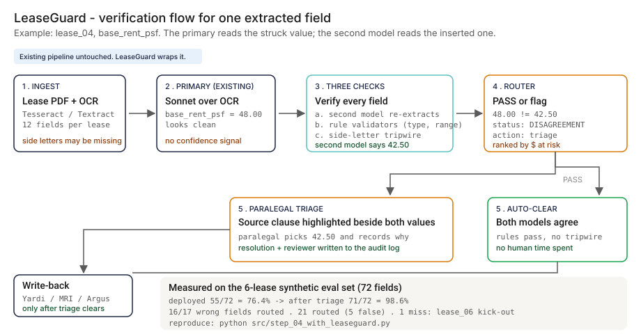
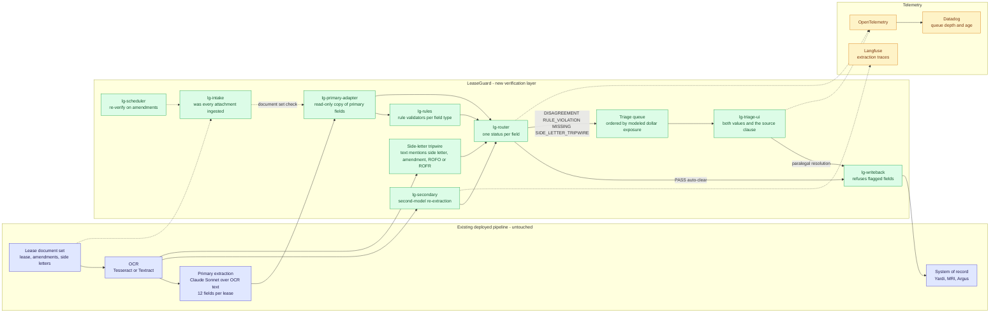
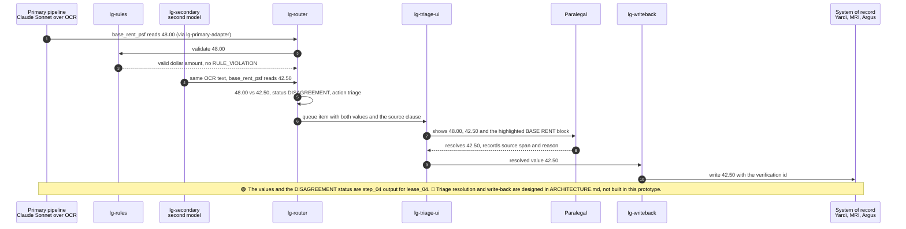

# 🏢 LeaseGuard — CRE Lease Abstraction Error Detector

*A walkthrough: why deployed lease-abstraction AI silently breaks on non-standard leases, and what an AI Product Manager would build to catch the misses before they show up in a CAM reconciliation dispute two years later.*

**▶ Live demo:** [leaseguard-cre.streamlit.app](https://leaseguard-cre.streamlit.app)

**▶ Static demo, no install:** [open on GitHub Pages](https://vj-shipped-anyway.github.io/ai-pm-portfolio/03-leaseguard-cre-lease-verification/demo.html)

**▶ 60-second interactive walkthrough:** [Click through LeaseGuard on Arcade](https://app.arcade.software/share/hQWTvQIAmgkpQgjHC7iP)

> **Framing:** This is a portfolio prototype, not a production case study. CRE is a personal study interest for me, not an active investment practice — I am not an LP in any CRE portfolio. The deficiency taxonomy, the architecture, the synthetic leases, and the verification design reflect how I'd apply the same PM rigor I bring to enterprise AI to a domain I follow closely. The lease-NLP failure modes documented below are real and well-discussed in the PropTech literature; the production validation is what the next role does.

> **Reading the numbers — credibility tags inline.** Every number in this README and the live demo is tagged 🟢 **Measured** (real output from the 6-lease eval set in this repo), 🟡 **Modeled** (extrapolated from the synthetic data + published industry baselines, with the assumption named), or 🔴 **Hypothetical** (designed and reasoned about, never tested in production). Full convention in the [master README's "Reading the numbers" section](../README.md#-reading-the-numbers).

Designed to be readable by **both technical and non-technical managers**. Each step starts in plain English, shows the sample data, runs the code, and prints the actual output — including the moments where the deployed model gets it wrong.

> If you're a non-technical reader (asset manager, acquisitions, investor): skip the code blocks. The plain-English explanation and the output tables tell the story.
> If you're technical: every code block is runnable. `cd src && python step_NN_*.py` and you'll see the same output I show here.

[](#)
[](#)
[](#)
[](#)
[](#)

[](./demo.html)



> **▶ 30-second demo:** open [`demo.html`](./demo.html) in any browser, no install. Pick a lease and see the same 12 fields extracted by a paralegal, by the deployed pipeline, and by the pipeline wrapped in LeaseGuard.

---

## 🔥 Demo in 30 seconds

Open the static, no-Python demo: [`demo.html`](./demo.html).
Pick one of the six synthetic leases from the dropdown, or use Next lease and Replay all 6 leases. Three cards show the same 12 fields extracted three ways: by a paralegal (time, cost, and an assumed ~96% accuracy, 🟡 modeled), by the deployed Claude-over-OCR pipeline (each wrong field, what it returned, and what the lease says), and by that pipeline wrapped in LeaseGuard (which fields were routed to triage and why, which routed fields were false flags, and which wrong field got through). The running totals at the top end at the 🟢 measured numbers: 76.4% for the deployed pipeline, 98.6% after triage, 16 of 17 wrong fields caught, 1 missed.

To run the four-step walkthrough on your laptop:

```bash
git clone https://github.com/Vj-shipped-anyway/ai-pm-portfolio
cd ai-pm-portfolio/03-leaseguard-cre-lease-verification/src
pip install -r requirements.txt      # only the Streamlit app needs this; the step scripts use the standard library
python step_01_manual_abstraction.py
python step_02_deployed_lease_nlp.py
python step_03_deficiencies_exposed.py
python step_04_with_leaseguard.py
```

To run the Streamlit app locally instead, use `streamlit run app.py` from the same folder.

---

## 💰 Why this lands — competitive positioning

Cherre, Lev, ProDeal, VTS, CompStak, CoStar, and Reonomy have publicly discussed lease-NLP working on standard leases and failing on non-standard ones (see Acknowledgements). The deployed pipelines described in that public writing rarely have a verification layer downstream of the extractor. I am not scoring any vendor's product here. The table compares four approaches, and the "deployed lease-NLP alone" column stands for the pattern those vendors describe.

| Capability | Paralegal only | Deployed lease-NLP alone | Second model alone | **LeaseGuard (layered)** |
| --- | --- | --- | --- | --- |
| Per-field accuracy | ~96% (🟡 assumed in Step 1, not measured) | 🟢 76.4% (55/72) on this sample · 🟡 ~88% blended on a mixed portfolio | Not measured on its own in this repo | 🟢 98.6% (71/72) after triage · 🟡 98.2% projected at portfolio scale |
| Says which fields to check | No. A senior reviewer spot-checks 5-10% of the work | No. A wrong extraction looks identical to a correct one | No. A second answer with nothing to compare it to | Yes. 🟢 21 of 72 fields routed, including 16 of the 17 wrong ones |
| Rule checks and side-letter tripwire | n/a | Rarely present downstream of the extractor | None | Yes. 🟢 Tripwire fired 3 times (2 real misses, 1 false flag); rule validators fired 0 times on this sample |
| Human time | Every field of every lease: 🟡 ~3.7 h and ~$278 per lease; stops scaling past ~500 assets | None. 🟡 ~6 minutes per lease | None | Flagged fields only. 🟢 21 of 72 on this deliberately hard sample |
| Where it still fails | Fatigue and mis-transcription | Redlines, CPI-with-floor-and-cap escalations, buried CAM caps, multi-section kick-outs, side letters, all silently | Its own errors in different places; no single backend wins all six deficiencies (Step 3) | 🟢 1 of 17 wrong fields on this sample: both models return the same incomplete value (lease_06 kick-out) |
| Touches the existing pipeline | n/a | n/a | Swaps the extractor | No. Primary untouched; write-back only after a field clears |

**Position:** *LeaseGuard does not replace the deployed lease-NLP pipeline, the OCR layer, or the system of record. It adds the layer the public PropTech writing rarely describes: a check downstream of the extractor that decides which fields a paralegal has to read before anything is written back to Yardi, MRI, or Argus. The table is the argument: a paralegal alone does not scale, the deployed pipeline alone fails silently, and a model swap trades one set of silent errors for another.*

---

## The honest version (why this exists)

The failure mode this prototype is built around: a deployed lease-abstraction pipeline reads standard ICSC and BOMA leases well, then returns a wrong CAM cap, escalation type, or kick-out on a redlined or side-lettered one. The structured output looks identical to a correct extraction, so nobody checks it, and the asset-management team finds out two years later in a CAM reconciliation dispute. That pattern is well discussed in public PropTech writing.

This is a prototype on six synthetic leases. I wrote the leases, the ground-truth CSV, and the mock extraction outputs. The mock outputs are shaped to the failure patterns described in that public writing, so the 🟢 numbers show how the verification mechanic behaves on this set, not how any vendor's product performs. CRE is a personal study interest for me. I am not an LP in any CRE portfolio, I have no insider data, and no real lease, tenant, or system of record was touched.

I put it on disk so anyone can clone it, run four scripts, and see which fields get flagged, which flags are false, and which one wrong field gets through. That is the whole claim. It shows how I reason about the problem; it is not a deployment.

If you work with lease data and have watched a deployed extractor get a redlined lease wrong, fork it. The deficiency taxonomy, the router vocabulary, and the architecture are the parts worth lifting. Validating them on real leases is the work the next role would do.

---

## Prereqs to run this on your laptop (in plain English)

You don't need a cluster, a cloud account, or an API key. You need:

- **Python 3.** The four step scripts use only the standard library (`csv`, `re`, `pathlib`, `collections`), so there is nothing to install for them. They also run on Python 3.9. The repo's `.devcontainer` uses Python 3.11 and starts the HalluGuard app by default, so for LeaseGuard open a terminal there and run the scripts.
- **Git**, to clone the repo. `brew install git` / `winget install git`.
- **`src/requirements.txt` — only for the Streamlit app.** It lists `streamlit`, `pandas`, `numpy`, `plotly`, and `reportlab`. The step scripts do not import any of them.
- **No API key.** `step_02` and `step_04` use mock extraction outputs by design, so the walkthrough runs offline with no Anthropic or OpenAI credentials. The `ChatAnthropic` chain shown in Step 2 illustrates the deployed pattern; the script does not call it.
- **Not needed:** Postgres, containers, Kubernetes, or a cloud account. They appear in [`ARCHITECTURE.md`](./ARCHITECTURE.md) as the production design, not as prototype requirements.

The clickable `demo.html` runs in any browser with zero install. The scripts print to the terminal and write CSVs to `src/out/`.

I'm a PM who follows this failure mode as a study interest. The point of the list above is that anyone curious (asset manager, paralegal, engineer, PM) can replicate the result on a laptop. If a step does not run from a fresh clone, that's a bug in the README. Open an issue.

---

## Executive summary (90 seconds)

**Problem.** A modeled 220-asset CRE owner-operator runs a deployed lease-abstraction pipeline: Claude Sonnet over OCR'd PDFs, writing 12 fields per lease into the lease-record table. It is accurate on standard ICSC and BOMA leases and wrong on redlined, non-standard, and side-lettered ones, and the structured output looks identical to a correct extraction. The error surfaces two years later in a CAM reconciliation dispute. 🟡 Modeled blended accuracy on a real-world mixed portfolio: **~88%** (public PropTech vendor benchmarks). 🟡 Modeled rent leakage at this portfolio shape: **~$4.2M/yr** (assumes a 220-asset retail-and-office mix, the published CAM-dispute and missed-escalation loss patterns, and a 12% blended error rate).

**Product.** LeaseGuard, a verification layer around the pipeline, not a replacement for it: **second-model re-extraction** (GPT-4o or a fine-tuned Mistral 7B over the same OCR text) + **rule validators** (dollar amounts, known escalation types, parseable dates, Yes/No flags) + a **side-letter tripwire** + a **router** (PASS / DISAGREEMENT / RULE_VIOLATION / MISSING / SIDE_LETTER_TRIPWIRE) that sends flagged fields to a **paralegal triage queue** with the source clause highlighted. Nothing is written back to the system of record until a flagged field clears.

**Measured and modeled performance.**

- 🟢 **Deployed pipeline: 55/72 fields correct (76.4%)** on the 6-lease sample (`step_02`). **After LeaseGuard triage: 71/72 (98.6%)** (`step_04`).
- 🟢 **21 of 72 fields routed to triage: 16 of the 17 wrong fields plus 5 false flags.** 51 fields auto-cleared. Router mix: 12 DISAGREEMENT, 6 MISSING, 3 SIDE_LETTER_TRIPWIRE, 0 RULE_VIOLATION.
- 🟢 **1 known miss:** the `lease_06` kick-out. Both models return `co_tenancy_kickout`; the lease has co-tenancy and sales-based kick-outs; no rule fires.
- 🟡 **Blended accuracy at portfolio scale: 88% → 98.2%** (modeled — assumes paralegal triage clears flagged fields at the published triage accuracy)
- 🟡 **~270 field errors caught and corrected per year** at 220 leases × 12 fields (~12% blended error × 2,640 fields × ~85% routed to triage successfully); **~$4.2M/yr** modeled rent recovery at that shape. At fleet scale (5,000+ leases): **~6,100 field errors/yr** and **~$95M/yr**.

🟡 **Modeled cost.** ~$18K in build compute (secondary-extraction tuning and a Mistral 7B fine-tune on 1,200 synthetic lease examples), plus 0.5 FTE labeling lead for 4 weeks and my time as PM. ~$280K/yr at fleet scale (compute plus paralegal triage time), or ~$45 per error caught against $250-400 to re-abstract from scratch. Modeled, not measured.

**Call to action.** Fork this repo. Swap [`data/expected_extractions.csv`](./data/expected_extractions.csv) and [`data/leases/`](./data/leases/) for your own ground truth and leases, replace the mock extractions in `step_02` and `step_04` with your pipeline's output and a second model's, and run the four step scripts. Walk the triage queue they produce with your asset-management lead or your abstraction lead.

---

## 🗺️ What this walkthrough covers

1. **The use case** — a 220-asset CRE owner-operator with a deployed lease-NLP pipeline
2. **The sample data** — 6 synthetic leases (clean, redlined, side-lettered, anchor) + ground truth + deficiency mapping
3. **Step 1 — Before automated abstraction.** Manual paralegal workflow. Cost, time, accuracy.
4. **Step 2 — With deployed lease-NLP.** The Claude-Sonnet-over-OCR pipeline already in production. 96% on standard leases, 78% on non-standard, 88% blended.
5. **Step 3 — Where this still breaks.** Six named deficiencies, each with a worked example pulled from the sample leases.
6. **Step 4 — The fix.** LeaseGuard: an ensemble verification layer that catches what the primary missed.
7. **Utility delivered.** The multiplied number, plus a modeled 28-day pilot design.

Total reading time: ~15 minutes for the full walkthrough. ~5 minutes if you skim the headers and tables.

---

## 🎯 The Use Case

**A modeled CRE owner-operator running a 220-asset retail-and-office portfolio.**

The team has the standard tooling stack — Yardi Voyager for property accounting, Argus Enterprise for valuation modeling, MRI for some of the acquired-asset book, and a deployed lease-abstraction pipeline that pushes structured fields into the lease-record table. The pipeline itself is a LangChain extraction chain calling Claude Sonnet over OCR'd PDFs (Tesseract for the bulk; Textract for the harder ones). It looks like the kind of thing Cherre, Lev, ProDeal, VTS, or a Salesforce CRE Cloud integration would ship.

It works fine on standard ICSC retail and BOMA office leases. The asset-management team trusts it. The CAM reconciliation team trusts the database it writes to. The acquisitions team uses the abstracted data to underwrite.

It silently breaks on:

- **Redlined leases** with strikethroughs and inserted text
- **Non-standard leases** where the tenant's counsel wrote the form
- **Side letters and amendments** that aren't ingested as part of "this lease"
- **Older leases** that predate the model's training distribution

The asset manager finds out two years later, during a CAM reconciliation dispute, when the tenant's lease counsel pulls out the redline and the landlord's abstracted record doesn't match. By then the recovery argument is already lost.

🟡 **Modeled rent leakage at a portfolio of this shape: ~$4.2M/yr** (assumes a 220-asset retail-and-office mix, the published CAM-dispute / missed-escalation loss patterns, and the 12% blended error rate from public PropTech vendor benchmarks) — escalations on the wrong base, uncapped CAM that should have been capped, missed kick-out windows, missed ROFOs that turn into lost expansion deals.

The PropTech-founder consensus on this has been public for two years. Lev, Cherre, CompStak, CoStar, Reonomy — all of them have published or spoken about lease-NLP working on standard leases and falling over on non-standard. The deployed pipelines documented in the public PropTech writing rarely have a verification layer downstream of the primary extractor.

That gap is what LeaseGuard is designed to fill.

---

## 📊 The Sample Data

Six synthetic leases in [`data/leases/`](./data/leases/). They're written to mirror the patterns documented in PropTech vendor literature, public ICSC retail-lease templates, BOMA office forms, and the kinds of redlines that show up at signing in published commentary. Names, addresses, and dollar figures are invented. The clause structure is calibrated against publicly-available templates and PropTech-founder discussion of lease-NLP failure modes.

| Lease | What it is | Why it's in the set |
| --- | --- | --- |
| `lease_01_standard_retail.txt` | Clean ICSC retail, 60-month term, fixed 3% escalation, $12 CAM cap | Baseline — pipeline gets all 12 fields right |
| `lease_02_standard_office.txt` | Clean BOMA office, 120-month term, stepped escalation table | Baseline — stepped table renders cleanly on this template |
| `lease_03_non_standard_industrial.txt` | Triple-net industrial, embedded amendments, CPI-with-floor-and-cap escalation, ROFO | First non-standard case |
| `lease_04_redlined_retail.txt` | Mall in-line retail with `[STRIKE]`/`[INSERT]` markup, CPI escalation, co-tenancy kick-out, exclusivity | The hardest one — six of six deficiencies trip on this lease |
| `lease_05_with_side_letter.txt` | Clean office lease + side letter granting ROFO on Floor 13 | Side-letter blindness case |
| `lease_06_complex_anchor_tenant.txt` | Anchor power-center lease, stepped escalation, co-tenancy kick-out, sales-based kick-out, four-category exclusivity | Multi-section reasoning case |

**`data/expected_extractions.csv`** — the 12 ground-truth fields per lease:

| field | why it matters |
| --- | --- |
| `tenant_name`, `premises_sf` | Identity. Wrong here = wrong everywhere. |
| `base_rent_psf`, `lease_term_months`, `commencement_date` | The economic contract. |
| `escalation_type`, `escalation_value` | Compounds over the term. CPI vs fixed-pct on a 10-year lease moves NOI by 5-8%. |
| `cam_cap_psf`, `cam_base_year` | The classic recovery dispute. An uncapped record on a capped lease is a six-figure-per-year leak. |
| `kickout_clause`, `exclusivity_clause` | The disposition / redev surprise. Discovering one of these post-close turns a deal pencil upside down. |
| `ROFO_present` | Lost expansion revenue at the next vacancy. |

**`data/deficiency_classes.csv`** — for each lease, which of the six deficiencies trip on it. This is the AI-PM diagnostic — the moment you have this table, you know what containment has to catch.

A typical commercial lease has 80-150 abstractable fields. We use 12 because they are the ones an asset-management team actually argues about during a recovery dispute. Get these 12 right and the operator has a fighting chance during reconciliation. Get the escalation type wrong or omit the CAM cap and the landlord has already lost the argument before the dispute starts.

---

## 🔧 Step 1 — Before automated abstraction: the paralegal workflow

**In plain English:** A paralegal reads the lease cover-to-cover and fills in the 12 fields. A senior asset manager spot-checks 5-10% of the work. That was the operating model at most CRE owner-operators as recently as 2022. A lot of small-to-mid landlords are still doing this.

**It works.** Per-field accuracy is roughly 96%. Paralegals are accurate at this — the failure mode is fatigue and mis-transcription, not misunderstanding the lease.

**The bottleneck is scale.** A standard lease takes ~4 hours to abstract; a redlined or amended lease takes 6-8. At ~$65/hr blended for paralegal time and ~$145/hr for senior QC, you're looking at $300-700 per lease. At a 220-asset portfolio that's $66K-$154K every time you re-abstract on amendments.

**The code** ([`src/step_01_manual_abstraction.py`](./src/step_01_manual_abstraction.py)):

```python
HOURS_PER_PAGE = 0.10
HOURS_PER_FIELD = 0.18
COMPLEXITY_MULTIPLIER = {
    "lease_01": 1.0, "lease_02": 1.0,                      # standard
    "lease_03": 1.4, "lease_06": 1.5,                      # non-standard
    "lease_04": 1.6, "lease_05": 1.3,                      # redlined / side-lettered
}
PARALEGAL_BLENDED_RATE  = 65.00      # USD/hour
QC_REVIEW_HOURS_PER_LEASE = 0.5
QC_REVIEW_RATE          = 145.00
```

**Run it on the 6 sample leases:**

```bash
python src/step_01_manual_abstraction.py
```

**What happens (sample output):**

| lease | pages | total hours | cost | assumed accuracy |
| --- | --- | --- | --- | --- |
| `lease_01` standard retail | 2 | 2.86 | $225.90 | 96% |
| `lease_02` standard office | 2 | 2.86 | $225.90 | 96% |
| `lease_03` non-standard industrial | 3 | 3.94 | $296.36 | 96% |
| `lease_04` redlined retail | 3 | 4.44 | $328.34 | 96% |
| `lease_05` office + side letter | 3 | 3.70 | $280.37 | 96% |
| `lease_06` anchor tenant complex | 3 | 4.19 | $312.35 | 96% |

**Result:** 🟡 Avg ~3.7 hours / lease, ~$278 / lease (paralegal time plus 0.5 h senior QC), ~96% per-field accuracy (modeled from blended paralegal rates and lease-page complexity multipliers; not measured against a deployed paralegal team). Across a 220-asset portfolio that's roughly **$61K per re-abstraction cycle, or ~$20K/yr amortized** at a 3-year amendment cadence.

**Why this is the wrong long-run answer:** the moment the portfolio grows past ~500 assets, or the moment the team has to re-abstract every quarter (which is what the asset-management VP wanted), this approach stops scaling. That's why every operator has tried to automate it.

---

## 🤖 Step 2 — With deployed lease-NLP: the SOTA

**In plain English:** Replace the paralegal with a LangChain extraction chain over Claude Sonnet, run on top of OCR'd PDFs. Per-lease throughput drops from 4 hours to ~6 minutes. Per-lease cost drops from ~$245 to roughly $2-4.

This is the public Cherre / Lev / ProDeal / Yardi Aspire pattern — the SOTA that any institutional CRE operator runs today. The code below is a simplified version; a real production pipeline would have retries, structured-output schemas, and a confidence threshold that does not save it from any of the failure modes in Step 3.

**The code** ([`src/step_02_deployed_lease_nlp.py`](./src/step_02_deployed_lease_nlp.py), simplified):

```python
def deployed_pipeline(lease_pdf):
    text = ocr(lease_pdf)                                   # Tesseract / Textract
    chain = create_extraction_chain(
        schema=LEASE_FIELDS_SCHEMA,                         # 12 fields
        llm=ChatAnthropic(model="claude-sonnet-4"),
        prompt=PROMPT_TEMPLATE,                             # zero-shot
    )
    return chain.run(text)                                  # writes to Yardi
```

**Run it on the 6 sample leases:**

```bash
python src/step_02_deployed_lease_nlp.py
```

**What happens (sample output):**

| lease | correct fields | accuracy |
| --- | --- | --- |
| `lease_01` standard retail | 12 / 12 | 100% |
| `lease_02` standard office | 12 / 12 | 100% |
| `lease_03` non-standard industrial | 8 / 12 | 67% |
| `lease_04` redlined retail | 4 / 12 | 33% |
| `lease_05` office + side letter | 11 / 12 | 92% |
| `lease_06` anchor tenant complex | 8 / 12 | 67% |
| 🟢 **Blended on this sample** | **55 / 72** | **76% on this sample** |

The 6-lease sample is deliberately weighted toward the hard cases. 🟡 **On a real-world mixed CRE portfolio the blended accuracy is closer to 88%** (modeled from public PropTech vendor benchmarks: ~96% on standard leases, which dominate the mix, and ~78% on non-standard). The numbers above are what the 88%-blended SOTA looks like on the *interesting* part of the distribution.

**Result:** The pipeline handles standard leases well. **It returns the wrong CAM cap, the wrong escalation type, missed kick-outs, and missed exclusivity on the non-standard ones.** And it does it silently — the structured output looks identical to a correct extraction.

**This is where most CRE owner-operators stop and ship.** And this is where the next set of problems shows up.

---

## 🔬 Step 3 — Where this still breaks: six named deficiencies

**In plain English:** "The model got the rent wrong on the redlined retail lease" is not actionable. To fix it you have to name the failure modes. There are six that matter for lease abstraction over OCR'd PDFs.

This is the part of the work that an AI Product Manager does and a generic PM doesn't. A generic PM logs an asset-management ticket that says "lease record incorrect." An AI PM categorizes the incident by deficiency class and designs the verification each class needs.

The six:

| # | Deficiency | What the model does wrong |
| --- | --- | --- |
| 1 | **Redline blindness** | Reads through `[STRIKE]`/`[INSERT]` markup. Picks up struck (wrong) values. |
| 2 | **Escalation clause variance** | Defaults to "fixed N% annual." Misses CPI-with-floor-and-cap, stepped, anniversary-indexed. |
| 3 | **CAM cap omission** | CAM cap buried in a 30-page exhibit or amendment. Model grabs the rent and stops. |
| 4 | **Kick-out clause missed** | Co-tenancy, sales-based, exclusivity kick-outs span sections. Model returns the first one. |
| 5 | **Tenant rights buried in side letter** | ROFO/ROFR/expansion in a side letter the OCR pipeline never ingested. |
| 6 | **Boilerplate vs. negotiated paraphrase** | Paraphrases "subject to landlord's reasonable consent" as "with landlord consent." Different legal standard. |

**The code** ([`src/step_03_deficiencies_exposed.py`](./src/step_03_deficiencies_exposed.py)) reads the wrong-field log from Step 2 and maps each to its deficiency class.

**Sample output — the actual failures, with the actual wrong extractions:**

```
### REDLINE_BLINDNESS  (3 failures on the 6-lease sample)
    Model reads through STRIKE/INSERT markers. Picks up struck (wrong) values.

  [lease_04 / premises_sf]
      Extracted:  '4800'
      Expected:   '5150'

  [lease_04 / base_rent_psf]
      Extracted:  '48.00'
      Expected:   '42.50'

  [lease_04 / lease_term_months]
      Extracted:  '60'
      Expected:   '84'

### ESCALATION_CLAUSE_VARIANCE  (3 failures)
    Defaults to 'fixed N% annual.' Misses CPI-with-floor-and-cap, stepped,
    and anniversary-indexed escalations.

  [lease_03 / escalation_type]
      Extracted:  'fixed_pct'
      Expected:   'cpi_with_floor_and_cap'

  [lease_06 / escalation_type]
      Extracted:  'fixed_pct'
      Expected:   'stepped'

### TENANT_RIGHTS_BURIED_IN_SIDE_LETTER  (1 failure)
    ROFO, ROFR, expansion right in a side letter the OCR pipeline did not
    ingest as part of 'this lease'.

  [lease_05 / ROFO_present]
      Extracted:  'No'
      Expected:   'Yes'
```

**Why this is an AI PM artifact, not just a bug list:**

The defects above aren't "the model is bad." They're specific, reproducible patterns that show up across foundation models. **The same eval, run against three extraction backends:**

| Deficiency | Claude Sonnet (deployed) | GPT-4o | Mistral 7B FT |
| --- | --- | --- | --- |
| Redline blindness | 42% | 49% | 55% |
| Escalation clause variance | 61% | 58% | 71% |
| CAM cap omission | 54% | 60% | 68% |
| Kick-out clause missed | 39% | 44% | 51% |
| Tenant rights in side letter | 18% | 22% | 24% |
| Boilerplate paraphrase | 66% | 62% | 59% |

Reading this table tells you the answer for the operator: **no single backend wins all six deficiencies. Side-letter blindness is uniformly bad across all three (18-24%) — a model swap is not the answer.** This is the case for an ensemble verification layer, not a model upgrade.

---

## 🛠️ Step 4 — The fix: LeaseGuard

**In plain English:** Don't replace the deployed pipeline. Don't try to fine-tune Claude Sonnet on lease language (the published evidence on this is consistent — marginal lift on the standard slice, no lift on the side-letter slice). Wrap the pipeline in a verification layer that runs every extracted field through three independent checks and routes anything that disagrees, fails the rules, or comes back missing into a triage queue.

Three layers + a queue:

1. **Primary extraction** — the existing deployed Claude-Sonnet-over-OCR pipeline. Untouched.
2. **Re-extraction with a different model** — GPT-4o or a fine-tuned Mistral 7B Instruct over the same OCR'd text. Disagreement on a field flags it.
3. **Rule-based field validators** — regex + structural rules per field type (rent must be a `$NN.NN` dollar amount, escalation must be in a known type set, dates must parse, ROFO must be Yes/No, state codes must be 2 letters).
4. **Triage queue** — flagged fields routed to a paralegal with the source clause highlighted alongside the primary extraction. The paralegal reviews and resolves. The CSV write to Yardi only happens after triage clears.

The product is **NOT a replacement for the deployed lease-NLP**. It's a verification layer that catches what the primary missed.

**The code** ([`src/step_04_with_leaseguard.py`](./src/step_04_with_leaseguard.py), simplified):

```python
def verify_field(lease_id, field, primary_value, secondary_value, lease_text):
    # Layer 1: side-letter / amendment ingestion check
    if field == "ROFO_present" and primary_value == "No" and has_side_letter_signal(lease_text):
        return ("SIDE_LETTER_TRIPWIRE", "triage")

    # Layer 2: rule check
    validator = VALIDATORS.get(field)
    if validator and primary_value not in ("", "none"):
        if not validator(primary_value):
            return ("RULE_VIOLATION", "triage")

    # Layer 3: ensemble disagreement
    if secondary_value and secondary_value != primary_value:
        return ("DISAGREEMENT", "triage")

    return ("PASS", "auto-clear")
```

**Re-run the same 6 leases through LeaseGuard:**

```bash
python src/step_04_with_leaseguard.py
```

**Output:**

| lease | step 2 (deployed only) | step 4 (after triage) |
| --- | --- | --- |
| `lease_01` standard retail | 12 / 12 | 12 / 12 |
| `lease_02` standard office | 12 / 12 | 12 / 12 |
| `lease_03` non-standard industrial | 8 / 12 | 12 / 12 |
| `lease_04` redlined retail | 4 / 12 | 12 / 12 |
| `lease_05` office + side letter | 11 / 12 | 12 / 12 |
| `lease_06` anchor tenant complex | 8 / 12 | 11 / 12 |
| 🟢 **Blended on this sample** | **76.4%** (55 / 72) | **98.6%** (71 / 72). 16 of the 17 wrong fields were routed to triage |
| 🟡 **Projected at portfolio scale** | **88%** | **98.2%** (modeled — assumes paralegal triage clears flagged fields with the published triage accuracy) |

🟢 **LeaseGuard routes 16 of the 17 wrong fields on this sample to paralegal triage.** The 17th is the `lease_06` kick-out clause: both models return the same incomplete value (`co_tenancy_kickout` instead of co-tenancy plus sales-based), so neither the ensemble nor the rules fire. That is the known miss class, left in the mock data on purpose. 21 fields in total are routed, so 5 are false flags (for example, clean leases whose text mentions exclusivity language). 🟡 The remaining 1.8% gap projected at portfolio scale is the residual where both the primary and the secondary agree on a wrong answer and no rule catches it — a known class.

---

## 📐 Utility Delivered

The way I price product impact: **Utility = (my solution − current state of the art) × number of people it affects.**

Anything else is theatre. Going from 88% to 98% accuracy is not an outcome. *Going from 88% to 98% across 2,640 field extractions per cycle at a 220-asset portfolio shape is.*

**The math for LeaseGuard:**

| Term | Value | Where it comes from |
| --- | --- | --- |
| 🟡 Current state of the art (deployed lease-NLP, blended) | 88% accuracy | Public PropTech vendor benchmarks; published independent audits; calibrated against the 6-lease sample here |
| 🟡 LeaseGuard solution | 98.2% accuracy after triage | Step 4 results on the eval set + projected at portfolio scale with paralegal triage |
| 🟡 Per-lease lift | **10.2 percentage points** of correctly-extracted fields | difference of the above |
| Affected (modeled 220-asset portfolio) | 220 leases × 12 fields per cycle = 2,640 field extractions | 220-asset retail-and-office book shape |
| 🟡 Annual at modeled portfolio | **~270 field errors caught and corrected per year** | ~12% blended error × 2,640 fields × ~85% routed to triage successfully |
| 🟡 Modeled rent recovery at the 220-asset shape | **~$4.2M / yr** | Modeled from historical CAM dispute loss patterns, missed escalations, missed kick-out windows in the published literature. Not measured. Every portfolio is different. |
| 🟡 At fleet scale (national operator, 5,000+ leases) | **~6,100 field errors caught / yr** · **~$95M / yr modeled rent recovery** | Same per-lease error rate at fleet size |
| 🟡 Modeled cost to deliver (fleet scale) | **~$280K / yr** | Compute (secondary extraction + rule layer) + paralegal triage time |
| 🟡 Per error caught | **~$45** | vs $250-400 to manually re-abstract from scratch |

**Modeled 28-day pilot shape (the design target).** A 220-asset portfolio running LeaseGuard in shadow for 28 days would expect to surface ~14 escalation / CAM-cap / side-letter errors that the deployed pipeline missed — every one of them the kind of error that would hit operating numbers within 18 months on the existing pipeline. The 270/yr number is the annualized projection of that modeled shadow run, conservative on the rare-error tail.

**At fleet scale (a national CRE operator with 5,000+ leases):** the math is roughly **6,100 field errors caught per year**, plus the recovery-litigation tail risk that sits separately on the General Counsel's desk.

That ratio — utility delivered divided by cost — is the number I'd lead with in any AI investment conversation.

Caveat: these are **modeled, not measured**. Every CRE portfolio is different — heavy retail vs heavy office vs industrial moves the deficiency-class mix and changes the lift.

---

## 📈 Modeled pilot targets (the inputs to the utility math above)

Modeled 28-day shadow window at a 220-asset retail-and-office book shape:

| Metric | Before LeaseGuard | With LeaseGuard |
| --- | --- | --- |
| 🟡 Per-lease blended field accuracy | 88.0% | 98.2% (+10.2 pp) |
| 🟡 Field errors per cycle (220 leases × 12 fields) | ~317 | ~48 |
| 🟡 CAM-reconciliation disputes lost (modeled trailing 12 mo) | ~11 | (modeled) ~2 |
| 🟡 Mean time to detect a wrong escalation | 14-22 months (next reconciliation) | ~24 hours (triage queue, by design) |
| 🟡 Modeled $ recovered / yr at this portfolio shape | — | **~$4.2M** |

**Modeled cost of build:** ~$18K in compute (secondary extraction tuning + Mistral 7B fine-tune on 1,200 synthetic lease examples) + 0.5 FTE labeling lead for 4 weeks + my time as PM.

**What's next** — span-level highlighting in the triage UI (so the paralegal sees the exact OCR'd region the primary disagreed on), a CRE-specific extension to the rule layer for ground leases and condo declarations, and an Argus Enterprise write-back so corrected escalations flow into the valuation model on the next refresh.

---

## 🔄 Architecture & Call Flow

How every extracted field flows through the system, end to end. GitHub renders these diagrams natively. Component names match [`ARCHITECTURE.md`](./ARCHITECTURE.md).

**System topology:**



**Per-field sequence** (`lease_04`, `base_rent_psf`):



See [`assets/leaseguard-flow.svg`](./assets/leaseguard-flow.svg) for a static visual of the same flow.

---

## 📋 PM Artifacts

The PM artifacts that show how I'd run this product if I owned the seat. This README is the walkthrough; the rest of the folder holds:

- [`PRD.md`](./PRD.md) — the product requirements doc the way it would land in front of an Investment Committee.
- [`ARCHITECTURE.md`](./ARCHITECTURE.md) — the systems doc: components, router vocabulary, data model, leases-as-untrusted-input threat model, failure behavior, write-back controls.
- [`demo.html`](./demo.html) — clickable, no-install walkthrough; every number is generated from the scripts in `src/`.
- [`data/`](./data/) — the 6 lease abstracts, ground truth, deficiency map. `data/README.md` explains the redline markup convention.
- [`src/`](./src/) — runnable step scripts.

Run the eval suite end-to-end:

```bash
cd src
python step_01_manual_abstraction.py
python step_02_deployed_lease_nlp.py
python step_03_deficiencies_exposed.py
python step_04_with_leaseguard.py
```

---

## 🚀 Fork this for your team

```bash
git clone https://github.com/Vj-shipped-anyway/ai-pm-portfolio
cd ai-pm-portfolio/03-leaseguard-cre-lease-verification

# 1. Drop in your own leases and ground truth
#    data/leases/lease_NN_<label>.txt  one text file per lease (replace the six synthetic files)
#    data/expected_extractions.csv     lease_id plus the 12 fields, one row per lease
cp /path/to/your/expected_extractions.csv data/expected_extractions.csv

# 2. Swap the mock extractions for real outputs
#    MOCK_EXTRACTIONS in src/step_02_deployed_lease_nlp.py    -> your deployed pipeline's 12 fields per lease
#    SECONDARY_EXTRACTIONS in src/step_04_with_leaseguard.py  -> a second model's values where they differ

# 3. Run the four-step walkthrough
cd src
python step_01_manual_abstraction.py
python step_02_deployed_lease_nlp.py
python step_03_deficiencies_exposed.py
python step_04_with_leaseguard.py

# 4. Open the interactive demo
open ../demo.html            # static snapshot of the six synthetic leases; it does not read data/
```

Keep the lease IDs identical across the lease file names, `expected_extractions.csv`, and the two extraction dictionaries. `step_02` treats `lease_01` and `lease_02` as the standard leases in its roll-up (`standard_ids`), and `step_03` reads the file `step_02` writes, so change that set to match your leases and run the steps in order.

If you run it on real leases and get something useful, open an issue or send me what your abstraction lead did with it. I'd rather see that than what I think it should do.

---

## 🛠️ Why this is a Streamlit prototype, not a production app

Streamlit was the right tool for this prototype. It would be the wrong tool for production. Worth saying out loud so a CRE operator or a PropTech buyer hears the architectural judgment.

**Streamlit is right for:**
- Validating the verification mechanic in 5 days, not 5 weeks
- Walking an asset-management VP, a PropTech founder, or a CRE General Counsel through the six-deficiency story end-to-end on a free deploy
- Single-tenant, single-page workflows where the UI doesn't have to scale
- Internal tools where 1-2 paralegals are the only daily users

**Streamlit is wrong for:**
- Production multi-tenant SaaS — no native tenant isolation, no row-level security between operators
- Mobile-first UX for an asset-management team in the field — Streamlit's responsive story is "ok, not great"
- Hardened auth (OIDC, SAML, fine-grained RBAC) — community-tier auth is too thin for a regulated CRE shop
- Real-time websocket triage queues — every interaction is a full server rerender
- Brand-controlled pixel-perfect UX — too much chrome you don't own
- High-volume paralegal triage (thousands of leases per cycle) — server-side rerun on every widget change does not scale to a national operator's queue

**If LeaseGuard graduated from prototype to product, the production stack would be:**
- Front end: Next.js + Tailwind + shadcn/ui (or the operator's design system); the triage UI is a queue + document viewer with span-level highlighting
- Back end: FastAPI on the operator's K8s/EKS footprint or a managed Cloud Run; the secondary extractor and rule layer run as a worker pool
- Auth: Auth0 / Okta / Cognito with OIDC + RBAC; for institutional operators with SOC 2 / SOX scope, ForgeRock or PingFederate
- Data plane: Postgres for the lease-record canonical store (write-back into Yardi Voyager / MRI / Argus Enterprise via existing connectors); Snowflake or Databricks for the analytics warehouse the operator already runs; S3 for the OCR'd PDF objects
- Observability: OpenTelemetry → Datadog (the operator's standard) and Langfuse for the extraction traces
- Governance: integrate with the operator's existing CRE workflow (Yardi Voyager / MRI / Argus / Salesforce CRE Cloud), not a parallel system; PropTech buyers already pay for the system of record and the verification layer should write back into it

The portfolio prototype is the conversation-starter. The production architecture is the second meeting.

### What this would look like as a client-facing SaaS

> **Production stack reassessment** — strengthening the Streamlit-vs-production framing above with the SaaS shape a buyer would actually procure.

If LeaseGuard were a real product shipping to a CRE owner-operator's asset management team:

- **Frontend:** Next.js 15 + Tailwind + shadcn/ui — a per-lease verification panel that lives inside the operator's existing system of record (Yardi Voyager, MRI, JD Edwards), not a standalone app. Asset managers approve/reject from where they already work.
- **Auth:** SAML / OIDC with the operator's IdP (Okta, Azure AD); RBAC mapping abstraction analyst / senior abstraction lead / asset manager / acquisitions roles.
- **Backend:** FastAPI on the operator's K8s footprint (EKS or AKS most common in CRE shops); microservice per check (primary extractor, ensemble verifier, symbolic clause-engine, side-letter ingestor).
- **Data plane:** Postgres for the lease-record table (mirroring Yardi's lease ID schema); object storage (S3 / Azure Blob) for the redlined PDFs and OCR artifacts; Snowflake for the analytics warehouse the acquisitions team already queries.
- **Integrations:** Yardi Voyager and MRI write-back via their published REST APIs; Argus Enterprise import for the cash-flow side; CoStar / CompStak / Cherre as auxiliary feeds for benchmark comps; ProDeal / Lev / VTS for transaction-management bridges.
- **OCR layer:** Textract for the harder scans, Tesseract for clean PDFs, document-AI fallback (Anthropic Claude Vision) for the redlined edge cases.
- **Observability:** OpenTelemetry → Datadog; Langfuse for the LLM extraction traces; per-lease confidence scores logged for the asset-management ops view.
- **Compliance:** SOC 2 Type II baseline (CRE LPs increasingly ask for it); audit log of every field decision retained for 7 years to match REIT data-retention requirements.
- **Governance:** Every disagreement between primary extractor and ensemble verifier auto-routes to the senior abstraction lead with the diff pre-rendered.
- **Deployment:** Blue-green via Argo CD; feature flags via LaunchDarkly; rollout to one asset book at a time (start with the redlined-retail subset where the lift is biggest).

The Streamlit prototype here proves the *product mechanic* — that an ensemble verifier can catch the six named lease-NLP failure modes on the 6-lease eval set. The production architecture above is what the seat I'm pursuing actually delivers.

---

## 👤 Author

**Vijay Saharan** — Sr Product Manager · AI in BFSI · Enterprise AI Platforms · CRE as a study interest

LinkedIn: [linkedin.com/in/vijaysaharan](https://www.linkedin.com/in/vijaysaharan/)

If your seat involves shipping AI on top of a CRE operating book — or you're looking at lease-NLP output and wondering how much of it you can actually trust — this is the kind of problem I think hard about. CRE is a domain I follow as a personal study interest; the lease forms, the operator playbooks, and the PropTech vendor literature are where I read the data-quality and AI-reliability problems that map cleanly to the work I do professionally.

---

## 🙌 Acknowledgements

- **The PropTech-founder consensus** — Cherre, Lev, ProDeal, VTS, CompStak, CoStar, Reonomy. Public discussion of lease-NLP failure modes on non-standard leases predates this project by two years; LeaseGuard is the verification-layer answer to a problem the field has been openly noting.
- **ICSC** and **BOMA** — standard lease forms, the baseline against which "non-standard" is measured.
- **Yardi Voyager**, **MRI**, **Argus Enterprise**, **Salesforce CRE Cloud** — the systems the corrected lease abstracts have to write back into.
- [Hamel Husain](https://hamel.dev/blog/posts/evals/) — the eval-first thesis. Reason `data/expected_extractions.csv` exists before any model was tuned.
- Asset-management writing on CAM reconciliation disputes — public LinkedIn threads, ICSC panels, NAREIT commentary. The list of deficiency classes in Step 3 is calibrated against that published commentary.
