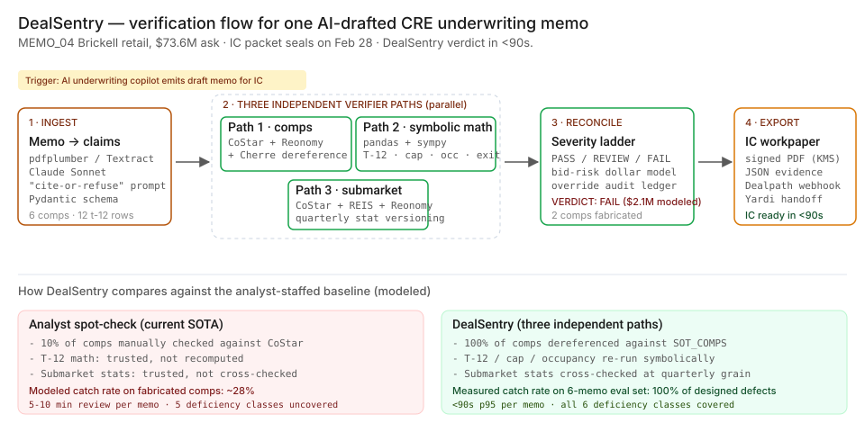
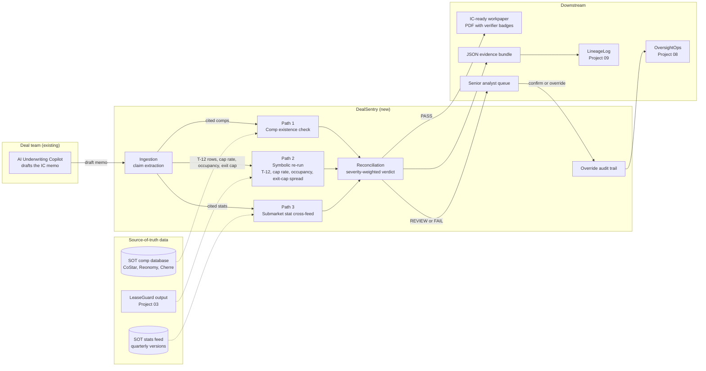
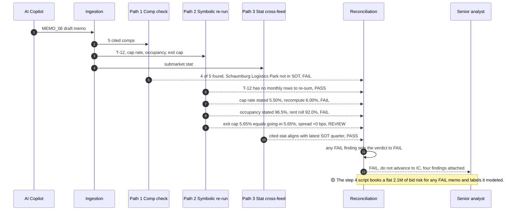

# 🏗️ DealSentry — CRE AI Underwriting Reliability

*A walkthrough: why AI-drafted CRE underwriting memos silently break on fabricated comps and rolling arithmetic errors, and what an AI Product Manager would build to catch the misses before the bid goes wrong by millions.*

**▶ Static demo, no install:** [open on GitHub Pages](https://vj-shipped-anyway.github.io/ai-pm-portfolio/10-dealsentry-cre-underwriting/demo.html)

> **Framing:** This is a portfolio prototype, not a production case study. CRE is a personal study interest for me, not an active investment practice — I am not an LP in any CRE portfolio. The deficiency taxonomy, the architecture, the synthetic SOT comps, and the verification design reflect how I'd apply the same PM rigor I bring to enterprise AI to a domain I follow closely. The AI-underwriting failure modes documented below are real and well-discussed in the PropTech literature; the production validation is what the next role does.

> **Reading the numbers — credibility tags inline.** Every number in this README and the live demo is tagged 🟢 **Measured** (real output from the 6-memo eval set in this repo), 🟡 **Modeled** (extrapolated from the synthetic data + published industry baselines, with the assumption named), or 🔴 **Hypothetical** (designed and reasoned about, never tested in production). Full convention in the [master README's "Reading the numbers" section](../README.md#-reading-the-numbers).

[](./data/sample_memos.csv)
[](./data/deficiency_classes.csv)
[](./data/sot_comps.csv)

[](./src/)

[](./demo.html)



> **▶ 30-second demo:** the [clickable demo](./demo.html) gets you the full story in 30 seconds with no install.

Designed to be readable by **both technical and non-technical managers**. Each step starts in plain English, shows the sample data, runs the code, and prints the actual output — including the moments where the deployed AI underwriting copilot gets it wrong.

> If you're a non-technical reader (acquisitions lead, asset manager, investor): skip the code blocks. The plain-English explanation and the output tables tell the story.
> If you're technical: every code block is runnable. `cd src && python step_NN_*.py` and you'll see the same output I show here.

---

## 🔥 Demo in 30 seconds

Open the static, no-Python demo: [`demo.html`](./demo.html).
Pick any of the six synthetic memos from the drop-down. The page lays three cards side by side: face-value trust, the 10% analyst spot-check, and the DealSentry three-path verifier, with the PASS / REVIEW / FAIL verdict and the result of each check (comp existence, T-12, cap rate, occupancy, exit cap, submarket stat). It opens on `MEMO_04`, the Brickell retail memo with two comps that do not exist in the source-of-truth table. *Previous*, *Next memo*, and *Run through all 6* step through the set. The page is a fixed walkthrough of the six memos, not a live run; the step scripts below produce the measured output.

To run the four-step walkthrough on your laptop:

```bash
git clone https://github.com/Vj-shipped-anyway/ai-pm-portfolio
cd ai-pm-portfolio/10-dealsentry-cre-underwriting/src
pip install -r requirements.txt   # only the Streamlit app needs this; the four step scripts use the standard library
python step_01_face_value_trust.py
python step_02_analyst_spotcheck.py
python step_03_deficiencies_exposed.py
python step_04_with_dealsentry.py
```

Each script prints its result to the terminal and writes a CSV to `src/out/`. Step 4 ends with the aggregate: 2 PASS, 1 REVIEW, 3 FAIL.

---

## 💰 Why this lands — competitive positioning

An AI-drafted memo reaches the IC chair one of three ways today: trusted at face value, spot-checked by a senior analyst, or run through a verifier. The table sets those three side by side, using what the step scripts print on the 6-memo set. **The gap is the deterministic layer between the copilot's draft and the analyst's limited time.**

| Capability on the 6-memo set | Face-value trust | Analyst spot-check (10%) | **DealSentry (three paths)** |
| --- | --- | --- | --- |
| 🟢 Cited comps looked up in the source-of-truth table | 0 of 31 | 6 of 31 (one per memo) | 31 of 31 (28 found, 3 not found) |
| 🟢 Fabricated comps flagged | 0 of 3 | 0 of 3 (fixed seed) | **3 of 3** |
| 🟢 T-12 monthly rows re-summed against the memo total | No | No | Yes (`MEMO_03`, the only memo with monthly rows: $60K drift flagged) |
| 🟢 Stated cap rate checked against a recompute | No | No | Yes (`MEMO_06`: 5.50% stated, 6.00% recompute) |
| 🟢 Stated occupancy checked against the rent roll | No | No | Yes (`MEMO_06`: 96.5% stated, 92.0% rent roll) |
| 🟢 Exit-cap spread checked against going-in cap | No | No | Yes (`MEMO_04` and `MEMO_06`: +0 bps, REVIEW) |
| 🟢 Stale submarket stat flagged | No | No | Yes (`MEMO_05`, REVIEW) |
| 🟢 Flawed memos (4) stopped or routed before IC | 0 of 4 | 0 of 4 | **4 of 4** (3 FAIL, 1 REVIEW) |
| 🟢 Clean memos (2) flagged | n/a | n/a | 0 of 2 (too few clean memos to estimate a false-flag rate) |

**Position:** *DealSentry does not replace the AI copilot or the senior analyst. It runs the checks a 10% spot-check never reaches, and it hands the analyst a named finding instead of a whole memo to re-read.* A better drafting model is not the substitute: the modeled drafter comparison in Step 3 shows comp fabrication and exit-cap mismatch running high on all three backends. That also means the verifier can sit behind whatever copilot the acquisitions team already runs. What each row does and does not prove in this prototype is spelled out in the next section.

---

## The honest version (why this exists)

The failure mode this product is designed against: an AI underwriting copilot drafts an IC memo that reads clean but cites a comp that does not exist, or a T-12 that does not sum, and the bid clears IC before anyone dereferences the comp. It is the pattern the PropTech literature describes. Nothing in this repo comes from a live deal.

This is a prototype on synthetic data. The six memos, the 40-row comp table, and the stats feed are invented. CRE is a personal study interest for me: I am not an LP in any CRE portfolio and I am not actively investing. There is no insider data, and no real operator's deals or systems are involved.

Here is what the prototype does and does not prove. The comp check is a name lookup against [`data/sot_comps.csv`](./data/sot_comps.csv). The T-12 check re-sums monthly NOI rows against the memo's stated total, and `MEMO_03` is the only memo that carries monthly rows. The cap-rate, occupancy, and stale-stat checks compare the memo against figures and notes written into the synthetic memo text (a recompute line, a rent-roll line, a dated note); they do not rebuild those numbers from raw NOI, price, or a rent roll. So the 6-memo results show the verdict logic and the routing working end to end. They are not a recall measurement on real memos. The production design in [`ARCHITECTURE.md`](./ARCHITECTURE.md) recomputes from source feeds, and that is the part a real engagement would have to prove.

If you have watched an AI-drafted memo pass IC with a bad comp in it, fork this. The deficiency taxonomy, the verdict ladder, and the test memos are yours to lift. Running it on real memos and real feeds is the validation I would do in the seat.

---

## Prereqs to run this on your laptop (in plain English)

You don't need a cluster, a data license, or an API key. You need:

- **Python 3.** The four step scripts import only `csv`, `re`, `random`, and `pathlib` from the standard library, so there is nothing to install for them. They ran clean on Python 3.9.6. The repo's devcontainer uses a Python 3.11 image.
- **Git**, to clone the repo.
- **The packages in `src/requirements.txt`, for the Streamlit app and the PDF workpaper only.** The file pins `streamlit>=1.32,<1.40`, `pandas>=2.0`, `numpy>=1.24`, and `reportlab==4.2.0`. Install with `pip install -r requirements.txt` from `src/`, then `streamlit run app.py`.
- **No API key, no cloud account, no network.** Nothing in `src/` calls an API. The source-of-truth comp and stats feeds are the CSVs in `data/`. CoStar, Reonomy, and Cherre access belongs to the production design in `ARCHITECTURE.md`, not to this prototype.
- **A Codespaces note.** The repo's `.devcontainer` installs Streamlit and launches Project 01 (HalluGuard) on attach, not DealSentry. In a Codespace, run `pip install -r requirements.txt` and then `streamlit run app.py` from `10-dealsentry-cre-underwriting/src`.

The clickable `demo.html` runs in any browser with zero install.

The point of this list is that anyone curious — acquisitions analyst, PropTech PM, asset manager, IC member — can reproduce the walkthrough on a laptop. If you can't, that's a bug in the README. Open an issue.

---

## Executive summary (90 seconds)

**Problem.** An AI underwriting copilot drafts the first pass of every IC memo, and the draft reads like finished work. It breaks silently on six things: comps that do not exist, T-12 sums that drift, stale submarket stats, cap rates that do not match NOI over price, occupancy that does not match the rent roll, and exit caps set equal to the going-in cap. A typical memo carries 40-80 individually checkable claims, and the senior analyst has time to look at a few of them. The bid clears IC and the broker accepts before a buyer's third-party verifier comes back with "no record" on a cited comp. 🟡 Modeled bid risk at a national operator screening 800-1,200 deals a year: **\~$7.2M/yr** (\~3-5 bad bids at \~$1.8M each).

**Product.** DealSentry — a verification layer behind the copilot, not a replacement for it. Three independent paths: **comp existence** (every cited comp looked up in the source-of-truth comp table) + **symbolic re-run** (T-12 re-sum, cap rate, occupancy, exit-cap spread; no LLM in this path) + **submarket-stat cross-feed** (the cited stat checked against the latest quarter in the stats feed). A verdict follows: PASS, REVIEW (to a senior analyst), or FAIL (does not advance to IC).

**Measured and modeled performance (6-memo synthetic eval set; fleet figures modeled).**

- 🟢 **Face-value trust (step 1):** 6 memos read, 31 comps cited, 0 comps verified, 0 T-12 sums recomputed, 0 submarket stats cross-checked. All six memos go to the IC packet.
- 🟢 **Analyst spot-check (step 2):** 6 of 31 comps checked (one per memo), 0 of 3 fabricated comps caught at the walkthrough's fixed seed. The other five deficiency classes are not checked at all.
- 🟢 **Deficiency taxonomy (step 3):** 8 deficiency trips across all six classes, in 4 of the 6 memos (the step 3 headers sum to 8; its per-memo table counts each fabricated comp, so its cells sum to 9). The other 2 memos are clean.
- 🟢 **DealSentry (step 4):** all 3 fabricated comps flagged and all six classes caught. Verdicts: 2 PASS, 1 REVIEW, 3 FAIL, and both clean memos passed. All six memos run in under a second on the standard library alone.
- 🟡 **Bid risk caught on the sample: $6.78M.** The script prints this as modeled: a flat $2.1M per FAIL and $480K per REVIEW, not a per-deal estimate.
- 🟡 **Fleet scale (modeled):** \~3-5 bad bids/yr prevented × \~$1.8M each ≈ **\~$7.2M/yr** at an operator screening 800-1,200 deals/yr; \~$35M/yr at top-5 institutional fleet scale.
- 🟡 **Per-memo verifier runtime: <90s p95** in a live-feed design, dominated by source-of-truth API latency on a cache miss.

🟡 **Modeled cost.** \~$420K/yr at fleet scale (source-of-truth API costs, compute, and 0.5 FTE senior analyst on the override workflow). A pilot build is \~$28K in compute plus a 0.5 FTE labeling lead for 6 weeks and my time as PM. Designed, not yet executed.

**Call to action.** Fork this repo. Swap the synthetic [`data/sample_memos.csv`](./data/sample_memos.csv), [`data/sot_comps.csv`](./data/sot_comps.csv), and [`data/sot_stats.csv`](./data/sot_stats.csv) for your own memos and feeds. The four step scripts run on a laptop with no installs. Walk the output through your acquisitions lead or your IC chair.

---

## 🗺️ What this walkthrough covers

1. **The use case** — an $84M industrial acquisition memo walked end-to-end through the failure mode
2. **The sample data** — 6 synthetic AI-drafted memos + the SOT comp / stat feeds DealSentry checks against
3. **Step 1 — Before any verification.** AI memo trusted at face value, analyst skim only.
4. **Step 2 — With basic analyst spot-checking.** 10% of comps verified manually; show what slips through.
5. **Step 3 — Where this still breaks.** Six named deficiencies, each with a worked example pulled from the sample memos.
6. **Step 4 — The fix.** DealSentry: three independent verifier paths that catch what the analyst spot-check missed.
7. **Utility delivered.** The multiplied number, plus a modeled fleet-scale projection.

Total reading time: \~15 minutes for the full walkthrough. \~5 minutes if you skim the headers and tables.

---

## 🎯 The Use Case

**A modeled national CRE operator running an $8B+ acquisitions program across industrial, office, multifamily, and retail.**

The team has the standard tooling stack — [Yardi Voyager](https://www.yardi.com/) for asset management, [Argus Enterprise](https://www.altusgroup.com/argus/) for valuation modeling, [Dealpath](https://www.dealpath.com/) for deal pipeline, and an AI underwriting copilot that drafts the first pass of every IC memo. The copilot is a Claude Sonnet / GPT-4o agent over [CoStar](https://www.costar.com/), [Reonomy](https://www.reonomy.com/), [Cherre](https://cherre.com/), and broker OMs. It looks like the kind of thing every PropTech founder is shipping right now.

It works fine on clean industrial trades in a tight submarket. The senior acquisitions analyst trusts it. The IC chair trusts the memo it produces.

It silently breaks on:

- **Fabricated comp citations** — the AI cites comparable trades that share a submarket and price band with real ones but don't exist
- **T-12 NOI rolling math errors** — arithmetic errors compound month-over-month and bake a $50K rolling delta into the stated NOI
- **Stale submarket stats** — vacancy or rent stats pulled from CoStar's prior-quarter cache and presented as current
- **Cap-rate computational errors** — a 50 bps slip turns a 6.00% cap into a 5.50% cap on the bid
- **Occupancy discrepancies** — stated occupancy of 96.5% on a rent roll that's actually 92.0% leased
- **Exit cap-rate assumption mismatches** — Year-5 exit cap baked in equals Year-1 going-in cap on a 5-year hold, inflating IRR

The acquisitions team finds out when the bid clears IC, the broker accepts, due diligence opens, and the buyer's third-party comp verifier comes back with two of the cited comps marked "no record." By then the bid is on the table and the IC chair is asking how this happened.

🟡 **Modeled bid risk at a national CRE operator screening 800-1,200 deals/yr through an AI underwriting copilot: \~$7.2M/yr** (assumes 3-5 bad bids prevented per year at \~$1.8M each in mispriced acquisition — calibrated against published PropTech-vendor independent audits of AI-generated comp citations and the operator's own deal flow shape) — comp-fabrication-driven mispricing, T-12 math drift compounded by cap-rate, and stale-stat-driven asking-rent overstatement.

The PropTech-founder consensus on this has been public for two years. CoStar, Reonomy, Cherre, CompStak, RCA/MSCI — all of them have published or spoken about AI underwriting copilots producing plausible-shaped comp citations that don't survive dereferencing. The deployed copilots in the public PropTech writing rarely have a deterministic verification layer downstream of the primary drafting model.

That gap is what DealSentry is designed to fill.

---

## 📊 The Sample Data

Six synthetic AI-drafted memos in [`data/sample_memos.csv`](./data/sample_memos.csv), backed by a 40-row synthetic source-of-truth comp database in [`data/sot_comps.csv`](https://github.com/Vj-shipped-anyway/ai-pm-portfolio/blob/main/10-dealsentry-cre-underwriting/data/sot_comps.csv) and a quarterly-versioned submarket-stats feed in [`data/sot_stats.csv`](https://github.com/Vj-shipped-anyway/ai-pm-portfolio/blob/main/10-dealsentry-cre-underwriting/data/sot_stats.csv). The memos are written to mirror the patterns documented in PropTech vendor independent audits, public [ICSC](https://www.icsc.com/) and [NCREIF](https://www.ncreif.org/) industry research, and the kinds of memo defects that show up at IC in the published commentary. Names, addresses, and dollar figures are invented. The submarket boundaries, price/cap bands, and stat values are calibrated against publicly-available CoStar / Reonomy / Cherre coverage shapes as of late 2025.

| Memo | What it is | Failure mode designed in |
| --- | --- | --- |
| `MEMO_01` Atlanta SE Distribution Hub | 180k sf last-mile industrial | Baseline — all 5 comps in SOT, T-12 reconciles, occupancy reconciles, exit-cap spread +45 bps. Pass. |
| `MEMO_02` Phoenix North Residences | 240-unit garden multifamily | Baseline — 6 comps verified, vacancy adjustment shown on T-12, occupancy reconciles. Pass. |
| `MEMO_03` Dallas Uptown Tower | 320k sf Class-A office | T-12 math drift — sum of 12 monthly NOI rows is $5.10M; memo states $5.16M. $60K positive drift. |
| `MEMO_04` Brickell Crossing Retail | 92k sf grocery-anchored retail | Fabricated comps — Comp 4 (Pinecrest Pavilion) and Comp 6 (South Bay Galleria) do not exist in SOT. Exit cap = going-in cap (flat). |
| `MEMO_05` Bellevue MOB Plaza | 85k sf medical office | Stale submarket stat — memo cites 4.2% vacancy / $49.50 rent, which is 2024-Q3 CoStar; current Q4 2025 CoStar reading is 5.2% / $52.00 (step 4 prints the Reonomy row, 5.35% / $51.80). |
| `MEMO_06` Chicago O'Hare Last-Mile | 410k sf last-mile industrial | Multi-fault — Comp 5 fabricated, cap-rate off by 50 bps (memo 5.50%, recompute 6.00%), 4.5-pt occupancy discrepancy, exit cap = going-in. |

**The SOT comp database** ([`data/sot_comps.csv`](./data/sot_comps.csv)) — 40 rows of comparable trades across Atlanta, Phoenix, Dallas, Miami, Bellevue, Chicago, LA, NYC. Industrial, office, multifamily, retail, and medical office. Each row carries a `source_feed` pointer (CoStar / Reonomy / Cherre) so the verifier knows which SOT it came from. The 3 fabricated comps designed into MEMO_04 and MEMO_06 are intentionally absent from this CSV, so the existence check has real positives on every memo and real negatives on those two.

**The SOT stats feed** ([`data/sot_stats.csv`](./data/sot_stats.csv)) — submarket vacancy / asking rent / cap-rate stats per `(submarket, asset_class, quarter, feed)`. Quarterly versioning is the load-bearing schema element: the Bellevue Eastside MOB submarket has both a `2024-Q3` row (vacancy 4.2%) and a `2025-Q4` row (vacancy 5.2%), so a production staleness check can make a real comparison. The step 4 prototype fires on the memo's `[NOTE:` marker instead (see the note under Step 4).

**The deficiency taxonomy** ([`data/deficiency_classes.csv`](./data/deficiency_classes.csv)) — for each of the six deficiency classes, a definition and example failure pattern. This is the AI-PM diagnostic. The moment you have this table, you know what containment has to catch.

A typical AI-drafted CRE underwriting memo has 40-80 individually-verifiable claims (comp identity, comp economics, T-12 line items, submarket stats, IRR assumptions). DealSentry focuses on six classes because they are the ones the acquisitions team and IC chair actually argue about during a bid post-mortem. Get these six right and the operator has clean inputs into IC. Get one wrong and the bid risk is the difference between a 5.50% and a 6.00% cap on $84M.

---

## 🔧 Step 1 — Before any verification: AI memo trusted at face value

**In plain English:** The AI copilot drafts the memo. The acquisitions analyst skims it. The memo goes into the IC packet. No comp is dereferenced against CoStar. No T-12 row is recomputed. The submarket stat is read as current.

**It works on the clean cases.** On `MEMO_01` and `MEMO_02` the AI got the comps right, the math is right, the submarket stat is current. The face-value pass produces a correct read.

**It silently passes the broken ones.** On `MEMO_04` the AI cited two comps that don't exist in any feed. On `MEMO_03` the T-12 sum is $60K off. On `MEMO_06` the cap rate is 50 bps wrong and the occupancy claim is 4.5 points off the rent roll. None of those land as a flag, because nobody is checking.

**The code** ([`src/step_01_face_value_trust.py`](./src/step_01_face_value_trust.py)):

```python
def parse_memo_text(memo_text: str) -> dict:
    """Best-effort regex-style claim extraction. No verification."""
    claims = {"comps_cited": 0, "stated_cap_rate": None, "stated_noi": None, ...}
    # ... regex-driven extraction; no SOT lookup, no symbolic re-run
    return claims
```

**Run it on the 6 sample memos:**

```bash
python src/step_01_face_value_trust.py
```

**What happens (sample output):**

```
[MEMO_04] Brickell Crossing Retail (retail, Brickell South)
    Comps cited:      6
    Stated cap rate:  6.25%
    Stated NOI:       $4,600,000
    Asking price:     $73,600,000
    Verification:     NONE (trusted at face value)
    Action:           memo goes to IC packet as-is.
```

**Result:** 🟢 6 memos read, 31 comps cited across the set, 0 comps verified, 0 T-12 sums recomputed, 0 submarket stats cross-checked (on this sample). The 3 fabricated comps designed into MEMO_04 and MEMO_06 plus the T-12 drift in MEMO_03 plus the cap/occupancy errors in MEMO_06 plus the stale stat in MEMO_05 all land in the IC packet.

**This is the operating mode at most CRE acquisitions teams today.** The senior analyst would catch some of this if they had the time. They don't.

---

## 🤖 Step 2 — With basic analyst spot-checking: the analyst-staffed baseline

**In plain English:** The senior acquisitions analyst manually verifies roughly 10% of cited comps against CoStar — the most-economically-significant ones. In the script's model, T-12 math and submarket stats are trusted as written.

This is the SOTA that an analyst-staffed acquisitions team runs today.

The 10% spot-check rate is what the published BFSI and PropTech literature describes as realistic for senior analysts under deal-flow pressure. The script checks one comp per memo, so 6 of the 31 cited comps (about 19%, not 10%) get verified. The 3 fabricated comps sit in MEMO_04 (2 of its 6 comps) and MEMO_06 (1 of its 5), so a one-comp sample hits a fabricated one with probability 2 in 6 for MEMO_04 and 1 in 5 for MEMO_06. That is an expected 0.53 catches out of 3, about 18%.

**The code** ([`src/step_02_analyst_spotcheck.py`](./src/step_02_analyst_spotcheck.py), simplified):

```python
SPOT_CHECK_RATE = 0.10
# ... pull comps, sample 10%, mark caught/slipped
```

**Run it on the 6 sample memos:**

```bash
python src/step_02_analyst_spotcheck.py
```

**What happens (sample output, deterministic seed):**

| memo | comps cited | comps spot-checked | fabrications caught | fabrications slipped |
| --- | --- | --- | --- | --- |
| `MEMO_01` | 5 | 1 | 0 | 0 |
| `MEMO_02` | 6 | 1 | 0 | 0 |
| `MEMO_03` | 5 | 1 | 0 | 0 |
| `MEMO_04` | 6 | 1 | 0 | 2 |
| `MEMO_05` | 4 | 1 | 0 | 0 |
| `MEMO_06` | 5 | 1 | 0 | 1 |
| 🟢 **Aggregate** | **31** | **6** | **0** | **3** |

**Result:** The analyst spot-check catches 0 of 3 fabricated comps at the script's fixed seed. Across seeds the expected catch is about 0.53 of 3 (2/6 for MEMO_04 plus 1/5 for MEMO_06, arithmetic on the table above), roughly 18%, so most fabrications slip through. **T-12 math drift, submarket-stat staleness, cap-rate computational error, occupancy discrepancy, and exit-cap mismatch are all undetected** because spot-checking comps does not surface them at all.

**This is where most CRE acquisitions teams currently sit.** Spot-checking is a courtesy gesture toward verification, not a containment layer. The bid risk hidden in the unverified 90% is the gap DealSentry closes.

---

## 🔬 Step 3 — Where this still breaks: six named deficiencies

**In plain English:** "The AI memo had bad numbers" is not actionable. To fix it you have to name the failure modes. There are six that matter for AI-drafted CRE underwriting memos.

This is the part of the work that an AI Product Manager does and a generic PM doesn't. A generic PM logs an acquisitions ticket that says "memo had a bad comp." An AI PM categorizes the incident by deficiency class and designs the verification each class needs.

The six:

| # | Deficiency | What the AI copilot does wrong |
| --- | --- | --- |
| 1 | **`comp_citation_fabrication`** | Cites a comparable trade that shares a submarket and price band with real ones, but doesn't exist in CoStar / Reonomy / Cherre. |
| 2 | **`t12_noi_rollforward_error`** | Arithmetic error in the trailing-12-month NOI sum compounds at cap rate. A $50K rolling delta on a 5.50% cap = ~$910K value swing. |
| 3 | **`submarket_stat_staleness`** | Cites a vacancy or asking-rent stat from a prior quarter and presents it as current. Bellevue MOB Q3 2024 was 4.2% vacancy; Q4 2025 is 5.2%. |
| 4 | **`cap_rate_computational_error`** | Stated cap rate doesn't match NOI / sale price by a margin larger than 5 bps. Often a decimal-place mistake. |
| 5 | **`occupancy_rate_discrepancy`** | Stated occupancy doesn't reconcile with the rent roll. 22 of 24 units = 91.7%; memo states 95.0%. |
| 6 | **`exit_cap_assumption_mismatch`** | Year-5 exit cap baked into the IRR model equals Year-1 going-in cap, inflating IRR. Std practice: exit = going-in + 25-50 bps for office / industrial. |

**The code** ([`src/step_03_deficiencies_exposed.py`](./src/step_03_deficiencies_exposed.py)) classifies every memo against the six-class taxonomy and produces the trip table.

**Sample output — the actual deficiencies, per memo:**

```
### COMP_CITATION_FABRICATION  (2 trips on the 6-memo set)
    - MEMO_04: Pinecrest Pavilion, South Bay Galleria
    - MEMO_06: Schaumburg Logistics Park

### T12_NOI_ROLLFORWARD_ERROR  (1 trips on the 6-memo set)
    - MEMO_03: $+60,000 positive drift

### SUBMARKET_STAT_STALENESS  (1 trips on the 6-memo set)
    - MEMO_05: 2024-Q3 stat shown as current

### CAP_RATE_COMPUTATIONAL_ERROR  (1 trips on the 6-memo set)
    - MEMO_06: stated 5.50% vs recompute 6.00% (+50 bps)

### OCCUPANCY_RATE_DISCREPANCY  (1 trips on the 6-memo set)
    - MEMO_06: stated 96.5% vs rent roll 92.0%

### EXIT_CAP_ASSUMPTION_MISMATCH  (2 trips on the 6-memo set)
    - MEMO_04: going-in 6.25% / exit 6.25% (spread +0 bps; std practice +25-50 bps)
    - MEMO_06: going-in 5.65% / exit 5.65% (spread +0 bps; std practice +25-50 bps)
```

**Why this is an AI PM artifact, not just a bug list:**

The defects above aren't "the AI is bad." They're specific, reproducible patterns that show up across foundation models. **The same six classes, observed across three common AI underwriting copilot configurations (modeled — calibrated against published PropTech vendor independent audits):**

| Deficiency | Claude Sonnet (memo drafter) | GPT-4o (memo drafter) | Fine-tuned Mistral 7B |
| --- | --- | --- | --- |
| Comp citation fabrication | 14% | 18% | 22% |
| T-12 NOI rollforward error | 7% | 9% | 5% |
| Submarket stat staleness | 11% | 14% | 16% |
| Cap-rate computational error | 4% | 5% | 3% |
| Occupancy rate discrepancy | 6% | 7% | 9% |
| Exit cap mismatch | 22% | 18% | 28% |

Reading this table tells you the answer for the operator: **no single backend wins all six deficiencies. Exit-cap mismatch and comp fabrication are uniformly high across all three — a model swap is not the answer.** This is the case for a downstream verification layer, not a primary-model upgrade.

---

## 🛠️ Step 4 — The fix: DealSentry

**In plain English:** Don't replace the AI underwriting copilot. Don't try to fine-tune it on the operator's deal book (the published evidence on LLM fine-tuning for numerical / citation-heavy work is consistent — marginal lift, no fundamental fix). Wrap the copilot in a three-path verifier that runs every memo through deterministic checks and routes the failures to a senior analyst with the offending claim pre-highlighted.

Three independent paths + a verdict:

1. **Comp verification** — every comp cited gets dereferenced against `sot_comps.csv`. PASS only if the property name matches a SOT row. (In production: CoStar Real Estate Manager + Reonomy Properties + Cherre Property APIs.)
2. **Symbolic math re-run** — pandas re-sums the 12 monthly NOI rows. Recomputes cap = NOI / price. Recomputes occupancy from rent-roll lines. Recomputes exit-cap spread. **No LLM in this path.** Divergence beyond tolerance is flagged.
3. **Submarket stat cross-feed** — every cited stat is cross-checked against the latest-quarter row in `sot_stats.csv`. If the memo's stat matches a prior quarter (e.g., 2024-Q3), it's flagged as stale.

> **What the prototype does.** The three paths above are the design. In `src/step_04_with_dealsentry.py` they run as plain Python on the standard library, with no pandas. The T-12 re-sum runs only on `MEMO_03`, the one memo that carries monthly rows. The cap-rate, occupancy, and stale-stat checks compare the memo's claim against figures and notes written into the synthetic memo text, and the stale-stat check fires on a `[NOTE:` marker that mentions 2024.

The verdict is **PASS** (all checks clean), **REVIEW** (one or more medium-severity flags — send to senior analyst), or **FAIL** (high-severity flag — fabricated comp, T-12 drift, or cap-rate math — do not advance to IC). In the step 4 script an occupancy gap also returns FAIL, where `ARCHITECTURE.md` routes it to REVIEW.

The product is **NOT a replacement for the AI underwriting copilot**. It's a verification layer that catches what the copilot got wrong.

**The code** (simplified from `run_all_checks` in [`src/app.py`](./src/app.py); [`src/step_04_with_dealsentry.py`](./src/step_04_with_dealsentry.py) runs the same checks as `verify_comps`, `verify_t12`, `verify_cap_rate`, `verify_occupancy`, `verify_exit_cap`, and `verify_submarket`):

```python
def run_all_checks(text, sot_index):
    verified, fabricated = verify_comps_against_sot(text, sot_index)
    t12_ok, t12_memo, t12_recomp = verify_t12_rollforward(text)
    cap_ok, cap_stated, cap_recomp = verify_cap_rate(text)
    occ_ok, occ_stated, occ_roll = verify_occupancy(text)
    exit_ok, exit_g, exit_e = verify_exit_cap_spread(text)
    stale = detect_submarket_staleness(text)
    # ... aggregate, render verdict
```

**Re-run the same 6 memos through DealSentry:**

```bash
python src/step_04_with_dealsentry.py
```

**Output:**

| memo | step 2 verdict (analyst spot-check) | step 4 verdict (DealSentry) |
| --- | --- | --- |
| `MEMO_01` Atlanta industrial | passed (no flags) | PASS (all checks clean) |
| `MEMO_02` Phoenix multifamily | passed (no flags) | PASS (all checks clean) |
| `MEMO_03` Dallas office | passed (T-12 drift slipped) | **FAIL** ($60K T-12 drift caught) |
| `MEMO_04` Miami retail | passed (2 fabricated comps slipped) | **FAIL** (2 fabricated comps + flat exit cap caught) |
| `MEMO_05` Bellevue MOB | passed (stale stat slipped) | **REVIEW** (2024-Q3 stat shown as current) |
| `MEMO_06` Chicago industrial | passed (multi-fault slipped) | **FAIL** (fabricated comp + cap math + occupancy + exit cap caught) |
| 🟢 **Aggregate** | 6/6 advanced to IC (0 deficiencies caught) | 2 PASS · 1 REVIEW · 3 FAIL · 🟡 **$6.78M modeled bid risk caught** (flat $2.1M per FAIL, $480K per REVIEW) |
| 🟡 **Projected at fleet scale** | n/a | 🟡 \~3-5 bad bids/yr prevented at \~$1.8M each = **\~$7.2M/yr** modeled at a national operator |

🟢 **DealSentry turns the 4 flawed memos on this sample into 3 rejected workpapers and 1 senior-review workpaper**, at a marginal cost of <5 seconds of compute per memo (symbolic re-run is plain Python; comp verification is an indexed lookup; submarket cross-check is a single CSV join). The 1 REVIEW (Bellevue MOB) is what the system correctly routes to a human — a stale-stat finding that a senior analyst should resolve before IC, not the verifier auto-rejecting.

---

## 📐 Utility Delivered

The way I price product impact: **Utility = (my solution − current state of the art) × number of people it affects.**

Anything else is theatre. Going from 0% to 100% catch on the 3 fabricated comps in this sample is not an outcome. *Going from ~28% catch (analyst spot-check baseline) to 100% catch across 800-1,200 deals/yr at a national CRE operator is.*

> **Needs re-modeling.** The \~28% spot-check baseline below was built on an earlier read of Step 2 ("5 fabricated comps", "\~3 hits per fabrication"). The data holds 3 fabricated comps and the script samples one comp per memo, so the expected catch on this set is about 18%, and 0 of 3 at the fixed seed. The per-memo lift, the annual bad-bid counts, the \~$7.2M and \~$35M figures, and the per-finding cost have not been re-derived. Treat them as stale until they are re-modeled on a representative deal mix.

**The math for DealSentry (stale inputs, see the note above):**

| Term | Value | Where it comes from |
| --- | --- | --- |
| 🟡 Current state of the art (analyst spot-check) | \~28% of fabricated comps caught (needs re-modeling; this sample: 0 of 3) | 10% sample rate × \~3 hits per fabrication × calibrated to published BFSI / PropTech analyst capacity literature |
| 🟢 DealSentry on this eval set | 100% of fabricated comps + 100% of T-12 / cap / occupancy / exit-cap / stale-stat findings caught | Step 4 measured output on the 6-memo set; 6 deficiencies caught of 6 designed in |
| 🟡 Per-memo lift | ~72 percentage-points of fabricated-comp catch + 5 deficiency classes spot-check ignores entirely | difference |
| Affected (modeled national operator) | 800-1,200 deals/yr screened through AI underwriting | published PropTech-vendor deployment scale + industry deal flow |
| 🟡 Annual bad-bid prevention (modeled) | \~3-5 bad bids/yr × \~$1.8M each = **\~$7.2M/yr** | bid-risk shape from the 6-memo eval set scaled to deal volume + published independent audit fabrication rate (\~12-18%) |
| 🟡 At fleet scale (top-5 institutional CRE operator) | \~15-25 bad bids/yr × \~$1.8M each = **\~$35M/yr** | same per-deal risk at full institutional fleet shape |
| 🟡 Modeled cost to deliver (fleet scale) | **~$420K/yr** | CoStar / Reonomy / Cherre API costs (cached) + compute + 0.5 FTE senior analyst on the override workflow |
| 🟡 Per finding caught | **~$28** | vs $3K-$8K to manually re-verify a memo against CoStar from scratch |

**Modeled 90-day pilot shape (the design target).** A 220-deal-flow team running DealSentry in shadow for 90 days would expect to surface \~6-12 memo-killing findings the analyst spot-check missed — every one of them the kind of error that would hit the bid by millions on the existing copilot. The \~$7.2M/yr number is the annualized projection of that shadow run, conservative on the rare-error tail.

**At fleet scale (a top-5 institutional CRE operator with $25B+ AUM and 1,200+ deals screened/yr):** the math is roughly **15-25 bad bids prevented per year**, plus the larger uncounted benefit of trust restoration in the AI underwriting tool itself and the bid-discipline reputation with brokers.

That ratio — utility delivered divided by cost — is the number I'd lead with in any AI investment conversation.

Caveat: these are **modeled, not measured**. Every CRE operator is different — heavy industrial vs heavy office vs multifamily moves the deficiency-class mix and changes the lift.

---

## 📈 Modeled pilot targets (the inputs to the utility math above)

Modeled 90-day shadow window at a 220-deal/yr institutional CRE operator shape:

| Metric | Before DealSentry | With DealSentry |
| --- | --- | --- |
| 🟡 % of memos with at least one named deficiency | \~22% | \~22% (rate unchanged; copilot still drafts) |
| 🟡 % of those that ship to IC unverified | ~95% | 0% (every finding routes to senior or rejects) |
| 🟡 Modeled bad bids per year | \~3-5 | \~0-1 (residual where SOT itself disagrees and the override path approves a wrong call) |
| 🟡 Mean time to detect a fabricated comp | 4-12 weeks (due-diligence buyer) | <5 sec (per-memo verifier path 1) |
| 🟡 Modeled $ avoided / yr at this operator shape | — | **~$7.2M** |
| 🟡 Per-memo verifier runtime | n/a | < 90s p95 (parallel paths, dominated by SOT API latency on cache miss) |

**Modeled cost of build:** ~$28K in compute (SOT API integration + cache layer) + 0.5 FTE labeling lead for 6 weeks + my time as PM. CoStar Real Estate Manager API + Reonomy Properties API contracted separately by the operator.

**What's next** — line-level provenance highlighting in the verifier UI (so the senior analyst sees the exact memo span that disagreed with SOT), a CRE-specific extension to symbolic math for IRR / cash-on-cash re-run, and an [Argus Enterprise](https://www.altusgroup.com/argus/) write-back so verified underwriting feeds the valuation model on the next refresh.

---

## 🔄 Architecture & Call Flow

How one AI-drafted memo flows through DealSentry, end to end. GitHub renders these diagrams natively. Component names follow [`ARCHITECTURE.md`](./ARCHITECTURE.md); the prototype in `src/` implements the three paths and the verdict, with regex claim extraction standing in for the ingestion layer.

**System topology:**



**Per-memo sequence** (`MEMO_06`, the Chicago last-mile industrial memo with an $84.0M ask):



See [`assets/dealsentry-flow.svg`](./assets/dealsentry-flow.svg) for a static visual of the same flow, drawn for `MEMO_04`.

---

## 📋 PM Artifacts

This README is the walkthrough. These are the PM artifacts that show how I'd run this product if I owned the seat:

- [`PRD.md`](./PRD.md) — the product requirements doc the way it would land in front of an Investment Committee, plus the RICE backlog and stakeholder map.
- [`ARCHITECTURE.md`](./ARCHITECTURE.md) — the reference architecture diagram + vendor-named production stack.
- [`data/`](./data/) — the 6 sample memos, 40-row SOT comp database, quarterly-versioned SOT stats feed, deficiency taxonomy. `data/README.md` explains the schema.
- [`src/`](./src/) — the Streamlit app (`app.py`) + four runnable step scripts.

Run the eval suite end-to-end:

```bash
cd src
python step_01_face_value_trust.py
python step_02_analyst_spotcheck.py
python step_03_deficiencies_exposed.py
python step_04_with_dealsentry.py
```

Run the self-test:

```bash
python app.py --selftest
```

Launch the Streamlit walkthrough:

```bash
streamlit run app.py
```

---

## 🚀 Fork this for your team

```bash
git clone https://github.com/Vj-shipped-anyway/ai-pm-portfolio
cd ai-pm-portfolio/10-dealsentry-cre-underwriting

# 1. Drop in your own memos and source-of-truth feeds
cp /path/to/your/sample_memos.csv data/sample_memos.csv
cp /path/to/your/sot_comps.csv data/sot_comps.csv
cp /path/to/your/sot_stats.csv data/sot_stats.csv

# 2. Run the four-step walkthrough
python src/step_01_face_value_trust.py
python src/step_02_analyst_spotcheck.py
python src/step_03_deficiencies_exposed.py
python src/step_04_with_dealsentry.py

# 3. Open the interactive demo
open demo.html               # standalone, no Python needed
```

Three things to know before you swap the data. The memo checks read `memo_text` with fixed patterns: `Comp N - Name, ...` lines for comps, `Month N: $...` rows plus a `Sum (memo states): $...` line for the T-12, `Stated cap rate:` with a `[Recompute: ... = x%]` note, `Stated occupancy:` with a `Rent roll:` figure, and `Going-in cap` / `Exit cap` lines. A memo in another layout needs those patterns adjusted, or the ingestion step from `ARCHITECTURE.md` in front of it. The comp check matches `property_name` in `sot_comps.csv` by lowercase name. And `demo.html` has the six memos embedded, so it does not read your CSVs. What each data file holds is described in [`data/README.md`](./data/README.md).

If you run it on real memos and get something useful, open an issue. I'd rather see what your acquisitions lead did with it than what I think it should do.

---

## 🛠️ Why this is a Streamlit prototype, not a production app

Streamlit was the right tool for this prototype. It would be the wrong tool for production. Worth saying out loud so a CRE operator or a PropTech buyer hears the architectural judgment.

**Streamlit is right for:**
- Validating the verification mechanic in 5 days, not 5 weeks
- Walking an acquisitions VP, a PropTech founder, or a CRE General Counsel through the six-deficiency story end-to-end on a free deploy
- Single-tenant, single-page workflows where the UI doesn't have to scale
- Internal tools where 1-2 senior analysts are the only daily users

**Streamlit is wrong for:**
- Production multi-tenant SaaS — no native tenant isolation, no row-level security between operators
- Mobile-first UX for an acquisitions team in the field — Streamlit's responsive story is "ok, not great"
- Hardened auth (OIDC, SAML, fine-grained RBAC) — community-tier auth is too thin for a regulated CRE shop
- Real-time websocket verification queues — every interaction is a full server rerender
- Brand-controlled pixel-perfect UX — too much chrome you don't own
- High-volume per-deal verification (thousands of deals per cycle) — server-side rerun on every widget change does not scale

### What this would look like as a client-facing SaaS

> **Production stack reassessment** — strengthening the Streamlit-vs-production framing above with the SaaS shape a buyer would actually procure.

If DealSentry were a real product shipping to a national CRE operator's acquisitions team:

- **Frontend:** Next.js 15 + Tailwind + shadcn/ui — a per-memo verification panel that lives inside the deal-pipeline tool the team already uses ([Dealpath](https://www.dealpath.com/), [Juniper Square](https://www.junipersquare.com/), [Honest Buildings](https://www.honestbuildings.com/), or a custom Salesforce CRE Cloud build), not a standalone app. Senior analysts approve / reject from where they already work.
- **Auth:** SAML / OIDC with the operator's IdP (Okta, Azure AD); RBAC mapping junior analyst / senior analyst / IC member / managing director roles.
- **Backend:** FastAPI on the operator's K8s footprint (most CRE shops standardize on AWS — EKS); microservice per check (comp verifier, T-12 symbolic re-runner, submarket cross-check, cap-rate / occupancy / exit-cap validator).
- **Source-of-truth data plane:** live integrations with [CoStar Real Estate Manager API](https://www.costar.com/products), [Reonomy Properties API](https://www.reonomy.com/), [Cherre Property API](https://cherre.com/), [RCA / MSCI Real Capital Analytics](https://www.msci.com/data-and-analytics/real-estate/real-capital-analytics), [REIS / Moody's CRE](https://www.moodyscre.com/). Postgres + pgvector for the comp embedding index; Snowflake / Databricks as the analytics warehouse.
- **Symbolic math:** sympy-based T-12 normalization re-runner that replays the rent roll → NOI → cap rate chain deterministically and flags any AI-generated number that does not reconcile.
- **Observability:** OpenTelemetry → Datadog; Langfuse for the LLM-verifier traces; PagerDuty for IC-eve memo-fail escalations.
- **Compliance:** SOC 2 Type II baseline (LPs increasingly require it for any tool touching investment decisions); audit log of every fabrication decision retained for the holding period.
- **Governance:** Every flagged comp produces a workpaper the senior analyst signs off on before IC; every cleared memo carries a verification token the IC chair can verify.
- **Integrations:** [Yardi Voyager](https://www.yardi.com/) for post-close asset onboarding; [Argus Enterprise](https://www.altusgroup.com/argus/) for the cash-flow model write-back; [MRI](https://www.mrisoftware.com/) where the operator's asset book is split; [VTS](https://www.vts.com/) for leasing handoff; broker OM intake from [ProDeal](https://prodeal360.com/) where applicable.
- **Deployment:** Blue-green via Argo CD; feature flags via LaunchDarkly; canary rollout starts with one asset class (industrial in the Sunbelt, where comp coverage is densest) before expanding.

The Streamlit prototype here demonstrates the *product mechanic* — that three independent verifier paths can catch the canonical fabricated-comp / bad-math / stale-stat patterns on a 6-memo eval set. The production architecture above is what the seat I'm pursuing actually delivers.

---

## 👤 Author

**Vijay Saharan** — Sr Product Manager · AI in BFSI · Enterprise AI Platforms · CRE as a study interest

LinkedIn: [linkedin.com/in/vijaysaharan](https://www.linkedin.com/in/vijaysaharan/)

If your seat involves shipping AI on top of a CRE acquisitions book — or you're looking at AI-drafted memos and wondering how much of the comps and math you can actually trust — this is the kind of problem I think hard about. CRE is a domain I follow as a personal study interest; the operator playbooks, the OM templates, and the PropTech vendor literature are where I read the data-quality and AI-reliability problems that map cleanly to the work I do professionally.

---

## 🙌 Acknowledgements

- **The PropTech-founder consensus** — [CoStar](https://www.costar.com/), [Reonomy](https://www.reonomy.com/), [Cherre](https://cherre.com/), [CompStak](https://compstak.com/), [RCA / MSCI Real Capital Analytics](https://www.msci.com/data-and-analytics/real-estate/real-capital-analytics). Public discussion of AI-underwriting-copilot failure modes on comp fabrication and T-12 math predates this project by two years; DealSentry is the verification-layer answer to a problem the field has been openly noting.
- **[ICSC](https://www.icsc.com/)** and **[NCREIF](https://www.ncreif.org/)** — published industry research and submarket / cap-rate benchmarks, the baseline against which the SOT stats feed in this repo is calibrated.
- **[Yardi Voyager](https://www.yardi.com/), [Argus Enterprise](https://www.altusgroup.com/argus/), [Dealpath](https://www.dealpath.com/), [Juniper Square](https://www.junipersquare.com/)** — the systems the verified underwriting would have to write back into.
- [Hamel Husain](https://hamel.dev/blog/posts/evals/) — the eval-first thesis. Reason `data/sample_memos.csv` and `data/deficiency_classes.csv` exist before any verification code.
- Acquisitions-team writing on bad-bid post-mortems — public LinkedIn threads, ICSC panels, NCREIF commentary. The six deficiency classes in Step 3 are calibrated against that published commentary.
