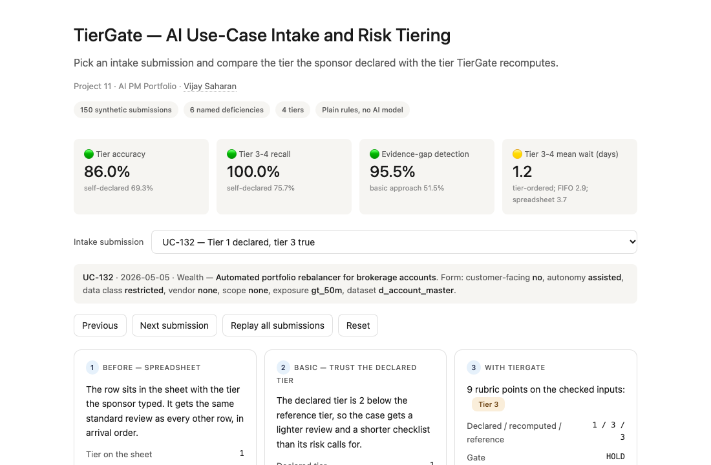
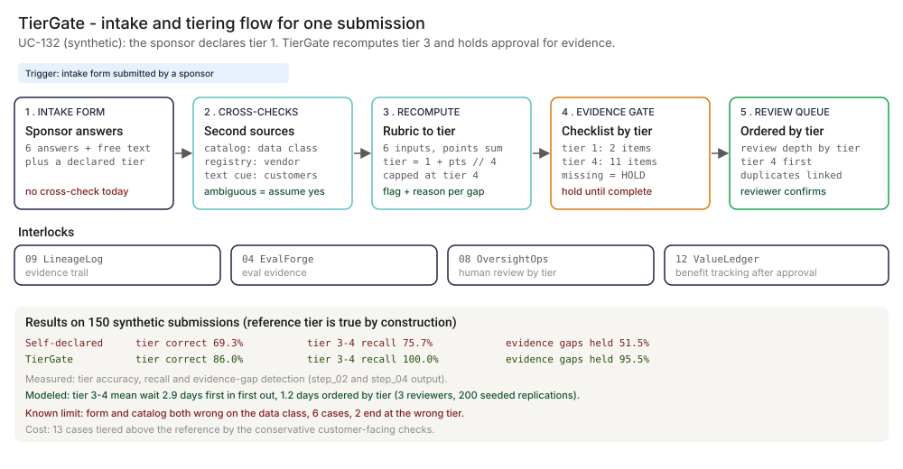
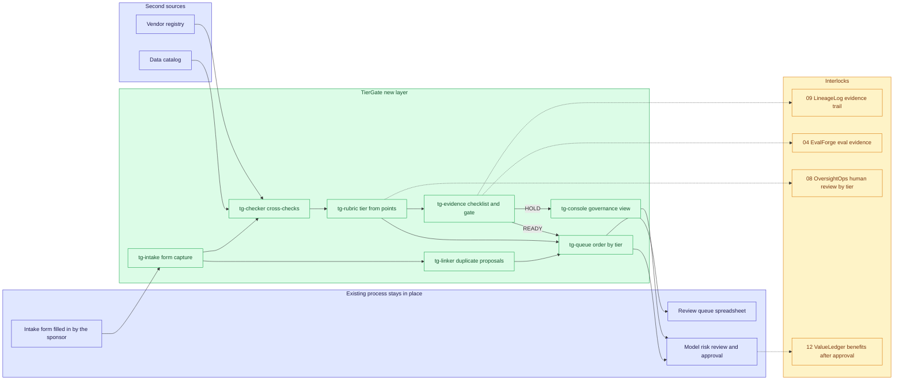
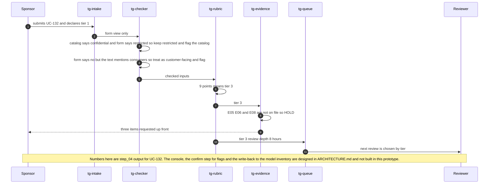

# 🚦 TierGate — AI Use-Case Intake and Risk Tiering

**A portfolio prototype for the front door of AI governance at a regulated bank: recompute the risk tier the sponsor declared, hold approval until the evidence that tier requires is on file, and order the review queue by tier instead of arrival. Written against the vocabulary of SR 11-7, the NIST AI RMF (Govern and Map) and the EU AI Act risk categories.**

**▶ Static demo, no install:** [open on GitHub Pages](https://vj-shipped-anyway.github.io/ai-pm-portfolio/11-tiergate-ai-usecase-intake/demo.html)

[](https://vj-shipped-anyway.github.io/ai-pm-portfolio/11-tiergate-ai-usecase-intake/demo.html)

**What it shows** (🟢 measured on synthetic data; the script is named in brackets):

- 🟢 Tier accuracy 69.3% → 86.0% (129 of 150 recomputed tiers equal the reference; `step_04`)
- 🟢 Evidence-gap detection 51.5% → 95.5%; approvals granted with required evidence missing 32 of 116 → 3 of 76
- 🟢 Known limit left in: 6 submissions where the form and the catalog both understate the data class

_A portfolio prototype on synthetic data, not a production case study. The framing, how to read the numbers and the regulatory note are folded below._


[](./demo.html)



> **▶ 30-second demo:** the [clickable demo](./demo.html) gets you the full story in 30 seconds with no install.

<details>
<summary>Framing, how to read the numbers, and the regulatory note</summary>

> **Regulatory note.** This README cites SR 11-7 or its replacement, [SR 26-2](https://www.federalreserve.gov/supervisionreg/srletters/SR2602.htm) (Federal Reserve, OCC and FDIC, April 17, 2026). SR 26-2 sets no enforceable standards, is aimed mainly at banks with over $30 billion in assets, and places generative AI and agentic AI outside its scope. Here those citations name the design basis for validation, monitoring and inventory practices, or serve as an analogy. They are not a claim that the project meets SR 26-2 or that SR 26-2 governs the systems it examines.

> **Framing:** This is a portfolio prototype, not a production case study. The six-deficiency taxonomy, the rubric, the architecture and the walkthrough are mine; every number below is measured or modeled on synthetic data, or marked hypothetical. No real bank, vendor, person or intake submission appears anywhere. Production validation (a model risk committee read, calibrating the rubric on real intake, a reviewer team working the queue) is what the next role does.

> **Reading the numbers — credibility tags inline.** Every number in this README and the demo is tagged 🟢 **Measured** (printed by a script in this folder on the 150 synthetic submissions, with the script named), 🟡 **Modeled** (an assumption named in one line), or 🔴 **Hypothetical** (designed and reasoned about, never tested). **The reference tier is true by construction:** it is the written rubric applied to the hidden true attributes of each submission, so accuracy measures how well a method recovers it from noisy inputs, not how real banks tier AI use cases. Full convention in the [master README's "Reading the numbers" section](../README.md#-reading-the-numbers).

</details>

---

## 🔥 Demo in 30 seconds

Open the static, no-Python demo: [`demo.html`](./demo.html).
Pick one of ten synthetic submissions. The first is `UC-132`, an automated portfolio rebalancer: the sponsor answered "no" to customer-facing and declared tier 1. TierGate reads the text (it mentions consumers), recomputes 9 rubric points and tier 3, and holds approval until three evidence items arrive. Three cards show the same submission handled three ways: the spreadsheet row, the basic approach that trusts the declared tier, and TierGate. The other nine scenarios cover the other five deficiencies, a clean case, the known limit, the cost of the conservative checks, and a false duplicate link. The totals at the top are the 🟢 measured numbers, except the queue wait, which is 🟡 modeled.

To run the four-step walkthrough on your laptop:

```bash
git clone https://github.com/Vj-shipped-anyway/ai-pm-portfolio
cd ai-pm-portfolio/11-tiergate-ai-usecase-intake/src
python3 step_01_spreadsheet_fifo.py
python3 step_02_self_declared_tier.py
python3 step_03_deficiencies_exposed.py
python3 step_04_with_tiergate.py
```

The step scripts need no packages. `pip install -r requirements.txt` is only for the Streamlit app (`streamlit run app.py`).

---

## 💰 Why this lands — competitive positioning

Most banks that review AI use cases today do it with a form, a spreadsheet and a reviewer's judgment. The product gap is the layer between the form and the review queue: something that checks what the sponsor wrote against a second source, decides the tier by a written rule, and refuses to approve without the evidence the tier owes. The table compares three approaches. No third-party product is scored.

| Capability | Spreadsheet, same review, FIFO | Self-declared tier on the form | **TierGate (the new layer)** |
| --- | --- | --- | --- |
| Where the tier comes from | None drives the review | The sponsor types it | Recomputed from the form, the data catalog, the vendor registry and the text |
| 🟢 Tier equals the reference tier | Not applicable | 69.3% (104 of 150, `step_02`) | 86.0% (129 of 150, `step_04`) |
| 🟢 True tier 3-4 cases recognized as tier 3-4 | Not applicable | 75.7% (53 of 70) | 100.0% (70 of 70) |
| Says which answer disagrees with a second source, and why | No | No | Yes. 🟢 74 of 150 submissions carry at least one cross-check flag with a reason |
| 🟢 Approvals granted with required evidence missing | Evidence not recorded | 32 of 116 approvals | 3 of 76 approvals |
| 🟢 Real evidence gaps caught before approval | Not recorded | 51.5% (34 of 66) | 95.5% (63 of 66) |
| Overlapping use cases linked | No | No | 🟢 9 of 10 true duplicate pairs proposed, with 5 false proposals a reviewer must reject |
| 🟡 Review depth and hours | Same 6.0 h for every row, 900.0 h | By declared tier, 714.0 h | By recomputed tier, 837.0 h |
| 🟡 Tier 3-4 mean queue wait | 3.7 business days, FIFO | 1.1 days (lighter workload, shallower reviews) | 2.9 days FIFO, 1.2 days ordered by tier |
| Where it still fails | Everything above | Understated answers pass silently | 🟢 Known limit: form and catalog both wrong (6 cases, 2 land at the wrong tier). 🟢 13 cases tiered above the reference by the conservative customer-facing checks |

**Position:** *TierGate does not replace the intake form, the model inventory, or the model risk review. It sits between the form and the review queue and does five things the form cannot: recompute the tier by a written rule, flag each discrepancy with its reason, link overlapping submissions, hold approval until the tier's evidence is on file, and put the riskiest reviews first. The table is the argument: a self-declared tier is wrong on 30.7% of this set, a spreadsheet cannot say what evidence anything owes, and a tier recomputed from a second source gets most of the way there without asking the sponsor for more work.*

---

## The honest version (why this exists)

The failure mode this prototype is built around: a sponsor fills in an AI use-case intake form and declares the risk tier. High-risk cases get a light review because the declared tier is low. Low-risk cases wait behind heavy ones. Required evidence is requested ad hoc, one email at a time. Nobody can say how many AI use cases exist, which tier each sits in, or what evidence each one owes.

This is the program-governance project in the portfolio. The others are controls on AI that is already running. This one decides what is allowed to run, and at what scrutiny.

It is a prototype on 150 synthetic submissions. I wrote the rubric, the generator, the error rates and the TierGate rules. The reference tier is true by construction, so the 🟢 numbers show how the mechanic behaves on this set, not how any bank's intake performs. The error rates are parameters I chose and document in [`data/README.md`](./data/README.md). No real submission, catalog, registry or vendor was touched, and no AI model is used anywhere: the rubric, the cross-checks and the duplicate score are plain rules.

I put it on disk so anyone can clone it, run four scripts, and see which tiers change, why, which flags are wrong, and the cases the checks cannot fix. That is the whole claim. It shows how I reason about the problem; it is not a deployment.

If you run AI governance and have watched a self-declared tier understate a case, fork it. The rubric shape, the deficiency taxonomy and the evidence checklist are the parts worth lifting. Calibrating them on real intake is the work the next role would do.

---

## Prereqs to run this on your laptop (in plain English)

You don't need a cluster, a cloud account or an API key. You need:

- **Python 3.** The four step scripts use only the standard library (`csv`, `json`, `re`, `random`, `statistics` and a few others), so there is nothing to install for them. I tested them on Python 3.9; any later 3.x should run them.
- **Git**, to clone the repo. `brew install git` / `winget install git`.
- **`src/requirements.txt` — only for the Streamlit app.** It lists `streamlit`, `pandas`, `numpy` and `plotly`. The step scripts and `data/_generate.py` do not import any of them.
- **No API key.** There is no model call anywhere in this folder.
- **Not needed:** Postgres, containers, a message queue or a cloud account. They appear in [`ARCHITECTURE.md`](./ARCHITECTURE.md) as the production design, not as prototype requirements.

The clickable `demo.html` runs in any browser with zero install. The scripts print to the terminal and write CSV and JSON files to `src/out/`. To rebuild the demo from the script output, run the four steps and then `python3 _build_demo.py` from `src/`.

If a step does not run from a fresh clone, that's a bug in this README. Open an issue.

---

## Executive summary (90 seconds)

**Problem.** A modeled $50B-asset US retail bank receives AI use-case intake submissions. The sponsor fills in the form and declares a tier. The reviewer takes it as given. 🟢 On the 150 synthetic submissions the declared tier equals the reference tier 69.3% of the time (`step_02`); 44 are declared too low, and 26 of the 70 truly tier 3-4 cases are declared below their reference tier. 🟢 32 of 116 approvals were granted without evidence the reference tier requires (`step_02`). 🟡 Every row gets the same 6.0 hour review in arrival order, so a true tier 4 case gets less depth than it needs, and the truly high-risk cases wait 3.7 business days on average like everyone else.

**Product.** TierGate, a layer between the form and the review queue: **recompute** the tier with the bank's own written rubric on cross-checked inputs (the higher of the form and the data catalog for data class; the higher of the form and the vendor registry for vendor model; blank, "unsure" and "no with customers in the text" resolve to customer-facing until the sponsor confirms) + **flag** every discrepancy with a reason + **link** duplicate submissions by token overlap + **gate** approval on the evidence checklist of the recomputed tier + **order** the review queue by tier.

**Measured and modeled performance.**

- 🟢 **Tier accuracy 69.3% → 86.0%** (129 of 150 recomputed tiers equal the reference; `step_04`). **Tier 3-4 recall 75.7% → 100.0%** (70 of 70).
- 🟢 **Evidence-gap detection 51.5% → 95.5%**; approvals granted with required evidence missing **32 of 116 → 3 of 76**.
- 🟢 **Duplicates:** 9 of 10 true pairs proposed at a fixed 0.50 threshold, with 5 false proposals (precision 0.64, recall 0.90).
- 🟡 **Tier 3-4 mean queue wait: 2.9 → 1.2 business days** when the same review times are ordered by tier instead of arrival (3 reviewers, 200 seeded replications). The cost: 🟡 tier 1-2 cases wait 3.4 → 9.7 days.
- 🟢 **Known limit left in:** 6 submissions where the form and the catalog both understate the data class. TierGate agrees with the wrong answer; 2 of them end at the wrong tier.
- 🟢 **Cost of the conservative checks:** 13 submissions are tiered above the reference, mostly because the text cue turns a customer-facing "no" into yes, and in a few cases because a blank or "unsure" answer resolves to yes.
- 🟡 **Utility:** (46 of 150 − 21 of 150) × 375 submissions a year = **62.5 mis-tiered use cases avoided per year** at the modeled bank.

🔴 **Not modeled.** Cost to deliver, reviewer acceptance of the flags, and what a real catalog or registry looks like. The rollout in the PRD is designed, not executed.

**Call to action.** Fork this repo. Swap [`data/intake_submissions.csv`](https://github.com/Vj-shipped-anyway/ai-pm-portfolio/blob/main/11-tiergate-ai-usecase-intake/data/intake_submissions.csv) for your own intake export, [`data/data_catalog.csv`](https://github.com/Vj-shipped-anyway/ai-pm-portfolio/blob/main/11-tiergate-ai-usecase-intake/data/data_catalog.csv) and [`data/vendor_registry.csv`](https://github.com/Vj-shipped-anyway/ai-pm-portfolio/blob/main/11-tiergate-ai-usecase-intake/data/vendor_registry.csv) for yours, rewrite the rubric points to match your policy, and walk the discrepancy list with your AI governance lead.

---

## 🗺️ What this walkthrough covers

1. **The use case** — AI use-case intake at a modeled $50B-asset US retail bank
2. **Sample data** — 150 synthetic submissions, a data catalog, a vendor registry, an evidence checklist per tier
3. **Step 1 — Before.** One spreadsheet, the same review for every case, first in first out
4. **Step 2 — Basic approach.** Trust the tier the sponsor declared
5. **Step 3 — Where this still breaks.** Six named deficiencies, each with a count
6. **Step 4 — The fix.** TierGate: recompute, flag, link, gate, order, and the limit it does not close
7. **Utility delivered.** The multiplied number, tagged
8. **Architecture & call flow.** Two Mermaid diagrams
9. **PM artifacts.** PRD and architecture doc

> Non-technical reader: skip the code blocks. The plain-English explanation and the tables tell the story.
> Technical reader: every command block runs. `cd src && python3 step_NN_*.py` and you'll see the same output.

Total reading time: about 15 minutes in full, about 4 minutes if you skim the headers and tables.

---

## 🎯 The Use Case

**A modeled US retail bank ($50B in assets, the shape used in projects 04 and 09), receiving AI use-case intake submissions from business units.**

Four people touch each submission:

- **The use-case sponsor (line 1)** fills in the form and declares a tier.
- **The AI governance lead (line 2)** owns the tiering policy and the evidence checklist, and wants one list of every AI use case with its tier and what it owes.
- **The model risk reviewer** does the review and wants the riskiest cases first and the evidence in hand when the review starts.
- **The CRO** wants to know, without a meeting, how many tier 3 and tier 4 use cases exist and whether any was approved on thin evidence.

Today the form is a spreadsheet row. The sponsor answers six questions (customer-facing, decision autonomy, data class, vendor model, regulatory scope, financial exposure), writes a title and a short description, and types a tier. The reviewer opens the next row. There is no check on the data class against the data catalog, no check on the vendor model against the vendor registry, no link between two sponsors who submitted the same idea, and no record of what evidence a tier requires.

The vocabulary the work has to meet, and the way TierGate uses it:

| Framework | How the design relates |
| --- | --- |
| **SR 11-7 model risk management** | An inventory that is complete enough to tier, validation depth proportional to risk, effective challenge on the higher tiers. The evidence checklist puts "independent validation with effective challenge" on tier 3 and above. |
| **NIST AI RMF, Govern and Map** | Govern: accountable owners, a written policy, one inventory. Map: the context and impact of each system, which is what the six form questions try to capture. |
| **EU AI Act risk categories** | The Act sorts AI systems into risk categories. TierGate's four tiers are an internal scale, not those categories. A mapping column between them is a design item and needs legal review. |

Four interlocks with the other projects: **09 LineageLog** (the evidence trail behind each decision), **04 EvalForge** (eval evidence on the checklist from tier 2), **08 OversightOps** (the human review design a tier requires), and **12 ValueLedger** (benefit tracking after approval).

---

## 📊 Sample Data

Five CSVs in [`data/`](./data/), generated by the committed, seeded, standard-library [`_generate.py`](./data/_generate.py). Running it twice gives identical files. Documented in detail in [`data/README.md`](./data/README.md).

**[`data/intake_submissions.csv`](https://github.com/Vj-shipped-anyway/ai-pm-portfolio/blob/main/11-tiergate-ai-usecase-intake/data/intake_submissions.csv)** — 150 submissions over 20 weeks. Each row has the form answers, the hidden true attributes and the committed reference tier. A preview (form answers and reference only):

| use_case_id | title | customer_facing | data_class | vendor_model | declared | reference |
| --- | --- | --- | --- | --- | --- | --- |
| UC-132 | Automated portfolio rebalancer for brokerage accounts | no (true: yes) | restricted | none | 1 | 3 |
| UC-026 | Sanctions name screening for business banking | no | confidential (true: restricted) | vendor_api | 2 | 4 |
| UC-005 | Meeting summariser for legal | no | internal | vendor_api | 2 | 2 |
| UC-088 | Collections outreach optimiser for home equity | yes | confidential (true: restricted) | none (true: self_hosted) | 3 | 4 |

**The rubric** is arithmetic. Points on the true attributes: customer-facing yes 2; autonomy 0, 1 or 3; data class 0 to 3; vendor model 0, 1 or 2; regulatory scope 0 to 3; exposure band 0 to 3. **Tier = min(4, 1 + points // 4).** The reference tier mix is 25 tier 1, 55 tier 2, 50 tier 3 and 20 tier 4 (🟢 `data/_generate.py`).

**The form deviates from the truth by documented, injected error rates** (generator parameters, realized counts from `data/_generate.py`):

| What goes wrong | Parameter | Realized |
| --- | --- | --- |
| Data class understated by one level | 10% / 30% / 30% of true internal / confidential / restricted | 40 of 150 |
| Vendor dependency omitted | 35% of vendor API, 20% of self-hosted | 31 of 107 |
| Customer-facing answer wrong, blank or unsure | 22% "no", 8% "unsure", 4% blank when truly yes; smaller rates when truly no | 27 of 150 |
| Declared tier shaded from the sponsor's own rubric result | down 18%, up 3% | 14 down, 3 up |

**[`data/data_catalog.csv`](https://github.com/Vj-shipped-anyway/ai-pm-portfolio/blob/main/11-tiergate-ai-usecase-intake/data/data_catalog.csv)** — 34 datasets with the class the catalog records and the true class. Four entries are stale (3 understate, 1 overstates). **[`data/vendor_registry.csv`](https://github.com/Vj-shipped-anyway/ai-pm-portfolio/blob/main/11-tiergate-ai-usecase-intake/data/vendor_registry.csv)** — 62 of the 107 vendor-dependent use cases, partial coverage. **[`data/evidence_checklist.csv`](https://github.com/Vj-shipped-anyway/ai-pm-portfolio/blob/main/11-tiergate-ai-usecase-intake/data/evidence_checklist.csv)** — 2, 4, 8 and 11 required items for tiers 1 to 4. **[`data/evidence_on_file.csv`](https://github.com/Vj-shipped-anyway/ai-pm-portfolio/blob/main/11-tiergate-ai-usecase-intake/data/evidence_on_file.csv)** — what each sponsor attached. Eight duplicate groups (17 submissions, 10 true pairs) are planted.

**The reference tier is true by construction.** Accuracy against it says how well a method recovers it from noisy inputs. It says nothing about how real banks behave, and the error rates are my parameters, not observations.

---

## 🔧 Step 1 — Before: one spreadsheet, same review, first in first out

**In plain English:** Every submission is a row. The reviewer opens the next row and runs the same standard review. The sheet holds whatever tier the sponsor typed. It records no evidence owed and no duplicates.

```bash
python3 src/step_01_spreadsheet_fifo.py
```

The queue is simulated, so every line of the assumptions is 🟡 modeled and printed first:

- Arrivals are the 150 `submitted_date` values in the data.
- 3 reviewers, each with 16 intake hours a week (3.2 hours a business day).
- Step 1 review time: 6.0 hours for every case, set close to the 5.9 hour average of the tier review times below.
- Review time by tier, used in Steps 2 and 4: tier 1 1.5 h, tier 2 3.0 h, tier 3 8.0 h, tier 4 14.0 h.
- Every review time is multiplied by lognormal noise (sigma 0.35, mean 1.0); 200 seeded replications; the same noise draws in every scenario.
- The queue is non-preemptive, with no rework loop.

**Result (🟡 modeled, `step_01`):**

| Measure | Value |
| --- | --- |
| Truly high-risk cases (reference tier 3-4) | 70 of 150 |
| Tier 3-4 mean queue wait, FIFO | 3.7 business days (5th to 95th percentile of 200 replications: 2.3 to 5.4) |
| Tier 1-2 mean queue wait, FIFO | 4.0 business days |
| Total reviewer hours | 900.0 (150 cases × 6.0 h) |
| Offered load on the reviewers | 94% |

Review depth given against what the reference tier needs (modeled): tier 1 gets 6.0 h where 1.5 h is enough; tier 3 gets 6.0 h where the tier calls for 8.0 h; tier 4 gets 6.0 h where it calls for 14.0 h.

The one assumption Step 1 hangs on is the standard review time. 🟡 At 4.0 h per case the offered load is 62% and the tier 3-4 wait is 0.4 days; at 6.0 h it is 94% and 3.7 days; at 8.0 h it is 125% and 17.2 days. At low load there is little queue to reorder; above 100% load the queue never clears. The comparison in Step 4 is read at the 6.0 h setting and the reviewer-count sensitivity is printed there too.

---

## 🤖 Step 2 — With the basic approach: trust the self-declared tier

**In plain English:** The sponsor writes a tier. The reviewer applies the checklist for that tier, approves when it is covered, and gives the review the depth that tier calls for. This is what most intake processes do once they move past a single standard review.

```bash
python3 src/step_02_self_declared_tier.py
```

**Output (🟢 measured unless tagged):**

```
Self-declared tier equals reference tier:     104 of 150  (69.3%)
Mis-tier rate:                                46 of 150  (30.7%)
    declared too low: 44    declared too high: 2
True tier 3-4 cases:                          70
    declared below their reference tier:        26 of 70  (37.1%)
    declared outside the 3-4 band entirely:     17 of 70  (tier 3-4 recall 75.7%)

Approvals granted:                            116 of 150
Approvals with evidence missing that the reference tier requires:  32 of 116  (27.6% of approvals)
    required items absent across those approvals: 74
Evidence-gap detection rate of this approach: 34 of 66 cases with a real gap were held  (51.5%)
```

Confusion (rows are the reference tier, columns the declared tier):

| | declared 1 | declared 2 | declared 3 | declared 4 |
| --- | --- | --- | --- | --- |
| **ref 1** | 24 | 1 | 0 | 0 |
| **ref 2** | 18 | 36 | 1 | 0 |
| **ref 3** | 2 | 14 | 34 | 0 |
| **ref 4** | 0 | 1 | 9 | 10 |

🟡 With review depth following the declared tier, total reviewer hours drop to 714.0 (74% load) and the tier 3-4 wait to 1.1 days. That is not an improvement: under-declared cases get shallow reviews, so the hours look lower than the reference tiers need.

**What the basic approach gets right:** tier 1. 24 of 25 true tier 1 cases are declared tier 1. **What it gets wrong:** nearly every error is an understatement (44 of 46), and the errors land where review depth and evidence matter most: 18 of 55 true tier 2 cases are declared tier 1, 14 of 50 true tier 3 cases are declared tier 2, and only 10 of 20 true tier 4 cases are declared tier 4.

---

## 🔬 Step 3 — Where this still breaks: 6 named deficiencies

| # | Deficiency | What goes wrong | Count on this dataset (🟢 `step_03`) |
| --- | --- | --- | --- |
| 1 | **Self-declared tier understates risk** | The sponsor's tier sits below the rubric on the true attributes. The case gets a lighter review and a shorter checklist. | **44** of 150 declared tiers are too low; 26 of them are truly tier 3-4. Example `UC-026`: declared tier 2, reference tier 4 (sanctions name screening). |
| 2 | **Data class never cross-checked against the catalog** | The form's data class is never compared with the class the catalog records for the same dataset. | **38** forms declare a class below the catalog's; 34 are real understatements. 40 forms are below the true class in total, and on 6 of those the catalog is below the true class too. Example `UC-016`: form says internal, catalog says confidential, true class confidential. |
| 3 | **Customer-facing impact missing or ambiguous** | The answer is blank or "unsure", or it is "no" on a case that does reach customers. It is worth two rubric points. | **24** forms: 7 blank, 5 "unsure", 12 "no" on a truly customer-facing case. 12 of the 24 ended up declared below their reference tier. |
| 4 | **Vendor dependency unflagged** | The form says no vendor model where the use case uses one. The vendor registry often already knows. | **31** of 107 vendor-dependent use cases say "none"; the registry lists 21 of those 31. Example `UC-011`. |
| 5 | **Overlapping use cases not linked** | Two sponsors submit the same idea. The spreadsheet has no link, so both get a full review and may carry different tiers. | **8** duplicate groups (17 submissions, 10 true pairs), 0 linked; 2 groups carry different declared tiers for the same use case. |
| 6 | **Approval without the evidence the tier requires** | The reviewer approves against the declared tier's checklist. The reference tier owes more. | **32** of 116 approvals are missing required evidence (74 items absent). Example `UC-042`: approved at declared tier 2, reference tier 3, missing E05, E06, E07, E08. |

```bash
python3 src/step_03_deficiencies_exposed.py
```

The deficiencies compound. `UC-026` writes confidential for restricted data, so its own form gives 11 points (tier 3), and the sponsor then declares tier 2. It gets the tier 2 checklist (4 items) and a 3.0 hour review where the reference tier 4 calls for 11 items and 14.0 hours, and the tier 2 checklist does not ask for independent validation or a human review design. Nothing in the spreadsheet shows it. **The product is the cross-check, the written rule and the gate, not another reviewer.**

---

## 🛠️ Step 4 — The fix: TierGate

Five moves, in this order, run on the same 150 submissions:

```bash
python3 src/step_04_with_tiergate.py
```

1. **Recompute** the tier from the form plus cross-checks, with the bank's written rubric.
2. **Flag** every discrepancy with a reason a reviewer can read.
3. **Link** duplicate or overlapping submissions with token-overlap similarity.
4. **Gate** approval on the evidence checklist of the recomputed tier.
5. **Order** the review queue by recomputed tier instead of arrival.

```python
# simplified from src/step_04_with_tiergate.py
def recompute(form, catalog, registry):
    cls = max_by_order(form["data_class"], catalog.get(form["dataset_name"]))   # higher class wins
    ven = max_by_order(form["vendor_model"], registry.get(form["use_case_id"])) # higher dependency wins
    cf = form["customer_facing"]
    if cf in ("", "unsure"):
        cf = "yes"                                   # resolve conservatively, flag, ask the sponsor
    elif cf == "no" and CUSTOMER_CUE.search(form["title"] + " " + form["description"]):
        cf = "yes"                                   # the text mentions customers, flag
    score = points(cf, autonomy, cls, ven, scope, exposure)
    return min(4, 1 + score // 4), flags
```

`recompute()` receives only the visible form columns, the catalog's recorded class and the vendor registry. It never reads `true_*`, `reference_*`, `duplicate_group`, or the catalog's `true_class` and `catalog_status`. Those are read afterwards, to score the result. The script also checks that the rubric, applied to the true columns, reproduces the reference tier on 150 of 150 rows.

**Worked example `UC-132`** (🟢 `step_04` output, rubric points in brackets):

| Input | Sponsor's form | TierGate checked | True value |
| --- | --- | --- | --- |
| customer-facing | no (0) | yes (2), the text says "consumers" | yes (2) |
| decision autonomy | assisted (1) | assisted (1) | assisted (1) |
| data class | restricted (3) | restricted (3) | restricted (3) |
| vendor model | none (0) | none (0) | none (0) |
| regulatory scope | none (0) | none (0) | none (0) |
| exposure band | gt_50m (3) | gt_50m (3) | gt_50m (3) |
| **points / tier** | **7 / tier 2** (the sponsor declared tier 1) | **9 / tier 3** | **9 / tier 3** |

The catalog records `d_account_master` as confidential; the sponsor honestly wrote restricted. TierGate keeps the higher class and flags the catalog entry for the steward (`DATA_CLASS_ABOVE_CATALOG`). Tier 3 requires eight items; `E05`, `E06` and `E08` are not on file, so the gate says HOLD and the three items are requested up front instead of one email at a time.

**Headline measures (🟢 measured, `step_04`):**

| Measure | Self-declared (Step 2) | TierGate |
| --- | --- | --- |
| Tier accuracy | 69.3% (104 of 150) | **86.0% (129 of 150)** |
| Mis-tier rate | 30.7% | 14.0% (8 too low, 13 too high) |
| Tier 3-4 recall | 75.7% (53 of 70) | **100.0% (70 of 70)** |
| True tier 3-4 below their reference tier | 26 | 6 (all tier 4 recomputed as tier 3) |
| Tier 3-4 precision | not computed | 94.6% (70 of 74 predicted) |
| Evidence-gap detection | 51.5% (34 of 66) | **95.5% (63 of 66)** |
| Approvals with required evidence missing | 32 of 116 | 3 of 76 |
| Held for evidence the reference tier does not require | not applicable | 11 |

Confusion (rows are the reference tier, columns the recomputed tier):

| | recomputed 1 | recomputed 2 | recomputed 3 | recomputed 4 |
| --- | --- | --- | --- | --- |
| **ref 1** | 19 | 6 | 0 | 0 |
| **ref 2** | 2 | 49 | 4 | 0 |
| **ref 3** | 0 | 0 | 47 | 3 |
| **ref 4** | 0 | 0 | 6 | 14 |

**Discrepancy flags.** 74 of 150 submissions carry a cross-check flag, and TierGate changed the tier on 51. "Right" means the flag pointed at a real form error:

| Flag | Raised | Right |
| --- | --- | --- |
| `DATA_CLASS_BELOW_CATALOG` | 38 | 34 |
| `VENDOR_NOT_DECLARED` | 21 | 21 |
| `CUSTOMER_FACING_CUE` (text mentions customers, form says no) | 25 | 6 |
| `CUSTOMER_FACING_AMBIGUOUS` (blank or "unsure") | 12 | 3 |

The customer-facing checks are the weak spot: 9 of 12 ambiguous answers and 19 of 25 text cues were on cases that are not customer-facing. They are the reason for the 13 over-tiered cases. I kept them conservative on purpose, because the safe error for a governance gate is a tier too high and a reviewer who can clear a flag. The cost is on the page.

**Duplicate linking (🟢 `step_04`).** Jaccard overlap on the tokens of title plus description (standard library only), proposed link at 0.50. Of 10 true pairs, 9 are proposed and 1 is missed; 5 proposals are wrong (precision 0.64, recall 0.90). The 0.50 threshold is a fixed design value, not tuned on this run. The sweep shows what moving it does on this same set:

| Threshold | Linked | Right | Wrong | Missed | Precision | Recall |
| --- | --- | --- | --- | --- | --- | --- |
| 0.30 | 78 | 10 | 68 | 0 | 0.13 | 1.00 |
| 0.40 | 42 | 10 | 32 | 0 | 0.24 | 1.00 |
| **0.50** | 14 | 9 | 5 | 1 | 0.64 | 0.90 |
| 0.60 | 11 | 9 | 2 | 1 | 0.82 | 0.90 |
| 0.70 | 10 | 9 | 1 | 1 | 0.90 | 0.90 |

Links are proposals; a reviewer confirms each (0.5 h modeled). 150 submissions give 11,175 pairs to compare; each later submission is linked once, to its best earlier match, which gives 13 linked submissions. In 4 of those 13 the two sponsors had declared different tiers. The descriptions come from templates, so this score separates duplicates from non-duplicates better or worse than real text would. Ten true pairs is a small set.

**Queue effect (🟡 modeled, the Step 1 assumptions apply; 200 seeded replications).** Same tier-depth review times, different ordering:

| Measure | First in first out | Ordered by tier |
| --- | --- | --- |
| Tier 3-4 mean wait | 2.9 business days (5th to 95th pct 1.9 to 4.8) | **1.2 business days** (0.7 to 1.9) |
| Tier 1-2 mean wait | 3.4 business days | 9.7 business days |

| Step | Tier 3-4 mean wait | Reviewer hours | Offered load |
| --- | --- | --- | --- |
| 1. Spreadsheet, same review, FIFO | 3.7 days | 900.0 | 94% |
| 2. Declared tier, FIFO | 1.1 days | 714.0 | 74% |
| 4. TierGate, ordered by tier | 1.2 days | 837.0 | 87% |

TierGate spends more reviewer hours than Step 2 because tier 3-4 cases get the depth their tier calls for. The 837.0 also counts duplicate handling: a proposed link that is a true duplicate costs the 0.5 h confirm instead of a second full review, and a wrong proposal adds 0.5 h to its review (🟡, `step_04`). It is not cheaper. It moves the hours to where the risk is. Sensitivity to reviewer count (the tier-depth hours stay, so the load moves):

| Reviewers | Offered load | Tier 3-4 FIFO | Tier 3-4 ordered | Tier 1-2 FIFO | Tier 1-2 ordered |
| --- | --- | --- | --- | --- | --- |
| 2 | 131% | 21.5 | 8.5 | 23.5 | 66.2 |
| 3 | 87% | 2.9 | 1.2 | 3.4 | 9.7 |
| 4 | 65% | 0.7 | 0.2 | 0.7 | 2.0 |

At 2 reviewers the queue is overloaded and no ordering rescues it. At 4 the effect is small because there is little queue to reorder. The ordering helps in the band where reviewers are stretched but not buried. Low-risk cases wait longer under it. An aging cap that stops them waiting without limit is a design item in the PRD, not built here (🔴).

### The known limit, left in on purpose

**When the form and the catalog are both wrong about a data class, the recompute agrees with the wrong answer.** 🟢 `step_04` finds 6 submissions where the form's data class and the catalog's recorded class are both below the true class (`UC-044`, `UC-058`, `UC-066`, `UC-088`, `UC-089`, `UC-129`). TierGate takes the higher of the two, which is still too low. 2 of the 6 end at the wrong tier (`UC-088`, `UC-089`); in the other 4 the missing point does not cross a tier boundary. Both sources carry the same wrong class, so nothing can disagree.

All 21 wrong tiers by cause (a case can have more than one): 13 customer-facing resolved to yes but truly internal; 5 customer-facing "no" with no cue in the text; 2 data class with the form and the catalog both below the true class; 1 catalog entry that overstates the class; 1 vendor with the form and the registry both silent. No true tier 3-4 case is left below tier 3, but 6 true tier 4 cases are recomputed as tier 3.

**What would close it:** a third source for data class (lineage from the data platform, or a scan of the actual fields) and a catalog freshness check. Both are design items in [`ARCHITECTURE.md`](./ARCHITECTURE.md), not built here.

---

## 📐 Utility Delivered

> **Utility = (my solution − current state of the art) × number of people it affects**

Here the thing affected is a use case, and the unit is a mis-tiered use case avoided: **(self-declared error rate − TierGate error rate) × AI use cases reviewed per year.**

| Term | Value | Where it comes from |
| --- | --- | --- |
| 🟢 Self-declared error rate | **30.7%** (46 of 150) | `step_02`, against the reference tier |
| 🟢 TierGate error rate | **14.0%** (21 of 150) | `step_04`, against the reference tier |
| 🟢 Gap | **16.7 percentage points** | difference of the above |
| 🟡 Bank shape | A $50B-asset US retail bank that sees the same intake rate as this synthetic set | Assumption, the same shape used in projects 04 and 09 |
| 🟡 Annual intake | **375 submissions** | Assumption: 7.5 submissions a week in this set × 50 weeks |
| 🟡 **Mis-tiered use cases avoided per year** | **62.5** | (46 of 150 − 21 of 150) × 375, an expected value |

Sensitivity, 🟡 modeled: 125.0 a year at 750 submissions, 250.0 at 1,500.

Read it with the cost attached. 🟢 The 13 over-tiered cases and 11 unneeded evidence holds are reviewer time spent on cases that did not need it. 🟡 Reviewer hours rise from 714.0 (declared tier) to 837.0 (TierGate) because the high tiers get the depth they call for. 🟢 6 true tier 4 cases are still recomputed as tier 3, and the known limit is not closed.

Caveat: the error rates are measured against a reference that is true by construction, on data whose error rates I set. The 62.5 is only as good as the match between those rates and a real bank's intake. The structure of the claim, a gap in error rate times a volume, is the part to reuse.

---

## 🔄 Architecture & Call Flow

How a submission flows through the system, end to end. GitHub renders these diagrams natively. Component names match [`ARCHITECTURE.md`](./ARCHITECTURE.md).

**System topology:**



**Per-submission sequence** (`UC-132`):



See [`assets/tiergate-flow.svg`](./assets/tiergate-flow.svg) for a static visual of the same flow.

---

## 📋 PM Artifacts

The PM artifacts that show how I'd run this product if I owned the seat. This README is the walkthrough; the rest of the folder holds:

- [`PRD.md`](./PRD.md) — the product requirements doc as it would go to an AI governance committee.
- [`ARCHITECTURE.md`](./ARCHITECTURE.md) — the systems doc: components, data model, the tier decision record, the threat model, failure behavior, controls.
- [`demo.html`](./demo.html) — clickable, no-install walkthrough; every number is generated from the scripts in `src/`.
- [`data/`](./data/) — the five CSVs, the generator and `data/README.md` (the rubric and the injected error rates).
- [`src/`](./src/) — the four step scripts, the Streamlit prototype and `_build_demo.py`.

Run the walkthrough end to end:

```bash
cd src
python3 step_01_spreadsheet_fifo.py
python3 step_02_self_declared_tier.py
python3 step_03_deficiencies_exposed.py
python3 step_04_with_tiergate.py
python3 _build_demo.py        # rebuilds ../demo.html from src/out/
```

---

## 🚀 Fork this for your team

```bash
git clone https://github.com/Vj-shipped-anyway/ai-pm-portfolio
cd ai-pm-portfolio/11-tiergate-ai-usecase-intake

# 1. Drop in your own intake, catalog, registry and evidence data
#    data/intake_submissions.csv   the visible form columns feed recompute(); the step scripts also read the
#                                  true_* and reference_* columns, so a labeled sample is needed to run them as written
#    data/data_catalog.csv         dataset_name, catalog_class (the class your catalog records)
#    data/vendor_registry.csv      use_case_id, vendor_model
#    data/evidence_checklist.csv   your evidence items per tier
#    data/evidence_on_file.csv     use_case_id, evidence_id

# 2. Rewrite the rubric to match your policy
#    PTS_* tables and tier_from_score() in src/step_04_with_tiergate.py

# 3. Run the four-step walkthrough
cd src
python3 step_01_spreadsheet_fifo.py
python3 step_02_self_declared_tier.py
python3 step_03_deficiencies_exposed.py
python3 step_04_with_tiergate.py

# 4. Open the interactive demo
open ../demo.html            # static snapshot of the synthetic data; rebuild it with python3 _build_demo.py
```

If you run it on real intake and get something useful, open an issue or send me what your AI governance lead did with the flag list. I'd rather see that than what I think it should do.

---

## 👤 Author

**Vijay Saharan** — Sr Product / Program Manager · AI in BFSI · Enterprise AI Platforms · CRE as a study interest

[LinkedIn](https://www.linkedin.com/in/vijaysaharan/) · Tagline: *AI Governance PM · Designs intake, tiering and evidence gates for AI under regulated constraint*

---

## 🙌 Acknowledgements

- **SR 11-7 (Federal Reserve and OCC supervisory guidance on model risk management), replaced in April 2026 by [SR 26-2](https://www.federalreserve.gov/supervisionreg/srletters/SR2602.htm)** — the model-risk guidance the work is compared with on inventory, risk-proportionate validation and effective challenge. TierGate's evidence checklist puts independent validation with effective challenge on tier 3 and above.
- **[NIST AI RMF](https://www.nist.gov/itl/ai-risk-management-framework)** — the Govern and Map functions are the vocabulary for the register, the accountable owners and the context questions on the form.
- **[EU AI Act](https://eur-lex.europa.eu/eli/reg/2024/1689/oj)** — the risk-category vocabulary. TierGate's four tiers are an internal scale and not those categories; the mapping is a design item.
- Projects in this portfolio that TierGate hands evidence to or takes evidence from: [04 EvalForge](../04-evalforge-llm-eval-platform/), [08 OversightOps](../08-oversightops-hitl-workflow/), [09 LineageLog](../09-lineagelog-ai-decision-audit/). 12 ValueLedger takes the benefit tracking after approval.
