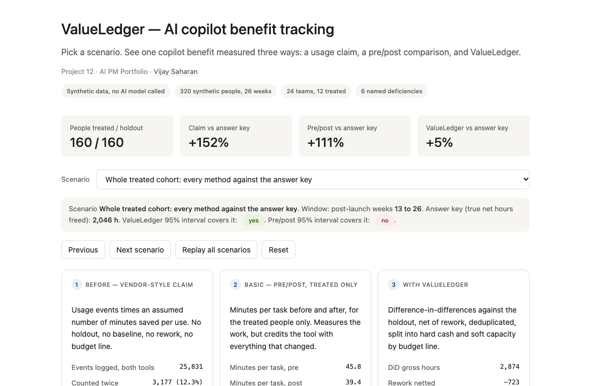
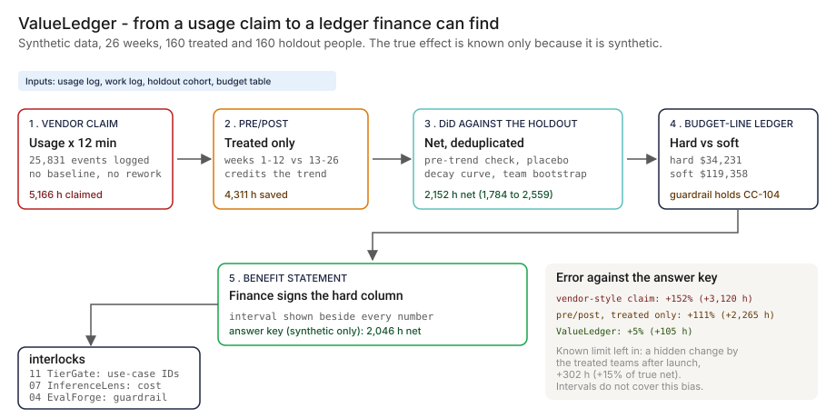
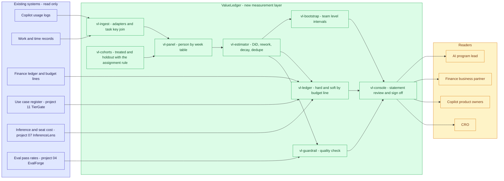
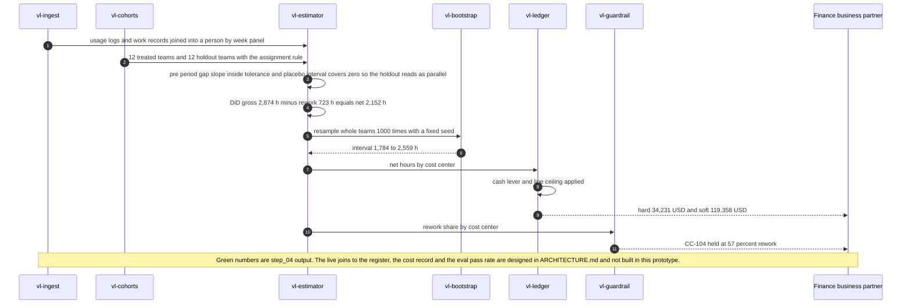

# 📒 ValueLedger — Benefit Realization Tracking for AI Copilots

**A portfolio prototype for measuring what an AI copilot really freed in a regulated bank: a holdout cohort, difference-in-differences, net of rework, a weekly effect curve with decay, overlap deduplication, and a hard-versus-soft ledger tied to the budget table. Built on synthetic data where the true effect is known, so each method's error can be read off an answer key.**

**▶ Static demo, no install:** [open on GitHub Pages](https://vj-shipped-anyway.github.io/ai-pm-portfolio/12-valueledger-ai-benefit-tracking/demo.html)

[](https://vj-shipped-anyway.github.io/ai-pm-portfolio/12-valueledger-ai-benefit-tracking/demo.html)

**What it shows** (🟢 measured on synthetic data; the script is named in brackets):

- 🟢 Vendor-style claim: 5,166 h against 2,046 h true net: +152% (2.52x)
- 🟢 ValueLedger: 2,152 h, +5% (1.05x), 95% interval 1,784 to 2,559 h, which covers the answer key (`step_04_with_valueledger.py`)
- 🟢 One known limit left in: a hidden change by the treated teams after launch is injected at 302 h (+15% of true net)

_A portfolio prototype on synthetic data, not a production case study. The framing, how to read the numbers and the regulatory note are folded below._


[](./demo.html)



> **▶ 30-second demo:** open [`demo.html`](./demo.html) in any browser, no install. Pick a scenario and see the same copilot benefit measured three ways: a vendor-style usage claim, a pre/post comparison, and ValueLedger, each scored against a true effect that is known only because the data is synthetic.

<details>
<summary>Framing, how to read the numbers, and the regulatory note</summary>

> **Regulatory note.** This README cites SR 11-7 or its replacement, [SR 26-2](https://www.federalreserve.gov/supervisionreg/srletters/SR2602.htm) (Federal Reserve, OCC and FDIC, April 17, 2026). SR 26-2 sets no enforceable standards, is aimed mainly at banks with over $30 billion in assets, and places generative AI and agentic AI outside its scope. Here those citations name the design basis for validation, monitoring and inventory practices, or serve as an analogy. They are not a claim that the project meets SR 26-2 or that SR 26-2 governs the systems it examines.

> **Framing:** This is a portfolio prototype, not a production case study. The six-deficiency taxonomy, the estimators, the architecture, and the walkthrough are mine. The data is synthetic and the true effect is known only because the generator injected it, so the 🟢 numbers show how each method behaves on this data, not how any bank's copilots perform. Production validation (a real holdout, a finance sign-off, a model-risk read) is what the next role does.

> **Reading the numbers — credibility tags inline.** Every number in this README and the demo is tagged 🟢 **Measured** (printed by a script in this folder on the shipped synthetic data: 320 people × 26 weeks in 24 teams; the script is named next to the number), 🟡 **Modeled** (extrapolated, with the assumption named in one line), or 🔴 **Hypothetical** (designed and reasoned about, never tested). Error figures are 🟢 measured against the answer key. Scaling them to a bank's headcount is 🟡 modeled. Full convention in the [master README's "Reading the numbers" section](../README.md#-reading-the-numbers).

</details>

---

## 🔥 Demo in 30 seconds

Open the static, no-Python demo: [`demo.html`](./demo.html).
Pick one of ten scenarios from the dropdown, or use Next scenario and Replay all scenarios. Three cards show the same copilot benefit three ways: the vendor-style claim (usage events × an assumed 12 minutes), a pre/post comparison of the treated cohort, and ValueLedger (holdout, net of rework, deduplicated, split into hard cash and soft capacity). The stats row shows the 🟢 measured errors against the answer key: the claim is +152% off, pre/post +111%, ValueLedger +5% (`step_04_with_valueledger.py`).

To run the four-step walkthrough on your laptop:

```bash
git clone https://github.com/Vj-shipped-anyway/ai-pm-portfolio
cd ai-pm-portfolio/12-valueledger-ai-benefit-tracking
pip install -r src/requirements.txt  # only the Streamlit app needs this; the step scripts use the standard library
python3 src/step_01_vendor_claim.py
python3 src/step_02_prepost_basic.py
python3 src/step_03_deficiencies_exposed.py
python3 src/step_04_with_valueledger.py
```

To run the Streamlit app locally instead, use `streamlit run app.py` from the `src` folder.

---

## 💰 Why this lands — competitive positioning

A copilot benefit number can reach leadership in one of three shapes: usage times an assumed saving, a before-and-after comparison, or a spreadsheet of savings the product owners report. I compare approaches rather than vendors, because the gap is in the method, not in any one tool. The table scores each approach on what it needs to answer before finance can use the number.

| Capability | Usage × assumption | Pre/post, treated only | Owner-reported savings | **ValueLedger (layered)** |
| --- | --- | --- | --- | --- |
| What it needs | A usage log and one number | Minutes per task before and after | A form per product owner | Work log, a holdout cohort, the budget table |
| Counterfactual: what would have happened anyway | None | None. The seasonal easing and the head start of enthusiastic teams are credited to the tool | Self-reported, so none by construction | Holdout cohort; 🟢 pre-period gap slope -0.050 min per task per week, read as parallel (`step_04_with_valueledger.py`) |
| Nets out rework | No | No | Depends on what the owner counts | Yes: 🟢 723 h subtracted |
| Handles novelty decay | No: flat by construction | No: the seasonal easing hides it | Depends on when the owner reports | Yes: 🟢 fitted half-life 2.5 weeks against 2.8 in the answer key |
| Counts overlapping tools once | No: 🟢 12.3% of logged events are the same task twice | Not applicable | Depends on whether owners compare notes | Yes: 🟢 3,177 duplicate events removed from attribution |
| Ties hours to a budget line | No | No | Depends on the form | Yes: 🟢 hard cash is 22% of ledger value |
| Interval on the number | None | An interval that excludes the answer key | None | 95% team-level bootstrap |
| 🟢 Error against the answer key on this data | +152% (2.52x) | +111% (2.11x) | Not measured in this repo | +5% (1.05x) |
| Where it still fails | Every row above | Every row above except that it measures the work | Depends on the owner's records | 🟢 A change the treated teams made on their own after launch is invisible: 302 h (+15% of true net) injected |

🟢 Scripts behind the table: the pre-period slope, the rework hours, the half-life, the hard share, the error row, and the injected hidden change are printed by `step_04_with_valueledger.py`. The duplicate-event share is printed by `step_03_deficiencies_exposed.py` and `step_04_with_valueledger.py`. The three approach columns other than ValueLedger describe how each approach works by construction; only the usage-times-assumption and pre/post columns are measured here.

**Position:** *ValueLedger does not replace the copilots' usage logs, the work system, or the finance ledger. It adds the measurement layer between them: a comparison group, a rework deduction, a decay curve, a count-once rule, and a join to the budget line, so the number that reaches finance is one finance can find.*

---

## The honest version (why this exists)

The failure mode this prototype is built around: a copilot business case multiplies usage events by an assumed minutes-saved figure and reports hours. Leadership sees a large number. Finance cannot find it in any budget line. Nobody netted out the time spent correcting the copilot's output, the novelty that wears off, or the second tool that logged the same task. The thesis of this portfolio is Utility = (my solution − current state of the art) × number of people affected, and that only works if the lift is measured honestly. This project measures the lift.

This is a prototype on synthetic data. I wrote the generator, the answer key, and the estimators. The true effect is known only because the generator injected it; a real bank has no answer key, and that absence is the reason benefit tracking is hard. The 🟢 numbers show how the mechanic behaves on this data. They do not show how any real copilot, vendor, or bank performs. No real employee, team, cost center, or business case is represented, and no AI model is called anywhere in this project: the two copilots exist only as columns in the data.

I put it on disk so anyone can clone it, run four scripts, and see which part of a copilot claim survives a comparison group, a rework deduction, and a budget table. That is the whole claim. It shows how I reason about the problem; it is not a deployment.

If you have been handed a copilot benefit number you could not trace to a budget line, fork it. The deficiency taxonomy, the ledger rule, and the architecture are the parts worth lifting. Validating them on real work data is the work the next role would do.

---

## Prereqs to run this on your laptop (in plain English)

You don't need a cluster, a cloud account, or an API key. You need:

- **Python 3.** The four step scripts and the data generator use only the standard library (`csv`, `json`, `math`, `random`, `pathlib`), so there is nothing to install for them. They ran on Python 3.9, the only version I tested.
- **Git**, to clone the repo. `brew install git` / `winget install git`.
- **`src/requirements.txt` is for the Streamlit app only.** It lists `streamlit`, `pandas`, `numpy`, and `plotly`. The step scripts do not import any of them, and `pip install -r src/requirements.txt` is not needed to run Steps 1 to 4.
- **No API key.** No model is called. The copilots are columns in synthetic CSVs.
- **Not needed:** Postgres, containers, Kubernetes, or a cloud account. They appear in [`ARCHITECTURE.md`](./ARCHITECTURE.md) as the production design, not as prototype requirements.

The clickable `demo.html` runs in any browser with zero install. Each step script finishes in a few seconds and writes a CSV or JSON to `src/out/`.

The point of the list above is that anyone curious (AI program lead, finance partner, product owner, engineer) can replicate the result on a laptop. If a step does not run from a fresh clone, that's a bug in the README. Open an issue.

---

## Executive summary (90 seconds)

**Problem.** A modeled regulated bank has two overlapping copilots in use by 160 people. Each vendor-style business case multiplies its own usage log by an assumed 12 minutes saved per use. The two logs together say 5,166 hours in 14 weeks, worth $372,329 at loaded cost rates. Finance cannot find it in a budget line. Nobody netted out rework, novelty decay, or two tools claiming the same task. The seasonal workload also eased over the same weeks, so a before-and-after comparison makes the copilots look better than they were.

**Product.** ValueLedger, a measurement layer, not a new copilot: a **holdout cohort** and **difference-in-differences** (with a pre-period trend check and a placebo launch) + **net of rework** + a **weekly effect curve with decay** + **overlap deduplication** + a **hard-versus-soft ledger** tied to the budget table (freed time counts as cash only where a cost center has a cash lever, up to the addressable spend) + **seeded team-level bootstrap intervals**. Interlocks: use-case IDs and approval from 11 TierGate, the cost side from 07 InferenceLens, a quality guardrail from 04 EvalForge so speed is not bought with errors.

**Measured performance (net hours freed, treated cohort, 14 weeks, scored against the answer key).**

- 🟢 **Vendor-style claim: 5,166 h against 2,046 h true net: +152% (2.52x).** Pre/post: 4,311 h, +111%, 95% interval 3,761 to 4,935 h, which does not cover the answer key (`step_04_with_valueledger.py`).
- 🟢 **ValueLedger: 2,152 h, +5% (1.05x), 95% interval 1,784 to 2,559 h, which covers the answer key** (`step_04_with_valueledger.py`).
- 🟢 **Of the $372,329 claimed, the answer key puts the cash a budget line can absorb at $33,706 (9%).** 68% of the claimed hours sit in cost centers with no cash lever (`step_03_deficiencies_exposed.py`). ValueLedger's hard column: $34,231, 22% of its $153,590 ledger value (`step_04_with_valueledger.py`).
- 🟢 **Novelty decays:** the answer key's net weekly hours fall from 212 (weeks 13 to 16) to 106 (weeks 23 to 26), 2.00x. The claim stays flat at 369 (`step_03_deficiencies_exposed.py`).
- 🟢 **The quality guardrail holds one cost center:** `CC-104`, where rework is 57% of gross time saved (`step_04_with_valueledger.py`).
- 🟢 **One known limit left in:** a hidden change by the treated teams after launch is injected at 302 h (+15% of true net). The realized error is +105 h because sampling noise (-197 h) offset part of it on this draw (`step_04_with_valueledger.py`).
- 🟡 **Scaled to 5,000 eligible staff: about 94,200 h, about $6,780,000 of phantom benefit removed per 14-week window** (modeled: assumes the same overstatement pattern holds at a bank's headcount and mix).

🔴 **Designed, never tested.** A finance sign-off on the hard column, a quarterly statement cycle, and the live joins to TierGate, InferenceLens, and EvalForge. The prototype stands in for each of them with a synthetic column.

**Call to action.** Fork this repo. Swap [`data/panel.csv`](./data/panel.csv), `teams.csv`, `employees.csv`, `budget.csv`, and `copilots.csv` for your own work records and budget lines, run the four step scripts, and put the ledger in front of your finance business partner. Without an answer key, the scoring lines in Steps 3 and 4 have nothing to score against, and `load_data()` in `src/valueledger_core.py` must stop reading the two truth files for any step to run; the estimators themselves do not use them.

---

## 🗺️ What this walkthrough covers

1. **The use case** — a modeled regulated bank with two overlapping copilots and a business case that multiplies usage by an assumption
2. **The sample data** — 320 synthetic people over 26 weeks in 24 teams, a budget table, and an answer key
3. **Step 1 — Before.** The vendor-style claim. Usage events times an assumed number of minutes saved per use
4. **Step 2 — Basic approach.** Pre/post comparison of the treated cohort only
5. **Step 3 — Where this still breaks.** Six named deficiencies, each scored against the answer key
6. **Step 4 — The fix.** ValueLedger: holdout, difference-in-differences, net of rework, decay curve, deduplication, hard-versus-soft ledger, bootstrap intervals. One known limit left in and printed
7. **Utility delivered.** (claimed benefit − true net benefit) × cohort scale
8. **Architecture & call flow.** Mermaid topology and a per-run sequence
9. **PM artifacts.** RICE backlog, one-page PRD, stakeholder map

Total reading time: about 12 minutes for the full walkthrough. About 4 minutes if you skim the headers and tables.

---

## 🎯 The Use Case

**A modeled regulated bank. 160 people in 12 teams got a copilot; 160 people in 12 other teams did not.**

Two copilots overlap: a drafting copilot (A) and a meeting-and-notes copilot (B). Each has its own business case, and each business case says the same thing: 12 minutes saved per use. Some people hold both, and on some tasks both are used, so the same task is in two usage logs.

The copilots launched in week 13 of a 26-week window. The 12 teams that got them were not picked at random. They were the 12 with the highest score on an internal enthusiasm survey, so they were also faster at baseline. The whole population has a seasonal workload curve: tasks take longer in the early weeks and ease afterwards, whether or not anyone has a copilot.

After 14 weeks, the AI program lead has two usage logs and one slide with a large number on it: 5,166 hours, $372,329. The finance business partner asks which budget line the hours came out of. The CRO asks whether speed was bought with errors. The product owners ask which of the two copilots earned the hours. None of the three questions can be answered from a usage log.

The claim breaks in six specific places:

- **It counts usage, not time saved.** A usage event is not a saved hour.
- **It has no counterfactual.** The seasonal easing and the enthusiastic teams' head start are credited to the tool.
- **It ignores novelty decay.** The first weeks are not the steady state.
- **It ignores rework.** Correcting the copilot's output takes time.
- **It double-counts.** Two logs, one task.
- **It has no budget line.** Capacity is not cash.

The synthetic dataset in this repo is built to make each of those visible, with the true answer known so that each can be measured.

---

## 📊 Sample Data

Seven files in [`data/`](./data/). Documented in detail in [`data/README.md`](./data/README.md), generated by [`data/_generate.py`](./data/_generate.py) (standard library, seeded, identical output on every run). Five files are what a measurement team could observe; two hold the answer key.

**[`data/teams.csv`](./data/teams.csv)** — 24 teams and the non-random selection rule (first 8 rows):

| `team_id` | `cost_center_id` | `headcount` | `enthusiasm_score` | `cohort` |
| --- | --- | --- | --- | --- |
| T01 | CC-101 | 17 | 4.74 | treated |
| T02 | CC-101 | 11 | 3.56 | treated |
| T03 | CC-101 | 12 | 2.44 | holdout |
| T04 | CC-102 | 10 | 1.64 | holdout |
| T05 | CC-102 | 12 | 3.48 | holdout |
| T06 | CC-102 | 11 | 3.71 | treated |
| T07 | CC-103 | 13 | 1.91 | holdout |
| T08 | CC-103 | 16 | 3.46 | holdout |

**[`data/budget.csv`](./data/budget.csv)** — 8 cost-center lines. Three can turn freed time into cash. Five cannot:

| `cost_center_id` | `cost_center_name` | `headcount` | `loaded_cost_per_hour_usd` | `freed_time_can_become_cash` | `addressable_spend_usd_annual` |
| --- | --- | --- | --- | --- | --- |
| CC-101 | Retail operations processing | 40 | 48.00 | yes | 70000 |
| CC-102 | Client onboarding and KYC | 33 | 55.00 | yes | 45000 |
| CC-103 | Collections and recoveries | 39 | 50.00 | yes | 60000 |
| CC-104 | Credit risk reporting | 42 | 82.00 | no | 0 |
| CC-105 | Regulatory compliance | 45 | 78.00 | no | 0 |
| CC-106 | Financial control | 36 | 74.00 | no | 0 |
| CC-107 | Legal and contracts | 48 | 95.00 | no | 0 |
| CC-108 | Product and analytics | 37 | 70.00 | no | 0 |

**[`data/panel.csv`](./data/panel.csv)** — 320 people × 26 weeks = 8,320 person-weeks (first 4 rows of the first person; copilots launch in week 13):

| `employee_id` | `week` | `tasks_completed` | `minutes_per_task` | `events_a` | `events_b` | `events_both` | `rework_minutes` |
| --- | --- | --- | --- | --- | --- | --- | --- |
| E0001 | 1 | 17 | 36.24 | 0 | 0 | 0 | 0.0 |
| E0001 | 2 | 19 | 37.70 | 0 | 0 | 0 | 0.0 |
| E0001 | 3 | 19 | 36.42 | 0 | 0 | 0 | 0.0 |
| E0001 | 4 | 19 | 36.61 | 0 | 0 | 0 | 0.0 |

**[`data/copilots.csv`](./data/copilots.csv)** — the two overlapping copilots and the assumption Step 1 multiplies:

| `copilot_id` | `copilot_name` | `use_case_id` | `assumed_minutes_saved_per_use` | `seat_cost_usd_per_month` | `approval_status` |
| --- | --- | --- | --- | --- | --- |
| A | Drafting copilot | UC-201 | 12 | 32 | approved |
| B | Meeting and notes copilot | UC-202 | 12 | 24 | approved |

**[`data/employees.csv`](./data/employees.csv)** — 320 people, their team, cost center, cohort, and which copilots they hold (`none`, `A`, `B`, or `AB`).

**The answer key.** [`data/truth_person_week.csv`](./data/truth_person_week.csv) and [`data/truth_parameters.json`](./data/truth_parameters.json) hold the true effect the generator injected: 5.5 minutes saved per assisted task at steady state, a 6.0-minute novelty bonus in launch week that decays with a half-life of 2.77 weeks, a rework cost per cost center, and a hidden post-launch change in the treated teams of 0.45 minutes per task. **The truth is known only because the data is synthetic.** The methods never read these files; the scripts open them only to score each method after it has run.

---

## 🔧 Step 1 — Before: the vendor-style claim

**In plain English:** The business case takes each copilot's usage log, multiplies the number of uses by the minutes the vendor says each use saves, and divides by 60. It needs one log and one assumption, which is why it is the number that reaches leadership first.

**The code** ([`src/step_01_vendor_claim.py`](./src/step_01_vendor_claim.py), simplified):

```python
def claim(ds, agg, post_weeks):
    events_a = total(agg, agg.treated, "EA", post_weeks)     # copilot A usage log
    events_b = total(agg, agg.treated, "EB", post_weeks)     # copilot B usage log
    minutes = events_a * 12 + events_b * 12                  # assumed minutes saved per use
    return minutes / 60.0                                    # claimed hours
```

**Run it:**

```bash
python3 src/step_01_vendor_claim.py
```

**Output:**

```
STEP 1 - Before: the vendor-style benefit claim
Synthetic data. 320 people, 26 weeks; 160 people in 12 treated teams got a copilot in week 13.

Business-case assumption (data/copilots.csv)
  copilot A, Drafting copilot,          UC-201  assumed minutes saved per use: 12
  copilot B, Meeting and notes copilot, UC-202  assumed minutes saved per use: 12

Usage log, the 14 weeks after launch
  copilot A events:                     13,728
  copilot B events:                     12,103
  events logged, both tools added up:   25,831

Claim
  claimed hours  = events x assumed minutes / 60 = 5,166 h
  per treated person                             = 32.3 h in 14 weeks
  implied value at loaded cost rates             = $372,329

What this number never asked: saved against what? net of what corrections?
counted once or twice? and in which budget line can finance find it?
```

**Result:** 🟢 5,166 claimed hours, 32.3 per treated person, $372,329 implied (`step_01_vendor_claim.py`). The 12-minute assumption is printed so that nobody has to ask. The claim never asks: saved against what, net of what, counted once or twice, and in which budget line.

---

## 🤖 Step 2 — With a pre/post comparison: the basic approach

**In plain English:** The careful analyst stops trusting the usage log and looks at the work: minutes per task for the treated people before the copilot (weeks 1 to 12) against after (weeks 13 to 26). That is a real measurement of the work, so it is better than Step 1. It still has no comparison group, so it credits the copilot with everything that changed between the two periods.

**The code** ([`src/step_02_prepost_basic.py`](./src/step_02_prepost_basic.py), simplified):

```python
pre_mean = pre_minutes / pre_tasks                    # treated cohort, weeks 1-12
for w in post_weeks:
    effect_w = pre_mean - minutes_w / tasks_w         # minutes saved per task that week
    saved_minutes += effect_w * tasks_w
hours = saved_minutes / 60.0
```

**Run it:**

```bash
python3 src/step_02_prepost_basic.py
```

**Output:**

```
STEP 2 - The basic approach: pre/post on the treated cohort only
Treated cohort: 160 people. Pre = weeks 1-12, post = weeks 13-26.

  mean minutes per task, pre:         45.78
  mean minutes per task, post:        39.35
  reduction per task:                 6.42 min
  tasks completed in the post weeks:  40,265

  estimated hours saved:              4,311 h  (26.9 h per treated person)
  implied value at loaded cost rates: $310,377

Against Step 1: the claim said 5,166 h; this says 4,311 h (83% of the claim).
It looks like a measurement because it uses the work, not the usage log.
It is still a before-and-after: whatever else changed in the 26 weeks is credited to the copilot.

Weekly reduction per task, min (week 13 ... 26):
  7.4  6.6  6.2  5.9  6.3  5.9  6.8  6.5  5.6  6.4  5.9  6.9  6.7  6.9
```

**Result:** 🟢 4,311 hours (a 6.42-minute reduction per task over 40,265 tasks, converted to hours), $310,377 implied (`step_02_prepost_basic.py`). That is 2.11x the answer key, which Step 3 explains. The weekly reduction per task is roughly flat across the 14 weeks. A flat line reads as a sustained effect. Step 3 shows why that reading is wrong.

---

## 🔬 Step 3 — Where this still breaks: six named deficiencies

**In plain English:** "The copilots saved 5,166 hours" is not actionable. To fix it you have to name the ways it is wrong and measure each. The generator injected a known true effect, so for the first time each error can be scored. The answer key is known only because the data is synthetic.

| # | Deficiency | What goes wrong | Error against the answer key (🟢 `step_03_deficiencies_exposed.py`) |
| --- | --- | --- | --- |
| a | **Gross usage is not net time saved** | The claim multiplies events by 12 minutes. A usage event is not a saved hour. | 12 assumed against 7.3 measured gross minutes per assisted task (5.4 net of rework). Distinct tasks × 12 minutes = 4,531 h against 2,769 h true gross: overstated by 1,762 h (+64%). |
| b | **No counterfactual: the seasonal trend and selection bias inflate the estimate** | Pre/post credits the copilot with the workload easing and with the head start of the enthusiastic teams. | Pre/post gross 4,311 h against 2,769 h: overstated by 1,542 h (+56%). The holdout, which never got a copilot, improved by an amount worth 1,437 h on the treated tasks. Treated against holdout after launch with no baseline: overstated by 1,345 h (+49%), because the treated teams were already 1.8 min per task faster before launch. |
| c | **Novelty decay ignored** | The first weeks overstate the steady state. A launch-month result annualized overstates the run-rate. | Net weekly hours: 212 in weeks 13 to 16 against 106 in weeks 23 to 26 (2.00x). The claim stays flat at 369 (+248% over the steady state). Pre/post shows 311 then 317: the seasonal easing hides the decay (+199%). |
| d | **Rework not netted** | Correcting copilot output takes time. Neither the claim nor pre/post subtracts it. | 723 h of rework, 26% of gross time saved. |
| e | **Double counting across overlapping tools** | Two usage logs record the same task, and both business cases count it. | 3,177 of 25,831 logged events (12.3%) are the same task twice: 635 h at 12 minutes. |
| f | **Benefit not tied to a budget line** | Freed time is capacity unless a cost center has a cash lever to displace. | 68% of claimed hours sit in cost centers with no cash lever. The cash the budget lines can absorb is $33,706: 23% of the $145,871 true value of the hours actually freed, and 9% of the $372,329 claimed. |

**Run it:**

```bash
python3 src/step_03_deficiencies_exposed.py
```

**Output:**

```
STEP 3 - Six deficiencies exposed, each scored against the answer key
Synthetic data. The answer key is known only because the generator injected the effect.
Net hours freed, treated cohort (160 people), 14 post-launch weeks:
  answer key: gross 2,769 h, rework 723 h, net 2,046 h
  vendor-style claim (step 1): 5,166 h   pre/post (step 2): 4,311 h

(a) Gross usage is not net time saved
    assumed minutes saved per use:                    12.0
    measured gross minutes saved per assisted task:   7.3   (net of rework: 5.4)
    distinct assisted tasks x assumed minutes:        4,531 h vs 2,769 h true gross -> overstated by 1,762 h (+64%)

(b) No counterfactual: the seasonal trend and selection bias inflate the estimate
    pre/post gross estimate: 4,311 h vs 2,769 h true gross -> overstated by 1,542 h (+56%)
    the holdout never got a copilot; its own improvement over the same weeks, applied to the
    treated cohort's tasks, is 1,437 h. Pre/post credits all of it to the copilot.
    treated vs holdout after launch, no baseline: 4,114 h -> overstated by 1,345 h (+49%)
    the treated teams were already 1.8 min per task faster before launch (selection by enthusiasm).

(c) Novelty decay ignored: the launch month overstates the steady state
    average weekly net hours, weeks 13-16 vs weeks 23-26
      answer key:          212 vs   106   (launch month is 2.00x the steady state)
      vendor-style claim:   369 vs   369   (flat: usage is flat and 12 minutes does not decay)
      pre/post:             311 vs   317   (the seasonal easing hides the decay)
    steady-state run-rate overstated by the claim: +248%; by pre/post: +199%

(d) Rework not netted
    rework minutes caused by copilot output: 723 h (26% of gross time saved)
    neither the claim nor pre/post subtracts it. Overstated by 723 h.

(e) Double counting across overlapping tools
    events logged by the two tools: 25,831; distinct assisted tasks: 22,654; answer key: 22,654
    counted twice: 3,177 events (12.3% of the log) = 635 h at the assumed minutes

(f) Benefit not tied to a budget line
    claimed value:                                   $372,329
    claimed hours sitting in cost centers with no cash lever: 68%
    true value of the hours actually freed:          $145,871
    of which cash the budget lines can absorb:       $33,706  (23% of the true value, 9% of the claimed value)

Bridge from the claim to the answer key (hours):
    vendor-style claim                                   5,166   running 5,166
    (e) remove double-counted events                      -635   running 4,531
    (a) assumed minutes -> measured gross minutes       -1,762   running 2,769
    (d) net out rework                                    -723   running 2,046
    answer key (true net)                                2,046
```

**Why this is an AI PM artifact, not just a bug list.** The bridge at the bottom of the output walks the claim down to the answer key one named deficiency at a time: 5,166 h claimed, minus 635 h of double counting, minus 1,762 h for the assumed minutes, minus 723 h of rework, equals 2,046 h. Each step is a different fix: a count-once rule, a measured minutes figure, a rework log. Deficiencies (b), (c), and (f) are not on that bridge because they are not errors in the claim's arithmetic. They are errors in what the number is compared against and where it lands: no comparison group, no time dimension, no budget line. The pre/post estimate is closer to the truth than the claim and still +111% off, which is the reason Step 4 adds a comparison group instead of a better multiplier.

---

## 🛠️ Step 4 — The fix: ValueLedger

**In plain English:** Don't try to improve the multiplier. Compare the treated teams with teams that did not get the tool, subtract the time spent fixing the copilot's output, watch the effect week by week, count each task once, and only call hours "cash" where a budget line can absorb them. Then print the interval and the one thing the method cannot see.

Six moves, each answering a deficiency from Step 3:

1. **Holdout and difference-in-differences** (a, b). The effect is the change in minutes per task for treated teams minus the change for holdout teams over the same weeks. The seasonal trend hits both groups, so it cancels, and so does the treated teams' baseline head start. A pre-period check (a gap slope and a placebo launch in week 7) says whether the holdout is a fair stand-in.
2. **Net of rework** (d). Minutes spent correcting copilot output are subtracted.
3. **A weekly effect curve with decay** (c). Gross minutes saved per distinct assisted task, by week, with an exponential fit, so the launch month is not annualized.
4. **Overlap deduplication** (e). Each task is counted once. Shared tasks are split equally between the two copilots, a policy choice and not a measurement.
5. **A hard-versus-soft ledger tied to the budget table** (f). Freed time is hard cash only where the cost center has a cash lever, up to the addressable spend on that line. The rest is soft capacity.
6. **Seeded team-level bootstrap intervals.** Whole teams are resampled with replacement within each arm, 1,000 times, with the standard library. Assignment was by team, so resampling people would understate the noise.

**The code** ([`src/step_04_with_valueledger.py`](./src/step_04_with_valueledger.py), simplified):

```python
# 1. difference-in-differences, by week, minutes per task
did_w = (pre_treated - mean_treated_w) - (pre_holdout - mean_holdout_w)
gross_min = sum(did_w * treated_tasks_w for each post week)

# 2. net of rework (logged against copilot output)
net_min = gross_min - rework_min

# 4. count each task once
distinct_tasks = events_a + events_b - events_both

# 3. weekly effect curve with decay: y = a + b * exp(-k * weeks_since_launch)
a, b, k = fit_decay(weeks_since_launch, gross_per_assisted_task, assisted_tasks)

# 5. hard versus soft, per cost center
value = net_hours * loaded_cost_per_hour
hard = max(0, min(value, line_ceiling)) if cash_flag == "yes" else 0
soft = value - hard
```

**Run it:**

```bash
python3 src/step_04_with_valueledger.py
```

**Output, the holdout check (move 1): is the holdout a fair counterfactual?**

```
1. Is the holdout a fair counterfactual? (weeks 1-12, before any copilot)
   baseline gap, treated minus holdout: -1.85 min per task. Selection on a visible trait; DiD absorbs the level.
   gap slope: -0.050 min/task/week (95% CI -0.131 to +0.022), tolerance +/-0.15
   placebo launch in week 7: +0.25 min/task (95% CI -0.23 to +0.76)
   verdict: PARALLEL. No visible divergence before launch.
   This check can only see what happened before launch.
```

🟢 The pre-period gap slope is -0.050 min per task per week (95% interval -0.131 to +0.022), inside the ±0.15 tolerance, and the placebo launch is +0.25 min per task (95% interval -0.23 to +0.76, which includes zero): **parallel**. With 12 teams on each side the check can only rule out large divergence, and it can only see the weeks before launch (`step_04_with_valueledger.py`).

**Output, net of rework and the effect curve (moves 2 and 3):**

```
2. Difference-in-differences, net of rework
   DiD gross effect on treated tasks, 14 weeks:  2,874 h
   rework logged against copilot output:        -723 h
   ValueLedger net hours:                        2,152 h  (95% CI 1,784 to 2,559)
   per treated person:                           13.4 h in 14 weeks

3. Weekly effect curve (gross minutes saved per distinct assisted task)
   week   :    13    14    15    16    17    18    19    20    21    22    23    24    25    26
   DiD    :  13.0  10.5   9.9   7.3   8.1   7.3   8.6   7.0   5.3   7.8   4.5   5.4   5.5   6.2
   fitted :  12.6  10.9   9.6   8.6   7.9   7.3   6.9   6.6   6.3   6.2   6.0   5.9   5.8   5.8
   answer :  11.4  10.1   9.1   8.2   7.7   7.2   6.8   6.5   6.3   6.1   5.9   5.9   5.8   5.7
   fit: steady state 5.6 min/use (95% CI 0.8 to 6.7; answer key 5.5)
        half-life 2.5 weeks (95% CI 1.1 to 9.2; answer key 2.8)
   net weekly hours, launch month vs steady state: 231 vs 108 (ratio 2.14; answer key 212 vs 106, ratio 2.00)
```

🟢 The fitted curve tracks the answer key closely (steady state 5.6 against 5.5, half-life 2.5 weeks against 2.8), but the intervals are wide: steady state 0.8 to 6.7 and half-life 1.1 to 9.2 weeks. Twelve teams a side do not pin a decay curve down tightly (`step_04_with_valueledger.py`). The launch month earns 2.14x the steady-state weekly hours on the fit, against 2.00x in the answer key.

**Output, overlap deduplication (move 4):**

```
4. Overlap deduplication (a task is counted once)
   events logged by the two tools: 25,831; distinct assisted tasks: 22,654; counted twice: 3,177 (12.3% of logged events)
   net minutes saved per distinct assisted task: 5.7 (the claim assumed 12 per logged event)
   Dedup does not change total hours (DiD measures the work, not the log). It changes attribution:
   shared tasks are split 50/50 between copilots. That split is a policy choice, not a measurement.
   copilot                      use case booked      claimed h   ledger h       cost
   Drafting copilot             UC-201   yes             2,746      1,153    $10,649
   Meeting and notes copilot    UC-202   yes             2,421        999     $7,211
```

**Output, the hard-versus-soft ledger (move 5):**

```
5. Hard versus soft ledger (data/budget.csv)
   line    cost center                    cash     net h      value       hard       soft   hold
   CC-101  Retail operations processing   yes        415    $19,906    $18,846     $1,060       
   CC-102  Client onboarding and KYC      yes        158     $8,682     $8,682         $0       
   CC-103  Collections and recoveries     yes        134     $6,703     $6,703         $0       
   CC-104  Credit risk reporting          no         111     $9,117         $0     $9,117   HOLD
   CC-105  Regulatory compliance          no         370    $28,834         $0    $28,834       
   CC-106  Financial control              no         355    $26,243         $0    $26,243       
   CC-107  Legal and contracts            no         458    $43,494         $0    $43,494       
   CC-108  Product and analytics          no         152    $10,610         $0    $10,610       
   total value $153,590 = hard cash $34,231 (95% CI $6,763 to $43,594) + soft capacity $119,358 (95% CI $86,287 to $176,348)
   hard cash is 22% of the ledger value. Answer key: hard cash $33,706, soft capacity $112,164
```

🟢 Of $153,590 of freed-hour value, $34,231 (22%) is hard cash and $119,358 is capacity (`step_04_with_valueledger.py`). The `CC-101` line is capped by its addressable spend: the hours are worth more than the line can absorb, so the excess is soft. The hard interval is wide ($6,763 to $43,594) because only a handful of treated teams sit in cash-lever cost centers.

**Output, the quality guardrail and the cost side (the interlocks with 04 EvalForge and 07 InferenceLens):**

```
6. Quality guardrail (stand-in for an EvalForge pass rate: rework as a share of gross time saved)
   CC-101  rework 96 h of 510 h gross = 19%
   CC-102  rework 40 h of 198 h gross = 20%
   CC-103  rework 35 h of 169 h gross = 21%
   CC-104  rework 148 h of 259 h gross = 57%   HOLD (above 40%)
   CC-105  rework 121 h of 491 h gross = 25%
   CC-106  rework 86 h of 441 h gross = 20%
   CC-107  rework 167 h of 625 h gross = 27%
   CC-108  rework 29 h of 181 h gross = 16%
   1 of 8 cost centers held. A held line stays in the soft column and cannot book hard cash until it is reviewed.

7. Cost side (interlock with 07 InferenceLens; synthetic seat prices in data/copilots.csv)
   cost of both copilots over 14 weeks: $17,860
   claimed value / cost:        20.8x
   ledger value / cost:         8.6x   (hours at loaded rates)
   ledger hard cash / cost:     1.92x   (what finance can find in a budget line)
```

🟢 `CC-104` (credit risk reporting) is held: rework eats 57% of the gross time saved, so its 111 net hours stay in the soft column and cannot book hard cash until the line is reviewed. The guardrail here uses rework as a stand-in for a pass rate from 04 EvalForge; no EvalForge data is read (`step_04_with_valueledger.py`). Against the cost of both copilots ($17,860 at synthetic seat prices), the claim implies a return of 20.8x, the ledger value 8.6x, and the hard cash 1.92x.

**Every method against the answer key:**

```
8. Every method against the answer key (net hours freed, treated cohort, 14 weeks)
   method                                 hours      error  error %     x key   95% CI
   Vendor-style claim (step 1)            5,166     +3,120    +152%     2.52x   none given
   Pre/post, treated only (step 2)        4,311     +2,265    +111%     2.11x   3,761 to 4,935
   ValueLedger (this step)                2,152       +105      +5%     1.05x   1,784 to 2,559
   Answer key (true net)                  2,046
   95% CI covers the answer key: pre/post no, ValueLedger yes.
```

| Method | Net hours | Error against the answer key | 95% interval | Covers the answer key? |
| --- | --- | --- | --- | --- |
| Vendor-style claim (Step 1) | 5,166 | +3,120 h (+152%) | none given | not applicable |
| Pre/post, treated only (Step 2) | 4,311 | +2,265 h (+111%) | 3,761 to 4,935 | no |
| **ValueLedger (Step 4)** | **2,152** | **+105 h (+5%)** | 1,784 to 2,559 | yes |
| Answer key (true net) | 2,046 | 0 | not applicable | not applicable |

🟢 All figures from `step_04_with_valueledger.py`. Pre/post is +111% off with an interval that excludes the truth: confidently wrong. The claim has no interval at all. Errors and sums are computed from unrounded hours, so a printed difference can be off by 1 (2,152 − 2,046 = 106, printed +105).

**The known limit, left in on purpose.**

```
9. The known limit left in: selection on things the data cannot see
   The enthusiastic teams also changed how they work after launch (injected: 0.45 min per task, not caused by the copilot).
   No column records it and the pre-period check cannot see it, so DiD credits it to the copilot.
   Injected hidden component:         +302 h  (+15% of true net hours)
   DiD gross estimate:                 2,874 h = true gross 2,769 + hidden 302 + sampling noise -197
   Realized error of ValueLedger net:  +105 h (+5%). On this draw sampling noise offset part of the hidden bias.
   The bootstrap interval measures sampling noise only. It does not widen for a bias nobody can observe.
```

The enthusiastic teams made a process change after launch that no column records. The pre-period check cannot see it, because it started after the launch. Difference-in-differences credits it to the copilot. 🟢 Injected size: 302 h, +15% of the true net hours. The realized error of +105 h (+5%) understates the bias, because on this draw sampling noise of -197 h happened to offset part of it. Read ValueLedger's +5% as a result that landed close, not as a precision claim: the bias the method carries by construction is the +15%, and the bootstrap interval measures sampling noise only, so it does not widen for it. The fix is not in the data. It is a randomized or staggered rollout, which turns selection into design. That is a 🔴 designed step, not a built one.

**Scenarios.** The same three methods, re-run on slices (point estimates; the app shows the intervals):

```
11. Scenarios (point estimates; the app shows the intervals)
   scenario                                                        claim h  prepost   ledger    truth
   Whole treated cohort: every method against the answer key         5,166    4,311    2,152    2,046
   Slice: people holding two copilots (overlap)                      1,688      958      454      439
   Slice: people holding one copilot                                 3,478    3,353    1,698    1,607
   Slice: launch month, weeks 13 to 16 (novelty window)              1,477    1,245      896      847
   Slice: steady state, weeks 23 to 26                               1,477    1,267      382      424
   Slice: cost centers where freed time can become cash              1,644    1,315      687      691
   Slice: cost centers where freed time stays capacity               3,522    2,994    1,473    1,355
```

🟢 The slices show where each method breaks: on two-copilot holders the claim is 1,688 h against 439 h true because the same task is in two logs, and in the steady-state weeks the claim is 1,477 h against 424 h true because the saving decayed and the claim did not (`step_04_with_valueledger.py`).

---

## 📐 Utility Delivered

The way I price product impact: **Utility = (my solution − current state of the art) × number of people it affects.**

Anything else is theater. Removing a 152% overstatement from one cohort's business case is not an outcome. *Removing it across every person a copilot program covers at a bank's headcount is.* The state of the art here is what reaches leadership: the claim. The lift is the overstatement removed.

**The math for ValueLedger:**

| Term | Value | Where it comes from |
| --- | --- | --- |
| 🟢 Claimed benefit per treated person (current state of the art) | 32.3 h in 14 weeks | `step_01_vendor_claim.py` |
| 🟢 True net benefit per treated person | 12.8 h | answer key, printed by `step_04_with_valueledger.py` |
| 🟢 Claimed minus true net | **19.5 h per person** | `step_04_with_valueledger.py` |
| 🟢 ValueLedger minus true net | +0.7 h per person | `step_04_with_valueledger.py`. The injected hidden bias is 1.9 h per person; sampling noise offset part of it on this draw |
| 🟢 Phantom benefit removed from the business case | **18.8 h per person** (17.6 h if the whole hidden bias had landed) | claimed minus true net, less ValueLedger's own error |
| Treated people in the cohort | 160 | `step_04_with_valueledger.py` |
| 🟡 Modeled bank headcount in scope | **5,000 eligible staff** | Assumption: the same adoption, overlap, rework, and seasonal pattern hold at a bank's mix. Not measured |
| 🟡 Phantom benefit removed at that scale | **about 94,200 h per 14-week window** | removed per person (printed as 18.8 h; unrounded 18.84 h, which is (5,166 − 2,152) ÷ 160) × 5,000, rounded to three significant figures |
| 🟡 Value at the cohort's blended loaded rate | **about $6,780,000 per 14-week window** | $72 per hour blended rate, `step_04_with_valueledger.py`. Hours are not cash: see the hard column |
| 🟢 Cash a budget line can absorb, per the answer key | $33,706 of $372,329 claimed | `step_03_deficiencies_exposed.py` |

The 🟢 rows are measured on the synthetic data. The two 🟡 rows depend on one assumption: that a bank's mix of copilot use, overlap, rework, and workload seasonality matches this dataset's. A real bank will differ, and the real overstatement could be smaller or larger. The point of the 🟡 rows is the shape of the calculation, not the figure.

---

## 🔄 Architecture & Call Flow

How a benefit statement is produced, end to end. GitHub renders these diagrams natively. Component names match [`ARCHITECTURE.md`](./ARCHITECTURE.md), which is a design for the production shape. The repo implements the mechanic as a prototype.

**System topology:**



**Per-run sequence** (the headline run on the synthetic data):



See [`assets/valueledger-flow.svg`](./assets/valueledger-flow.svg) for a static visual of the same flow.

---

## 📋 PM Artifacts

The PM artifacts that show how I'd run this product if I owned the seat. This README is the walkthrough; the rest of the folder holds:

- [`PRD.md`](./PRD.md) — the product requirements doc: one-page PRD, RICE backlog, stakeholder map, KPIs, rollout, open questions.
- [`ARCHITECTURE.md`](./ARCHITECTURE.md) — the systems doc: components, data model, the cohort-assignment threat model, failure behavior, sign-off controls. A design, not a deployment.
- [`demo.html`](./demo.html) — clickable, no-install walkthrough; every number is generated from the scripts in `src/` by `src/_build_demo.py`.
- [`data/`](./data/) — the synthetic panel, budget table, copilots, and answer key, with `data/README.md` explaining each column.
- [`src/`](./src/) — runnable step scripts and the Streamlit app.

Run the walkthrough end-to-end:

```bash
cd src
python3 step_01_vendor_claim.py
python3 step_02_prepost_basic.py
python3 step_03_deficiencies_exposed.py
python3 step_04_with_valueledger.py
```

---

## 🚀 Fork this for your team

```bash
git clone https://github.com/Vj-shipped-anyway/ai-pm-portfolio
cd ai-pm-portfolio/12-valueledger-ai-benefit-tracking

# 1. Drop in your own records (same columns as the synthetic files)
#    data/panel.csv       one row per person per week: tasks, minutes per task, usage events per copilot, rework minutes
#    data/employees.csv   person, team, cost center, cohort (treated or holdout), copilots held
#    data/teams.csv       team, cost center, headcount, cohort
#    data/budget.csv      cost-center lines, loaded cost per hour, cash flag, addressable spend
#    data/copilots.csv    use-case ID, assumed minutes per use, seat cost, approval status
cp /path/to/your/panel.csv data/panel.csv

# 2. Run the four-step walkthrough
cd src
python3 step_01_vendor_claim.py
python3 step_02_prepost_basic.py
python3 step_03_deficiencies_exposed.py
python3 step_04_with_valueledger.py

# 3. Rebuild the interactive demo from your numbers
python3 _build_demo.py
open ../demo.html            # static snapshot; it does not read data/ at run time
```

Keep the cohort labels identical across `employees.csv` and `teams.csv`, and keep launch in week 13 or change `LAUNCH_WEEK` in `src/valueledger_core.py`. `load_data()` in `src/valueledger_core.py` opens `truth_person_week.csv` and `truth_parameters.json` for all four scripts, and Steps 3 and 4 use them to score each method. Real data has no answer key, so with real data remove the answer-key loading from `load_data()` and the scoring lines, or the scripts stop with a missing-file error; the estimators in Step 4 do not need the key. A holdout built from teams that chose not to adopt is not a holdout. If you can still decide who gets the tool next, randomize or stagger it by team.

If you run it on real work data and get something useful, open an issue or send me what your finance partner did with the hard column. I'd rather see that than what I think it should do.

---

## 🛠️ Why this is a Streamlit prototype, not a production app

Streamlit was the right tool for this prototype. It would be the wrong tool for production. Worth saying out loud so an AI program lead or a finance partner hears the architectural judgment.

**Streamlit is right for:**
- Validating the measurement mechanic and walking the four-step story through in a few screens
- Walking an AI program lead, a finance business partner, or a CRO through the claim, the pre/post comparison, and the ledger side by side
- Single-tenant, single-page workflows where the UI doesn't have to scale
- Internal tools where one or two analysts are the only daily users

**Streamlit is wrong for:**
- Production multi-tenant access: no tenant isolation, no row-level security between business lines
- Hardened auth (OIDC, SAML, fine-grained RBAC) and a sign-off step where finance approves the hard column and the approval is recorded
- Scheduled recomputation: every interaction is a full server rerun, and a quarterly statement cycle is a batch job
- Employee-level work data: the production design aggregates at team level, hashes identifiers, and keeps individual rows out of the UI
- Brand-controlled, pixel-perfect statements that finance can attach to a business case

**If ValueLedger graduated from prototype to product, the production stack would be:**
- Front end: a statement review console in the bank's design system, with the interval beside every number
- Back end: a batch service on the bank's existing container platform; estimators run as scheduled jobs per cohort and per quarter
- Auth: the bank's identity provider with OIDC and role mapping for the AI program lead, finance business partner, product owner, and CRO
- Data plane: Postgres for cohorts, estimates, ledger lines, and sign-offs; a columnar store for the person-by-week panel; the finance ledger read through an existing export
- Observability: OpenTelemetry spans from the ingest and estimator jobs into the bank's standard monitoring
- Governance: each statement carries its cohort rule, its pre-trend result, its interval, and the guardrail status, and is versioned and signed

The portfolio prototype is the conversation-starter. The production architecture is the second meeting.

### What this would look like as a client-facing SaaS

> **Production stack reassessment** — the shape a buyer inside a bank's AI program office would procure. Design, not deployed.

- **Frontend:** a benefit-statement page per use case, embedded in the bank's existing AI governance console, with Claimed, Pre/post, and Ledger columns, the interval, and a hard/soft split.
- **Auth:** the bank's IdP; RBAC mapping program lead, finance business partner, product owner, CRO, and audit roles.
- **Backend:** one job per stage (ingest, cohort snapshot, estimator, bootstrap, ledger, guardrail), each idempotent and re-runnable for a past quarter.
- **Cohort registry:** an append-only record of who was treated or held out, when, and by what rule, so the selection rule is on file before the first number is read.
- **Integrations:** use-case IDs and approval from 11 TierGate; cost per feature from 07 InferenceLens; pass rates from 04 EvalForge for the guardrail; budget lines from the finance ledger.
- **Compliance:** designed against the guidance a model used for investment decisions would be compared with (SR 11-7, replaced by SR 26-2 in April 2026, and the NIST AI RMF Measure function); a legal and works-council read on employee work data is a precondition, not an afterthought.
- **Deployment:** shadow first: run the statements for one use case beside the existing business case, and let finance compare, before any statement replaces a slide.

The Streamlit prototype here shows the *measurement mechanic*: that a comparison group, a rework deduction, a decay curve, a count-once rule, and a budget-line split move a copilot benefit number from +152% off to +5% off on this data. The production architecture above is what the seat I'm pursuing would deliver.

---

## 👤 Author

**Vijay Saharan** — Sr Product / Program Manager · AI in BFSI · Enterprise AI Platforms · CRE as a study interest

[LinkedIn](https://www.linkedin.com/in/vijaysaharan/) · Tagline: *AI Program PM · Measures AI benefit net of rework and tied to a budget line*

---

## 🙌 Acknowledgements

- **[FinOps Foundation framework](https://www.finops.org/framework/)** — the cost-accountability vocabulary the cost side of the ledger borrows. The reason a benefit statement carries its cost beside it.
- **[NIST AI RMF](https://www.nist.gov/itl/ai-risk-management-framework)** — the Measure function: the standard the benefit measurement would have to meet.
- **SR 11-7** (the model risk management guidance, see the [SR 26-2, which replaced it](https://www.federalreserve.gov/supervisionreg/srletters/SR2602.htm)) — a model that informs an investment decision is in its scope, which is why the interval, the cohort rule, and the known limit travel with the number.
- **Difference-in-differences, placebo tests, and cluster bootstrap** — standard methods from applied statistics, named here without a citation; the implementation in `src/step_04_with_valueledger.py` is mine and uses only the standard library.
- **[EvalForge](../04-evalforge-llm-eval-platform/)** (Project 04) — the quality guardrail interlock: speed is not bought with errors.
- **[InferenceLens](../07-inferencelens-inference-finops/)** (Project 07) — the cost side of return.
- **[TierGate](../11-tiergate-ai-usecase-intake/)** (Project 11) — the use-case ID and approval interlock. ValueLedger books benefit only for an approved use-case ID; in this repo that is a synthetic column, not a built join.
