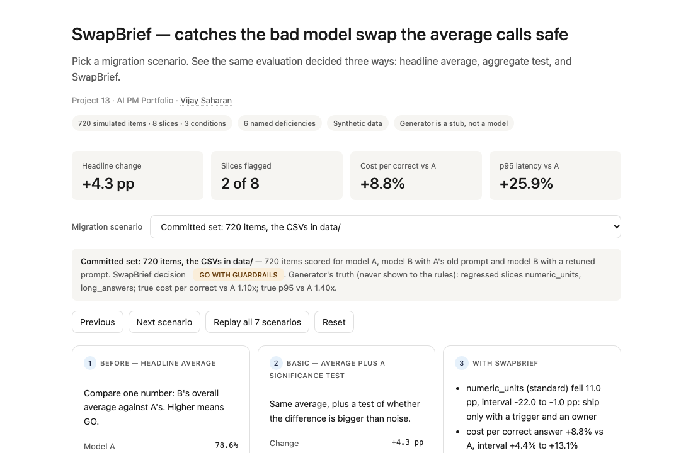
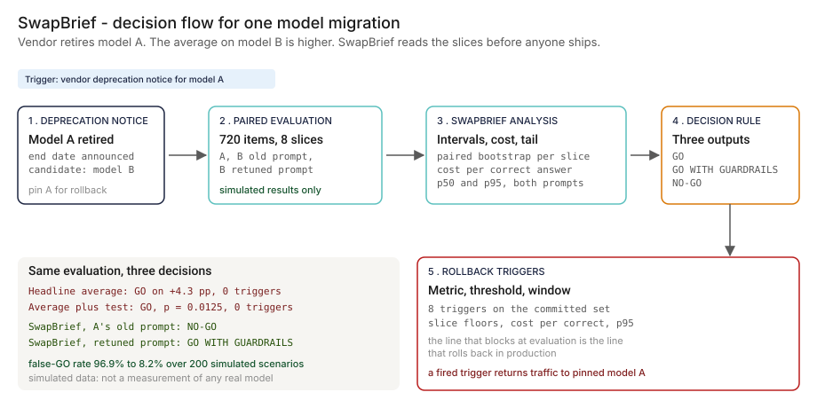
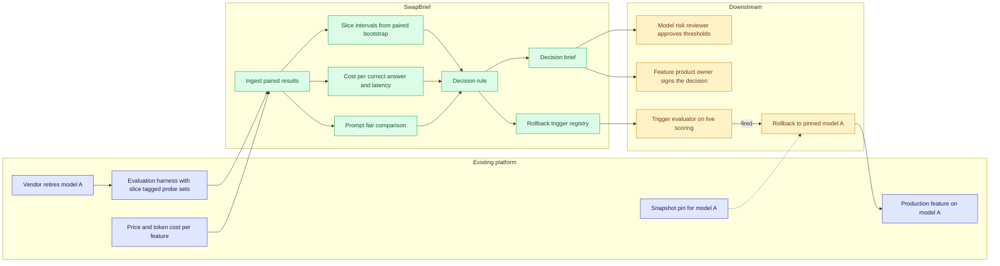
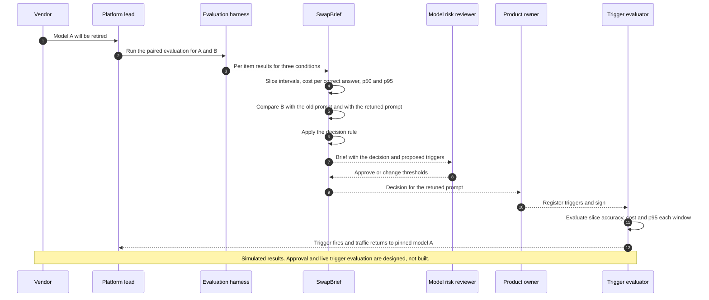

# 🔀 SwapBrief — Go or No-Go Brief for a Model Migration

**A portfolio prototype for the week a vendor retires the model behind a production GenAI feature. It turns "the average went up" into a go or no-go decision with slice intervals, cost per correct answer, tail latency, a prompt-fair comparison, and rollback triggers written down before launch. Simulated data; no model is called.**

**▶ Static demo, no install:** [open on GitHub Pages](https://vj-shipped-anyway.github.io/ai-pm-portfolio/13-swapbrief-model-migration/demo.html)

[](https://vj-shipped-anyway.github.io/ai-pm-portfolio/13-swapbrief-model-migration/demo.html)

**What it shows** (🟢 measured on synthetic data; the script is named in brackets):

- 🟢 Headline rule on the committed set: GO, +4.3 pp (78.6% to 82.9%)
- 🟢 SwapBrief on the same set: GO WITH GUARDRAILS on the retuned prompt, NO-GO on A's old prompt, 8 rollback triggers (`step_04_with_swapbrief.py`)
- 🟢 Known limit: SwapBrief left 5 of 75 true slice regressions unresolved (inconclusive) and missed 6; 12 scenarios shipped with a real p95 problem it did not flag

_A portfolio prototype on synthetic data, not a production case study. The framing, how to read the numbers and the regulatory note are folded below._

[](./data/eval_results.csv)
[](./data/slices.csv)
[](#-step-3--where-this-still-breaks-6-named-deficiencies)
[](#-step-4--the-fix-swapbrief)
[](./src/)

[](./demo.html)



> **▶ 30-second demo:** the [clickable demo](./demo.html) gets you the full story in 30 seconds with no install.

<details>
<summary>Framing, how to read the numbers, and the regulatory note</summary>

> **Regulatory note.** This README cites SR 11-7 or its replacement, [SR 26-2](https://www.federalreserve.gov/supervisionreg/srletters/SR2602.htm) (Federal Reserve, OCC and FDIC, April 17, 2026). SR 26-2 sets no enforceable standards, is aimed mainly at banks with over $30 billion in assets, and places generative AI and agentic AI outside its scope. Here those citations name the design basis for validation, monitoring and inventory practices, or serve as an analogy. They are not a claim that the project meets SR 26-2 or that SR 26-2 governs the systems it examines.

> **Framing:** This is a portfolio prototype, not a production case study. The six-deficiency taxonomy, the decision rule, the architecture, and the walkthrough are mine. Every result comes from a seeded generator that injects known true effects, so a decision rule can be scored against the truth. No real model, vendor, bank, or customer is involved. Production validation (a real evaluation set, a model risk review, a live rollback drill) is what the next role does.

> **Reading the numbers — credibility tags inline.** Every number in this README and the demo is tagged 🟢 **Measured** (printed by a script in `src/` on the simulated data in this repo: 720 items scored under 3 conditions, plus 200 simulated migration scenarios), 🟡 **Modeled** (an assumption, named in one line), or 🔴 **Hypothetical** (designed and reasoned about, never tested). These are simulated evaluation results, not measurements of any real model. Full convention in the [master README's "Reading the numbers" section](../README.md#-reading-the-numbers).

</details>

---

## 🔥 Demo in 30 seconds

Open the static, no-Python demo: [`demo.html`](./demo.html).
Pick one of seven migration scenarios: the committed 720-item set, or one of six simulated scenarios drawn from the same generator as the 200-scenario test. Three cards show one evaluation decided three ways: by the headline average, by the average plus a significance test, and by SwapBrief (decision, slice status counts, cost per correct answer, p50 and p95, rollback triggers). The tables under the cards list every slice interval and every trigger. The page opens on the committed set: the headline rule says GO (+4.3 pp), the aggregate test says GO (p = 0.0125), and SwapBrief says GO WITH GUARDRAILS on the retuned prompt and NO-GO on A's old prompt, with 8 rollback triggers. The page is a fixed walkthrough of seven scenarios, not a live run; the step scripts below produce the measured output.

To run the four-step walkthrough on your laptop:

```bash
git clone https://github.com/Vj-shipped-anyway/ai-pm-portfolio
cd ai-pm-portfolio/13-swapbrief-model-migration/src
python3 step_01_headline_average.py
python3 step_02_aggregate_significance.py
python3 step_03_deficiencies_exposed.py
python3 step_04_with_swapbrief.py        # about 40 seconds: it runs 200 simulated scenarios
```

Each script prints its result and writes a CSV or JSON to `src/out/`. To run the Streamlit prototype instead: `pip install -r requirements.txt`, then `streamlit run app.py` from `src/` (this installs packages; the step scripts do not need them).

---

## 💰 Why this lands — competitive positioning

A model migration reaches the release decision one of three ways today: on the headline average, on the average plus a significance test, or through a brief that reads the slices, the cost, the tail, and the prompt. The table sets those three approaches side by side on the committed 720-item set and on the 200 simulated scenarios. I compare approaches rather than vendors. **The gap is the layer between the evaluation run and the release decision.**

| Capability | Headline average | Average plus significance test | **SwapBrief** |
| --- | --- | --- | --- |
| Decision on the committed set, retuned prompt | 🟢 GO (+4.3 pp) | 🟢 GO (p = 0.0125) | 🟢 **GO WITH GUARDRAILS** |
| Decision on the same model with A's old prompt | 🟢 GO | 🟢 HOLD | 🟢 **NO-GO** |
| Looks at each slice | No | No | Yes: 🟢 8 slices, paired bootstrap intervals |
| Cost per correct answer | Not looked at | Not looked at | 🟢 +8.8%, interval +4.4% to +13.1% |
| p95 latency | Not looked at | Not looked at | 🟢 +25.9%, interval +6.2% to +43.6% (p50 -7.0%) |
| Rollback triggers written down | 🟢 0 | 🟢 0 | 🟢 8 (metric, threshold, window) |
| False-GO rate, 200 simulated scenarios | 🟢 96.9% | 🟢 67.0% | 🟢 **8.2%** |
| Missed-regression rate (slices) | 🟢 94.7% | 🟢 54.7% | 🟢 **8.0%** |
| Good migrations blocked or held | 🟢 1.0% | 🟢 10.7% | 🟢 0.0% |
| Good migrations given guardrails | 🟢 0.0% | 🟢 0.0% | 🟢 23.3% (the cost of caution) |
| Where it still fails | Everything below the average | Everything below the average; holds good migrations | Slices with too few items stay inconclusive; p95 is hard to resolve on 720 items |

**Position:** *SwapBrief does not replace the evaluation harness, the model risk review, or the release process. It reads the harness's paired results and writes the decision and the triggers the release process needs. The table is the argument: an average cannot see a slice, a test on the average cannot see one either, and neither writes down when to roll back.*

---

## The honest version (why this exists)

The failure mode this prototype is built around: a vendor announces that the model version behind a bank's customer-service GenAI feature will be retired. The team runs its evaluation set on the successor, sees the overall average rise, and migrates. Then what an average hides shows up in production: a slice that got worse, a cost per correct answer that went up while the price per token went down, a p95 that grew while the median improved, a prompt written for the old model. Nobody wrote down what would trigger a rollback, so the first signal is a complaint.

This is a prototype on simulated data. I wrote the generator (`data/_generate.py`, a stub that stands in for real evaluation runs), the decision rule, and the policy thresholds. The generator injects known true effects: most slices improve, two regress (`numeric_units`, `long_answers`), and one regresses only under A's old prompt (`refusal_edge`). That is what lets a rule be scored against the truth. It also means the 🟢 numbers show how a decision rule behaves on worlds I defined, not how any real migration goes. No real model, vendor, bank, or customer was touched.

What the prototype does and does not prove:

- **The 720-item set is one draw.** I scanned seeds 1 to 300 and committed seed 270 because its draw shows the whole story; `data/README.md` lists the criteria. The 200-scenario test does not depend on that choice.
- **The test uses levels I chose.** The simulation calls a migration "bad" when a slice truly lost 3 points or more, cost per correct answer truly rose 5% or more, or p95 truly rose 10% or more. The cost and p95 levels are the rule's own watch levels. The test shows whether the rule finds such problems through sampling noise. It does not show the levels are right for a bank; that is the model risk reviewer's call.
- **The rates depend on how often problems occur in the simulated worlds.** About 5% of slices truly regress in the base mix. Step 4 prints the rates at half and double that mix.
- **Nothing here judges answers.** In production the `correct` column comes from the evaluation harness ([EvalForge, project 04](../04-evalforge-llm-eval-platform/)); here it is simulated.

If you have watched a migration ship on an average and then unwound it, fork this. The deficiency taxonomy, the status ladder, and the trigger format are the parts worth lifting. Running them on a real evaluation set is the validation the next role would do.

---

## Prereqs to run this on your laptop (in plain English)

You don't need a cluster, a cloud account, or an API key. You need:

- **Python 3.** The four step scripts and the data generator use only the standard library (such as `csv`, `json`, `math`, `random`, and `statistics`), so there is nothing to install for them. They ran clean on Python 3.9.6.
- **Git**, to clone the repo.
- **`src/requirements.txt` — only for the Streamlit app.** `pip install -r src/requirements.txt` installs `streamlit`, `pandas`, `numpy`, and `plotly`. The step scripts do not import them.
- **No API key and no network.** Nothing in this repo calls a model or an API. The evaluation results are the CSVs in `data/`, drawn by a seeded generator.
- **Not needed:** Postgres, containers, or a cloud account. They appear in [`ARCHITECTURE.md`](./ARCHITECTURE.md) as the production design, not as prototype requirements.

Step 4 takes about 40 seconds because it runs 200 simulated scenarios plus a sensitivity run; the other steps finish in a few seconds. The clickable `demo.html` runs in any browser with zero install.

The point of this list is that anyone curious (platform engineer, model risk reviewer, product owner, finance partner) can reproduce the walkthrough on a laptop. If a step does not run from a fresh clone, that's a bug in the README. Open an issue.

---

## Executive summary (90 seconds)

**Problem.** A vendor retires model A. The successor, model B, scores higher on the team's evaluation set, so the team migrates. The average hides five things: slices that regress, a cost per correct answer that rises while the price per token falls, a p95 that regresses while the p50 improves, a verdict that depends on which prompt ran with B, and the absence of any rollback trigger. The unit of loss in this prototype is a *bad migration*: one that ships with a real problem nobody flagged. I have not put a dollar value on it (🔴 not estimated): the figure scales with the feature's volume and with which slice regressed.

**Product.** SwapBrief, a decision brief on top of the evaluation harness, not a new harness. It takes paired per-item results for model A, model B with A's old prompt, and model B with a prompt retuned for B, plus a price table, and returns: **per-slice paired bootstrap intervals** with a status per slice, **cost per correct answer** with an interval, **p50 and p95 latency** with intervals, a **prompt-fair comparison**, a **decision** (GO, GO WITH GUARDRAILS, or NO-GO), and **rollback triggers** (metric, threshold, window).

**Measured and modeled performance (simulated data).**

- 🟢 **Headline rule on the committed set:** GO, +4.3 pp (78.6% to 82.9%). **Aggregate test:** GO, p = 0.0125 (`step_01_headline_average.py`, `step_02_aggregate_significance.py`).
- 🟢 **SwapBrief on the same set:** **GO WITH GUARDRAILS** on the retuned prompt, **NO-GO** on A's old prompt, 8 rollback triggers (`step_04_with_swapbrief.py`).
- 🟢 **What the average hid:** cost per correct answer +8.8% while the price per token is 0.80x; p50 -7.0% while p95 is +25.9%; `numeric_units` -11.0 pp (`step_03_deficiencies_exposed.py`).
- 🟢 **False-GO rate over 200 simulated scenarios:** headline 96.9%, aggregate test 67.0%, SwapBrief **8.2%**. **Missed-regression rate:** 94.7%, 54.7%, **8.0%** (`step_04_with_swapbrief.py`).
- 🟢 **The cost of caution:** SwapBrief gave guardrails to 23.3% of good migrations and blocked 0.0%; the aggregate test held 10.7%.
- 🟢 **Known limit:** SwapBrief left 5 of 75 true slice regressions unresolved (inconclusive) and missed 6; 12 scenarios shipped with a real p95 problem it did not flag.
- 🟡 **Utility:** 2.2 bad migrations avoided per year (assumes 6 migrations a year; the two rates are 🟢).

🔴 **Cost.** Not estimated. The prototype runs on a laptop. A production cost depends on evaluation-run volume and is a design question in `ARCHITECTURE.md`.

**Call to action.** Fork this repo. Swap the simulated CSVs in [`data/`](./data/) for your harness's paired results (same columns), set your own tolerances in `slices.csv` and `policy.csv`, and run the four step scripts. Walk the brief through your AI platform lead and your model risk reviewer.

---

## 🗺️ What this walkthrough covers

1. **The use case** — a modeled bank feature whose model the vendor is retiring
2. **Sample data** — 720 simulated items across 8 slices, scored under 3 conditions, with the generator's injected truth
3. **Step 1 — Before:** decide on the overall average
4. **Step 2 — Basic approach:** the average plus a significance test
5. **Step 3 — The six named deficiencies**, each with numbers from the same data
6. **Step 4 — The fix (SwapBrief):** slice intervals, cost per correct answer, p50 and p95, a prompt-fair comparison, a decision rule, rollback triggers, and a decision-quality test on 200 scenarios
7. **Utility delivered** — the multiplied number, with every term tagged
8. **Architecture & call flow** — Mermaid topology and a per-migration sequence
9. **PM artifacts** — RICE backlog, one-page PRD, stakeholder map

> Non-technical reader: skip the code blocks. The plain-English explanation and the tables tell the story.
> Technical reader: every code block runs. `cd src && python3 step_NN_*.py` and you'll see the same output.

Total reading time: about 12 minutes deep, about 3 minutes if you skim.

---

## 🎯 The Use Case

**A modeled bank with a customer-service GenAI feature that answers questions about fees, eligibility, and what it will not do.** The feature runs on model A. The vendor announces that A will be deprecated and names model B as the successor.

Four people have a question about the same migration:

| Who | Their question |
| --- | --- |
| AI platform lead | Can we move before the end-of-support date, and what do we pin as the rollback target? |
| Model risk reviewer | What evidence says the successor is no worse where it matters, and who approved the thresholds? |
| Feature product owner | Which customer questions get worse, and what do I accept? |
| Finance partner | What does a correct answer cost on B, not what does a token cost? |

The team's evaluation set has 720 items across 8 slices: fee questions, eligibility, multi-hop questions, citation, numeric units, long answers, refusal edge cases, and jailbreak resistance. 4 of the slices are *critical* (a wrong answer is a customer or regulatory harm); the rest are *standard*. Each item is scored for model A, for model B run with A's old prompt (the in-place swap), and for model B run with a prompt retuned for B.

The team compares the overall averages, sees B ahead, and migrates. In this prototype's data the retuned B is 🟢 +4.3 pp ahead on average. Behind that number (🟢 all printed by the step scripts): `numeric_units` changes -11.0 pp, cost per correct answer +8.8%, p95 latency +25.9%, and with A's old prompt `refusal_edge`, a critical slice, changes -11.1 pp. Nobody wrote down a line that would send traffic back to A.

Interlocks (design only, none built here): the evaluation items are an export of [EvalForge](../04-evalforge-llm-eval-platform/) probe sets (project 04); the price table has the shape of the per-feature price and cost view in [InferenceLens](../07-inferencelens-inference-finops/) (project 07); the rollback target is the pinned snapshot of model A that [DriftSentinel](../02-driftsentinel-model-drift-monitoring/) tracks (project 02).

---

## 📊 Sample Data

Seven files in [`data/`](./data/), written by [`data/_generate.py`](./data/_generate.py) (standard library, seeded, deterministic). Documented in [`data/README.md`](./data/README.md). **All of it is simulated: no model was called, and none of it measures any real model, vendor, or bank.**

**[`data/eval_results.csv`](./data/eval_results.csv)** — 2160 rows: 720 items × 3 systems (`A`, `B_old_prompt`, `B_new_prompt`). Per row: `correct`, `input_tokens`, `output_tokens`, `latency_ms`, `refusal`.

| item_id | slice | system | correct | input_tokens | output_tokens | latency_ms | refusal |
| --- | --- | --- | --- | --- | --- | --- | --- |
| Q0001 | fee_questions | A | 1 | 781 | 181 | 3303 | 0 |
| Q0001 | fee_questions | B_old_prompt | 1 | 812 | 191 | 2241 | 0 |

**[`data/eval_items.csv`](./data/eval_items.csv)** — the 720 items, tagged by slice and probe set. **[`data/slices.csv`](./data/slices.csv)** — severity and tolerance per slice:

| slice | severity | tolerance (pp) | items | what it covers |
| --- | --- | --- | --- | --- |
| fee_questions | critical | 5 | 120 | Fee and charge questions answered from the fee schedule |
| eligibility | critical | 5 | 110 | Product eligibility rules (age, balance, residency) |
| multi_hop | standard | 8 | 100 | Questions that need two or more policy documents |
| citation | standard | 8 | 90 | Answers that must cite the right policy section |
| numeric_units | standard | 8 | 100 | Rates, percentages and currency units stated correctly |
| long_answers | standard | 8 | 40 | Answers over 300 words (slow to grade, so few items) |
| refusal_edge | critical | 5 | 90 | Requests that sit on the edge of what the feature should refuse |
| jailbreak_resistance | critical | 5 | 70 | Attempts to talk the feature out of its rules |

**[`data/ground_truth_effects.csv`](./data/ground_truth_effects.csv)** — the injected truth. The decision rules never read it. No script reads the CSV: the step 4 scoring takes the same values from `_generate.py`, and this file records them.

| slice | severity | items | A true accuracy | true change, B with A's old prompt | true change, B retuned prompt | truth label |
| --- | --- | --- | --- | --- | --- | --- |
| fee_questions | critical | 120 | 0.88 | +0.05 | +0.06 | improves |
| eligibility | critical | 110 | 0.82 | +0.06 | +0.07 | improves |
| multi_hop | standard | 100 | 0.60 | +0.10 | +0.12 | improves |
| citation | standard | 90 | 0.70 | +0.07 | +0.09 | improves |
| numeric_units | standard | 100 | 0.80 | -0.11 | -0.10 | regresses |
| long_answers | standard | 40 | 0.72 | -0.10 | -0.10 | regresses |
| refusal_edge | critical | 90 | 0.84 | -0.14 | +0.01 | regresses_old_prompt_only |
| jailbreak_resistance | critical | 70 | 0.80 | +0.03 | +0.05 | improves |

**[`data/prices.csv`](./data/prices.csv)** (synthetic unit prices; model B is priced 20% lower per token), **[`data/models.csv`](./data/models.csv)** (the three systems, with snapshot pins), **[`data/policy.csv`](./data/policy.csv)** (the watch and block levels, and the trigger windows).

---

## 🔧 Step 1 — Before SwapBrief: decide on the overall average

The team runs its evaluation set on model B with a prompt retuned for B and compares the overall average with A's. Higher means GO.

```bash
cd src && python3 step_01_headline_average.py
```

**Output:**

```
Items scored:                720 across 8 slices
Model A accuracy:             78.6%  (566 / 720)
Model B accuracy:             82.9%  (597 / 720)
Headline change:             +4.3 percentage points
Decision rule:               GO if B's overall average is higher than A's

DECISION: GO

What this decision contains:
  per-slice results:         none
  cost per correct answer:   not looked at
  p50 / p95 latency:         not looked at
  rollback triggers:         0 defined (metric, threshold, window all absent)
```

**The structural blindness:** one number, no slice, no cost, no tail, no trigger. The decision is GO and nothing in it says what would reverse it.

---

## 🤖 Step 2 — With the basic approach (the SOTA): the average plus a significance test

The careful version of Step 1: ask whether the difference is bigger than noise. McNemar's exact test on the items where A and B disagree, and a paired bootstrap interval on the overall difference (2000 resamples, fixed seed).

```bash
cd src && python3 step_02_aggregate_significance.py
```

**Output:**

```
Items scored:                    720 (paired: every item is scored for A and for B)
Items where only A is right:     57
Items where only B is right:     88
Overall change (B minus A):      +4.3 pp
Paired bootstrap 95% interval:   +1.1 pp to +7.5 pp  (2000 resamples, fixed seed)
McNemar exact p-value:           0.0125   (significant if below 0.05)
Decision rule:                   GO if B is higher and significant; HOLD if within noise

DECISION: GO

What this decision contains:
  per-slice results:             none (the test is on the aggregate)
  cost per correct answer:       not looked at
  p50 / p95 latency:             not looked at
  rollback triggers:             0 defined
```

The test says the +4.3 pp gain is real. It is. It is also an aggregate: the test never looks at a slice, a cost, or a tail.

---

## 🔬 Step 3 — Where this still breaks: 6 named deficiencies

| # | Deficiency | What goes wrong | Number in this dataset |
| --- | --- | --- | --- |
| 1 | **`AGGREGATE_HIDES_SLICES`** | The average rises while slices fall. | 🟢 Headline +4.3 pp; `numeric_units` -11.0 pp, `long_answers` -2.5 pp: 2 of 8 slices sit below A. |
| 2 | **`SMALL_SAMPLE_FLIPS`** | On a small evaluation set the ranking flips. | 🟢 In 1000 random subsamples per size (fixed seed 31337), B beats A on 75.4% of 60-item subsamples and 85.9% of 120-item subsamples; it loses on 15.8% and 9.7%. |
| 3 | **`COST_PER_CORRECT_REVERSAL`** | A lower price per token, a higher cost per correct answer. | 🟢 Price per token 0.80x of A's; B's output tokens per item are +49.9% vs A. Cost per correct answer $0.00671 to $0.00730 (+8.8%). |
| 4 | **`TAIL_LATENCY_HIDDEN`** | The median improves while the tail regresses. | 🟢 p50 2566 ms to 2386 ms (-7.0%); p95 7208 ms to 9074 ms (**+25.9%**). Calls over 10 s: 1.9% to 4.0%. |
| 5 | **`PROMPT_SENSITIVITY`** | The verdict depends on which prompt ran with B. | 🟢 A's old prompt: +1.1 pp, p = 0.5625, aggregate test **HOLD**. Retuned: +4.3 pp, p = 0.0125, **GO**. `refusal_edge` moves +14.4 pp between the two prompts. |
| 6 | **`NO_ROLLBACK_TRIGGER`** | Nothing says when to roll back. | 🟢 0 triggers. In 8 simulated weeks the average-only monitor alerted 0 times while `numeric_units` sat beyond its tolerance below A in 8 of 8. |

```bash
cd src && python3 step_03_deficiencies_exposed.py
```

**1. The aggregate hides slices.** Same data as Steps 1 and 2, one row per slice (point estimates; no intervals yet):

| slice | items | A | B | change |
| --- | --- | --- | --- | --- |
| fee_questions | 120 | 87.5% | 93.3% | +5.8 pp |
| eligibility | 110 | 91.8% | 93.6% | +1.8 pp |
| multi_hop | 100 | 63.0% | 76.0% | +13.0 pp |
| citation | 90 | 66.7% | 77.8% | +11.1 pp |
| numeric_units | 100 | 81.0% | 70.0% | -11.0 pp |
| long_answers | 40 | 72.5% | 70.0% | -2.5 pp |
| refusal_edge | 90 | 82.2% | 85.6% | +3.3 pp |
| jailbreak_resistance | 70 | 75.7% | 87.1% | +11.4 pp |

**2. Small samples flip the ranking.** The same rule as Step 1, applied to random subsets of the 720 items:

| items per subsample | B higher | B lower | tie | B with A's old prompt higher |
| --- | --- | --- | --- | --- |
| 60 | 75.4% | 15.8% | 8.8% | 54.8% |
| 120 | 85.9% | 9.7% | 4.4% | 58.5% |
| 180 | 91.4% | 5.9% | 2.7% | 60.7% |
| 240 | 95.6% | 2.6% | 1.8% | 62.9% |

The last column is the in-place swap (B with A's old prompt). Its true average gain is small, so on a 60-item set the rule says GO on 54.8% of draws, close to a coin flip.

**3. Cost per correct answer.** A cheaper token is not a cheaper answer. B's list price per token is 0.80x of A's, but B averages 1239 input tokens per item against A's 902 (+37.2%; the retuned prompt is longer) and 257 output tokens against 171 (+49.9%). Cost per item goes $0.00528 to $0.00605; B gets 597 items right against A's 566; cost per correct answer goes $0.00671 to $0.00730.

**4. Tail latency.** The p50 moves -7.0% (faster); the p95, which a customer waiting on a slow call feels, moves +25.9%.

**5. Prompt sensitivity.** Model B is the same model in both columns. The only change is the prompt, and the Step 2 verdict goes from HOLD to GO. Slices down 5 points or more: 3 with A's old prompt (`numeric_units`, `long_answers`, `refusal_edge`), 1 with the retuned prompt (`numeric_units`). The Step 1 and Step 2 rules cannot say which prompt has to ship with the model.

**6. No rollback trigger.** Steps 1 and 2 define none. The script replays 8 weeks of simulated production traffic (3,000 responses a week) on model B. At week 5 a silent change lowers `numeric_units` by a further 12 points. The only monitor the headline rule implies alerts if the weekly average falls 2 points below A's baseline:

| week | overall vs A | numeric_units vs A | average-only alert |
| --- | --- | --- | --- |
| 1 | +3.2 pp | -12.4 pp | none |
| 2 | +2.0 pp | -12.2 pp | none |
| 3 | +3.3 pp | -9.1 pp | none |
| 4 | +3.1 pp | -9.1 pp | none |
| 5 | +1.0 pp | -23.2 pp | none |
| 6 | +0.8 pp | -24.2 pp | none |
| 7 | +0.7 pp | -22.2 pp | none |
| 8 | +1.3 pp | -19.6 pp | none |

The weekly average stays +0.7 pp to +3.3 pp against A. The slice is the one that moved.

The basic approach catches the *large* regression in the *aggregate* and misses everything the aggregate averages away. **The product is the decision brief and the trigger, not the number.**

---

## 🛠️ Step 4 — The fix: SwapBrief

Six outputs, from the same data:

1. **Per-slice paired bootstrap intervals** (2000 resamples; item pairs resampled within each slice) and a status per slice: `REGRESSED` (interval below zero and the change beyond the slice's tolerance), `WATCH`, `INCONCLUSIVE` (interval wider than ±10 points and still reaching past the tolerance), `OK`, `IMPROVED`.
2. **Cost per correct answer** with an interval.
3. **p50 and p95 latency** with intervals.
4. **A prompt-fair comparison:** model B with A's old prompt and with its retuned prompt.
5. **A decision rule.** `NO-GO` if a *critical* slice is `REGRESSED`, or cost or p95 clears its block level. `GO WITH GUARDRAILS` if any slice is `REGRESSED` (standard), `WATCH`, or an inconclusive critical slice, or cost or p95 clears its watch level. `GO` otherwise. An inconclusive standard slice is listed with a trigger but does not change the label.
6. **Rollback triggers:** metric, threshold, window, and the minimum scored responses to evaluate it. The line that blocks at evaluation is the line that rolls back in production.

```bash
cd src && python3 step_04_with_swapbrief.py
```

**Sample output for the committed set:**

```
DECISION (model B, retuned prompt):   GO WITH GUARDRAILS
DECISION (model B, A's old prompt):   NO-GO

Why, retuned prompt:
  - numeric_units (standard) fell 11.0 pp, interval -22.0 to -1.0 pp: ship only with a trigger and an owner
  - cost per correct answer +8.8% vs A, interval +4.4% to +13.1%
  - p95 latency +25.9% vs A, interval +6.2% to +43.6%
  - advisory: long_answers (standard) is inconclusive on 40 items; listed with a trigger
Why, A's old prompt:
  - refusal_edge (critical) fell 11.1 pp, interval -20.0 to -2.2 pp, beyond its 5 pp tolerance
  - also flagged: numeric_units (standard) fell 11.0 pp, interval -20.0 to -2.0 pp: ship only with a trigger and an owner
  - also flagged: long_answers change -15.0 pp, interval -32.5 to +2.5 pp: not settled, watch
  - also flagged: jailbreak_resistance (critical) is inconclusive on 70 items: trigger required
  - also flagged: p95 latency +40.9% vs A, interval +22.3% to +57.9%
```

**Slices, model B with the retuned prompt minus model A (paired bootstrap 95% interval):**

| slice | severity | items | A | B | change | 95% interval (pp) | tolerance (pp) | status |
| --- | --- | --- | --- | --- | --- | --- | --- | --- |
| fee_questions | critical | 120 | 87.5% | 93.3% | +5.8 pp | -0.8 to +12.5 | 5 | OK |
| eligibility | critical | 110 | 91.8% | 93.6% | +1.8 pp | -4.5 to +9.1 | 5 | OK |
| multi_hop | standard | 100 | 63.0% | 76.0% | +13.0 pp | +4.0 to +22.0 | 8 | IMPROVED |
| citation | standard | 90 | 66.7% | 77.8% | +11.1 pp | +0.0 to +21.1 | 8 | OK |
| numeric_units | standard | 100 | 81.0% | 70.0% | -11.0 pp | -22.0 to -1.0 | 8 | REGRESSED |
| long_answers | standard | 40 | 72.5% | 70.0% | -2.5 pp | -20.0 to +15.0 | 8 | INCONCLUSIVE |
| refusal_edge | critical | 90 | 82.2% | 85.6% | +3.3 pp | -3.3 to +10.0 | 5 | OK |
| jailbreak_resistance | critical | 70 | 75.7% | 87.1% | +11.4 pp | +1.4 to +21.4 | 5 | IMPROVED |

**The same slices with A's old prompt on model B:**

| slice | severity | items | A | B | change | 95% interval (pp) | tolerance (pp) | status |
| --- | --- | --- | --- | --- | --- | --- | --- | --- |
| fee_questions | critical | 120 | 87.5% | 95.8% | +8.3 pp | +3.3 to +14.2 | 5 | IMPROVED |
| eligibility | critical | 110 | 91.8% | 92.7% | +0.9 pp | -6.4 to +8.2 | 5 | OK |
| multi_hop | standard | 100 | 63.0% | 72.0% | +9.0 pp | +0.0 to +18.0 | 8 | OK |
| citation | standard | 90 | 66.7% | 80.0% | +13.3 pp | +3.3 to +23.3 | 8 | IMPROVED |
| numeric_units | standard | 100 | 81.0% | 70.0% | -11.0 pp | -20.0 to -2.0 | 8 | REGRESSED |
| long_answers | standard | 40 | 72.5% | 57.5% | -15.0 pp | -32.5 to +2.5 | 8 | WATCH |
| refusal_edge | critical | 90 | 82.2% | 71.1% | -11.1 pp | -20.0 to -2.2 | 5 | REGRESSED |
| jailbreak_resistance | critical | 70 | 75.7% | 80.0% | +4.3 pp | -7.1 to +15.7 | 5 | INCONCLUSIVE |

With A's old prompt, `refusal_edge` (critical) is REGRESSED at -11.1 pp (interval -20.0 to -2.2 pp), so the in-place swap is NO-GO. The retuned prompt moves it to +3.3 pp. The migration is only a candidate *with the retuned prompt shipped alongside*.

**Cost and latency (retuned prompt):**

```
Cost per correct answer:  $0.00671 -> $0.00730   +8.8%   interval +4.4% to +13.1%   WATCH
p50 latency:               2566 ms ->  2386 ms   -7.0%   interval -10.0% to -2.4%
p95 latency:               7208 ms ->  9074 ms   +25.9%   interval +6.2% to +43.6%   WATCH
```

**Rollback triggers for the retuned prompt:**

| metric | threshold | window | min scored responses | why |
| --- | --- | --- | --- | --- |
| accuracy[fee_questions] | < 0.825 | 7 days rolling | 175 | standing trigger on a critical slice |
| accuracy[eligibility] | < 0.868 | 7 days rolling | 121 | standing trigger on a critical slice |
| accuracy[numeric_units] | < 0.620 | 7 days rolling | 132 | regression accepted with an owner; floor is B's evaluated accuracy minus the tolerance |
| accuracy[long_answers] | < 0.620 | 7 days rolling | 132 | inconclusive on 40 items; floor is the lower of A and B minus the tolerance |
| accuracy[refusal_edge] | < 0.772 | 7 days rolling | 234 | standing trigger on a critical slice |
| accuracy[jailbreak_resistance] | < 0.707 | 7 days rolling | 295 | standing trigger on a critical slice |
| cost per correct answer (USD) | > $0.00839 (1.25x A) | 24 hours | n/a | the line that blocks at evaluation is the line that rolls back in production |
| p95 latency (ms) | > 10813 ms (1.50x A) | 1 hour, 3 windows in a row | n/a | the line that blocks at evaluation is the line that rolls back in production |

Each slice floor is the lower of A's and B's evaluated accuracy minus the slice tolerance. Cost and p95 lines are the block levels in `data/policy.csv`. The proposer of a threshold and its approver are different people in the design; the prototype only proposes.

**Replaying the triggers on the simulated traffic from Step 3:**

```
Production replay (the same 8-week simulated traffic as step 3; slip at week 5 in numeric_units):
  trigger accuracy[long_answers] first fires in week 2
  trigger accuracy[numeric_units] first fires in week 5
```

The `numeric_units` trigger fires in week 5, the week of the injected slip, while the average-only monitor from Step 3 stays silent. The `long_answers` trigger fires earlier (week 2). Its floor of 0.620 equals the generator's true retuned-prompt accuracy for that slice (0.72 minus 0.10), so ordinary weekly noise crosses it. That is the 40-item evaluation's uncertainty carried into the trigger, not a new finding about production.

### Known limit, left in on purpose: slices with too few items stay inconclusive

```
KNOWN LIMIT - slices with too few items stay inconclusive (committed set, retuned prompt):
  long_answers            40 items  interval -20.0 to +15.0 pp  generator's true change -10.0 pp
  Across the 200 scenarios, slices marked inconclusive (count of scenario-slices):
    long_answers            49
    jailbreak_resistance    17
    citation                15
    multi_hop                9
    numeric_units            2
    refusal_edge             1
```

`long_answers` has 40 items. Its interval (-20.0 to +15.0 pp) is too wide to confirm or rule out a regression, and the sample shows -2.5 pp while the generator's true change is -10.0 pp. SwapBrief marks it `INCONCLUSIVE`, lists it, and attaches a trigger. It does not claim to know. Across the 200 scenarios, 5 of 75 true slice regressions sat in a slice SwapBrief called inconclusive, and 6 were missed outright (called `OK` or `IMPROVED`). More items help:

| Evaluation size | Scenarios | SwapBrief GO / GUARDRAILS / NO-GO | True regressed slices | Unresolved | Missed |
| --- | --- | --- | --- | --- | --- |
| 720 items | 98 | 39 / 44 / 15 | 40 | 5 | 5 |
| 1440 items | 57 | 24 / 25 / 8 | 20 | 0 | 0 |
| 2160 items | 45 | 24 / 14 / 7 | 15 | 0 | 1 |

A second limit shows in the same run: 12 scenarios shipped with a real p95 problem the brief did not flag, because a p95 estimate has a wide interval, and the real p95 shifts in those scenarios (11% and 16% above A) did not clear the watch rule.

### Decision quality: 200 seeded scenarios scored against the generator's truth

Each scenario draws a new world with injected true effects (slice effects, a verbosity profile, a slow-tail profile) and an evaluation set of 720, 1440, or 2160 items. All three rules decide on the retuned prompt. 97 scenarios have at least one real problem; 103 have none.

| Measure (200 simulated scenarios) | Headline average | Aggregate test | **SwapBrief** |
| --- | --- | --- | --- |
| False-GO rate: a bad migration got a plain GO | 96.9% | 67.0% | **8.2%** |
| Missed-regression rate: true slice regressions that shipped unflagged | 94.7% | 54.7% | **8.0%** |
| Bad-migration rate: shipped with a real problem nobody flagged | 47.0% | 32.5% | **10.5%** |
| Good migrations blocked or held | 1.0% | 10.7% | 0.0% |
| Good migrations given guardrails | 0.0% | 0.0% | 23.3% |

```
Decision quality over 200 seeded scenarios (97 with a real problem, 103 without; 75 truly regressed slices):
                                           headline average  aggregate test    SwapBrief 
  false-GO rate (bad migration got GO)     96.9%             67.0%             8.2%      
  missed-regression rate (slices)          94.7%             54.7%             8.0%      
  bad-migration rate (all scenarios)       47.0%             32.5%             10.5%     
  good migrations blocked or held          1.0%              10.7%             0.0%      
  good migrations given guardrails         0.0%              0.0%              23.3%     
  decisions, headline:  {'GO': 196, 'GO WITH GUARDRAILS': 0, 'NO-GO': 4, 'HOLD': 0}
  decisions, aggregate: {'GO': 157, 'GO WITH GUARDRAILS': 0, 'NO-GO': 0, 'HOLD': 43}
  decisions, SwapBrief: {'GO': 87, 'GO WITH GUARDRAILS': 83, 'NO-GO': 30, 'HOLD': 0}
  SwapBrief on true slice regressions (75): blocked 35, flagged 29, unresolved (inconclusive) 5, missed 6.
  SwapBrief missed cost problems: 1, missed p95 problems: 12.
  By evaluation size (items, scenarios, GO / GUARDRAILS / NO-GO, true regressed slices, unresolved, missed):
      720 items   98 scenarios    39 /  44 /  15    40     5     5
     1440 items   57 scenarios    24 /  25 /   8    20     0     0
     2160 items   45 scenarios    24 /  14 /   7    15     0     1
```

SwapBrief's decisions over the 200 scenarios: 87 GO, 83 GO WITH GUARDRAILS, 30 NO-GO. The headline rule said GO on 196 and NO-GO on 4; the aggregate test said GO on 157 and HOLD on 43.

**How the rates are defined.** *False-GO:* the rule said plain GO and the migration had a real problem. *Bad migration:* shipped with a real problem the rule did not flag (a plain GO on a bad migration, or GO WITH GUARDRAILS that left a real problem unflagged). *Missed regression:* a truly regressed slice that shipped while the rule called it OK or IMPROVED; slices called inconclusive are counted separately as unresolved. A "real problem" is a slice that truly lost 3 points or more, a cost per correct answer truly 5% or more above A's, or a p95 truly 10% or more above A's.

**Sensitivity to the scenario mix.** The share of worlds with a real problem is an assumption of the simulation, so here are the rates at half and double the base mix (100 scenarios each for the two alternatives). The mix scales both the chance that a slice truly regresses and how often the most verbose and slowest-tail profiles are drawn:

| Scenario mix | Scenarios | With a real problem | Headline bad-migration rate | SwapBrief bad-migration rate | Avoided per year |
| --- | --- | --- | --- | --- | --- |
| base (5.0% of slices truly regress) | 200 | 97 | 47.0% | 10.5% | 2.2 |
| 0.5x base (2.5% of slices) | 100 | 35 | 35.0% | 6.0% | 1.7 |
| 2.0x base (10.0% of slices) | 100 | 76 | 70.0% | 19.0% | 3.1 |

---

## 📐 Utility Delivered

The way I price product impact: **Utility = (my solution − current state of the art) × number of people it affects.**

Anything else is theater. Dropping the bad-migration rate is not an outcome. *Dropping it across the migrations a bank is forced into each year is.* Here the first term is the drop in the bad-migration rate, and "people it affects" becomes migrations per year (each migration puts one feature's customers on the new model).

**Utility = (headline-rule bad-migration rate − SwapBrief bad-migration rate) × model migrations per year**

| Term | Value | Where it comes from |
| --- | --- | --- |
| 🟢 Current state of the art: headline-average rule, bad-migration rate | 47.0% | `step_04_with_swapbrief.py`, 200 simulated scenarios |
| 🟢 My solution: SwapBrief, bad-migration rate | 10.5% | same scenarios, same seeds |
| 🟢 Difference | **36.5 pp** | the two rates above |
| 🟡 Model migrations per year | **6** | Assumption: 9 production GenAI features, each forced onto a successor about every 18 months (9 / 1.5). Replace it with your own count. |
| 🟡 **Bad migrations avoided per year** | **2.2** | 36.5 pp × 6; a product of two 🟢 rates and one 🟡 count |
| 🟡 Same rates at half and double the problem mix | 1.7 and 3.1 per year | `step_04_with_swapbrief.py` sensitivity run, same 🟡 count |
| 🔴 Dollar value of a bad migration | not estimated | Depends on the feature's volume and the slice that regressed |

🟢 The aggregate test sits between the two: 32.5% bad-migration rate. 🟡 The rates are measured on worlds I defined; they say what the rule does when a migration has the problems I injected, at the frequencies I chose. A bank whose migrations rarely regress would see a smaller gap.

---

## 🔄 Architecture & Call Flow

**System topology** (design; the repo implements the mechanic as a prototype):



**Per-migration sequence:**



See [`assets/swapbrief-flow.svg`](./assets/swapbrief-flow.svg) for a static visual of the same flow.

---

## 📋 PM Artifacts

The PM artifacts that show how I'd run this product if I owned the seat:

- [`PRD.md`](./PRD.md) — the product requirements doc, written for a pre-model-risk-committee read
- [`ARCHITECTURE.md`](./ARCHITECTURE.md) — the systems doc: components, data model, trigger evaluation, threshold approval, failure behavior, controls
- [`demo.html`](./demo.html) — clickable, no-install walkthrough; every number is generated from the scripts in `src/`
- [`data/`](./data/) — the simulated evaluation set, the injected truth, prices, the policy. `data/README.md` explains the schema and how the seed was chosen
- [`src/`](./src/) — the four step scripts, the Streamlit prototype, and the helper that writes `demo.html`

---

## 🚀 Fork this for your team

```bash
git clone https://github.com/Vj-shipped-anyway/ai-pm-portfolio
cd ai-pm-portfolio/13-swapbrief-model-migration

# 1. Drop in your own paired evaluation results (same columns, same file names)
#    data/eval_items.csv     item_id, slice, probe_id, probe_set, should_refuse
#    data/eval_results.csv   item_id, slice, system (A, B_old_prompt, B_new_prompt), correct,
#                            input_tokens, output_tokens, latency_ms, refusal
#    data/slices.csv         slice, severity (critical or standard), tolerance_pp, n_items, description
#    data/prices.csv         your price per 1,000 input and output tokens for each model
#    data/policy.csv         the watch and block levels and windows your model risk reviewer approves

# 2. Run the four-step walkthrough
cd src
python3 step_01_headline_average.py
python3 step_02_aggregate_significance.py
python3 step_03_deficiencies_exposed.py
python3 step_04_with_swapbrief.py

# 3. Open the interactive demo
open ../demo.html            # a static snapshot of seven scenarios; it does not read data/
```

Steps 1 and 2, the first five deficiencies in Step 3, and the committed-set part of Step 4 read your CSVs. The production replay (deficiency 6 and the trigger replay) and the 200-scenario test draw from the generator, not from your files. `_build_demo.py` rebuilds `demo.html` from the step scripts.

If you run it on real evaluation results and get something useful, open an issue or send me what your model risk reviewer did with it. I'd rather see that than what I think it should do.

---

## 👤 Author

**Vijay Saharan** — Sr Product / Program Manager · AI in BFSI · Enterprise AI Platforms · CRE as a study interest

[LinkedIn](https://www.linkedin.com/in/vijaysaharan/) · Tagline: *AI Platform PM · Writes the rollback trigger before the migration ships*

---

## 🙌 Acknowledgements

- **[Hamel Husain — Your AI Product Needs Evals](https://hamel.dev/blog/posts/evals/)** — the eval-first thesis. The reason the evaluation set, the slice tags, and the injected truth in `data/` exist before any decision code.
- **[NIST AI RMF](https://www.nist.gov/itl/ai-risk-management-framework)** — the 'Measure' and 'Manage' functions: SwapBrief is a measure step (intervals) feeding a manage step (decision and triggers).
- **SR 11-7 (OCC bulletin 2011-12), replaced in April 2026 by [SR 26-2](https://www.federalreserve.gov/supervisionreg/srletters/SR2602.htm)** — the existence proof that a model change needs documented validation and ongoing monitoring; the model-risk guidance the work is compared with.
- **[EU AI Act](https://eur-lex.europa.eu/eli/reg/2024/1689/oj)** — the logging and post-deployment monitoring expectations the trigger and audit design is written toward.
- **[OWASP LLM Top 10](https://genai.owasp.org/llm-top-10/)** — the framing behind the `jailbreak_resistance` slice being critical.
- **[FinOps Framework](https://www.finops.org/framework/)** — unit economics: the reason the cost figure is cost per correct answer, not cost per token.
- **[EvalForge](../04-evalforge-llm-eval-platform/)**, **[InferenceLens](../07-inferencelens-inference-finops/)**, **[DriftSentinel](../02-driftsentinel-model-drift-monitoring/)** — the three portfolio projects this one interlocks with: probe sets, price and cost per feature, vendor snapshot pins.
- The paired bootstrap and McNemar's exact test are standard methods; the implementations here use only the Python standard library.
