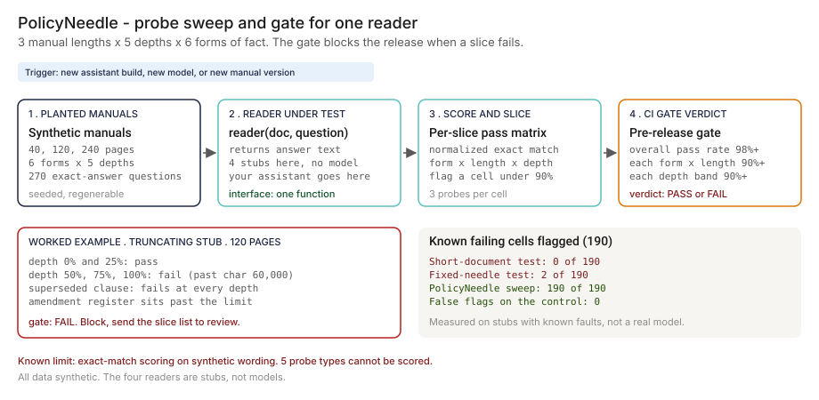
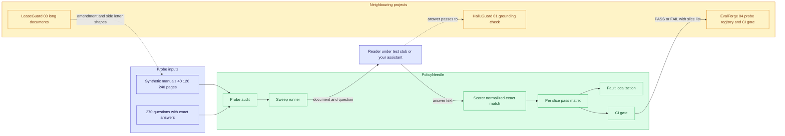
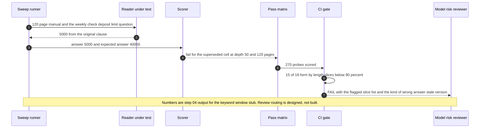

# 📚 PolicyNeedle — Long-Context Fidelity Probes for Policy-Manual Assistants

**A portfolio prototype for finding the clause a policy-manual assistant misses in a 100-to-300 page manual before launch, not after the answer has reached a customer. Built on the needle-in-a-haystack idea and aligned to the NIST AI RMF 'Measure' function; SR 11-7 ongoing monitoring is the standard the work would have to meet in a bank.**

**▶ Static demo, no install:** [open on GitHub Pages](https://vj-shipped-anyway.github.io/ai-pm-portfolio/14-policyneedle-long-context-fidelity/demo.html)

> **Framing:** This is a portfolio prototype, not a production case study. The six-deficiency taxonomy, the probe design, the harness and the walkthrough are mine. Every number below comes from synthetic manuals and from four stub readers that are not models. Running the probes against a real assistant and against real policy manuals is what the next role does.

> **Reading the numbers — credibility tags inline.** Every number in this README and the demo is tagged 🟢 **Measured** (printed by a script in this folder, from the synthetic manuals and the four stub readers: 270 probes × 4 readers = 1,080 reads), 🟡 **Modeled** (an assumption, named in one line), or 🔴 **Hypothetical** (designed and reasoned about, never tested). The 🟢 numbers describe the harness against stubs with known faults. They are not a measurement of any real model. Full convention in the [master README's "Reading the numbers" section](../README.md#-reading-the-numbers).

[](./data/probes.csv)
[](./src/harness.py)
[](./src/step_03_deficiencies_exposed.py)
[](./src/step_04_with_policyneedle.py)
[](./src/step_04_with_policyneedle.py)
[](./src/)

[](./demo.html)



> **▶ 30-second demo:** the [clickable demo](./demo.html) gets you the full story in 30 seconds with no install.

---

## 🔥 Demo in 30 seconds

Open the static, no-Python demo: [`demo.html`](./demo.html).
Pick one of 12 scenarios (four stub readers × three manual lengths), or use Previous, Next scenario and Replay all 12 scenarios. Three cards show the same reader tested three ways: the short-document spot test (10 of 10 pass for every reader), a single fixed needle (flags one of three faulty stubs), and the PolicyNeedle sweep (a depth-by-form heat map, the faults flagged, and a gate verdict). The running totals count the faulty-stub scenarios each test flags (🟢 after all 12: short test 0 of 9, fixed needle 2 of 9, PolicyNeedle 9 of 9) and the false flags on the control (🟢 0). The utility callout carries 🟢 190 of 190 known fault cells flagged. The page is a fixed replay of script output, not a live run.

To run the four-step walkthrough on your laptop:

```bash
git clone https://github.com/Vj-shipped-anyway/ai-pm-portfolio
cd ai-pm-portfolio/14-policyneedle-long-context-fidelity/src
python3 step_01_short_document_test.py
python3 step_02_fixed_needle_test.py
python3 step_03_deficiencies_exposed.py
python3 step_04_with_policyneedle.py
```

The four scripts use only the standard library, so there is nothing to install for them. To run the Streamlit app instead: `pip install -r requirements.txt`, then `streamlit run app.py` from the same folder.

---

## 💰 Why this lands — competitive positioning

A policy-manual assistant reaches launch one of three ways: after a short-document spot test, after a long-document test with one needle at one depth, or after a sweep that plants every form of fact at every depth. The table sets those three side by side, using what the step scripts print on the synthetic set. **The gap is a test set that puts the clause in the middle, in a footnote, in a table, behind an amendment and next to a near-duplicate, and says which one failed.** I compare approaches here, not vendors.

| Capability on the synthetic set | Short-document spot test | Fixed-needle long test | **PolicyNeedle sweep** |
| --- | --- | --- | --- |
| 🟢 Probes in the run | 10 | 9 | **270** |
| 🟢 Manual length | One 6-page excerpt | 40, 120 and 240 pages | 40, 120 and 240 pages |
| 🟢 Depths tested | 5, inside one excerpt | 1 (50%) | **5** (0, 25, 50, 75, 100%) |
| 🟢 Forms of fact | Plain clause only | Plain clause only | **6** (plain, superseded, exception, table, two-section, distractor) |
| 🟢 Faulty stubs flagged (of 3) | 0 | 1 | **3** |
| 🟢 Known failing cells flagged (of 190) | 0 | 2 | **190** |
| 🟢 Says which form and depth fail | No | No (one depth) | **Yes**, per form × length × depth cell, with the kind of wrong answer |
| 🟢 False flags on the control | 0 | 0 | **0** |
| Where it still fails | Has none of the structures the faults need | Cannot see faults that are not about position | Exact-match scoring: 🟢 5 probe types cannot be scored |

**Position:** *PolicyNeedle does not replace retrieval evals, grounding checks or model evals. It adds a probe set and a gate for the one question those leave open: does the assistant still read the right clause when the manual is hundreds of pages long and the clause sits in the middle, in a footnote, in a table, or behind an amendment at the back?* A grounding check compares a draft to the passage it was given, so an answer taken from the old clause can pass if the old clause is what was retrieved. The short test in Step 1 holds none of the structures that break these readers. A single needle finds position faults and nothing else.

---

## The honest version (why this exists)

The failure mode this product is designed against: a bank's assistant answers from a 100 to 300 page policy manual. A clause in the middle, a superseded version, an exception buried in a footnote, or a table value gets missed or mixed up, and the answer still reads confidently. Teams test on short documents, so the failure never shows before launch. That is the design premise. Nothing in this repo comes from a real incident, a real bank or a real vendor.

This is a prototype on synthetic manuals. I wrote the generator, the six forms of planted fact, the question set with exact answers, the scoring harness and four stub readers. No model is called, and none is claimed. Each stub is a small function with one fault written in on purpose, so the harness can be checked against faults that are known to be there. The 🟢 numbers show how the harness behaves on faults I planted. They do not show how any assistant behaves.

Three things the prototype does not prove. First, two of the three faulty stubs fail whole forms at every depth and length, so their faults do not need a long document; they need a document that contains an amendment, a footnote, a table or a sibling product, and the short excerpt in Step 1 contains none of them. Second, the harness can only find faults the probe forms were built to expose. Third, scoring is exact match on synthetic wording, so paraphrase and a wordy-but-correct answer are not covered (Step 4 prints the count and names of the probe types it cannot score). Validating the probes on a real assistant is the work I would do in the seat.

If you own a policy-grounded assistant and have asked "what happens at page 150?", fork this. The six forms, the slice vocabulary and the gate rules are the parts worth lifting.

---

## Prereqs to run this on your laptop (in plain English)

You don't need a cluster, a cloud account or an API key. You need:

- **Python 3.** The four step scripts, the data generator and the demo builder use only the standard library, so there is nothing to install for them. They ran clean on Python 3.9.6. The repo's devcontainer uses a Python 3.11 image and starts the HalluGuard app by default, so for PolicyNeedle open a terminal there and run the scripts.
- **Git**, to clone the repo.
- **`pip install -r src/requirements.txt` — only for the Streamlit app.** The file pins `streamlit>=1.32,<1.40`, `pandas>=2.0`, `numpy>=1.24` and `plotly>=5.18`. The step scripts do not import any of them.
- **No API key, no network.** Nothing in `src/` calls a model or a URL. The readers are stubs in `src/harness.py`.
- **Not needed:** a database, containers, Kubernetes or a cloud account. They appear in [`ARCHITECTURE.md`](./ARCHITECTURE.md) as the production design, not as prototype requirements.

The clickable `demo.html` runs in any browser with zero install. The scripts print to the terminal and write CSV and JSON to `src/out/`. If a step does not run from a fresh clone, that's a bug in the README. Open an issue.

---

## Executive summary (90 seconds)

**Problem.** A bank's assistant answers questions from a policy manual of 100 to 300 pages. The short document a team tests on holds one version of each clause and no sibling products. The long manual holds amendments at the back, exceptions in footnotes, fee tables, rules that need two sections, and near-duplicate clauses for neighboring products. A reader that fails on any of these still writes a confident answer. 🟡 Modeled launch volume: **8 policy-grounded assistants launched or re-launched per year** at a large bank (my assumption, range 4-12).

**Product.** PolicyNeedle: a **generator** that builds synthetic manuals at three lengths (40, 120 and 240 pages) with facts planted at five depths in six forms; a **question set** with exact expected answers and an audit that checks each question matches only the blocks it was built around; a **harness** that accepts any `reader(document_text, question) -> answer_text` function and scores normalized exact match; a **per-slice pass matrix**, **fault localization** and a **CI-style gate**. The four readers shipped are **stubs**, not models: a truncating reader, a keyword-window reader, a recency reader and a full-scan control.

**Measured performance (270 long-sweep probes, 1,080 reads; stubs with known faults, not a real model).**

- 🟢 **Short-document spot test (`step_01`): 10 of 10 pass for all four readers**, including the three that carry a known fault.
- 🟢 **Fixed-needle test (`step_02`): 3 of 9 for the truncating stub, 9 of 9 for the other three.** It flags 1 of 3 faulty stubs.
- 🟢 **Six deficiencies exposed (`step_03`):** the truncating stub fails below a depth that moves with length (40 pages: 100% only; 120 pages: 50% and deeper; 240 pages: 25% and deeper) and fails every superseded clause; the keyword-window stub fails 5 of 6 forms at every depth; the recency stub fails 4 of 6.
- 🟢 **PolicyNeedle (`step_04`): 190 of 190 known fault cells flagged, 0 missed, 0 false flags** across all four readers. The gate returns FAIL for the three faulty stubs and PASS for the control. The control answers 270 of 270 probes correctly.
- 🟢 **Known limit left in:** 5 probe types cannot be scored by exact match (paraphrased, unit-converted, verbose or hedged, multi-value and free-text answers). The control's correct answers, wrapped in one sentence, score 0 of 270.
- 🟡 **Utility: (100% − 0%) × 8 assistants per year = 8 launches a year** whose long-document faults are caught before launch (range 4-12), if each launch carries at least one such fault.

**Call to action.** Fork this repo. Replace the synthetic [`data/manuals/`](./data/manuals/) and [`data/probes.csv`](./data/probes.csv) with a policy manual of your own and questions your policy owner has signed off, wrap your assistant in the one-function reader interface, and run the sweep. Walk the flagged-slice list through your AI platform lead and your model risk reviewer.

---

## 🗺️ What this walkthrough covers

1. **The use case** — a modeled bank assistant that answers from 100 to 300 page policy manuals
2. **Sample data** — 4 synthetic manuals (6, 40, 120 and 240 pages), 280 probes, 11 probe types
3. **Step 1 — Before:** the short-document spot test. Everything passes. Why teams stop here.
4. **Step 2 — Basic approach:** a long-document test with one fixed needle position
5. **Step 3 — The six named deficiencies**, each with a depth-by-length grid per reader
6. **Step 4 — The fix (PolicyNeedle):** full sweep, per-slice matrix, fault localization, CI-style gate, harness validity, and the known limit
7. **Utility delivered** — the multiplied number, with the measured and modeled parts separated
8. **Architecture & call flow** — Mermaid topology and per-probe sequence
9. **PM artifacts** — RICE backlog, 1-page PRD, stakeholder map

> Non-technical reader: skip the code blocks. The plain-English explanation and the output tables tell the story.
> Technical reader: every code block runs. `cd src && python3 step_NN_*.py` and you'll see the same output.

Total reading time: about 12 minutes deep, about 3 minutes if you skim.

---

## 🎯 The Use Case

**A modeled bank with a policy-grounded assistant for staff and customers.** The assistant answers from the bank's policy manuals: deposit products, fees, limits, holds, disputes. The manuals run 100 to 300 pages, change through numbered amendments, and describe families of products with near-identical clauses.

The failure this is designed against, as a design premise rather than an observed incident:

- A **plain clause** in the middle of a long manual is not read.
- A **superseded clause** is answered from the old version, because the amendment sits in an appendix at the back.
- An **exception** in a footnote is missed, so the answer says a fee applies when it does not.
- A **table value** is read from the wrong column.
- A fact that needs **two clauses from different sections** is answered from one of them.
- A **near-duplicate clause for a sibling product** is answered instead of the right one.

In each case the answer reads as confidently as a correct one. The premise: the team tests on a short excerpt where none of this exists, sees 100%, and launches.

The synthetic set in this repo plants exactly these six forms, at five depths, in manuals of 40, 120 and 240 pages. **No real manual, bank, vendor or incident is involved.**

---

## 📊 Sample Data

Everything in [`data/`](./data/) is generated by [`data/_generate.py`](./data/_generate.py): standard library only, seeded, and deterministic (running it twice writes identical files). Documented in [`data/README.md`](./data/README.md). One synthetic "page" is 1,800 characters, a convention of this repo and not the layout of any real manual.

**[`data/manuals.csv`](./data/manuals.csv)** — four manuals:

| manual_id | chars | approx pages | sections | planted facts | amendment register starts at |
| --- | --- | --- | --- | --- | --- |
| `manual_006p` | 10,605 | 5.9 | 4 | 10 | none |
| `manual_040p` | 72,102 | 40.1 | 16 | 90 | char 68,613 |
| `manual_120p` | 216,553 | 120.3 | 43 | 90 | char 209,428 |
| `manual_240p` | 432,391 | 240.2 | 83 | 90 | char 420,044 |

**[`data/probes.csv`](./data/probes.csv)** — 280 probes: 10 for the short spot test and 270 for the long sweep (6 forms × 5 depths × 3 per cell, at each of 3 lengths). One probe per form, from the 120-page manual at depth 50%:

| probe_id | form | question | expected | trap the form sets |
| --- | --- | --- | --- | --- |
| `L120-PLN-050-1` | plain | What is the bonus rewards rate for Kite Mortgage? | 2% | none |
| `L120-SUP-050-1` | superseded | What is the weekly check deposit limit for Ember Certificate? | $40,000 | old version, $5,000 |
| `L120-EXC-050-1` | exception | Is the account research fee on Nutmeg Certificate charged when staff research an account because of error? | no | main clause says yes |
| `L120-TBL-050-1` | table | What is the quarterly research fee for Fjord Savings at Tier 2? | $21 | first column, $35 |
| `L120-TWO-050-1` | two_section | What is the monthly reissue fee for Quill Certificate? | $30 | one clause: 50% or $60 |
| `L120-DST-050-1` | distractor | What is the base rewards rate for Clover Card? | 0.5% | sibling clauses: 5% and 2% |

The planted text for the superseded probe, as it appears in `manual_120p.txt`:

```
21.37 The weekly check deposit limit for Ember Certificate is $5,000.
  ...  111,929 characters later, in Appendix A  ...
Amendment 33 (effective 2026-04-16) replaces clause 21.37. The weekly check deposit limit for Ember Certificate is $40,000.
```

Each probe row also carries where its evidence sits (`evidence_start`, `evidence_end`, `evidence_spans`), the kind of wrong answer the form invites (`trap_label`, `trap_answers`) and `scoring=exact`. **[`data/probe_types.csv`](./data/probe_types.csv)** lists 11 probe types: the 6 forms, which exact match can score, and 5 it cannot (the known limit).

The exception probes mix both directions: two of three in each cell carry an exception that applies (expected "no"), one carries a reason the footnote does not cover (expected "yes"), so a reader that always answers one way cannot pass.

---

## 🔧 Step 1 — Before PolicyNeedle: the short-document spot test

**In plain English:** The team wires the assistant to a policy document, writes ten questions against a short excerpt, checks the answers and sees every one pass. The excerpt fits any context window and holds one version of each clause. That is the test that ships.

```bash
python3 step_01_short_document_test.py
```

**Output** (a 6-page excerpt of 10,605 characters, ten plain-clause questions, four stub readers):

```
  Reader                           Passed  Pass rate   Known fault of this stub
  ------------------------------ -------- ----------   ----------------------------------------
  Truncating reader (stub)          10/10       100%   reads only the first 60,000 characters
  Keyword-window reader (stub)      10/10       100%   answers from the first matching window
  Recency reader (stub)             10/10       100%   answers from the last matching window
  Full-scan control (stub)          10/10       100%   none by design
```

**Why teams stop here.** A 100% result reads as done. The excerpt is 10,605 characters and the truncating stub reads 60,000, so a window limit never bites. And the excerpt contains no amendment register, no footnote exception, no tier table, no cross-section discount clause (all four counts are 0) and no question that matches more than one block (0 of 10). The faults need those structures; the test has none of them.

---

## 🤖 Step 2 — With the basic approach: a long-document test with one fixed needle position

**In plain English:** The usual upgrade. Plant one plain fact at one depth (the middle, 50%) in a long document and check that the reader finds it. Run it at 40, 120 and 240 pages.

```bash
python3 step_02_fixed_needle_test.py
```

**Output:**

```
  Reader                            40 pp   120 pp   240 pp      Total  Pass rate
  ------------------------------ -------- -------- -------- ---------- ----------
  Truncating reader (stub)            3/3      0/3      0/3       3/9         33%
  Keyword-window reader (stub)        3/3      3/3      3/3       9/9        100%
  Recency reader (stub)               3/3      3/3      3/3       9/9        100%
  Full-scan control (stub)            3/3      3/3      3/3       9/9        100%
```

The test flags 1 of 3 faulty stubs: the truncating stub, whose limit falls before the middle of the 120 and 240 page manuals. The keyword-window and recency stubs score 9 of 9, because their faults are not about where the fact sits. What the test still cannot say: which depth fails (only one is tested), and anything about the other five forms of fact. 🟢 It flags 2 of the 190 known failing cells.

---

## 🔬 Step 3 — Where this still breaks: six named deficiencies

| # | Deficiency | What goes wrong | Form in the data |
| --- | --- | --- | --- |
| a | **Position sensitivity** | A plain clause past the reader's limit is never seen. | `plain` |
| b | **Superseded clause answered from the old version** | The amendment sits in Appendix A, at the back. The reader answers from the original clause. | `superseded` |
| c | **Exception or negation clause missed** | A footnote says the fee is not charged in a case. The reader answers from the main clause. | `exception` |
| d | **Table value wrong** | The reader takes the first value in the product's row, not the column the question names. | `table` |
| e | **Two-section synthesis fact missed** | The answer needs a standard fee in one section and a discount in the next. The reader uses one. | `two_section` |
| f | **Near-duplicate distractor answered** | A clause for Business, Student or Plus sits next to the right one. The reader answers from a sibling. | `distractor` |

```bash
python3 step_03_deficiencies_exposed.py
```

The script prints one depth-by-length grid per deficiency, with one column group per reader. Each cell is probes passed out of 3. Two of the six grids, as printed:

```
(a) Position sensitivity   [form: plain]
                  truncating       first-match      last-match       control
    depth \ pages  40  120  240     40  120  240     40  120  240     40  120  240
    0%              3    3    3      3    3    3      3    3    3      3    3    3
    25%             3    3    0      3    3    3      3    3    3      3    3    3
    50%             3    0    0      3    3    3      3    3    3      3    3    3
    75%             3    0    0      3    3    3      3    3    3      3    3    3
    100%            0    0    0      3    3    3      3    3    3      3    3    3

(c) Exception or negation clause missed   [form: exception]
                  truncating       first-match      last-match       control
    depth \ pages  40  120  240     40  120  240     40  120  240     40  120  240
    0%              3    3    3      1    1    1      2    2    2      3    3    3
    25%             3    3    0      1    1    1      2    2    2      3    3    3
    50%             3    0    0      1    1    1      2    2    2      3    3    3
    75%             3    0    0      1    1    1      2    2    2      3    3    3
    100%            0    0    0      1    1    1      2    2    2      3    3    3
```

**Pass rate by deficiency, all depths and lengths (45 probes each):**

| Deficiency | Truncating | Keyword-window | Recency | Control |
| --- | --- | --- | --- | --- |
| (a) Position sensitivity | 🟢 21/45 (47%) | 45/45 | 45/45 | 45/45 |
| (b) Superseded clause | 🟢 0/45 | 0/45 | 45/45 | 45/45 |
| (c) Exception or negation | 🟢 21/45 (47%) | 15/45 (33%) | 30/45 (67%) | 45/45 |
| (d) Table value | 🟢 21/45 (47%) | 0/45 | 0/45 | 45/45 |
| (e) Two-section fact | 🟢 21/45 (47%) | 0/45 | 0/45 | 45/45 |
| (f) Near-duplicate distractor | 🟢 21/45 (47%) | 0/45 | 0/45 | 45/45 |

**One wrong answer per deficiency** (120 pages, depth 50%, from the stub built to fail it):

```
(b) first-match - L120-SUP-050-1   Q: What is the weekly check deposit limit for Ember Certificate?
      expected: $40,000   got: $5,000    kind of wrong answer: stale_version
(c) first-match - L120-EXC-050-1   Q: Is the account research fee on Nutmeg Certificate charged when ...?
      expected: no        got: yes       kind of wrong answer: exception_missed
(d) first-match - L120-TBL-050-1   Q: What is the quarterly research fee for Fjord Savings at Tier 2?
      expected: $21       got: $35       kind of wrong answer: wrong_column
(e) first-match - L120-TWO-050-1   Q: What is the monthly reissue fee for Quill Certificate?
      expected: $30       got: 50%       kind of wrong answer: single_clause
(f) first-match - L120-DST-050-1   Q: What is the base rewards rate for Clover Card?
      expected: 0.5%      got: 5%        kind of wrong answer: sibling_answer
```

**Reading the grids.** A staircase, passing above a depth that moves with length, is a position fault. Only the truncating stub has one, and its boundary is its 60,000-character limit. A flat row, the same result at every depth and length, is a fault in how that form is read. The keyword-window and recency stubs fail whole forms at every depth, which no position test sees. The control passes every cell, so the probes are answerable from the text.

---

## 🛠️ Step 4 — The fix: PolicyNeedle

**In plain English:** Plant every form of fact at every depth, run the reader, and report by slice. Seven parts:

1. **Probe audit.** Each question must match exactly the blocks its form was built around; the control must answer every probe.
2. **Per-slice pass matrix.** Form × length × depth, three probes per cell.
3. **Fault localization.** Which form, which length, which depth, and what kind of wrong answer.
4. **CI-style gate.** PASS needs overall at least 98%, every form-by-length slice at least 90%, every depth band at least 90%. A broken threshold blocks the release.
5. **Harness validity.** Does it flag every known fault cell and stay quiet on the control?
6. **Catch rates** behind the utility number.
7. **The known limit**, printed.

```bash
python3 step_04_with_policyneedle.py
```

**The reader interface is one function.** Swap a stub for your own assistant by writing a function of this shape:

```python
def reader(document_text: str, question: str) -> str:
    ...  # return the short answer text; the harness scores normalized exact match
```

**1. Audit and 2. Matrix** (truncating stub shown; the script prints all four):

```
280 probes checked. Questions that match more or fewer blocks than their form is built around: 0.
Full-scan control answers 270 of 270 long-sweep probes correctly, so every probe is answerable.

Truncating reader (stub) - probes passed out of 3
                40 pages                 120 pages                240 pages
    depth %       0   25   50   75  100    0   25   50   75  100    0   25   50   75  100
    plain         3    3    3    3    0    3    3    0    0    0    3    0    0    0    0
    superseded    0    0    0    0    0    0    0    0    0    0    0    0    0    0    0
    exception     3    3    3    3    0    3    3    0    0    0    3    0    0    0    0
    table         3    3    3    3    0    3    3    0    0    0    3    0    0    0    0
    two_section   3    3    3    3    0    3    3    0    0    0    3    0    0    0    0
    distractor    3    3    3    3    0    3    3    0    0    0    3    0    0    0    0
```

**3. Fault localization** (condensed: the script prints one line per form):

```
Truncating reader (stub)
  plain        fails: 40pp: depth 100 and deeper | 120pp: depth 50 and deeper | 240pp: depth 25 and deeper
  superseded   fails: all depths at every length
  kind of wrong answer: no_answer 144, stale_version 21
Keyword-window reader (stub)
  plain        fails: none
  superseded, exception, table, two_section, distractor   fails: all depths at every length
  kind of wrong answer: sibling_answer 45, single_clause 45, stale_version 45, wrong_column 45, exception_missed 30
Recency reader (stub)
  plain, superseded   fails: none
  exception, table, two_section, distractor   fails: all depths at every length
  kind of wrong answer: sibling_answer 45, single_clause 45, wrong_column 45, exception_over_applied 15
```

The boundary check: the truncating stub's pass/fail staircase brackets its true 60,000-character limit at 3 of 3 lengths (40 pages: 48,685 to 62,694; 120 pages: 51,067 to 102,208; 240 pages: 1,045 to 103,278). A five-point depth grid cannot place the limit more tightly than the gap between two depths.

**4. Gate:**

| Reader | Verdict | Overall | Why |
| --- | --- | --- | --- |
| Truncating reader (stub) | 🟢 **FAIL** | 38.9% | 18 of 18 form-by-length slices and 5 of 5 depth bands below 90% |
| Keyword-window reader (stub) | 🟢 **FAIL** | 22.2% | 15 of 18 slices and 5 of 5 depth bands below 90% |
| Recency reader (stub) | 🟢 **FAIL** | 44.4% | 12 of 18 slices and 5 of 5 depth bands below 90% |
| Full-scan control (stub) | 🟢 **PASS** | 100.0% | every threshold met |

**5. Harness validity.** A cell is form × length × depth (90 per reader). A "known fault cell" is one the stub was written to fail; the list comes from the stub's design, not from its output.

| Reader | Known fault cells | Flagged | True flags | Misses | False flags |
| --- | --- | --- | --- | --- | --- |
| Truncating reader (stub) | 55 | 55 | 55 | 0 | 0 |
| Keyword-window reader (stub) | 75 | 75 | 75 | 0 | 0 |
| Recency reader (stub) | 60 | 60 | 60 | 0 | 0 |
| Full-scan control (stub) | 0 | 0 | 0 | 0 | 0 |
| 🟢 **Total** | **190** | **190** | **190** | **0** | **0** |

At the probe level, 525 wrong answers were observed, 525 were designed, and all 525 are in both lists. The threshold matters: with a cell floor of 50% instead of 90%, 15 known fault cells would be missed (the cells where the recency stub still passes two of three). This validates the scoring, slicing and flagging against stubs with known faults. It is not a recall estimate for faults nobody planted, and not a statement about any real model.

**6. Catch rates** on the 190 known failing cells (of 270 stub cells):

| Test | Flagged | Share |
| --- | --- | --- |
| Short-document spot test (step 1) | 🟢 0 of 190 | 0.0% |
| Fixed-needle long test (step 2) | 🟢 2 of 190 | 1.1% |
| PolicyNeedle sweep (this step) | 🟢 190 of 190 | 100.0% |

By fault class (stub × form), the same three tests flag 0, 1 and 15 of 15.

**7. The known limit left in: exact-match scoring on synthetic wording.**

```
Probe types the harness can score: 6 (plain, superseded, exception, table, two_section, distractor).
Probe types it cannot score:       5 (paraphrased_answer, unit_converted_answer, verbose_or_hedged_answer,
                                      multi_value_answer, free_text_explanation).
Demonstration: the control's correct answers wrapped in one sentence score 0 of 270 under exact match;
90 of 90 cells flagged, gate FAIL. A correct but wordy reader would be flagged as broken.
```

Paraphrase and model verbosity are not covered. Scoring a real assistant needs a tolerant scorer first; that is the first item in the backlog in [`PRD.md`](./PRD.md). It cuts the other way too: the 🟢 catch rates above would not carry over to a real assistant until it does.

---

## 📐 Utility Delivered

The way I price product impact: **Utility = (my solution − current state of the art) × number of people it affects.**

Here the solution is the sweep, the current state of the art is the short-document spot test, and the unit it multiplies is assistants launched per year, because that is the unit that carries the risk. Going from a 0% catch rate to 100% is not an outcome. *Going from 0% to 100% across the 8 policy-grounded assistants a large bank is modeled to launch in a year is.*

| Term | Value | Where it comes from |
| --- | --- | --- |
| 🟢 My solution: known failing cells PolicyNeedle flags | **100%** (190 of 190) | `step_04_with_policyneedle.py` |
| 🟢 Current state of the art: short-document spot test | **0%** (0 of 190) | `step_01_short_document_test.py` flags nothing |
| 🟢 Between the two: a single fixed needle | 1.1% (2 of 190) | `step_02_fixed_needle_test.py` |
| 🟢 Lift | **100 percentage points** | difference of the first two rows |
| 🟢 False flags on the control | 0 | `step_04_with_policyneedle.py` |
| 🟡 Assistants launched per year | **8** (range 4-12) | Assumption: a large bank with several business lines launches or re-launches one or two policy-grounded assistants per line per year. My assumption, not a published figure |
| 🟡 **Launches a year whose long-document faults are caught before launch** | **8** (range 4-12) | (100% − 0%) × 8 |

Three cautions that belong next to the number:

1. **The catch rates describe the harness against stubs with known faults. They do not describe any real model.** 100% versus 0% is what you get when one test is built to expose the planted faults and the other contains none of the structures they need. It shows the harness can see what the short test cannot. It does not estimate how many real assistants carry such faults.
2. The multiplication **assumes every launch carries at least one fault of the kinds modeled**. That is the optimistic case. 🟡 If one launch in four does, the figure is 2 a year.
3. **The known limit applies.** Exact-match scoring would flag a correct but wordy assistant as broken (the control wrapped in a sentence scores 0 of 270). Until a tolerant scorer replaces it, the catch rate is a property of the stubs.

The cost side, so the number is not read alone: 🟢 each probe sends its whole manual to the reader, so one sweep of one reader sends 64,894,140 characters of manual text (`step_04`). 🟡 At 4 characters per token, a rule of thumb, that is about 16 million tokens per sweep. Sending the 90 questions for a manual in one session with the manual cached would cut it; that is a design option, not measured here.

---

## 🔄 Architecture & Call Flow

How a probe set flows through PolicyNeedle, end to end. GitHub renders these diagrams natively. Component names follow [`ARCHITECTURE.md`](./ARCHITECTURE.md); the prototype in `src/` implements the audit, the runner, the scorer, the matrix, the localizer and the gate, with stubs standing in for the assistant under test.

**System topology:**



**Per-probe sequence** (`L120-SUP-050-1`, a superseded clause in the 120-page manual, read by the keyword-window stub):



**Interlocks with the rest of the portfolio:**

| Project | How PolicyNeedle meets it |
| --- | --- |
| **01 HalluGuard** (grounding of answers) | HalluGuard checks a draft against the rows it was given, so an answer taken from a superseded clause is grounded in the retrieved text and passes. PolicyNeedle checks whether the reader picked the right clause to ground on. Run PolicyNeedle before launch and HalluGuard at runtime. |
| **03 LeaseGuard** (long documents) | A lease with a side letter and a redline has the same shapes as a manual with an amendment register and a footnote exception: the later document governs, and an extractor can stop at the first match. The superseded and exception forms here are those shapes, in a policy-manual setting. |
| **04 EvalForge** (probe sets and CI gate) | The probe set is a versioned probe set and the gate is a CI gate. EvalForge's PRD lists long-context fidelity probes as a queued backlog item; this project is a standalone prototype of that item. The design hands the gate verdict to EvalForge's gate rather than building a second one. |

See [`assets/policyneedle-flow.svg`](./assets/policyneedle-flow.svg) for a static visual of the same flow.

---

## 📋 PM Artifacts

This README is the walkthrough. These are the PM artifacts that show how I'd run this product if I owned the seat:

- [`PRD.md`](./PRD.md) — the product requirements doc, the RICE backlog, the stakeholder map and the rollout plan.
- [`ARCHITECTURE.md`](./ARCHITECTURE.md) — the systems doc: components, data model, security, operations, the threat model for manuals and probes.
- [`demo.html`](./demo.html) — clickable, no-install walkthrough; every number is generated from the scripts in `src/` by `src/_build_demo.py`.
- [`data/`](./data/) — the four synthetic manuals, the question set, the probe types and the generator. `data/README.md` explains the schema.
- [`src/`](./src/) — the harness (`harness.py`), four runnable step scripts and the Streamlit app (`app.py`).

Run the walkthrough end to end:

```bash
cd src
python3 step_01_short_document_test.py
python3 step_02_fixed_needle_test.py
python3 step_03_deficiencies_exposed.py
python3 step_04_with_policyneedle.py
```

---

## 🚀 Fork this for your team

```bash
git clone https://github.com/Vj-shipped-anyway/ai-pm-portfolio
cd ai-pm-portfolio/14-policyneedle-long-context-fidelity

# 1. Regenerate the synthetic data (optional, output is identical every time)
python3 data/_generate.py

# 2. Run the four-step walkthrough
cd src
python3 step_01_short_document_test.py
python3 step_02_fixed_needle_test.py
python3 step_03_deficiencies_exposed.py
python3 step_04_with_policyneedle.py

# 3. Open the interactive demo
open ../demo.html            # static snapshot of the 12 scenarios; it does not read data/
```

To put your own assistant through the sweep, wrap it in the one-function interface and score it with the same harness:

```python
import harness as h

def my_assistant(document_text: str, question: str) -> str:
    ...  # your retrieval and generation; return only the short answer

manuals, probes = h.load_manuals(), h.long_probes(h.load_probes())
rows = []
for p in probes:
    row = h.run_probe(my_assistant, p, manuals)
    row["reader"] = "mine"
    rows.append(row)
print(h.gate(rows)["verdict"], len(h.flagged_cells(h.cell_counts(rows), "mine")))
```

To use your own manual: put plain text in `data/manuals/` with blocks separated by a blank line, list it in `data/manuals.csv`, and write `data/probes.csv` with the columns in `data/README.md`. Questions must have one exact expected answer. Exact match means your assistant must return only the value, so expect to add a tolerant scorer before the first run is meaningful. This has not been run against a real assistant; 🔴 it is designed for one.

If you run it on a real manual and get something useful, open an issue or send me what your model risk reviewer did with the slice list. I'd rather see that than what I think it should do.

---

## 🛠️ Why this is a Streamlit prototype, not a production app

Streamlit was the right tool for this prototype. It would be the wrong tool for production. Worth saying out loud so a hiring manager hears the architectural judgment.

**Streamlit is right for:**
- Validating the probe-and-gate mechanic in days, not weeks
- Walking an AI platform lead or a model risk reviewer through the four-step story end to end
- Single-tenant, single-page workflows where the UI doesn't have to scale
- Internal tools where one or two platform engineers are the daily users

**Streamlit is wrong for:**
- Production multi-tenant SaaS: no tenant isolation, no row-level security
- Hardened auth (OIDC, SAML, fine-grained RBAC) in a regulated bank
- Long-running sweeps: a sweep against a hosted assistant is minutes to hours of calls, and a rerun-on-every-widget-change model restarts the page, not the job
- Latency-sensitive CI gate workflows: the gate belongs in the pipeline, not in a page
- Brand-controlled UX for a policy owner who reviews slice lists daily

**If PolicyNeedle graduated from prototype to product, the production stack would be (design, not built):**
- Front end: a results console embedded in the bank's AI platform console; the policy owner's view is a slice list and a manual viewer with the planted clause highlighted
- Back end: a Python service on the bank's existing container platform; the runner, scorer and gate as separate workers
- Auth: the bank's identity provider with role mapping for AI platform lead, policy owner, model risk reviewer and product owner
- Data plane: Postgres for manuals, probe sets, runs and gate decisions; object storage with write-once retention for sweep evidence
- Observability: OpenTelemetry to the bank's standard monitoring; Langfuse for the reader-adapter traces
- Governance: gate verdicts filed to the bank's model risk workflow as an evidence bundle

The portfolio prototype is the conversation-starter. The production architecture is the second meeting.

### What this would look like as a client-facing SaaS

> **Production stack reassessment** — the SaaS shape a buyer would actually procure. 🔴 Designed, not built.

- **Frontend:** a panel inside the bank's AI platform console, not a standalone app. Policy owners and model risk reviewers work where they already work.
- **Auth:** SAML or OIDC with the bank's identity provider; roles for AI platform lead, policy owner, model risk reviewer and assistant product owner.
- **Backend:** one service per stage (planter, runner, scorer, matrix, gate) so a long sweep never blocks the gate API.
- **Probe registry:** versioned probe sets, content-addressed, so a gate verdict names the exact probe-set version it ran.
- **Scoring:** exact match first, then a tolerant scorer for paraphrase and verbosity, with every tolerant pass logged for review. This closes the known limit; it is not built.
- **CI gate:** a pre-release check that blocks a deploy on FAIL and requires a named approver and an audit entry to override.
- **Governance:** each gate verdict files an evidence bundle (probe-set version, reader version, slice matrix, flagged-cell list) to the model risk workflow.
- **Deployment:** shadow first. Run the sweep on every release candidate, publish the matrix, and only then make the gate blocking.

The Streamlit prototype here proves the *product mechanic*: that a probe set with planted forms of fact, a per-slice matrix and a gate flags known faults and stays quiet on a control. The production architecture above is what the seat I'm pursuing actually delivers.

---

## 👤 Author

**Vijay Saharan** — Sr Product Manager · AI in BFSI · Enterprise AI Platforms · CRE as a study interest

[LinkedIn](https://www.linkedin.com/in/vijaysaharan/) · Tagline: *AI Platform PM · Designs long-context test sets for policy-grounded assistants under regulated constraint*

---

## 🙌 Acknowledgements

- **[Greg Kamradt — Needle-in-a-Haystack](https://github.com/gkamradt/LLMTest_NeedleInAHaystack)** — the idea of planting one fact at a chosen depth in a long context and checking whether it is found. PolicyNeedle extends it to six forms of fact, a question set with exact answers, a per-slice matrix and a gate.
- **[Hamel Husain — Your AI Product Needs Evals](https://hamel.dev/blog/posts/evals/)** — the eval-first thesis. The reason `data/probes.csv` and the expected answers exist before any reader does.
- **[NIST AI RMF](https://www.nist.gov/itl/ai-risk-management-framework)** — the 'Measure' function maps onto a probe set, a scorer and a gate. PolicyNeedle is aligned to it as a prototype; nothing here is certified or attested.
- **[OWASP LLM Top 10](https://genai.owasp.org/llm-top-10/)** — LLM09 (Misinformation) is the framing for a confident answer taken from the wrong clause.
- **[SR 11-7 (OCC bulletin 2011-12)](https://www.occ.gov/news-issuances/bulletins/2011/bulletin-2011-12.html)** — model risk management. Ongoing monitoring of an assistant that answers from policy is the standard the work would have to meet.
- Sibling projects in this portfolio: [HalluGuard](../01-halluguard-bank-chatbot-safety/), [LeaseGuard](../03-leaseguard-cre-lease-verification/) and [EvalForge](../04-evalforge-llm-eval-platform/).
