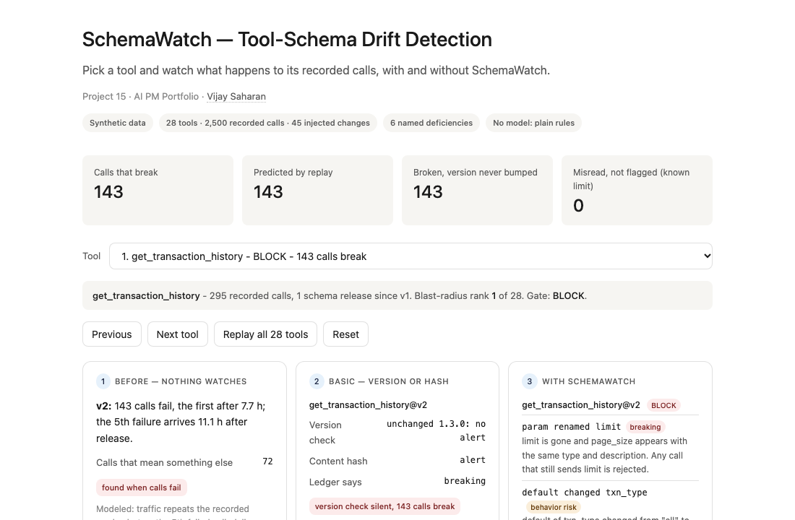
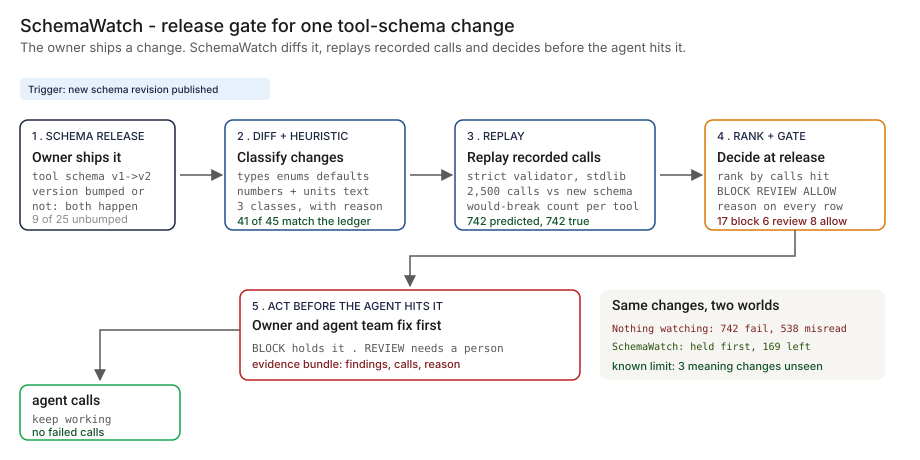
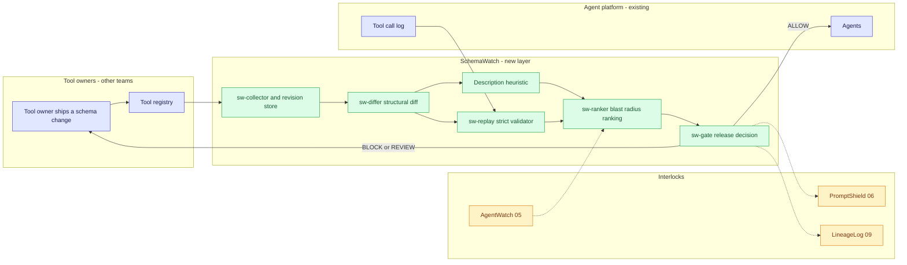
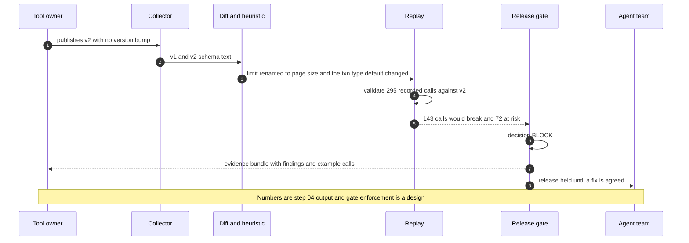

# 🔭 SchemaWatch — Tool-Schema Drift Detection for Tool-Calling Agents

**A portfolio prototype for catching tool-schema changes before an agent's calls fail, or quietly mean something else: a structural diff, a description heuristic, a replay of recorded calls, a blast-radius ranking and a release gate. Aligned to the [NIST AI RMF](https://www.nist.gov/itl/ai-risk-management-framework) 'Measure' function; [SR 26-2](https://www.federalreserve.gov/supervisionreg/srletters/SR2602.htm) (which replaced SR 11-7 in April 2026) is the model-risk guidance the work is compared with for ongoing monitoring.**

**▶ Static demo, no install:** [open on GitHub Pages](https://vj-shipped-anyway.github.io/ai-pm-portfolio/15-schemawatch-tool-schema-drift/demo.html)

[](https://vj-shipped-anyway.github.io/ai-pm-portfolio/15-schemawatch-tool-schema-drift/demo.html)

**What it shows** (🟢 measured on synthetic data; the script is named in brackets):

- 🟢 Classification: 41 of 45 changes match the ledger (91.1%) (`step_04`)
- 🟢 Replay: 742 calls predicted broken, 742 truly broken, 0 false positives, 0 misses (`step_04`)
- 🟢 Gate: 17 BLOCK, 6 REVIEW, 8 ALLOW across 31 releases (`step_04`)

_A portfolio prototype on synthetic data, not a production case study. The framing, how to read the numbers and the regulatory note are folded below._


[](./demo.html)



> **▶ 30-second demo:** the [clickable demo](./demo.html) gets you the full story in 30 seconds with no install.

<details>
<summary>Framing, how to read the numbers, and the regulatory note</summary>

> **Regulatory note.** This README cites SR 11-7 or its replacement, [SR 26-2](https://www.federalreserve.gov/supervisionreg/srletters/SR2602.htm) (Federal Reserve, OCC and FDIC, April 17, 2026). SR 26-2 sets no enforceable standards, is aimed mainly at banks with over $30 billion in assets, and places generative AI and agentic AI outside its scope. Here those citations name the design basis for validation, monitoring and inventory practices, or serve as an analogy. They are not a claim that the project meets SR 26-2 or that SR 26-2 governs the systems it examines.

> **Framing:** This is a portfolio prototype, not a production case study. The six-deficiency taxonomy, the architecture, the data generator and the walkthrough are mine. Every number below is either printed by a script in this folder on data I generated, or is modeled with its assumption named. Production validation (tool owners agreeing to a gate, a real tool registry, real call logs, a model-risk read) is what the next role does.

> **Reading the numbers — credibility tags inline.** Every number in this README and the demo is tagged 🟢 **Measured** (printed by a script in `src/` on the shipped synthetic data: 28 tools, 31 schema releases, 45 injected changes, 2,500 recorded calls), 🟡 **Modeled** (extrapolated from that data, with the assumption named in one line), or 🔴 **Hypothetical** (designed and reasoned about, never tested). Full convention in the [master README's "Reading the numbers" section](../README.md#-reading-the-numbers). **All data is synthetic and generated by a seeded script. The truth is known because the data is synthetic: the generator decided what changed, so it can say exactly which calls break.**

</details>

---

## 🔥 Demo in 30 seconds

Open the static, no-Python demo: [`demo.html`](./demo.html).
Pick one of the 28 tools from the dropdown, or use Next tool and Replay all 28 tools. Three cards show the same recorded calls three ways: with nothing watching (calls fail, or pass and mean something else), with a version or hash check (what it alerts on and what it cannot see), and with SchemaWatch (the classified diff, the calls that would break, the gate decision). The running totals at the top end at the 🟢 measured numbers: 742 broken calls predicted exactly, 380 of them inside releases a version check never alerts on, and 169 calls misread that the gate cannot see.

To run the four-step walkthrough on your laptop:

```bash
git clone https://github.com/Vj-shipped-anyway/ai-pm-portfolio
cd ai-pm-portfolio/15-schemawatch-tool-schema-drift/src
python3 step_01_no_monitoring.py
python3 step_02_hash_and_version_check.py
python3 step_03_deficiencies_exposed.py
python3 step_04_with_schemawatch.py
```

To regenerate the synthetic data (the output is identical on every run): `python3 ../data/_generate.py`.
To run the Streamlit prototype: `pip install -r requirements.txt`, then `streamlit run app.py` from `src/` (or `streamlit run 15-schemawatch-tool-schema-drift/src/app.py` from the repo root).

---

## 💰 Why this lands — competitive positioning

Teams that notice tool-schema drift usually start with one of two cheap checks: compare the version string, or compare a hash of the schema text. I compare approaches rather than vendors, so the table below scores those two checks and the new layer on the same synthetic releases.

| Capability | Nothing watching | Version-string check | Content hash | **SchemaWatch** |
| --- | --- | --- | --- | --- |
| Notices a release that needs action | Only when calls fail | 🟢 16 of 25 (64.0%) | 🟢 25 of 25 (100.0%) | 🟢 22 of 25, each with a reason; the misses are the known limit |
| Raises an alert on a release that needs none | n/a | 🟢 3 of 31 releases | 🟢 6 of 31 releases | 🟢 1 (a number written as a word) |
| Separates breaking from non-breaking | No | No | No | 🟢 41 of 45 changes match the ledger |
| Counts the calls a release breaks | After the fact: 🟢 742 calls fail in the week | No | No | 🟢 742 predicted, 742 true, 0 false positives |
| Sees a unit swap in a description | Never: the call passes | No | No | 🟢 5 of 5 |
| Sees a meaning change with no number or unit | Never | No | No | No. 🟢 0 of 3 (the known limit) |
| Ranks alerts by calls hit | n/a | No | No | Yes: blast radius per tool |
| Holds a release before the agent meets it | No | No | No | Yes, if the owner agrees to the gate (open question in the PRD) |
| Where it still fails | Everything above | Any release shipped without a bump: 🟢 380 broken calls | Cannot tell which of 31 alerts matters | Meaning changes with no number or unit; owners who deploy around the registry |

**Position:** *SchemaWatch does not replace the tool owners' own tests, the API gateway or the tool registry. It adds the check that sits on the consumer side: before a release reaches the agent, replay what the agent actually sends and say which calls break, which keep working with a different meaning, and who should look first. A hash tells you that something changed. This tells you what to do about it.*

---

## The honest version (why this exists)

The failure mode this prototype is built around: an agent calls tools, and each tool is an API with a JSON schema owned by another team. The owner renames a parameter, tightens a type, adds a required field, drops an enum value or changes a unit in a description, and the agent team is not told. Calls fail loudly, which is the good case. Or they succeed with the wrong meaning: an amount that was in dollars is now read as cents, a default quietly moves, and nothing errors.

This is a prototype on synthetic data. I wrote the generator, the change ledger, the call set, the diff, the description heuristic, the validator and the gate. The recorded calls are produced by a seeded script, not by an agent or a model, and no model is used anywhere in this repo. The truth is known because the data is synthetic: the generator decides what changed, so it can say which calls break and which only change meaning. A real estate does not hand you that, which is why the first job in a real deployment would be capturing a real tool-call log. Nothing here is a real bank, tool, API, incident or vendor.

The ledger is dense on purpose (26 of 28 tools change inside one quarter) so that every change type appears often enough to count. It is a test set, not an estimate of how often real tools change; that frequency is a separate, named assumption in the utility section.

If you run agents on tools other teams own and have had a parameter rename land on you, fork it. The change taxonomy, the replay mechanic and the gate vocabulary are the parts worth lifting. Validating them against a real tool log is the work the next role would do.

---

## Prereqs to run this on your laptop (in plain English)

You don't need a cluster, a cloud account or an API key. You need:

- **Python 3.** The four step scripts, the data generator and the demo builder use only the standard library (for example `csv`, `json`, `re`, `hashlib`, `statistics` and `pathlib`), so there is nothing to install for them. They are written for Python 3.9 and tested on it; they use no syntax newer than 3.9.
- **Git**, to clone the repo. `brew install git` / `winget install git`.
- **`src/requirements.txt` — only for the Streamlit app.** It lists `streamlit`, `pandas`, `numpy` and `plotly`. The step scripts do not import any of them. Run `pip install -r src/requirements.txt` only if you want the app.
- **No API key.** There is no model call, no network call and no secret anywhere. The diff, the heuristic, the validator and the gate are plain rules you can read.
- **Not needed:** a database, containers, Kubernetes or a cloud account. They appear in [`ARCHITECTURE.md`](./ARCHITECTURE.md) as the production design, not as prototype requirements.

Each step script finishes in seconds and writes its CSV or JSON to `src/out/`. The clickable `demo.html` runs in any browser with zero install. If a step does not run from a fresh clone, that's a bug in the README. Open an issue.

---

## Executive summary (90 seconds)

**Problem.** A modeled bank runs an agent platform that calls 28 internal tools. Other teams own the tools and their schemas. Inside one quarter, 26 of the 28 tools ship 45 schema changes, and 17 of those changes ship with no version bump. The agent team finds out when calls fail. 🟢 742 of 2,500 recorded calls (29.7%) fail in the week after the releases land, and 🟢 538 more keep working while meaning something different. Those never fail, so nothing alerts.

**Product.** SchemaWatch, a consumer-side check on every tool-schema release: a **structural diff** that classifies each change as breaking, non-breaking or behavior-risk with a reason; a **description heuristic** that extracts numbers and units and flags a change; a **replay** of the recorded calls against the new schema with a small strict validator written in the standard library; a **blast-radius ranking** by calls hit; and a **release gate** that returns BLOCK, REVIEW or ALLOW.

**Measured and modeled performance.**

- 🟢 **Classification: 41 of 45 changes match the ledger (91.1%)** (`step_04`). Without the description heuristic it is 37 of 45 (82.2%).
- 🟢 **Replay: 742 calls predicted broken, 742 truly broken, 0 false positives, 0 misses** (`step_04`). This agreement is by construction: the generator and the validator both apply the declared schema. It says nothing about servers that are stricter or looser than their published schema.
- 🟢 **Semantic changes flagged: 5 of 8.** 5 of 5 with a unit signal; 0 of 3 with none (`step_04`).
- 🟢 **Gate: 17 BLOCK, 6 REVIEW, 8 ALLOW across 31 releases.** It matches the ledger-derived answer on 27 of 31 (`step_04`).
- 🟢 **Version check misses 9 of 25 releases that need action and 380 of 742 broken calls** (`step_02`). The hash misses none, and cannot say which of its 31 alerts matters.
- 🟡 **Time to a person with no monitoring: a median 15.9 hours after release, at best** (`step_01`). Assumes traffic repeats the recorded week and an alert fires on the 5th failed call with instant delivery.
- 🟡 **Utility: (28.44 − 3.76) × 12 = about 296 calls per quarter**, assuming 12 schema changes a quarter across the estate and that every BLOCK and REVIEW is acted on.
- 🔴 **Design target: a gate decision inside the owner's release pipeline, with the evidence bundle attached.** Designed in `ARCHITECTURE.md`, never built or timed.

**Call to action.** Fork this repo. Swap [`data/tool_schemas.csv`](./data/tool_schemas.csv) and [`data/recorded_calls.csv`](./data/recorded_calls.csv) for exports from your tool registry and your tool-call log, and call `diff_schemas` and `strict_validate` from `step_04` on them. The ledger and truth files exist only because the data is synthetic.

---

## 🗺️ What this walkthrough covers

1. **The use case** — an agent platform calling 28 tools owned by other teams
2. **Sample data** — 59 schema revisions, 45 injected changes, 2,500 recorded calls, per-call truth
3. **Step 1 — Before SchemaWatch** — nobody watches schemas; how many calls fail and how long until a person hears
4. **Step 2 — Basic approach** — version-string check and content hash; what each catches and flags falsely
5. **Step 3 — The six named deficiencies** — each with a count from the dataset
6. **Step 4 — The fix (SchemaWatch)** — diff, heuristic, replay, blast radius, gate; measured against the ledger, with the known limit printed
7. **Utility delivered** — a multiplied number with the assumption named
8. **Architecture & call flow** — topology and a per-release sequence
9. **PM artifacts** — PRD and architecture

> Non-technical reader: skip the code blocks. The plain-English explanation and the output tables tell the story.
> Technical reader: every code block runs. `cd src && python3 step_NN_*.py` and you'll see the same output.

Total reading time: about 12 minutes deep, 3 minutes if you skim.

---

## 🎯 The Use Case

**A modeled bank's agent platform. 28 tools, each an API with a JSON schema owned by another team.**

An agent handles customer and banker requests by calling tools: balance lookups, wires, ACH payments, FX rates, KYC checks, card holds, fee schedules. Each tool has a schema the agent was built and tested against. The tools are owned by payments, cards, lending and servicing teams, who ship on their own calendars and do not ask the agent team first.

Three things happen inside one quarter in the synthetic data:

- **A rename with no version bump.** The transaction-history owner renames `limit` to `page_size` and changes the default of `txn_type`. The version string stays at 1.3.0. 🟢 143 of 295 recorded calls to that tool would fail, and 72 more silently get a different default.
- **A unit swap.** The card-hold owner changes the `amount` description from "US dollars" to "cents". The type is still a number, so validation passes. 🟢 49 of 49 recorded calls now mean something 100 times smaller, and no error is raised.
- **A reworded meaning.** The FX-rate owner rewrites what the base currency means, so the quote direction inverts. There is no number and no unit in the change. 🟢 123 recorded calls pass validation and mean something different. This is the known limit.

The agent platform lead owns the agent, the tool owners own the schemas, the SRE on call gets paged when calls fail, and the model risk reviewer has to explain, after the fact, why a decision was made on a tool whose meaning had changed. SchemaWatch is designed for those four.

---

## 📊 Sample Data

Four CSVs in [`data/`](./data/), generated by [`data/_generate.py`](./data/_generate.py) (standard library, seeded, deterministic: running it twice produces identical files). Documented in [`data/README.md`](./data/README.md). One preview each:

**[`data/tool_schemas.csv`](./data/tool_schemas.csv)** — 59 schema revisions for 28 tools: v1 for every tool, v2 for 26, v3 for 5. Each row holds the declared version string and the full JSON-schema-like dict.

| tool | rev | declared_version | released_at |
| --- | --- | --- | --- |
| `get_transaction_history` | v1 | 1.3.0 | 2026-02-16T09:00 |
| `get_transaction_history` | v2 | 1.3.0 | 2026-04-09T14:30 |
| `place_card_hold` | v1 | 1.0.0 | 2026-02-16T09:00 |
| `place_card_hold` | v2 | 1.0.0 | 2026-04-29T16:45 |

**[`data/change_ledger.csv`](./data/change_ledger.csv)** — the 45 injected changes. This is the ground truth: every revision after v1 is produced by applying these rows to the previous one. Eleven change types; 28 changes shipped with a version bump and 17 did not.

| change_id | tool | to_rev | change_type | param | old -> new | bumped | true_class |
| --- | --- | --- | --- | --- | --- | --- | --- |
| CH-003 | `get_transaction_history` | v2 | param_renamed | `limit` | `limit` -> `page_size` | no | breaking |
| CH-021 | `place_card_hold` | v2 | unit_changed | `amount` | `Hold amount in US dollars.` -> `Hold amount in cents.` | no | behavior_risk |
| CH-005 | `initiate_wire_transfer` | v2 | required_added | `idempotency_key` | - -> `string` | yes | breaking |
| CH-009 | `get_fx_rate` | v2 | meaning_changed | `base_currency` | `Base currency; the rate is quoted as units of the quote currency per one unit of base.` -> `Base currency; the rate is quoted as units of the base currency per one unit of the quote currency.` | no | behavior_risk |

**[`data/recorded_calls.csv`](./data/recorded_calls.csv)** — 2,500 agent calls (argument dicts) over one week, all valid under v1. **[`data/call_truth.csv`](./data/call_truth.csv)** — for each call: does it break under strict validation of the latest revision, in which revision did it first break, and does it still pass but mean something different. The preview below joins the two files on `call_id` and leaves out `true_misread_meaning` and `cause_change_ids`.

| call_id | tool | args_json | true_broken | first_break_rev | true_misread_unit | true_shifted_default |
| --- | --- | --- | --- | --- | --- | --- |
| C0012 | `get_transaction_history` | `{"account_id":"AC-570296","start_date":"2026-01-28","end_date":"2026-02-19"}` | 0 | - | 0 | 1 |
| C0014 | `place_card_hold` | `{"card_id":"CR-683509","amount":384.06}` | 0 | - | 1 | 0 |

Ledger mix: 4 renames, 5 type changes (3 tightening, 2 widening), 4 required fields added, 4 enum values removed, 4 added, 4 defaults changed, 5 unit changes in a description, 6 cosmetic rewordings, 2 parameters removed, 4 optional fields added, 3 meaning changes with no number or unit. By class: 17 breaking, 16 non-breaking, 12 behavior-risk. Truth: 742 calls break, 228 pass with a unit now meaning something else, 169 pass with a changed meaning, 156 pass but rely on a default that moved.

The data includes two hard cases on purpose: a cosmetic rewording that writes "7 days" as "seven days" (the heuristic reads it as a changed number), and meaning changes that carry no number or unit (the heuristic cannot see them).

---

## 🔧 Step 1 — Before SchemaWatch: nobody watches tool schemas

**In plain English:** The agent team learns about a schema change when calls start failing. Calls that fail are loud. Calls that keep working with a different meaning are not, so nothing ever alerts.

```bash
python3 src/step_01_no_monitoring.py
```

The script replays the recorded week from each release and counts what happens. The assumptions are in the script header and printed with the result:

```
ASSUMPTIONS (modeled):
  A1  after a release, traffic repeats the recorded week from the release time
  A2  with no schema monitoring the first signal is a failed call
  A3  a person is alerted on the 5th failed call to one tool; delivery is instant
  A4  calls that pass but mean something different never fail, so never alert
```

**Result:**

```
RESULT
  Calls that fail loudly in the week after release:   742 of 2,500 (29.7%), across 17 releases
  Median hours to the first failed call:              8.8 h
  Median hours until a person is alerted (floor):     15.9 h (slowest 65.7 h)
  Releases that never reach 5 failures in the week: 1 of 17 (4 calls fail with nobody alerted)
  Calls that pass but mean something different:       538 (unit 228, meaning 169, default 156; overlaps counted once), alert never
```

🟢 Calls failing, time to first failure and the silent-call count are printed by `step_01`. 🟡 The time to a person depends on the assumed alarm (the 5th failed call, instant delivery), so treat it as a floor. In the sensitivity table the script prints, the median is 11.8 hours at 3 failures and 36.4 hours at 10. The number that does not depend on the alarm is the silent one: 538 calls that pass and mean something else raise nothing.

---

## 🤖 Step 2 — With the basic approach: version strings and content hashes

**In plain English:** Compare the version string a tool publishes, or hash the schema text and alert when the hash changes. Both are cheap and both are reasonable.

```bash
python3 src/step_02_hash_and_version_check.py
```

```
RESULT (release level)
  Version check: 19 alerts. Catches 16 of 25 releases that need action (64.0%), flags 3 noise-only releases.
                 Misses 9 releases that need action: the owner shipped them without a version bump.
                 Calls broken inside releases it never alerts on: 380 of 742.
  Content hash:  31 alerts. Catches 25 of 25 (100.0%), flags 6 noise-only releases the same way it flags a breaking one.
                 Calls broken inside releases it never alerts on: 0 of 742.
  Neither tells you which change is breaking: 16 of 45 changes behind these alerts are non-breaking.
  Neither can say how many calls break, or rank the alerts.
```

- **The version check is only as good as the owners' habits.** 🟢 It alerts on 19 of 31 releases and catches 16 of the 25 that need action. It misses 9: the owner shipped them without a bump. It also alerts on 3 releases that need nothing, because an owner bumped the version for a reworded description.
- **The hash catches everything and tells you nothing.** 🟢 It alerts on all 31 releases, flags 6 that need no action exactly as it flags a breaking one, and cannot say which change is breaking, how many calls break, or which alert to read first.

---

## 🔬 Step 3 — Where this still breaks: 6 named deficiencies

| # | Deficiency | What goes wrong | Count in this dataset |
| --- | --- | --- | --- |
| 1 | **Breaking and non-breaking not separated** | An alert says "changed", not "will break". | 🟢 16 of 45 changes (35.6%) behind a hash alert are non-breaking; 6 releases contain nothing else |
| 2 | **Versionless changes missed** | The owner changes the schema and leaves the version string alone. | 🟢 17 of 45 changes (37.8%) shipped with no bump; 380 recorded calls break inside them |
| 3 | **Semantic changes invisible to a structural diff** | A unit swap leaves types, enums and required lists untouched. | 🟢 A structural diff sees 0 of 8 semantic changes; 397 calls pass and mean something else |
| 4 | **Enum removal and addition treated alike** | A removed value breaks callers that send it; an added value breaks nobody. | 🟢 4 removals break 66 calls; 4 additions break 0; both raise the same alert |
| 5 | **A new required field breaks every existing call** | A diff that calls added fields additive labels it safe. | 🟢 4 required fields added; 185 of 185 calls to those tools break; the additive-is-safe rule labels 4 of 4 safe |
| 6 | **A changed default silently alters behavior** | Calls that omit the parameter now get a different value and still validate. | 🟢 4 defaults changed; 156 of 480 calls to those tools (32.5%) rely on one; 0 fail validation |

```bash
python3 src/step_03_deficiencies_exposed.py
```

```
(a) Breaking and non-breaking changes are not separated
    A hash alerts on 31 releases covering 45 changes. 17 are breaking, 12 change behavior, 16 (35.6%) are non-breaking.
    6 releases contain only non-breaking changes, yet raise the same alert.

(b) Versionless changes are missed
    17 of 45 changes (37.8%) shipped without a version bump, in 12 of 31 releases;
    9 of those releases need action and 380 recorded calls break inside them.
    8 tools never changed their version string; 6 of them changed in ways that need action.

(c) Semantic changes are invisible to a structural diff
    8 semantic changes (5 carry a unit signal, 3 carry none). A diff of types, enums, defaults and required lists sees 0 of 8.
    397 recorded calls still pass validation and now mean something different (228 unit, 169 meaning).

(d) Enum removal and enum addition are treated alike
    4 removals and 4 additions raise 8 identical 'changed' alerts.
    Removals break 66 recorded calls; additions break 0.

(e) A new required field breaks every existing call
    4 required fields were added, on 4 tools. 185 of 185 recorded calls to those tools break (100%).
    A diff that treats added fields as additive labels 4 of 4 of them safe.

(f) A changed default silently alters behavior
    4 defaults changed, on 4 tools. 156 of 480 calls to those tools (32.5%) omit the parameter and now get a
    different value. Validation fails 0 of them: nothing alerts.
```

The basic approach catches the existence of a change and misses what the change does. **The product is the classification, the replay and the gate, not the detection.**

---

## 🛠️ Step 4 — The fix: SchemaWatch

Five parts, all plain rules, no model:

1. **Structural diff and classifier.** Compares two revisions of one tool and returns findings, each with a class (breaking, non-breaking, behavior-risk) and a reason a tool owner can read. It detects renames (a removed and an added parameter with the same type and similar description), required and optional additions, removals, type changes (widening is non-breaking, narrowing is breaking), enum values added and removed, and changed defaults.
2. **Description heuristic.** Extracts the numbers and units a parameter description states and flags a change. "US dollars" to "cents" and "seconds" to "milliseconds" change the extracted pairs. "US dollars" to "USD" does not. It does not parse number words and it ignores everything that is not a number or a unit.
3. **Replay.** Validates every recorded call against the new revision with a small strict validator (types, enums, required, minimum, maximum, maxLength, unknown keys rejected) and returns a would-break count per tool.
4. **Blast-radius ranking.** Ranks tools by the recorded calls a release breaks or silently changes.
5. **Release gate.** BLOCK if any recorded call would break. REVIEW if a change is breaking by structure with no call exercising it, or flags a unit, number or default change. ALLOW if everything is non-breaking.

```bash
python3 src/step_04_with_schemawatch.py
```

**The gate, first rows (31 releases in the full output):**

```
RELEASE GATE (one row per schema release)
release                            bump break  risk    gate   ought
---------------------------------- ---- ----- ----- ------- -------
get_transaction_history@v2           no   143    72   BLOCK   BLOCK
lookup_customer_profile@v3           no    82     0   BLOCK   BLOCK
initiate_wire_transfer@v2           yes    74     0   BLOCK   BLOCK
schedule_ach_payment@v2             yes    74     0   BLOCK   BLOCK
create_support_ticket@v3             no    64     0   BLOCK   BLOCK
get_account_balance@v2              yes    40     0   BLOCK   BLOCK
dispute_transaction@v2               no    37     0   BLOCK   BLOCK
run_kyc_check@v2                    yes    37     0   BLOCK   BLOCK
schedule_appointment@v2              no    37     0   BLOCK   BLOCK
  ...
```

| gate | releases | examples |
| --- | --- | --- |
| BLOCK | 17 | `get_account_balance@v2`, `get_transaction_history@v2`, `initiate_wire_transfer@v2`, ... |
| REVIEW | 6 | `screen_sanctions@v2`, `place_card_hold@v2`, `get_statement_pdf@v2`, ... |
| ALLOW | 8 | `get_fx_rate@v2`, `lookup_customer_profile@v2`, `block_card@v2`, ... |

**Blast radius, top of the ranking:**

| # | tool | calls | would break | at risk | share | gate |
| --- | --- | --- | --- | --- | --- | --- |
| 1 | `get_transaction_history` | 295 | 143 | 72 | 72.9% | BLOCK |
| 2 | `calculate_loan_payment` | 98 | 17 | 81 | 100.0% | BLOCK |
| 3 | `lookup_customer_profile` | 197 | 82 | 0 | 41.6% | BLOCK |
| 4 | `create_support_ticket` | 74 | 74 | 0 | 100.0% | BLOCK |
| 5 | `initiate_wire_transfer` | 74 | 74 | 0 | 100.0% | BLOCK |
| 6 | `schedule_ach_payment` | 74 | 74 | 0 | 100.0% | BLOCK |

**Measured against the ledger and the per-call truth:**

```
MEASURED AGAINST THE LEDGER AND THE PER-CALL TRUTH
  Classification accuracy:     41 of 45 changes (91.1%); without the description heuristic 37 of 45 (82.2%)
  Findings with no ledger entry: 0
  Replay vs true broken calls: predicted 742, true 742; false positives 0, false negatives 0 (precision 100.0%, recall 100.0%)
  First-break revision matches truth for 2,500 of 2,500 calls
  Semantic changes flagged:    5 of 8 (62.5%); with a unit signal 5 of 5, with none 0 of 3
  Cosmetic rewrites flagged by the heuristic: 1 of 6
  Silent calls (valid, different meaning): truth 538, flagged 422, caught 369 (recall 68.6%, precision 87.4%)
  Gate decision matches the ledger-derived answer: 27 of 31 releases (87.1%)
  Releases that need action caught by the gate: 22 of 25; false REVIEWs 1
```

Classification confusion matrix (rows are the ledger's class, columns are what SchemaWatch said):

|  | predicted breaking | predicted non_breaking | predicted behavior_risk | undetected |
| --- | --- | --- | --- | --- |
| truth: breaking | 17 | 0 | 0 | 0 |
| truth: non_breaking | 0 | 15 | 1 | 0 |
| truth: behavior_risk | 0 | 3 | 9 | 0 |

Where it is wrong, printed by the script:

```
  Where the classifier is wrong:
    CH-009 get_fx_rate@v2                 meaning_changed        truth behavior_risk predicted non_breaking
    CH-025 get_statement_pdf@v2           description_reworded   truth non_breaking  predicted behavior_risk
    CH-033 find_atm@v2                    meaning_changed        truth behavior_risk predicted non_breaking
    CH-035 set_transfer_limit@v2          meaning_changed        truth behavior_risk predicted non_breaking
  Where the gate differs from the ledger-derived answer:
    get_fx_rate@v2                     gate ALLOW  ought REVIEW
    get_statement_pdf@v2               gate REVIEW ought ALLOW
    find_atm@v2                        gate ALLOW  ought REVIEW
    set_transfer_limit@v2              gate ALLOW  ought REVIEW
```

- **8 semantic changes, 5 flagged.** Every change with a unit signal was flagged (5 of 5). None of the 3 without one was.
- **One false flag.** The heuristic flagged 1 of 6 cosmetic rewordings: "expires after 7 days" became "expires after seven days", which reads as a number that vanished. A person clears it in review. The gate shows it as a false REVIEW.
- **Replay agrees with the truth on every call, and that is not a claim about production.** The generator derives the truth from the ledger rules; the replay validates the schema text. They agree on 742 of 742. A real server can be stricter or looser than the schema it publishes, so a real deployment would calibrate replay against the failures it actually sees.

### The known limit, left in on purpose

SchemaWatch does not detect a change in meaning that carries no number and no unit. 3 of the 45 ledger changes are of this kind:

| change | where | before | after |
| --- | --- | --- | --- |
| CH-009 | `get_fx_rate.base_currency` | "Base currency; the rate is quoted as units of the quote currency per one unit of base." | "Base currency; the rate is quoted as units of the base currency per one unit of the quote currency." |
| CH-033 | `find_atm.network` | "ATM network to include in the search." | "ATM network to exclude from the search." |
| CH-035 | `set_transfer_limit.daily_limit` | "Daily transfer limit, applied per account, in US dollars." | "Daily transfer limit, applied per customer, in US dollars." |

```
KNOWN LIMIT (left in on purpose)
  Meaning changes with no number and no unit are not detected: 3 in the ledger, 0 caught.
    CH-009 get_fx_rate.base_currency: "Base currency; the rate is quoted as units of the quote currency per one unit of base." -> "Base currency; the rate is quoted as units of the base currency per one unit of the quote currency."
    CH-033 find_atm.network: "ATM network to include in the search." -> "ATM network to exclude from the search."
    CH-035 set_transfer_limit.daily_limit: "Daily transfer limit, applied per account, in US dollars." -> "Daily transfer limit, applied per customer, in US dollars."
  They leave 169 recorded calls passing validation with a different meaning, and the gate says ALLOW.
```

They leave 🟢 169 recorded calls passing validation with a different meaning, and the gate says ALLOW. The mitigation is in the process, not the code: ask owners to flag any description edit that changes who or what a parameter refers to, and have a person read description diffs for tools that move money. That is 🔴 designed in the PRD, never tested with real owners.

Other limits, stated plainly: constraint changes (minimum, maximum, maxLength, patterns) are outside the diff, and patterns and nested objects are outside the validator; the gate can only hold what passes through a registry or pipeline the owners agreed to use; and replay is only as good as the recorded calls.

---

## 📐 Utility Delivered

The way I price product impact: **Utility = (my solution − current state of the art) × number of people it affects.**

Here the terms are calls kept safe per change and changes per quarter. Each change lands on four roles: the agent platform lead, the tool owner, the SRE on call and the model risk reviewer. Going from "alert says something changed" to "this release breaks these calls, hold it" is not an outcome by itself. *Doing it for every release an estate of this shape ships in a quarter is.*

| Term | Value | Where it comes from |
| --- | --- | --- |
| Current state of the art (basic alerts, no gate), calls broken or misread per change | 🟢 **28.44** | `step_04`: 1,280 of 2,500 distinct calls are broken or misread, spread across 45 changes, for one recorded week of exposure |
| If every version-check alert were acted on perfectly | 🟢 738 calls still affected | `step_04`: affected calls that sit behind a release with no version bump |
| My solution (SchemaWatch gate), calls broken or misread per change | 🟢 **3.76** | `step_04`: 169 calls remain, all from the 3 meaning changes with no number or unit |
| Per-change lift | 🟢 28.44 − 3.76 | Calls kept safe per change, per recorded week of exposure |
| Number it affects: schema changes per quarter | 🟡 **12** | **Assumption, not a statistic:** a 28-tool estate owned by other teams ships 12 schema changes a quarter, about one every two quarters per tool. Edit `CHANGES_PER_QUARTER` in `step_04` to use your own |
| Assumption that makes the lift real | 🟡 Every BLOCK and REVIEW is acted on before the release reaches the agent | If owners ignore a hold, the lift shrinks toward zero |
| **Utility** | 🟡 **(28.44 − 3.76) × 12 = about 296 calls per quarter** | Per recorded week of exposure per change; a floor if breakage lasts longer than a week |

Sensitivity to the changes-per-quarter assumption (🟡, same per-change lift): 6 changes gives 148, 12 gives 296, 24 gives 593, and the ledger's own 45 gives 1,111.

🔴 What I have not measured: how long breakage lasts without a gate, what an owner does with a hold, and what any of this costs to run. The synthetic estate is also much denser than a real one. Treat the per-change number as a property of this mix of changes, not a forecast.

---

## 🔄 Architecture & Call Flow

How each schema release flows through the system. GitHub renders these diagrams natively. Component names match [`ARCHITECTURE.md`](./ARCHITECTURE.md).

**System topology:**



**Per-release sequence** (`get_transaction_history`, release v2):



See [`assets/schemawatch-flow.svg`](./assets/schemawatch-flow.svg) for a static visual of the same flow.

**Interlocks (all 🔴 designed, none built):**

- [05 AgentWatch](../05-agentwatch-agent-observability/) sees the runtime failure. SchemaWatch is the pre-release side of the same problem: when AgentWatch sees a tool error, it can check whether SchemaWatch holds an open BLOCK or REVIEW for that tool, and label the failure as known drift instead of a new incident.
- [06 PromptShield](../06-promptshield-prompt-injection-defense/) is the tool-call gate. SchemaWatch supplies the revision a call must validate against, and can route calls to a tool under BLOCK to a safe fallback instead of the changed API.
- [09 LineageLog](../09-lineagelog-ai-decision-audit/) composes the decision-level audit record (prompt version, retrieval set, model snapshot, features). The designed extension adds the schema revision hash each tool call ran under, so a reviewer can answer "which version of this tool did that decision use". LineageLog does not record tool calls today.

---

## 📋 PM Artifacts

The PM artifacts that show how I'd run this product if I owned the seat. This README is the walkthrough; the rest of the folder holds:

- [`PRD.md`](./PRD.md) — the product requirements doc: users, backlog, KPIs, rollout, open questions.
- [`ARCHITECTURE.md`](./ARCHITECTURE.md) — the systems doc: components, data model, security, failure behavior, operations. A design, not deployed.
- [`demo.html`](./demo.html) — clickable, no-install walkthrough; every number is generated from the scripts in `src/` by `src/_build_demo.py`.
- [`data/`](./data/) — the four synthetic CSVs and the generator. `data/README.md` explains the ground-truth rules.
- [`src/`](./src/) — runnable step scripts and the Streamlit prototype.

Run the walkthrough end-to-end:

```bash
cd src
python3 step_01_no_monitoring.py
python3 step_02_hash_and_version_check.py
python3 step_03_deficiencies_exposed.py
python3 step_04_with_schemawatch.py
```

---

## 🚀 Fork this for your team

```bash
git clone https://github.com/Vj-shipped-anyway/ai-pm-portfolio
cd ai-pm-portfolio/15-schemawatch-tool-schema-drift

# 1. Run the synthetic walkthrough as is
cd src
python3 step_01_no_monitoring.py
python3 step_02_hash_and_version_check.py
python3 step_03_deficiencies_exposed.py
python3 step_04_with_schemawatch.py

# 2. Open the interactive demo
open ../demo.html            # static snapshot of the synthetic run; it does not read data/
```

To point it at your own estate, replace two files and keep their columns:

- `data/tool_schemas.csv`: one row per tool revision: `tool, rev, declared_version, released_at, schema_json`
- `data/recorded_calls.csv`: one row per tool call: `call_id, tool, called_at, args_json`

The two functions that do the work take plain dicts, so you can call them directly:

```python
# from src/
from step_04_with_schemawatch import diff_schemas, strict_validate

findings = diff_schemas(old_schema, new_schema)    # classified findings, each with a reason
errors = strict_validate(new_schema, call_args)    # empty list when the call is valid
```

`data/change_ledger.csv` and `data/call_truth.csv` exist only because the data is synthetic. The step scripts read them to define releases and to score the result, so on real exports you will need to build the release list from consecutive revisions yourself, and the accuracy lines in step 4 cannot be computed: you will not have a ledger. Keep the schema JSON in the same dict shape (`name`, `version`, `description`, `parameters` with `properties`, `required`, `additionalProperties`), or adapt `strict_validate`.

If you run it on a real tool log and get something useful, open an issue or send me what your tool owners did with it. I'd rather see that than what I think it should do.

---

## 👤 Author

**Vijay Saharan** — Sr Product / Program Manager · AI in BFSI · Enterprise AI Platforms · CRE as a study interest

[LinkedIn](https://www.linkedin.com/in/vijaysaharan/) · Tagline: *AI Platform PM · Designs change control for the tools agents call, under regulated constraint*

---

## 🙌 Acknowledgements

- **[NIST AI RMF](https://www.nist.gov/itl/ai-risk-management-framework)** — the 'Measure' function maps onto replay and the release gate: continuous measurement of a system that depends on components other teams change.
- **SR 11-7 (OCC bulletin 2011-12), replaced in April 2026 by [SR 26-2](https://www.federalreserve.gov/supervisionreg/srletters/SR2602.htm)** — the model-risk guidance the work is compared with. A tool whose meaning changes under a deployed agent is a change the ongoing-monitoring story has to account for.
- **[OWASP LLM Top 10](https://genai.owasp.org/llm-top-10/)** — the excessive-agency theme behind treating tool schemas as a controlled interface.
- **[OpenTelemetry](https://opentelemetry.io/)** — the telemetry standard the production design would emit to.
- **[EU AI Act](https://eur-lex.europa.eu/eli/reg/2024/1689/oj)** — the Article 12 record-keeping vocabulary the revision-hash lineage in the LineageLog interlock is written toward. This is not a claim that the Act applies or that the design meets it.
- **JSON Schema and semantic versioning** — the conventions the synthetic schemas imitate and the version strings that owners follow, or do not.
- **Sibling projects in this repo** — [05 AgentWatch](../05-agentwatch-agent-observability/), [06 PromptShield](../06-promptshield-prompt-injection-defense/) and [09 LineageLog](../09-lineagelog-ai-decision-audit/), the three interlocks.
