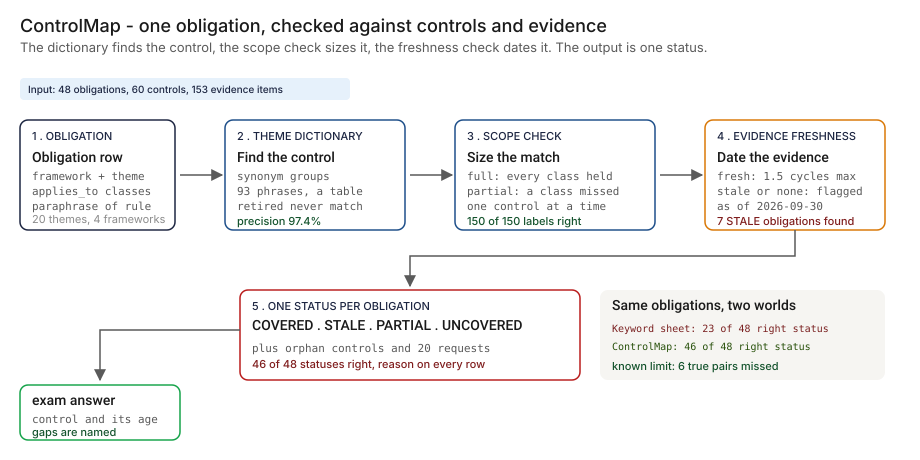

# Architecture — ControlMap

The systems doc most PM writeups skip. Databases, where the code runs, encryption posture, user management, network, operational runbooks. What you'd hand to your CISO and your platform engineering lead on day one.

> **Status.** This is the design for the production shape. The repo implements the product mechanic as a prototype (a theme dictionary, a scope check, an evidence-freshness check and a status, over synthetic data, with a Streamlit app). Nothing below is claimed as deployed or load-tested. Where a figure is a design target, it says so.

This doc is cloud-agnostic where the design allows it and explicit where it doesn't. Every BFSI shop is on AWS, GCP or Azure (or two of three). GCP is shown as primary; AWS and Azure equivalents are called out inline.



---

## 1. Logical architecture

ControlMap is a read-mostly join. It does not replace the obligation register, the control library or the evidence systems, and it never writes to them. It sits between the three and answers one question per obligation: which control meets it, with what scope, and how old is the latest evidence.

Eight components. Four decide what a status says; four support them or report on them.

| Component | Responsibility | Language / framework | Decides a status? | Stateful? |
| --- | --- | --- | --- | --- |
| `cm-registry` | Imports obligations, controls and evidence metadata from the systems that hold them, keeping their identifiers. | Python 3.11 on Cloud Functions / Lambda / Functions | Feeds it, async | No |
| `cm-store` | Holds obligations, controls, dictionary versions, links, statuses and the audit log. | PostgreSQL 15 | Yes | Stateful |
| `cm-dictionary` | Versioned phrase groups per theme, with a proposer and a different approver for every change. | Python; the prototype's `THEME_TERMS` table | Yes, config | Stateful (in the store) |
| `cm-matcher` | Matches a control to an obligation by theme phrase, sizes the match by scope (full or partial) and stores the phrase that produced it. | Python; the prototype's `controlmap_links` | Yes, sync | No |
| `cm-evidence` | Reads the latest evidence date per control from the evidence systems and applies the freshness rule. | Python scheduled job; the prototype's `freshness` | Feeds it, async | No |
| `cm-status` | Combines links, scope and freshness into COVERED, STALE, PARTIAL or UNCOVERED with a reason; builds the orphan list and the consolidated requests. | Python, FastAPI, Pydantic v2; the prototype's `derive_status` | Yes, sync | No |
| `cm-console` | Review console: statuses, links with their phrase, dictionary changes, reviewer verdicts, exam notes. | React + Next.js + Tailwind | No | No |
| `cm-telemetry` | OpenTelemetry spans and metrics from every component, exported off the status path. | OTel Collector to the platform's monitoring | No, async | No |

**What decides a status, and what does not.** The store, dictionary, matcher and status service decide what a row says. The importer, the evidence job, the console and telemetry support or report. ControlMap never judges whether a control works: that stays with the control owner and the second line.

**Repo structure** (production shape; monorepo):

```
controlmap/
├── apps/
│   ├── registry/       # importers for the obligation register, control library, evidence metadata
│   ├── matcher/        # theme phrase match, scope check
│   ├── evidence/       # freshness job
│   ├── status/         # FastAPI: status, orphans, evidence requests
│   └── console/        # review UI
├── libs/
│   ├── dictionary/     # phrase groups, versioning, change workflow
│   └── rules/          # scope rule, freshness rule, status derivation
├── infra/
│   ├── terraform/      # multi-cloud IaC (gcp, aws, azure)
│   ├── kubernetes/     # Helm charts + Kustomize overlays
│   └── policies/       # OPA bundles, IAM templates, network policies
├── docs/
│   ├── ARCHITECTURE.md
│   ├── runbooks/
│   └── api/            # OpenAPI spec
└── tests/
    ├── unit/
    ├── integration/
    └── calibration/    # links vs a reviewer's sample of true pairs
```

---

## 2. Physical / deployment architecture

### Runtime

| Component | GCP (primary) | AWS | Azure | Why |
| --- | --- | --- | --- | --- |
| `cm-registry` | Cloud Functions gen 2 + Cloud Scheduler | Lambda + EventBridge | Functions + Event Grid | Small scheduled imports plus change events |
| `cm-matcher` | Cloud Run jobs | ECS Fargate tasks | Container Apps jobs | Stateless, short-lived, re-run when the dictionary changes |
| `cm-evidence` | Cloud Run jobs + Cloud Scheduler | ECS Fargate tasks + EventBridge | Container Apps jobs | Scheduled read of evidence dates |
| `cm-status` | Cloud Run (min instances 1) | ECS Fargate | Container Apps | Stateless API; a warm instance keeps reads fast |
| `cm-console` | Cloud Run | ECS Fargate | Container Apps | Stateless UI |
| `cm-store` | Cloud SQL for PostgreSQL | RDS for PostgreSQL | Azure Database for PostgreSQL | The platform team already runs it |

**Failure behavior (the decision that matters most).** A status is never silently downgraded or upgraded by a missing feed. If an evidence source is unavailable, the status keeps its last evidence date and shows the age of that read. If the dictionary has no group for a theme, the obligation shows UNCOVERED with the reason "no phrase group", not a quiet gap. If an obligation has no theme or no applies_to, the status is blocked and the row goes to a reviewer.

| Failure | Behavior | Alert |
| --- | --- | --- |
| Evidence source unavailable | Last evidence date kept; status shows the age of the last successful read | P3 |
| Registry import fails | Previous import stays live; the failed run is listed | P3 |
| Dictionary change breaks a status | Changed rows are listed for review before publishing | P3 |
| Obligation without theme or applies_to | Status blocked; row routed to a reviewer | P4 |
| Store unavailable | Console read-only from cache; imports buffer locally | P2 |
| Telemetry sink down | Buffer locally, drop with a counter once full | P4 |

**Latency.** There is no release path. The read of one status is a lookup. 🔴 Design target: a status never older than the latest evidence date in the source systems, refreshed at least nightly. It has not been measured in this repo.

### Network topology

```
Obligation register / GRC tool        Control library        Evidence systems
        │ read-only token                  │ read-only            │ read-only (dates and URIs only)
        ▼                                  ▼                      ▼
                         [cm-registry]  [cm-evidence]
                                  │            │
                                  ▼            ▼
                         [PostgreSQL: obligations, controls, links, statuses]
                                  │
        [cm-dictionary] ──►  [cm-matcher] ──►  [cm-status] ◄── console / API (OIDC, role-checked by OPA)
                                                    │
                                   ┌────────────────┼──────────────────┐
                                   ▼                ▼                  ▼
                           exam note export   evidence requests   OTel Collector ──► monitoring

Out of band:
   Interlocks (designed): TierGate (11), LineageLog (09), EvalForge (04), FairLens (17), IncidentLedger (19)
```

### Region & DR

- Primary and DR regions follow the bank's own footprint. ControlMap does not get a different recovery objective than the registers it reads.
- Region-specific instances where data residency applies. Each has its own database and key ring.

---

## 3. Data architecture

### Databases by purpose

| Store | Purpose | Why this store |
| --- | --- | --- |
| **PostgreSQL 15** | Obligations, controls, dictionary versions, links, status history, reviewer verdicts, audit log | Relational integrity for the audit trail; the platform team already runs it |
| **Object storage with Object Lock (WORM)** | Exam notes and archived status snapshots | Write-once-read-many for the record-keeping policy |
| **Redis** (optional) | Cache of current statuses for the console | TTL eviction handles cleanup |

### PostgreSQL schema (the consequential tables)

```sql
-- One row per obligation, imported from the register; the statement is the bank's own paraphrase
CREATE TABLE obligations (
    obligation_id   TEXT PRIMARY KEY,
    framework       TEXT NOT NULL,
    theme           TEXT NOT NULL,
    statement       TEXT NOT NULL,
    applies_to      TEXT[] NOT NULL,              -- use-case classes
    source_ref      TEXT NOT NULL,                -- pointer back into the register
    imported_at     TIMESTAMPTZ NOT NULL DEFAULT NOW()
);

-- One row per control, imported from the control library
CREATE TABLE controls (
    control_id            TEXT PRIMARY KEY,
    name                  TEXT NOT NULL,
    description           TEXT NOT NULL,
    owner                 TEXT NOT NULL,
    test_frequency_days   INT NOT NULL CHECK (test_frequency_days > 0),
    scope                 TEXT[] NOT NULL,        -- use-case classes the control runs for
    status                TEXT NOT NULL,          -- active / retired
    source_ref            TEXT NOT NULL
);

-- Evidence metadata only; the document stays in the system that holds it
CREATE TABLE evidence_items (
    evidence_id     TEXT PRIMARY KEY,
    control_id      TEXT NOT NULL REFERENCES controls,
    evidence_type   TEXT NOT NULL,
    collected_on    DATE NOT NULL,
    reviewer        TEXT NOT NULL,
    source_uri      TEXT NOT NULL,
    content_sha256  TEXT NOT NULL
);

-- The dictionary: a change needs a proposer and a different approver
CREATE TABLE theme_terms (
    theme         TEXT NOT NULL,
    phrase        TEXT NOT NULL,
    version       INT NOT NULL,
    proposed_by   TEXT NOT NULL,
    approved_by   TEXT NOT NULL,
    approved_at   TIMESTAMPTZ NOT NULL,
    PRIMARY KEY (theme, phrase, version),
    CHECK (proposed_by <> approved_by)
);

-- One row per (obligation, control) link and the phrase that produced it
CREATE TABLE crosswalk_links (
    obligation_id       TEXT NOT NULL REFERENCES obligations,
    control_id          TEXT NOT NULL REFERENCES controls,
    dictionary_version  INT NOT NULL,
    phrase              TEXT NOT NULL,
    coverage            TEXT NOT NULL,            -- full / partial
    reviewer_verdict    TEXT,                     -- confirmed / rejected / null until reviewed
    PRIMARY KEY (obligation_id, control_id, dictionary_version)
);

-- Append-only status history, partitioned by month; the partition key is part of the primary key
CREATE TABLE status_history (
    obligation_id       TEXT NOT NULL REFERENCES obligations,
    computed_at         TIMESTAMPTZ NOT NULL,
    dictionary_version  INT NOT NULL,
    status              TEXT NOT NULL,            -- COVERED / STALE / PARTIAL / UNCOVERED
    driving_controls    TEXT[] NOT NULL,
    newest_evidence_on  DATE,
    reason              TEXT NOT NULL,
    PRIMARY KEY (obligation_id, computed_at)
) PARTITION BY RANGE (computed_at);

-- Audit log (immutable, append-only, partitioned by month); the partition key is part of the primary key
CREATE TABLE audit_log (
    audit_id        UUID NOT NULL DEFAULT gen_random_uuid(),
    occurred_at     TIMESTAMPTZ NOT NULL DEFAULT NOW(),
    actor_id        TEXT NOT NULL,
    actor_type      TEXT NOT NULL,          -- user / service_account
    action          TEXT NOT NULL,
    resource_type   TEXT NOT NULL,
    resource_id     TEXT NOT NULL,
    request_id      TEXT NOT NULL,
    payload         JSONB,
    result          TEXT NOT NULL,          -- success / failure / forbidden
    PRIMARY KEY (audit_id, occurred_at)
) PARTITION BY RANGE (occurred_at);
```

**Evidence content.** ControlMap needs the control, the evidence type, the collection date and a pointer. It does not need the document. The design stores metadata and a content hash, and links to the system that holds the file, under that system's retention and access rules. ControlMap does not become a second copy of the evidence.

### Retention & data classification

The retention periods below are design defaults. Confirm each against the bank's own record-retention schedule before use.

| Data class | Retention (design default) | Storage | Classification |
| --- | --- | --- | --- |
| Obligations, controls and dictionary versions | Life of the obligation plus 7 years | Postgres, archive to Object Lock | Internal |
| Links and reviewer verdicts | 7 years | Postgres, archive to Object Lock | Confidential |
| Status history | 7 years | Postgres partitioned, archive to Object Lock | Confidential |
| Evidence metadata | 7 years | Postgres | Internal |
| Exam notes | 7 years | Object storage with Object Lock | Confidential |
| Audit log | 7 years | Postgres partitioned, archive to Object Lock | Confidential |
| Status cache | TTL, hours | Redis | Internal |

---

## 4. Security architecture

### Encryption

- **At rest.** AES-256 with customer-managed keys (CMEK / CMK) in Cloud KMS, AWS KMS or Azure Key Vault, one key ring per region. Keys never cross a region boundary.
- **In transit.** TLS 1.3 north-south. mTLS east-west through the service mesh.
- **Database-level.** Transparent data encryption on PostgreSQL, encryption at rest on Redis.

### Secrets management

- **Primary store.** HashiCorp Vault or the cloud secret manager. No long-lived static credentials.
- **Application secrets** (read tokens for the register, the control library and the evidence systems; database passwords): fetched at boot through workload identity, rotated on the bank's schedule with dual-credential rolling.
- **Service-account keys.** None. Workload Identity on GCP, IAM Roles for Service Accounts on AWS, Managed Identity on Azure.

### Identity provider & user management

- **IdP.** Whatever the bank already runs (Okta, Microsoft Entra ID, Ping). SAML 2.0 and OIDC. ControlMap does not run its own.
- **MFA.** Enforced at the IdP, not in the app.
- **Sessions.** OIDC ID token plus signed session cookie (HttpOnly, Secure, SameSite=Strict), with absolute and idle expiry set by bank policy.
- **Service-to-service identity.** SPIFFE IDs; each component has its own workload identity and mTLS enforces it at every hop.

### RBAC matrix

Authorization is enforced at the status API with OPA, and every decision is written to `audit_log`.

| Role | Can | Maps to (bank role) |
| --- | --- | --- |
| `cm:viewer` | Read statuses, links and exam notes | Audit, executives |
| `cm:owner` | Viewer + read the links for their own controls, attest, answer evidence requests | Control owner |
| `cm:governance` | Owner rights across controls + manage obligations, applies_to and evidence requests | Head of AI governance |
| `cm:reviewer` | Viewer + approve dictionary changes, confirm or reject a link | Line-2 model risk |
| `cm:admin` | Config, integrations, role management | Platform engineering lead |

A dictionary change needs a proposer and a different approver. Both are recorded in `theme_terms`.

### Network controls

- **Perimeter.** VPC Service Controls (GCP), PrivateLink plus Network Firewall (AWS) or Private Endpoints (Azure). No public ingress; the importers reach only the register, library and evidence endpoints on an allow-list.
- **Lateral.** Network policies and layer-7 inspection on the service mesh; importers read through read-only views and can reach nothing else.
- **Ingress.** The console sits behind the bank's SSO.
- **Zero-trust.** Every inter-service call is authenticated. No "trusted internal network" assumption.

### Threat model

| Threat | Mitigation |
| --- | --- |
| A phrase is added to the dictionary to turn a gap into COVERED | Proposer and a different approver; every status stores the dictionary version and the phrase that produced each link; changed rows are listed before publishing. |
| Evidence dates are edited at the source to look fresh | ControlMap reads dates and content hashes, stores both, and flags a changed hash with an unchanged date. |
| A control description is written to match a theme without doing the work | A reviewer confirms each new link once; the status says what it checked and what it did not (design and operating effectiveness). |
| A description contains markup or instructions | Descriptions are treated as data and rendered escaped. No model reads them; the matcher is a phrase lookup. |
| A status is read as an assurance opinion | The status wording names the checks; COVERED means "a full-scope control with fresh evidence", not "the control works". |
| Evidence content is copied into a second store | Metadata and hashes only; the file stays with the system that holds it. |

---

## 4a. APIs consumed and exposed

ControlMap is a glue layer. Every external dependency is listed with its protocol, auth model, and what happens when it is down.

### APIs consumed (north-bound, what we depend on)

| External service | Protocol / auth | What we call | Failure mode |
| --- | --- | --- | --- |
| Obligation register / GRC tool | REST or export, read-only token from Vault | Fetch obligations with theme and applies_to | Previous import stays live |
| Control library | REST or export, read-only | Fetch controls with scope, owner and test cycle | Previous import stays live |
| Evidence systems (including LineageLog and EvalForge, designed) | Read-only views, workload identity | Evidence dates, types, URIs and hashes | Last date kept; age of the read shown |
| Bank IdP (Okta / Entra / Ping) | SAML 2.0 + OIDC | Console login, role lookup | Existing sessions continue |
| Ticketing | REST / webhook | Send consolidated evidence requests | Email fallback |
| Monitoring (OpenTelemetry to the platform's stack) | OTLP over TLS | Metrics and traces | Local buffer |

### APIs we expose (south-bound, what others call us)

| Surface | Protocol / auth | Consumers |
| --- | --- | --- |
| `GET /v1/obligations/{id}/status` | OpenAPI 3.1 over HTTPS, mTLS service identity | Exam-prep tooling, TierGate (11), FairLens (17) |
| `GET /v1/controls/orphans` | mTLS service identity | Internal audit tooling |
| `POST /v1/evidence-requests/preview` | mTLS service identity | Ticketing |
| Console API | OIDC bearer, role-checked by OPA | `cm-console` |
| Webhooks (outbound) | HTTPS POST, HMAC-SHA256 signed | Ticketing, model-risk record |

### API-design opinions (the choices a reviewer will ask about)

- **REST and OpenAPI, not GraphQL.** The surface is a status read, an orphan list and a request preview. OpenAPI generates the clients and the console SDK from one spec.
- **The response carries the reason, not just the status.** The status, each link with its phrase, scope label and evidence age come back every time, so a reviewer can disagree with a row without a meeting.
- **Idempotency key on writes.** A retried dictionary change must not open a second proposal. UUID v4 in the `Idempotency-Key` header.
- **Status is cheap and cacheable.** Readers ask many times; the answer is a small document with a TTL.
- **Webhooks are signed, not just authenticated.** HMAC-SHA256 with a per-consumer rotating secret.
- **Versioning in the path** (`/v1/`), with a deprecation window announced in headers.

---

## 5. Operational architecture

### Observability

| Signal | Tool | Why |
| --- | --- | --- |
| Application logs and traces | OpenTelemetry into the platform's existing monitoring | The SRE's existing pane |
| Status counts over time | Postgres + dashboards | COVERED, STALE, PARTIAL and UNCOVERED per framework |
| Import and evidence-job health | Metrics | Drives the "last read" age shown on statuses |
| Audit log | Postgres, archived to Object Lock | Record-keeping |

**SLOs worth owning.**

| SLO | Why it is the PM's number |
| --- | --- |
| **In-scope obligations with a status, a control and an evidence date** | The north star. Everything else supports it. |
| **Share of links confirmed by a reviewer** | The cost side of the dictionary. A low share means the phrases need work. |
| **Evidence age at read** | A status on a stale read is worse than no status. |
| **Obligations blocked for a missing theme or scope** | Data quality in the registers, surfaced instead of hidden. |
| **Status freshness** | 🔴 Design target: never older than the latest evidence date, refreshed at least nightly; not measured. |

### Alerting

| Severity | Trigger | Channel |
| --- | --- | --- |
| P2 | Store unavailable; imports failing for more than a day | Paging (low urgency) + chat |
| P3 | Evidence source unavailable; dictionary change breaks a status | Chat |
| P4 | Obligation blocked for a missing theme; daily digest | Email |

### Rollout

Shadow first: import, link and compute statuses, show nothing to owners, and compare the links with a reviewer's sample. Then calibration, then advisory statuses, then exam-ready notes, as laid out in the PRD. A dictionary change is rolled back by version if the share of confirmed links falls.

### Backup & DR

- **PostgreSQL.** Continuous WAL streaming to object storage, daily snapshots, point-in-time recovery inside the retention window.
- **Object stores.** Object Lock and versioning for exam notes and archived snapshots.
- **Imports.** Idempotent by identifier; any import can be re-run from the source systems.
- **DR drill cadence.** Quarterly failover to the secondary region, validated against the recovery objective of the registers it reads.

### Runbooks (one page each, in `docs/runbooks/`)

- `dictionary-change.md` — propose, approve, publish, roll back
- `link-review.md` — confirm or reject a link and record why
- `evidence-source-down.md` — the evidence job cannot read a source
- `blocked-obligation.md` — an obligation has no theme or no applies_to
- `missed-control.md` — a control meets an obligation but its wording is outside the dictionary: add the phrase
- `exam-note.md` — pull the status, the links and the evidence items for one obligation

---

## 6. Compliance posture

Alignment, not certification. These are the frameworks the design is written against.

| Framework | How the design relates |
| --- | --- |
| **SR 26-2 / model risk management** (SR 11-7 was its 2011 predecessor) | The inventory, validation, monitoring and governance themes appear as obligations; ControlMap maps them to controls and dates the evidence. It does not decide whether a model is validated. SR 26-2 places generative and agentic AI outside its scope, so the modeled bank applies these themes to its AI systems by its own policy. |
| **NIST AI RMF** | The govern, map, measure and manage themes appear as obligations; the map and manage functions are the gaps in the prototype's data. |
| **EU AI Act** | Record-keeping, human oversight, transparency and risk-management themes appear as obligations; the record-keeping hook is the interlock with LineageLog (designed). |
| **ECOA / Regulation B** | Adverse-action reasons and notice themes appear as obligations scoped to credit decisions; FairLens (17) is the designed source of adverse-action evidence. |
| **SOC 2 Type II, GDPR, India data localization** | Regional instances, metadata-only evidence, append-only audit. |

---

## 7. What's deliberately not here

- **A test of whether a control works.** ControlMap dates the evidence. Design and operating effectiveness stay with the control owner and the second line.
- **An interpretation of the rules.** Obligation statements are the bank's own paraphrases, held in its register. ControlMap does not read the text of a regulation.
- **A model.** The matcher is a phrase table a person maintains. No model reads a control description.
- **Intake and tiering of use cases.** That is TierGate (11); it supplies applies_to.
- **Decision-level audit.** That is LineageLog (09); it is an evidence source.
- **Joint coverage by two partial controls.** The prototype judges one control at a time. A reviewer records a joint decision on the obligation.
- **A standalone authentication system.** It uses the bank's IdP.

Holding that line is the scope discipline: each item above is something a team would be tempted to absorb, and each one is already owned by another system or another phase.

---

## Appendix — sample API contract

```python
# GET /v1/obligations/OB-12/status
# Auth: mTLS service identity
# Response 200
{
    "obligation_id": "OB-12",
    "theme": "vendor model oversight",
    "status": "STALE",
    "reason": "a full-scope control exists, but its evidence is stale or missing",
    "links": [
        {"control_id": "CT-23", "coverage": "partial", "phrase": "vendor model",
         "evidence_age_days": 715, "limit_days": 547, "evidence": "stale"},
        {"control_id": "CT-42", "coverage": "full", "phrase": "model vendors",
         "evidence_age_days": 812, "limit_days": 547, "evidence": "stale"}
    ],
    "dictionary_version": 1,
    "evidence_uri": "object-lock://controlmap/exam-notes/..."
}
```

The status, the links, the phrases and the evidence ages in the example are the prototype's `step_04` output for OB-12 on the synthetic data (two of its 4 links are shown). The URI and the dictionary version are illustrative.

OpenAPI spec lives at `docs/api/openapi.yaml` and is the source of truth for the clients and the console.

See also: [README](./README.md), [PRD](./PRD.md), and the [clickable demo](https://vj-shipped-anyway.github.io/ai-pm-portfolio/16-controlmap-ai-obligation-crosswalk/demo.html).
