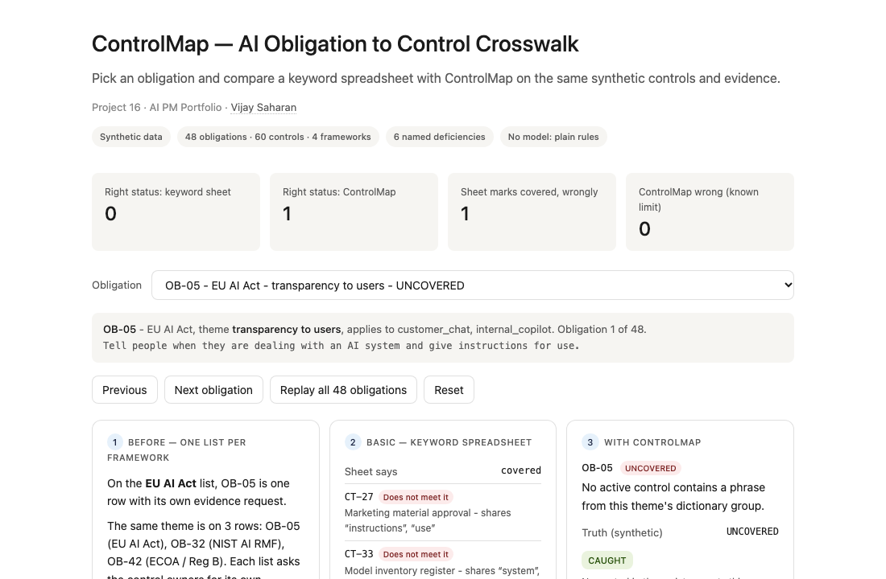
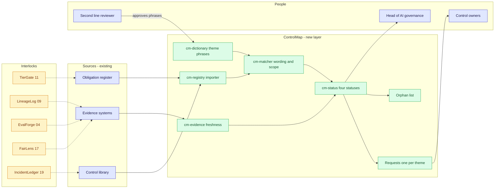
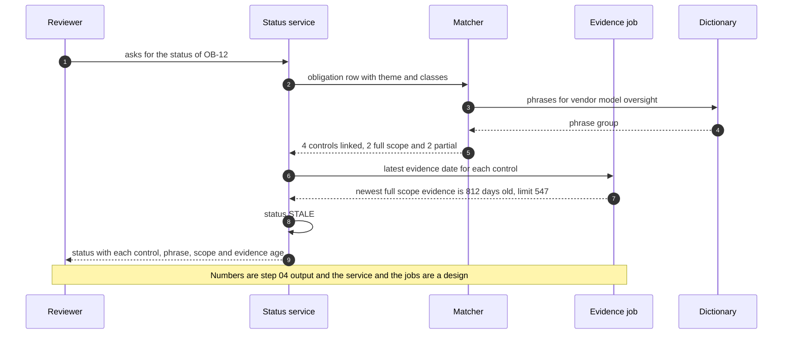

# 🗺️ ControlMap — AI Obligation to Control Crosswalk

**A portfolio prototype for mapping AI-related obligations (EU AI Act, model risk guidance, NIST AI RMF, ECOA / Regulation B) to the controls that meet them and to evidence that is still current: a theme dictionary, a scope check, an evidence-freshness check, an orphan-control list and one consolidated evidence request per theme. Aligned to the govern, map, measure and manage themes in the [NIST AI RMF](https://www.nist.gov/itl/ai-risk-management-framework) and to the inventory, validation and monitoring themes in [SR 26-2](https://www.federalreserve.gov/supervisionreg/srletters/SR2602.htm) (the April 2026 model-risk guidance; SR 11-7 was its 2011 predecessor).**

**▶ Static demo, no install:** [open on GitHub Pages](https://vj-shipped-anyway.github.io/ai-pm-portfolio/16-controlmap-ai-obligation-crosswalk/demo.html)

[](https://vj-shipped-anyway.github.io/ai-pm-portfolio/16-controlmap-ai-obligation-crosswalk/demo.html)

**What it shows** (🟢 measured on synthetic data; the script is named in brackets):

- 🟢 Right status: 46 of 48 obligations (95.8%) with ControlMap against 23 of 48 for the sheet (`step_04`, `step_02`)
- 🟢 Each part earns its place: the dictionary takes the right-status count to 31, the scope check to 39 and the freshness check to 46 (`step_04`)
- 🟢 Pairs: precision 97.4%, recall 96.2% against the truth map, where the sheet scores 46.9% and 39.1% (`step_04`, `step_02`)

_A portfolio prototype on synthetic data, not a production case study. The framing, how to read the numbers and the regulatory note are folded below._


[](./demo.html)


> **▶ 30-second demo:** the [clickable demo](./demo.html) gets you the full story in 30 seconds with no install.

<details>
<summary>Framing, how to read the numbers, and the regulatory note</summary>

> **Regulatory note.** This README cites SR 11-7 or its replacement, [SR 26-2](https://www.federalreserve.gov/supervisionreg/srletters/SR2602.htm) (Federal Reserve, OCC and FDIC, April 17, 2026). SR 26-2 sets no enforceable standards, is aimed mainly at banks with over $30 billion in assets, and places generative AI and agentic AI outside its scope. Here those citations name the design basis for validation, monitoring and inventory practices, or serve as an analogy. They are not a claim that the project meets SR 26-2 or that SR 26-2 governs the systems it examines.

> **Framing:** This is a portfolio prototype, not a production case study. The six-deficiency taxonomy, the crosswalk design, the data generator and the walkthrough are mine. Every number below is either printed by a script in this folder on data I generated, or is modeled with its assumption named. Production validation (a real obligation register, a real control library, real evidence dates, a second-line read) is what the next role does.

> **Reading the numbers — credibility tags inline.** Every number in this README and the demo is tagged 🟢 **Measured** (printed by a script in `src/` on the shipped synthetic data: 48 obligations, 60 controls, 153 evidence items, 156 true pairs), 🟡 **Modeled** (extrapolated from that data, with the assumption named in one line), or 🔴 **Hypothetical** (designed and reasoned about, never tested). Full convention in the [master README's "Reading the numbers" section](../README.md#-reading-the-numbers). **All data is synthetic and generated by a seeded script. The truth is known because the data is synthetic: the generator decided which control meets which obligation, so it can score any method. Obligation statements are paraphrases written for this exercise, not the text of any rule.**

</details>

---

## 🔥 Demo in 30 seconds

Open the static, no-Python demo: [`demo.html`](./demo.html).
Pick one of the 48 obligations from the dropdown, or use Next obligation and Replay all 48 obligations. Three cards show the same obligation three ways: on one list per framework (its own evidence request, no control, no scope, no date), through a keyword spreadsheet (what it links and whether the link is real), and with ControlMap (the status, the control, its scope and the age of its evidence). The running totals at the top end at the 🟢 measured numbers: the sheet gives the right status to 23 of 48 obligations and ControlMap to 46; the sheet marks 21 obligations covered wrongly; ControlMap gets 2 wrong, which is the known limit.

To run the four-step walkthrough on your laptop:

```bash
git clone https://github.com/Vj-shipped-anyway/ai-pm-portfolio
cd ai-pm-portfolio/16-controlmap-ai-obligation-crosswalk/src
python3 step_01_status_quo.py
python3 step_02_keyword_crosswalk.py
python3 step_03_deficiencies_exposed.py
python3 step_04_with_controlmap.py
```

To regenerate the synthetic data (the output is identical on every run): `python3 ../data/_generate.py`.
To run the Streamlit prototype: `pip install -r requirements.txt`, then `streamlit run app.py` from `src/` (or `streamlit run 16-controlmap-ai-obligation-crosswalk/src/app.py` from the repo root).

---

## 💰 Why this lands — competitive positioning

Teams that map AI obligations to controls usually start with one of two cheap approaches: a spreadsheet that links rows by shared keywords, or a questionnaire sent to each control owner. I compare approaches rather than vendors, so the table below scores the spreadsheet and the new layer on the same synthetic data. The questionnaire is not built here, so its cells are design judgment (🔴), not measurements.

| Capability | One list per framework | Keyword spreadsheet | Owner questionnaire | **ControlMap** |
| --- | --- | --- | --- | --- |
| Finds the controls that meet an obligation | By hand, one list at a time | 🟢 61 of 156 true pairs (39.1%) | The owner's own claim; 🔴 not built or measured | 🟢 150 of 156 (96.2%) |
| Links to controls that do not meet the obligation | n/a | 🟢 69 of 130 links (53.1%) | 🔴 not measured | 🟢 4 of 154 links |
| Right status per obligation | No status | 🟢 23 of 48 (47.9%), at most 33 of 48 | 🔴 not measured | 🟢 46 of 48 (95.8%) |
| Sees a scope mismatch (PARTIAL) | No | No: 🟢 6 of 8 shown as covered | Only if the owner mentions it; 🔴 not measured | Yes: 🟢 8 of 8 found |
| Sees stale evidence (STALE) | No evidence date | No: 🟢 7 of 7 shown as covered | The owner attaches a file; the date is not checked; 🔴 not measured | Yes: 🟢 7 of 7 found |
| Lists controls that serve nothing | No | No view; 🟢 links 8 of 11 orphans to an obligation | No | 🟢 lists 10 of 11, and 2 others wrongly |
| Evidence requests per cycle | 🟢 48 | 48 | 🔴 one per owner per ask | 🟢 20 (14 to owners, 6 gaps) |
| Where it still fails | Everything above | Lookalike words, different words, scope, dates | Self-reported; no check of wording or dates | Wording outside the dictionary: 🟢 6 true pairs; a phrase used to deny a thing; fresh evidence is not a working control |

**Position:** *ControlMap does not replace the obligation register, the control library or the people who judge whether a control works. It adds the join between them. A spreadsheet tells you that two words match. This tells you which control, in what scope, with evidence from when.*

---

## The honest version (why this exists)

The failure mode this prototype is built around: a bank has to show, for each AI-related obligation, which control meets it and whether the evidence is current. The map lives in a spreadsheet that links rows by shared keywords. It marks obligations "covered" that are not, because two common words match. It misses controls that mean the same thing in other words. It does not know a control's scope, so a chat control is counted for a credit-decision duty. It has no evidence date, so a control tested two years ago looks the same as one tested last week. And nobody sees the controls that serve no obligation.

This is a prototype on synthetic data. I wrote the generator, the truth map, the sheet, the dictionary, the scope and freshness checks and the status rules. No model is used anywhere in this repo. The truth is known because the data is synthetic: the generator decides which control meets which obligation, so it can score the sheet and ControlMap. A real library does not hand you that, which is why the first job in a real deployment would be getting a control owner and a second-line reviewer to agree on a sample of true pairs. Nothing here is a real bank, control, vendor, regulator file or incident.

Two caveats up front. The dictionary was written by the author of the data, so the ControlMap scores here are an upper bound, not an estimate for a real library: 🟢 39 of 50 control-to-theme links rest on a single dictionary phrase. And fresh evidence shows that someone collected something recently. It does not show that a control works; design and operating effectiveness are not tested.

The set is dense on purpose (11 orphan controls, 6 themes with no control, 7 stale obligations) so that every effect appears often enough to count. It is a test set, not an estimate of how often these failures occur in a real library; the one frequency I do assume is named in the utility section.

If you prepare exams for AI governance and have inherited a keyword crosswalk, fork it. The theme taxonomy, the scope rule, the freshness rule and the status vocabulary are the parts worth lifting. Validating the dictionary against a reviewer's judgment is the work the next role would do.

---

## Prereqs to run this on your laptop (in plain English)

You don't need a cluster, a cloud account or an API key. You need:

- **Python 3.** The four step scripts, the data generator and the demo builder use only the standard library (for example `csv`, `json`, `re`, `datetime`, `collections` and `pathlib`), so there is nothing to install for them. They are written for Python 3.9 and tested on it; they use no syntax newer than 3.9.
- **Git**, to clone the repo. `brew install git` / `winget install git`.
- **`src/requirements.txt` — only for the Streamlit app.** It lists `streamlit`, `pandas`, `numpy` and `plotly`. The step scripts do not import any of them. Run `pip install -r src/requirements.txt` only if you want the app.
- **No API key.** There is no model call, no network call and no secret anywhere. The dictionary, the scope check and the freshness check are plain rules you can read.
- **Not needed:** a database, containers, Kubernetes or a cloud account. They appear in [`ARCHITECTURE.md`](./ARCHITECTURE.md) as the production design, not as prototype requirements.

Each step script finishes in seconds and writes its CSV or JSON to `src/out/`. The clickable `demo.html` runs in any browser with zero install. If a step does not run from a fresh clone, that's a bug in the README. Open an issue.

---

## Executive summary (90 seconds)

**Problem.** A modeled bank answers 48 AI-related obligations from four frameworks, using 60 controls and 153 evidence items. The head of AI governance and the second-line reviewer prepare for an exam from a spreadsheet that links obligations to controls by shared keywords. 🟢 It gives the right status to 23 of 48 obligations (47.9%), marks 42 covered while 40 have any control that meets them, and has no evidence date, no scope and no list of unused controls.

**Product.** ControlMap, a crosswalk with four rules: a **theme dictionary** (synonym groups) that finds the controls that meet an obligation; a **scope check** that labels a match full or partial; an **evidence-freshness check** (latest item no older than 1.5 times the control's test cycle); and a **status** per obligation: COVERED, STALE, PARTIAL or UNCOVERED, with a reason on every row. It also lists the orphan controls and consolidates evidence requests to one per theme.

**Measured and modeled performance.**

- 🟢 **Right status: 46 of 48 obligations (95.8%)** with ControlMap against 23 of 48 for the sheet (`step_04`, `step_02`). A covered / not-covered sheet could reach at most 33 of 48, because it cannot say PARTIAL or STALE.
- 🟢 **Each part earns its place:** the dictionary takes the right-status count to 31, the scope check to 39 and the freshness check to 46 (`step_04`). The theme name alone as the phrase scores 8.
- 🟢 **Pairs: precision 97.4%, recall 96.2%** against the truth map, where the sheet scores 46.9% and 39.1% (`step_04`, `step_02`). Agreement on the full or partial label (150 of 150) holds by construction: the generator and ControlMap apply the same rule to the same scopes.
- 🟢 **Stale and partial obligations found:** 7 of 7 STALE and 8 of 8 PARTIAL (`step_04`); the sheet shows 7 of 7 STALE and 6 of 8 PARTIAL as covered (`step_03`). Freshness is a definition: the generator and ControlMap use the same 1.5-cycle rule, so that agreement is by construction too.
- 🟢 **Orphan controls: 10 of 11 listed**, with 2 others wrongly listed because their wording is outside the dictionary (`step_04`).
- 🟢 **Evidence requests: 20 instead of 48** (14 to control owners, 6 gaps with no control to ask) (`step_01`, `step_04`).
- 🟡 **Utility: (46/48 − 23/48) × 288 = 138 obligation entries given the right status**, assuming 6 business lines each track their own copy of the list.
- 🔴 **Design target: a status never older than the latest evidence date in the source systems.** Designed in `ARCHITECTURE.md`, never built or timed.

**Call to action.** Fork this repo. Swap [`data/obligations.csv`](./data/obligations.csv), [`data/controls.csv`](./data/controls.csv) and [`data/evidence.csv`](./data/evidence.csv) for exports from your obligation register, your control library and your evidence systems, and call `analyze` from `step_04` on them. [`data/truth_map.csv`](./data/truth_map.csv) exists only because the data is synthetic.

---

## 🗺️ What this walkthrough covers

1. **The use case** — a modeled bank answering AI-related obligations from four frameworks
2. **Sample data** — 48 obligations, 60 controls, 153 evidence items, 156 true pairs
3. **Step 1 — Before ControlMap** — one list per framework; how many themes repeat and how many evidence requests go out
4. **Step 2 — Basic approach** — the keyword spreadsheet; what it links, what it gets right
5. **Step 3 — The six named deficiencies** — each with a count from the dataset
6. **Step 4 — The fix (ControlMap)** — dictionary, scope, freshness, orphans, requests; scored against the truth map, with the known limit printed
7. **Utility delivered** — a multiplied number with the assumption named
8. **Architecture & call flow** — topology and a per-obligation sequence
9. **PM artifacts** — PRD and architecture

> Non-technical reader: skip the code blocks. The plain-English explanation and the output tables tell the story.
> Technical reader: every code block runs. `cd src && python3 step_NN_*.py` and you'll see the same output.

Total reading time: about 12 minutes deep, 3 minutes if you skim.

---

## 🎯 The Use Case

**A modeled bank's AI governance program. 48 obligations from four frameworks, 60 controls, and an exam to prepare for.**

The head of AI governance has to show, for each obligation, which control meets it and whether the evidence is current. The obligations come from the EU AI Act, model risk guidance (SR 26-2), the NIST AI RMF and ECOA / Regulation B, and each framework has its own list. SR 26-2 places generative and agentic AI outside its scope, so the modeled bank applies its themes to all of its AI systems by its own policy. The controls are owned by model risk, credit risk, fair lending, technology, vendor management and the AI platform team, who test on their own cycles.

Four things happen in the synthetic data:

- **A lookalike word.** A network-traffic control, `CT-31`, shares "deployed", "monitoring" and "systems" with the ongoing-monitoring obligation `OB-34`. The sheet links them. The control meets no obligation. 🟢 69 of the sheet's 130 links are to controls that do not meet the obligation.
- **Different words, same meaning.** A challenger comparison review, `CT-19`, meets all four independent-validation obligations and shares fewer than two words with each of them. 🟢 The sheet misses 95 of 156 true pairs.
- **The wrong scope.** `OB-22` asks that users of the internal copilot can challenge and override its output. The only human-review controls run for credit decisions and chat. The sheet says covered. 🟢 6 of 8 obligations whose controls miss part of their scope are marked covered.
- **Evidence that is not current.** `OB-12` (vendor model oversight) has four controls that meet it, and the newest evidence among the full-scope ones is 812 days old against a limit of 547. The sheet links 7 controls and says covered. 🟢 7 of 7 stale obligations are marked covered.

The people involved: the head of AI governance who owns the answer, the second-line reviewer who has to defend the dictionary, the control owners who are asked for evidence, and internal audit who reads the record. ControlMap is designed for those four.

---

## 📊 Sample Data

Four CSVs in [`data/`](./data/), generated by [`data/_generate.py`](./data/_generate.py) (standard library, seeded, deterministic: running it twice produces identical files). Documented in [`data/README.md`](./data/README.md). One preview each:

**[`data/obligations.csv`](./data/obligations.csv)** — 48 obligations, 12 per framework, 20 distinct themes. The statements are paraphrases written for this exercise, not the text of any rule. `applies_to` is how the modeled bank scoped each row.

```
obligation_id,framework,theme,statement,applies_to
OB-01,EU AI Act,risk management,Keep a written risk process for each high-risk AI system and update it as the system changes.,credit_decision;fraud_scoring
OB-02,EU AI Act,data governance,"Check that data used to build and test the system is relevant, representative and free of known errors.",credit_decision;fraud_scoring
OB-03,EU AI Act,technical documentation,"Prepare documents that describe the system's design, purpose and limits before it goes live.",credit_decision
```

**[`data/controls.csv`](./data/controls.csv)** — 60 controls with an owner, a test cycle in days, a scope and a status. 11 of them meet no obligation (2 are retired).

```
control_id,name,description,owner,test_frequency_days,scope,status
CT-01,Fair lending compliance program,Written program with named owners for fair lending testing and issue follow-up.,Fair Lending Office,180,credit_decision,active
CT-02,Benchmark replication exercise,Second-line analysts rebuild the model's headline results from raw data and reconcile any difference.,Model Risk Management,365,credit_decision;fraud_scoring,active
CT-03,Legacy scorecard validation,Annual validation of the previous credit scorecard; closed when the scorecard was replaced.,Model Risk Management,365,credit_decision,retired
```

**[`data/evidence.csv`](./data/evidence.csv)** — 153 evidence items. Evidence is stale when the latest item is older than 1.5 times the control's test cycle, counted at the fixed date 2026-09-30.

```
evidence_id,control_id,evidence_type,collected_on,reviewer
EV-001,CT-01,sample check,2025-08-13,R-01
EV-002,CT-01,exception log,2026-02-05,R-09
EV-003,CT-01,system report,2026-08-06,R-02
```

**[`data/truth_map.csv`](./data/truth_map.csv)** — the generator's ground truth: 156 pairs, 94 full and 62 partial. It exists only because the data is synthetic.

```
obligation_id,control_id,coverage
OB-01,CT-04,full
OB-01,CT-25,full
OB-01,CT-38,full
OB-01,CT-53,full
```

Truth totals by status: COVERED 25, STALE 7, PARTIAL 8, UNCOVERED 8. The data includes the traps on purpose: lookalike controls that meet nothing, controls worded in different words, scope mismatches, 6 themes with no control, and 3 controls with no evidence on file.

---

## 🔧 Step 1 — Before ControlMap: one obligation list per framework

**In plain English:** Each framework has its own list. Several themes (record-keeping, human oversight, ongoing monitoring and others) appear on more than one list, and every list asks the control owners for its own evidence. The lists carry no control, no scope and no evidence date.

```bash
python3 src/step_01_status_quo.py
```

The script counts what the lists look like. The definitions it uses are printed with the result:

```
ASSUMPTIONS (definitions used for the count):
  R1  answered on its own, each framework sends one evidence request per obligation row
  R2  answered once per distinct theme, the bank sends one request per theme
```

**Result:**

```
FRAMEWORK LISTS (each answered on its own)
  framework                        obligations  themes   themes also in another list
  EU AI Act                                 12      12                            11
  Model risk guidance (SR 26-2)             12      12                            11
  NIST AI RMF                               12      12                             9
  ECOA / Regulation B                       12      10                             7
```

```
RESULT
  Obligations across 4 frameworks:              48
  Distinct themes:                              20
  Themes asked by more than one framework:      12 (covering 38 of 48 obligations)
  Evidence requests, each framework alone:      48 (rule R1)
  Evidence requests, once per theme:            20 (rule R2)
  Requests that repeat a theme already asked:   28 of 48 (58.3%)
  The register behind the lists:                60 controls and 153 evidence items as of 2026-09-30;
                                                the lists carry no control scope and no evidence date.
```

🟢 The counts are printed by `step_01`. They follow the two definitions above, so read them as a property of how the work is split, not as a measurement of effort: 12 of the 20 themes are asked by more than one framework, and 28 of the 48 requests (58.3%) repeat a theme another row has already asked for.

---

## 🤖 Step 2 — With the basic approach: a keyword crosswalk spreadsheet

**In plain English:** Mark an obligation "covered" when two words overlap with a control's name or description, and list the controls that matched. It is cheap and it is how this is usually done.

```bash
python3 src/step_02_keyword_crosswalk.py
```

```
SHEET OUTPUT (first rows)
  obligation framework     theme                        sheet says   controls linked  truth
  OB-01      EU AI Act     risk management              not covered                0  COVERED
  OB-02      EU AI Act     data governance              covered                    4  COVERED
  OB-03      EU AI Act     technical documentation      covered                    2  COVERED
  OB-04      EU AI Act     record-keeping               not covered                0  PARTIAL
  OB-05      EU AI Act     transparency to users        covered                    2  UNCOVERED
  OB-06      EU AI Act     human oversight              covered                    2  COVERED
  OB-07      EU AI Act     accuracy and resilience      not covered                0  COVERED
  OB-08      EU AI Act     external registration        covered                    2  UNCOVERED
  OB-09      EU AI Act     independent validation       covered                    3  COVERED
  OB-10      EU AI Act     ongoing monitoring           covered                    7  PARTIAL
  OB-11      EU AI Act     governance and policy        covered                    6  COVERED
  OB-12      EU AI Act     vendor model oversight       covered                    7  STALE
  ...
```

```
RESULT
  Candidate pairs checked:                          2,880 (48 obligations x 60 controls)
  Pairs the sheet links:                            130
  True pairs in truth_map.csv:                      156
  Pair precision:                                   61 of 130 (46.9%)
  Pair recall:                                      61 of 156 (39.1%)
  Obligations the sheet marks covered:              42 of 48
  Obligations with at least one meeting control:    40 of 48 (truth)
  Obligations with a full-scope control:            32 of 48 (truth)
  Marked covered but given a wrong status:          21 of 42
  Right status (label and a true control named):    23 of 48 (47.9%)
  Most a covered / not-covered sheet could score:   33 of 48 (it cannot say PARTIAL or STALE)
```

- **The sheet links too much and finds too little.** 🟢 Pair precision 46.9% and recall 39.1% against the truth map: 61 of its 130 links are real, and 61 of the 156 true pairs are found.
- **It cannot say anything but covered or not covered.** 🟢 It marks 42 of 48 obligations covered, 21 of them with a wrong status. The most a sheet of this kind could score is 33 of 48, because PARTIAL and STALE are not in its vocabulary.
- **The scoring rule is strict on both sides.** A status counts as right only if the label is right and, for anything but UNCOVERED, at least one control the method names really drives that status. The same rule scores ControlMap in step 4.

---

## 🔬 Step 3 — Where this still breaks: 6 named deficiencies

| # | Deficiency | What goes wrong | Count in this dataset |
| --- | --- | --- | --- |
| 1 | **Lookalike words counted as coverage** | Two common words match and the obligation is "covered". | 🟢 69 of 130 links (53.1%) are to controls that do not meet the obligation; 6 of the 8 obligations with no control at all are marked covered |
| 2 | **Synonym misses** | The control that meets the obligation uses different words. | 🟢 95 of 156 true pairs (60.9%) missed; 7 of 40 obligations that have a meeting control get none of them |
| 3 | **Partial coverage shown as covered** | The control's scope misses a use-case class the obligation covers. | 🟢 6 of 8 PARTIAL obligations marked covered |
| 4 | **Stale evidence hidden** | The sheet holds no evidence date. | 🟢 7 of 7 STALE obligations marked covered; a freshness filter on the sheet's own links would flag 0 of them |
| 5 | **Orphan controls hidden** | Nothing lists a control that serves no obligation, and word matching links it to something anyway. | 🟢 11 orphan controls; 8 of them linked to at least one obligation (16 links) |
| 6 | **Duplicate evidence requests** | The same theme is asked for by several frameworks as separate requests. | 🟢 28 of 48 requests (58.3%) repeat a theme already asked |

```bash
python3 src/step_03_deficiencies_exposed.py
```

```
STEP 3 - Where the keyword sheet breaks: 6 named deficiencies
  (same sheet as step 2, scored against data/truth_map.csv; the truth is known because the data is synthetic)

(a) Lookalike words are counted as coverage
    69 of 130 (53.1%) links the sheet makes are to controls that do not meet the obligation.
    9 of 42 (21.4%) 'covered' obligations are covered only by such controls.
    6 of the 8 (75.0%) obligations with no meeting control are marked covered.
    Worst case: CT-33 Model inventory register is linked to 8 obligations it does not meet.

(b) Synonym misses: the right control uses different words
    95 of 156 (60.9%) true pairs are not linked by the sheet.
    For 7 of 40 (17.5%) obligations that have a meeting control, the sheet finds none of them
    (4 are shown as not covered, 3 look covered through other controls).
    Controls whose every true pair is missed (different words, same meaning):
      CT-02 Benchmark replication exercise         4 of 4 true pairs missed
      CT-15 Second-line review of chatbots         4 of 4 true pairs missed
      CT-19 Challenger comparison review           4 of 4 true pairs missed
      CT-10 Chatbot answer sampling                4 of 4 true pairs missed

(c) Partial coverage is shown as covered
    6 of 8 (75.0%) obligations whose only meeting controls miss part of their scope are marked covered.
      OB-04 record-keeping                 needs credit_decision, customer_chat; the sheet marks it not covered
      OB-10 ongoing monitoring             needs all classes; marked covered via 7 controls; true partial: CT-22 (scope credit_decision;customer_chat;fraud_scoring)
      OB-22 human oversight                needs internal_copilot; marked covered via 2 controls; true partial: CT-34 (scope credit_decision)
      OB-23 record-keeping                 needs all classes; marked covered via 2 controls, none a true partial
      OB-29 measure function               needs all classes; marked covered via 1 control; true partial: CT-05 (scope customer_chat;internal_copilot)
      OB-31 human oversight                needs credit_decision, customer_chat, internal_copilot; the sheet marks it not covered
      OB-33 accuracy and resilience        needs all classes; marked covered via 1 control, none a true partial
      OB-34 ongoing monitoring             needs all classes; marked covered via 1 control, none a true partial

(d) Stale evidence hides behind 'covered'
    7 of 7 (100.0%) obligations whose full-scope controls all have stale or missing evidence are marked covered.
    A freshness filter on the sheet's own links would flag 0 of those 7: lookalike links to unrelated fresh controls hide the rest.
    Across all 42 obligations marked covered, 3 have no linked control with fresh evidence.
      OB-12 vendor model oversight           newest full-scope evidence 812 days old, limit 547; the sheet links 7 controls
      OB-18 vendor model oversight           newest full-scope evidence 812 days old, limit 547; the sheet links 6 controls
      OB-27 vendor model oversight           newest full-scope evidence 812 days old, limit 547; the sheet links 7 controls
      OB-36 data governance                  newest full-scope evidence 185 days old, limit 135; the sheet links 1 control
      OB-39 timely notice of action taken    newest full-scope evidence 74 days old, limit 45; the sheet links 4 controls
      OB-40 timely notice of action taken    newest full-scope evidence 74 days old, limit 45; the sheet links 2 controls
      OB-46 vendor model oversight           newest full-scope evidence 633 days old, limit 547; the sheet links 5 controls

(e) Orphan controls are hidden
    11 controls meet no obligation (9 active). The sheet has no view that lists them.
    Its word matching links 8 of the 11 (72.7%) to at least one obligation (16 links), so they look useful.
      CT-16 Developer pre-release self-check     OB-02 on build, check; OB-09 on independent, validation
      CT-18 Vendor invoice approval              OB-27 on party, third, vendor
      CT-20 Data center power resilience test    OB-02 on data, test; OB-33 on recover, resilience
      CT-27 Marketing material approval          OB-05 on instructions, use
      CT-28 Access recertification               OB-24 on production, review
      CT-31 Network traffic monitoring           OB-34 on deployed, monitoring, systems
      CT-47 Employee conduct training            OB-11 on policy, roles; OB-16 on policy, roles
      CT-49 Application uptime monitoring        OB-15 on monitoring, set, thresholds; OB-41 on application, set

(f) The same theme is asked for as separate evidence requests
    48 requests go out, one per obligation row, for 20 distinct themes.
    28 of 48 (58.3%) repeat a theme another row has already asked for.

Top controls the sheet links wrongly (obligations linked that the control does not meet):
    CT-33 Model inventory register             8
    CT-16 Developer pre-release self-check     5
    CT-56 Adverse action reason review         4
    CT-40 Decision log retention               4
    CT-47 Employee conduct training            3
```

The basic approach finds some of the links and misses what the links mean. **The product is the scope, the freshness and the status, not the matching.**

---

## 🛠️ Step 4 — The fix: ControlMap

Four parts, all plain rules, no model:

1. **Theme dictionary.** A hand-written table of phrases per theme (20 themes, 93 phrases). A control matches an obligation when its name or description contains a phrase from the obligation's theme group. Retired controls never match. The phrase that produced each link is stored with it.
2. **Scope check.** A match is full when the control's scope includes every use-case class the obligation applies to, and partial when it misses one or more. Coverage is judged one control at a time.
3. **Evidence-freshness check.** Evidence is fresh when the control's latest item is no older than 1.5 times its test cycle at 2026-09-30; otherwise stale, or none on file. The 1.5 factor is an assumption of the modeled bank, not a requirement of any framework; it is `STALE_FACTOR` in `step_01`.
4. **Status and views.** COVERED (a full-scope control with fresh evidence), STALE (a full-scope control, none fresh), PARTIAL (only partial controls), UNCOVERED (no control). Plus the orphan-control list and one evidence request per theme.

```bash
python3 src/step_04_with_controlmap.py
```

**The status table, first rows (48 in the full output):**

```
OBLIGATION STATUS (first rows; all 48 in out/step_04_obligation_status.csv)
  obligation framework     theme                          status     driving control and evidence
  OB-01      EU AI Act     risk management                COVERED    4 controls drive it; freshest CT-38, evidence 51 d old (limit 547 d)
  OB-02      EU AI Act     data governance                COVERED    2 controls drive it; freshest CT-29, evidence 9 d old (limit 45 d)
  OB-03      EU AI Act     technical documentation        COVERED    3 controls drive it; freshest CT-44, evidence 5 d old (limit 547 d)
  OB-04      EU AI Act     record-keeping                 PARTIAL    4 partial-scope controls; closest CT-40 misses customer_chat; evidence 52 d old (limit 135 d)
  OB-05      EU AI Act     transparency to users          UNCOVERED  no control matches this theme
  OB-06      EU AI Act     human oversight                COVERED    2 controls drive it; freshest CT-21, evidence 41 d old (limit 135 d)
  OB-07      EU AI Act     accuracy and resilience        COVERED    2 controls drive it; freshest CT-32, evidence 53 d old (limit 135 d)
  OB-08      EU AI Act     external registration          UNCOVERED  no control matches this theme
  OB-09      EU AI Act     independent validation         COVERED    3 controls drive it; freshest CT-16, evidence 72 d old (limit 135 d)
  OB-10      EU AI Act     ongoing monitoring             PARTIAL    5 partial-scope controls; closest CT-22 misses internal_copilot; evidence 30 d old (limit 45 d)
  OB-11      EU AI Act     governance and policy          COVERED    5 controls drive it; freshest CT-54, evidence 8 d old (limit 135 d)
  OB-12      EU AI Act     vendor model oversight         STALE      2 full-scope controls, none fresh; newest CT-42, evidence 812 d old (limit 547 d)
  OB-13      SR 26-2       model inventory                STALE      2 full-scope controls, none fresh; newest CT-33, evidence 70 d old (limit 45 d)
  OB-14      SR 26-2       independent validation         COVERED    2 controls drive it; freshest CT-60, evidence 82 d old (limit 547 d)
  OB-15      SR 26-2       ongoing monitoring             COVERED    1 control drives it; freshest CT-22, evidence 30 d old (limit 45 d)
  OB-16      SR 26-2       governance and policy          COVERED    5 controls drive it; freshest CT-54, evidence 8 d old (limit 135 d)
  ...
  Rows above where the control shown is a false link (see KNOWN LIMIT): OB-09
```

The row for `OB-09` names `CT-16`, the developer self-check, as the freshest control. That is the false link described under the known limit. The status is still right because 2 real validation controls drive the row as well.

**What each part adds, scored against the truth map with the same strict rule as the sheet:**

```
WHAT EACH PART ADDS (obligations with the right status; same strict rule as step 2)
  Keyword sheet (step 2):                          23 of 48
  Theme name as the only phrase (no synonyms):     8 of 48
  Theme dictionary with synonym groups:            31 of 48
  + scope check (adds PARTIAL):                    39 of 48
  + evidence freshness (adds STALE):               46 of 48   <- ControlMap
  Thin dictionary (first phrase per theme only):   41 of 48, pair recall 25.6%
```

```
SCORED AGAINST truth_map.csv
  Right status, ControlMap:                   46 of 48 (95.8%)
  Right status, keyword sheet:                23 of 48 (47.9%)
  Pairs linked / true pairs:                  154 / 156
  Pair precision:                             150 of 154 (97.4%)
  Pair recall:                                150 of 156 (96.2%)
  Links that are wrong:                       4 of 154 (2.6%)
  Scope label right on linked true pairs:     150 of 150
```

```
  Status confusion (rows: truth, columns: ControlMap)
                  COVERED      STALE    PARTIAL  UNCOVERED
  COVERED              23          2          0          0
  STALE                 0          7          0          0
  PARTIAL               0          0          8          0
  UNCOVERED             0          0          0          8
```

| Status | Truth | Keyword sheet | ControlMap |
| --- | --- | --- | --- |
| COVERED | 🟢 25 | marks 42 "covered" | 🟢 23 |
| STALE | 🟢 7 | cannot say | 🟢 9 |
| PARTIAL | 🟢 8 | cannot say | 🟢 8 |
| UNCOVERED | 🟢 8 | marks 6 of the 8 "covered" | 🟢 8 |

**Orphan controls and consolidated evidence requests:**

```
ORPHAN CONTROLS (listed by ControlMap; the sheet has no such view)
  12 controls serve no obligation by ControlMap's reading; 10 of the 11 (90.9%) true orphans are among them.
    CT-02 Benchmark replication exercise         active   WRONGLY listed
    CT-03 Legacy scorecard validation            retired  true orphan
    CT-08 Branch cash handling audit             active   true orphan
    CT-09 Workload roll-call                     active   WRONGLY listed
    CT-18 Vendor invoice approval                active   true orphan
    CT-20 Data center power resilience test      active   true orphan
    CT-27 Marketing material approval            active   true orphan
    CT-28 Access recertification                 active   true orphan
    CT-31 Network traffic monitoring             active   true orphan
    CT-47 Employee conduct training              active   true orphan
    CT-49 Application uptime monitoring          active   true orphan
    CT-58 Chatbot reply keyword filter           retired  true orphan
```

```
CONSOLIDATED EVIDENCE REQUESTS (one per distinct theme)
  48 requests if each framework answers on its own, 20 once per theme: 14 go to control owners, 6 are gaps with no control to ask (8 obligations).
  theme                            frameworks  obligations  controls  need new evidence
  governance and policy                     4            4         6                  0
  independent validation                    4            4         4                  0
  ongoing monitoring                        4            4         5                  0
  vendor model oversight                    4            4         4                  4
  accuracy and resilience                   3            3         3                  0
  data governance                           3            3         4                  1
  human oversight                           3            3         3                  0
  record-keeping                            3            3         4                  0
  technical documentation                   3            3         4                  0
  transparency to users                     3            3         0 GAP: no control
  model inventory                           2            2         2                  2
  risk management                           2            2         4                  0
  specific adverse-action reasons           1            2         3                  0
  timely notice of action taken             1            2         2                  2
  change management                         1            1         0 GAP: no control
  external registration                     1            1         0 GAP: no control
  manage function                           1            1         0 GAP: no control
  map function                              1            1         0 GAP: no control
  measure function                          1            1         2                  0
  prohibited-basis inputs                   1            1         0 GAP: no control
```

- **What the numbers say.** 🟢 The right-status count goes from 23 (sheet) to 31 with the dictionary, 39 with the scope check and 46 with the freshness check. The scope and freshness checks matter as much as the matching: they are what makes PARTIAL and STALE visible at all.
- **The dictionary does the heavy lifting.** 🟢 Using the theme name alone as the phrase scores 8 of 48. Cutting the dictionary to its first phrase per theme still scores 41 of 48 statuses, because most obligations have several controls, but pair recall drops to 25.6%. Statuses are more forgiving than the pair list.
- **Consolidation is a count, not a saving.** 🟢 20 requests instead of 48, and 6 of the 20 are gaps with no control to ask: they go to the head of AI governance as open items. How much owner time that frees is not measured here.
- **Agreement that holds by construction.** The scope label (150 of 150 right) and the freshness verdict are definitions the generator and ControlMap share. The part that is not by construction is the wording match, and that is where the misses are.

### The known limit, left in on purpose

ControlMap misses true mappings whose wording is outside the dictionary, links one control it should not, and does not test whether any control works.

```
  Rows above where the control shown is a false link (see KNOWN LIMIT): OB-09
```

| What | Where | Effect |
| --- | --- | --- |
| Wording outside the dictionary | `CT-02` (benchmark replication) and `CT-09` (workload roll-call) | 🟢 6 true pairs missed; 2 obligations read STALE where the truth is COVERED; both controls appear on the orphan list |
| A phrase that denies the thing | `CT-16` (developer self-check) | 🟢 4 wrong links to independent-validation obligations; no status changes because real validation controls also exist |
| Fresh is not working | every COVERED row | Not measurable here: design and operating effectiveness are not tested |

Other limits, stated plainly: truth is judged at the theme level and one control at a time, so two partial controls that together span a scope are not counted as full (the generator avoids the case); the dictionary was written by the author of the data, so the scores are an upper bound; and with real libraries the first job is a reviewer's sample of true pairs to measure precision and recall.

---

## 📐 Utility Delivered

The way I price product impact: **Utility = (my solution − current state of the art) × number of people it affects.**

Here the terms are obligations given the right status and obligation entries tracked. Each entry lands on four roles: the head of AI governance, the second-line reviewer, the control owner and internal audit. Going from "two words match" to "this control, this scope, this evidence age" is not an outcome by itself. *Doing it for every obligation entry a bank tracks in an exam cycle is.*

| Term | Value | Where it comes from |
| --- | --- | --- |
| Current state of the art (keyword sheet), right status | 🟢 **23 of 48 (47.9%)** | `step_02`: label right and a true control named |
| Most a covered / not-covered sheet could reach | 🟢 33 of 48 | `step_02`: it cannot say PARTIAL or STALE |
| My solution (ControlMap), right status | 🟢 **46 of 48 (95.8%)** | `step_04`: same rule, same truth map |
| Per-obligation lift | 🟢 46/48 − 23/48 | 23 more obligations given the right status |
| Number it affects: obligation entries tracked | 🟡 **288** | **Assumption, not a statistic:** 6 business lines each track their own copy of the 48-obligation list. Edit `BUSINESS_LINES` in `step_04` to use your own |
| Assumption that makes the lift real | 🟡 A reviewer reads the status and acts on a STALE, PARTIAL or UNCOVERED row | If rows are ignored, the lift shrinks toward zero |
| **Utility** | 🟡 **(46/48 − 23/48) × 288 = 138 obligation entries given the right status** | Per exam cycle; assumes the other business lines' copies behave like this set |

Sensitivity to the business-lines assumption (🟡, same per-obligation lift): 3 lines gives 69, 6 gives 138, 12 gives 276.

🔴 What I have not measured: how long exam preparation takes with and without a status, what a reviewer does with a STALE row, and what it costs to maintain the dictionary. The synthetic set is also much denser in failures than a real library. Treat the per-obligation number as a property of this mix of traps, not a forecast.

---

## 🔄 Architecture & Call Flow

How each obligation flows through the system. GitHub renders these diagrams natively. Component names match [`ARCHITECTURE.md`](./ARCHITECTURE.md).

**System topology:**



**Per-obligation sequence** (OB-12, vendor model oversight):



See [`assets/controlmap-flow.svg`](./assets/controlmap-flow.svg) for a static visual of the same flow.

**Interlocks (all 🔴 designed, none built):**

- [11 TierGate](../11-tiergate-ai-usecase-intake/) tiers each use case at intake. The tier sets which classes an obligation applies to, which is the `applies_to` column here. ControlMap is not a second intake: it maps obligations to controls, and it does not tier use cases.
- [09 LineageLog](../09-lineagelog-ai-decision-audit/) records decision lineage and [04 EvalForge](../04-evalforge-llm-eval-platform/) holds evaluation runs. Both are evidence sources: a dated run or a dated lineage export is an evidence item for the control that produces it. ControlMap is not a decision audit: it dates the evidence, it does not replay a decision.
- 17 FairLens would supply adverse-action evidence for the ECOA / Regulation B obligations.
- 19 IncidentLedger would link incidents to the controls that should have caught them.

---

## 📋 PM Artifacts

The PM artifacts that show how I'd run this product if I owned the seat. This README is the walkthrough; the rest of the folder holds:

- [`PRD.md`](./PRD.md) — the product requirements doc: users, backlog, KPIs, rollout, open questions.
- [`ARCHITECTURE.md`](./ARCHITECTURE.md) — the systems doc: components, data model, security, failure behavior, operations. A design, not deployed.
- [`demo.html`](./demo.html) — clickable, no-install walkthrough; every number is generated from the scripts in `src/` by `src/_build_demo.py`.
- [`data/`](./data/) — the four synthetic CSVs and the generator. `data/README.md` explains the ground-truth rules.
- [`src/`](./src/) — runnable step scripts and the Streamlit prototype.

Run the walkthrough end-to-end:

```bash
cd src
python3 step_01_status_quo.py
python3 step_02_keyword_crosswalk.py
python3 step_03_deficiencies_exposed.py
python3 step_04_with_controlmap.py
```

---

## 🚀 Fork this for your team

```bash
git clone https://github.com/Vj-shipped-anyway/ai-pm-portfolio
cd ai-pm-portfolio/16-controlmap-ai-obligation-crosswalk

# 1. Run the synthetic walkthrough as is
cd src
python3 step_01_status_quo.py
python3 step_02_keyword_crosswalk.py
python3 step_03_deficiencies_exposed.py
python3 step_04_with_controlmap.py

# 2. Open the interactive demo
open ../demo.html            # static snapshot of the synthetic run; it does not read data/
```

To point it at your own program, replace three files and keep their columns:

- `data/obligations.csv`: one row per obligation: `obligation_id, framework, theme, statement, applies_to`
- `data/controls.csv`: one row per control: `control_id, name, description, owner, test_frequency_days, scope, status`
- `data/evidence.csv`: one row per evidence item: `evidence_id, control_id, evidence_type, collected_on, reviewer`

Then edit `THEME_TERMS` in `step_04` so each of your themes has a phrase group, and set `AS_OF` in `step_01`. The functions that do the work take plain dicts:

```python
# from src/
from step_01_status_quo import load_all
from step_04_with_controlmap import analyze

a = analyze(load_all(your_data_dir))
for r in a["rows"]:
    print(r["obligation_id"], r["status"], r["driving"])   # status and the controls behind it
```

`data/truth_map.csv` exists only because the data is synthetic. The scoring lines in steps 2 to 4 read it, so on real exports they cannot be computed until a reviewer builds a sample of true pairs; `analyze` still returns the statuses, the links with their phrases, the orphan list and the consolidated requests. Keep the themes at the level you want a status for: a control that serves a theme is treated as meeting every obligation filed under it.

If you run it on a real library and get something useful, open an issue or send me what your reviewers did with it. I'd rather see that than what I think it should do.

---

## 👤 Author

**Vijay Saharan** — Sr Product / Program Manager · AI in BFSI · Enterprise AI Platforms · CRE as a study interest

[LinkedIn](https://www.linkedin.com/in/vijaysaharan/) · Tagline: *AI Governance PM · Designs the join between obligations, controls and evidence, under regulated constraint*

---

## 🙌 Acknowledgements

- **[NIST AI RMF](https://www.nist.gov/itl/ai-risk-management-framework)** — the govern, map, measure and manage themes are four of the 20 themes the obligations are filed under, and the map and manage obligations are the gaps in the prototype's data.
- **[SR 26-2](https://www.federalreserve.gov/supervisionreg/srletters/SR2602.htm)** — the April 2026 model-risk guidance from the Federal Reserve, OCC and FDIC, and the model-risk guidance the work is compared with on the inventory, validation, monitoring and governance themes. SR 11-7 was its 2011 predecessor.
- **[EU AI Act](https://eur-lex.europa.eu/eli/reg/2024/1689/oj)** — the source of the record-keeping, human-oversight, transparency and risk-management themes in the EU rows, as paraphrased for this exercise.
- **[Regulation B (CFPB)](https://www.consumerfinance.gov/rules-policy/regulations/1002/)** — the source of the adverse-action reasons and notice themes in the ECOA rows, as paraphrased for this exercise. The notice-timing and record-retention periods are left as "the period the bank has set" in the synthetic data; any real value would be an assumption of the bank, not legal advice.
- **Sibling projects in this repo** — [11 TierGate](../11-tiergate-ai-usecase-intake/), [09 LineageLog](../09-lineagelog-ai-decision-audit/) and [04 EvalForge](../04-evalforge-llm-eval-platform/), the three interlocks that exist today; 17 FairLens and 19 IncidentLedger are designed interlocks, none built.
