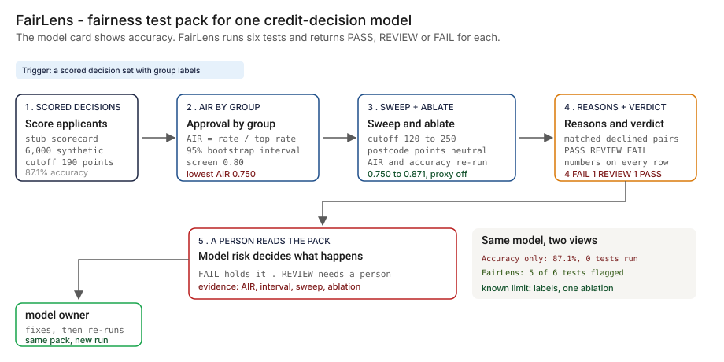
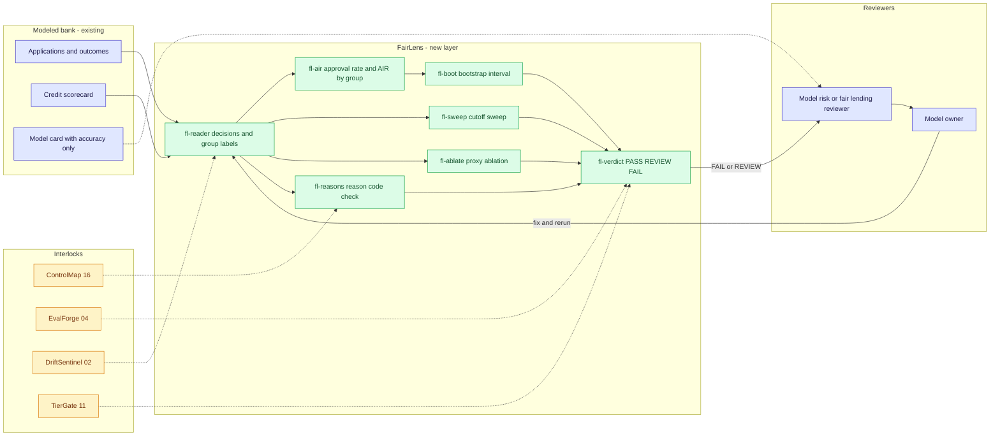
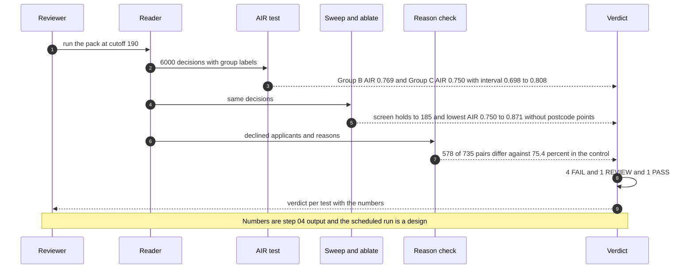

# ⚖️ FairLens — Fairness Test Pack for a Credit-Decision Model

**A portfolio prototype for finding the gap that overall accuracy hides in a credit-decision model: approval rate and adverse impact ratio by group with a bootstrap interval, a cutoff sweep, a proxy ablation, a reason-code check and a PASS, REVIEW or FAIL verdict per test. Aligned to the [NIST AI RMF](https://www.nist.gov/itl/ai-risk-management-framework) 'Measure' function and the ongoing-monitoring expectation in [SR 26-2](https://www.federalreserve.gov/supervisionreg/srletters/SR2602.htm) (April 2026; it replaced the 2011 predecessor, SR 11-7), with the reason-code test written against the adverse-action theme in [Regulation B](https://www.consumerfinance.gov/rules-policy/regulations/1002/).**

**▶ Static demo, no install:** [open on GitHub Pages](https://vj-shipped-anyway.github.io/ai-pm-portfolio/17-fairlens-credit-model-fairness/demo.html)

> **Framing:** This is a portfolio prototype, not a production case study. The six-deficiency taxonomy, the test pack, the verdict rules, the data generator and the walkthrough are mine. Every number below is either printed by a script in this folder on data I generated, or is modeled with its assumption named. Production validation (a real decision log, a defensible group-inference step, a fair-lending counsel read, a model-risk read) is what the next role does. Nothing here is a legal finding.

> **Reading the numbers — credibility tags inline.** Every number in this README and the demo is tagged 🟢 **Measured** (printed by a script in `src/` on the shipped synthetic data: 6,000 applicants, 3 synthetic groups, one stub scorecard), 🟡 **Modeled** (extrapolated from that data, with the assumption named in one line), or 🔴 **Hypothetical** (designed and reasoned about, never tested). Full convention in the [master README's "Reading the numbers" section](../README.md#-reading-the-numbers). **All data is synthetic and generated by a seeded script. The truth is known because the data is synthetic: the generator decided who defaulted, and that the postcode band has no effect on default. The scorecard is a stub, not a trained model, and no model is used anywhere in this repo.**


[](./demo.html)



> **▶ 30-second demo:** the [clickable demo](./demo.html) gets you the full story in 30 seconds with no install.

---

## 🔥 Demo in 30 seconds

Open the static, no-Python demo: [`demo.html`](./demo.html).
Pick a group (A, B or C) and one of six cutoffs, or use Next scenario and Replay all 18 scenarios. Three cards show the same decisions three ways: the model card (one accuracy figure, no tests), accuracy by group (looks fine), and FairLens (the group's approval rate, AIR with its interval, a verdict for each of six tests, and the principal reason codes given to declined applicants). Start with Group B at the policy cutoff, then move the cutoff to 185 and watch the verdicts change.

To run the four-step walkthrough on your laptop:

```bash
git clone https://github.com/Vj-shipped-anyway/ai-pm-portfolio
cd ai-pm-portfolio/17-fairlens-credit-model-fairness/src
python3 step_01_model_card_only.py
python3 step_02_accuracy_baseline.py
python3 step_03_deficiencies_exposed.py
python3 step_04_with_fairlens.py
```

To regenerate the synthetic data (the output is identical on every run): `python3 ../data/_generate.py`.
To run the Streamlit prototype: `pip install -r requirements.txt`, then `streamlit run app.py` from `src/` (or `streamlit run 17-fairlens-credit-model-fairness/src/app.py` from the repo root).

---

## 💰 Why this lands — competitive positioning

Teams that review a credit-decision model for fairness usually start from one of three places: the accuracy on the model card, a spreadsheet of approval rates by group built for one review, or a questionnaire the model owner fills in. I compare approaches rather than vendors, so the table below scores those three and the new layer on the same synthetic decisions. The first three columns describe the approach in general; the last column is what the scripts in this folder print.

| Capability | Accuracy only (model card) | One-off AIR spreadsheet | Validation questionnaire | **FairLens** |
| --- | --- | --- | --- | --- |
| Approval rate by group | No | Yes, at one cutoff, by hand | Attested, not computed | 🟢 83.5% / 64.3% / 62.7% (spread 20.9 points) |
| AIR with an interval for the small group | No | A point estimate | No | 🟢 Group C 0.750, interval 0.698 to 0.808 |
| How the result moves with the cutoff | No | Only if someone reruns it | No | 🟢 swept 120 to 250; the screen holds up to 185, the policy cutoff is 190 |
| Tests one input as a stand-in for group | No | Only if someone thinks of it | Asks yes or no | 🟢 lowest AIR 0.750 to 0.871 with the postcode points neutral |
| Checks the reasons given to declined applicants | No | No | Asks for a policy | 🟢 578 of 735 matched pairs differ against 75.4% within Group A |
| Says when the data cannot decide | No | No | No | 🟢 REVIEW for Group C: the interval straddles 0.80 |
| A verdict per test, with the numbers beside it | No | A reviewer's judgment | A narrative | 🟢 4 FAIL, 1 REVIEW, 1 PASS |
| Where it still fails | Everything above | Stale as soon as the cutoff or the data changes | Self-reported, not recomputed | Needs group labels; one ablation, not a search; the reason-code check passes while the proxy is present |

**Position:** *FairLens does not replace the validator's judgment, fair-lending counsel or the bank's own testing. It adds a repeatable run: the same six tests on every release of the model and every change of the cutoff, each with a verdict and the numbers behind it. Accuracy tells you how often the model agrees with the outcome. This tells you who is approved, how sure you can be, and what moves it.*

---

## The honest version (why this exists)

The failure mode this prototype is built around: a credit-decision model ships with a model card that reports one number, overall accuracy. A reviewer who has only that number cannot say whether one group is approved far less often than another, whether the answer changes with the cutoff, whether one input is acting as a stand-in for group, or whether declined applicants are given consistent reasons. Accuracy by group can look fine while the approval rates are 20 points apart, because a model can be right about people it should not have declined.

This is a prototype on synthetic data. I wrote the generator, the stub scorecard, the six tests, the verdict rules and the bootstrap. The scorecard is a hand-written points table, a stub, not a trained model, and no model is used anywhere in this repo. The truth is known because the data is synthetic: the generator decided who defaulted, from five inputs, and the postcode band is not one of them. A real lender does not have that, and does not have group labels either, which is why the first job in a real deployment is a defensible group-inference step that this prototype does not have. The groups are labels I made up and encode no real protected class. Nothing here is a real bank, applicant, postcode or model.

The group parameters were set by hand over several trial runs so that the approval gap, the proxy effect and a small-group interval near 0.80 all appear often enough to count. The data is a test set, not an estimate of how often any of this happens in the real world. The seed story is in [`data/README.md`](./data/README.md).

If you review credit models and have been handed an accuracy figure and a request to sign off on fairness, fork it. The test list, the verdict vocabulary and the label-error example are the parts worth lifting. Validating them against a real decision log is the work the next role would do.

---

## Prereqs to run this on your laptop (in plain English)

You don't need a cluster, a cloud account or an API key. You need:

- **Python 3.** The four step scripts, the data generator and the demo builder use only the standard library (for example `csv`, `random`, `json` and `pathlib`), so there is nothing to install for them. They are written for Python 3.9 and tested on it; they use no syntax newer than 3.9.
- **Git**, to clone the repo. `brew install git` / `winget install git`.
- **`src/requirements.txt` — only for the Streamlit app.** It lists `streamlit`, `pandas`, `numpy` and `plotly`. The step scripts do not import any of them. Run `pip install -r src/requirements.txt` only if you want the app.
- **No API key.** There is no model call, no network call and no secret anywhere. The scorecard, the AIR calculation, the sweep, the ablation, the reason codes and the bootstrap are plain rules and a seeded resample you can read.
- **Not needed:** a database, containers, Kubernetes or a cloud account. They appear in [`ARCHITECTURE.md`](./ARCHITECTURE.md) as the production design, not as prototype requirements.

Each step script finishes in seconds and writes its CSV or JSON to `src/out/`. The clickable `demo.html` runs in any browser with zero install. If a step does not run from a fresh clone, that's a bug in the README. Open an issue.

---

## Executive summary (90 seconds)

**Problem.** A modeled bank approves credit applicants with a points scorecard. The model card reports one accuracy figure and one approval rate. 🟢 At the policy cutoff of 190 points that is 87.1% accuracy and 75.7% approved. Behind those two numbers, 🟢 approval rates are 83.5% for Group A, 64.3% for Group B and 62.7% for Group C, a spread of 20.9 points, while accuracy by group (88.9%, 84.2%, 84.2%) looks fine. Nothing on the card is split by group, so a reviewer runs 0 fairness tests.

**Product.** FairLens, a test pack with six tests, one per deficiency: **(T1)** the approval-rate gap between groups, **(T2)** the adverse impact ratio (AIR) by group, **(T3)** a sweep of the cutoff that finds where the lowest AIR crosses 0.80 and what that costs, **(T4)** an ablation of the postcode points, **(T5)** a reason-code check on matched pairs of declined applicants, and **(T6)** a seeded bootstrap interval on the smallest group. Each test returns PASS, REVIEW or FAIL with its numbers. The 0.80 line is the four-fifths convention from employment guidance (29 CFR 1607), used here only as a screening convention.

**Measured and modeled performance.**

- 🟢 **AIR by group: Group B 0.769 (interval 0.742 to 0.797), Group C 0.750 (interval 0.698 to 0.808)** (`step_04`). Both are below the 0.80 screen. Group C has 450 applicants, so its interval straddles 0.80 and the verdict is REVIEW, not FAIL.
- 🟢 **Cutoff: the screen holds up to cutoff 185; the policy cutoff 190 is 5 points above** (`step_03`, `step_04`). Passing means moving the cutoff to 185, which takes approval from 75.7% to 79.8% (+4.1 points) and the default rate in the approved book from 8.2% to 10.1% (+1.9 points).
- 🟢 **Proxy: lowest AIR 0.750 to 0.871 with the postcode points neutral; accuracy 87.1% to 89.2%** (`step_04`). 295 decisions turn from decline to approve (32.5% of them defaulted) and 200 turn from approve to decline (56.5% defaulted). The truth is known because the data is synthetic: postcode has no effect on default in the generator.
- 🟢 **Reason codes: the top reason differs in 578 of 735 matched cross-group pairs (78.6%), against 75.4% within Group A** (`step_04`). That is +3.3 points, so T5 passes. Of the 295 declines the postcode points alone cause, 18 (6.1%) do not list the postcode reason among 4 reasons; with 2 listed, 59 of 295 name it.
- 🟢 **Pack: 4 FAIL, 1 REVIEW, 1 PASS across 6 tests** (`step_04`). The thresholds are assumptions of a modeled bank, not legal advice.
- 🟢 **Known limit, printed: with 14.8% of group labels wrong at random, the AIR screen passes (lowest AIR 0.817) when it fails on the true labels (0.750)** (`step_04`). A pass that depends on label quality is not evidence.
- 🟡 **Utility: 1.00 × 20,000 = 20,000 decisions a year under a model with a full fairness test pack**, assuming 20,000 credit decisions a year (`step_04`).
- 🔴 **Design target: the pack runs on every model release and cutoff change as a scheduled eval, with the verdicts filed to the model-risk record.** Designed in `ARCHITECTURE.md`, never built or timed.

**Call to action.** Fork this repo. Swap [`data/applicants.csv`](./data/applicants.csv) for an export of your own scored decisions with the outcome and a group column, and call `run_pack` from `step_04`. The ledger-style truth is not needed: the only synthetic-only fact is `defaulted`, which a real export would take from your performance window.

---

## 🗺️ What this walkthrough covers

1. **The use case** — a modeled bank's credit-decision model with a single accuracy figure on its model card
2. **Sample data** — 6,000 synthetic applicants in 3 synthetic groups, a stub points scorecard and a reason-code table
3. **Step 1 — Before FairLens** — the model card: accuracy and approval rate, nothing by group
4. **Step 2 — Basic approach** — accuracy-style metrics and accuracy by group; what they show and what they leave out
5. **Step 3 — The six named deficiencies** — each with a number from the dataset
6. **Step 4 — The fix (FairLens)** — six tests with verdicts, and a printed "What it still gets wrong"
7. **Utility delivered** — a multiplied number with the assumption named
8. **Architecture & call flow** — topology and a per-run sequence
9. **PM artifacts** — PRD and architecture

> Non-technical reader: skip the code blocks. The plain-English explanation and the output tables tell the story.
> Technical reader: every code block runs. `cd src && python3 step_NN_*.py` and you'll see the same output.

Total reading time: about 12 minutes deep, 3 minutes if you skim.

---

## 🎯 The Use Case

**A modeled bank's credit-decision model. One points scorecard, one cutoff, one accuracy figure on the model card.**

Applicants are scored on income, debt-to-income, length of credit history, utilization, prior delinquencies and a postcode band, and approved when the total reaches the cutoff. The model owner reports accuracy against the observed outcome. The model risk or fair-lending reviewer is asked whether the model is fair, and has the model card and a data extract.

Three things happen in the synthetic data:

- **A gap behind a good accuracy.** Group B is approved at 🟢 64.3% against 83.5% for Group A (AIR 0.769), while its accuracy is 84.2% against 88.9%. The accuracy figures sit within 4.7 points of each other; the approval rates sit 20.9 points apart.
- **A proxy.** The scorecard gives up to 35 of its 350 points to `postcode_band`. By construction the bands are correlated with group: 🟢 31.7% of Group A applicants are in the best band against 4.3% of Group B. Postcode has no effect on default in the generator. With its points neutral, the lowest AIR goes from 🟢 0.750 to 0.871.
- **A small group.** Group C has 🟢 450 applicants on purpose. Its AIR is 0.750 with a 95% interval of 0.698 to 0.808, which straddles the 0.80 screen. The data cannot say which side of the line the group is on.

The model risk or fair-lending reviewer runs the pack, the model owner fixes what fails, credit policy owns the cutoff, and compliance counsel reads the result against the rules. The applicants are the people who get the reasons. FairLens is designed for those roles.

---

## 📊 Sample Data

Three CSVs in [`data/`](./data/), generated by [`data/_generate.py`](./data/_generate.py) (standard library, seeded, deterministic: running it twice produces identical files). Documented in [`data/README.md`](./data/README.md). One preview each, real rows from the files:

**[`data/applicants.csv`](./data/applicants.csv)** — 6,000 synthetic applicants: Group A 3,600, Group B 1,950, Group C 450. `defaulted` is the outcome the generator decided. `postcode_band` runs from P1 (best) to P5. No real protected class is encoded.

```
applicant_id,group,income,dti,history_months,utilization,prior_delinq,postcode_band,defaulted
AP-00001,Group B,67700,0.28,113,0.47,0,P4,0
AP-00002,Group C,26100,0.38,11,0.56,2,P4,1
AP-00003,Group B,78400,0.44,93,0.38,0,P5,0
AP-00004,Group A,37600,0.29,98,0.19,0,P2,0
AP-00005,Group B,71900,0.13,137,0.56,0,P4,0
```

**[`data/scorecard_points.csv`](./data/scorecard_points.csv)** — the stub: a hand-written points table, never fitted to the data. It is not a trained model. The last component is the planted flaw.

```
component,bucket,low,high,points
income,under 25k,0,25000,0
income,25k to 35k,25000,35000,12
income,35k to 50k,35000,50000,26
```

```
postcode_band,P1,,,35
postcode_band,P2,,,25
postcode_band,P3,,,15
postcode_band,P4,,,5
postcode_band,P5,,,0
```

**[`data/reason_codes.csv`](./data/reason_codes.csv)** — a plain-language reason code for each scorecard component. The principal reasons for a decline are the components with the most points lost against their maximum.

```
component,reason_code,plain_language
income,R01,Income is low for the credit requested
dti,R02,Debt payments are high compared with income
history_months,R03,Length of credit history is short
utilization,R04,Balances are high compared with credit limits
prior_delinq,R05,Late payments are on record
postcode_band,R06,Postcode band of the home address
```

The data includes three hard cases on purpose: an input that stands in for group (postcode), a group small enough that its AIR cannot be pinned down (Group C), and a reason-code check that looks clean while the proxy is present. See [`data/README.md`](./data/README.md) for the generator's rules, the seed story and what is and is not claimed.

---

## 🔧 Step 1 — Before FairLens: the model card reports one number

**In plain English:** The model owner reports accuracy and the approval rate. A reviewer is given those two numbers and nothing split by group.

```bash
python3 src/step_01_model_card_only.py
```

The scorecard and the cutoff are the model. The cutoff is a policy constant of a modeled bank, not legal advice:

```
THE SCORECARD (points available per component)
  component        max points  reason code
  income                   70  R01 Income is low for the credit requested
  dti                      65  R02 Debt payments are high compared with income
  history_months           60  R03 Length of credit history is short
  utilization              60  R04 Balances are high compared with credit limits
  prior_delinq             60  R05 Late payments are on record
  postcode_band            35  R06 Postcode band of the home address
```

**Result:**

```
THE OUTCOME (known because the generator decided it; the model card does not show it by group)
  Group A: 3,600 applicants, 707 defaulted (19.6%)
  Group B: 1,950 applicants, 583 defaulted (29.9%)
  Group C: 450 applicants, 137 defaulted (30.4%)

THE PROXY (postcode band mix, share of each group's applicants; P1 is the best band)
  Group A: P1 31.7%, P2 31.6%, P3 21.3%, P4 10.3%, P5 5.1%
  Group B: P1 4.3%, P2 11.4%, P3 26.4%, P4 34.2%, P5 23.8%
  Group C: P1 10.2%, P2 16.4%, P3 27.8%, P4 28.2%, P5 17.3%

MODEL CARD (the only numbers a reviewer is given)
  Overall accuracy:      5,223 of 6,000 decisions correct (87.1%)
  Overall approval rate: 4,542 of 6,000 applicants approved (75.7%)
  By group:              nothing. No number on the card is split by group.
  Fairness tests run:    0
```

🟢 Accuracy, approval rate, the outcome by group and the postcode mix by group are printed by `step_01`. The scorecard is a stub, not a trained model. The outcome and the postcode correlation are the generator's, shown here because the truth is known; the model card shows neither.

---

## 🤖 Step 2 — With the basic approach: accuracy, and accuracy by group

**In plain English:** Go one step past the model card. Compute accuracy-style metrics with the standard library, and split accuracy by group if the group is known. All of it is reasonable.

```bash
python3 src/step_02_accuracy_baseline.py
```

```
OVERALL METRICS (standard library only, no AUC)
  Accuracy:                           87.1%
  Approval rate:                      75.7%
  Default rate in the approved book:  8.2%
  Default catch rate:                 73.9% of 1,427 defaulters declined
  False decline rate:                 8.8% of repaid applicants declined
  KS statistic (score separation):    0.686

ACCURACY BY GROUP
  group     applicants  correct  accuracy
  Group A        3,600    3,202     88.9%
  Group B        1,950    1,642     84.2%
  Group C          450      379     84.2%
  Spread: 4.7 points, from 84.2% (Group B) to 88.9% (Group A).
```

- **Accuracy by group looks fine.** 🟢 It runs from 84.2% to 88.9%, a spread of 4.7 points. A reviewer reading this has no reason to escalate.
- **None of it says who is approved.** The metrics describe how often the scorecard agrees with the outcome. They do not mention approval rates, the cutoff, any single input or the reasons given to declined applicants.

---

## 🔬 Step 3 — Where this still breaks: 6 named deficiencies

| # | Deficiency | What goes wrong | Count in this dataset |
| --- | --- | --- | --- |
| 1 | **Overall accuracy hides group approval gaps** | A model can be right about people it should not have declined, so accuracy by group stays close while approval rates do not. | 🟢 Accuracy spread 4.7 points; approval spread 20.9 points (83.5% / 64.3% / 62.7%) |
| 2 | **AIR below 0.80 for a group, reported nowhere** | The model card has no number split by group. | 🟢 2 of 2 non-reference groups below 0.80: Group B 0.769, Group C 0.750 |
| 3 | **One cutoff is a snapshot** | The result at 190 says nothing about 185 or 195. | 🟢 The screen holds up to 185; the policy cutoff 190 is 5 points above; passing costs +4.1 points of approval and +1.9 points of approved-book default rate |
| 4 | **A proxy drives the gap** | An input correlated with group moves decisions without adding information about default. | 🟢 Lowest AIR 0.750 to 0.871 and accuracy 87.1% to 89.2% with the postcode points neutral; 295 + 200 decisions turn |
| 5 | **Reason codes may not say what drove the decision** | Matched applicants from different groups can be told different reasons, and the reasons can omit the proxy. | 🟢 578 of 735 matched pairs differ (78.6%) against 75.4% within Group A; 18 of 295 proxy-caused declines omit R06 with 4 reasons listed |
| 6 | **Small-group instability** | A point estimate for a few hundred applicants hides how wide the range is. | 🟢 Group C (450 applicants): interval 0.698 to 0.808 straddles 0.80 |

```bash
python3 src/step_03_deficiencies_exposed.py
```

```
(1) Overall accuracy hides group approval gaps
    A 88.9% / B 84.2% / C 84.2% accuracy by group: spread 4.7 points.
    A 83.5% / B 64.3% / C 62.7% approval rate by group: spread 20.9 points.

(2) The AIR by group is below 0.80 for a group and is reported nowhere
    Reference group: Group A (highest approval rate).
    Group B: AIR 0.769  below 0.80
    Group C: AIR 0.750  below 0.80
    2 of 2 non-reference groups are below 0.80. The model card reports none of these.

(3) One cutoff is a snapshot
    cutoff  approval  accuracy  approved book default  min AIR  group
       150     94.6%     81.3%                  19.6%    0.930  B
       160     91.6%     83.5%                  17.4%    0.898  B
       170     88.0%     85.6%                  14.9%    0.872  B
       180     83.0%     87.4%                  11.7%    0.828  B
       190     75.7%     87.1%                   8.2%    0.750  C  <- policy cutoff
       200     68.0%     84.2%                   5.6%    0.714  B
       210     59.8%     79.2%                   3.7%    0.681  B
       220     49.4%     71.3%                   1.9%    0.590  B
       230     39.5%     62.5%                   1.0%    0.500  B
    The minimum AIR stays at or above 0.80 up to cutoff 185 and is below it at 186 (swept 120 to 250, step 1).
    The policy cutoff 190 is 5 points above that. Passing the screen means moving the cutoff to 185:
      overall approval 75.7% -> 79.8% (+4.1 points)
      default rate in the approved book 8.2% -> 10.1% (+1.9 points)
      accuracy 87.1% -> 87.5% (+0.5 points)

(4) A proxy: ablate the postcode_band points
    Postcode points replaced by the population mean (18 points) for every applicant.
    Minimum AIR 0.750 (Group C) -> 0.871 (Group C).
    Accuracy 87.1% -> 89.2% (+2.1 points); approval 75.7% -> 77.3%.
    Decisions that change: 295 declined -> approved, 200 approved -> declined.
    Defaulted among the 295 who flip to approved: 96 (32.5%).
    Defaulted among the 200 who flip to declined: 113 (56.5%).
    The postcode points approve applicants who default more often (56.5%) than the ones they decline (32.5%).

(5) Reason codes
    Matched pairs of declined applicants: scores within 3 points, one in Group A and one in Group B or C.
    Group B vs Group A: 572 pairs, top reason code differs in 447 (78.1%)
    Group C vs Group A: 163 pairs, top reason code differs in 131 (80.4%)
    Control, Group A vs Group A: 268 pairs, differs in 202 (75.4%)
    Cross-group: 578 of 735 pairs differ (78.6%), +3.3 points against the control.
    Declines caused by the postcode points alone: 295 (approved if the postcode points were neutral).
    Reason R06 (postcode band) is among the 4 listed reasons for 277 of them; unnamed 18 (6.1%).
    Sensitivity to how many reasons the bank lists: 1 listed -> 3 of 295; 2 listed -> 59 of 295; 3 listed -> 192 of 295; 4 listed -> 277 of 295.

(6) Small-group instability
    Group C has 450 applicants. AIR 0.750, 95% bootstrap interval 0.698 to 0.808 (width 0.110; 1,000 resamples, seed 20261019).
    The interval straddles 0.80: with this many applicants, the data cannot say which side of the screen the group is on.

The accuracy-only view reports none of the six. The product is the test pack, not the statistic.
```

An accuracy-only view reports none of the six. **The product is the test pack, not the statistic**: the same six measurements on every release and every cutoff change, each with a verdict.

---

## 🛠️ Step 4 — The fix: FairLens

Six tests, all plain rules and a seeded resample, no model:

1. **T1 Group approval gap.** Approval rate by group and the spread in points. FAIL at 15 points or more, REVIEW at 5.
2. **T2 AIR by group.** A group's approval rate divided by the highest group approval rate. FAIL when any group is below 0.80, REVIEW within 0.05 above it. A group-level verdict uses the bootstrap interval: FAIL when the whole interval is below 0.80, REVIEW when it straddles it, PASS when it sits at or above it.
3. **T3 Cutoff sweep.** Every cutoff from 120 to 250. FAIL when the cutoff under test fails the screen, REVIEW when it holds with under 10 points of headroom. Prints where the lowest AIR crosses 0.80 and what passing costs.
4. **T4 Proxy ablation.** Replace the postcode points with the population mean and re-run. FAIL when that moves the lowest AIR from below 0.80 to at or above it, REVIEW when it lifts it by 0.05 or more.
5. **T5 Reason-code consistency.** Matched pairs of declined applicants (scores within 3 points, different groups) against a within-group control, plus whether the listed reasons name the postcode band for declines the postcode points alone cause.
6. **T6 Small-group stability.** REVIEW when the smallest group's 95% bootstrap interval (1,000 resamples, seeded) straddles 0.80.

```bash
python3 src/step_04_with_fairlens.py
```

**The pack:**

```
TEST PACK
  test verdict what it checks             numbers
  T1   FAIL    Group approval gap         approval 83.5% / 64.3% / 62.7%, spread 20.9 points
  T2   FAIL    AIR by group               lowest AIR 0.750 (Group C); 2 of 2 non-reference groups below 0.80
  T3   FAIL    Cutoff sweep               screen holds up to cutoff 185; cutoff 190 is 5 points above; passing costs approval 75.7% -> 79.8% and approved-book default rate 8.2% -> 10.1%
  T4   FAIL    Proxy ablation             lowest AIR 0.750 -> 0.871, accuracy 87.1% -> 89.2%, 295 decisions turn to approve and 200 to decline
  T5   PASS    Reason-code consistency    578 of 735 matched pairs differ (78.6%) against 75.4% within Group A (+3.3 points); 18 of 295 proxy-caused declines omit R06 (6.1%)
  T6   REVIEW  Small-group stability      Group C (n 450) AIR 0.750, interval 0.698 to 0.808, straddles 0.80
  Result: 4 FAIL, 1 REVIEW, 1 PASS across 6 tests
```

**AIR by group, with the bootstrap interval:**

```
T1/T2/T6  AIR BY GROUP WITH A 95% BOOTSTRAP INTERVAL (cutoff 190, 1,000 resamples, seed 20261019)
  group     applicants  approved    rate    AIR  interval        verdict
  Group A        3,600     3,007   83.5%  1.000  reference       REFERENCE
  Group B        1,950     1,253   64.3%  0.769  0.742 to 0.797  FAIL
  Group C          450       282   62.7%  0.750  0.698 to 0.808  REVIEW
  Reference group Group A (highest approval rate). Group verdict: FAIL when the whole interval is below 0.80,
  PASS when the whole interval is at or above it, REVIEW when the interval straddles it.
```

**The cutoff sweep:**

```
T3  CUTOFF SWEEP (step 1 across 120 to 250; every 5th shown)
  cutoff  approval  accuracy  approved default  min AIR  group  screen
     160     91.6%     83.5%             17.4%    0.898  B      holds
     165     90.2%     84.5%             16.3%    0.887  B      holds
     170     88.0%     85.6%             14.9%    0.872  B      holds
     175     85.8%     86.6%             13.4%    0.843  B      holds
     180     83.0%     87.4%             11.7%    0.828  B      holds
     185     79.8%     87.5%             10.1%    0.803  B      holds  <- last cutoff that holds
     190     75.7%     87.1%              8.2%    0.750  C      fails  <- policy
     195     72.8%     86.4%              7.0%    0.747  B      fails
     200     68.0%     84.2%              5.6%    0.714  B      fails
     205     64.3%     82.1%              4.7%    0.691  C      fails
     210     59.8%     79.2%              3.7%    0.681  B      fails
     215     55.1%     75.6%              3.0%    0.624  B      fails
  Cost of passing: cutoff 190 -> 185 moves approval 75.7% -> 79.8% and the approved-book default rate 8.2% -> 10.1%.
```

**The proxy ablation:**

```
T4  PROXY ABLATION (postcode_band points replaced by the population mean, 18 points)
  group      AIR before  AIR after
  Group A         1.000      1.000
  Group B         0.769      0.883
  Group C         0.750      0.871
  Lowest AIR 0.750 -> 0.871 (lift +0.120); accuracy 87.1% -> 89.2% (+2.1 points).
  295 decisions turn from decline to approve (default rate 32.5%); 200 turn from approve to decline (default rate 56.5%).
  The truth is known because the data is synthetic: postcode_band has no effect on default in the generator.
```

**Reason codes:**

```
T5  REASON-CODE CONSISTENCY (principal reason = most points lost against the maximum; 4 reasons listed)
  Matched pairs of declined applicants, scores within 3 points, different groups:
    Group B vs Group A: 572 pairs, top reason differs in 447 (78.1%)
    Group C vs Group A: 163 pairs, top reason differs in 131 (80.4%)
    Control, Group A vs Group A: 268 pairs, differs in 202 (75.4%)
    Cross-group: 578 of 735 pairs differ (78.6%), +3.3 points against the control -> PASS
  Declines caused by the postcode points alone: 295. Reason R06 is among the listed reasons for 277; unnamed 18 (6.1%) -> PASS
  Sensitivity to how many reasons are listed: 1 -> 3 of 295 named; 2 -> 59 of 295 named; 3 -> 192 of 295 named; 4 -> 277 of 295 named.
  Top principal reason codes among declined applicants, by group (share of declines):
    Group A: R03 23.8%, R02 23.3%, R01 23.1%  (declined 593; R06 is the top reason for 2)
    Group B: R02 25.5%, R01 25.3%, R03 19.5%  (declined 697; R06 is the top reason for 2)
    Group C: R02 31.0%, R01 25.6%, R03 18.5%  (declined 168; R06 is the top reason for 1)
```

- **T3 finds the cutoff, and prices it.** 🟢 The screen holds up to 185 and the policy cutoff is 190. Moving the cutoff is a credit-policy decision: the approved book gets riskier (8.2% to 10.1% default rate) in exchange for passing the screen. FairLens puts both numbers next to each other; it does not choose.
- **T4 says what the gap is made of.** 🟢 With the postcode points neutral the lowest AIR is 0.871 and accuracy is 89.2%, so the points are not buying accuracy. The postcode points approve 200 applicants who default more often (56.5%) than the 295 they decline (32.5%). The truth is known because the data is synthetic.
- **T5 passes, and that is a result.** 🟢 Matched cross-group pairs differ at 78.6% against 75.4% within Group A. Most of that is how a points scorecard works: two applicants with the same total can lose their points in different places. The test measures the excess over the control, +3.3 points. A PASS here means the reasons name the postcode band when the postcode points drove the decision; whether the postcode band should appear on a notice at all is the T4 question.
- **T6 is a REVIEW, not a verdict on the group.** Group C's interval straddles the screen. A person decides, or someone collects more data.

### What it still gets wrong

```
WHAT IT STILL GETS WRONG (known limits, left in on purpose)
  1. AIR is a screening statistic, not a legal finding. 0.80 comes from employment guidance (29 CFR 1607)
     and is applied here as a screening convention, not as a credit-law standard.
  2. The search for less discriminatory alternatives is one ablation (postcode_band), not a search. A second
     proxy, or a re-weighted scorecard, would not be found by this pack.
  3. Real credit data has no group labels. This prototype reads the group from the file; real use needs a
     defensible group-inference step that this prototype does not have. The one concrete example, with a share
     of labels made wrong at random (seed 20261020; real inference errors correlate with geography):
         wrong labels  lowest AIR  AIR screen at cutoff 190
             0 ( 0.0%)       0.750  fails
           300 ( 5.0%)       0.781  fails
           579 ( 9.7%)       0.796  fails
           887 (14.8%)       0.817  passes
         1,174 (19.6%)       0.862  passes
         1,462 (24.4%)       0.872  passes
         1,782 (29.7%)       0.865  passes
     With 14.8% of labels wrong the screen passes (lowest AIR 0.817). A pass that depends on label quality is not evidence.
  4. A real miss inside the pack: the reason-code pair check passes (+3.3 points against its control)
     while 295 declines are caused by the postcode points. Only T4 and the naming check see them, and the naming
     check depends on how many reasons are listed: with 2 listed, 59 of 295 are named.
```

Plainly, in order: AIR is a screening statistic, not a legal finding. The less-discriminatory-alternative search is one ablation. The pack reads the group from a column that real credit data does not have, and the printed example shows a failing screen turning into a passing one at 14.8% label error (an optimistic model of inference error; real errors correlate with geography). And the reason-code pair check, one of the six tests, passes while the proxy is present, because the postcode reason is rarely the top reason. The naming check catches it only when few reasons are listed. These are limits I did not remove. The mitigation is in the process (a person reads the pack), not the code, and it is 🔴 designed, never tested with real reviewers.

---

## 📐 Utility Delivered

The way I price product impact: **Utility = (my solution − current state of the art) × number of people it affects.**

Here the terms are fairness tests the reviewer can run on a model, and credit decisions a year under that model. Going from "the model card has an accuracy figure" to "six tests have run, each with a verdict and its numbers" is not an outcome by itself. *Doing it for every decision the model makes in a year is.*

```
UTILITY (per the formula in the README)
  Fairness tests the accuracy-only view runs: 0 of 6 (by definition: nothing on the model card is split by group)
  Fairness tests the pack runs:                6 of 6; 5 of 6 return REVIEW or FAIL
  Delta = 6/6 - 0/6 = 1.00
  MODELED: 20,000 credit decisions a year under this scorecard (an assumption, not a statistic; edit ANNUAL_DECISIONS).
  Utility = 1.00 x 20,000 = 20,000 decisions a year under a model with a full fairness test pack
  MODELED illustration: 495 of 6,000 test-set decisions turn on the postcode points (8.25%);
  at 20,000 a year the same share would be about 1,650. The test set is dense on purpose, so this is not a frequency estimate.
```

| Term | Value | Where it comes from |
| --- | --- | --- |
| Current state of the art (accuracy only), fairness tests run | 🟢 **0 of 6** | `step_01` prints "Fairness tests run: 0": by definition, nothing on the model card is split by group |
| My solution (the FairLens pack), fairness tests run | 🟢 **6 of 6**, of which 5 of 6 return REVIEW or FAIL | `step_04` |
| Per-model lift | 🟢 6/6 − 0/6 = **1.00** | A count of tests, close to by construction; the informative part is what the tests return |
| Number it affects: credit decisions a year | 🟡 **20,000** | **Assumption, not a statistic:** a modeled bank decides 20,000 credit applications a year with this scorecard. Edit `ANNUAL_DECISIONS` in `step_04` to use your own |
| Assumption that makes the lift real | 🟡 A reviewer acts on every FAIL and REVIEW, and the bank has group labels or a defensible inference | If the pack is not read, the lift is zero |
| **Utility** | 🟡 **1.00 × 20,000 = 20,000 decisions a year** under a model with a full fairness test pack | Per year of decisions at the assumed volume |

A modeled illustration (🟡): 🟢 495 of 6,000 test-set decisions (8.25%) turn on the postcode points, so at the same share the modeled volume would be about 1,650. The test set is dense on purpose, so treat that as a property of this synthetic mix, not a forecast.

🔴 What I have not measured: whether reviewers act on a REVIEW, what a real group-inference step does to these numbers, and what running the pack costs. The synthetic data is also much more favorable to detection than real data: the proxy is planted, the outcome is known and the labels are exact.

---

## 🔄 Architecture & Call Flow

How each run of the pack flows through the system. GitHub renders these diagrams natively. Component names match [`ARCHITECTURE.md`](./ARCHITECTURE.md).

**System topology:**



**Per-run sequence** (the policy cutoff, 190):



See [`assets/fairlens-flow.svg`](./assets/fairlens-flow.svg) for a static visual of the same flow.

**Interlocks (all 🔴 designed, none built):**

- 16 ControlMap maps the obligations a credit decision carries, including the Regulation B adverse-action theme. FairLens supplies the evidence for the reason-code obligation: which reasons were given, and whether they match what drove the decision.
- [04 EvalForge](../04-evalforge-llm-eval-platform/) is the eval platform. The FairLens pack runs there as one more eval on every model release. FairLens is not a duplicate of it: EvalForge is a generic harness, and the fairness tests, the verdicts and the group handling are the content.
- [02 DriftSentinel](../02-driftsentinel-model-drift-monitoring/) watches scores for drift. When the score distribution moves, it triggers a rerun of the pack, because AIR is a function of the score distribution and the cutoff. FairLens is not a duplicate of it: drift monitoring says the inputs moved, not who is approved.
- [11 TierGate](../11-tiergate-ai-usecase-intake/) tiers use cases. A credit decision sits in the highest tier, which is what makes the full pack mandatory in the design rather than optional.

---

## 📋 PM Artifacts

The PM artifacts that show how I'd run this product if I owned the seat. This README is the walkthrough; the rest of the folder holds:

- [`PRD.md`](./PRD.md) — the product requirements doc: users, backlog, KPIs, rollout, open questions.
- [`ARCHITECTURE.md`](./ARCHITECTURE.md) — the systems doc: components, data model, security, failure behavior, operations. A design, not deployed.
- [`demo.html`](./demo.html) — clickable, no-install walkthrough; every number is generated from the scripts in `src/` by `src/_build_demo.py`.
- [`data/`](./data/) — the three synthetic CSVs and the generator. `data/README.md` explains the rules and the seed story.
- [`src/`](./src/) — runnable step scripts and the Streamlit prototype.

Run the walkthrough end-to-end:

```bash
cd src
python3 step_01_model_card_only.py
python3 step_02_accuracy_baseline.py
python3 step_03_deficiencies_exposed.py
python3 step_04_with_fairlens.py
```

---

## 🚀 Fork this for your team

```bash
git clone https://github.com/Vj-shipped-anyway/ai-pm-portfolio
cd ai-pm-portfolio/17-fairlens-credit-model-fairness

# 1. Run the synthetic walkthrough as is
cd src
python3 step_01_model_card_only.py
python3 step_02_accuracy_baseline.py
python3 step_03_deficiencies_exposed.py
python3 step_04_with_fairlens.py

# 2. Open the interactive demo
open ../demo.html            # static snapshot of the synthetic run; it does not read data/
```

To point it at your own model, replace three files and keep their columns:

- `data/applicants.csv`: one row per scored decision: `applicant_id, group, income, dti, history_months, utilization, prior_delinq, postcode_band, defaulted`. The `group` column is the hard part: real credit data does not have it (see the known limits).
- `data/scorecard_points.csv`: `component, bucket, low, high, points`. If your model is not a points scorecard, keep a score per applicant and adapt `component_points` in `step_01`.
- `data/reason_codes.csv`: `component, reason_code, plain_language`.

The functions that do the work take plain dicts, so you can call them directly:

```python
# from src/
from step_01_model_card_only import prepare
from step_04_with_fairlens import run_pack

prep = prepare()                       # loads the three CSVs and scores every applicant once
pack = run_pack(prep, None, 190)       # the six tests at one cutoff; bootstrap runs inside
for t in pack["tests"]:
    print(t["id"], t["verdict"], t["numbers"])
```

`defaulted` and the group labels exist as exact values only because the data is synthetic. On a real export, `defaulted` comes from your performance window and the group column needs a defensible inference step before any verdict can be read as more than a screen. The thresholds in `step_04` and the 4 listed reasons and 3-point score band in `step_03` are assumptions of a modeled bank: set your own.

If you run it on a real decision log and get something useful, open an issue or send me what your reviewers did with it. I'd rather see that than what I think it should do.

---

## 🛠️ Why this is a Streamlit prototype, not a production app

Streamlit was the right tool for this prototype. It would be the wrong tool for production. Worth saying out loud so a model-risk or platform lead hears the architectural judgment.

**Streamlit is right for:**
- Validating the six-test mechanic in days, not weeks
- Walking a model risk reviewer, a fair-lending reviewer or a model owner through the four-step story on a free deploy
- Single-tenant, single-page workflows where the UI doesn't have to scale
- Internal tools where one or two reviewers are the only daily users

**Streamlit is wrong for:**
- A scheduled test run on every model release. That is a job with a runner, a store and a defined schedule, not a page that reruns on every widget change
- Hardened auth (OIDC, SAML, fine-grained RBAC) with separate roles for reviewers, model owners and counsel
- Large decision logs. Bootstrapping millions of decisions needs a worker pool and a columnar store
- Brand-controlled UX inside the model-risk system of record where reviewers already work

**If FairLens graduated from prototype to product, the production shape would be (🔴 design, not built):**
- Reader: a scheduled job that reads scored decisions, outcomes and group labels from the model's scoring log through a read-only view
- Test runner: stateless workers (Python) running the six tests, with the bootstrap seeded and the seed stored with the result
- Group inference: a separate, documented step with its own validation, not folded into the tests
- Data plane: Postgres for runs, test results and verdicts; a columnar store for per-decision results; object storage with retention for evidence bundles
- Observability: OpenTelemetry into the platform's existing monitoring; run age and failed runs as the first SLOs
- Governance: verdicts and evidence written to the model-risk record, with the interlocks to ControlMap, EvalForge, DriftSentinel and TierGate above

The portfolio prototype is the conversation-starter. The production architecture is the second meeting.

---

## 👤 Author

**Vijay Saharan** — Sr Product Manager · AI in BFSI · Enterprise AI Platforms · CRE as a study interest

[LinkedIn](https://www.linkedin.com/in/vijaysaharan/) · Tagline: *AI Platform PM · Designs repeatable fairness tests for credit-decision models, under regulated constraint*

---

## 🙌 Acknowledgements

Obligation themes named below are a paraphrase written for this exercise, not the text of the rule.

- **[NIST AI RMF](https://www.nist.gov/itl/ai-risk-management-framework)** — the 'Measure' function maps onto the six tests: repeatable measurement of a deployed system's behavior across the groups it affects.
- **[SR 26-2](https://www.federalreserve.gov/supervisionreg/srletters/SR2602.htm)** — the current model-risk guidance (the 2011 predecessor, SR 11-7, was replaced in April 2026) and the standard the work would have to meet. The theme this prototype maps to is ongoing outcomes analysis on a model in use.
- **[Regulation B](https://www.consumerfinance.gov/rules-policy/regulations/1002/)** — the CFPB's rule on credit discrimination and notices to declined applicants. The theme the reason-code test maps to is that the reasons given should be the ones that drove the decision.
- **[29 CFR 1607](https://www.ecfr.gov/current/title-29/subtitle-B/chapter-XIV/part-1607)** — the employment guidance where the four-fifths convention comes from. It is used here only as a screening convention, not as a credit-law standard.
- **[EU AI Act](https://eur-lex.europa.eu/eli/reg/2024/1689/oj)** — lists the creditworthiness assessment of natural persons among its high-risk topics; named here, not quoted, as the reason the full pack belongs in the highest tier.
- **Sibling projects in this repo** — 16 ControlMap, [04 EvalForge](../04-evalforge-llm-eval-platform/), [02 DriftSentinel](../02-driftsentinel-model-drift-monitoring/) and [11 TierGate](../11-tiergate-ai-usecase-intake/), the four interlocks.
