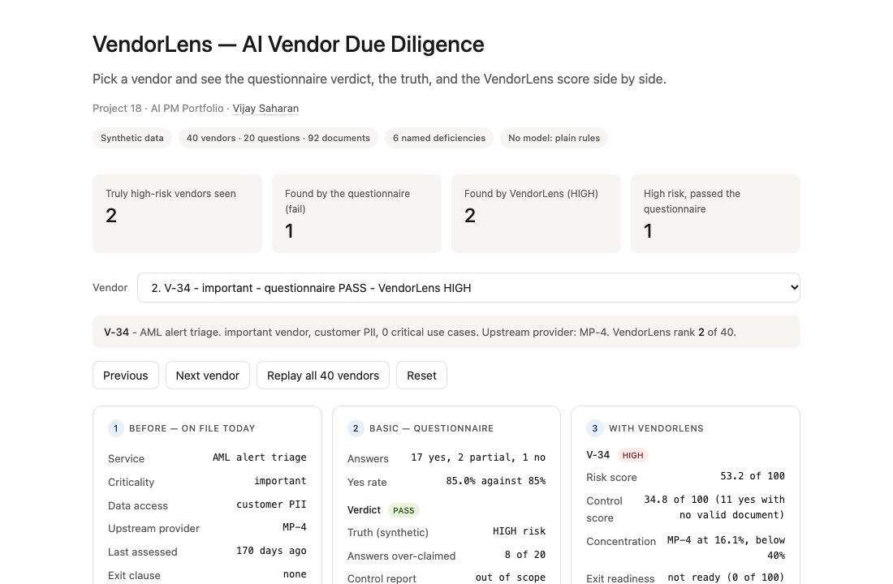
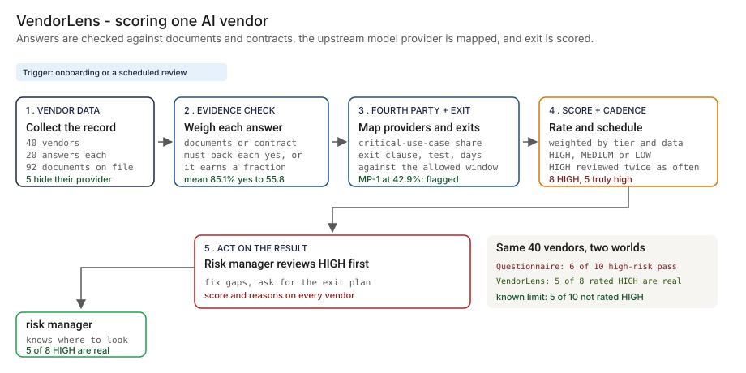
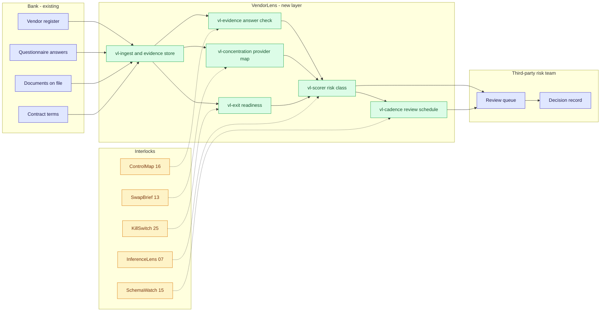
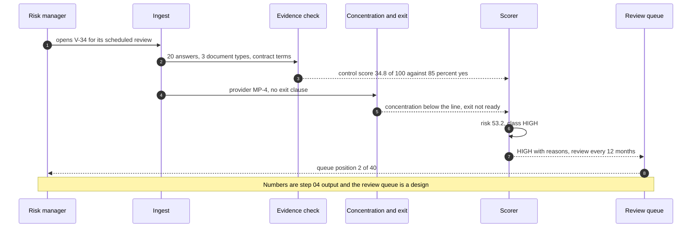

# 🏢 VendorLens — AI Vendor Due Diligence Scored on Evidence, Concentration and Exit

**A portfolio prototype for scoring AI vendors on what can be checked: each questionnaire answer weighed against a document or the contract, the upstream model provider mapped for concentration, exit readiness scored, and a review cadence set by tier. Aligned to the interagency third-party risk guidance in [SR 23-4](https://www.federalreserve.gov/supervisionreg/srletters/SR2304.htm) and the model-risk guidance in [SR 26-2](https://www.federalreserve.gov/supervisionreg/srletters/SR2602.htm) (which replaced SR 11-7 in April 2026), and to the [NIST AI RMF](https://www.nist.gov/itl/ai-risk-management-framework).**

**▶ Static demo, no install:** [open on GitHub Pages](https://vj-shipped-anyway.github.io/ai-pm-portfolio/18-vendorlens-ai-vendor-due-diligence/demo.html)

[](https://vj-shipped-anyway.github.io/ai-pm-portfolio/18-vendorlens-ai-vendor-due-diligence/demo.html)

**What it proves** (🟢 measured on synthetic data; the script is named in brackets):

- 🟢 Questionnaire: 29 of 40 pass (72.5%); 6 of 10 truly high-risk vendors pass (`step_02`)
- 🟢 Evidence: 27 of 29 passes have at least one missing, stale or out-of-scope document; 222 of 380 yes answers on evidence-backed questions (58.4%) have no valid document (`step_03`)
- 🟢 Known limit: 5 of 10 truly high-risk vendors are not rated HIGH, and 3 vendors rated HIGH are not truly high (`step_04`)

_A portfolio prototype on synthetic data, not a production case study. The framing, how to read the numbers and the regulatory note are folded below._


[](./demo.html)



> **▶ 30-second demo:** the [clickable demo](./demo.html) gets you the full story in 30 seconds with no install.

<details>
<summary>Framing, how to read the numbers, and the regulatory note</summary>

> **Regulatory note.** This README cites SR 11-7 or its replacement, [SR 26-2](https://www.federalreserve.gov/supervisionreg/srletters/SR2602.htm) (Federal Reserve, OCC and FDIC, April 17, 2026). SR 26-2 sets no enforceable standards, is aimed mainly at banks with over $30 billion in assets, and places generative AI and agentic AI outside its scope. Here those citations name the design basis for validation, monitoring and inventory practices, or serve as an analogy. They are not a claim that the project meets SR 26-2 or that SR 26-2 governs the systems it examines.

> **Framing:** This is a portfolio prototype, not a production case study. The six-deficiency taxonomy, the scoring rules, the architecture, the data generator and the walkthrough are mine. Every number below is either printed by a script in this folder on data I generated, or is modeled with its assumption named. Production validation (a real vendor register, real documents and contracts, a third-party risk team agreeing to the weights, a model-risk read) is what the next role does.

> **Reading the numbers — credibility tags inline.** Every number in this README and the demo is tagged 🟢 **Measured** (printed by a script in `src/` on the shipped synthetic data: 40 vendors, 20 questions, 800 answers, 92 documents, 56 critical use cases), 🟡 **Modeled** (extrapolated from that data, with the assumption named in one line), or 🔴 **Hypothetical** (designed and reasoned about, never tested). Full convention in the [master README's "Reading the numbers" section](../README.md#-reading-the-numbers). **All data is synthetic and produced by a seeded script. Vendor ids and model providers are invented codes. The truth is known because the data is synthetic: the generator decided every vendor's real risk, how much it over-claims and which model provider it really runs on.**

</details>

---

## 🔥 Demo in 30 seconds

Open the static, no-Python demo: [`demo.html`](./demo.html).
Pick one of the 40 vendors from the dropdown, or use Next vendor and Replay all 40 vendors. Three cards show the same vendor three ways: what the bank holds today (a record and a flat review cycle), what the questionnaire says next to the truth, and what VendorLens scores (control score, concentration, exit, cadence, with reasons). The running totals at the top end at the 🟢 measured numbers: 10 truly high-risk vendors, 4 found by the questionnaire, 5 found by VendorLens, 6 that passed the questionnaire.

To run the four-step walkthrough on your laptop:

```bash
git clone https://github.com/Vj-shipped-anyway/ai-pm-portfolio
cd ai-pm-portfolio/18-vendorlens-ai-vendor-due-diligence/src
python3 step_01_status_quo.py
python3 step_02_questionnaire_checklist.py
python3 step_03_deficiencies_exposed.py
python3 step_04_with_vendorlens.py
```

To regenerate the synthetic data (the output is identical on every run): `python3 ../data/_generate.py`.
To run the Streamlit prototype: `pip install -r requirements.txt`, then `streamlit run app.py` from `src/` (or `streamlit run 18-vendorlens-ai-vendor-due-diligence/src/app.py` from the repo root).

---

## 💰 Why this lands — competitive positioning

Teams that govern AI vendors usually start with two cheap tools: a register of vendors with a review date, and a questionnaire the vendor fills in. I compare approaches rather than vendors, so the table below scores those two and the new layer on the same synthetic estate.

| Capability | Register and flat review cycle | Questionnaire at 85% yes | **VendorLens** |
| --- | --- | --- | --- |
| Checks an answer against a document or the contract | Only if a person does it | No: counts the word yes. 🟢 27 of 29 passes have a missing, stale or out-of-scope document | 🟢 Every answer is classed backed, unbacked, unverifiable or contradicted; 222 of 380 yes answers on evidence-backed questions (58.4%) among passes have no valid document |
| Sees one upstream provider carrying many vendors | Only if the provider column is filled in: 🟢 5 of 40 are blank | 🟢 Asks in 0 of 20 questions; 10 of the 14 vendors on the top provider pass on their own | 🟢 MP-1 carries 42.9% of 56 critical use cases (HHI 3282) and is flagged |
| Scores how the bank would leave | No | 🟢 Asks in 0 of 20 questions | 🟢 6 ready, 17 partial, 17 not ready of 40; 9 of 10 critical vendors not ready. 🟡 Modeled time to exit |
| Weights by criticality and customer data | By hand | 🟢 The same 85% line for all: 9 of 15 PII vendors pass | Yes: risk is scaled by tier and data access |
| Sets review cadence by tier | 🟢 One flat cycle flags 0 of 40 | Same | 🟡 6 of 10 critical vendors overdue on a 12-month tier cadence (modeled) |
| Finds high-risk vendors | Not asked | 🟢 4 of 10 found; 6 of 10 pass. Precision 36.4% (4 of 11 fails) | 🟢 5 of 10 rated HIGH; precision 62.5% (5 of 8). At the same queue size of 11: 6 of 10 |
| Where it still fails | Whatever is typed in | 🟢 79 of 800 answers over-claimed; it cannot see them | Risk no document reveals; undisclosed providers; weights and lines are my assumptions; evidence is not authenticated |

**Position:** *VendorLens does not replace the contract review, the right to audit or the third-party risk team's judgment. It adds the check between the questionnaire and the decision: weigh each claim against a document or the contract, show which upstream providers the estate leans on, and say how the bank would leave. A questionnaire tells you what a vendor says. This tells you what can be checked, and what cannot.*

---

## The honest version (why this exists)

The failure mode this prototype is built around: a bank buys AI from dozens of vendors, and due diligence is a questionnaire the vendor fills in. It rewards over-claiming, because a yes costs the vendor nothing. It never asks which upstream model provider the vendor runs on, so ten vendors that each look fine can all depend on the same provider. And it never asks how the bank would leave, so the first time anyone looks at an exit plan is when the exit is needed.

This is a prototype on synthetic data. I wrote the generator, the questionnaire, the documents, the contracts, the scoring rules and the truth file. The answers are produced by a seeded script, not by a vendor or a model, and no model is used anywhere in this repo. The truth is known because the data is synthetic: the generator decided every vendor's real control quality, how much it over-claims, and which provider it really runs on. A real estate does not hand you that, which is why the first job in a real deployment would be collecting the documents and contract terms that stand behind the answers. Nothing here is a real bank, vendor, model provider, regulator dataset or incident.

The estate is dense on purpose (10 of 40 vendors are critical, and most pass the questionnaire) so that every effect appears often enough to count. It is a test set, not an estimate of how real vendors answer or how often real documents are missing. At 40 vendors one vendor moves a rate by 2.5 points, so read the comparisons as direction, not as precision.

If you run third-party risk for AI vendors and have wondered how many of your passes rest on a claim nobody checked, fork it. The evidence rule, the concentration view and the exit score are the parts worth lifting. Validating them against real documents and a real register is the work the next role would do.

---

## Prereqs to run this on your laptop (in plain English)

You don't need a cluster, a cloud account or an API key. You need:

- **Python 3.** The four step scripts, the data generator and the demo builder use only the standard library (for example `csv`, `json`, `random`, `statistics`, `datetime` and `pathlib`), so there is nothing to install for them. They are written for Python 3.9 and tested on it; they use no syntax newer than 3.9.
- **Git**, to clone the repo. `brew install git` / `winget install git`.
- **`src/requirements.txt` — only for the Streamlit app.** It lists `streamlit`, `pandas`, `numpy` and `plotly`. The step scripts do not import any of them. Run `pip install -r src/requirements.txt` only if you want the app.
- **No API key.** There is no model call, no network call and no secret anywhere. The evidence rule, the concentration view, the exit score and the risk class are plain rules you can read.
- **Not needed:** a database, containers, Kubernetes or a cloud account. They appear in [`ARCHITECTURE.md`](./ARCHITECTURE.md) as the production design, not as prototype requirements.

Each step script finishes in seconds and writes its CSV or JSON to `src/out/`. The clickable `demo.html` runs in any browser with zero install. If a step does not run from a fresh clone, that's a bug in the README. Open an issue.

---

## Executive summary (90 seconds)

**Problem.** A modeled bank has 40 AI vendors. Due diligence is a 20-question yes, partial or no questionnaire, and a vendor passes at 85% yes. 🟢 29 of 40 vendors pass, including 6 of the 10 that are truly high risk. 🟢 27 of those 29 passes have a missing, stale or out-of-scope document. Many vendors run on the same upstream model provider, and 🟢 0 of 20 questions ask which one. Nobody asks how the bank would leave.

**Product.** VendorLens, a scoring layer on the vendor record: an **evidence-adjusted control score** (each answer earns full credit only if a valid document or the contract backs it); a **concentration flag** when one upstream provider carries more than 40% of the estate's critical use cases; an **exit-readiness score**; and a **risk class** (HIGH, MEDIUM, LOW) weighted by criticality and data access, with a **review cadence** by tier. Every score comes with its reasons.

**Measured and modeled performance.**

- 🟢 **Questionnaire: 29 of 40 pass (72.5%); 6 of 10 truly high-risk vendors pass** (`step_02`). 79 of 800 answers were over-claimed (said better than the truth); 70 of those sit on vendors that pass.
- 🟢 **Evidence: 27 of 29 passes have at least one missing, stale or out-of-scope document; 222 of 380 yes answers on evidence-backed questions (58.4%) have no valid document** (`step_03`). 15 yes answers on audit rights or model-change notice are contradicted by the vendor's own contract.
- 🟢 **Concentration: MP-1 carries 42.9% of 56 critical use cases across 14 vendors, HHI 3282** (`step_03`, `step_04`). 10 of those 14 vendors pass the questionnaire on their own.
- 🟢 **HIGH detection: VendorLens rates 8 vendors HIGH and 5 are truly high risk (precision 62.5%, recall 50.0%); a failed questionnaire is 4 of 11 (precision 36.4%, recall 40.0%)** (`step_04`). At the same queue size of 11, VendorLens's top 11 hold 6 of 10 truly high-risk vendors against 4.
- 🟢 **Exit: 6 vendors ready, 17 partial, 17 not ready; 9 of 10 critical vendors not ready** (`step_04`). 🟡 Modeled: 26 of 40 would take longer to exit than the allowed window (8 of 10 critical), assuming 180 days with no exit clause and 1.5 times the stated days for an untested plan.
- 🟢 **Known limit: 5 of 10 truly high-risk vendors are not rated HIGH, and 3 vendors rated HIGH are not truly high** (`step_04`). MP-1 is shown at 42.9% and is really 53.6% because 5 vendors do not disclose their provider. That understatement is by construction.
- 🟡 **Utility: (0.125 − 0.100) × 120 = 3.0 more high-risk vendors found**, assuming 120 vendors in a bank's AI estate.
- 🔴 **Design target: a scored decision with reasons on every in-scope vendor before onboarding and at each scheduled review.** Designed in `ARCHITECTURE.md`, never built or timed.

**Call to action.** Fork this repo. Swap [`data/vendors.csv`](./data/vendors.csv), [`data/questionnaire.csv`](./data/questionnaire.csv) and [`data/evidence.csv`](./data/evidence.csv) for exports from your vendor register and evidence store, and call the scoring functions in `step_04` on them. `data/truth.csv` exists only because the data is synthetic.

---

## 🗺️ What this walkthrough covers

1. **The use case** — a modeled bank with 40 AI vendors and a questionnaire
2. **Sample data** — 40 vendors, 20 questions, 800 answers, 92 documents, per-vendor truth
3. **Step 1 — Before VendorLens** — the register, a flat review cycle and nothing else
4. **Step 2 — Basic approach** — the 85% questionnaire checklist, scored against the truth
5. **Step 3 — The six named deficiencies** — each with a count from the dataset
6. **Step 4 — The fix (VendorLens)** — evidence, concentration, exit, class and cadence; measured against the truth file, with the known limits printed
7. **Utility delivered** — a multiplied number with the assumption named
8. **Architecture & call flow** — topology and a per-vendor sequence
9. **PM artifacts** — PRD and architecture

> Non-technical reader: skip the code blocks. The plain-English explanation and the output tables tell the story.
> Technical reader: every code block runs. `cd src && python3 step_NN_*.py` and you'll see the same output.

Total reading time: about 12 minutes deep, 3 minutes if you skim.

---

## 🎯 The Use Case

**A modeled bank's AI vendor estate. 40 vendors, a questionnaire, and a third-party risk manager who has to decide where to look.**

The bank uses AI services for chat, document extraction, fraud and AML support, call transcription, credit decision support and more. Each service comes from a vendor. The vendor fills in a questionnaire, sends some documents, and the bank files both. The user is the third-party risk manager, who has a review queue of a size they can work and no way to tell, from the questionnaire, which vendors belong in it.

Four things show up in the synthetic estate:

- **A pass nobody checked.** V-34 passes at exactly 85.0% yes (17 of 20), holds customer PII and is truly high risk. 🟢 8 of its answers were over-claimed, and its documents are missing or out of scope. VendorLens scores its control at 34.8 of 100 and rates it HIGH (risk 53.2).
- **A provider everyone leans on.** 🟢 14 vendors run on MP-1, which carries 42.9% of the estate's critical use cases. 10 of them pass the questionnaire on their own. No question asks.
- **No way out.** 🟢 17 of 40 vendors have no exit clause, 16 more have one that was never tested, and 9 of 10 critical vendors have no ready exit.
- **A claim the contract contradicts.** 🟢 7 of the 20 vendors with no audit right answered yes to "customers may audit our controls".

The third-party risk manager owns the decision, the business owner of the AI service owns the use case, procurement and legal own the contract, and the model risk reviewer has to explain, after the fact, why a vendor's model was trusted. VendorLens is designed for those four.

---

## 📊 Sample Data

Five CSVs in [`data/`](./data/), produced by [`data/_generate.py`](./data/_generate.py) (standard library, seeded, deterministic: running it twice produces identical files). Documented in [`data/README.md`](./data/README.md). One preview each:

**[`data/vendors.csv`](./data/vendors.csv)** — 40 vendors, invented ids and invented provider codes. Criticality, customer-data access, critical use cases supported, upstream provider (blank when the vendor does not disclose it), exit clause, exit test, portability days, audit right, model-change notice days, last assessed, contract end.

```
vendor_id,service_type,criticality,data_access,use_cases_supported,critical_use_cases,model_provider,exit_clause,portability_days,exit_tested,audit_right,model_change_notice_days,last_assessed_on,contract_end
V-01,translation,standard,none,2,0,MP-1,yes,21,no,no,0,2026-08-30,2028-03-08
V-02,collections outreach,standard,internal,2,0,MP-1,no,,no,yes,0,2025-12-23,2026-12-24
V-03,HR screening support,important,internal,5,1,MP-4,yes,131,no,no,0,2024-12-14,2027-10-13
V-04,enterprise search,standard,internal,1,1,MP-1,no,,no,no,90,2026-06-27,2028-05-09
V-05,translation,standard,customer_pii,3,0,,yes,56,no,no,0,2025-05-03,2028-02-29
```

**[`data/questionnaire.csv`](./data/questionnaire.csv)** — 40 vendors by 20 self-declared answers. **[`data/questions.csv`](./data/questions.csv)** — the 20 questions and what could back each one (a control report, a penetration test, model documentation, the contract, or nothing in this repo).

```
question_id,group,text,verified_by
Q01,security,Access to customer data is limited by role and reviewed,independent_control_report
Q02,security,Data is encrypted at rest and in transit,independent_control_report
Q03,security,Security events are logged and monitored,independent_control_report
Q04,security,An incident response plan exists and is exercised,independent_control_report
```

**[`data/evidence.csv`](./data/evidence.csv)** — 92 documents with an issue date and whether each covers the AI service. **[`data/truth.csv`](./data/truth.csv)** — what the generator decided: true risk class, the latent score behind it, over-claimed answers, whether the provider is disclosed, and the provider the vendor really runs on.

```
vendor_id,doc_type,issued_on,covers_ai_service
V-01,independent_control_report,2026-01-05,yes
V-01,penetration_test,2024-12-17,yes
V-02,independent_control_report,2025-12-10,yes
V-02,model_documentation,2026-03-15,yes
```

```
vendor_id,true_risk,latent_risk,overclaimed_answers,provider_disclosed,true_model_provider
V-01,low,0.190,0,yes,MP-1
V-02,low,0.218,1,yes,MP-1
V-03,medium,0.336,2,yes,MP-4
V-04,low,0.225,1,yes,MP-1
V-05,medium,0.398,0,no,MP-1
```

Mix: 10 critical, 14 important and 16 standard vendors; 15 hold customer PII, 16 hold internal data, 9 hold none; 56 critical use cases, 38 of them on critical vendors; 5 vendors do not disclose their upstream provider. Truth: 10 high, 14 medium and 16 low. The data includes hard cases on purpose: vendors that over-claim but have valid documents, vendors with a risk factor no field reveals, and a provider whose share is understated because some vendors hide it.

---

## 🔧 Step 1 — Before VendorLens: a register and a flat review cycle

**In plain English:** Today the bank holds a vendor record, a questionnaire and some filed documents. Every vendor is reassessed on the same 24-month cycle. Nothing says who is risky, who shares a provider, or how the bank would leave.

```bash
python3 src/step_01_status_quo.py
```

The assumptions are in the script header and printed with the result:

```
ASSUMPTIONS (modeled):
  A1  the questionnaire is the assessment; documents sent with it are filed, not checked
  A2  one flat reassessment cycle for every vendor: 730 days (24 months)
  A3  nothing asks which upstream model provider a vendor runs on, or how the bank would leave
```

**Result:**

```
THE ESTATE
  Criticality:           10 critical, 14 important, 16 standard
  Data access:           15 hold customer PII, 16 internal data, 9 none
  Critical and PII:      7 vendors are both
  Critical use cases:    56 across the estate, 38 of them on critical vendors
  Upstream provider:     5 vendors do not disclose it

WHAT THE BANK HOLDS TODAY
  Self-declared answers: 800 (40 vendors x 20 questions)
  Documents on file:     92 from 38 vendors; filed, not read against the answers (A1)
  Contracts:             11 end within 180 days (of which 2 already past their end date)
```

```
RESULT
  10 of 40 vendors are critical; 15 of 40 hold customer PII; 7 are both.
  Median time since last assessment: 517 days; oldest 713 days.
  Assessed more than 12 months ago: 25 of 40; more than 24 months ago: 0 of 40 (overdue on the flat cycle).
  Vendors whose upstream model provider the bank cannot see: 5 of 40.
  Nothing yet says who passes, who is risky, or how the bank would leave. That is steps 2 to 4.
```

🟢 The counts and the last-assessed ages are printed by `step_01`. 🟡 The flat 24-month cycle is an assumption of a modeled bank, not a statistic. The number that matters for what follows: the flat cycle calls 0 of 40 vendors overdue, while 25 of 40 were last assessed more than 12 months ago.

---

## 🤖 Step 2 — With the basic approach: a questionnaire checklist

**In plain English:** Each vendor answers 20 questions about its own controls. It passes when at least 85% of the answers are yes. This is how many questionnaire programs run, and it is a reasonable first filter.

```bash
python3 src/step_02_questionnaire_checklist.py
```

```
vendor  tier       data          yes    pct verdict   truth overclaimed
------- ---------- ------------- --- ------ ------- ------- -----------
V-01    standard   none           18  90.0%    PASS     low           0
V-02    standard   internal       20 100.0%    PASS     low           1
V-03    important  internal       15  75.0%    FAIL  medium           2
V-04    standard   internal       17  85.0%    PASS     low           1
```

(The script prints all 40 vendors; the first rows are shown here. The `<-- passed, truly high` marker appears on the vendors the checklist passes and the truth file calls high risk.)

```
VERDICT BY TRUE RISK (rows: what the vendor really is; columns: what the checklist said)
  truth     pass  fail
  high         6     4
  medium       9     5
  low         14     2

RESULT
  Passes: 29 of 40 (72.5%); fails: 11.
  Truly high-risk vendors: 10. Found by the checklist (they fail): 4. Passed: 6 of 10.
  Used as a high-risk detector, a fail has precision 36.4% (4 of 11) and recall 40.0% (4 of 10).
  Critical vendors that pass: 8 of 10. Passing vendors with customer PII access: 9.
  Answers over-claimed (said better than the truth): 79 of 800 answers; 70 of them sit on vendors that pass.
  The checklist cannot see an over-claim: it counts the word yes.
```

- **It passes most vendors.** 🟢 29 of 40 pass. That is the failure being modeled, so the generator makes a group of vendors over-claim on purpose; the pass rate is a design choice, not a finding.
- **It passes most of the high-risk ones.** 🟢 6 of the 10 truly high-risk vendors pass, and 8 of the 10 critical vendors pass. Used as a high-risk detector, a fail has precision 36.4% (4 of 11) and recall 40.0% (4 of 10).
- **It cannot see an over-claim.** 🟢 79 of 800 answers said better than the truth; 70 of them sit on vendors that pass. The checklist counts the word yes.

---

## 🔬 Step 3 — Where this still breaks: 6 named deficiencies

| # | Deficiency | What goes wrong | Count in this dataset |
| --- | --- | --- | --- |
| 1 | **Self-declared answers over-claim** | A yes with no document behind it counts the same as a yes with one. | 🟢 27 of 29 passes have a missing, stale or out-of-scope document; 222 of 380 yes answers on evidence-backed questions (58.4%) have no valid document |
| 2 | **Concentration hidden vendor by vendor** | Each vendor looks fine alone; many share one upstream provider. | 🟢 MP-1 carries 42.9% of 56 critical use cases across 14 vendors; 10 of the 14 pass on their own; 0 of 20 questions ask; HHI 3282 |
| 3 | **Exit readiness never asked** | No one knows if the bank can leave until it must. | 🟢 33 of 40 vendors have no tested exit; 9 of 10 critical. 🟡 Modeled: 26 of 40 would take longer than the allowed window |
| 4 | **Data access not weighted** | A vendor holding customer data faces the same 85% line as one holding none. | 🟢 9 of 15 PII vendors pass (60.0%); 20 of 25 others pass (80.0%); 5 of the 9 are truly high risk |
| 5 | **Stale assessments** | One flat cycle ignores tier. | 🟡 6 of 40 overdue on the tier cadence (6 of 10 critical); the flat cycle flags 0 |
| 6 | **Contract gaps** | No audit right, no notice of a model change; answers say otherwise. | 🟢 32 of 40 have at least one gap, 24 of them pass; 7 of 20 with no audit right answered yes to "customers may audit" |

```bash
python3 src/step_03_deficiencies_exposed.py
```

```
(1) Self-declared answers over-claim
    27 of 29 passing vendors have at least one evidence type that is missing, stale or out of scope.
    Across the passing vendors' 87 vendor-document slots: 36 valid, 28 missing, 17 stale, 6 out of scope.
    222 of 380 yes answers on evidence-backed questions (58.4%) have no valid document behind them.
    15 yes answers on audit or model-change notice are contradicted by the vendor's own contract (12 of them on vendors that pass).
    Strict reading: 27 of 29 passes drop under the 85% line if only backed or unverifiable yes answers count.
    Truth: 20 of 29 passing vendors over-claimed at least one answer; 20 of those have a yes with no valid backing.

(2) A vendor-by-vendor view hides concentration on one upstream model provider
    The questionnaire asks which model provider a vendor runs on in 0 of 20 questions.
    Share of all critical use cases by disclosed provider:
      MP-1  14 vendors  24 critical use cases   42.9%
      MP-4   8 vendors   9 critical use cases   16.1%
      MP-3   3 vendors   6 critical use cases   10.7%
      MP-2   6 vendors   4 critical use cases    7.1%
      MP-5   4 vendors   4 critical use cases    7.1%
      unknown  vendors that do not disclose: 9 critical use cases (16.1%)
    Top provider MP-1: 42.9% of 56 critical use cases across 14 vendors; 10 of those 14 vendors pass on their own.
    HHI of the disclosed critical use cases: 3282 (scale 0 to 10,000; higher is more concentrated).

(3) Exit readiness is never asked
    The questionnaire asks about exit in 0 of 20 questions.
    17 of 40 vendors have no exit clause; 16 more have a clause that was never tested (33 of 40 without a tested exit).
    9 of 10 critical vendors have no tested exit (4 have no clause at all).
    MODELED: 26 of 40 vendors would take longer to exit than the allowed window (8 of 10 critical); 17 of those pass the questionnaire.
    Allowed windows (days): critical 45, important 90, standard 150.

(4) Data access is not weighted
    The same 85% line applies to every vendor. 9 of 15 vendors with customer PII access pass (60.0%); 20 of 25 without it pass (80.0%).
    Of the 9 passing PII vendors, 5 are critical. Truth: 5 are truly high risk and 8 are medium or high.

(5) Stale assessments
    MODELED tier cadence: critical 12 months, important 24, standard 36. The status quo uses one 24 month cycle.
    6 of 40 vendors are overdue on their tier cadence; the flat cycle flags 0.
    Overdue: 6 of 10 critical, 0 of 14 important, 0 standard. The flat cycle misses 6 of them.

(6) Contract gaps
    20 of 40 vendors have no audit right; 24 of 40 have no commitment to notify before a model change; 12 have neither.
    32 of 40 vendors have at least one gap (24 of them pass the questionnaire; 6 of 10 critical vendors).
    7 of 20 vendors with no audit right answered yes to "customers may audit"; 8 of 24 with no notice commitment answered yes to "notified before a model change".
```

The basic approach records what a vendor says and misses what can be checked. **The product is the evidence adjustment, the concentration view, the exit score and the cadence, not another questionnaire.**

---

## 🛠️ Step 4 — The fix: VendorLens

Four parts, all plain rules, no model:

1. **Evidence-adjusted control score.** Each answer earns credit by what backs it. A yes backed by a valid document (recent, covering the AI service) or by the contract earns 1.0. A yes with no valid document earns 0.35. A yes the contract contradicts earns 0. A yes on a question no document in this repo could check earns 0.7. A partial earns about half of those (the printed table has the exact values). The score is the credit over 20 answers, from 0 to 100.
2. **Concentration flag.** The share of the estate's critical use cases carried by each upstream provider, with an HHI over the disclosed ones. One provider above 40% is flagged. A vendor that does not disclose its provider counts half a flag.
3. **Exit-readiness score.** An exit clause (50), a tested exit (30) and a modeled time to exit inside the allowed window (20).
4. **Risk class and cadence.** A weakness score (control 0.50, exit 0.20, contract gaps 0.10, concentration 0.20) is scaled by criticality and data access into a 0 to 100 risk score, then bucketed: HIGH at 45 or more, MEDIUM at 30 or more. Review cadence follows the tier (12, 24 or 36 months), and a HIGH vendor is reviewed twice as often.

```bash
python3 src/step_04_with_vendorlens.py
```

**Settings (all my assumptions):**

```
SETTINGS (my assumptions, edit at the top of the file):
  Weakness weights: control 0.5, exit 0.2, contract 0.1, concentration 0.2
  Exposure by criticality: critical 0.6, important 0.35, standard 0.15; by data access: customer PII 0.4, internal 0.2, none 0.0
  Risk = 100 x weakness x (0.4 + 0.6 x exposure); HIGH at 45 or more, MEDIUM at 30 or more
  Concentration flag: one upstream provider above 40% of critical use cases
  Credit per answer (yes / partial / no):
    backed by a valid document or the contract   1.0 / 0.5 / 0.0
    no valid document behind it                  0.35 / 0.15 / 0.0
    no document here could check it              0.7 / 0.35 / 0.0
    the contract says otherwise                  0.0 / 0.0 / 0.0
```

**Concentration, exit and cadence:**

```
1. EVIDENCE-ADJUSTED CONTROL SCORE
   Mean questionnaire yes rate 85.1%; mean evidence-adjusted control score 55.8 of 100.
2. CONCENTRATION
   provider  vendors crit. use cases   share  flag
   MP-1           14              24   42.9%  FLAGGED
   MP-4            8               9   16.1%  
   MP-3            3               6   10.7%  
   MP-2            6               4    7.1%  
   MP-5            4               4    7.1%  
   unknown         5               9   16.1%  not disclosed
   HHI of the disclosed critical use cases: 3282
3. EXIT READINESS
   Ready 6, partial 17, not ready 17 of 40; critical vendors not ready: 9 of 10.
4. REVIEW CADENCE (tier cadence; a HIGH vendor is reviewed twice as often)
   Overdue: 9 of 40 on VendorLens cadence (6 on tier cadence alone, 3 more because they are HIGH); the flat cycle flags 0.
```

**Risk ranking, top of the list:**

```
RISK RANKING (top 14 of 40; 'pts' = points from control / exit / contract / concentration)
 # vendor tier      data          ctrl exit pts                 risk class  checklist truth 
 1 V-15   critical  customer_pii  34.0    0 33/20/0/20          73.0 HIGH   fail      high  
 2 V-34   important customer_pii  34.8    0 28/17/8/0           53.2 HIGH   pass      high  
 3 V-08   critical  internal      51.5   70 21/5/9/18           53.0 HIGH   pass      medium
 4 V-09   critical  customer_pii  54.2   50 23/10/0/20          52.9 HIGH   fail      high  
 5 V-21   standard  internal      31.3    0 21/12/6/12          51.5 HIGH   fail      medium
 6 V-18   critical  customer_pii  49.0  100 26/0/5/20           50.5 HIGH   pass      high  
 7 V-40   important customer_pii  23.3   50 33/8/8/0            49.6 HIGH   fail      high  
 8 V-33   important internal      47.5    0 19/15/0/15          48.4 HIGH   pass      medium
 9 V-38   important customer_pii  58.0    0 18/17/8/0           43.4 MEDIUM pass      medium
10 V-28   critical  customer_pii  43.5   50 28/10/5/0           43.2 MEDIUM pass      medium
11 V-26   important customer_pii  58.5    0 18/17/8/0           43.1 MEDIUM fail      high  
12 V-29   important none          24.8  100 23/0/6/12           41.2 MEDIUM fail      medium
13 V-17   critical  customer_pii  71.0    0 14/20/5/0           39.5 MEDIUM pass      high  
14 V-13   critical  none          58.0    0 16/15/0/8           38.8 MEDIUM pass      low   
   ...
   Classes: 8 HIGH, 15 MEDIUM, 17 LOW.
```

**Measured against the truth file:**

```
MEASURED AGAINST THE TRUTH FILE (synthetic: the generator decided the true risk)
  Class agreement:           23 of 40 vendors (57.5%)
  HIGH, VendorLens:          flagged 8, truly high 5; precision 62.5% (5 of 8), recall 50.0% (5 of 10)
  HIGH, questionnaire fail:  flagged 11, truly high 4; precision 36.4% (4 of 11), recall 40.0% (4 of 10)
  Same review-queue size (11 vendors, as many as the questionnaire fails): VendorLens's top 11 hold 6 of 10 truly high-risk vendors; the questionnaire's fails hold 4
  Truly high-risk vendors that passed the questionnaire: 6; VendorLens rates 2 of them HIGH
  Passing vendors VendorLens rates HIGH: 4; failing vendors it rates LOW: 1
  Confusion (rows: truth, columns: VendorLens):
              HIGH  MEDIUM   LOW
    high         5       3     2
    medium       3       7     4
    low          0       5    11
```

- **It finds more, with fewer false alarms.** 🟢 5 of 8 vendors rated HIGH are truly high risk (62.5%), against 4 of 11 for a failed questionnaire (36.4%). At the same queue size of 11, VendorLens's top 11 hold 6 of 10 truly high-risk vendors against 4. 🟢 The agreement with the truth class is 23 of 40 (57.5%).
- **Part of this is by construction.** The generator and VendorLens both treat critical vendors with customer data as more exposed, and both read the same exit and contract fields. The part that is not by construction is control quality: the truth uses the vendor's real controls, and VendorLens sees them only through answers and documents.
- **I moved the HIGH line once.** I set HIGH at 35 and MEDIUM at 20 before the first run against `truth.csv`. That run rated 18 of 40 vendors HIGH, which is not a queue anyone can work, so I moved the lines to 45 and 30 and did not search further. The sensitivity table below prints the neighboring lines, including 35. It trades recall for queue size.

**Sensitivity to my assumptions (the truth is read only to count):**

```
SENSITIVITY TO MY ASSUMPTIONS (the truth is read only to count)
  HIGH line 35: flagged 18, truly high 8 of 10
  HIGH line 40: flagged 12, truly high 6 of 10
  HIGH line 45: flagged 8, truly high 5 of 10
  HIGH line 50: flagged 6, truly high 4 of 10
  Concentration line 35%: 1 provider(s) flagged; HIGH flagged 8, truly high 5 of 10
  Concentration line 40%: 1 provider(s) flagged; HIGH flagged 8, truly high 5 of 10
  Concentration line 45%: 0 provider(s) flagged; HIGH flagged 3, truly high 3 of 10
  Concentration line 50%: 0 provider(s) flagged; HIGH flagged 3, truly high 3 of 10
  Equal weights: HIGH flagged 10, truly high 6 of 10
```

- **The 40% line does real work.** 🟢 Moving it to 45% leaves no provider flagged and HIGH falls from 8 vendors to 3. The flag is an assumption of mine, and the table shows how much rests on it.

### The known limit, left in on purpose

```
KNOWN LIMIT (left in on purpose)
  1. Weights, the HIGH line and the 40% concentration line are my assumptions. The sensitivity above shows how the result moves.
  2. Evidence authenticity is not verified. A document counts as valid if it exists, is recent and covers the AI service;
     the data has no field for a forged or inaccurate report, so this limit cannot be measured here.
  3. Vendors that do not disclose their upstream provider make concentration understated by construction:
     5 of 40 vendors, 9 of 56 critical use cases (16.1%) sit in the unknown bucket.
     Truth: 3 of them run on MP-1, carrying 6 critical use cases. MP-1 is shown at 42.9% and is really 53.6% (10.7 points higher).
     HHI shown 3282, true 3546. Upper bound for MP-1 if every unknown vendor ran on it: 59.0%.
     Providers VendorLens cannot rule out as concentrated: none.
  4. Real misses. Truly high-risk vendors not rated HIGH: 5 of 10.
     V-26: rated MEDIUM (risk 43.1), questionnaire fail, latent truth 0.423
     V-17: rated MEDIUM (risk 39.5), questionnaire pass, latent truth 0.61
     V-36: rated MEDIUM (risk 37.4), questionnaire pass, latent truth 0.538
     V-32: rated LOW (risk 27.2), questionnaire pass, latent truth 0.461
     V-19: rated LOW (risk 27.0), questionnaire pass, latent truth 0.487
     Rated HIGH but not truly high: 3.
     V-08: truly medium (risk 53.0, latent truth 0.282)
     V-21: truly medium (risk 51.5, latent truth 0.293)
     V-33: truly medium (risk 48.4, latent truth 0.312)
     The truth carries an unobserved factor, so no score built from answers, documents and contracts can match it exactly.
```

Five points, stated plainly:

- **Weights and lines are mine.** The weights, the HIGH line and the 40% concentration line are assumptions, not regulatory values and not legal advice. The sensitivity table is the honest answer to "why those numbers".
- **Evidence authenticity is not verified.** A document counts as valid if it exists, is recent and covers the AI service. The data has no field for a forged or inaccurate report, so this limit cannot be measured here. Two of the vendors rated LOW (V-32 and V-19) are truly high risk and pass the questionnaire.
- **Undisclosed providers understate concentration, by construction.** 🟢 5 of 40 vendors do not name their provider. MP-1 is shown at 42.9% and is really 53.6%, 10.7 points higher, and the HHI is 3282 where the truth is 3546. A real bank would not know the second number. The mitigation is a contract term that requires disclosure of the upstream provider, which is 🔴 designed in the PRD, never tested.
- **Real misses.** 🟢 5 of 10 truly high-risk vendors are not rated HIGH. The generator gives every vendor a risk factor no answer, document or contract field reveals, so no score built from those fields can match the truth.
- **Small test set.** At 40 vendors, one vendor moves a rate by 2.5 points.

---

## 📐 Utility Delivered

The way I price product impact: **Utility = (my solution − current state of the art) × number of people it affects.**

Here the terms are high-risk vendors found per vendor assessed, and the number of vendors in a bank's AI estate. The people who feel it are the third-party risk manager, the business owner, the contract owner in procurement and legal, and the model risk reviewer. Going from "this vendor passed" to "this vendor passed on claims nobody checked, shares a provider with many others and has no exit" is not an outcome by itself. *Doing it across the whole estate of vendors a bank actually has is.*

| Term | Value | Where it comes from |
| --- | --- | --- |
| Current state of the art (questionnaire fail), high-risk vendors found per vendor | 🟢 **0.100** | `step_04`: 4 of 40 vendors are truly high risk and fail the questionnaire |
| My solution (VendorLens HIGH), high-risk vendors found per vendor | 🟢 **0.125** | `step_04`: 5 of 40 vendors are truly high risk and rated HIGH |
| Per-vendor lift | 🟢 0.125 − 0.100 | High-risk vendors found per vendor assessed |
| Number it affects: vendors in a bank's AI estate | 🟡 **120** | **Assumption, not a statistic:** a large bank's AI estate holds 120 vendors. Edit `ESTATE_VENDORS` in `step_04` to use your own |
| Assumption that makes the lift real | 🟡 The third-party risk team works the HIGH queue and the vendors supply documents on request | If reviewers ignore the queue, the lift shrinks toward zero |
| **Utility** | 🟡 **(0.125 − 0.100) × 120 = 3.0 more high-risk vendors found** | Per full review of the estate |

Sensitivity to the estate-size assumption (🟡, same per-vendor lift): 40 vendors gives 1.0, 80 gives 2.0, 120 gives 3.0 and 200 gives 5.0. At the same review-queue size, the lift is larger (6 of 10 against 4 of 10); I use the more conservative class result in the formula.

🔴 What I have not measured: reviewer time per vendor, what a HIGH finding costs to work, how many vendors would supply documents on request, and what any of this costs to run. The synthetic estate is also denser than a real one. Treat the per-vendor number as a property of this mix of vendors, not a forecast.

---

## 🔄 Architecture & Call Flow

How each vendor flows through the system. GitHub renders these diagrams natively. Component names match [`ARCHITECTURE.md`](./ARCHITECTURE.md).

**System topology:**



**Per-vendor sequence** (V-34, an important vendor with customer PII that passes the questionnaire):



See [`assets/vendorlens-flow.svg`](./assets/vendorlens-flow.svg) for a static visual of the same flow.

**Interlocks (all 🔴 designed, none built):**

- [07 InferenceLens](../07-inferencelens-inference-finops/) knows what each vendor costs. VendorLens can show the spend beside the risk class, so a HIGH vendor with a large bill is reviewed first.
- [13 SwapBrief](../13-swapbrief-model-migration/) decides model swaps. A swap changes the upstream provider behind a use case, so it should reopen the concentration view for that vendor and for the estate.
- [15 SchemaWatch](../15-schemawatch-tool-schema-drift/) watches vendor API changes. A vendor schema change is a trigger for an out-of-cycle evidence check.
- **16 ControlMap** (vendor-model obligations) would map each obligation to the vendor control and document that evidences it, so the evidence rule reads from one crosswalk.
- **25 KillSwitch** (exit and fallback) would run the drills that turn an untested exit into a tested one, which is the single largest lever on the exit score.

---

## 📋 PM Artifacts

The PM artifacts that show how I'd run this product if I owned the seat. This README is the walkthrough; the rest of the folder holds:

- [`PRD.md`](./PRD.md) — the product requirements doc: users, backlog, KPIs, rollout, open questions.
- [`ARCHITECTURE.md`](./ARCHITECTURE.md) — the systems doc: components, data model, security, failure behavior, operations. A design, not deployed.
- [`demo.html`](./demo.html) — clickable, no-install walkthrough; every number is generated from the scripts in `src/` by `src/_build_demo.py`.
- [`data/`](./data/) — the five synthetic CSVs and the generator. `data/README.md` explains the ground-truth rules.
- [`src/`](./src/) — runnable step scripts and the Streamlit prototype.

Run the walkthrough end-to-end:

```bash
cd src
python3 step_01_status_quo.py
python3 step_02_questionnaire_checklist.py
python3 step_03_deficiencies_exposed.py
python3 step_04_with_vendorlens.py
```

---

## 🚀 Fork this for your team

```bash
git clone https://github.com/Vj-shipped-anyway/ai-pm-portfolio
cd ai-pm-portfolio/18-vendorlens-ai-vendor-due-diligence

# 1. Run the synthetic walkthrough as is
cd src
python3 step_01_status_quo.py
python3 step_02_questionnaire_checklist.py
python3 step_03_deficiencies_exposed.py
python3 step_04_with_vendorlens.py

# 2. Open the interactive demo
open ../demo.html            # static snapshot of the synthetic run; it does not read data/
```

To point it at your own estate, replace three files and keep their columns:

- `data/vendors.csv`: one row per vendor: `vendor_id, service_type, criticality, data_access, use_cases_supported, critical_use_cases, model_provider, exit_clause, portability_days, exit_tested, audit_right, model_change_notice_days, last_assessed_on, contract_end`
- `data/questionnaire.csv`: one row per vendor, one column per question, values `yes`, `partial` or `no`; the question list lives in `data/questions.csv`
- `data/evidence.csv`: one row per document: `vendor_id, doc_type, issued_on, covers_ai_service`

The functions that do the work take plain dicts, so you can call them directly:

```python
# from src/
from step_01_status_quo import load_all
from step_04_with_vendorlens import analyze

result = analyze(load_all())     # one row per vendor: control score, exit, concentration, class, cadence, reasons
```

`data/truth.csv` exists only because the data is synthetic. `analyze` never reads it, and `load_all` returns an empty truth when the file is absent. The comparison lines in steps 2 and 4 need it, so on real exports they cannot be computed: you will not have a truth file. Keep the settings at the top of `step_01` and `step_04` as the starting point for your own policy, and set the weights, the HIGH line and the concentration line with your line-2 reviewers, not from this repo.

If you run it on a real register and get something useful, open an issue or send me what your reviewers did with it. I'd rather see that than what I think it should do.

---

## 🛠️ Why this is a Streamlit prototype, not a production app

Streamlit was the right tool for this prototype. It would be the wrong tool for production. Worth saying out loud so a platform lead hears the architectural judgment.

**Streamlit is right for:**
- Validating the evidence rule, the concentration view and the exit score in days, not weeks
- Walking a third-party risk manager, a business owner or a model risk reviewer through the four-step story on a free deploy
- Single-tenant, single-page workflows where the UI doesn't have to scale
- Internal tools where one or two analysts are the only daily users

**Streamlit is wrong for:**
- A review queue with assignments, comments and approvals. That is a workflow, and it belongs in the bank's existing third-party risk system
- Hardened auth (OIDC, SAML, fine-grained RBAC) with separate roles for risk, business, procurement and line-2
- Vendor-facing document upload, which needs scanning, retention and an audit trail
- Brand-controlled UX inside the tool where reviewers already work

**If VendorLens graduated from prototype to product, the production shape would be (🔴 design, not built):**
- Ingest: connectors to the vendor register, the questionnaire tool and the contract repository, writing immutable snapshots with a content hash
- Evidence store: object storage with retention for documents, a Postgres table for type, issue date and scope, and a named reader for each document
- Scoring: a stateless service that reads the snapshot and the policy file and writes a decision with its reasons
- Data plane: Postgres for vendors, answers, evidence metadata, scores and decisions; object storage with retention for documents and decision bundles
- Observability: OpenTelemetry into the platform's existing monitoring; evidence age and queue age as the first SLOs
- Governance: decisions and evidence written to the third-party risk record, with the interlocks to InferenceLens, SwapBrief, SchemaWatch, ControlMap and KillSwitch above

The portfolio prototype is the conversation-starter. The production architecture is the second meeting.

---

## 👤 Author

**Vijay Saharan** — Sr Product / Program Manager · AI in BFSI · Enterprise AI Platforms · CRE as a study interest

[LinkedIn](https://www.linkedin.com/in/vijaysaharan/) · Tagline: *AI Platform PM · Designs due diligence for AI vendors that checks the claim, not only the questionnaire, under regulated constraint*

---

## 🙌 Acknowledgements

- **[NIST AI RMF](https://www.nist.gov/itl/ai-risk-management-framework)** — the 'Govern' and 'Map' functions frame why a bank needs to know which third-party components an AI system depends on.
- **[SR 23-4](https://www.federalreserve.gov/supervisionreg/srletters/SR2304.htm)** — the interagency third-party risk guidance; the standard the due-diligence, contract and ongoing-monitoring work would have to meet.
- **SR 11-7 (the 2011 predecessor), replaced in April 2026 by [SR 26-2](https://www.federalreserve.gov/supervisionreg/srletters/SR2602.htm)** — the model-risk guidance the work is compared with. A vendor's model is still a model the bank is accountable for.
- **[EU AI Act](https://eur-lex.europa.eu/eli/reg/2024/1689/oj)** — the provider and deployer split is why the design records which upstream provider a vendor's system runs on.
- **Sibling projects in this repo** — [07 InferenceLens](../07-inferencelens-inference-finops/), [13 SwapBrief](../13-swapbrief-model-migration/) and [15 SchemaWatch](../15-schemawatch-tool-schema-drift/), with 16 ControlMap and 25 KillSwitch, the five interlocks.
