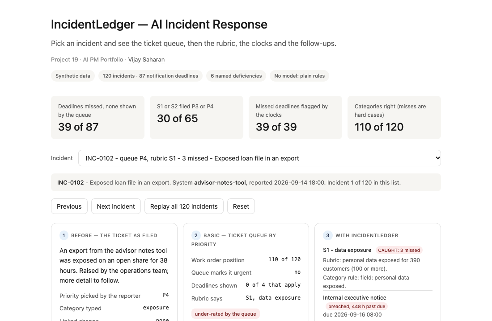
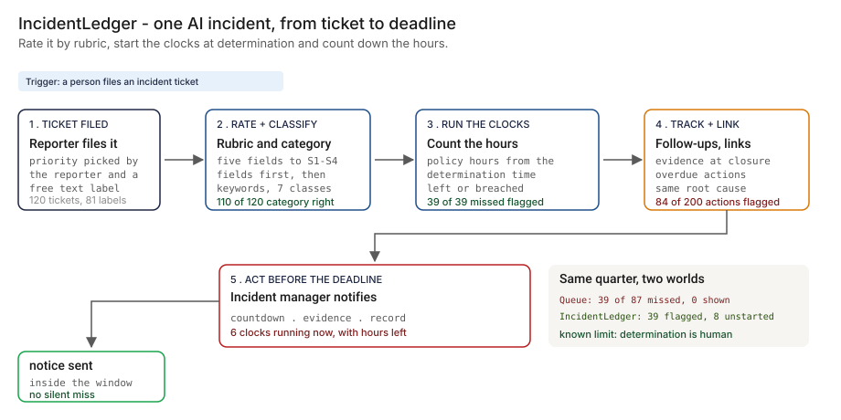
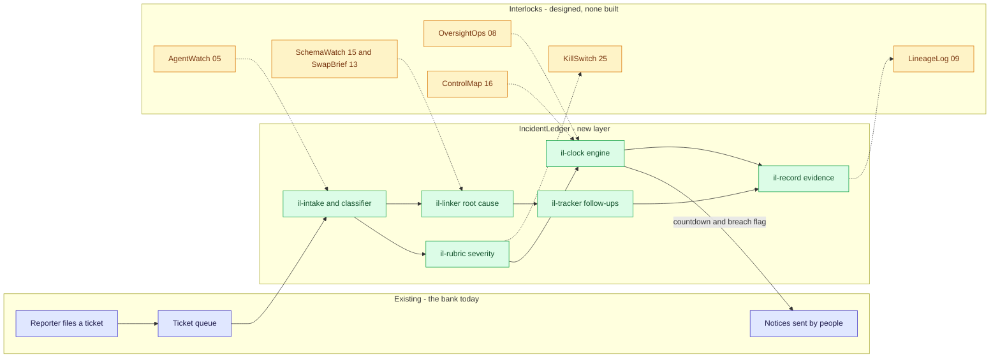
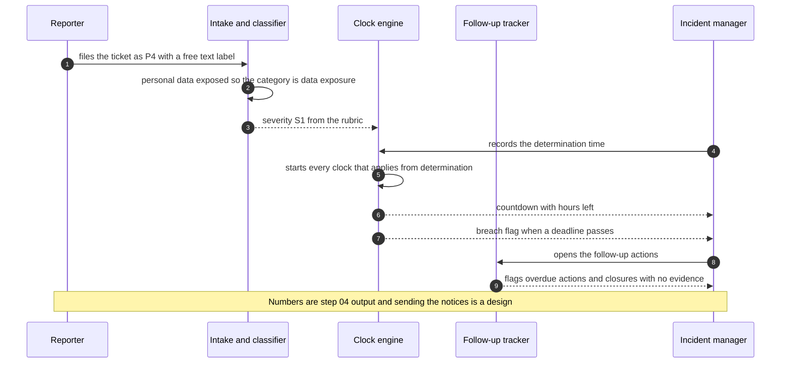

# 🚨 IncidentLedger — AI Incident Response with the Notification Clock Running

**A portfolio prototype for AI incident response in a modeled bank: a rule-based classifier, a severity rubric, a notification-clock engine, a follow-up tracker and linking by root cause. Written against the model-risk guidance the work is compared with: the 'Manage' function of the [NIST AI RMF](https://www.nist.gov/itl/ai-risk-management-framework), the ongoing-monitoring expectation in [SR 26-2](https://www.federalreserve.gov/supervisionreg/srletters/SR2602.htm) (the current model-risk guidance, which replaced its 2011 predecessor in April 2026), the incident-notification theme of [SR 22-4](https://www.federalreserve.gov/supervisionreg/srletters/SR2204.htm), and the serious-incident reporting article of the [EU AI Act](https://eur-lex.europa.eu/eli/reg/2024/1689/oj) (Article 73).**

**▶ Static demo, no install:** [open on GitHub Pages](https://vj-shipped-anyway.github.io/ai-pm-portfolio/19-incidentledger-ai-incident-response/demo.html)

[](https://vj-shipped-anyway.github.io/ai-pm-portfolio/19-incidentledger-ai-incident-response/demo.html)

**What it shows** (🟢 measured on synthetic data; the script is named in brackets):

- 🟢 Deadlines: 39 of 87 missed (44.8%), on 25 incidents, and the engine flags 39 of 39 (`step_04`)
- 🟢 Category: 110 of 120 right (91.7%) (`step_04`)
- 🟢 Severity: 120 of 120 match the truth file, by construction (`step_04`): the generator and the script apply the same rubric to the same fields

_A portfolio prototype on synthetic data, not a production case study. The framing, how to read the numbers and the regulatory note are folded below._


[](./demo.html)



> **▶ 30-second demo:** the [clickable demo](./demo.html) gets you the full story in 30 seconds with no install.

<details>
<summary>Framing, how to read the numbers, and the regulatory note</summary>

> **Regulatory note.** This README cites SR 11-7 or its replacement, [SR 26-2](https://www.federalreserve.gov/supervisionreg/srletters/SR2602.htm) (Federal Reserve, OCC and FDIC, April 17, 2026). SR 26-2 sets no enforceable standards, is aimed mainly at banks with over $30 billion in assets, and places generative AI and agentic AI outside its scope. Here those citations name the design basis for validation, monitoring and inventory practices, or serve as an analogy. They are not a claim that the project meets SR 26-2 or that SR 26-2 governs the systems it examines.

> **Framing:** This is a portfolio prototype, not a production case study. The six-deficiency taxonomy, the severity rubric, the clock engine, the architecture, the data generator and the walkthrough are mine. Every number below is either printed by a script in this folder on data I generated, or is modeled with its assumption named. Production validation (real incident tickets labeled by people, a clock policy confirmed with counsel, a model-risk read) is what the next role does.

> **Reading the numbers — credibility tags inline.** Every number in this README and the demo is tagged 🟢 **Measured** (printed by a script in `src/` on the shipped synthetic data: 120 incidents, 87 notification deadlines, 200 follow-up actions, 78 root causes), 🟡 **Modeled** (extrapolated from that data, with the assumption named in one line), or 🔴 **Hypothetical** (designed and reasoned about, never tested). Full convention in the [master README's "Reading the numbers" section](../README.md#-reading-the-numbers). **All data is synthetic and generated by a seeded script. The truth is known because the data is synthetic: the generator decided each incident's category, severity and root cause, and which notices went late.** Deadline lengths and rubric thresholds are assumptions of a modeled bank, not legal advice or a statement of any rule.

</details>

---

## 🔥 Demo in 30 seconds

Open the static, no-Python demo: [`demo.html`](./demo.html).
Pick one of the 120 incidents from the dropdown, or use Next incident and Replay all 120 incidents. Three cards show the same incident three ways: the ticket as filed (the priority the reporter picked and a free-text label), the ticket queue (its position in the work order, with what happened to its deadlines beside it), and IncidentLedger (the rubric severity, the category and its rule, each clock with hours left or breached, the follow-ups and the linked tickets). The totals at the top end at the 🟢 measured numbers: 39 of 87 deadlines missed with none shown by the queue, 30 of 65 S1 or S2 tickets filed P3 or P4, and 110 of 120 categories right.

To run the four-step walkthrough on your laptop:

```bash
git clone https://github.com/Vj-shipped-anyway/ai-pm-portfolio
cd ai-pm-portfolio/19-incidentledger-ai-incident-response/src
python3 step_01_ticket_queue_status_quo.py
python3 step_02_priority_fifo_baseline.py
python3 step_03_deficiencies_exposed.py
python3 step_04_with_incidentledger.py
```

To regenerate the synthetic data (the output is identical on every run): `python3 ../data/_generate.py`.
To run the Streamlit prototype: `pip install -r requirements.txt`, then `streamlit run app.py` from `src/` (or `streamlit run 19-incidentledger-ai-incident-response/src/app.py` from the repo root).

---

## 💰 Why this lands — competitive positioning

Teams that log AI incidents usually start with one of two things: the ticket system they already have, or a spreadsheet of deadlines someone keeps by hand. I compare approaches rather than vendors, so the table below scores the queue on the synthetic data and describes the spreadsheet by design (I have not measured one).

| Capability | Ticket queue (reporter priority) | Manual deadline spreadsheet | **IncidentLedger** |
| --- | --- | --- | --- |
| Rates severity from facts | No. 🟢 Priority matched the rubric on 57 of 120 tickets | No: it follows whatever the ticket says | Yes: 🟢 rubric from five fields; 120 of 120 match the truth file, by construction |
| Knows which deadlines apply | 🟢 0 tracked | Only the ones someone enters | 🟢 87 clocks evaluated from the policy file |
| Shows hours left or breached | No | Only if updated by hand | Yes, at every read: 🟢 6 running with hours left, 39 missed |
| Notices a missed deadline | 🟢 0 of 39 | Only if someone checks | 🟢 39 of 39, by construction (arithmetic on the policy) |
| Aggregates by category | No: 🟢 81 free-text strings for 7 classes | Only if someone codes them | 🟢 110 of 120 right; 5 of the 10 misses flag a person |
| Follow-ups need evidence | No: 🟢 27 of 109 closed actions have none | Only a column | 🟢 84 of 200 actions flagged (overdue or closed with no evidence) |
| Links tickets with one root cause | 🟢 0 | No | 🟢 35 of 42 repeat tickets linked; 15 of 61 links join different root causes |
| Where it still fails | Everything above | Anything nobody typed | Ambiguous text, a cause hidden behind an effect, and a determination only a person can make |

**Position:** *IncidentLedger does not replace the incident process, the on-call rota or the people who decide an incident is real. It adds the rubric, the clock and the follow-up discipline that a ticket queue lacks: it says how severe the incident is on facts, which notices are owed, how many hours are left, and which actions closed without evidence. It cannot say when the bank decided, and the clocks depend on that.*

---

## The honest version (why this exists)

The failure mode this prototype is built around: an AI system does something it should not (a wrong answer, an exposed record, an unfair decision, an outage, an injection, a regression after a model change), and someone files a ticket. The reporter picks a priority and types a category. Nothing computes the severity, nothing counts the hours to a notification deadline, and the follow-up actions close without anyone checking for evidence. When the same root cause produces four tickets, nobody links them. The first sign that a deadline was missed is a person asking about it later.

This is a prototype on synthetic data. I wrote the generator, the truth file, the policy file, the classifier, the rubric, the clock engine, the tracker and the linker. The titles and descriptions are filled-in templates, not model output, and no model is used anywhere in this repo. The truth is known because the data is synthetic: the generator decides each incident's true category, severity and root cause, so it can say exactly which tickets were rated wrong. A real queue does not hand you that, which is why the first job in a real deployment would be a labeled sample of real tickets. Nothing here is a real bank, system, vendor, regulator dataset or incident.

The set is dense on purpose (120 incidents in one quarter) so that every effect appears often enough to count. It is a test set, not an estimate of how often real AI incidents happen. The rate of late and unsent notices is set by outcome weights in the generator, which are assumptions listed in [`data/README.md`](./data/README.md), not observed behavior of any bank.

If you run AI systems in a regulated setting and have tried to answer "who was told, and when" after an incident, fork it. The rubric, the clock vocabulary and the follow-up rule are the parts worth lifting. Validating them against real tickets and a policy confirmed by counsel is the work the next role would do.

---

## Prereqs to run this on your laptop (in plain English)

You don't need a cluster, a cloud account or an API key. You need:

- **Python 3.** The four step scripts, the data generator and the demo builder use only the standard library (for example `csv`, `json`, `statistics` and `pathlib`), so there is nothing to install for them. They are written for Python 3.9 and tested on it; they use no syntax newer than 3.9.
- **Git**, to clone the repo. `brew install git` / `winget install git`.
- **`src/requirements.txt` — only for the Streamlit app.** It lists `streamlit`, `pandas`, `numpy` and `plotly`. The step scripts do not import any of them. Run `pip install -r src/requirements.txt` only if you want the app.
- **No API key.** There is no model call, no network call and no secret anywhere. The classifier, the rubric, the clock engine, the tracker and the linker are plain rules you can read.
- **Not needed:** a database, containers, Kubernetes or a cloud account. They appear in [`ARCHITECTURE.md`](./ARCHITECTURE.md) as the production design, not as prototype requirements.

Each step script finishes in seconds and writes its CSV or JSON to `src/out/`. The clickable `demo.html` runs in any browser with zero install. If a step does not run from a fresh clone, that's a bug in the README. Open an issue.

---

## Executive summary (90 seconds)

**Problem.** A modeled bank logs AI incidents in a ticket queue. In one quarter it holds 120 incidents and 87 notification deadlines apply under its policy. Reporters pick the priority: 🟢 30 of 65 tickets that are truly S1 or S2 were filed P3 or P4. Categories are free text: 🟢 81 distinct strings for 7 classes. Nobody tracks the deadlines: 🟢 39 of 87 were missed (17 sent late, 22 never sent), and 8 more never started because no determination was recorded.

**Product.** IncidentLedger, an incident layer on top of the queue: a **classifier** (fields first, keywords second, and 'needs a person' when it cannot tell), a **severity rubric** (S1 to S4 from five fields), a **clock engine** (the policy file, the determination time, hours left or breached at the read date), a **follow-up tracker** (overdue, or closed with no evidence) and a **linker** (same system and change id, else same category inside a week).

**Measured and modeled performance.**

- 🟢 **Deadlines: 39 of 87 missed (44.8%), on 25 incidents, and the engine flags 39 of 39** (`step_04`). This agreement is by construction: the clocks are arithmetic on the determination time and the policy file, and the queue shows 0.
- 🟢 **Category: 110 of 120 right (91.7%)** (`step_04`). All 10 misses are the 10 hard cases written into the data: 5 flagged 'needs a person', 5 wrong with no flag. The clear cases score well because I wrote the templates and the keyword lists.
- 🟢 **Severity: 120 of 120 match the truth file, by construction** (`step_04`): the generator and the script apply the same rubric to the same fields. It says the code does what the rubric says, not that the rubric is right.
- 🟢 **Queue priority matched the rubric on 57 of 120** (`step_03`). The queue marks 36 tickets P1 or P2 and 35 of them are truly S1 or S2; it marks 35 of the 65 truly S1 or S2 tickets (`step_02`).
- 🟢 **Start the clock at detection and 65 deadlines are missed, not 39** (`step_03`). The anchor is a policy choice the queue never makes.
- 🟢 **Follow-ups: 84 of 200 flagged** (57 overdue, 27 closed with no evidence) (`step_04`).
- 🟢 **Links: 35 of 42 repeat tickets linked; pair precision 75.4%, recall 78.0%** (`step_04`).
- 🟡 **Utility: (0.392 − 0.067) × 60 = about 19.5 missed deadlines avoided a quarter**, assuming 60 AI incidents a quarter and that a person acts on every countdown before the deadline.
- 🔴 **Design target: a countdown that reaches the incident manager before the window closes, and an evidence record written to the model-risk file.** Designed in `ARCHITECTURE.md`, never built or timed.

**Call to action.** Fork this repo. Swap [`data/incidents.csv`](./data/incidents.csv), [`data/notifications.csv`](./data/notifications.csv) and [`data/actions.csv`](./data/actions.csv) for exports from your incident system, put your own hours in [`data/policy.csv`](./data/policy.csv) (confirm them with counsel), and call `classify`, `rubric` and `evaluate_clocks` from `step_04` on them. The truth file exists only because the data is synthetic.

---

## 🗺️ What this walkthrough covers

1. **The use case** — a modeled bank's AI incident queue: 120 tickets, 87 notification deadlines, 200 follow-up actions
2. **Sample data** — five CSVs: incidents, truth, policy, notifications, actions
3. **Step 1 — Before IncidentLedger** — the queue as it stands: priorities, free-text categories, no clocks
4. **Step 2 — Basic approach** — sort by reporter priority, oldest first; what that gets right and what it misses
5. **Step 3 — The six named deficiencies** — each with a count from the dataset
6. **Step 4 — The fix (IncidentLedger)** — classifier, rubric, clocks, tracker, linker; measured against the truth file, with the known limit printed
7. **Utility delivered** — a multiplied number with the assumption named
8. **Architecture & call flow** — topology and a per-incident sequence
9. **PM artifacts** — PRD and architecture

> Non-technical reader: skip the code blocks. The plain-English explanation and the output tables tell the story.
> Technical reader: every code block runs. `cd src && python3 step_NN_*.py` and you'll see the same output.

Total reading time: about 12 minutes deep, 3 minutes if you skim.

---

## 🎯 The Use Case

**A modeled bank's AI incident queue. 120 tickets in one quarter, 87 notification deadlines, 200 follow-up actions.**

An AI incident here is any event where an AI system did something it should not have: a wrong output, an unfair outcome, a data exposure, a security or injection event, an outage, a regression after a model or release change, or misuse. The AI incident manager owns the response: rate the incident, tell the right people inside the right window, close the follow-ups with evidence, and notice when this week's incident is last week's.

Three things happen inside one quarter in the synthetic data:

- **A severe incident filed low, with its deadlines missed.** INC-0102 ("Exposed loan file in an export", on `advisor-notes-tool`) is filed by the reporter as P4 and sits at position 110 of 120 in the queue. The rubric says S1: personal data exposed for 390 customers (100 or more). 🟢 3 of its 4 notification deadlines are missed (Internal executive notice, Regulator notice, Serious-incident report to an AI regulator); Customer notice is running.
- **A clock that never starts.** INC-0012 ("Payments routing agent worse after change CHG-2845") is rated S2 by the rubric, but nobody has recorded a determination more than 86 days after it was detected, so its clock (Regulator notice) has not started and nothing in the queue says so. 🟢 5 incidents are in this state.
- **One root cause, several tickets.** 4 tickets (INC-0109, INC-0110, INC-0111, INC-0114) are misuse on `collections-draft-tool` with one root cause, filed over 3 days. The queue links none of them; the linker puts them in 2 group(s), where one is correct.

The AI incident manager owns the response. The executive who must be told, the regulatory liaison, the model owner and the model-risk reviewer need the same record. IncidentLedger is designed for those five.

---

## 📊 Sample Data

Five CSVs in [`data/`](./data/), generated by [`data/_generate.py`](./data/_generate.py) (standard library, seeded, deterministic: running it twice produces identical files). Documented in [`data/README.md`](./data/README.md), including how the data was tuned. One preview each:

**[`data/incidents.csv`](./data/incidents.csv)** — 120 incident tickets as a queue holds them. Times are integer hours from 2026-07-01T00:00; the read date `AS_OF` is hour 2304.

| incident_id | reported_at | reporter_priority | reporter_category | system | change_id | customers_affected | pii_exposed | detected_at | determined_at |
| --- | --- | --- | --- | --- | --- | --- | --- | --- | --- |
| INC-0001 | 88 | P4 | security | payments-routing-agent |  | 0 | 0 | 79 | 96 |
| INC-0002 | 104 | P2 | unfair decision | mortgage-prescreen-model |  | 898 | 0 | 96 | 124 |
| INC-0003 | 122 | P2 | quality drop | advisor-notes-tool | CHG-2508 | 4269 | 0 | 119 | 145 |

**[`data/truth.csv`](./data/truth.csv)** — what the generator decided: the true category (seven classes), the true severity (S1 to S4 from the rubric inputs) and the root-cause key. `hard_case` marks the 10 incidents written to be hard.

| incident_id | true_category | true_severity | root_cause_key | hard_case |
| --- | --- | --- | --- | --- |
| INC-0001 | security_injection | S3 | RC-001 |  |
| INC-0002 | unfair_outcome | S1 | RC-002 |  |
| INC-0003 | regression_after_change | S2 | RC-003 |  |

**[`data/policy.csv`](./data/policy.csv)** — the notification clocks of a modeled bank. **Assumptions of a modeled bank, not legal advice or a statement of any rule; the hours are assumed values to confirm with counsel.**

| clock_id | clock_name | applies_to | hours | anchor |
| --- | --- | --- | --- | --- |
| CK1 | Internal executive notice | sev_s1 | 4 | determination |
| CK2 | Regulator notice | notification_incident | 36 | determination |
| CK3 | Customer notice | pii_exposed | 720 | determination |
| CK4 | Serious-incident report to an AI regulator | serious_incident | 360 | determination |

**[`data/notifications.csv`](./data/notifications.csv)** — 51 notices that were actually sent and when. **[`data/actions.csv`](./data/actions.csv)** — 200 follow-up actions with owner, due date, status and whether evidence is attached.

| notification_id | incident_id | clock_id | sent_at |
| --- | --- | --- | --- |
| N-0001 | INC-0002 | CK1 | 131 |
| N-0002 | INC-0009 | CK1 | 272 |
| N-0003 | INC-0009 | CK2 | 271 |

| action_id | incident_id | action | owner | due_at | status | closed_at | evidence_link |
| --- | --- | --- | --- | --- | --- | --- | --- |
| A-0001 | INC-0001 | Test the fix against the crafted input | owner-11 | 432 | closed | 540 | yes |
| A-0002 | INC-0001 | Add an input filter for the pattern | owner-07 | 432 | closed | 434 | yes |
| A-0003 | INC-0002 | Agree a remediation with the model owner | owner-02 | 844 | closed | 882 | yes |

Class mix: wrong output 26, unfair outcome 12, data exposure 16, security and injection 16, availability 20, regression after change 20, misuse 10. By rubric severity: S1 17, S2 48, S3 26, S4 29. 78 root causes, 29 of them in more than one ticket.

The data includes hard cases on purpose: 3 tickets carry one keyword for two classes, 1 is outvoted by the wrong class, 2 name nothing, 3 expose personal data through an injection or a misuse, and 1 is a regression whose reporter never wrote that anything changed. The clear cases are easy because I wrote the templates and the keyword lists.

---

## 🔧 Step 1 — Before IncidentLedger: AI incidents in a ticket queue

**In plain English:** The reporter picks the priority and types a category. The queue holds the ticket, and that is all it knows. No severity, no deadline, no link to the ticket that looks the same.

```bash
python3 src/step_01_ticket_queue_status_quo.py
```

**Result:**

```
RESULT
  Tickets filed:                                120
  Priorities chosen by the reporter:            P1 16, P2 20, P3 32, P4 52
  Distinct free-text categories:                81 (39 after lowercasing and trimming)
  Notification deadlines tracked by the queue:  0
  Follow-up actions:                            200 (109 closed, 91 not closed)
  Not-closed actions already past their due date: 57 (the queue shows no flag)
  Tickets with no determination time recorded:  5
```

🟢 Every count is printed by `step_01`. A queue with no deadline field cannot show a deadline, and 57 actions are already past due with nothing flagging them.

---

## 🤖 Step 2 — With the basic approach: sort by priority, oldest first

**In plain English:** Work the queue by the priority the reporter picked, oldest first inside a priority. It is the obvious thing to do and it is not wrong: when the reporter says urgent, it usually is. The failure is the tickets nobody marked.

```bash
python3 src/step_02_priority_fifo_baseline.py
```

```
pos  incident  queue truth title
---  --------- ----- ----- --------------------------------------------------
  1  INC-0005  P1    S2    Output format changed since the release
  2  INC-0013  P1    S1    Credit line model outage
  3  INC-0017  P1    S1    Underwriting assistant produced a made-up refer...
  4  INC-0026  P1    S1    Internal pricing sheet leaked via card dispute ...
  5  INC-0034  P1    S1    Credit line model looks biased on limit
  6  INC-0035  P1    S2    KYC document extractor gave an incorrect payoff...
  7  INC-0043  P1    S2    Payments routing agent failed, then gave bad data
  8  INC-0046  P1    S2    KYC document extractor down for 2 hours
  9  INC-0050  P1    S1    Retail chat assistant worse after change (chang...
 10  INC-0051  P1    S2    Cash forecast model not responding
 11  INC-0086  P1    S1    Card dispute summarizer timed out for some users
 12  INC-0087  P1    S1    Exposed loan file in an export
  ...
```

```
RESULT
  Tickets the queue marks P1 or P2:                   36 of 120 (30.0%)
  Of those, truly S1 or S2 under the rubric:          35 of 36 (97.2%)
  Truly S1 or S2 tickets the queue marks P1 or P2:    35 of 65 (53.8%)
  Truly S1 or S2 among the first 20 tickets worked:   20 of 20
  Truly S1 tickets filed P3 or P4:                    4 of 17
  Queue position of the 17 S1 tickets:                median 15, worst 110 of 120
  Notification deadlines shown by the queue:          0
```

- **The queue is precise and misses a lot.** 🟢 Of 36 tickets marked P1 or P2, 35 are truly S1 or S2 (97.2%). But it marks only 35 of 65 truly S1 or S2 tickets (53.8%).
- **The tickets it misses are the worst place to miss.** 🟢 4 of the 17 S1 tickets were filed P3 or P4. The worst sits at position 110 of 120.
- **No clocks.** 🟢 The queue shows 0 notification deadlines. Sorting does not change that.

---

## 🔬 Step 3 — Where this still breaks: 6 named deficiencies

| # | Deficiency | What goes wrong | Count in this dataset |
| --- | --- | --- | --- |
| 1 | **Priority differs from the rubric severity** | The reporter's guess is the only rating. | 🟢 30 of 65 truly S1 or S2 tickets filed P3 or P4 (4 of them S1); matches on 57 of 120 |
| 2 | **Free-text categories cannot be aggregated** | The same event has many labels, and some labels fit many events. | 🟢 81 strings for 7 classes (39 after trimming); 3 labels cover more than one class, 22 tickets |
| 3 | **Clocks missed or never started** | No one counts the hours to a notification deadline. | 🟢 39 of 87 missed; 8 more never started on 5 incidents |
| 4 | **The clock anchor changes the count** | Detection and determination give different breach counts, and the queue picks neither. | 🟢 39 missed from determination, 65 from detection |
| 5 | **Follow-ups overdue or closed with no evidence** | A closed action may mean nothing was done. | 🟢 57 of 91 not-closed actions overdue; 27 of 109 closed with no evidence |
| 6 | **Related incidents not linked** | One root cause arrives as several tickets. | 🟢 42 repeat tickets across 29 root causes; the queue links 0 |

```bash
python3 src/step_03_deficiencies_exposed.py
```

```
(a) The reporter's priority differs from the rubric severity
    Priority matches the rubric severity on 57 of 120 tickets (47.5%).
    30 of 65 tickets that are truly S1 or S2 were filed P3 or P4 (4 of them S1).
    1 ticket that is truly S3 or S4 was filed P1 or P2.

(b) Free-text categories cannot be aggregated
    Reporters typed 81 distinct category strings for 7 real classes (39 after lowercasing and trimming).
    3 of those 39 labels are used for more than one real class, covering 22 tickets (18.3%).
    Most-shared labels: 'ai issue', 'bug', 'security'.

(c) Notification clocks are missed, or never started
    87 notification deadlines apply under the modeled policy; the queue tracks 0.
    At 2026-10-05 00:00: 34 sent on time, 17 sent late, 22 never sent and past due, 6 still running, 8 not started.
    Missed (late or never sent): 39 of 87 (44.8%).
    8 deadlines on 5 incidents never started: nobody recorded a determination.
    clock  applies  on_time  late  breached  running  not_started
    CK1         17       10     4         3        0            0
    CK2         43       17    10        11        0            5
    CK3         16        2     1         4        6            3
    CK4         11        5     2         4        0            0

(d) The clock starts at detection or at determination, and the two disagree
    Detection to determination took a median 24 h (longest 232 h); 57 of 115 determined incidents took more than 24 h.
    Deadlines missed with the clock from determination: 39 (plus 8 not started).
    Deadlines missed with the clock from detection:     65.
    The anchor changes the count by 26; the queue has no anchor, so each team picks its own.

(e) Follow-up actions are overdue, or closed with no evidence
    57 of 91 open actions are past their due date; the queue shows no flag.
    27 of 109 closed actions have no evidence link (24.8%).
    84 of 200 actions (42.0%) sit on 59 incidents, 45 of them S1 or S2.

(f) Related incidents are not linked
    120 tickets come from 78 root causes; 29 root causes appear in more than one ticket (71 tickets).
    42 tickets are repeats of an earlier one; the largest root cause has 4 tickets. The queue links 0.
```

The basic approach orders the work by what the reporter felt. **The product is the rubric, the clock and the follow-up discipline, not the sort.**

---

## 🛠️ Step 4 — The fix: IncidentLedger

Five parts, all plain rules, no model:

1. **Classifier.** Fields first: personal data exposed means data exposure; a linked change id plus change wording means regression after change. Keywords second, from a list per class. A tie, or no keyword, returns 'needs a person' instead of a guess. The keyword lists and the field rules are in `step_04`.
2. **Severity rubric.** S1 to S4 from customers affected, regulated decision, personal data, financial impact band and duration, with the rubric line that fired. The thresholds are assumptions of a modeled bank.
3. **Clock engine.** Reads [`data/policy.csv`](./data/policy.csv) and the ticket's determination time, and evaluates every clock that applies at the read date: on time, late, never sent and past due, running with hours left, or not started. It can also start every clock at detection, to show the difference.
4. **Follow-up tracker.** An action is overdue when it is not closed and past its due date, and flagged when it is closed with no evidence link.
5. **Linker.** Two tickets link when they share a system and a change id, or, when either has none, share a system and a predicted category within seven days. Groups are the connected components, and the prototype scores them against `root_cause_key` in the truth file.

```bash
python3 src/step_04_with_incidentledger.py
```

**Category, severity and clocks:**

```
1. CATEGORY (fields first, keywords second)
   Correct on 110 of 120 incidents (91.7%). 10 wrong: 5 flagged 'needs a person', 5 wrong with no flag.
   A field rule decided 33 incidents and was right on 30.
   class                      incidents  right
   wrong output                      26     24
   unfair outcome                    12     12
   data exposure                     16     16
   security and injection            16     14
   availability                      20     17
   regression after change           20     19
   misuse                            10      8

2. SEVERITY (rubric, thresholds are assumptions of a modeled bank)
   S1 17, S2 48, S3 26, S4 29. Matches the truth file on 120 of 120 (by construction).

3. CLOCKS at 2026-10-05 00:00 (clock starts at determination)
   87 deadlines apply: 34 on time, 17 late, 22 never sent and past due, 6 running, 8 not started.
   Missed (late or never sent): 39 of 87 (44.8%), on 25 incidents. On time: 34 of 87 (39.1%).
   Same clocks started at detection: 65 missed.
   Statuses agree with the truth-side arithmetic of step 3 on 87 of 87 (by construction).
   A countdown at one quarter of the window left would have fired before the deadline on 39 of 39 missed clocks (by construction).
   running: INC-0087 Customer notice, 37 h left
   running: INC-0089 Customer notice, 63 h left
   running: INC-0090 Customer notice, 63 h left
   running: INC-0100 Customer notice, 166 h left
   running: INC-0102 Customer notice, 268 h left
   running: INC-0106 Customer notice, 348 h left
```

**Follow-ups and links:**

```
4. FOLLOW-UPS
   200 actions: 57 overdue, 27 closed with no evidence, 82 closed with evidence, 34 open and on track.
   Flagged: 84 of 200 (42.0%).

5. LINKS (same system; change id, else same category within 7 days)
   78 groups from 120 incidents. Truth has 78 root causes.
   Pairs: 46 right of 61 linked (precision 75.4%), 46 of 59 true pairs found (recall 78.0%).
   Repeat tickets linked to an earlier ticket of the same root cause: 35 of 42.
```

**Measured against the truth file:**

```
MEASURED AGAINST THE TRUTH FILE
  Category:  110 of 120 (91.7%); designed hard cases 10, missed 10; misses outside them 0
  Severity:  120 of 120 (by construction)
  Queue priority matched the rubric severity on 57 of 120
  Deadlines: 39 missed, all 39 with a countdown that fires first (by construction); the queue showed 0
```

- **The clocks are arithmetic, and that is why they work.** 🟢 87 of 87 clock statuses agree with the truth-side arithmetic of `step_03`, by construction. The value is not in being clever; it is that someone computes the deadline for every incident and reads it at every look. 6 clocks are running now (listed above), and the app shows the hours left.
- **The classifier flags some of its own doubt.** 🟢 Of the 10 misses, 5 return 'needs a person' (ties and texts with no keyword). The other 5 are wrong with no flag.
- **Clocks do not depend on the category.** They run on rubric fields and the determination time, so a category miss does not move a deadline.
- **Links are the weakest part.** 🟢 Pair precision is 75.4% and recall 78.0%. A same-system, same-category pair inside a week is a guess; a shared change id is better evidence.

### The known limit, left in on purpose

```
WHAT IT STILL GETS WRONG (known limit, left in on purpose)
  Category misses: 10 of 120.
    INC-0037 truth wrong output             said needs a person          tie between wrong output and availability
    INC-0043 truth availability             said wrong output            keywords: incorrect, inaccurate
    INC-0049 truth security and injection   said data exposure           field: personal data exposed
    INC-0070 truth wrong output             said needs a person          no keyword matched
    INC-0075 truth security and injection   said data exposure           field: personal data exposed
    INC-0085 truth regression after change  said wrong output            keywords: incorrect
    INC-0086 truth availability             said needs a person          tie between wrong output and availability
    INC-0090 truth misuse                   said data exposure           field: personal data exposed
    INC-0095 truth availability             said needs a person          tie between wrong output and availability
    INC-0111 truth misuse                   said needs a person          no keyword matched
  Determination is a human call. The clock starts when a person records it, and the tool cannot supply it.
    5 incidents have no determination at 2026-10-05 00:00; 8 deadlines on 5 of them have not started.
    Detection to determination: median 24 h, longest 232 h. Start the clock at detection and 65 deadlines are missed instead of 39.
  Links: 7 of 42 repeat tickets are not linked to an earlier ticket of the same root cause; 15 linked pairs are not the same root cause.
```

Three limits, all printed above:

1. **Category.** The 10 misses are the hard cases. 3 are an injection or a misuse that exposed personal data and were filed as data exposure, because the field rule comes first and sees the effect. Ties and silence are flagged for a person; a field rule that sees only the effect is not.
2. **Determination is a human call.** The clock starts when a person records that the bank decided this is a real incident. 🟢 5 incidents have none at the read date, so 8 deadlines have not started. The mitigation is in the process, not the code: a named person must decide within a set time. That is 🔴 designed in the PRD, never tested with real teams.
3. **Links.** 🟢 7 of 42 repeat tickets are not linked to an earlier ticket of the same root cause, and 15 linked pairs are not the same root cause.

Other limits, stated plainly: the policy hours are assumptions that counsel would have to confirm; severity and clock agreement hold by construction; the engine trusts the five rubric fields as reported; and notification is only as good as the person who sends it.

---

## 📐 Utility Delivered

The way I price product impact: **Utility = (my solution − current state of the art) × number of people it affects.**

Here the terms are deadline misses and clocks that never started, per incident, and incidents per quarter. Each incident lands on five roles: the incident manager, the executive who must be told, the regulatory liaison, the model owner and the model-risk reviewer. *Doing it for every incident a bank of this shape logs in a quarter is the outcome, not the rating of one.*

| Term | Value | Where it comes from |
| --- | --- | --- |
| Current state of the art (ticket queue), misses and unstarted clocks per incident | 🟢 **0.392** | `step_04`: 39 missed + 8 never started = 47 over 120 incidents, none flagged |
| My solution (IncidentLedger), per incident | 🟢 **0.067** | `step_04`: 8 clocks cannot start without a determination |
| Per-incident lift | 🟢 0.392 − 0.067 = 0.325 | 39 missed deadlines over 120 incidents, each with a countdown that fires first |
| Number it affects: incidents per quarter | 🟡 **60** | **Assumption, not a statistic:** a modeled bank logs 60 AI incidents a quarter, half the density of the synthetic set. Edit `INCIDENTS_PER_QUARTER` in `step_04` to use your own |
| Assumption that makes the lift real | 🟡 A person acts on every countdown before the deadline | If the countdown is ignored, the lift shrinks toward zero |
| **Utility** | 🟡 **(0.392 − 0.067) × 60 = about 19.5 missed deadlines avoided a quarter** | Per quarter, for this mix of incidents |

Sensitivity to the incidents-per-quarter assumption (🟡, same per-incident lift): 30 gives 9.8, 60 gives 19.5, and the synthetic set's own 120 gives 39.0.

🔴 What I have not measured: whether anyone acts on a countdown, what a late notice costs a bank, or what any of this costs to run. The synthetic quarter is also much denser than a real one. Treat the per-incident number as a property of this mix of incidents and this generator's outcome weights, not a forecast.

---

## 🔄 Architecture & Call Flow

How each incident flows through the system. GitHub renders these diagrams natively. Component names match [`ARCHITECTURE.md`](./ARCHITECTURE.md).

**System topology:**



**Per-incident sequence** (INC-0102):



See [`assets/incidentledger-flow.svg`](./assets/incidentledger-flow.svg) for a static visual of the same flow.

**Interlocks (all 🔴 designed, none built):**

- [05 AgentWatch](../05-agentwatch-agent-observability/) sees the runtime behavior. IncidentLedger starts after someone decides it is an incident: when AgentWatch raises an alert, the first alert time can set `detected_at`. IncidentLedger is not a second observability tool.
- [08 OversightOps](../08-oversightops-hitl-workflow/) designs human review. A reviewer who rejects an AI output can open an incident, and the same role is the natural owner of the determination that starts the clocks.
- [09 LineageLog](../09-lineagelog-ai-decision-audit/) records AI decisions. The decision records for the affected decisions attach to the incident as evidence.
- [15 SchemaWatch](../15-schemawatch-tool-schema-drift/) and [13 SwapBrief](../13-swapbrief-model-migration/) produce the changes a regression incident points at. A schema hold or a migration decision supplies the `change_id`.
- 16 ControlMap would map the incident-reporting obligations to the clock rows in the policy file, so each clock names the obligation it serves.
- 25 KillSwitch would take an S1 rating as a trigger to run a fallback.

---

## 📋 PM Artifacts

The PM artifacts that show how I'd run this product if I owned the seat. This README is the walkthrough; the rest of the folder holds:

- [`PRD.md`](./PRD.md) — the product requirements doc: users, backlog, KPIs, rollout, open questions.
- [`ARCHITECTURE.md`](./ARCHITECTURE.md) — the systems doc: components, data model, security, failure behavior, operations. A design, not deployed.
- [`demo.html`](./demo.html) — clickable, no-install walkthrough; every number is generated from the scripts in `src/` by `src/_build_demo.py`.
- [`data/`](./data/) — the five synthetic CSVs and the generator. `data/README.md` explains the ground-truth rules and how the data was tuned.
- [`src/`](./src/) — runnable step scripts and the Streamlit prototype.

Run the walkthrough end-to-end:

```bash
cd src
python3 step_01_ticket_queue_status_quo.py
python3 step_02_priority_fifo_baseline.py
python3 step_03_deficiencies_exposed.py
python3 step_04_with_incidentledger.py
```

---

## 🚀 Fork this for your team

```bash
git clone https://github.com/Vj-shipped-anyway/ai-pm-portfolio
cd ai-pm-portfolio/19-incidentledger-ai-incident-response

# 1. Run the synthetic walkthrough as is
cd src
python3 step_01_ticket_queue_status_quo.py
python3 step_02_priority_fifo_baseline.py
python3 step_03_deficiencies_exposed.py
python3 step_04_with_incidentledger.py

# 2. Open the interactive demo
open ../demo.html            # static snapshot of the synthetic run; it does not read data/
```

To point it at your own incidents, replace four files and keep their columns:

- `data/incidents.csv`: `incident_id, reported_at, reporter_priority, reporter_category, title, description, system, change_id, customers_affected, regulated_decision_involved, pii_exposed, financial_impact_band, duration_hours, detected_at, determined_at` (times as integer hours from your own epoch, and set `EPOCH` and `AS_OF` in `step_01`)
- `data/policy.csv`: `clock_id, clock_name, applies_to, hours, anchor, basis, note`, with your own hours confirmed by counsel
- `data/notifications.csv`: `notification_id, incident_id, clock_id, sent_at`
- `data/actions.csv`: `action_id, incident_id, action, owner, due_at, status, closed_at, evidence_link`

The functions that do the work take plain dicts, so you can call them directly:

```python
# from src/
from step_01_ticket_queue_status_quo import load_all
from step_04_with_incidentledger import classify, rubric, evaluate_clocks, track_action

data = load_all()
incident = data["incidents"][0]
category = classify(incident)                       # category, rule, confidence
severity, reasons = rubric(incident)                # S1 to S4 and the rubric lines that fired
clocks = evaluate_clocks(incident, severity, data["policy"], data["sent"])   # status, hours left or over
```

`data/truth.csv` exists only because the data is synthetic. The step scripts read it to score the result, so on real exports the category, severity and link scores in step 4 cannot be computed until people label a sample. Keep the field vocabulary (`applies_to` in the policy file maps to code in `step_04`), or adapt `policy_flags`.

If you run it on real tickets and get something useful, open an issue or send me what your incident manager did with it. I'd rather see that than what I think it should do.

---

## 🛠️ Why this is a Streamlit prototype, not a production app

Streamlit was the right tool for this prototype. It would be the wrong tool for production. Worth saying out loud so an incident manager and a platform lead hear the architectural judgment.

**Streamlit is right for:**
- Validating the rubric, clock and tracker mechanic in days, not weeks
- Walking an incident manager, a regulatory liaison or a model risk reviewer through the four-step story on a free deploy
- Single-tenant, single-page workflows where the UI doesn't have to scale
- Internal tools where one or two engineers are the only daily users

**Streamlit is wrong for:**
- A countdown that has to reach a person. A clock needs a scheduler and a notification channel, not a page that reruns on every widget change
- Hardened auth (OIDC, SAML, fine-grained RBAC) with separate roles for the manager, the liaison and the reviewer
- An incident record that has to be immutable and retained under the bank's schedule
- Brand-controlled UX inside the tools the incident manager already uses

**If IncidentLedger graduated from prototype to product, the production shape would be (🔴 design, not built):**
- Intake: an API behind the existing incident system, with a typed form that replaces the free-text category and the reporter's priority
- Rubric, classifier and clock engine: stateless workers (Python) reading the policy file as versioned configuration, with a scheduler that evaluates open clocks on a fixed interval
- Notifications: the engine alerts the incident manager and records what was sent; the bank's own channels send the notices
- Data plane: Postgres for incidents, clocks, notices and actions; object storage with retention for the evidence record
- Observability: OpenTelemetry into the platform's existing monitoring; clock evaluation lag and open breaches as the first SLOs
- Governance: the record written to the model-risk file, with the interlocks to AgentWatch, OversightOps and LineageLog above

The portfolio prototype is the conversation-starter. The production architecture is the second meeting.

---

## 👤 Author

**Vijay Saharan** — Sr Product / Program Manager · AI in BFSI · Enterprise AI Platforms · CRE as a study interest

[LinkedIn](https://www.linkedin.com/in/vijaysaharan/) · Tagline: *AI Platform PM · Designs incident response for AI systems, with the deadline clock running*

---

## 🙌 Acknowledgements

Obligation themes below are a paraphrase written for this exercise, not the text of the rule.

- **[NIST AI RMF](https://www.nist.gov/itl/ai-risk-management-framework)** — the 'Manage' function: tracking, responding to and communicating about incidents. The clock engine and the follow-up tracker are the prototype's version of that theme.
- **[SR 26-2](https://www.federalreserve.gov/supervisionreg/srletters/SR2602.htm)** — the current model-risk guidance (its 2011 predecessor was SR 11-7). The guidance the work is compared with: an incident that reveals a model problem has to feed ongoing monitoring and be explained afterwards.
- **[SR 22-4](https://www.federalreserve.gov/supervisionreg/srletters/SR2204.htm)** — the Fed letter on contact information for incident notification. The theme is knowing whom to contact when an incident must be notified. The policy file names the recipient of each clock, and the hours in it remain assumptions to confirm with counsel.
- **[EU AI Act](https://eur-lex.europa.eu/eli/reg/2024/1689/oj)** — serious-incident reporting for high-risk systems is Article 73. The serious-incident clock in the policy file is modeled on that theme with an assumed value, not the Act's text.
- **[OWASP LLM Top 10](https://genai.owasp.org/llm-top-10/)** — the vocabulary behind the security and injection class.
- **[OpenTelemetry](https://opentelemetry.io/)** — the telemetry standard the production design would emit to.
- **Sibling projects in this repo** — [05 AgentWatch](../05-agentwatch-agent-observability/), [08 OversightOps](../08-oversightops-hitl-workflow/), [09 LineageLog](../09-lineagelog-ai-decision-audit/), [15 SchemaWatch](../15-schemawatch-tool-schema-drift/) and [13 SwapBrief](../13-swapbrief-model-migration/), the interlocks that exist today. 16 ControlMap and 25 KillSwitch are named as designed interlocks only.
