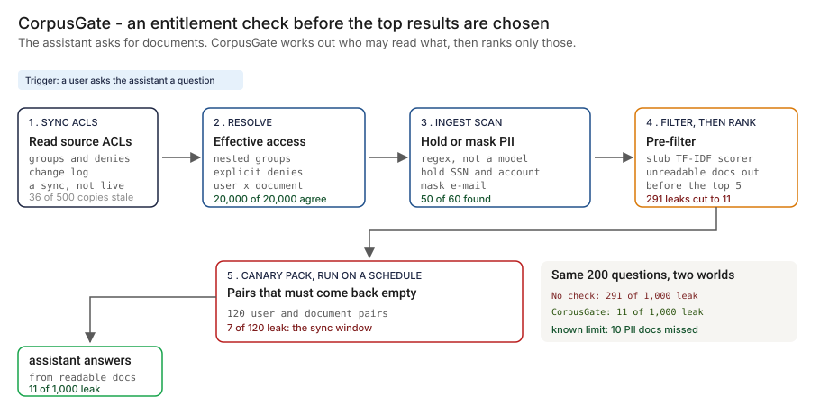

# Architecture — CorpusGate

The systems doc most PM writeups skip. Databases, where the code runs, encryption posture, user management, network, operational runbooks. What you'd hand to your CISO and your platform engineering lead on day one.

> **Status.** This is the design for the production shape. The repo implements the product mechanic as a prototype (an effective-ACL resolver, a drift check, a pre-filter, an ingestion scan and a canary runner, over synthetic data, with a plain TF-IDF stub as the retriever and a Streamlit app). Nothing below is claimed as deployed or load-tested. Where a figure is a design target, it says so.

This doc is cloud-agnostic. Runtime choices are given as classes of managed service (managed functions, managed containers, managed PostgreSQL, object storage with retention lock) because every regulated shop is on one cloud or two and the mapping is mechanical.



---

## 1. Logical architecture

CorpusGate is an assistant-side control. It does not replace the source system's access control, the identity provider or the retrieval store's own security features. It sits between the assistant and its index and decides one thing per question: which documents this user may be shown, and, at ingestion, which documents may be indexed as they are.

Nine components. Four are in the request path; five are not.

| Component | Responsibility | Language / framework | In request path? | Stateful? |
| --- | --- | --- | --- | --- |
| `cg-sync` | Pulls ACLs, the change log and the group tree from document stores and the directory, on a schedule and from a change feed. Writes versioned rows. | Python 3.11 on managed functions | No, async | No |
| `cg-store` | Holds principals, group edges, document ACL entries, the ACL change log, decisions, scan findings and canary runs. | PostgreSQL 15 | Yes | Stateful |
| `cg-resolver` | Resolves a user's effective groups through the whole tree and answers allow or deny for a document ACL, with explicit denies. The prototype's `effective_groups` and `acl_allows`. | Python, FastAPI, Pydantic v2 | Yes, sync | No |
| `cg-filter` | Turns the resolver's answer into a clause the retrieval query applies before ranking, and logs the decision. | Python library inside the assistant's retrieval service | Yes, sync | No |
| `cg-drift` | Compares the ACL copy in the retrieval store with the source ACL and lists entries to refresh. | Python | No, async | No |
| `cg-ingest` | Scans documents at ingestion (regex patterns), holds or masks per policy, and feeds the owner review queue. The prototype's `scan_text`. | Python in the indexing pipeline | Yes, at indexing | No |
| `cg-canary` | Runs the canary pack on a schedule and on every ACL or index change; stores leaked or not per pair. | Python | No, async | No |
| `cg-console` | Review console: quarantine queue, drift report, canary results, decision lookup. | React + Next.js + Tailwind | No | No |
| `cg-telemetry` | OpenTelemetry spans and metrics from every component, exported off the request path. | OTel Collector to the platform's monitoring | No, async | No |

**What is in the request path, and what is not.** The resolver, the store and the filter decide what a user is shown. The ingestion scan decides what is indexed. Everything else supports them or reports on them. CorpusGate never reads document text to judge an answer; whether an answer is grounded is HalluGuard (01), and instructions hidden in documents are PromptShield (06).

**Repo structure** (production shape; monorepo):

```
corpusgate/
├── apps/
│   ├── sync/           # pull and change-feed handlers
│   ├── resolver/       # FastAPI: effective access
│   ├── drift/          # index vs source comparison
│   ├── ingest/         # scan stage, quarantine queue
│   ├── canary/         # pack runner
│   └── console/        # review UI
├── libs/
│   ├── groups/         # tree walk, cycle guard, deny rules
│   ├── filter/         # clause builders for the retrieval store
│   └── patterns/       # personal-data patterns and tests
├── infra/
│   ├── terraform/      # multi-cloud IaC
│   ├── kubernetes/     # Helm charts + Kustomize overlays
│   └── policies/       # policy bundles, IAM templates, network policies
├── docs/
│   ├── ARCHITECTURE.md
│   ├── runbooks/
│   └── api/            # OpenAPI spec
└── tests/
    ├── unit/
    ├── integration/
    └── canary/         # the pack itself, versioned
```

---

## 2. Physical / deployment architecture

### Runtime

| Component | Runtime class | Why |
| --- | --- | --- |
| `cg-sync` | Managed functions + a scheduler and an event trigger | Small scheduled job plus an event handler |
| `cg-resolver` | Managed containers, minimum one warm instance | Stateless API in the request path; a warm instance keeps decisions fast |
| `cg-filter` | In-process library in the retrieval service | No extra network hop in the request path |
| `cg-drift`, `cg-canary` | Managed container jobs | Stateless, short-lived, scheduled |
| `cg-ingest` | A stage in the indexing pipeline's workers | Scans before a document is indexed |
| `cg-console` | Managed containers | Stateless UI |
| `cg-store` | Managed PostgreSQL | The platform team already runs it |

**Failure behavior (the decision that matters most).** The filter fails closed. If the resolver or the store is unreachable, or the ACL data for a document is older than a staleness limit, the user gets no results from that document set, never unfiltered results. A fail-open setting needs a named owner and a line-2 sign-off. At ingestion, a document that cannot be scanned waits in a held state instead of being indexed unscanned.

| Failure | Behavior | Alert |
| --- | --- | --- |
| Resolver down or slow | Filter fails closed for the affected users | P1 |
| Store unavailable | Same; the filter uses no cached decision older than its limit | P1 |
| Sync late or a store unreachable | Documents from that store are withheld after the staleness limit; lag is a metric | P2 |
| Change feed down | Falls back to the scheduled pull; the sync window widens and is reported | P2 |
| Group missing from the directory, or a cycle | Unknown groups deny; the tree walk tracks visited groups | P3 |
| Scan stage down | Documents wait unindexed | P3 |
| Canary leaked | The pack failing blocks the next release of the assistant | P1 |
| Telemetry sink down | Buffer locally, drop with a counter once full | P4 |

**Latency.** The only new wait in the request path is the resolver call and the filter clause. 🔴 Design target: a decision inside the assistant's existing response budget, with the user's effective groups cached for a short TTL. It has not been measured in this repo. The levers if it is slow: cache effective groups per user, send a group list into the query instead of a document list, and precompute the allowed set for frequent users.

### Network topology

```
Document stores / directory
   │   ACL + group pull, change feed (signed)
   ▼
[cg-sync]  ── read-only service accounts ──►  [Document stores, Group directory]
   │
   ▼
[PostgreSQL: principals, group_edges, doc_acl_entries, acl_change_log]
   │                    │
   ▼                    ▼
[cg-resolver] ◄── user id ── [Assistant retrieval service + cg-filter] ──► [Retrieval store]
   │                                   │
   ▼                                   ▼
[access_decisions]              [Assistant]

Indexing path:  [Document stores] ──► [cg-ingest scan] ──► hold / mask ──► [Retrieval store]
Scheduled:      [cg-drift], [cg-canary]  ── same filter, read-only ──► results to [cg-store]
Out of band:    [cg-console] behind the bank's SSO ──► [cg-resolver API] (role-checked)
Interlocks:     HalluGuard (01), PromptShield (06), LineageLog (09), ControlMap (16), ScopeKeeper (23), all designed, none built
```

### Region & DR

- Primary and DR regions follow the assistant platform's own footprint. CorpusGate does not get a different recovery objective than the assistant whose retrieval it filters.
- Region-specific instances where data residency applies. Each has its own database and key ring; ACL and decision data do not replicate across regions.

---

## 3. Data architecture

### Databases by purpose

| Store | Purpose | Why this store |
| --- | --- | --- |
| **PostgreSQL 15** | Principals, group edges, document ACL entries, ACL change log, decisions, scan findings, canary runs, audit log | Relational integrity for the audit trail; the platform team already runs it |
| **Retrieval store** (PostgreSQL with a vector extension, or the platform's own) | Document chunks and their vectors; ACL tags kept only as a hint | Whatever the assistant already uses; CorpusGate does not own it |
| **A columnar store** (optional) | Decision history over time at volume | High volume, append-only, queried by user and date range |
| **Object storage with retention lock (WORM)** | Archived decisions and canary results | Write-once-read-many for the record-keeping policy |

### PostgreSQL schema (the consequential tables)

```sql
-- Users and groups, as the directory last reported them
CREATE TABLE principals (
    principal_id   TEXT PRIMARY KEY,
    kind           TEXT NOT NULL CHECK (kind IN ('user', 'group')),
    synced_at      TIMESTAMPTZ NOT NULL
);

-- Members of the child are also members of the parent
CREATE TABLE group_edges (
    parent_id      TEXT NOT NULL REFERENCES principals,
    child_id       TEXT NOT NULL REFERENCES principals,
    sync_version   BIGINT NOT NULL,
    PRIMARY KEY (parent_id, child_id)
);

CREATE TABLE documents (
    doc_id         TEXT PRIMARY KEY,
    source_system  TEXT NOT NULL,
    label          TEXT NOT NULL CHECK (label IN ('public', 'internal', 'confidential', 'restricted')),
    content_sha256 TEXT NOT NULL,
    state          TEXT NOT NULL CHECK (state IN ('indexed', 'quarantined', 'withdrawn')),
    acl_version    BIGINT NOT NULL,              -- the source ACL version this row reflects
    indexed_at     TIMESTAMPTZ
);

-- One row per allow or deny entry on a document
CREATE TABLE doc_acl_entries (
    doc_id         TEXT NOT NULL REFERENCES documents,
    principal_id   TEXT NOT NULL REFERENCES principals,
    effect         TEXT NOT NULL CHECK (effect IN ('allow', 'deny')),
    acl_version    BIGINT NOT NULL,
    PRIMARY KEY (doc_id, principal_id, effect)
);

-- Every ACL change the sync has seen; seen_at - changed_at is the sync window for that change
CREATE TABLE acl_change_log (
    change_id      UUID NOT NULL DEFAULT gen_random_uuid(),
    changed_at     TIMESTAMPTZ NOT NULL,
    doc_id         TEXT NOT NULL,
    change_kind    TEXT NOT NULL,
    from_acl       TEXT NOT NULL,
    to_acl         TEXT NOT NULL,
    seen_at        TIMESTAMPTZ NOT NULL,
    PRIMARY KEY (change_id, changed_at)
) PARTITION BY RANGE (changed_at);

-- One row per retrieval decision; append-only; the query text itself is not stored
CREATE TABLE access_decisions (
    decision_id      UUID NOT NULL DEFAULT gen_random_uuid(),
    decided_at       TIMESTAMPTZ NOT NULL,
    user_id          TEXT NOT NULL,
    query_sha256     TEXT NOT NULL,
    acl_version_max  BIGINT NOT NULL,            -- newest ACL version the decision used
    returned_doc_ids TEXT[] NOT NULL,
    withheld_count   INT NOT NULL,
    held_count       INT NOT NULL,
    PRIMARY KEY (decision_id, decided_at)
) PARTITION BY RANGE (decided_at);

-- Personal-data findings and the owner's review
CREATE TABLE pii_findings (
    finding_id     UUID PRIMARY KEY DEFAULT gen_random_uuid(),
    doc_id         TEXT NOT NULL REFERENCES documents,
    kind           TEXT NOT NULL,                -- ssn_like / account_like / email_like
    action         TEXT NOT NULL CHECK (action IN ('quarantine', 'mask')),
    status         TEXT NOT NULL CHECK (status IN ('open', 'confirmed', 'false_positive', 'released')),
    found_at       TIMESTAMPTZ NOT NULL,
    reviewed_by    TEXT,
    reviewed_at    TIMESTAMPTZ
);

-- One row per canary per run
CREATE TABLE canary_runs (
    run_id         UUID NOT NULL,
    run_at         TIMESTAMPTZ NOT NULL,
    canary_id      TEXT NOT NULL,
    user_id        TEXT NOT NULL,
    doc_id         TEXT NOT NULL,
    stratum        TEXT NOT NULL,
    leaked         BOOLEAN NOT NULL,
    PRIMARY KEY (run_id, run_at, canary_id)
) PARTITION BY RANGE (run_at);

-- Audit log (immutable, append-only, partitioned by month)
CREATE TABLE audit_log (
    audit_id       UUID NOT NULL DEFAULT gen_random_uuid(),
    occurred_at    TIMESTAMPTZ NOT NULL,
    actor_id       TEXT NOT NULL,
    actor_type     TEXT NOT NULL,                -- user / service_account
    action         TEXT NOT NULL,
    resource_type  TEXT NOT NULL,
    resource_id    TEXT NOT NULL,
    request_id     TEXT NOT NULL,
    payload        JSONB,
    result         TEXT NOT NULL,                -- success / failure / forbidden
    PRIMARY KEY (audit_id, occurred_at)
) PARTITION BY RANGE (occurred_at);
```

**The filter clause (design).** The resolver returns the user's effective groups. The retrieval query applies them before ranking, as a condition on the allow and deny group arrays of each document, or as a list of allowed document ids when the set is small. The point is the order: the clause runs inside the search, so unreadable documents never enter the candidate set. A post-filter that takes the top results and then drops some returns fewer than the requested number: in the prototype, 🟢 3.58 results per question against 5.00 for the pre-filter. Whether a given retrieval store can filter inside an approximate search without losing recall is a thing to test on the real store, and it is 🔴 not tested here because the prototype retriever is an exact TF-IDF stub.

**The sync window (design).** The prototype reads source ACLs as of the last sync, so a change made after it is invisible: 🟢 3 changes, 103 pairs. The design adds a change feed from each store into a small overlay of "changed since the last full sync" documents. A document in the overlay is withheld from everyone until the sync catches up, or served only to users the new ACL clearly allows. That fails closed for changed documents. 🔴 Design target: a revocation takes effect before the next query for that document. It is not built and not timed; the canary stratum for changes after the last sync is how it would be tested.

### Retention & data classification

The retention periods below are design defaults. Confirm each against the bank's own record-retention schedule before use.

| Data class | Retention (design default) | Storage | Classification |
| --- | --- | --- | --- |
| Principals, group edges, document ACL entries | Current state plus the change log | PostgreSQL | Confidential |
| ACL change log | 7 years | PostgreSQL, archive to object storage with retention lock | Confidential |
| Access decisions (ids, counts, hashes) | 7 years | PostgreSQL, archive to retention lock | Confidential |
| Query text | Not stored by CorpusGate; only a hash | n/a | Governed by the assistant platform |
| Personal-data findings | Until reviewed, then 7 years for the decision | PostgreSQL | Confidential |
| Canary results | 2 years | PostgreSQL | Internal |
| Audit log | 7 years | PostgreSQL partitioned, archive to retention lock | Confidential |

---

## 4. Security architecture

### Encryption

- **At rest.** AES-256 with customer-managed keys in the cloud's key service, one key ring per region. Keys never cross a region boundary.
- **In transit.** TLS 1.3 north-south. mTLS east-west through the service mesh.
- **Field-level.** Query text is not stored; a hash is. Document text stays in the retrieval store under its own controls.
- **Database-level.** Transparent data encryption on PostgreSQL.

### Secrets management

- **Primary store.** The bank's secret manager. No long-lived static credentials.
- **Application secrets** (directory and document-store read tokens, change-feed signing secrets, database passwords): fetched at boot through workload identity, rotated on the bank's schedule with dual-credential rolling.
- **Service-account keys.** None. Workload identity everywhere.
- **Change-feed secrets.** Per-source signing secret, rotated; `cg-sync` verifies the signature before it applies anything.

### Identity provider & user management

- **IdP.** Whatever the bank already runs. SAML 2.0 and OIDC. CorpusGate does not run its own.
- **MFA.** Enforced at the IdP, not in the app.
- **Sessions.** OIDC ID token plus signed session cookie (HttpOnly, Secure, SameSite=Strict), with absolute and idle expiry set by bank policy.
- **Service-to-service identity.** SPIFFE IDs; each component has its own workload identity and mTLS enforces it at every hop.

### RBAC matrix

Authorization is enforced at the resolver and console APIs with a policy engine, and every decision is written to `audit_log`.

| Role | Can | Maps to (bank role) |
| --- | --- | --- |
| `cg:viewer` | Read drift, canary results and aggregate decision counts | Audit, executives |
| `cg:owner` | Viewer + review quarantine items for their own documents | Document owner |
| `cg:platform` | Owner rights across documents + configure policy per assistant, run the canary pack | Assistant platform owner |
| `cg:security` | Viewer + author and approve canary pairs, look up one decision by id | Information-security reviewer |
| `cg:privacy` | Viewer + set the ingestion policy, release or confirm findings | Privacy officer |
| `cg:admin` | Config, integrations, role management | Platform engineering lead |

A release from quarantine needs a proposer and a different approver. Both are recorded in `pii_findings` and `audit_log`.

### Network controls

- **Perimeter.** Private service endpoints; no public ingress for the resolver. `cg-sync` reaches only the document-store and directory endpoints on an allow-list.
- **Lateral.** Network policies and layer-7 inspection on the service mesh; the canary runner calls the same filter as the assistant and can reach nothing else.
- **Ingress.** The resolver is called by the assistant's retrieval service over mTLS; the console sits behind the bank's SSO.
- **Zero-trust.** Every inter-service call is authenticated. No "trusted internal network" assumption.

### Threat model

| Threat | Mitigation |
| --- | --- |
| The response reveals that a withheld document exists (titles, counts per document) | Results contain only readable documents; the withheld count is in the decision log, not in the answer; the response shape is fixed |
| ACL revoked after the last sync | Change feed with a fail-closed overlay; a canary stratum for recent changes; sync lag as a metric |
| Directory disagrees with itself, or a group cycle | Unknown groups deny; visited-set tree walk; a reconciliation job against the source system's own answer for a sample of users |
| Personal data in a format the scan misses | Review queue for suspected misses; owner attestation at ingestion; known limit, stated in the PRD |
| The decision log becomes a second copy of what users asked | Hash of the query, document ids and counts only |
| A service account sees everything | Read-only scopes per source; the filter never uses a privileged identity to answer a user |
| Instructions hidden in a retrieved document | Out of scope here: PromptShield (06). CorpusGate decides which documents reach the model, not what they say |
| A canary pack that never changes | Versioned in the repo; a stratum for each failure class; new failures from production are added as canaries |

---

## 4a. APIs consumed and exposed

CorpusGate is a glue layer. Every external dependency is listed with its protocol, auth model, and what happens when it is down.

### APIs consumed (north-bound, what we depend on)

| External service | Protocol / auth | What we call | Failure mode |
| --- | --- | --- | --- |
| Document stores | REST or event stream, read-only token from the secret manager | Fetch ACLs and the change log; subscribe to ACL change events | Sync continues from the last good state; staleness limit applies |
| Group directory | LDAP or REST, read-only service account | Fetch principals and group edges | Same |
| Retrieval store | Native client, scoped credential | Apply the filter clause; list indexed ids for drift | Filter fails closed |
| Bank IdP | SAML 2.0 + OIDC | Console login, role lookup | Existing sessions continue |
| Model-risk and security records | Vendor REST, service principal | File decision summaries and canary results | Local audit trail continues; sync resumes later |
| Monitoring (OpenTelemetry to the platform's stack) | OTLP over TLS | Metrics and traces | Local buffer |
| Paging and chat | REST / webhook | Alert routing | Email fallback |

### APIs we expose (south-bound, what others call us)

| Surface | Protocol / auth | Consumers |
| --- | --- | --- |
| `POST /v1/retrieval/filter` | OpenAPI 3.1 over HTTPS, mTLS service identity | The assistant's retrieval service |
| `GET /v1/decisions/{id}` | mTLS service identity, role-checked | LineageLog (09), the security reviewer |
| `GET /v1/users/{id}/effective-groups` | mTLS service identity | ScopeKeeper (23) |
| `POST /v1/canaries/run` | mTLS service identity | The assistant's release pipeline |
| Console API | OIDC bearer, role-checked | `cg-console` |
| Webhooks (outbound) | HTTPS POST, HMAC-SHA256 signed | Incident management, security and model-risk records |

### API-design opinions (the choices a reviewer will ask about)

- **REST and OpenAPI, not GraphQL.** The surface is one filter endpoint, one decision lookup and a console.
- **Return the clause, not the verdicts.** The filter response carries the user's effective groups and an ACL version, so the retrieval query applies the check inside the search. A list of 500 verdicts would not scale to the real estate.
- **No titles in a refusal.** A response never names a document the user may not read.
- **Idempotency key on `run`.** A retried pipeline step must not start a second canary run. UUID v4 in the `Idempotency-Key` header.
- **Webhooks are signed, not just authenticated.** HMAC-SHA256 with a per-consumer rotating secret.
- **Versioning in the path** (`/v1/`), with a deprecation window announced in headers.

---

## 5. Operational architecture

### Observability

| Signal | Tool | Why |
| --- | --- | --- |
| Application logs and traces | OpenTelemetry into the platform's existing monitoring | The on-call engineer's existing pane |
| Decisions over time | The columnar store or PostgreSQL + dashboards | Withheld and held counts per assistant and per store |
| Sync lag and change-feed age | Metrics | Drives the staleness limit |
| Canary results | PostgreSQL + dashboards | The security reviewer's primary signal |
| Audit log | PostgreSQL, archived | Record-keeping |

**SLOs worth owning.**

| SLO | Why it is the PM's number |
| --- | --- |
| **Retrieval requests with a logged decision** | The north star. Everything else supports it. |
| **Canaries leaking** | The one number the security reviewer reads first |
| **ACL sync lag and revocation propagation** | The largest measured gap in the prototype |
| **Quarantine queue age** | A queue nobody owns turns into lost recall |
| **Filter decision latency** | 🔴 Design target is the assistant's existing response budget; not measured |

### Alerting

| Severity | Trigger | Channel |
| --- | --- | --- |
| P1 | A canary leaks; resolver or store down so the filter fails closed | Paging |
| P2 | Sync late; change feed down | Paging (low urgency) + chat |
| P3 | Group cycle or missing group; scan stage down | Chat |
| P4 | Quarantine queue ageing; daily drift digest | Email |

### Rollout

Shadow first: sync and compute decisions, show nothing different to users, and compare the resolver with what the source system allows for a sample of users. Then the canary pack, then the filter for one low-risk assistant, then the ingestion scan, as laid out in the PRD. Automatic rollback of the filter for an assistant if its empty-result rate breaches its threshold.

### Backup & DR

- **PostgreSQL.** Continuous WAL streaming to object storage, daily snapshots, point-in-time recovery inside the retention window.
- **Object stores.** Retention lock and versioning for archived decisions and canary results.
- **ACL state.** Rebuildable: any document's ACL can be re-fetched from its source system.
- **DR drill cadence.** Quarterly failover to the secondary region, validated against the assistant platform's own recovery objective.

### Runbooks (one page each, in `docs/runbooks/`)

- `canary-leaked.md` — a canary came back: find the pair, check the ACL version, check the sync lag, hold the assistant release
- `sync-late.md` — a store is behind: apply the staleness limit, widen the overlay
- `quarantine-review.md` — resolve a held document: confirm, mask, release, record
- `group-drift.md` — the resolver and the source system disagree for a sampled user
- `pii-miss.md` — personal data found in an indexed document: withdraw it, add the format to the patterns and the canary
- `decision-lookup.md` — pull the decision and the ACL version for a question by id

---

## 6. Compliance posture

Alignment, not certification. These are the frameworks the design is written against.

| Framework | How the design relates |
| --- | --- |
| **SR 26-2 / model risk management** | The current model-risk guidance, which replaced its 2011 predecessor in April 2026. A retrieval layer that shows a user a document they may not read is a control gap that ongoing monitoring has to be able to see. The canary pack and the decision record are the monitoring evidence for that dependency. (Paraphrase written for this exercise, not the text of the guidance.) |
| **NIST AI RMF** | The Measure and Manage functions map to the canary pack, the leak counts and the filter. |
| **OWASP LLM Top 10, sensitive information disclosure** | Treating retrieval as an access-controlled path limits what an assistant can be made to disclose from its corpus. |
| **Data-access obligations (ControlMap, 16)** | 🔴 Designed, none built: the canary results and decision records are candidate evidence for the controls an obligation maps to. |
| **SOC 2 Type II, GDPR, India data localization** | Regional instances, query text not stored, append-only audit. |

---

## 7. What's deliberately not here

- **A replacement for the source system's access control.** The source stays the authority. CorpusGate reads it and applies it on the assistant side.
- **A judgment of the answer.** Whether an answer is grounded (HalluGuard, 01), whether a document carries an injected instruction (PromptShield, 06) and whether a long context is used faithfully (PolicyNeedle, 14) are other projects.
- **A claim that the scan finds every value.** It is regex patterns. Values in unusual formats are a known limit, covered by a review queue and owner attestation.
- **A claim that the sync window is closed.** The prototype does not close it. The design sketches how, and the canary stratum tests it.
- **Embedding or vector-search behavior.** The prototype retriever is an exact TF-IDF stub. How a real approximate index behaves under a filter is untested.
- **A standalone authentication system.** It uses the bank's IdP.

Holding that line is the scope discipline: each item above is something a team would be tempted to absorb, and each one is already owned by another system or another phase.

---

## Appendix — sample API contract

```python
# POST /v1/retrieval/filter
# Auth: mTLS service identity (assistant retrieval service)
{
    "user_id": "U031",
    "request_id": "Q003"
}
# Response 200
{
    "effective_groups": ["grp-all-staff", "grp-retail", "grp-retail-cards"],
    "readable_documents": 338,
    "withheld_better_matches": 3,
    "acl_version": "illustrative"
}
```

The counts and groups in the example are the prototype's output for Q003 on the synthetic data: U031 may read 338 of 500 documents and 3 better matches were withheld. The ids and the ACL version are illustrative. In production the response carries the group list and a version, not the document ids, and the retrieval query applies them inside the search.

OpenAPI spec lives at `docs/api/openapi.yaml` and is the source of truth for the retrieval client and the console.

See also: [README](./README.md), [PRD](./PRD.md), and the [clickable demo](https://vj-shipped-anyway.github.io/ai-pm-portfolio/20-corpusgate-rag-entitlements/demo.html).
