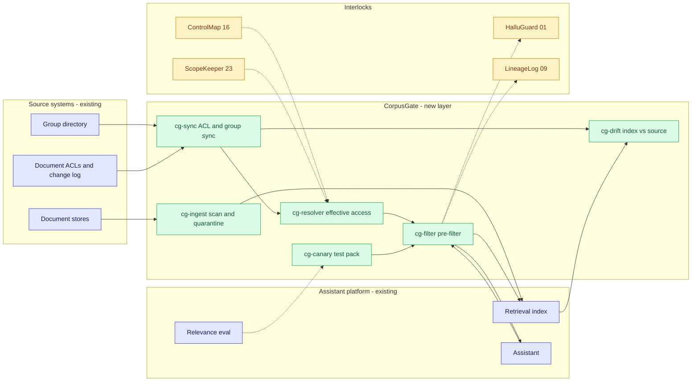
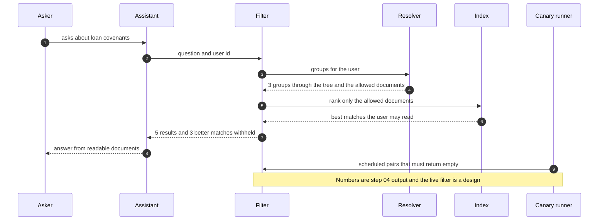

# 🚪 CorpusGate — Entitlement-Aware Retrieval for an Internal AI Assistant

**A portfolio prototype for making an assistant's retrieval respect who may read what: effective access resolved through nested groups, the index's ACL copy checked against the source, a filter applied before ranking, a personal-data scan at ingestion and a canary pack that tests all of it. Aligned to the [NIST AI RMF](https://www.nist.gov/itl/ai-risk-management-framework) 'Measure' function, the sensitive-information-disclosure theme in the [OWASP LLM Top 10](https://genai.owasp.org/llm-top-10/) and the ongoing-monitoring expectation in [SR 26-2](https://www.federalreserve.gov/supervisionreg/srletters/SR2602.htm) (the current model-risk guidance, which replaced its 2011 predecessor in April 2026).**

**▶ Static demo, no install:** [open on GitHub Pages](https://vj-shipped-anyway.github.io/ai-pm-portfolio/20-corpusgate-rag-entitlements/demo.html)

> **Framing:** This is a portfolio prototype, not a production case study. The six-deficiency taxonomy, the architecture, the data generator and the walkthrough are mine. Every number below is either printed by a script in this folder on data I generated, or is modeled with its assumption named. Production validation (a real document estate, the real access lists and group directory, an identity provider, a security review) is what the next role does.

> **Reading the numbers — credibility tags inline.** Every number in this README and the demo is tagged 🟢 **Measured** (printed by a script in `src/` on the shipped synthetic data: 500 documents, 40 users, 200 test queries, 120 canary pairs, 39 ACL changes, 60 documents with injected personal data), 🟡 **Modeled** (extrapolated from that data, with the assumption named in one line), or 🔴 **Hypothetical** (designed and reasoned about, never tested). Full convention in the [master README's "Reading the numbers" section](../README.md#-reading-the-numbers). **All data is synthetic and generated by a seeded script. The truth is known because the data is synthetic: the generator decided every access list, label and injected value, so it can say exactly who may read what. The retriever is a stub (plain TF-IDF), not a model, and no model is used anywhere in this repo.**


[](./demo.html)


> **▶ 30-second demo:** the [clickable demo](./demo.html) gets you the full story in 30 seconds with no install.

---

## 🔥 Demo in 30 seconds

Open the static, no-Python demo: [`demo.html`](./demo.html).
Pick one of 15 questions from the dropdown, or use Next question and Replay all 15 questions. Each question is asked by one user and was picked by a rule to show a different failure. Three cards show the same question three ways: what a relevance-only assistant returns (with the results the user may not read marked), what that user may really read next to what three cheap guards do, and what CorpusGate returns. The totals at the top are the 🟢 measured numbers: 291 of 1,000 results leaked without a check, 11 with CorpusGate, 7 of 120 canaries leaking.

To run the four-step walkthrough on your laptop:

```bash
git clone https://github.com/Vj-shipped-anyway/ai-pm-portfolio
cd ai-pm-portfolio/20-corpusgate-rag-entitlements/src
python3 step_01_no_access_control.py
python3 step_02_relevance_only_eval.py
python3 step_03_deficiencies_exposed.py
python3 step_04_with_corpusgate.py
```

To regenerate the synthetic data (the output is identical on every run): `python3 ../data/_generate.py`.
To run the Streamlit prototype: `pip install -r requirements.txt`, then `streamlit run app.py` from `src/` (or `streamlit run 20-corpusgate-rag-entitlements/src/app.py` from the repo root).

---

## 💰 Why this lands — competitive positioning

Teams that find a retrieval leak usually reach for one of three cheap guards: filter on the ACL copy stored in the index, check the user's own group list, or filter on the sensitivity label. I compare approaches rather than vendors, so the table below scores those guards, today's relevance-only eval and the new layer on the same synthetic questions.

| Capability | Relevance-only eval (today) | Cheap guards, run alone | **CorpusGate** |
| --- | --- | --- | --- |
| Notices a result the asker may not read | Never: 🟢 283 of 291 leaked results score as correct | Partly: they leave 🟢 47 (ACL copy), 52 (flat check) and 114 (label filter) of 1,000 | 🟢 11 of 1,000 remain, all from the sync window |
| Stays right after an ACL change | n/a | ACL copy: 🟢 574 pairs allowed that the source now denies | Reads the source ACL: 🟢 103 pairs wrong for the 3 changes after the last sync (known limit) |
| Handles nested groups and explicit denies | n/a | Flat check: 🟢 521 pairs wrongly denied, 525 wrongly allowed | 🟢 20,000 of 20,000 pairs agree with the truth file, by construction |
| Copes with a wrong label | n/a | Label filter: 🟢 33 leaks from 12 mislabeled documents | Uses the ACL, not the label: 🟢 0 of 14 mislabeled canaries leak |
| Finds personal data before indexing | Does not look | n/a | 🟢 50 of 60 found, 9 look-alike documents flagged; the misses are the known limit |
| Keeps relevant, readable documents | 🟢 readable recall@5 0.707 | Label filter 0.808, flat check 0.837 | 🟢 0.812 (0.882 before the personal-data action) |
| Tests entitlement | 🟢 0 of 200 queries | n/a | 🟢 canary pack, 7 of 120 leak |
| Where it still fails | Everything above | Each guard leaves a different gap | Personal data in unusual formats; changes after the last sync |

**Position:** *CorpusGate does not replace the source system's access control, the identity provider or the retrieval store's own security features. It adds the check that sits on the assistant side: work out what this user may read, remove everything else before the top results are chosen, keep personal data out of retrievable text, and keep testing the result with pairs that must come back empty. A relevance eval tells you the answers match. This tells you the asker was allowed to see them.*

---

## The honest version (why this exists)

The failure mode this prototype is built around: an internal assistant retrieves from a document corpus, and the retrieval eval measures relevance only. A user asks about loan covenants and the top five include a restricted document from another team. Nothing errors. The eval scores that document as a correct answer, because it is relevant. Nobody tests whether a user can pull back a document they are not entitled to, whether an ACL change ever reached the index, or whether personal data was ingested into text anyone can retrieve.

This is a prototype on synthetic data. I wrote the generator, the group tree, the access lists, the retriever stub, the resolver, the scan and the canary pack. The documents are short sentences built from topic vocabulary by a seeded script, not by a model, and no model is used anywhere in this repo. The retriever is plain TF-IDF in the standard library, a stub rather than a vector model, so nothing here says how an embedding index ranks. The truth is known because the data is synthetic: the generator decided who may read what, so it can say exactly which results are leaks. A real estate does not hand you that, which is why the first job in a real deployment would be exporting the real access lists and group directory. No real person's data exists in these files: the personal-data values use obviously invalid formats (SSN-like numbers start with 9 and have group 00, account numbers look like `ACCT-0000-1234`, e-mail addresses end in `.example`). Nothing here is a real bank, employee, customer, system, vendor or incident.

The test set is dense on purpose, so that every effect appears often enough to count. 39 documents change ACL after indexing, 12 are mislabeled, 60 carry personal data and 215 have an explicit deny entry, and for each kind there are questions from a user it affects. The leak rate is a property of this test set, not an estimate of how often real assistants leak. I also added mixed questions (a quarter of the base questions mention two aspects) after my first run gave a precision of 1.000, which is not a believable eval. I did not change the seed.

If you run an assistant over documents with access lists and have had someone ask "could that user have seen that?", fork it. The group-tree resolver, the pre-filter, the ingestion policy and the canary pack are the parts worth lifting. Validating them against a real directory and a real document estate is the work the next role would do.

---

## Prereqs to run this on your laptop (in plain English)

You don't need a cluster, a cloud account or an API key. You need:

- **Python 3.** The four step scripts, the data generator and the demo builder use only the standard library (for example `csv`, `json`, `re`, `math`, `statistics` and `pathlib`), so there is nothing to install for them. They are written for Python 3.9 and tested on it; they use no syntax newer than 3.9.
- **Git**, to clone the repo. `brew install git` / `winget install git`.
- **`src/requirements.txt` — only for the Streamlit app.** It lists `streamlit`, `pandas`, `numpy` and `plotly`. The step scripts do not import any of them. Run `pip install -r src/requirements.txt` only if you want the app.
- **No API key.** There is no model call, no embedding call, no network call and no secret anywhere. The retriever, the resolver, the scan and the canary runner are plain code you can read.
- **Not needed:** a database, containers, Kubernetes, a vector store or a cloud account. They appear in [`ARCHITECTURE.md`](./ARCHITECTURE.md) as the production design, not as prototype requirements.

Each step script finishes in seconds and writes its CSV or JSON to `src/out/`. The clickable `demo.html` runs in any browser with zero install. If a step does not run from a fresh clone, that's a bug in the README. Open an issue.

---

## Executive summary (90 seconds)

**Problem.** A modeled bank's internal assistant retrieves from a 500-document corpus for 40 users. The retrieval eval measures relevance only: precision@5 0.969, recall@5 0.704. It cannot see who is asking. 🟢 291 of 1,000 results (29.1%) go to a user who may not read them, and 🟢 283 of those 291 count as correct answers in the eval. 🟢 39 of 500 documents changed ACL after the index was built, and 🟢 60 carry personal data, 38 of them in documents open to all staff.

**Product.** CorpusGate, an entitlement layer between the assistant and its index: an **effective-ACL resolver** that walks nested groups and honors explicit denies; an **ACL drift check** that compares the index's copy with the source and filters on the source; a **pre-filter** that removes unreadable documents before the top 5 is chosen; an **ingestion scan** that holds documents with SSN-like or account-like values and masks e-mail addresses; and a **canary pack** of user and not-entitled-document pairs that must come back empty.

**Measured and modeled performance.**

- 🟢 **Leakage: 291 of 1,000 results before, 11 after** (`step_04`). All 11 come from 3 ACL changes made after the last sync (the known limit).
- 🟢 **Cheap guards alone leave 47 (ACL copy from index time), 52 (flat group check) and 114 (label-only filter)** (`step_03`).
- 🟢 **Canary pack: 120 of 120 leak with no control, 7 of 120 with CorpusGate** (`step_04`). The pack is stratified toward known failure cases, so this describes the pack, not a rate.
- 🟢 **Personal data: 50 of 60 injected documents found (83.3%), 10 missed, 9 look-alikes flagged** (`step_04`). Results carrying personal data fall from 43 to 11.
- 🟢 **Readable recall@5 goes from 0.707 to 0.812 (+0.105)** (`step_04`): unreadable results no longer take a slot. The personal-data quarantine costs 0.070 of it; masking instead of holding would give 0.882.
- 🟢 **Resolver vs the truth file: 20,000 of 20,000 pairs agree** (`step_04`). This agreement is by construction: the generator and the resolver implement one rule two ways. It says nothing about a directory that disagrees with itself.
- 🟡 **Utility: (145.50 − 5.50) × 1,200 = about 168,000 unreadable results kept from users** if each of an assumed 1,200 assistant users runs 100 queries.
- 🔴 **Design target: the filter runs inside the retrieval query and ACL revocations propagate before the next query.** Designed in `ARCHITECTURE.md`, never built or timed.

**Call to action.** Fork this repo. Swap [`data/documents.csv`](./data/documents.csv), [`data/groups.csv`](./data/groups.csv) and [`data/users.csv`](./data/users.csv) for exports from your document store and your directory, and call `effective_groups`, `acl_allows` and `scan_text` on them. The truth files exist only because the data is synthetic.

---

## 🗺️ What this walkthrough covers

1. **The use case** — an internal assistant over 500 documents, 40 users and 29 nested groups
2. **Sample data** — documents with labels, access lists, an index-time ACL copy and injected personal data; a change log; test questions; canaries; a per-user entitlement truth file
3. **Step 1 — Before CorpusGate** — retrieval with no access control; how many results the asker may not read
4. **Step 2 — Basic approach** — the relevance-only eval; what it measures and what it cannot see
5. **Step 3 — The six named deficiencies** — each with a count from the dataset
6. **Step 4 — The fix (CorpusGate)** — resolver, drift check, pre-filter, ingestion scan, canary pack; measured against the truth, with the known limit printed
7. **Utility delivered** — a multiplied number with the assumption named
8. **Architecture & call flow** — topology and a per-question sequence
9. **PM artifacts** — PRD and architecture

> Non-technical reader: skip the code blocks. The plain-English explanation and the output tables tell the story.
> Technical reader: every code block runs. `cd src && python3 step_NN_*.py` and you'll see the same output.

Total reading time: about 12 minutes deep, 3 minutes if you skim.

---

## 🎯 The Use Case

**A modeled bank's internal assistant. 500 documents, 40 users, access lists that change.**

Staff ask the assistant about procedures, guidance notes, checklists and meeting summaries across retail, commercial, risk, compliance, legal, HR and technology. Every document has a sensitivity label, an access list of groups that may read it (and sometimes groups that may not), and an owner team. The user directory has groups inside groups, up to four levels deep. The retrieval layer ranks by relevance and returns the top 5.

Three things happen in the synthetic data:

- **A restricted document in the top 5.** U031 (retail analyst) asks "loan covenant extension amortization collateral". The top 5 include D0153, labeled restricted and readable only by groups the user is not in. 3 of the 5 results are documents this user may not read. The relevance eval scores them as correct.
- **An access change the index never heard about.** 39 documents changed ACL after indexing. A filter on the index's own copy of the ACL still lets 47 unreadable results through and hides 12 relevant documents the asker may read.
- **Personal data in text anyone can retrieve.** 60 documents carry injected SSN-like, account-like or e-mail-like values; 38 of them are open to all staff. 43 of the 1,000 results contain one.

The assistant platform owner owns retrieval and the eval, the information-security reviewer has to answer "could this user have seen that document" after the fact, the document owners own the access lists, the identity team owns the groups, and the privacy officer owns what personal data may be indexed. CorpusGate is designed for the first two, with the other three as consulted stakeholders.

---

## 📊 Sample Data

Seven CSVs in [`data/`](./data/), generated by [`data/_generate.py`](./data/_generate.py) (standard library, seeded, deterministic: running it twice produces identical files). Documented in [`data/README.md`](./data/README.md). The shape, as printed by `step_01`:

```
DATA SHAPE
  Documents: 500 (true label: public 90, internal 239, confidential 121, restricted 50); 12 carry a wrong label
  Users: 40 (5 contractors); groups: 29, nested up to 4 levels deep; documents with an explicit deny entry: 215
  Queries: 200 asked by 39 different users
  Personal data injected into 60 documents (account_like 20, email_like 18, ssn_like 22)
  ACL changes after indexing: 39 (revokes 25, grants 14); 3 of them after the last sync
  Canary pack: 120 user and document pairs (mislabeled 14, nested_deny 20, ordinary 60, revoked_after_index 20, revoked_after_sync 6)
```

**[`data/documents.csv`](./data/documents.csv)** — 500 documents. `sensitivity` is the label in use; `sensitivity_label_truth` is what the label should be (12 differ). `acl_groups` is the source ACL today; `acl_groups_at_index` is the copy stored when the index was built; an entry starting with `-` is an explicit deny. `pii_truth` says which personal-data value the generator injected. The text column is left out of the preview.

First rows:

| doc_id | dept | sensitivity | acl_groups | acl_groups_at_index | pii_truth | sensitivity_label_truth |
| --- | --- | --- | --- | --- | --- | --- |
| `D0001` | `risk` | `public` | `grp-all-staff` | `grp-all-staff` | `none` | `public` |
| `D0002` | `risk` | `internal` | `grp-all-staff` | `grp-all-staff` | `none` | `internal` |
| `D0003` | `retail` | `confidential` | `grp-retail` | `grp-retail` | `none` | `confidential` |
| `D0004` | `tech` | `public` | `grp-all-staff` | `grp-all-staff` | `none` | `public` |

First rows of the ACL change log, [`data/acl_changes.csv`](./data/acl_changes.csv) (39 changes, 3 of them after the last sync):

| change_id | doc_id | changed_at | change_kind | from_acl | to_acl |
| --- | --- | --- | --- | --- | --- |
| `AC-001` | `D0157` | `2026-06-05T08:30` | `add_contractor_deny` | `grp-all-staff` | `grp-all-staff;-grp-contractors` |
| `AC-002` | `D0315` | `2026-06-10T07:30` | `add_group` | `grp-risk;grp-incident-response;-grp-contractors` | `grp-risk;grp-incident-response;-grp-contractors;grp-compliance` |
| `AC-003` | `D0246` | `2026-06-13T15:15` | `add_group` | `grp-risk-credit;grp-exec;-grp-contractors` | `grp-risk-credit;grp-exec;-grp-contractors;grp-compliance` |
| `AC-004` | `D0292` | `2026-06-14T14:15` | `add_group` | `grp-risk;-grp-contractors` | `grp-risk;-grp-contractors;grp-compliance` |

**[`data/groups.csv`](./data/groups.csv)** — 29 (parent, child) rows over 29 groups. Members of the child are also members of the parent. **[`data/users.csv`](./data/users.csv)** — 40 users with direct memberships only.

| user_id | dept | role | direct_groups |
| --- | --- | --- | --- |
| `U001` | `tech` | `contractor` | `grp-contractors-tech;grp-tech` |
| `U002` | `compliance` | `analyst` | `grp-compliance-aml-investigations` |
| `U003` | `risk` | `manager` | `grp-risk` |
| `U004` | `hr` | `analyst` | `grp-hr-comp` |

**[`data/queries.csv`](./data/queries.csv)** — 200 test questions with the documents relevant to the topic (relevance truth, independent of who may read). **[`data/canary_queries.csv`](./data/canary_queries.csv)** — 120 canaries, each a user, a document that user may not read, and a query built to retrieve exactly that document. **[`data/entitlement_truth.csv`](./data/entitlement_truth.csv)** — for each user, the documents the user may read today.

| query_id | user_id | text |
| --- | --- | --- |
| `Q001` | `U007` | `how do we handle checkout and session for privileged recording` |
| `Q002` | `U004` | `what is the rule for identity on account opening verification` |
| `Q003` | `U031` | `loan covenant extension amortization collateral` |

| canary_id | user_id | doc_id | query_text | stratum |
| --- | --- | --- | --- | --- |
| `CAN-001` | `U001` | `D0107` | `DOC-0107 regulator correspondence matters` | `mislabeled` |
| `CAN-002` | `U004` | `D0453` | `DOC-0453 market exposure stress` | `ordinary` |
| `CAN-003` | `U003` | `D0346` | `DOC-0346 records archive destruction` | `revoked_after_sync` |

The data includes hard cases on purpose: a contractor whose deny group is reached only through a parent group, documents narrowed after the index was built, three narrowed after the last sync, documents labeled lower than they should be, and personal data written in formats a simple pattern does not match.

---

## 🔧 Step 1 — Before CorpusGate: retrieval with no access control

**In plain English:** The assistant returns the documents that match best. It does not look at who is asking. Nothing errors when a user is shown a document they may not read, so nothing is logged and nobody finds out.

```bash
python3 src/step_01_no_access_control.py
```

The script runs the 200 test questions through a plain TF-IDF scorer (a stub, not a vector model) and checks each of the 1,000 returned results against the truth file.

**Result:**

```
RESULT
  Results returned:                       1,000
  Results the asker may not read:         291 of 1,000 (29.1%)
  Queries with at least one such result:  145 of 200 (72.5%)
  By the label the document really has:  public 3, internal 57, confidential 169, restricted 62
  No error is raised and nothing is logged: nothing in this setup notices.

Example (first query by id that returned a restricted document the asker may not read):
  Q003 asked by U031 (retail, analyst): "loan covenant extension amortization collateral"
  returned D0153 [restricted] Loan covenant: renewal and extension (FAQ) [DOC-0153]
  the document's ACL is grp-commercial-payments-ops;grp-exec;-grp-contractors; the asker's direct groups are grp-retail-cards
```

🟢 The leak counts are printed by `step_01`. The truth is known because the data is synthetic. The leak rate is a property of this test set: it is dense on purpose, so read it as "the failure exists and is countable", not as a rate for real assistants.

---

## 🤖 Step 2 — With the basic approach: a relevance-only eval

**In plain English:** Score the top 5 against the documents that are relevant to the question. Precision@5 and recall@5 are a normal, sensible eval, and they look healthy here. They cannot see who is asking, and the eval file has no way to say "this document must not come back".

```bash
python3 src/step_02_relevance_only_eval.py
```

```
RESULT
  Precision@5: 0.969
  Recall@5:    0.704   (queries have 7.0 relevant documents on average, so recall@5 cannot reach 1.0)
  Queries with at least one relevant document in the top 5: 199 of 200 (99.5%)

WHAT THE EVAL CAN SEE
  Relevance of the top 5:                                           yes
  Who is asking:                                                    no (queries.csv has a user, the score never uses it)
  Entitlement test cases in the eval set:                           0 of 200 queries
  Results the same system returns to a user who may not read them:  291 of 1,000 (29.1%)
  Of those, scored by the eval as correct answers:                  283 of 291 (97.3%)
```

- **The eval is healthy and blind.** 🟢 Precision@5 0.969, recall@5 0.704. A leaked document that is relevant counts as a hit: 🟢 283 of 291 leaked results (97.3%) score as correct.
- **There is no entitlement test case to fail.** 🟢 0 of 200 queries expects any document to stay out.

---

## 🔬 Step 3 — Where this still breaks: 6 named deficiencies

| # | Deficiency | What goes wrong | Count in this dataset |
| --- | --- | --- | --- |
| 1 | **Entitlement leakage** | Retrieval ranks by relevance and nothing checks who is asking. | 🟢 291 of 1,000 results (29.1%) go to a user who may not read them, in 145 of 200 queries |
| 2 | **Stale ACL in the index** | The ACL copy taken when the index was built misses later changes. | 🟢 39 of 500 documents (7.8%) changed ACL after indexing; a filter on the copy still leaks 47 results and allows 574 pairs the source now denies |
| 3 | **Personal data in ingested text** | Nothing scans documents before they are indexed. | 🟢 60 of 500 documents carry injected personal data, 38 open to all staff; 43 results contain it; a regex finds 50 of 60 and flags 9 look-alikes |
| 4 | **Flat group check** | Comparing only direct groups ignores nesting, in both directions. | 🟢 521 of 20,000 pairs wrongly denied (22 users); 525 wrongly allowed (5 users) |
| 5 | **Label-only filter** | A label is not an access list: it withholds readable documents and passes mislabeled ones. | 🟢 113 of 975 readable relevant documents (11.6%) withheld; 114 results still leak, 33 from 12 mislabeled documents |
| 6 | **The eval has no entitlement test cases** | The eval cannot express "must not return", and scores leaks as hits. | 🟢 0 of 200 queries; 283 of 291 leaked results score as correct; 120 of 120 canaries leak with no filter |

```bash
python3 src/step_03_deficiencies_exposed.py
```

```
(1) Entitlement leakage: nothing checks who is asking
    291 of 1,000 results (29.1%) go to a user who may not read them, in 145 of 200 queries (72.5%).
    Leaked by true label: public 3, internal 57, confidential 169, restricted 62.

(2) Stale ACL in the index: an ACL copy taken at index time misses later changes
    39 of 500 documents changed ACL after indexing (7.8%): 25 revokes, 14 grants.
    A filter on the index copy (nested groups handled correctly) still allows 574 user and document pairs the source now denies,
    and denies 70 pairs the source now allows.
    On the queries it leaks 47 of 1,000 results in 43 queries, and hides 12 of 975 readable relevant documents.

(3) Personal data in ingested text: nothing scans documents before they are indexed
    60 of 500 documents carry injected personal data; 38 of those are open to all staff.
    43 of 1,000 results contain it, 32 of them from documents open to all staff.
    A regex scan finds 50 of 60 (83.3%), misses 10, and flags 9 documents that carry none.

(4) Flat group check: ignores nested groups
    Checking only the user's direct groups (plus all-staff) gets 521 of 20,000 user and document pairs wrongly denied (22 users)
    and 525 wrongly allowed (5 users: an explicit deny reached only through a parent group is missed).
    On the queries it leaks 52 results in 28 queries and hides 73 of 975 readable relevant documents.
    Readable recall@5 is 0.837, against 0.883 for a filter that uses the true entitlement.

(5) Label-only filter: allow public and internal, withhold confidential and restricted
    Over-blocks: 888 of 13,114 readable user and document pairs (6.8%) are withheld.
    Recall lost: 113 of 975 readable relevant documents (11.6%) never reach the user.
    Readable recall@5 is 0.808, against 0.883 for a filter that uses the true entitlement.
    Under-blocks: 114 results still leak in 74 queries, 33 of them from the 12 mislabeled documents; the rest are documents whose ACL is narrower than their label.

(6) The eval has no entitlement test cases
    0 of 200 queries is an entitlement-negative. The eval scores 283 of the 291 leaked results as correct (precision@5 0.969).
    A canary pack asks for exactly one document each user may not read (120 of 120 pairs verified not entitled).
    Leaked canaries: no filter 120 of 120; index-ACL filter 31; flat group check 46; label-only filter 65.
    The pack is stratified toward the cases above, so these counts describe this pack, not a rate.
```

The flat check here is the user's direct groups plus the all-staff group, an assumption of this modeled check; without it, it would also deny every all-staff document. The basic approach measures relevance and the cheap guards each fix one failure and leave another. **The product is the resolver, the source-of-truth ACL, the pre-filter, the ingestion policy and the test pack, not any single guard.**

---

## 🛠️ Step 4 — The fix: CorpusGate

Five parts, all plain rules, no model:

1. **Effective-ACL resolver.** Walks the group tree upward from the user's direct groups, then allows a document if the user is in any allow group and in no deny group. Compared with the generator's truth file, which walks the tree downward.
2. **ACL drift check.** Replays the ACL change log up to the last sync and compares the result with the copy stored in the index. Filtering uses the source ACL; the drift list says which index entries to refresh.
3. **Pre-filter.** Removes documents the asker may not read before the top 5 is chosen, so they never take a slot. A post-filter (take 5, then drop) is scored for comparison.
4. **Ingestion scan.** Regex patterns for SSN-like, account-like and e-mail-like values. Policy, an assumption of the modeled bank: SSN-like and account-like hits are held out of the index (quarantine); e-mail-like hits are masked. A variant that masks everything is scored too.
5. **Canary pack.** 120 user and not-entitled-document pairs, each with a query built to retrieve exactly that document. Reported as leaked / total.

```bash
python3 src/step_04_with_corpusgate.py
```

**The resolver, the drift check and the scan:**

```
1. EFFECTIVE ACL (nested groups, explicit denies)
   Resolver vs the generator's truth file, today's ACL: 20,000 of 20,000 user and document pairs agree (100.0%).
   That agreement is by construction: the generator and the resolver implement one rule in two ways (downward and upward).

2. ACL DRIFT (index copy vs source ACL as of the last sync)
   Index ACL differs from the source ACL as of 2026-09-30T00:00: 36 of 500 documents (7.2%): 22 revokes, 14 grants.
   CorpusGate filters on the source ACL, so none of these is decided from the stale copy; each is listed for re-indexing.
   Resolver on the synced ACL vs the truth file: 19,897 of 20,000 pairs agree (99.5%); the difference is the sync window below.

3. INGESTION SCAN (regex at ingestion; ssn_like and account_like -> quarantine, email_like -> redact)
   Injected personal data: 60 documents. Found: 50 of 60 (83.3%); missed 10; flagged with none: 9 documents.
     ssn_like      found 18 of 22
     account_like  found 17 of 20
     email_like    found 15 of 18
   Quarantined (not indexed): 41 documents (35 with injected data, 6 look-alikes). Redacted: 18 documents (15 with injected data).
   Results in the 200 queries that carry personal data: 43 before (32 from documents open to all staff), 11 after.
```

**Results on the 200 questions:**

```
4. RESULTS ON THE 200 QUERIES (top 5; leaked = a result the asker may not read today)
   system                                   returned  leaked  queries  readable recall@5  per query
   no access control (step 1)                  1,000     291      145              0.707       5.00
   post-filter on the ACL                        716       7        7              0.707       3.58
   pre-filter on the ACL, no PII action        1,000      11       11              0.882       5.00
   CorpusGate (pre-filter + PII action)        1,000      11       11              0.812       5.00
   variant: redact all, quarantine none        1,000      11       11              0.882       5.00
   true-entitlement filter (best case)         1,000       0        0              0.883       5.00
   Readable recall@5 counts only relevant documents the asker may read (all 200 queries have at least one). 'queries' is queries with at least one leaked result.
   Change in readable recall from filtering: readable recall@5 goes 0.707 -> 0.812 (+0.105), because unreadable results no longer take slots.
   Cost of the PII action alone: 0.070 (pre-filter without it 0.882). Gap to the true-entitlement filter: 0.071.
   Policy choice: redacting every match instead of quarantining gives readable recall@5 0.882, so quarantine costs 0.070 more.
   A post-filter returns 3.58 results per query on average; the pre-filter returns 5.00.
   The old eval, rerun on the CorpusGate results: precision@5 0.969 -> 0.778, recall@5 0.704 -> 0.560.
   Recall@5 against all relevant documents falls because unreadable relevant documents are no longer returned; that is the intended behavior, not a loss.
```

- **Filtering before ranking.** 🟢 The post-filter leaves 7 leaks but returns only 3.58 results per question; the pre-filter returns 5.00. Readable recall@5 is 0.707 with no filter and 0.882 with the pre-filter, because unreadable results stop taking slots.
- **The cost is in the personal-data policy, not the filter.** 🟢 Holding SSN-like and account-like documents out of the index takes 0.070 off readable recall@5 (0.812 against 0.882); masking every match instead gives 0.882. That is a choice for the privacy officer, with a measured price.
- **The old eval gets worse, and should.** 🟢 Rerun on the CorpusGate results, precision@5 goes 0.969 to 0.778 and recall@5 0.704 to 0.560. Unreadable relevant documents are no longer returned, and when a user can read fewer than 5 relevant documents the gate fills the list with the next-best readable ones. A score floor that returns fewer results is in the PRD backlog.

**The canary pack:**

```
5. CANARY PACK (120 pairs; each asks for one document the user may not read)
   Leaked / total: no access control 120 of 120; CorpusGate 7 of 120.
   stratum                pairs  no control  CorpusGate
   mislabeled                14          14           0
   nested_deny               20          20           0
   ordinary                  60          60           1
   revoked_after_index       20          20           0
   revoked_after_sync         6           6           6
```

### The known limit, left in on purpose

Two things CorpusGate does not catch, both printed by the script:

```
KNOWN LIMIT (left in on purpose)
  (a) Personal data in a format the patterns do not match: 10 of 60 injected documents were not found.
      D0083 account_like Refund is credited to settlement account ACCT 0000 9325.
      D0116 email_like   Escalate to user1529 [at] corp.example for sign-off.
      D0122 account_like Refund is credited to settlement account account no. 00008092.
      D0177 account_like Refund is credited to settlement account account no. 00009126.
      D0231 email_like   Escalate to user2084 [at] corp.example for sign-off.
      D0250 ssn_like     Case note: applicant identifier 998001450 was pasted from the intake form.
      D0262 ssn_like     Case note: applicant identifier 920 00 8934 was pasted from the intake form.
      D0355 ssn_like     Case note: applicant identifier 965 00 7260 was pasted from the intake form.
      D0358 ssn_like     Case note: applicant identifier 913 00 5866 was pasted from the intake form.
      D0436 email_like   Escalate to user8856 [at] corp.example for sign-off.
      They are served as they are: 11 results in the 200 queries still carry personal data.
  (b) The ACL-sync window: 3 ACL changes landed after the last sync (2026-09-30T00:00). The gate reads source ACLs at sync time, so it cannot see them.
      AC-037 D0191 2026-09-30T08:00  grp-all-staff -> grp-tech  (still allowed for 34 users)
      AC-038 D0393 2026-09-30T11:00  grp-all-staff -> grp-tech  (still allowed for 34 users)
      AC-039 D0346 2026-09-30T15:00  grp-all-staff -> grp-compliance  (still allowed for 35 users)
      Until the next sync it allows 103 user and document pairs the source now denies.
      The canary pack caught it: 7 of 120 canaries leaked. The 200 queries leaked 11 results, 11 of them from these 3 documents.
      This prototype does not close the window; the production design (ARCHITECTURE.md) sketches how.
```

- **Personal data in an unusual format.** 🟢 10 of 60 injected documents use spaces, no separator, a spelled-out or bracketed e-mail address, or a different account wording. They are indexed and served as written: 🟢 11 results in the test set still carry them. The mitigation is process, not a longer pattern list: a review queue for scan misses and an owner attestation at ingestion. That is 🔴 designed in the PRD, never tested with real owners. (The 11 here and the 11 leaked results above are different counts that happen to match.)
- **The ACL-sync window.** 🟢 3 ACL changes landed after the last sync (D0191, D0393, D0346). The gate reads source ACLs at sync time, so for those documents it still allows 103 user and document pairs the source denies. The canary pack caught it (7 of 120), and so did 11 test results. This prototype does not close the window. The production design in [`ARCHITECTURE.md`](./ARCHITECTURE.md) sketches a change feed with a fail-closed overlay; that is 🔴 designed, never built.

Other limits, stated plainly: the corpus is one chunk per document; the retriever is a stub, so nothing here says how an embedding index ranks or how its filtered search behaves; the resolver agrees with the truth file by construction; and the scan is regex patterns, not a classifier.

---

## 📐 Utility Delivered

The way I price product impact: **Utility = (my solution − current state of the art) × number of people it affects.**

Here the terms are unreadable results returned per 100 queries and assistant users. Each user gets the benefit directly; the information-security reviewer gets a test pack and a decision record instead of an after-the-fact reconstruction.

| Term | Value | Where it comes from |
| --- | --- | --- |
| Current state of the art (relevance-only retrieval, no entitlement filter), unreadable results per 100 queries | 🟢 **145.50** | `step_04`: 291 unreadable results across 200 queries |
| My solution (CorpusGate), unreadable results per 100 queries | 🟢 **5.50** | `step_04`: 11 remain, all from the 3 changes after the last sync |
| Lift | 🟢 140.00 per 100 queries | `step_04`: 145.50 − 5.50 |
| Recall cost, readable recall@5 | 🟢 0.707 to 0.812 (+0.105) | `step_04`: a gain against the unfiltered system; 0.070 of it is given back to the personal-data quarantine |
| Number it affects: assistant users | 🟡 **1,200** | **Assumption, not a statistic:** a modeled bank has 1,200 people using the assistant. Edit `ASSISTANT_USERS` in `step_04` to use your own |
| Assumption that makes the lift real | 🟡 Source ACLs are synced often enough, and every document store is behind the gate | If a store is not connected, or the sync is slow, the lift shrinks |
| **Utility** | 🟡 **(145.50 − 5.50) × 1,200 = about 168,000 unreadable results kept from users** | If each user runs 100 queries; the unit is results, not incidents |

Sensitivity to the user assumption (🟡, same lift): 84,000 at 600 users, 168,000 at 1,200, 336,000 at 2,400.

🔴 What I have not measured: how many of these results would have been read or acted on, what a real leak costs, how long a real sync window is, and what any of this costs to run. Treat the per-100-queries number as a property of this test set, not a forecast.

---

## 🔄 Architecture & Call Flow

How each question flows through the system. GitHub renders these diagrams natively. Component names match [`ARCHITECTURE.md`](./ARCHITECTURE.md).

**System topology:**



**Per-question sequence** (Q003, asked by U031):



See [`assets/corpusgate-flow.svg`](./assets/corpusgate-flow.svg) for a static visual of the same flow.

**Interlocks (all 🔴 designed, none built):**

- [01 HalluGuard](../01-halluguard-bank-chatbot-safety/) checks that an answer is grounded in what it retrieved. CorpusGate supplies the other half: grounded in documents the user was allowed to read.
- [06 PromptShield](../06-promptshield-prompt-injection-defense/) defends against instructions hidden in documents. CorpusGate decides which documents reach the model at all; it does not read their content for injection.
- [09 LineageLog](../09-lineagelog-ai-decision-audit/) records which documents informed an answer. Each access decision from CorpusGate would carry the document ids and the ACL version used, so "could the user see that" has an answer.
- [14 PolicyNeedle](../14-policyneedle-long-context-fidelity/) tests whether a model uses what is in a long context. CorpusGate is upstream of it and is not a duplicate of 14 or of 06: it decides which documents reach the context at all, not what a model does with them or what the documents say.
- 16 ControlMap would map data-access obligations onto the controls that evidence them. The canary results and the decision record are candidate evidence.
- 23 ScopeKeeper reviews what permissions an agent's tools hold. An agent that retrieves on a user's behalf would inherit the user's entitlement from the resolver instead of holding its own.

---

## 📋 PM Artifacts

The PM artifacts that show how I'd run this product if I owned the seat. This README is the walkthrough; the rest of the folder holds:

- [`PRD.md`](./PRD.md) — the product requirements doc: users, backlog, KPIs, rollout, open questions.
- [`ARCHITECTURE.md`](./ARCHITECTURE.md) — the systems doc: components, data model, security, failure behavior, operations. A design, not deployed.
- [`demo.html`](./demo.html) — clickable, no-install walkthrough; every number is generated from the scripts in `src/` by `src/_build_demo.py`.
- [`data/`](./data/) — the synthetic CSVs and the generator. `data/README.md` explains the ground-truth rules.
- [`src/`](./src/) — runnable step scripts and the Streamlit prototype.

Run the walkthrough end-to-end:

```bash
cd src
python3 step_01_no_access_control.py
python3 step_02_relevance_only_eval.py
python3 step_03_deficiencies_exposed.py
python3 step_04_with_corpusgate.py
```

---

## 🚀 Fork this for your team

```bash
git clone https://github.com/Vj-shipped-anyway/ai-pm-portfolio
cd ai-pm-portfolio/20-corpusgate-rag-entitlements

# 1. Run the synthetic walkthrough as is
cd src
python3 step_01_no_access_control.py
python3 step_02_relevance_only_eval.py
python3 step_03_deficiencies_exposed.py
python3 step_04_with_corpusgate.py

# 2. Open the interactive demo
open ../demo.html            # static snapshot of the synthetic run; it does not read data/
```

To point it at your own estate, replace three files and keep their columns:

- `data/documents.csv`: one row per document: `doc_id, title, text, dept, sensitivity, acl_groups, acl_groups_at_index` (an entry starting with `-` is a deny)
- `data/groups.csv`: one row per nesting edge: `parent, child` (members of the child are members of the parent)
- `data/users.csv`: one row per user: `user_id, dept, role, direct_groups`

The functions that do the work take plain dicts, so you can call them directly:

```python
# from src/
from step_01_no_access_control import load_all, effective_groups, acl_allows
from step_03_deficiencies_exposed import scan_text

data = load_all()
groups = effective_groups(data, "U031")                         # the user's groups through the whole tree
allowed = acl_allows(groups, ["grp-retail", "-grp-contractors"])   # allow groups, then explicit denies
hits = scan_text("Escalate to user1529@corp.example")           # [("email_like", "user1529@corp.example")]
```

The step scripts need all seven CSVs. `data/entitlement_truth.csv` and the `pii_truth` and `sensitivity_label_truth` columns exist only because the data is synthetic; `data/queries.csv` and `data/canary_queries.csv` are test fixtures you would write against your own estate, and `data/acl_changes.csv` is the change log your document stores keep. On real exports, call the functions directly as above rather than running the step scripts: the accuracy lines cannot be computed without a truth file. You can still build a canary pack from your own directory by picking user and document pairs you know are denied.

If you run it on a real estate and get something useful, open an issue or send me what your document owners did with it. I'd rather see that than what I think it should do.

---

## 🛠️ Why this is a Streamlit prototype, not a production app

Streamlit was the right tool for this prototype. It would be the wrong tool for production. Worth saying out loud so a platform owner hears the architectural judgment.

**Streamlit is right for:**
- Validating the resolver, pre-filter and scan mechanic in days, not weeks
- Walking an assistant platform owner, an information-security reviewer or a privacy officer through the four-step story on a free deploy
- Single-tenant, single-page workflows where the UI doesn't have to scale
- Internal tools where one or two platform engineers are the only daily users

**Streamlit is wrong for:**
- The filter itself. A filter in the retrieval path has to be a service or a query clause that answers in a defined time, not a page that reruns on every widget change
- Hardened auth (OIDC, SAML, fine-grained RBAC) with separate roles for platform, security and privacy
- Large document estates. Resolving groups and scanning documents at volume needs workers and a proper store
- Brand-controlled UX inside the tools where reviewers already work

**If CorpusGate graduated from prototype to product, the production shape would be (🔴 design, not built):**
- Sync: a scheduled pull plus a change feed from each document store and the group directory, writing versioned ACLs and group edges
- Resolver and filter: a stateless service that returns the user's effective groups and applies them as a clause inside the retrieval query, so unreadable documents never enter the candidate set
- Ingestion: a scan stage in the indexing pipeline with a quarantine queue and an owner review step
- Data plane: PostgreSQL for ACLs, group edges, decisions and findings, partitioned by time where volume needs it; the retrieval store keeps documents, with ACL tags as a hint and never as the source of truth
- Observability: OpenTelemetry into the platform's existing monitoring; canary leak count and sync lag as the first SLOs
- Governance: access decisions and canary results written to the model-risk and security records, with the interlocks to HalluGuard, LineageLog and ControlMap above

The portfolio prototype is the conversation-starter. The production architecture is the second meeting.

---

## 👤 Author

**Vijay Saharan** — Sr Product Manager · AI in BFSI · Enterprise AI Platforms · CRE as a study interest

[LinkedIn](https://www.linkedin.com/in/vijaysaharan/) · Tagline: *AI Platform PM · Designs the access check between an enterprise assistant and the documents it reads, under regulated constraint*

---

## 🙌 Acknowledgements

- **[NIST AI RMF](https://www.nist.gov/itl/ai-risk-management-framework)** — the 'Measure' function maps onto the canary pack and the leak counts: continuous measurement of a system whose inputs other teams control.
- **[SR 26-2](https://www.federalreserve.gov/supervisionreg/srletters/SR2602.htm)** — the current model-risk guidance, which replaced its 2011 predecessor in April 2026; the standard the work would have to meet. A retrieval layer that shows a user a document they may not read is a control gap that ongoing monitoring has to be able to see. (That sentence is my paraphrase written for this exercise, not the text of the guidance.)
- **[OWASP LLM Top 10](https://genai.owasp.org/llm-top-10/)** — the sensitive-information-disclosure theme behind treating retrieval as an access-controlled path.
- **Access-control lists, nested groups and deny entries** — the directory conventions the synthetic data imitates, and the reason a flat group check is wrong in both directions.
- **Sibling projects in this repo** — [01 HalluGuard](../01-halluguard-bank-chatbot-safety/), [06 PromptShield](../06-promptshield-prompt-injection-defense/), [09 LineageLog](../09-lineagelog-ai-decision-audit/) and [14 PolicyNeedle](../14-policyneedle-long-context-fidelity/), with 16 ControlMap and 23 ScopeKeeper as designed interlocks.
