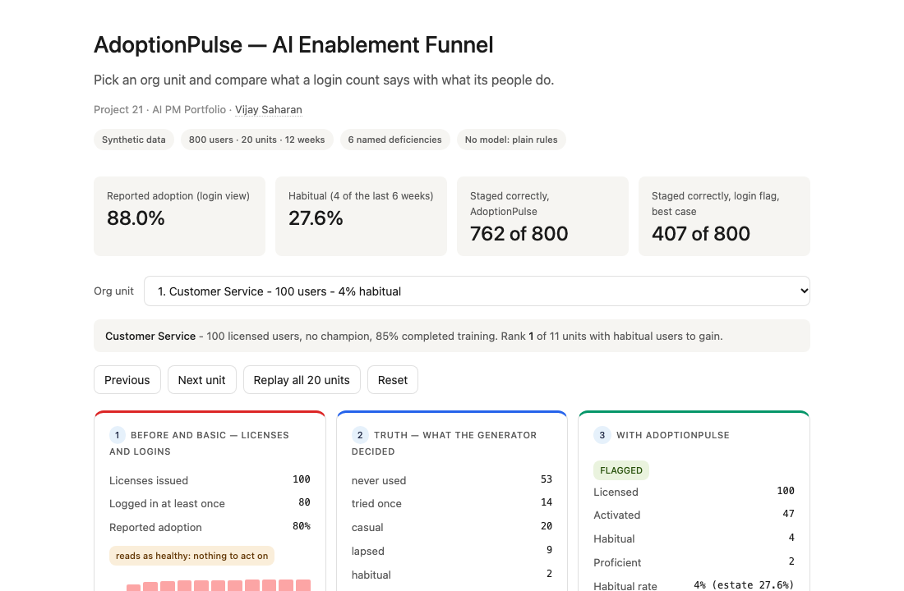
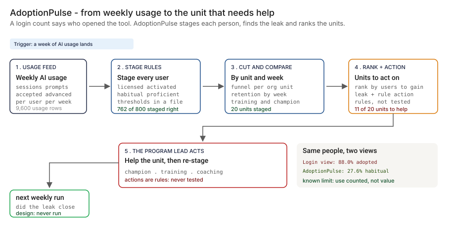
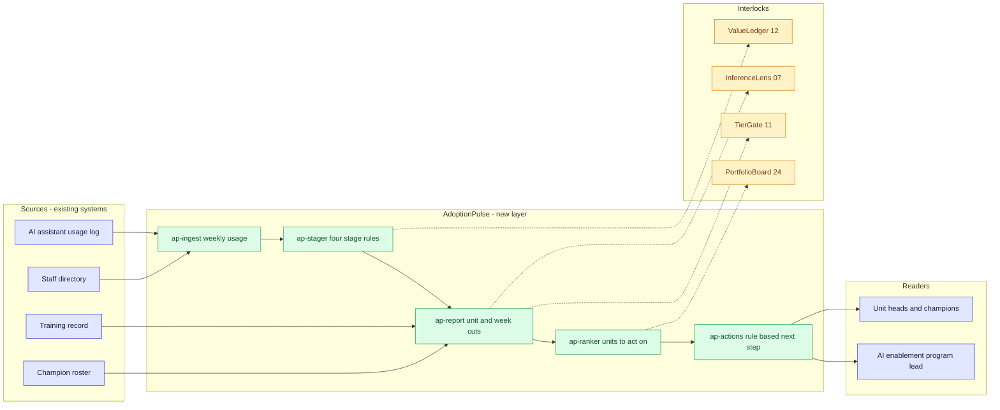
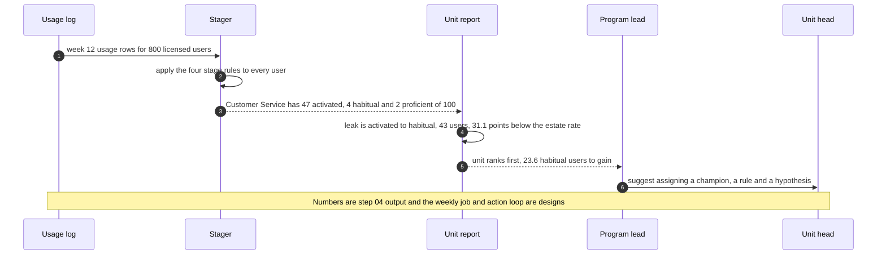

# 📈 AdoptionPulse — AI Enablement Funnel: Real Usage by Team and Stage

**A portfolio prototype for measuring AI adoption as stages, units and weeks instead of license counts and logins: a four-stage funnel (licensed, activated, habitual, proficient), a cut by org unit, a training-to-usage read, champion coverage, a retention curve and a ranked list of units to act on. Aligned to the [NIST AI RMF](https://www.nist.gov/itl/ai-risk-management-framework) 'Govern' function (people, training and accountability for AI use).**

**▶ Static demo, no install:** [open on GitHub Pages](https://vj-shipped-anyway.github.io/ai-pm-portfolio/21-adoptionpulse-ai-enablement-funnel/demo.html)

[](https://vj-shipped-anyway.github.io/ai-pm-portfolio/21-adoptionpulse-ai-enablement-funnel/demo.html)

**What it shows** (🟢 measured on synthetic data; the script is named in brackets):

- 🟢 Funnel: 800 licensed, 558 activated (69.8%), 221 habitual (27.6%), 80 proficient (10.0%) (`step_04`)
- 🟢 Unit spread: 4.0% habitual (Customer Service, 100 users) to 66.7% (Internal Audit, 9 users), while the login view shows 70.0% to 100.0% (`step_03`)
- 🟢 Known limit: 13 of 80 users staged proficient (16.2%) produce poor work in the generator, and weekly counts cannot show it (`step_04`)

_A portfolio prototype on synthetic data, not a production case study. The framing, how to read the numbers and the regulatory note are folded below._


[](./demo.html)



> **▶ 30-second demo:** the [clickable demo](./demo.html) gets you the full story in 30 seconds with no install.

<details>
<summary>Framing, how to read the numbers, and the regulatory note</summary>

> **Framing:** This is a portfolio prototype, not a production case study. The six-deficiency taxonomy, the stage rules, the architecture, the data generator and the walkthrough are mine. Every number below is either printed by a script in this folder on data I generated, or is modeled with its assumption named. Production validation (a real usage feed, an HR and privacy review, unit heads agreeing to act on a report) is what the next role does.

> **Reading the numbers — credibility tags inline.** Every number in this README and the demo is tagged 🟢 **Measured** (printed by a script in `src/` on the shipped synthetic data: 800 licensed users, 20 org units, 12 weeks, 9,600 user-weeks of usage, 60 champions), 🟡 **Modeled** (extrapolated from that data, with the assumption named in one line), or 🔴 **Hypothetical** (designed and reasoned about, never tested). Full convention in the [master README's "Reading the numbers" section](../README.md#-reading-the-numbers). **All data is synthetic and generated by a seeded script. The truth is known because the data is synthetic: the generator decided what each person does. It also planted the champion effect and the training effect, so those two are true by construction. Real data would be confounded.**

</details>

---

## 🔥 Demo in 30 seconds

Open the static, no-Python demo: [`demo.html`](./demo.html).
Pick one of the 20 org units from the dropdown, or use Next unit and Replay all 20 units. Three cards show the same people three ways: the license-and-login view (what the program reports today), the truth the generator decided for that unit, and AdoptionPulse (stage counts, the leak between stages, the recommended action). The totals at the top are the 🟢 measured numbers: 88.0% reported as adopted against 27.6% habitual, and 762 of 800 users staged the way the generator decided against 407 of 800 for the login flag at its best.

To run the four-step walkthrough on your laptop:

```bash
git clone https://github.com/Vj-shipped-anyway/ai-pm-portfolio
cd ai-pm-portfolio/21-adoptionpulse-ai-enablement-funnel/src
python3 step_01_license_counts_status_quo.py
python3 step_02_login_adoption_baseline.py
python3 step_03_deficiencies_exposed.py
python3 step_04_with_adoptionpulse.py
```

To regenerate the synthetic data (the output is identical on every run): `python3 ../data/_generate.py`.
To run the Streamlit prototype: `pip install -r requirements.txt`, then `streamlit run app.py` from `src/` (or `streamlit run 21-adoptionpulse-ai-enablement-funnel/src/app.py` from the repo root).

---

## 💰 Why this lands — competitive positioning

Teams that need to know whether an AI rollout is working usually start with one of two things: the license and login numbers the platform already holds, or a self-report questionnaire. I compare approaches rather than vendors, so the table below scores the login count and the new layer on the same synthetic people. The questionnaire column is a description of the approach, not a measurement: no questionnaire is simulated in this repo.

| Capability | License and login count | Self-report questionnaire | **AdoptionPulse** |
| --- | --- | --- | --- |
| Says who uses it every week | No: the log holds logins, not AI sessions | Self-reported; not measured here | 🟢 221 of 800 users (27.6%) are habitual, each staged from weekly usage |
| Notices when use falls | No: 🟢 the percentage fell in 0 of 11 weeks while the active share of activated users went from 51.6% to 36.4% | Only at the next survey | Yes: the weekly active share among the activated, by week |
| Separates one-time use from a habit | No: 🟢 337 activated users who never became habitual all count as adopted | Not measured here | 🟢 337 of 558 activated users (60.4%) flagged as not habitual |
| Shows which unit lags | 🟢 70.0% to 100.0% across units, and 9 of 20 units read as healthy while under 25% of their users are habitual | Not measured here | 🟢 4.0% to 66.7% habitual across units, ranked by habitual users to gain |
| Reads training against usage | No | Self-reported; not measured here | 🟢 132 of 428 trained users (30.8%) never had an AI session |
| Reads champion coverage against usage | No | Not measured here | 🟢 38.6% habitual with a champion, 15.5% without (true by construction) |
| Stages each licensed user correctly | 🟢 407 of 800 (50.9%) at best, with the mapping chosen after seeing the truth | n/a | 🟢 762 of 800 (95.2%), partly by construction |
| Judges the quality of the work | No | Self-reported at best | No. 🟢 13 of 80 users staged proficient (16.2%) produce poor work (the known limit) |
| Where it still fails | Everything above | Recall, the answer people think is expected, and a slow cadence | Value and quality of work; "proficient" is a proxy; the champion and training reads are not causal on real data |

**Position:** *AdoptionPulse does not replace the license portal, the training record or the champion roster. It joins them to weekly usage and answers the questions a login count cannot: who uses the tool every week, in which unit, at what depth, and where a team loses people between stages. A login count says who opened the tool. This says who stayed and where to help.*

---

## The honest version (why this exists)

The failure mode this prototype is built around: an enterprise licenses an AI assistant to hundreds of staff and reports adoption as licenses issued and people who logged in. That number goes up and stays high. It cannot say who uses the tool, who uses it every week, who uses it well, which teams lag, whether training changed anything or whether champions matter. The person who has to answer those questions is the AI enablement program lead.

This is a prototype on synthetic data. I wrote the generator, the stage rules, the unit cuts, the ranking and the walkthrough. The usage counts are produced by a seeded script, not by people or a model, and no model is used anywhere in this repo. The truth is known because the data is synthetic: the generator decided each person's behavior type, so it can say whether the stage rules got a person right. A real estate does not hand you that, which is why the first job in a real deployment would be a real usage feed and a sample review of what staged users actually do. Nothing here is a real bank, employee, vendor, product or incident.

Two effects are planted on purpose and labeled everywhere they are measured: units with a champion have more habitual users, and trained people have more habitual users. The generator assigns both independently of propensity, so a with-and-without comparison recovers them only up to noise: over 20 units, the champion gap lands 9.2 points above its planted size. In real data neither would hold: motivated people choose training and motivated units get champions. Treat those two reads as a demonstration of the mechanic, not as evidence that training or champions work.

A usage report about people is sensitive. The design reports by unit with a minimum group size and never as an individual ranking. One unit here (Internal Audit, 9 people) would fall under a 🔴 design target of 10 and be rolled up in production. That rule is designed, not built.

The data is dense on purpose (800 people and six behavior types) so that each effect appears often enough to count. It is a test set, not an estimate of how real staff behave; the shares were chosen by the generator, not taken from any benchmark.

If you run an AI enablement program and have been asked "is it working" with a login count to hand, fork it. The stage definitions, the leak logic and the unit cut are the parts worth lifting. Validating them against real usage is the work the next role would do.

---

## Prereqs to run this on your laptop (in plain English)

You don't need a cluster, a cloud account or an API key. You need:

- **Python 3.** The four step scripts, the data generator and the demo builder use only the standard library (for example `csv`, `json`, `statistics` and `pathlib`), so there is nothing to install for them. They are written for Python 3.9 and tested on it; they use no syntax newer than 3.9.
- **Git**, to clone the repo. `brew install git` / `winget install git`.
- **`src/requirements.txt` — only for the Streamlit app.** It lists `streamlit`, `pandas`, `numpy` and `plotly`. The step scripts do not import any of them. Run `pip install -r src/requirements.txt` only if you want the app.
- **No API key.** There is no model call, no network call and no secret anywhere. The stage rules are plain thresholds you can read in `data/funnel_policy.csv`.
- **Not needed:** a database, containers, Kubernetes or a cloud account. They appear in [`ARCHITECTURE.md`](./ARCHITECTURE.md) as the production design, not as prototype requirements.

Each step script finishes in seconds and writes its CSV or JSON to `src/out/`. The clickable `demo.html` runs in any browser with zero install. If a step does not run from a fresh clone, that's a bug in the README. Open an issue.

---

## Executive summary (90 seconds)

**Problem.** A modeled bank licensed an AI assistant to 800 staff in 20 org units and reports adoption as licenses issued and people who logged in: 🟢 704 of 800 (88.0%). The program lead cannot say who uses it every week, which team lags, or whether training and champions changed anything. 🟢 221 of 800 users (27.6%) are habitual, and 🟢 337 of 558 activated users (60.4%) never became habitual yet all count as adopted.

**Product.** AdoptionPulse, a staging layer on weekly AI usage: a **four-stage funnel** (licensed, activated, habitual, proficient) from plain rules in a policy file; a **cut by org unit** with the leak between stages; a **training-to-usage read**; **champion coverage**; a **retention curve** by week; and a **ranked list of units to act on** with a rule-based action. No model is used.

**Measured and modeled performance.**

- 🟢 **Funnel: 800 licensed, 558 activated (69.8%), 221 habitual (27.6%), 80 proficient (10.0%)** (`step_04`). Counts are nested: a proficient user is also habitual.
- 🟢 **Unit spread: 4.0% habitual (Customer Service, 100 users) to 66.7% (Internal Audit, 9 users)**, while the login view shows 70.0% to 100.0% (`step_03`). Customer Service reads 80.0% adopted and 85.0% of its staff completed training.
- 🟢 **Staging: 762 of 800 users (95.2%) staged as the generator decided, against 407 of 800 (50.9%) for the login flag at its best** (`step_04`). The agreement is partly by construction: the generator's behaviors were written around the same thresholds.
- 🟢 **Weekly decay: among 558 activated users, 51.6% had a session in week 4 and 36.4% in week 12**, while the login view rose from 83.2% to 88.0% (`step_03`).
- 🟢 **Training and champions, planted by construction:** habitual gap measured 7.4 points against 10.0 planted for training, and 23.1 against 13.9 for champions (`step_04`). The champion gap is larger because unit appetite is not balanced across the two groups.
- 🟢 **Known limit: 13 of 80 users staged proficient (16.2%) produce poor work in the generator, and weekly counts cannot show it** (`step_04`).
- 🟡 **Utility: (95.2% − 50.9%) × 800 = about 355 users correctly staged**, assuming the modeled bank's full license count is in scope and the accuracy measured here holds on real usage data.
- 🔴 **Design target: a weekly stage job and a unit-level report with a minimum group size.** Designed in `ARCHITECTURE.md`, never built or timed.

**Call to action.** Fork this repo. Swap [`data/users.csv`](./data/users.csv) and [`data/usage_weekly.csv`](./data/usage_weekly.csv) for exports from your directory and your assistant's usage log, edit the thresholds in [`data/funnel_policy.csv`](./data/funnel_policy.csv), and call `stage_of` from `step_01`. The truth files exist only because the data is synthetic.

---

## 🗺️ What this walkthrough covers

1. **The use case** — an AI assistant licensed to 800 staff in 20 units, reported as one adoption percentage
2. **Sample data** — 800 users, 9,600 user-weeks, 60 champions, a policy file and the generator's truth
3. **Step 1 — Before AdoptionPulse** — what licenses and logins hold, and the six questions they cannot answer
4. **Step 2 — Basic approach** — one adoption percentage, week by week and by unit
5. **Step 3 — The six named deficiencies** — each with a count from the dataset
6. **Step 4 — The fix (AdoptionPulse)** — stages, units, training, champions, retention and a ranked list; measured against the generator's truth, with the known limit printed
7. **Utility delivered** — a multiplied number with the assumption named
8. **Architecture & call flow** — topology and a per-week sequence
9. **PM artifacts** — PRD and architecture

> Non-technical reader: skip the code blocks. The plain-English explanation and the output tables tell the story.
> Technical reader: every code block runs. `cd src && python3 step_NN_*.py` and you'll see the same output.

Total reading time: about 12 minutes deep, 3 minutes if you skim.

---

## 🎯 The Use Case

**A modeled bank's AI enablement program. 800 licensed staff in 20 org units, one adoption number.**

The program rolled an AI assistant out in four weekly waves. It reports licenses issued and people who logged in. Each org unit has a head; some units have an assigned champion; most staff completed a training module. Three things show up in the synthetic data:

- **A big team that looks fine.** Customer Service has 100 licensed users, 80 of whom logged in (80.0%), and 85.0% completed training. 🟢 4 of 100 are habitual (4.0%), 43 of the 47 who started are not habitual, and the unit has no champion. The login view cannot tell it apart from a team that works.
- **A small team that does.** Internal Audit has 9 users and 🟢 6 are habitual (66.7%). The login view reads 100.0% for it and for two other units, so it cannot rank them.
- **Training that did not stick.** 🟢 132 of 428 trained users (30.8%) never had an AI session in 12 weeks.

The AI enablement program lead owns the question. Unit heads own the response. Champions are the lever the program can pull. An HR and privacy reviewer decides how far usage data about people may go, and security owns the usage feed. AdoptionPulse is designed for those five.

---

## 📊 Sample Data

Seven CSVs in [`data/`](./data/), generated by [`data/_generate.py`](./data/_generate.py) (standard library, seeded, deterministic: running it twice produces identical files). Documented in [`data/README.md`](./data/README.md). The first rows of the main files, copied from the files:

**[`data/users.csv`](./data/users.csv)** — 800 licensed staff: unit, role, licensing week (1 to 4), whether the unit has a champion, and the week training was completed (empty if not trained).

```
user_id,org_unit,role,licensed_week,champion_in_unit,trained_week
U0001,Mortgage Servicing,associate,3,yes,4
U0002,Customer Service,associate,1,no,
U0003,Branch Network,relationship manager,3,no,
U0004,Branch Network,relationship manager,3,no,
U0005,Mortgage Servicing,associate,3,yes,6
```

**[`data/usage_weekly.csv`](./data/usage_weekly.csv)** — 800 users x 12 weeks = 9,600 rows of logins, AI sessions, prompts, accepted outputs and advanced-feature uses. Weeks before a person is licensed are zero.

```
user_id,week,logins,ai_sessions,prompts,outputs_accepted,advanced_feature_uses
U0001,1,0,0,0,0,0
U0001,2,0,0,0,0,0
U0001,3,1,2,11,4,0
U0001,4,1,2,6,2,0
U0001,5,2,4,15,2,0
```

**[`data/funnel_policy.csv`](./data/funnel_policy.csv)** — the stage definitions and thresholds. These are assumptions of a modeled bank, not advice and not a standard.

```
parameter,value,applies_to,definition
activation_window_weeks,2,activated,"Activated = at least 1 AI session in the first 14 days after licensing. Weekly data, so the licensing week and the next week."
habit_window_weeks,6,habitual,Look-back window for habit and proficiency: the last 6 weeks of the data (weeks 7 to 12).
habit_min_active_weeks,4,habitual,Habitual = AI sessions in at least 4 of the last 6 weeks.
proficient_min_advanced_weeks,2,proficient,Proficient also needs advanced-feature use in at least 2 of the last 6 weeks.
proficient_min_accept_rate,0.6,proficient,"Proficient also needs accepted outputs divided by prompts over the last 6 weeks at or above this value. A proxy for skill, not a measure of it."
leak_min_gap_points,5,action,A stage conversion counts as a leak when a unit is at least this many points below the estate rate.
leak_min_users,5,action,A stage conversion is judged for a unit only when at least this many users entered the stage before it.
```

**[`data/champions.csv`](./data/champions.csv)** — 60 champions in the 12 units that have one.

```
champion_id,org_unit,active_weeks
CH-001,Payments Operations,8
CH-002,Payments Operations,7
CH-003,Payments Operations,11
```

**[`data/user_truth.csv`](./data/user_truth.csv)**, **[`data/unit_truth.csv`](./data/unit_truth.csv)** and **[`data/planted_effects.csv`](./data/planted_effects.csv)** — what the generator decided: each person's behavior type and true stage, each unit's hidden appetite, and the size of the two planted effects. They exist only because the data is synthetic. No stage rule reads them; the scoring in step 4 does.

```
effect,planted_logit_shift,users_affected,avg_p_habitual_or_better_without,avg_p_habitual_or_better_with,planted_gap_points
champion_in_unit,0.7,420,0.2429,0.3823,13.9
training_completed,0.55,428,0.2365,0.3364,10.0
```

Behavior types the generator draws: never used, tried once, casual, lapsed after starting, habitual and proficient. Truth totals (printed by `step_04`): 242 never used, 139 tried once, 100 casual, 72 lapsed, 161 habitual, 86 proficient.

The data includes two hard cases on purpose: casual users who sometimes reach four active weeks out of the last six, and habitual users who miss enough weeks to fall under the line. Both produce staging errors that step 4 counts.

---

## 🔧 Step 1 — Before AdoptionPulse: licenses issued and users who logged in

**In plain English:** The program holds the week each license was issued and a login count. It reports one number: the share of licensed people who logged in at least once. Nothing in those two fields says whether anyone used the AI.

```bash
python3 src/step_01_license_counts_status_quo.py
```

The script lists what the status quo holds and asks the six questions the program lead gets asked. The assumptions are in the script header and printed with the result:

```
ASSUMPTIONS (modeled):
  A1  the program reports what the license portal and the sign-in log hold: the week a
      license was issued and login counts. It does not hold AI session counts
  A2  'adoption' is the share of licensed users who logged in at least once
```

**Result:**

```
WHAT THE STATUS QUO REPORTS
  Licenses issued:                      800
  Users who logged in at least once:    704 of 800 (88.0%)
  Login events in 12 weeks:               4,186
  Reported adoption (licensed and logged in): 88.0%
```

```
THE SIX QUESTIONS THE PROGRAM LEAD GETS ASKED
  question                         needs                                                          answerable
  Who uses it?                     ai_sessions, user_id                                           no
  Who uses it every week?          ai_sessions, user_id, week                                     no
  Who uses it well?                advanced_feature_uses, outputs_accepted, prompts, user_id      no
  Which teams lag?                 ai_sessions, org_unit                                          no
  Did training change anything?    ai_sessions, trained_week                                      no
  Do champions matter?             ai_sessions, champion_in_unit                                  no

RESULT
  Questions answerable from the fields the status quo holds: 0 of 6 (by construction of the field list in this script)
  The one number it can give is 88.0% adoption. It cannot say who uses the tool, how often, or how well.
```

🟢 Reported adoption and the question table are printed by `step_01`. The "0 of 6" is by construction of the field list in the script: each question names the fields it needs, and none of them is a field the status quo holds. The number is real; the point it makes is that the fields are missing, not that the logins are wrong.

---

## 🤖 Step 2 — With the basic approach: one adoption percentage

**In plain English:** Turn the license and login numbers into one percentage and report it every week and for every unit. It is cheap and it is what a login count gives you.

```bash
python3 src/step_02_login_adoption_baseline.py
```

```
WEEK BY WEEK
  week  licensed  logged in  adoption
     1       319        191     59.9%
     2       562        408     72.6%
     3       739        584     79.0%
     4       800        666     83.2%
     5       800        688     86.0%
     6       800        689     86.1%
     7       800        692     86.5%
     8       800        697     87.1%
     9       800        700     87.5%
    10       800        701     87.6%
    11       800        702     87.8%
    12       800        704     88.0%
```

```
RESULT
  Reported adoption: 704 of 800 (88.0%)
  Across units: 70.0% (Treasury) to 100.0% (Data and Analytics), a spread of 30.0 points
  Units reading as healthy (at or above 80%): 19 of 20
  Weeks in which the percentage fell: 0 of 11
  What it tells the program lead: adoption is high and rising. It names no team to help.
```

- **It is high and it does not fall.** 🟢 704 of 800 (88.0%) by week 12, and the percentage fell in 0 of 11 weeks. A person who logged in once stays counted, so the number does not drop when use does.
- **It cannot name a team to help.** 🟢 19 of 20 units read as healthy at the assumed 80% cut, and the spread across units is 30.0 points. Run the script for the full unit table; it also writes `src/out/step_02_by_unit.csv`.

---

## 🔬 Step 3 — Where this still breaks: 6 named deficiencies

| # | Deficiency | What goes wrong | Count in this dataset |
| --- | --- | --- | --- |
| 1 | **Logins that never became an AI session** | A login is an open page, not a use. | 🟢 146 of 704 logged-in users (20.7%) never had an AI session; 499 of 4,186 login events (11.9%) fell in a week with none |
| 2 | **One-time activation counted as adoption** | A person who tried it once is in the 88.0%. | 🟢 337 of 558 activated users (60.4%) never became habitual; 149 users had sessions in exactly one week of 12 |
| 3 | **The average hides the unit spread** | One percentage cannot rank 20 teams. | 🟢 Habitual rate runs 4.0% to 66.7% against 70.0% to 100.0% on logins; 9 of 20 units read as healthy while under 25% of their users are habitual |
| 4 | **Training completion is not usage** | A completion count says nothing about use. | 🟢 132 of 428 trained users (30.8%) never had a session; habitual rate 31.1% trained against 23.7% untrained |
| 5 | **Champion coverage is invisible** | No view joins the roster to usage. | 🟢 38.6% habitual with a champion against 15.5% without (true by construction) |
| 6 | **Weekly decay is hidden** | The cumulative number does not fall when use does. | 🟢 Among activated users, 51.6% active in week 4 and 36.4% in week 12, while the login view rose from 83.2% to 88.0% |

```bash
python3 src/step_03_deficiencies_exposed.py
```

```
Reported adoption (step 2): 88.0%. Counts below use the stage rules in funnel_policy.csv.
Training and champion gaps are planted by construction; real data would be confounded.

(1) Logins that never became an AI session
    146 of 704 users who logged in (20.7%) never had an AI session in 12 weeks.
    499 of 4,186 login events (11.9%) fell in a week with no AI session.

(2) One-time activation counted as adoption
    337 of 558 activated users (60.4%) never became habitual;
    the login view counts 337 of them as adopted. 149 users had AI sessions in exactly one week of 12.

(3) The average hides the spread between units
    Login view: 70.0% to 100.0% across units (30.0 points).
    Habitual rate: 4.0% (Customer Service, 100 users) to 66.7% (Internal Audit, 9 users), 62.7 points.
    9 of 20 units read as healthy (at or above 80% logged in) while under 25% of their users are habitual.

(4) Training completion is not usage
    428 of 800 users completed training (53.5%). 132 of them (30.8%) never had an AI session.
    Habitual rate: trained 133 of 428 (31.1%), untrained 88 of 372 (23.7%), a gap of 7.4 points.

(5) Champion coverage (true by construction)
    12 of 20 units have a champion (60 champions in all), covering 420 of 800 users.
    Habitual rate: with a champion 162 of 420 (38.6%), without 59 of 380 (15.5%), a gap of 23.1 points.

(6) Weekly decay
    Among the 558 activated users, 288 (51.6%) had an AI session in week 4 and 203 (36.4%) in week 12, a drop of 15.2 points.
    Over the same weeks the login view rose from 83.2% to 88.0%.
    Week 4 is partly set by the activation rule; from week 6 the curve is free of it: 238 (42.7%) in week 6.

The login count measures reach. The product is the stage, the unit and the week.
```

Deficiency 6 carries one caveat the script prints: week 4 is partly set by the activation rule, because a person counts as activated only if they had a session in their first two weeks. From week 6 the curve is free of that effect: 🟢 42.7% in week 6 and 36.4% in week 12.

Deficiencies 4 and 5 are the two planted effects. The gaps are real in this dataset because the generator put them there. The login count measures reach. **The product is the stage, the unit and the week.**

---

## 🛠️ Step 4 — The fix: AdoptionPulse

Five parts, all plain rules, no model:

1. **Stage rules.** Every licensed user gets one stage from `data/funnel_policy.csv`: licensed; activated (at least 1 AI session in the first 14 days); habitual (sessions in at least 4 of the last 6 weeks); proficient (habitual, advanced-feature use in at least 2 of those weeks, and an accepted-output rate of at least 0.60). Counts are nested.
2. **Unit funnel and leak.** The funnel per org unit, and the stage conversion where a unit sits furthest below the estate rate (at least 5 points, with at least 5 users entering that stage).
3. **Training and champion reads.** Conversion to activated and habitual for trained and untrained users, and for units with and without a champion, printed next to the effect the generator planted.
4. **Retention curve.** The share of activated users with an AI session in each week.
5. **Ranked list and action.** Units ranked by the habitual users they would add if they matched the estate rate, each with a rule-based action. The actions are rules, not tested interventions.

```bash
python3 src/step_04_with_adoptionpulse.py
```

**The funnel and the units, ranked by habitual users to gain:**

```
THE FUNNEL (all licensed users)
  stage        users  share of licensed   conversion from previous
  licensed       800             100.0%
  activated      558              69.8%                      69.8%
  habitual       221              27.6%                      39.6%
  proficient      80              10.0%                      36.2%
```

```
FUNNEL BY ORG UNIT (ranked: habitual users gained if the unit matched the estate rate)
   # unit                    lic  act  hab prof   hab% champ train%  gain
   1 Customer Service        100   47    4    2   4.0%    no  85.0%  23.6
   2 Technology Delivery      90   61   17    8  18.9%    no  42.2%   7.9
   3 Branch Network           70   45   13    7  18.6%    no  38.6%   6.3
   4 Compliance               26   15    3    0  11.5%    no  38.5%   4.2
   5 Credit Risk              46   33   10    4  21.7%    no  65.2%   2.7
   6 Procurement              10    6    1    0  10.0%    no  90.0%   1.8
   7 Payments Operations      75   51   19    8  25.3%   yes  22.7%   1.7
   8 Fraud Operations         30   20    7    3  23.3%   yes  43.3%   1.3
   9 Legal                    15   11    3    1  20.0%   yes  60.0%   1.1
  10 Marketing                18   14    4    1  22.2%    no  72.2%   1.0
  11 Retail Operations        52   39   14    5  26.9%   yes  38.5%   0.4
   - Collections              35   28   16    0  45.7%   yes  31.4%   0.0
   - Commercial Lending       58   49   23    9  39.7%   yes  72.4%   0.0
   - Data and Analytics       28   26   15    8  53.6%   yes  78.6%   0.0
   - Finance                  42   32   21    7  50.0%   yes  33.3%   0.0
   - Human Resources          14   13    6    2  42.9%   yes  57.1%   0.0
   - Internal Audit            9    9    6    1  66.7%   yes  77.8%   0.0
   - Mortgage Servicing       38   29   21    8  55.3%   yes  84.2%   0.0
   - Treasury                 20   11    7    4  35.0%    no  60.0%   0.0
   - Wealth Advisory          24   19   11    2  45.8%   yes  37.5%   0.0

  Units with habitual users to gain: 11 of 20
```

Units at or above the estate habitual rate have no users to gain and show a dash instead of a rank. Every unit still gets a leak and an action when it sits 5 or more points under the estate rate at a stage, so a high-rate unit can carry an action too.

**The top of the action list:**

```
UNITS TO ACT ON (leak = the stage conversion furthest below the estate rate, at least 5 points)
  1. Customer Service (100 users, 4.0% habitual, gain 23.6 users)
     leak: activated to habitual (-31.1 points)
     action: Users start and stop: 43 activated users are not habitual and the unit has no champion. Assign one (a hypothesis: the champion effect in this data is planted, not observed).
  2. Technology Delivery (90 users, 18.9% habitual, gain 7.9 users)
     leak: activated to habitual (-11.7 points)
     action: Users start and stop: 44 activated users are not habitual and the unit has no champion. Assign one (a hypothesis: the champion effect in this data is planted, not observed).
```

**Training and champion coverage, with the planted effect next to the measured one:**

```
TRAINING TO USAGE
  Trained   428: activated 69.2%, habitual 31.1%, never active 132 (30.8%)
  Untrained 372: activated 70.4%, habitual 23.7%, never active 110 (29.6%)
  Planted effect (logit +0.55): +10.0 points in the chance of becoming habitual, averaged over trained users.
  Measured gap in habitual rate: 7.4 points. True here by construction; real data would be confounded.

CHAMPION COVERAGE
  12 of 20 units have a champion; 60 champions (14.3 per 100 users in those units), median 7.0 active weeks of 12.
  With a champion 420: habitual 38.6%   Without 380: habitual 15.5%
  Planted effect (logit +0.70): +13.9 points in the chance of becoming habitual, averaged over users in champion units.
  Hidden unit appetite the generator drew (logit, size-weighted mean): champion units -0.14, other units -0.60.
  Measured gap: 23.1 points. It differs from the planted effect because unit appetite is not balanced across the two groups; with 20 units it cannot be.
```

**The retention curve:**

```
RETENTION CURVE (activated users with an AI session in the week; 558 activated users)
  week  active   share  login view
     4     288   51.6%       83.2%
     5     259   46.4%       86.0%
     6     238   42.7%       86.1%
     7     226   40.5%       86.5%
     8     222   39.8%       87.1%
     9     214   38.4%       87.5%
    10     225   40.3%       87.6%
    11     238   42.7%       87.8%
    12     203   36.4%       88.0%
  Weeks before 6 are partly set by the activation rule (activated means a session in the first two weeks);
  from week 6 the curve is free of that effect: 42.7% in week 6, 36.4% in week 12.
```

**Measured against the generator's truth:**

```
MEASURED AGAINST THE GENERATOR'S TRUTH (user_truth.csv; no rule reads it)
  AdoptionPulse stage correct:            762 of 800 (95.2%)
  Wrong: 33 staged too low, 5 staged too high
  Login view as reported (logged in = adopted), adopter or not: 343 of 800 (42.9%)
  AdoptionPulse, same adopter-or-not question:                  768 of 800 (96.0%)
  Login flag mapped to four stages with hindsight (best case):  407 of 800 (50.9%)
     logged in        -> activated  (311 of 704)
     never logged in  -> licensed   (96 of 96)
  Confusion matrix (rows: generator's stage, columns: AdoptionPulse stage)
                licensed  activated   habitual proficient
  licensed           242          0          0          0
  activated            0        308          3          0
  habitual             0         25        134          2
  proficient           0          4          4         78
  Accuracy by the generator's latent user type
     never used   242 users,  242 staged correctly (100.0%)
     tried once   139 users,  139 staged correctly (100.0%)
     casual       100 users,   97 staged correctly (97.0%)
     lapsed        72 users,   72 staged correctly (100.0%)
     habitual     161 users,  134 staged correctly (83.2%)
     proficient    86 users,   78 staged correctly (90.7%)
  Agreement between the rules and the generator's types holds partly by construction: the generator's
  behavior was written around the same thresholds. Read it as a property of this synthetic set.
```

- **762 of 800 users staged the way the generator decided.** Of the misses, 33 are staged too low and 5 too high. Most of the low ones (25) are habitual-type users who missed enough weeks to fall under the line. The login flag, mapped to the four stages after seeing the truth so it gets its best case, gets 407.
- **The agreement is partly by construction.** The generator's behaviors were written around the same thresholds as the rules. The number is a property of this synthetic set. On real usage there is no truth file to score against.
- **The champion gap is larger than the planted effect.** With 20 units, unit appetite is not balanced across units with and without a champion (the line above prints the two means). A naive with-and-without comparison moves a lot even when the only thing planted is the effect itself.

### The known limit, left in on purpose

AdoptionPulse counts use. It does not see the value or the quality of the work.

```
KNOWN LIMIT (left in on purpose)
  Telemetry counts use, not value. 13 of 80 users the rules call proficient (16.2%) produce poor work in the generator,
  and nothing in the weekly counts can show it. Work quality is independent of the counts by design.
  'Proficient' is a proxy. Of 86 proficient-type users, 78 are staged proficient, 4 habitual, 4 lower.
  Of 161 habitual-type users, 2 are staged proficient and 25 are staged only activated (active in fewer than 4 of the last 6 weeks).
  The champion gap (23.1 measured, 13.9 planted) and the training gap (7.4 measured, 10.0 planted) are true by construction.
```

The mitigation is in the process, not the code: a manager sample review of what staged-proficient users actually produce, and a rubric agreed with the unit head. That is 🔴 designed in the PRD, never tested with real reviewers. "Proficient" is a proxy for skill: advanced-feature use and an accepted-output rate are signals a person can produce without doing good work, and the generator makes that explicit by drawing work quality independently of the counts.

Other limits, stated plainly: the weekly grain means the 14-day activation window is the licensing week and the next week; the thresholds are assumptions of a modeled bank; a person on leave for three weeks looks like a lapse; and the actions are rules whose effect has never been measured.

---

## 📐 Utility Delivered

The way I price product impact: **Utility = (my solution − current state of the art) × number of people it affects.**

Here the terms are the share of licensed users staged correctly and the licensed population. Going from "logged in" to "this person is a habitual user, in this unit, and this is where the unit leaks" is not an outcome by itself. *Doing it for every licensed person a program of this shape carries is.*

| Term | Value | Where it comes from |
| --- | --- | --- |
| Current state of the art (the login flag), share of licensed users correctly staged | 🟢 **50.9%** | `step_04`: 407 of 800, with the flag mapped to the four stages after seeing the truth, so it is the best the flag can do |
| The login view as reported (logged in = adopted), adopter or not | 🟢 42.9% | `step_04`: 343 of 800 on the simpler adopter-or-not question |
| My solution (AdoptionPulse staging) | 🟢 **95.2%** | `step_04`: 762 of 800 staged as the generator decided, partly by construction |
| Per-user lift | 🟢 95.2% − 50.9% = 44.4 points | Share of licensed users correctly staged |
| Number it affects: licensed staff | 🟡 **800** | **Assumption, not a statistic:** the modeled bank's full license count is in scope. Edit `MODELED_POPULATION` in `step_04` to use your own |
| Assumption that makes the lift real | 🟡 The accuracy measured on this synthetic set holds on real usage data | It will not hold exactly: real behavior has no truth file and no planted thresholds |
| **Utility** | 🟡 **(95.2% − 50.9%) × 800 = about 355 users correctly staged** | Users whose stage the login flag would get wrong at its best |

Sensitivity to the licensed-population assumption (🟡, same lift): 800 gives 355, 2,000 gives 888, 5,000 gives 2,219.

🔴 What I have not measured: whether any suggested action raises the habitual rate, what the usage feed costs to run, whether real staff behave in the six types the generator draws, and what a habitual user is worth. The synthetic estate is also cleaner than a real one. Treat the lift as a property of this mix of people, not a forecast.

---

## 🔄 Architecture & Call Flow

How each weekly run flows through the system. GitHub renders these diagrams natively. Component names match [`ARCHITECTURE.md`](./ARCHITECTURE.md).

**System topology:**



**Per-week sequence** (`Customer Service`, week 12):



See [`assets/adoptionpulse-flow.svg`](./assets/adoptionpulse-flow.svg) for a static visual of the same flow.

**Interlocks (all 🔴 designed, none built):**

- [12 ValueLedger](../12-valueledger-ai-benefit-tracking/) measures benefit against a holdout. AdoptionPulse is the upstream read: a benefit claim should follow habit, so ValueLedger would take habitual users by unit as its denominator. This is not a duplicate: AdoptionPulse measures usage, and ValueLedger measures what the usage was worth.
- [11 TierGate](../11-tiergate-ai-usecase-intake/) decides which use cases to enable. AdoptionPulse can tell it where a use case, once enabled, is or is not becoming a habit.
- [24 PortfolioBoard](../24-portfolioboard-ai-program-portfolio/) treats enablement as a program. AdoptionPulse would supply the stage counts and the ranked units it reports on.
- [07 InferenceLens](../07-inferencelens-inference-finops/) reports spend. Joined to habitual users by unit, it would give cost per active user.

---

## 📋 PM Artifacts

The PM artifacts that show how I'd run this product if I owned the seat. This README is the walkthrough; the rest of the folder holds:

- [`PRD.md`](./PRD.md) — the product requirements doc: users, backlog, KPIs, rollout, open questions.
- [`ARCHITECTURE.md`](./ARCHITECTURE.md) — the systems doc: components, data model, privacy and security, failure behavior, operations. A design, not deployed.
- [`demo.html`](./demo.html) — clickable, no-install walkthrough; every number is generated from the scripts in `src/` by `src/_build_demo.py`.
- [`data/`](./data/) — the seven synthetic CSVs and the generator. `data/README.md` explains the ground-truth rules.
- [`src/`](./src/) — runnable step scripts and the Streamlit prototype.

Run the walkthrough end-to-end:

```bash
cd src
python3 step_01_license_counts_status_quo.py
python3 step_02_login_adoption_baseline.py
python3 step_03_deficiencies_exposed.py
python3 step_04_with_adoptionpulse.py
```

---

## 🚀 Fork this for your team

```bash
git clone https://github.com/Vj-shipped-anyway/ai-pm-portfolio
cd ai-pm-portfolio/21-adoptionpulse-ai-enablement-funnel

# 1. Run the synthetic walkthrough as is
cd src
python3 step_01_license_counts_status_quo.py
python3 step_02_login_adoption_baseline.py
python3 step_03_deficiencies_exposed.py
python3 step_04_with_adoptionpulse.py

# 2. Open the interactive demo
open ../demo.html            # static snapshot of the synthetic run; it does not read data/
```

To point it at your own program, replace these files and keep their columns:

- `data/users.csv`: one row per licensed person: `user_id, org_unit, role, licensed_week, champion_in_unit, trained_week`
- `data/usage_weekly.csv`: one row per person per week: `user_id, week, logins, ai_sessions, prompts, outputs_accepted, advanced_feature_uses`
- `data/champions.csv`: one row per champion: `champion_id, org_unit, active_weeks`
- `data/funnel_policy.csv`: edit the thresholds to your own definitions

The two functions that do the work take plain dicts:

```python
# from src/
from step_01_license_counts_status_quo import load_all, stage_of
from step_04_with_adoptionpulse import analyze

data = load_all()                       # reads ../data/*.csv
stage = stage_of(user, data["use"][user["user_id"]], data["policy"])   # one person
result = analyze(data)                  # funnel, units, retention, ranked list
```

`data/user_truth.csv`, `data/unit_truth.csv` and `data/planted_effects.csv` exist only because the data is synthetic. `load_all` reads them and `analyze` scores against them, so on real exports you will need to drop those reads, and the accuracy and planted-effect lines in step 4 cannot be computed: you will not have a truth file. Weeks are numbered 1 to 12 in the loaders; change `WEEKS` in `step_01` for a different window.

If you run it on a real program and get something useful, open an issue or send me what your unit heads did with it. I'd rather see that than what I think it should do.

---

## 👤 Author

**Vijay Saharan** — Sr Product / Program Manager · AI in BFSI · Enterprise AI Platforms · CRE as a study interest

[LinkedIn](https://www.linkedin.com/in/vijaysaharan/) · Tagline: *AI Enablement PM · Turns license counts into usage stages a program lead can act on, under regulated constraint*

---

## 🙌 Acknowledgements

- **[NIST AI RMF](https://www.nist.gov/itl/ai-risk-management-framework)** — the 'Govern' function's attention to people, training and accountability is the theme behind measuring whether training and ownership change use. This is a paraphrase written for this exercise, not the text of the framework.
- **Product analytics practice** — the activation, retention and funnel vocabulary the stages borrow. The thresholds here are assumptions of a modeled bank, not an industry standard.
- **Sibling projects in this repo** — [12 ValueLedger](../12-valueledger-ai-benefit-tracking/), [11 TierGate](../11-tiergate-ai-usecase-intake/), [07 InferenceLens](../07-inferencelens-inference-finops/) and [24 PortfolioBoard](../24-portfolioboard-ai-program-portfolio/), the four interlocks.
