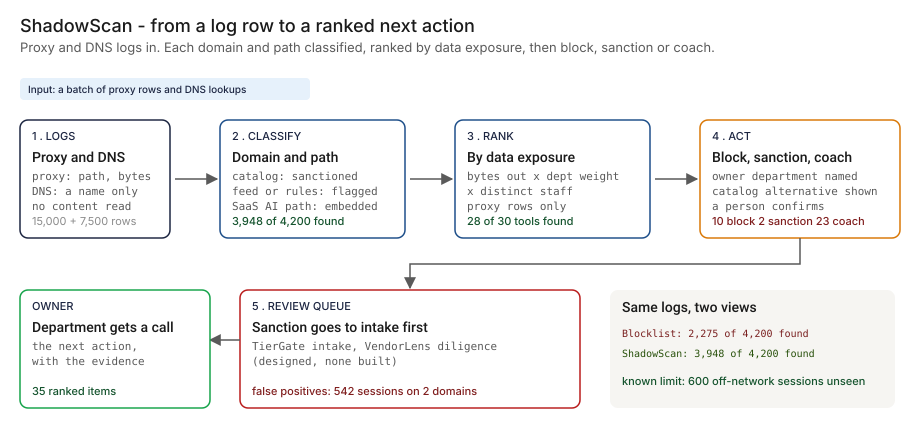

# Architecture — ShadowScan

The systems doc most PM writeups skip. Databases, where the code runs, encryption posture, user management, network, operational runbooks. What you'd hand to your CISO and your platform engineering lead on day one.

> **Status.** This is the design for the production shape. The repo implements the product mechanic as a prototype (a catalog and feed lookup, a path pattern and a size test, an exposure ranking and a next-action rule, over synthetic logs, with a Streamlit app). Nothing below is claimed as deployed or load-tested. Where a figure is a design target, it says so.

This doc is cloud-agnostic where the design allows it and explicit where it doesn't. Every BFSI shop is on AWS, GCP or Azure (or two of three). GCP is shown as primary; AWS and Azure equivalents are called out inline.



---

## 1. Logical architecture

ShadowScan is an offline analytic over logs the bank already collects. It does not replace the proxy, the resolver, the sanctioned catalog or the approval process, and nothing in it sits in a user's request path. It reads a batch of log rows, decides which domains are AI tools nobody approved, ranks them by data exposure and recommends one action each. A block is a change the security team applies to the proxy after a person confirms.

Seven components. None is on a user's request path.

| Component | Responsibility | Language / framework | Inline in user traffic? | Stateful? |
| --- | --- | --- | --- | --- |
| `ss-collector` | Reads proxy and DNS log exports and the staff directory on a schedule. Joins each row to a department and a site, replaces the user identifier with a pseudonym and writes a batch. | Python on Cloud Run jobs / Fargate tasks / Container Apps jobs | No | No |
| `ss-reference` | Syncs the sanctioned catalog (with the AI-scope field), the known-AI feed and the department sensitivity weights, each versioned and stamped with its age. | Python | No | No |
| `ss-classifier` | Rules R1 to R5: catalog lookup, feed lookup, generation-style path pattern, upload-size test and domain discovery. Emits a class and the evidence for each session. The prototype's `classify` and `discover_domains`. | Python | No | No |
| `ss-ranker` | Computes the exposure index per discovered domain and assigns the owner department and the next action. The prototype's `build_items`. | Python | No | No |
| `ss-store` | Holds domains, per-day aggregates, decisions, resolutions and the audit log. | PostgreSQL 15 | No | Stateful |
| `ss-review` | Review queue and API: open recommendations, evidence, contest, confirm. Posts sanction candidates to intake. | FastAPI, Pydantic v2; React + Next.js console | No | No |
| `ss-telemetry` | OpenTelemetry spans and metrics from every component. | OTel Collector to the platform's monitoring | No | No |

**What is on the path, and what is not.** Collector, classifier, ranker and store produce the ranking each batch. The review queue is where a person acts. Blocking itself stays with the security team's proxy and resolver configuration. ShadowScan never drops a request.

**Repo structure** (production shape; monorepo):

```
shadowscan/
├── apps/
│   ├── collector/      # log readers, directory join, pseudonymization
│   ├── reference/      # catalog, feed and weight sync
│   ├── classifier/     # rules R1 to R5
│   ├── ranker/         # exposure index, owner, next action
│   ├── review/         # FastAPI: queue, evidence, contest
│   └── console/        # review UI
├── libs/
│   ├── logs/           # proxy and resolver row models
│   └── domains/        # registered-domain parsing with a public-suffix list
├── infra/
│   ├── terraform/      # multi-cloud IaC (gcp, aws, azure)
│   ├── kubernetes/     # Helm charts + Kustomize overlays
│   └── policies/       # OPA bundles, IAM templates, network policies
├── docs/
│   ├── ARCHITECTURE.md
│   ├── runbooks/
│   └── api/            # OpenAPI spec
└── tests/
    ├── unit/
    ├── integration/
    └── calibration/    # classifier output vs hand-reviewed samples
```

---

## 2. Physical / deployment architecture

### Runtime

| Component | GCP (primary) | AWS | Azure | Why |
| --- | --- | --- | --- | --- |
| `ss-collector` | Cloud Run jobs + Cloud Scheduler | ECS Fargate tasks + EventBridge | Container Apps jobs | A scheduled batch job |
| `ss-reference` | Cloud Run jobs | ECS Fargate tasks | Container Apps jobs | Small scheduled sync |
| `ss-classifier`, `ss-ranker` | Dataflow or Cloud Run jobs | EMR Serverless or ECS Fargate | Container Apps jobs or Synapse | Batch over a day of rows; scale on rows |
| `ss-review` and `ss-console` | Cloud Run | ECS Fargate | Container Apps | Stateless API and UI |
| `ss-store` | Cloud SQL for PostgreSQL | RDS for PostgreSQL | Azure Database for PostgreSQL | The platform team already runs it |

**Failure behavior (the decision that matters most).** ShadowScan fails toward "no new ranking", never toward an action. If a batch fails, yesterday's ranking stays visible with its age. If a reference list is stale beyond a set age, the ranking says so on every row. If a log source is missing, the ranking names the missing source and does not present a partial view as complete. No failure can block a request, because nothing in ShadowScan is in the request path.

| Failure | Behavior | Alert |
| --- | --- | --- |
| Proxy or resolver export late or missing | Ranking marked partial and names the source; previous ranking stays | P2 |
| Feed or catalog sync fails | Previous version used; age shown on every recommendation | P3 |
| Directory join fails for some users | Rows count toward the domain, not toward a department; the unjoined share is a metric | P3 |
| Classifier job fails | Previous ranking stands with its age | P2 |
| Store unavailable | Batches buffer in object storage; the console shows the last good state | P2 |
| Telemetry sink down | Buffer locally, drop with a counter once full | P4 |

**Latency.** The only time that matters is from a log row to a recommendation. 🔴 Design target: one daily batch. It has not been measured in this repo.

### Network topology

```
Proxy and resolver log exports (read-only)        Staff directory (read-only)
   │                                                   │
   ▼                                                   ▼
[ss-collector] ── pseudonymize user ── batch ──► [object storage, encrypted]
                                                        │
[ss-reference] ◄── catalog register, known-AI feed      ▼
   │                                              [ss-classifier] ──► [ss-ranker]
   └────────────── versions and ages ─────────────────────┘               │
                                                                          ▼
                                                  [PostgreSQL: domains, decisions]
                                                                          │
                                  ┌───────────────────────────────────────┼──────────────────┐
                                  ▼                                       ▼                  ▼
                           [ss-review API] ◄── console behind SSO     OTel Collector    evidence bundles
                                  │
                                  └──► intake (TierGate, designed)    security team applies a confirmed block
                                                                        to the proxy and resolver config
```

### Region & DR

- Primary and DR regions follow the security analytics platform's own footprint. ShadowScan does not get a different recovery objective than the log pipeline it reads.
- Region-specific instances where data residency applies. Each has its own database and key ring; pseudonymization tokens do not leave their region.

---

## 3. Data architecture

### Databases by purpose

| Store | Purpose | Why this store |
| --- | --- | --- |
| **PostgreSQL 15** | Domains, per-day aggregates, decisions, resolutions, reference-list versions, audit log | Relational integrity for the audit trail; the platform team already runs it |
| **Object storage** | Pseudonymized batches and evidence bundles, with retention and Object Lock for evidence | Cheap, durable, write-once for the record |
| **ClickHouse** (or the platform's columnar store) | Per-session aggregates over time, by domain, department and user bucket | High volume, append-only, queried by date range |

### PostgreSQL schema (the consequential tables)

```sql
-- One row per registered domain ShadowScan has seen
CREATE TABLE domains (
    domain_id         UUID PRIMARY KEY DEFAULT gen_random_uuid(),
    registered_domain TEXT NOT NULL UNIQUE,
    first_seen        DATE NOT NULL,
    in_feed           BOOLEAN NOT NULL,
    catalog_tool      TEXT,                          -- set when the domain is in the sanctioned catalog
    ai_in_scope       BOOLEAN,                       -- did the approval cover AI behavior
    category          TEXT                           -- from the feed, empty for discovered domains
);

-- One row per domain, department and day; partition key is part of the primary key
CREATE TABLE domain_day_aggregates (
    domain_id         UUID NOT NULL REFERENCES domains,
    dept_code         TEXT NOT NULL,
    day               DATE NOT NULL,
    class             TEXT NOT NULL,                 -- sanctioned_ai / unsanctioned_ai / embedded_ai_in_approved_saas / other
    evidence          TEXT NOT NULL,                 -- catalog / feed / path / ratio / path+ratio / path in approved SaaS
    sessions          INT NOT NULL,
    dns_only_sessions INT NOT NULL,
    bytes_out         BIGINT NOT NULL,
    distinct_users    INT NOT NULL,                  -- pseudonymous users, counted not listed
    PRIMARY KEY (domain_id, dept_code, day)
) PARTITION BY RANGE (day);

-- One row per ranked recommendation; append-only
CREATE TABLE recommendations (
    recommendation_id UUID PRIMARY KEY DEFAULT gen_random_uuid(),
    domain_id         UUID NOT NULL REFERENCES domains,
    batch_date        DATE NOT NULL,
    rank              INT NOT NULL,
    exposure_index    NUMERIC NOT NULL,
    owner_dept        TEXT NOT NULL,
    high_sens_share   NUMERIC NOT NULL,              -- share of bytes from departments weighted 4 or 5
    action            TEXT NOT NULL,                 -- block / sanction / coach
    alternative       TEXT,                          -- catalog tool that does the same job, if any
    weights_version   TEXT NOT NULL,                 -- which sensitivity weights produced the rank
    reference_age     INTERVAL NOT NULL              -- age of the feed and catalog at ranking time
);

-- A person confirms, contests or overrides a recommendation; proposer and approver differ
CREATE TABLE recommendation_resolutions (
    resolution_id     UUID PRIMARY KEY DEFAULT gen_random_uuid(),
    recommendation_id UUID NOT NULL REFERENCES recommendations,
    proposed_by       TEXT NOT NULL,
    approved_by       TEXT NOT NULL,
    outcome           TEXT NOT NULL,                 -- confirmed / contested / false_positive / overridden
    reason            TEXT NOT NULL,
    resolved_at       TIMESTAMPTZ NOT NULL DEFAULT NOW()
);

-- Audit log (immutable, append-only, partitioned by month); partition key is part of the primary key
CREATE TABLE audit_log (
    audit_id        UUID NOT NULL DEFAULT gen_random_uuid(),
    occurred_at     TIMESTAMPTZ NOT NULL DEFAULT NOW(),
    actor_id        TEXT NOT NULL,
    actor_type      TEXT NOT NULL,          -- user / service_account
    action          TEXT NOT NULL,
    resource_type   TEXT NOT NULL,
    resource_id     TEXT NOT NULL,
    request_id      TEXT NOT NULL,
    payload         JSONB,
    result          TEXT NOT NULL,          -- success / failure / forbidden
    PRIMARY KEY (audit_id, occurred_at)
) PARTITION BY RANGE (occurred_at);
```

**User identifiers.** The collector replaces each user identifier with a keyed pseudonym before the classifier sees it. The classifier needs distinct counts and departments, not names. The key lives in a separate key ring; only the privacy officer's documented process can re-identify, for a stated reason, and every re-identification writes to `audit_log`. ShadowScan never stores request bodies or content, and it does not try to read any.

**Domain parsing.** The prototype takes the last two labels of a host as its registered domain, which is enough because every synthetic domain ends in `.example`. The production design uses a public-suffix list, so that a look-alike host such as a catalog domain used as a subdomain of someone else's domain is not mistaken for the catalog tool.

### ClickHouse schema (the time-series table)

```sql
CREATE TABLE session_aggregates (
    day             Date,
    registered_domain LowCardinality(String),
    dept_code       LowCardinality(String),
    user_token      String,                   -- pseudonym, not an identifier
    class           LowCardinality(String),
    source          LowCardinality(String),   -- proxy / dns
    sessions        UInt32,
    bytes_out       UInt64,                   -- zero for DNS rows: no size in that log
    bytes_in        UInt64
) ENGINE = ReplicatedMergeTree('/clickhouse/tables/{shard}/session_aggregates', '{replica}')
PARTITION BY toYYYYMM(day)
ORDER BY (registered_domain, day, dept_code)
TTL day + INTERVAL 400 DAY DELETE;          -- design default, confirm against the bank's retention schedule
```

### Retention & data classification

The retention periods below are design defaults. Confirm each against the bank's own record-retention schedule and the privacy officer's position before use.

| Data class | Retention (design default) | Storage | Classification |
| --- | --- | --- | --- |
| Domains and reference-list versions | Life of the product plus 7 years | Postgres | Internal |
| Per-day aggregates (pseudonymous) | 13 months | Postgres partitions, then dropped | Confidential |
| Recommendations and resolutions | 7 years | Postgres, archive to Object Lock | Confidential |
| Evidence bundles | 7 years | Object storage with Object Lock | Confidential |
| Per-session aggregates (pseudonymous) | 13 months | ClickHouse | Confidential |
| Raw log exports | Not stored by ShadowScan beyond the batch window | The log pipeline | Governed by that system |
| Audit log | 7 years | Postgres partitioned, archive to Object Lock | Confidential |

---

## 4. Security architecture

### Encryption

- **At rest.** AES-256 with customer-managed keys (CMEK / CMK) in Cloud KMS, AWS KMS or Azure Key Vault, one key ring per region. Keys never cross a region boundary.
- **In transit.** TLS 1.3 north-south. mTLS east-west through the service mesh.
- **Field-level.** User identifiers are pseudonymized before they reach the classifier; the pseudonym key is separate from the data key.
- **Database-level.** Transparent data encryption on PostgreSQL, encrypted disks on ClickHouse.

### Secrets management

- **Primary store.** HashiCorp Vault or the cloud secret manager. No long-lived static credentials.
- **Application secrets** (log export read tokens, database passwords, the pseudonym key): fetched at boot through workload identity, rotated on the bank's schedule with dual-credential rolling.
- **Service-account keys.** None. Workload Identity on GCP, IAM Roles for Service Accounts on AWS, Managed Identity on Azure.

### Identity provider & user management

- **IdP.** Whatever the bank already runs, over SAML and OIDC. ShadowScan does not run its own.
- **MFA.** Enforced at the IdP, not in the app.
- **Sessions.** OIDC ID token plus signed session cookie (HttpOnly, Secure, SameSite=Strict), with absolute and idle expiry set by bank policy.
- **Service-to-service identity.** SPIFFE IDs; each component has its own workload identity and mTLS enforces it at every hop.

### RBAC matrix

Authorization is enforced at the review API with OPA, and every decision is written to `audit_log`.

| Role | Can | Maps to (bank role) |
| --- | --- | --- |
| `ss:viewer` | Read rankings, aggregates and trends at department level | Audit, executives |
| `ss:owner` | Viewer + read the evidence for domains their department owns; confirm or contest | Department owner |
| `ss:security` | Owner rights across departments + apply a confirmed block; manage the feed and weights | Information-security lead |
| `ss:governance` | Security rights without applying blocks + manage the catalog and open intake | AI governance lead |
| `ss:privacy` | Start a documented re-identification; read the audit log | Privacy officer |
| `ss:admin` | Config, integrations, role management | Platform engineering lead |

A resolution that overrides a recommendation needs a proposer and a different approver. Both are recorded in `recommendation_resolutions`.

### Network controls

- **Perimeter.** VPC Service Controls (GCP), PrivateLink plus Network Firewall (AWS) or Private Endpoints (Azure). No public ingress; the collector reaches only the log export endpoints and the directory on an allow-list.
- **Lateral.** Network policies and layer-7 inspection on the service mesh; workers read logs through read-only views and can reach nothing else.
- **Ingress.** The console sits behind the bank's SSO; the review API accepts only service identities and the console.
- **Zero-trust.** Every inter-service call is authenticated. No "trusted internal network" assumption.

### Threat model

| Threat | Mitigation |
| --- | --- |
| User-level logs become a surveillance tool | Pseudonymize before the classifier; rank by department; no content inspection; re-identification only through the privacy officer's documented process, written to the audit log. |
| A host that imitates a catalog domain is read as the approved tool | Match registered domains with a public-suffix list, not by string suffix; alert on a catalog name appearing under a foreign registered domain. |
| A tool is built to evade the path pattern and the size test | Known limit (🟢 2 domains are never discovered in the prototype). The rules are a floor, not a guarantee; the review queue and the feed are the other inputs. |
| Sensitivity weights are edited to hide a department's exposure | Weights are versioned, every recommendation records the version, and a change needs a proposer and a different approver. |
| A recommendation is applied without review, or quietly overridden | Blocks are applied by the security team only after a confirmed resolution; append-only resolutions with proposer and approver; a weekly report of overrides. |
| A false positive blocks a legitimate tool | Advisory first; a contest path; the false-positive outcome is recorded and feeds the next calibration. |
| The ranking is read as a measure of leaked data | The console labels the exposure as a ranking index and shows the inputs: bytes out, weights used, distinct staff and what the log could not measure. |

---

## 4a. APIs consumed and exposed

ShadowScan is a glue layer. Every external dependency is listed with its protocol, auth model, and what happens when it is down.

### APIs consumed (north-bound, what we depend on)

| External service | Protocol / auth | What we call | Failure mode |
| --- | --- | --- | --- |
| Proxy log pipeline | Read-only export or query, workload identity | A day of proxy rows | Ranking marked partial; names the missing source |
| DNS resolver logs | Read-only export or query, workload identity | A day of lookups | Ranking marked partial |
| Staff directory | Read-only, service principal | Department and site per user | Rows count toward the domain only; unjoined share reported |
| Sanctioned catalog (governance register) | REST, service principal | Approved tools, domains, AI-scope field | Previous version used; age shown |
| Known-AI feed | File or REST, signed | Domain and category list | Previous version used; age shown |
| Intake (TierGate, designed) | REST, service principal | Open an intake for a sanction candidate | Queue holds the request and retries |
| Bank IdP | SAML + OIDC | Console login, role lookup | Existing sessions continue |
| Monitoring (OpenTelemetry to the platform's stack) | OTLP over TLS | Metrics and traces | Local buffer |

### APIs we expose (south-bound, what others call us)

| Surface | Protocol / auth | Consumers |
| --- | --- | --- |
| `GET /v1/recommendations` | OpenAPI 3.1 over HTTPS, mTLS service identity | Security analytics, the console |
| `GET /v1/domains/{domain}/finding` | mTLS service identity | Intake (TierGate), model-risk record |
| `POST /v1/recommendations/{id}/resolution` | OIDC bearer, role-checked by OPA | `ss-console` |
| Webhooks (outbound) | HTTPS POST, HMAC-SHA256 signed | Intake, incident management |

### API-design opinions (the choices a reviewer will ask about)

- **REST and OpenAPI, not GraphQL.** The surface is a list, a finding and a resolution. OpenAPI generates the console SDK and the intake client from one spec.
- **The response carries the evidence, not just the verdict.** Class, evidence, rank, the inputs to the exposure index and the age of the reference lists come back every time, so a department owner can contest without a meeting.
- **No endpoint blocks anything.** A block is an action the security team takes in its own tooling after a confirmed resolution.
- **Webhooks are signed, not just authenticated.** HMAC-SHA256 with a per-consumer rotating secret.
- **Versioning in the path** (`/v1/`), with a deprecation window announced in headers.

---

## 5. Operational architecture

### Observability

| Signal | Tool | Why |
| --- | --- | --- |
| Application logs and traces | OpenTelemetry into the platform's existing monitoring | The analyst's existing pane |
| Recommendations over time | ClickHouse + dashboards | Block, sanction and coach counts and resolution times |
| Reference-list age and batch lag | Metrics | Drives the "partial" and "stale" markers |
| Audit log | Postgres, archived to Object Lock | Record-keeping |

**SLOs worth owning.**

| SLO | Why it is the PM's number |
| --- | --- |
| **Top-10 items with a resolved decision within one cycle** | The north star. Everything else supports it. |
| **Share of rows matched to a catalog or feed entry or discovered** | A falling share means new tools are arriving that the lists do not know |
| **False-positive outcomes per cycle** | The cost side. Too high and departments stop trusting the queue. |
| **Age of the feed and the catalog** | A stale list is the first deficiency in this repo |
| **Unjoined rows** | Rows with no department weaken the ranking |
| **Time from log row to recommendation** | 🔴 Design target is one daily batch; not measured |

### Alerting

| Severity | Trigger | Channel |
| --- | --- | --- |
| P1 | A re-identification outside the documented process | Paging |
| P2 | Log source missing; classifier job failed; store unavailable | Paging (low urgency) + chat |
| P3 | Feed or catalog sync failed; directory join degraded | Chat |
| P4 | Thin data for a department; daily digest | Email |

### Rollout

Shadow first: collect and classify, show nothing to departments, and compare the ranking with what the security team already knows. Then calibrate on a hand-reviewed sample, then an advisory queue, then confirmed blocks for the top of the ranking, as laid out in the PRD. Automatic fall back to advisory if the false-positive outcomes breach their threshold.

### Backup & DR

- **PostgreSQL.** Continuous WAL streaming to object storage, daily snapshots, point-in-time recovery inside the retention window.
- **ClickHouse.** Weekly backup to object storage; replicated engine for HA inside a region.
- **Object stores.** Object Lock and versioning for evidence bundles and archived decisions.
- **Reference lists.** Every version is kept; any ranking can be reproduced from its logs, weights version and list versions.
- **DR drill cadence.** Quarterly failover to the secondary region, validated against the log pipeline's own recovery objective.

### Runbooks (one page each, in `docs/runbooks/`)

- `recommendation-contested.md` — a department contests a block: read the evidence, review the sample, record the outcome
- `false-positive.md` — a benign domain crossed the discovery threshold: record it, tune the rule, add it to the calibration set
- `source-missing.md` — a log source is late or absent: mark the ranking partial and tell the owner
- `reference-stale.md` — the feed or the catalog sync failed: use the previous version and escalate
- `reidentify.md` — the privacy officer's documented process and the audit entry it must write
- `evidence-pull.md` — pull the evidence for a domain and the list versions that produced its rank

---

## 6. Compliance posture

Alignment, not certification. These are the frameworks the design is written against. The statements below are paraphrases written for this exercise, not the text of any rule.

| Framework | How the design relates |
| --- | --- |
| **SR 26-2 (Federal Reserve, OCC and FDIC, April 17, 2026; the 2011 predecessor is SR 11-7)** | A model in use that nobody inventoried is a gap in the model inventory. The ranking and the decision log are the evidence that discovery runs and that each finding was decided. [SR 26-2](https://www.federalreserve.gov/supervisionreg/srletters/SR2602.htm). |
| **SR 23-4 (interagency third-party risk guidance)** | Sanctioning a discovered tool starts third-party due diligence before it enters the catalog (the VendorLens interlock). [SR 23-4](https://www.federalreserve.gov/supervisionreg/srletters/SR2304.htm). |
| **NIST AI RMF** | The Govern and Map functions expect the organization to know which AI systems it uses; the discovery layer is how that inventory stays true. [NIST AI RMF](https://www.nist.gov/itl/ai-risk-management-framework). |
| **EU AI Act** | A deployer has to know which AI systems it uses before it can meet obligations about them. [EU AI Act](https://eur-lex.europa.eu/eli/reg/2024/1689/oj). |
| **OWASP LLM Top 10, sensitive information disclosure** | Ranking tools by what staff send to them points the first review at the largest disclosure. [OWASP LLM Top 10](https://genai.owasp.org/llm-top-10/). |
| **Privacy law, works-council rules, data localization** | Pseudonymization before the classifier, department-level reporting, regional instances, a stated retention period and no content inspection. Needs the bank's privacy officer. |

---

## 7. What's deliberately not here

- **Anything inline in a user's traffic.** ShadowScan recommends. The proxy and resolver stay with the security team; a block is their change.
- **Content inspection.** No request body is read or stored. The rules see a domain, a path, two byte counts and a client class.
- **A model.** The prototype is a catalog lookup, a feed lookup, a path pattern, a size test and a ranking. A learned classifier would need labeled real logs and a model-risk read of its own.
- **A claim that it finds everything.** It cannot see sessions in no log (🟢 600 in the prototype), tools on plain paths with small payloads (🟢 2 domains), or the AI features that use vendor-specific paths (🟢 491 of 1,200 sessions found).
- **Defense against prompt injection or data exfiltration through a sanctioned tool.** That is [PromptShield](../06-promptshield-prompt-injection-defense/).
- **An approval workflow.** The path to sanction a tool is [TierGate](../11-tiergate-ai-usecase-intake/); due diligence on the vendor is VendorLens (18), designed and not built.
- **A standalone authentication system.** It uses the bank's IdP.

Holding that line is the scope discipline: each item above is something a team would be tempted to absorb, and each one is already owned by another system or another phase.

---

## Appendix — sample API contract

```python
# GET /v1/domains/meetscribe-u27.example/finding
# Auth: mTLS service identity
# Response 200
{
    "domain": "meetscribe-u27.example",
    "class": "unsanctioned_ai",
    "evidence": "feed",
    "rank": 1,
    "of": 35,
    "exposure": {"index": 23658.3, "mb_out": 253.3, "distinct_staff": 23,
                 "high_sensitivity_share": 0.875, "sources": ["proxy"]},
    "owner_dept": "FRD",
    "action": "block",
    "alternative": "S-03 Meeting notes summarizer",
    "advisory": True
}
```

The class, evidence, rank, exposure fields, owner, action and alternative in the example are the prototype's `step_04` output for this domain on the synthetic data. The `advisory` field is illustrative: it is a design flag, not a measurement. The domain is invented.

OpenAPI spec lives at `docs/api/openapi.yaml` and is the source of truth for the console and the intake client.

See also: [README](./README.md), [PRD](./PRD.md), and the [clickable demo](https://vj-shipped-anyway.github.io/ai-pm-portfolio/22-shadowscan-unsanctioned-ai-discovery/demo.html).
