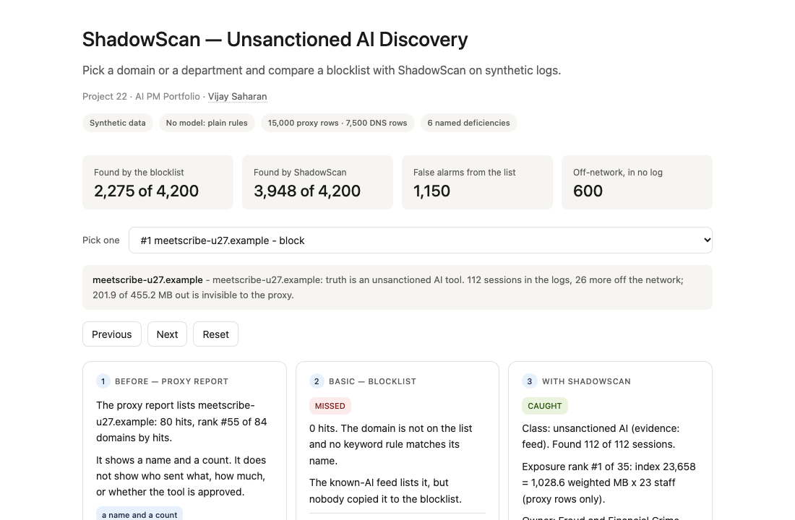
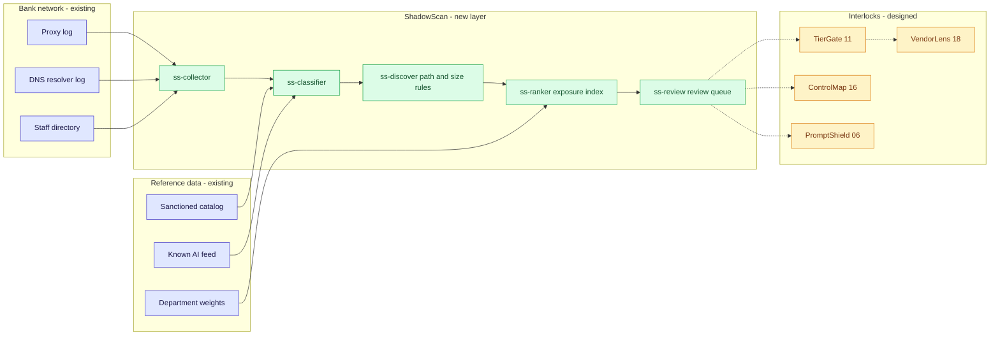
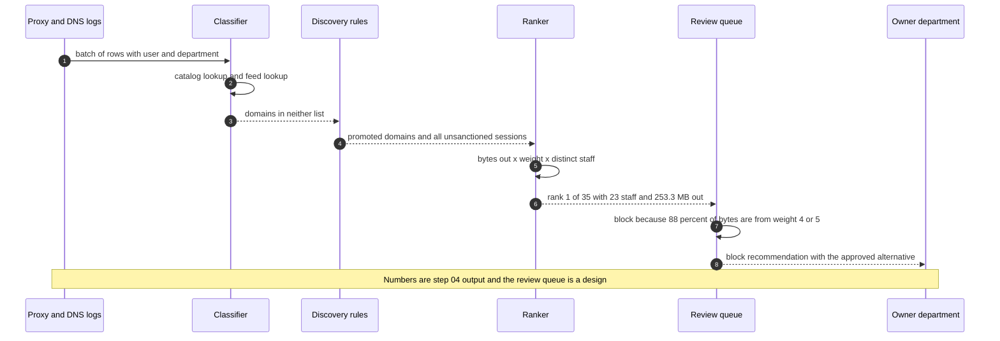

# 🔦 ShadowScan — Finding the AI Tools Staff Already Use, Ranked by Data Exposure

**A portfolio prototype for discovering AI use nobody approved, from proxy and DNS logs: a catalog and feed lookup, a generation-style path pattern, an upload-size test, a ranking by data exposure and a block, sanction or coach recommendation for each tool. Aligned to the AI-system inventory theme under the Govern function of the [NIST AI RMF](https://www.nist.gov/itl/ai-risk-management-framework) and to the sensitive-information-disclosure theme of the [OWASP LLM Top 10](https://genai.owasp.org/llm-top-10/).**

**▶ Static demo, no install:** [open on GitHub Pages](https://vj-shipped-anyway.github.io/ai-pm-portfolio/22-shadowscan-unsanctioned-ai-discovery/demo.html)

[](https://vj-shipped-anyway.github.io/ai-pm-portfolio/22-shadowscan-unsanctioned-ai-discovery/demo.html)

**What it shows** (🟢 measured on synthetic data; the script is named in brackets):

- 🟢 Discovery: 3,948 of 4,200 unsanctioned AI sessions found (recall 94.0%, precision 87.9%) (`step_04`)
- 🟢 Ranking: the top 10 by hit count and the top 10 by exposure share 0 of 10 domains (`step_03`)
- 🟢 Known limit: 600 off-network sessions (12.5% of all unsanctioned AI sessions) are in no log (`step_03`, `step_04`)

_A portfolio prototype on synthetic data, not a production case study. The framing, how to read the numbers and the regulatory note are folded below._


[](./demo.html)


> **▶ 30-second demo:** the [clickable demo](./demo.html) gets you the full story in 30 seconds with no install.

<details>
<summary>Framing, how to read the numbers, and the regulatory note</summary>

> **Regulatory note.** This README cites SR 11-7 or its replacement, [SR 26-2](https://www.federalreserve.gov/supervisionreg/srletters/SR2602.htm) (Federal Reserve, OCC and FDIC, April 17, 2026). SR 26-2 sets no enforceable standards, is aimed mainly at banks with over $30 billion in assets, and places generative AI and agentic AI outside its scope. Here those citations name the design basis for validation, monitoring and inventory practices, or serve as an analogy. They are not a claim that the project meets SR 26-2 or that SR 26-2 governs the systems it examines.

> **Framing:** This is a portfolio prototype, not a production case study. The six-deficiency taxonomy, the exposure formula, the next-action rules, the architecture, the data generator and the walkthrough are mine. Every number below is either printed by a script in this folder on data I generated, or is modeled with its assumption named. Production validation (real proxy and DNS logs, a real catalog, a security operations read, an AI governance read) is what the next role does.

> **Reading the numbers — credibility tags inline.** Every number in this README and the demo is tagged 🟢 **Measured** (printed by a script in `src/` on the shipped synthetic data: 15,000 proxy rows, 7,500 DNS rows, 520 staff, 30 unsanctioned AI domains), 🟡 **Modeled** (an assumption named in one line), or 🔴 **Hypothetical** (designed and reasoned about, never tested). Full convention in the [master README's "Reading the numbers" section](../README.md#-reading-the-numbers). **All data is synthetic and produced by a seeded script. The truth is known because the data is synthetic: the generator decided which domains are AI tools nobody approved. Agreement that holds by construction (the feed lookup, the catalog lookup) is labeled as such. No model is used anywhere in this repo.**

</details>

---

## 🔥 Demo in 30 seconds

Open the static, no-Python demo: [`demo.html`](./demo.html).
Pick one of 24 things to look at: the ten highest-exposure domains ShadowScan found, four cases worth a second look (a tool to sanction, an AI feature inside an approved product, a tool it misses, a harmless site the blocklist flags), or one of the ten departments. Three cards show the same logs three ways: the proxy report (a name and a count), a static blocklist (what it hits, what it misses, what it flags by mistake, next to the truth) and ShadowScan (the class, the exposure rank, the owner department and the next action). The totals at the top end at the 🟢 measured numbers: 3,948 of 4,200 unsanctioned AI sessions found against 2,275 for the blocklist, 1,150 look-alike sessions the list flags by mistake, and 600 sessions in no log.

To run the four-step walkthrough on your laptop:

```bash
git clone https://github.com/Vj-shipped-anyway/ai-pm-portfolio
cd ai-pm-portfolio/22-shadowscan-unsanctioned-ai-discovery/src
python3 step_01_status_quo.py
python3 step_02_blocklist_baseline.py
python3 step_03_deficiencies_exposed.py
python3 step_04_with_shadowscan.py
```

To regenerate the synthetic data (the output is identical on every run): `python3 ../data/_generate.py`.
To run the Streamlit prototype: `pip install -r requirements.txt`, then `streamlit run app.py` from `src/` (or `streamlit run 22-shadowscan-unsanctioned-ai-discovery/src/app.py` from the repo root).

---

## 💰 Why this lands — competitive positioning

Teams that want to know which AI tools staff use start with one of two cheap controls: ask people (a questionnaire or a spreadsheet inventory) or block known domains. I compare approaches rather than vendors, so the table below scores the blocklist and the new layer on the same synthetic logs and says plainly what a questionnaire cannot be scored on here.

| Capability | Questionnaire or spreadsheet inventory | Static blocklist | **ShadowScan** |
| --- | --- | --- | --- |
| Finds AI tools nobody told you about | Only what staff report. Not scored: no survey data was generated | 🟢 Hits 14 of 30 unsanctioned AI domains | 🟢 Finds 28 of 30 |
| Unsanctioned AI sessions found | n/a | 🟢 2,275 of 4,200 (54.2%) | 🟢 3,948 of 4,200 (94.0%); 3,311 of those come from the feed lookup, by construction |
| Raises alarms on harmless sites | n/a | 🟢 1,150 look-alike sessions on 10 domains; precision 66.4% | 🟢 542 sessions on 2 benign domains; precision 87.9% |
| Sees an AI feature inside an approved product | Only if the owner knows it is on | 🟢 0 of 1,200 sessions | 🟢 491 of 1,200 (40.9%) |
| Says how much data left, and from where | No | No: a hit count | Yes: bytes out x department weight x staff, as an index |
| Ranks by exposure | No | No | 🟢 9 of 10 of its top 10 match the truth ranking; the hit-count top 10 shares 0 of 10 with the exposure top 10 |
| Tells the owner what to do | No | No | Block, sanction or coach, with an owner department (🔴 thresholds are assumptions) |
| Sees personal-device and off-network use | Only if staff say so | No | No. 🟢 600 sessions (the known limit) |
| Where it still fails | Depends on honest, current answers | Goes stale; keyword rules flag look-alike names | Chat tools on plain paths with small payloads; DNS-only branches; off-network use |

**Position:** *ShadowScan does not replace the proxy, the sanctioned catalog or the approval process. It adds the step between a log line and a decision: which of these domains is an AI tool nobody approved, how much sensitive data is going to it, who owns the problem and what to do about it. A blocklist tells you a domain was reached. This tells you which one to look at first.*

---

## The honest version (why this exists)

The failure mode this prototype is built around: a bank approves a set of AI tools and keeps a list of domains to block. Staff use other AI tools anyway, because the approved ones do not do the job or are slow to get. New AI domains appear faster than the list is edited. AI features arrive inside software the bank already approved as ordinary software, so the domain looks sanctioned. And a count of hits says nothing about whether a tool received a chat prompt or a signed contract.

This is a prototype on synthetic data. I wrote the generator, the catalog, the feed, the blocklist, the classifier, the exposure formula and the next-action rules. The logs are produced by a seeded script, not by a proxy, a resolver or a model, and no model is used anywhere in this repo. The truth is known because the data is synthetic: the generator decides which domains are AI tools nobody approved, so it can score any method exactly. A real estate does not hand you that, which is why the first job in a real deployment would be capturing real proxy and DNS logs and a real catalog. Nothing here is a real bank, domain, product, vendor, log or incident.

The data is dense on purpose so that every effect appears often enough to count. It is a test set, not an estimate of how often real staff use AI tools, how large real logs are or how a real blocklist performs. The number of staff using AI outside the catalog in a real bank is a separate, named assumption in the utility section.

If you run security or AI governance at a bank and your control is a list of domains, fork it. The deficiency taxonomy, the exposure index and the next-action vocabulary are the parts worth lifting. Validating them against your own logs is the work the next role would do.

---

## Prereqs to run this on your laptop (in plain English)

You don't need a cluster, a cloud account or an API key. You need:

- **Python 3.** The four step scripts, the data generator and the demo builder use only the standard library (for example `csv`, `json`, `re`, `collections` and `pathlib`), so there is nothing to install for them. They are written for Python 3.9 and tested on it; they use no syntax newer than 3.9.
- **Git**, to clone the repo. `brew install git` / `winget install git`.
- **`src/requirements.txt` — only for the Streamlit app.** It lists `streamlit`, `pandas`, `numpy` and `plotly`. The step scripts do not import any of them. Run `pip install -r src/requirements.txt` only if you want the app.
- **No API key.** There is no model call, no network call and no secret anywhere. The catalog lookup, the feed lookup, the path pattern, the size test and the ranking are plain rules you can read.
- **Not needed:** a database, a SIEM, containers, Kubernetes or a cloud account. They appear in [`ARCHITECTURE.md`](./ARCHITECTURE.md) as the production design, not as prototype requirements.

Each step script finishes in seconds and writes its CSV or JSON to `src/out/`. The clickable `demo.html` runs in any browser with zero install. If a step does not run from a fresh clone, that's a bug in the README. Open an issue.

---

## Executive summary (90 seconds)

**Problem.** A modeled bank has a catalog of 12 approved tools and a static blocklist of 15 entries. Staff also use AI tools nobody approved. In two weeks of synthetic logs, 🟢 4,200 sessions went to 30 unsanctioned AI domains, and 🟢 1,200 more used an AI feature inside a product the bank approved as ordinary software. The blocklist finds 2,275 of the 4,200, says nothing about how much data left, and flags 1,150 sessions to harmless look-alike names. Another 600 sessions happen on personal devices and are in no log.

**Product.** ShadowScan, a read-only layer over the proxy and DNS logs: a **catalog lookup** (approved tool, or approved software whose AI features were never reviewed), a **feed lookup** of known AI domains, a **generation-style path pattern** and an **upload-heavy size test** that discover domains the feed lacks, an **exposure ranking** (bytes out x department sensitivity weight x distinct staff) and a **next action** for each domain (block, sanction or coach) with an owner department. A person confirms before anything is blocked (a design; the prototype only recommends).

**Measured and modeled performance.**

- 🟢 **Discovery: 3,948 of 4,200 unsanctioned AI sessions found (recall 94.0%, precision 87.9%)** (`step_04`). The blocklist finds 2,275 (54.2%) (`step_02`). 28 of 30 domains found; the list hits 14.
- 🟢 **Where the recall comes from.** The feed lookup alone finds 3,311 of 4,200 (78.8%), and that part is by construction: the generator put 22 of the 30 domains in the feed. The path and size rules add 637 sessions on 6 of the 8 domains the feed lacks (`step_04`).
- 🟢 **Ranking: the top 10 by hit count and the top 10 by exposure share 0 of 10 domains** (`step_03`). The hit-count top 10 holds 3.1% of total exposure. ShadowScan's top 10 matches the truth ranking on 9 of 10 (`step_04`); the miss is a false positive at #3.
- 🟢 **Embedded AI: 491 of 1,200 sessions found (40.9%)**, with 40 false positives (`step_04`). The blocklist finds none.
- 🟢 **False positives: 542 sessions on 2 benign domains** called unsanctioned AI by the path and size rules (`step_04`). One of them ranks #3 by exposure.
- 🟢 **Known limit: 600 off-network sessions** (12.5% of all unsanctioned AI sessions) are in no log (`step_03`, `step_04`). 2 AI domains that use plain paths and small payloads are never discovered (`step_04`).
- 🟡 **Utility: (20.562 − 11.849) × 1,500 = about 13,070 extra unsanctioned AI sessions brought into view per two-week window**, assuming a bank of 10,000 staff of whom 15% use AI outside the catalog (`step_04`).
- 🔴 **Design target: every sanction candidate goes to intake (TierGate) and due diligence (VendorLens) before approval.** Designed in `ARCHITECTURE.md`, never built or timed.

**Call to action.** Fork this repo. Swap [`data/proxy_log.csv`](./data/proxy_log.csv), [`data/dns_log.csv`](./data/dns_log.csv), [`data/sanctioned_catalog.csv`](./data/sanctioned_catalog.csv) and [`data/known_ai_domains.csv`](./data/known_ai_domains.csv) for exports from your proxy, resolver, catalog and feed, and call `classify` and `build_items` from `step_04` on them. The truth file exists only because the data is synthetic.

---

## 🗺️ What this walkthrough covers

1. **The use case** — a modeled bank with 12 approved tools and AI use nobody approved
2. **Sample data** — 15,000 proxy rows, 7,500 DNS rows, 520 staff, per-session truth, 600 sessions in no log
3. **Step 1 — Before ShadowScan** — the proxy report: domains ranked by hits, with AI use buried in it
4. **Step 2 — Basic approach** — a static blocklist; what it hits, misses and flags by mistake
5. **Step 3 — The six named deficiencies** — each with a count from the dataset
6. **Step 4 — The fix (ShadowScan)** — classify, discover, rank by exposure, recommend; scored against the truth, with the known limit printed
7. **Utility delivered** — a multiplied number with the assumption named
8. **Architecture & call flow** — topology and a per-batch sequence
9. **PM artifacts** — PRD and architecture

> Non-technical reader: skip the code blocks. The plain-English explanation and the output tables tell the story.
> Technical reader: every code block runs. `cd src && python3 step_NN_*.py` and you'll see the same output.

Total reading time: about 12 minutes deep, 3 minutes if you skim.

---

## 🎯 The Use Case

**A modeled bank. 12 approved tools, a blocklist of 15 entries, 520 staff, 10 departments.**

The information-security lead sees a proxy report: domains ranked by hits. The AI governance lead owns the list of approved AI tools and the approval path. Neither can say which AI tools staff actually use, how much sensitive data goes to them or which department to call first. Three things show up in the synthetic logs:

- **A transcription tool nobody approved.** `meetscribe-u27.example` is not on the blocklist, and it sits at #55 of 84 domains in the hit-count report. It ranks #1 by exposure: 23 staff sent 253.3 MB through the proxy, 88% of it from departments weighted 4 or 5. 🟢 The blocklist finds 0 of its sessions; ShadowScan finds 112 of 112.
- **An AI feature inside an approved product.** The meetings product `meet-p04.example` is in the catalog as ordinary software, so its domain looks sanctioned. 🟢 133 of its sessions use an AI feature; ShadowScan finds 70 of them by path and cannot read the other 63.
- **A harmless file-sharing site called an AI tool.** `filevault-f01.example` takes large uploads, which the size test reads as document upload to an AI tool. 🟢 It ranks #3 by exposure and is a false positive. The next action is a recommendation that a person reviews.

The users are the information-security lead and the AI governance lead. The department owners get the next action; the model risk reviewer needs the inventory to be true. ShadowScan is designed for those four.

---

## 📊 Sample Data

Eight CSVs in [`data/`](./data/), produced by [`data/_generate.py`](./data/_generate.py) (standard library, seeded, deterministic: running it twice produces identical files). Documented in [`data/README.md`](./data/README.md), which also records the one parameter change made after the first run. Real rows from three of the files, picked to show each kind of session:

**[`data/proxy_log.csv`](./data/proxy_log.csv)** — 15,000 sessions seen by the proxy. Lines for an approved AI tool, an AI feature inside an approved product (a vendor-specific path), a harmless look-alike name, an unsanctioned AI tool on an API-style path, an AI feature on a generation-style path, a document upload to an unsanctioned tool and a large upload to a harmless file share:

```
hour,user_id,dept,domain,path,bytes_out,bytes_in,client_class
0,U0495,FAC,assist-s01.example,/app,3428,16710,browser
3,U0175,FIN,app.crm-p02.example,/labs/quick-draft,8669,35152,browser
6,U0152,FIN,maintenance-log-l02.example,/home,2516,11406,browser
7,U0355,ENG,refactorly-u20.example,/v1/completions,68286,4143,desktop_app
7,U0492,FAC,docs-p01.example,/api/v2/assist/summarize,25603,17485,browser
7,U0510,FAC,pdfchat-u09.example,/chat-with-doc/1589,491691,3531,browser
9,U0181,FIN,filevault-f01.example,/upload,326846,2388,browser
```

**[`data/truth_sessions.csv`](./data/truth_sessions.csv)** — the label the generator gave each of those sessions (line `k` of this file labels line `k` of the proxy log), then the first off-network sessions, which have no log row:

```
session_id,true_label,true_bytes_out,user_id,domain
P7,sanctioned_ai,,,
P18,embedded_ai_in_approved_saas,,,
P35,benign_lookalike,,,
P60,unsanctioned_ai,,,
P72,embedded_ai_in_approved_saas,,,
P74,unsanctioned_ai,,,
P169,other,,,
X1,off_network,7950,U0002,askpilot-u02.example
X2,off_network,2537490,U0002,briefreader-u11.example
X3,off_network,670121,U0002,callsummary-ai-u29.example
```

**[`data/dns_log.csv`](./data/dns_log.csv)** — 7,500 lookups from branch staff: a name and nothing else.

```
hour,user_id,domain
1,U0484,videohub-g09.example
2,U0090,banknews-g11.example
2,U0186,api.desk-p03.example
```

The other files: [`sanctioned_catalog.csv`](./data/sanctioned_catalog.csv) (12 approved tools, 7 approved as AI tools and 5 as ordinary software), [`known_ai_domains.csv`](./data/known_ai_domains.csv) (a feed of 40 domains, partly out of date), [`blocklist.csv`](./data/blocklist.csv) (15 entries), [`dept_sensitivity.csv`](./data/dept_sensitivity.csv) (a sensitivity weight of 1 to 5 per department, an assumption of a modeled bank) and [`users.csv`](./data/users.csv).

Truth by label over the 22,500 log rows: 3,050 sanctioned AI, 4,200 unsanctioned AI, 1,200 AI-feature sessions inside approved software, 1,150 benign look-alike names and 12,900 other. Plus 600 sessions in no log.

The data includes hard cases on purpose: 8 AI domains absent from both lists, 2 of which use plain paths and small payloads; AI features on vendor-specific paths; clients that hide the path; a reports page and a file share that look like AI tools to a rule; and look-alike names.

---

## 🔧 Step 1 — Before ShadowScan: the proxy report shows hits, and nobody reviews AI use

**In plain English:** The only view is the proxy report: domains ranked by hits. AI tools nobody approved are in it, in among the approved tools and the ordinary sites. The report gives a name and a count.

```bash
python3 src/step_01_status_quo.py
```

**The report, and what is in it:**

```
WHAT THE REPORT SHOWS: top 15 domains by hits in the proxy log
  (the third column is the report; the last column is the truth, which the report does not have)
  rank  domain                        hits users  truth (main label of its sessions)
     1  docs-p01.example              1200   366  other
     2  crm-p02.example               1080   324  other
     3  desk-p03.example               770   306  other
     4  newsdesk-g01.example           647   314  other
     5  assist-s01.example             600   309  sanctioned_ai
     6  codehelp-s02.example           500   295  sanctioned_ai
     7  meet-p04.example               500   274  other
     8  notes-s03.example              400   251  sanctioned_ai
     9  marketwire-g02.example         372   250  other
    10  people-p05.example             350   202  other
    11  intranet-i01.example           330   226  other
    12  translate-s04.example          300   224  sanctioned_ai
    13  weatherbit-g03.example         269   192  other
    14  talkwise-u01.example           260    84  unsanctioned_ai
    15  summarize-s05.example          250   191  sanctioned_ai
```

```
AI-LOOKING TRAFFIC THAT NOBODY REVIEWS (truth labels; premise: no review process exists)
  Sessions visible in some log: 22,500
    sanctioned AI tools:                   3,050
    unsanctioned AI tools:                 4,200 across 30 domains
    AI features inside approved SaaS:      1,200
    benign look-alike names:               1,150
    everything else:                       12,900
  AI use outside the catalog's scope that a log can see: 5,400 sessions (24.0% of visible sessions)
  Staff with at least one such session: 198 of 520 (38.1%)
  Plus 600 sessions on personal devices or off the network that no log shows (truth only).

RESULT
  Unsanctioned AI domains in the top 15 of the hit-count report: 1 of 30; the best-ranked sits at #14.
  The report gives a name and a count: no sign of what left, from which department, or whether the tool is approved.
```

🟢 Every count above is printed by `step_01`. The truth column is the generator's label, which the report does not have. 🔴 The premise that no process reviews AI-looking traffic is a design assumption of the modeled bank, not a measurement.

---

## 🤖 Step 2 — With the basic approach: a static blocklist

**In plain English:** Keep a list of known AI domains and count the hits. Add a keyword rule when the list goes stale. Both are cheap and both are reasonable.

```bash
python3 src/step_02_blocklist_baseline.py
```

The list is a stand-in written for this exercise: 13 exact domain entries (4 of them retired) and 2 keyword rules. Hits are counted in a report; this prototype does not model whether the proxy also dropped the request.

```
THE LIST: 15 entries = 13 exact domains + 2 keyword rules
  4 of the 13 exact entries are retired domains that match no traffic in either log; 9 are live.

HITS BY ENTRY (entries with at least one hit)
  entry                        type      hits  true AI  look-alike
  ai                           keyword   1815      665        1150
  talkwise-u01.example         domain     364      364           0
  askpilot-u02.example         domain     266      266           0
  codepal-u17.example          domain     238      238           0
  quickai-u03.example          domain     210      210           0
  chatnest-u04.example         domain     168      168           0
  pdfchat-u09.example          domain     112      112           0
  voicenote-u26.example        domain      98       98           0
  docsense-u10.example         domain      84       84           0
  pixelforge-u22.example       domain      70       70           0

RESULT (both logs, scored against truth_sessions.csv)
  Blocklist hits: 3,425
    unsanctioned AI sessions (correct hits): 2,275 of 3,425 hits (66.4% precision)
    benign look-alike sessions (false alarms): 1,150 on 10 look-alike domains (1,150 from the keyword rules)
    other false alarms: 0
  Unsanctioned AI sessions visible in the logs: 4,200
    found by the list: 2,275 (54.2% recall); missed: 1,925
    proxy log: 1,625 of 3,000 found
    DNS log: 650 of 1,200 found
  6 of the 30 unsanctioned AI domains have a keyword in their name (also exact entries: 1).
  Keyword rules: 1,815 hits; 665 were AI tools whose name contains the keyword, 1,150 were look-alikes.
  Sessions on personal devices or off the network: 600 (no log has them, so no list can hit them).
```

- **The list is only as current as the last edit.** 🟢 It finds 2,275 of 4,200 unsanctioned AI sessions (54.2%) and hits 14 of 30 domains.
- **The keyword rule trades one error for another.** 🟢 It recovers some AI domains whose names happen to contain `ai`, and it flags 1,150 sessions to harmless names. Precision of the list is 66.4%.

---

## 🔬 Step 3 — Where this still breaks: 6 named deficiencies

| # | Deficiency | What goes wrong | Count in this dataset |
| --- | --- | --- | --- |
| 1 | **Stale blocklist** | New AI domains appear faster than the list is edited, and retired ones stay on it. | 🟢 16 of 30 unsanctioned AI domains never hit; 1,925 of 4,200 sessions pass the list unseen; 4 of 13 exact entries are retired |
| 2 | **Embedded AI looks sanctioned by domain** | An AI feature inside an approved product shares the product's domain. | 🟢 1,200 of 1,200 sessions match a catalog domain; the blocklist hits 0 |
| 3 | **DNS-only logs show a name, no volume** | A lookup row cannot tell a 198-byte request from an 18,521,380-byte upload. | 🟢 1,200 of 4,200 sessions (28.6%) are seen only in DNS; they sent 651.3 MB |
| 4 | **Look-alike names are flagged** | A keyword rule cannot tell `ai` in a word from an AI tool. | 🟢 1,150 sessions on 10 harmless domains; precision of the list 66.4% |
| 5 | **Hit count is not exposure** | The busiest domain is not the one receiving the most sensitive data. | 🟢 Top-10 overlap 0 of 10; the hit-count top 10 holds 3.1% of exposure |
| 6 | **Off-network use is invisible** | A personal device on a home network is in no log. | 🟢 600 sessions, 12.5% of all unsanctioned AI sessions |

```bash
python3 src/step_03_deficiencies_exposed.py
```

```
(1) A stale blocklist
    16 of 30 unsanctioned AI domains are never hit by the list: 8 are in the known-AI feed but were never copied to the list, 8 are in neither.
    1,925 of 4,200 unsanctioned AI sessions pass the list unseen.
    4 of 13 exact entries are retired domains. The feed is stale too: 11 of 40 entries match no traffic, and 8 unsanctioned AI domains are absent from it.

(2) Embedded AI inside approved SaaS looks sanctioned by domain
    1,200 sessions use an AI feature inside 5 approved SaaS products (900 in the proxy log, 300 in the DNS log).
    1,200 of 1,200 match a catalog domain, so they look sanctioned; the blocklist hits 0, the feed lists 0.

(3) DNS-only logs show a name but no volume
    1,200 of 4,200 visible unsanctioned AI sessions (28.6%) are seen only in the DNS log, across 30 domains and 49 staff.
    The truth says they sent 651.3 MB (27.1% of all bytes out in visible unsanctioned AI sessions). The DNS log shows none of it.
    Bytes out per session range from 198 B to 18,521,380 B (median 13,620 B): one lookup row cannot tell them apart.

(4) Look-alike benign domains are flagged
    The keyword rules fire on 1,150 sessions to 10 benign look-alike domains.
    63.4% of keyword hits are false alarms; overall precision of the list is 66.4% (2,275 of 3,425 hits).

(5) Ranking by hit count and ranking by data exposure give different top-10 lists
    Over the 30 true unsanctioned AI domains (picked by truth, so detection is perfect): the top 10 by hits and the top 10 by exposure share 0 of 10 domains.
    The #1 domain by exposure (meetscribe-u27.example) is #14 by hits; the #1 by hits (talkwise-u01.example) is #19 by exposure.
    The hit-count top 10 holds 3.1% of total exposure; the exposure top 10 holds 87.6%.

(6) Off-network and personal-device use is invisible
    600 unsanctioned AI sessions were injected on personal devices or off the network, by 169 staff. No log row exists for any of them.
    They are 12.5% of all unsanctioned AI sessions (600 of 4,800). 4 of those staff appear in no log as an unsanctioned AI user.
    The truth says they sent 490.7 MB, against 2,402.5 MB in the sessions the logs can show.

RESULT
  #   deficiency                                         count
  1   Stale blocklist: domains never hit                 16 of 30
  2   Embedded AI looks sanctioned by domain             1,200 of 1,200 sessions
  3   DNS-only: a name, no volume                        1,200 of 4,200 sessions
  4   Look-alike domains flagged                         1,150 sessions on 10 domains
  5   Hit count vs exposure: top-10 overlap              0 of 10
  6   Off-network use: invisible sessions                600
```

```
  Top 10 by hits vs top 10 by exposure (true unsanctioned AI domains)
  by hits                       hits   by exposure                    exposure
  talkwise-u01.example           364   meetscribe-u27.example            23658
  thinkdesk-u05.example          294   voicenote-u26.example             18324
  askpilot-u02.example           266   callsummary-ai-u29.example        15116
  codepal-u17.example            238   transcribo-u28.example            14706
  devassist-ai-u18.example       210   briefreader-u11.example            9841
  quickai-u03.example            210   dictate-u30.example                9301
  wordsmith-ai-u06.example       196   sheetmind-u13.example              8715
  bridge-chat-u07.example        182   pdfchat-u09.example                8086
  snippetgen-u19.example         182   contract-ai-u12.example            6788
  chatnest-u04.example           168   filesage-u16.example               4303
```

The basic approach counts hits on what it already knows. **The product is the discovery, the ranking and the recommendation, not the count.** Deficiency 5 is a property of this generator's byte sizes. 🟢 The most-hit domain, `talkwise-u01.example`, sent 0.951 MB over 260 proxy sessions; `meetscribe-u27.example`, #1 by exposure, sent 253.3 MB over 80 (`step_04`'s `out/step_04_exposure_ranking.csv`). The overlap on real logs is unknown and is the first thing a pilot would measure.

---

## 🛠️ Step 4 — The fix: ShadowScan

Plain rules, no model:

1. **Catalog lookup.** A host under a catalog domain is a sanctioned AI tool if the catalog says the AI behavior was reviewed. If the product was approved as ordinary software, a proxy path that looks like generation (`/v1/chat/completions`, `/ai/draft`, `/assist/summarize`) marks the session as an AI feature inside an approved product. Everything else on that domain is ordinary use.
2. **Feed lookup.** A domain in the known-AI feed that is not in the catalog is an unsanctioned AI tool.
3. **Discovery by path and size.** For domains in neither list, a session is flagged if its path looks like generation or if it is upload-heavy (at least 100,000 bytes out and at least 5 times the bytes in). A domain is promoted to unsanctioned AI when at least 3 of its proxy sessions, and at least a quarter of them, are flagged. Once promoted, every session to it counts, including the DNS rows, which carry a name only.
4. **Exposure ranking.** Per discovered domain: (the sum of bytes out x the department's sensitivity weight, in MB) x distinct staff, from proxy rows only. It is a ranking index, not a measure of leaked data. Distinct staff is a breadth multiplier on purpose: a tool 100 people use is harder to fix than one 3 people use.
5. **Next action.** Block if the domain is in the top 10 by exposure and departments weighted 4 or 5 send at least half the bytes. Sanction if at least 25 staff use it and that share is under 30%: take it to intake and due diligence. Coach otherwise. Each action names an owner department and, where the feed gives a category, the approved tool that does the same job. All thresholds are 🟡 assumptions of a modeled bank, not advice.

```bash
python3 src/step_04_with_shadowscan.py
```

The rules and thresholds, as the script prints them:

```
RULES (thresholds are assumptions of a modeled bank)
  R1  catalog domain, AI behavior reviewed                  -> sanctioned_ai
  R2  catalog domain, approved as ordinary software         -> embedded_ai_in_approved_saas if the proxy path looks like generation, else other
  R3  domain in the known-AI feed                           -> unsanctioned_ai
  R4  any other domain: a session is flagged by a generation-style path, or by at least 100,000 bytes out and 5x the bytes in;
      the domain is promoted when at least 3 of its proxy sessions, and at least 25% of them, are flagged -> unsanctioned_ai
  R5  anything else                                         -> other
  Next action: block = top 10 by exposure and at least 50% of bytes from departments weighted 4 or 5;
               sanction = at least 25 staff and under 30% of bytes from those departments; otherwise coach
```

**Domains the heuristics discover (not in the catalog or the feed):**

```
DOMAINS THE HEURISTICS DISCOVER (not in the catalog or the feed)
  domain                       sessions flagged  share  evidence    truth
  reports-r01.example               150      86    57%  path        other
  filevault-f01.example             150      74    49%  ratio       other
  paperlens-u15.example              70      68    97%  path+ratio  unsanctioned_ai
  refactorly-u20.example            110      64    58%  path+ratio  unsanctioned_ai
  bridge-chat-u07.example           130      59    45%  path        unsanctioned_ai
  filesage-u16.example               60      55    92%  path+ratio  unsanctioned_ai
  dictate-u30.example                50      50   100%  ratio       unsanctioned_ai
  visualyze-u25.example              35      19    54%  path        unsanctioned_ai
```

**The exposure ranking, top 12 of 35 discovered items:**

```
EXPOSURE RANKING (top 12 of 35 discovered items; index = MB x weight x users, proxy rows only)
   # domain                       kind      evidence    users   MB out  exposure owner hi-sens  action
   1 meetscribe-u27.example       tool      feed           23    253.3     23658 FRD       88%  block
   2 voicenote-u26.example        tool      feed           20    231.3     18324 HRP       67%  block
   3 filevault-f01.example        tool      ratio         119     42.4     17683 CRD       52%  block
   4 callsummary-ai-u29.example   tool      feed           19    216.1     15116 HRP       66%  block
   5 transcribo-u28.example       tool      feed           17    216.0     14706 HRP       82%  block
   6 briefreader-u11.example      tool      feed           27     98.3      9841 ENG       55%  block
   7 dictate-u30.example          tool      ratio          14    180.8      9301 LEG       60%  block
   8 sheetmind-u13.example        tool      feed           21     96.0      8715 LEG       92%  block
   9 pdfchat-u09.example          tool      feed           22    107.0      8086 FIN       73%  block
  10 contract-ai-u12.example      tool      feed           21     75.9      6788 LEG       89%  block
  11 filesage-u16.example         tool      path+ratio     17     59.5      4303 CRD       94%  coach
  12 notesum-u14.example          tool      feed           15     62.7      4079 FIN      100%  coach
  Next actions across all 35 items: block 10, sanction 2, coach 23
```

**What the app and the demo show for four of the picks** (the same sentences, the same numbers, printed by `step_04`):

```
WHAT THE APP AND THE DEMO SHOW (four of the picks; the same sentences, the same numbers)
  PICK: #1 meetscribe-u27.example - block
    Report:      The proxy report lists meetscribe-u27.example: 80 hits, rank #55 of 84 domains by hits.
    Blocklist (MISSED): 0 hits. The domain is not on the list and no keyword rule matches its name. The known-AI feed lists it, but nobody copied it to the blocklist.
    Blue card:   Truth (synthetic): an AI tool nobody approved. 112 sessions in the logs (80 proxy, 32 DNS) by 31 staff. 253.3 MB out in the proxy log; 99.2 MB more in DNS sessions that show no size. 26 more sessions (102.7 MB) on personal devices that no log shows.
    ShadowScan (CAUGHT): Class: unsanctioned AI (evidence: feed). Found 112 of 112 sessions. Exposure rank #1 of 35: index 23,658 = 1,028.6 weighted MB x 23 staff (proxy rows only). Owner: Fraud and Financial Crime. 88% of the bytes come from departments weighted 4 or 5.
    Next action: BLOCK: Block at proxy and DNS; tell Fraud and Financial Crime to use S-03 Meeting notes summarizer.
  PICK: #3 filevault-f01.example - block
    Report:      The proxy report lists filevault-f01.example: 150 hits, rank #26 of 84 domains by hits.
    Blocklist (NO HIT (CORRECT)): 0 hits. The list is right about this domain: it is an ordinary site.
    Blue card:   Truth (synthetic): not an AI tool. 263 sessions (150 proxy, 113 DNS) by 189 staff.
    ShadowScan (WRONG: FALSE POSITIVE): Class: unsanctioned AI (evidence: ratio). Exposure rank #3 of 35: index 17,683. Owner: Credit Underwriting. Flagged 263 sessions by name once the rules fired on its proxy rows.
    Next action: BLOCK: Block at proxy and DNS; tell Credit Underwriting; the feed gives no category, so no catalog tool is suggested. Note: False positive of the path and ratio rules. The action is a recommendation that a person reviews, not an automatic block.
  PICK: #15 meet-p04.example - coach (AI feature in approved SaaS)
    Report:      The proxy report lists meet-p04.example: 500 hits, rank #7 of 84 domains by hits.
    Blocklist (MISSED: LOOKS APPROVED): 0 hits. P-04 Meetings and video is in the sanctioned catalog, so the domain looks approved. The AI feature inside it is invisible by domain.
    Blue card:   Truth (synthetic): the domain belongs to the approved product P-04 Meetings and video, but 133 of its sessions use an AI feature (100 proxy, 33 DNS) by 94 staff. 20.6 MB out in the proxy log for those sessions.
    ShadowScan (FLAGGED): Class: AI feature inside approved SaaS (evidence: path in approved SaaS). Found 70 of 133 sessions. Exposure rank #15 of 35: index 2,900. Owner: Technology and Engineering. The other 63 sessions use a vendor-specific path or a DNS row, which a path pattern cannot read.
    Next action: COACH: Coach Technology and Engineering on the approved scope.
  PICK: ponder-u08.example - not found (known limit)
    Report:      The proxy report lists ponder-u08.example: 100 hits, rank #48 of 84 domains by hits.
    Blocklist (MISSED): 0 hits. The domain is not on the list and no keyword rule matches its name. It is in neither the known-AI feed nor the list.
    Blue card:   Truth (synthetic): an AI tool nobody approved. 140 sessions in the logs (100 proxy, 40 DNS) by 48 staff. 0.3 MB out in the proxy log; 0.1 MB more in DNS sessions that show no size. 26 more sessions (0.1 MB) on personal devices that no log shows.
    ShadowScan (MISSED: KNOWN LIMIT): Class: other. 0 of 140 sessions found. Why: proxy paths look ordinary and sizes are small, so no rule fires.
    Next action: None. ShadowScan does not know this domain exists. Note: Known limit: a chat tool on ordinary paths with small payloads and a hidden path is invisible to these rules.
```

**Measured against the truth labels:**

```
MEASURED AGAINST TRUTH (log-visible sessions)
  Unsanctioned AI sessions: found 3,948 of 4,200 (recall 94.0%); false positives 542 (precision 87.9%)
    the blocklist found 2,275 of 4,200 (recall 54.2%); ShadowScan found 1,673 that the list missed and lost 0 that the list hit
    proxy log: 2,820 of 3,000 found
    DNS log: 1,128 of 1,200 found
  Unsanctioned AI domains found: 28 of 30; of the 8 in neither the feed nor the list, 6 found
  How the 3,948 correct finds were made: 3,311 by the feed, 637 by the path and ratio rules on domains the feed lacks
  The feed alone would find 3,311 of 4,200 (78.8%); it lists 22 of the 30 domains by the generator's design, so that part is by construction
  Unsanctioned AI domains the blocklist hits at all: 14 of 30
  Embedded AI in approved SaaS: found 491 of 1,200 sessions (recall 40.9%); false positives 40 (precision 92.5%); the blocklist found 0
  Sanctioned AI sessions recognized: 3,050 of 3,050 (a catalog lookup, so by construction)
  Top 10 by exposure vs the truth ranking (same formula on truth-labeled proxy sessions): 9 of 10 shared
```

Classification confusion matrix (rows are the truth, columns are what ShadowScan said):

```
Confusion matrix (rows: truth; columns: what ShadowScan said)
                                   sanctioned_ai unsanctioned_ai     embedded_ai           other
  sanctioned_ai                            3,050               0               0               0
  unsanctioned_ai                              0           3,948               0             252
  embedded_ai_in_approved_saas                 0               0             491             709
  benign_lookalike                             0               0               0           1,150
  other                                        0             542              40          12,318
```

- **The feed does most of the work, and that part is by construction.** The generator put 22 of the 30 domains in the feed, so the lookup finds them. What the prototype adds is the 6 of 8 domains the feed lacks, found by path and size, and the ranking.
- **The ranking agrees with the truth ranking on 9 of 10, and the miss is the point.** The truth ranking uses the same formula on the generator's labels, so the only difference is classification: a false positive takes a place at #3.
- **No false negatives on sanctioned tools, by construction.** The catalog lookup is the rule that decides what is sanctioned, so 3,050 of 3,050 is not a result.

### The known limit, left in on purpose

```
WHAT IT STILL GETS WRONG (known limit, left in on purpose)
  1. Off-network and personal-device sessions: 600 sessions, 12.5% of all unsanctioned AI sessions (600 of 4,800), 490.7 MB out. No log has them, so no rule can find them.
  2. Unsanctioned AI sessions missed: 252 of 4,200. Why:
          139  proxy row, path and size look ordinary
           72  dns row on a domain the proxy rows did not discover (a name only)
           41  proxy row, path hidden (pinned app or mobile client), normal size
     Domains never discovered:
       ponder-u08.example            140 sessions
       typeahead-u21.example         112 sessions
  3. Embedded AI missed: 709 of 1,200 sessions. Why:
          300  DNS row: the name of an approved product, no path
          211  proxy row, vendor-specific path a pattern cannot match
          198  proxy row, path hidden
  4. False positives of the path and ratio heuristics: 542 sessions on 2 benign domains were called unsanctioned AI:
       filevault-f01.example         263 sessions  rule: ratio       truth: other  exposure rank #3
       reports-r01.example           279 sessions  rule: path        truth: other  exposure rank #25
     Benign sessions called embedded AI (an ordinary page whose path looks like generation): 40
       crm-p02.example                20 sessions
       desk-p03.example               20 sessions
  5. Exposure leaves out DNS-only bytes: 689.8 MB (truth) in discovered sessions that have no size in the log, against 1,811.7 MB measured.
  6. Content is not read. A tool on an ordinary-looking path with small payloads and a hidden path is invisible.
```

ShadowScan cannot find what no log shows, and it cannot read what is encrypted or hidden. 🟢 The 600 off-network sessions are 12.5% of all unsanctioned AI sessions. The 2 domains it never discovers (`ponder-u08.example` and `typeahead-u21.example`) look like ordinary traffic: plain paths, small payloads and, for some sessions, a path hidden by a pinned app. The two false-positive domains cross the discovery threshold because a reports page uses `generate` in its path and a file share takes large uploads. The mitigation is in the process, not the code: a person reviews every block recommendation, and a department can contest one. That review is 🔴 designed in the PRD, never tested with real reviewers.

Other limits, stated plainly: the exposure index leaves out DNS-only bytes; sensitivity weights are one assumption per department, not per document; a tool that sends nothing a path or a size can show is invisible to these rules; and a real feed would change which domains are found by lookup and which by rule.

---

## 📐 Utility Delivered

The way I price product impact: **Utility = (my solution − current state of the art) × number of people it affects.**

Here the terms are unsanctioned AI sessions found per staff member who used one, and the staff who use AI outside the catalog. Going from "a hit count on known domains" to "a ranked list of what staff actually use, with an owner and a next action" is not an outcome by itself. *Doing it for every member of staff who uses AI outside the catalog is.*

| Term | Value | Where it comes from |
| --- | --- | --- |
| Current state of the art (static blocklist), sessions found per staff member who used an unsanctioned AI tool | 🟢 **11.849** | `step_04`: 2,275 correct hits for 192 staff with at least one visible unsanctioned AI session |
| My solution (ShadowScan), sessions found per such staff member | 🟢 **20.562** | `step_04`: 3,948 correct finds for the same 192 staff |
| Unsanctioned sessions found beyond the blocklist | 🟢 **1,673** | `step_04`: 3,948 found by ShadowScan less 2,275 found by the list, for the same 192 staff; 0 that the list hit were lost |
| Per-staff lift | 🟢 20.562 − 11.849 = 8.71 | Extra sessions found per staff member (1,673 over 192 staff), in a two-week extract |
| Number it affects: staff using AI outside the catalog | 🟡 **1,500** | **Assumption, not a statistic:** a bank of 10,000 staff, 15% of them using AI outside the catalog. Edit `MODELED_STAFF` and `MODELED_OUTSIDE_SHARE` in `step_04` to use your own |
| Assumption that makes the lift real | 🟡 The review queue works the ranked list, and each block, sanction or coach recommendation is acted on | If nobody acts on the ranking, the lift is a better report and nothing else |
| **Utility** | 🟡 **(20.562 − 11.849) × 1,500 = about 13,070 extra sessions per two-week window** | Brought into view, not removed. 🟢 The 600 off-network sessions stay invisible to both |

The script prints the same arithmetic and the sensitivity to the number-of-staff assumption (🟡, same per-staff lift):

```
UTILITY (the delta is measured; the number of people is an assumption)
  Staff with at least one visible unsanctioned AI session: 192
  Blocklist: 2,275 correct hits = 11.849 sessions found per such staff member
  ShadowScan: 3,948 correct finds = 20.562 sessions found per such staff member
  Delta: 8.714 extra sessions found per staff member in the two-week extract
  Modeled people: 10,000 staff x 15% using AI outside the catalog = 1,500 (assumption, edit MODELED_STAFF and MODELED_OUTSIDE_SHARE)
  Utility = (20.562 - 11.849) x 1,500 = about 13,070 extra unsanctioned AI sessions brought into view per two-week window
    sensitivity: 500 staff gives about 4,360
    sensitivity: 1,500 staff gives about 13,070
    sensitivity: 3,000 staff gives about 26,140
```

🔴 What I have not measured: how many sessions stop after a recommendation, what a department owner does with a block, what any of this costs to run, and how often real staff use real AI tools. The synthetic extract is much denser than a real one. Treat the per-staff number as a property of this mix of tools, not a forecast.

---

## 🔄 Architecture & Call Flow

How each batch of log rows flows through the system. GitHub renders these diagrams natively. Component names match [`ARCHITECTURE.md`](./ARCHITECTURE.md).

**System topology:**



**Per-batch sequence** (the top-ranked domain, `meetscribe-u27.example`):



See [`assets/shadowscan-flow.svg`](./assets/shadowscan-flow.svg) for a static visual of the same flow.

**Interlocks (all 🔴 designed, none built):**

- [11 TierGate](../11-tiergate-ai-usecase-intake/) is the path to sanction a tool. A `sanction` recommendation opens an intake there instead of a ticket, so the tool gets a tier and the evidence that tier requires.
- 18 VendorLens: sanctioning a tool starts third-party due diligence before the tool enters the catalog.
- 16 ControlMap: the acceptable-use obligations a block or a coaching note rests on, mapped to the bank's own policy.
- [06 PromptShield](../06-promptshield-prompt-injection-defense/) is not a duplicate of this project. It defends a sanctioned model against injection and exfiltration; ShadowScan finds the tools nobody put behind it. Once a discovered tool is sanctioned, its traffic can be routed through PromptShield.
- 23 ScopeKeeper: a discovered tool that acts as an agent, with permissions on bank systems, goes to a scope review.

---

## 📋 PM Artifacts

The PM artifacts that show how I'd run this product if I owned the seat. This README is the walkthrough; the rest of the folder holds:

- [`PRD.md`](./PRD.md) — the product requirements doc: users, backlog, KPIs, rollout, open questions.
- [`ARCHITECTURE.md`](./ARCHITECTURE.md) — the systems doc: components, data model, security, failure behavior, operations. A design, not deployed.
- [`demo.html`](./demo.html) — clickable, no-install walkthrough; every number is generated from the scripts in `src/` by `src/_build_demo.py`.
- [`data/`](./data/) — the eight synthetic CSVs and the generator. `data/README.md` explains the ground-truth rules and the seed.
- [`src/`](./src/) — runnable step scripts and the Streamlit prototype.

Run the walkthrough end-to-end:

```bash
cd src
python3 step_01_status_quo.py
python3 step_02_blocklist_baseline.py
python3 step_03_deficiencies_exposed.py
python3 step_04_with_shadowscan.py
```

---

## 🚀 Fork this for your team

```bash
git clone https://github.com/Vj-shipped-anyway/ai-pm-portfolio
cd ai-pm-portfolio/22-shadowscan-unsanctioned-ai-discovery

# 1. Run the synthetic walkthrough as is
cd src
python3 step_01_status_quo.py
python3 step_02_blocklist_baseline.py
python3 step_03_deficiencies_exposed.py
python3 step_04_with_shadowscan.py

# 2. Open the interactive demo
open ../demo.html            # static snapshot of the synthetic run; it does not read data/
```

To point it at your own estate, replace these files and keep their columns:

- `data/proxy_log.csv`: `hour, user_id, dept, domain, path, bytes_out, bytes_in, client_class`
- `data/dns_log.csv`: `hour, user_id, domain`
- `data/sanctioned_catalog.csv`: `tool, domains, approved_data_class, ai_in_scope, use_case`
- `data/known_ai_domains.csv`: `domain, category`
- `data/users.csv` and `data/dept_sensitivity.csv`: the directory and your own sensitivity weights

The functions that do the work take the dict that `load_all` returns, so you can call them directly:

```python
# from src/
from step_01_status_quo import load_all
from step_04_with_shadowscan import analyze

a = analyze(load_all())          # classes, discovered domains, ranked items, scores
for item in a["items"][:10]:
    print(item["rank"], item["domain"], item["action"])
```

`data/truth_sessions.csv` and `data/blocklist.csv` exist for scoring and for the baseline. On real exports you will not have a truth file, so the accuracy lines in step 4 cannot be computed: expect to review a sample of flagged and unflagged sessions by hand instead. `load_all` reads the truth file and the blocklist; on real exports, remove those two reads and the scoring calls, and keep `discover_domains`, `classify` and `build_items` for the ranking.

If you run it on a real log and get something useful, open an issue or send me what your reviewers did with it. I'd rather see that than what I think it should do.

---

## 🛠️ Why this is a Streamlit prototype, not a production app

Streamlit was the right tool for this prototype. It would be the wrong tool for production. Worth saying out loud so a security lead hears the architectural judgment.

**Streamlit is right for:**
- Validating the discovery, ranking and recommendation mechanic in days, not weeks
- Walking an information-security lead, an AI governance lead or a model risk reviewer through the four-step story on a free deploy
- Single-tenant, single-page workflows where the UI doesn't have to scale
- Internal tools where one or two analysts are the only daily users

**Streamlit is wrong for:**
- Log volumes. Real proxy and DNS logs are millions of rows a day; classification needs a streaming job and a columnar store, not a page that reruns on every widget change
- Hardened auth (OIDC, SAML, fine-grained RBAC) with separate roles for security, governance and department owners
- A review queue with assignments, comments, an audit trail and contestation
- Brand-controlled UX inside the tools the security team already works in

**If ShadowScan graduated from prototype to product, the production shape would be (🔴 design, not built):**
- Collector: a reader on the log pipeline that already feeds the security team's analytics, with user identifiers pseudonymized before they reach the classifier
- Classifier and ranker: stateless workers (Python) that hold the catalog, the feed and the weights, writing per-day aggregates by domain, department and user bucket
- Data plane: Postgres for domains, decisions and resolutions; a columnar store for per-session aggregates; object storage with retention for evidence bundles
- Review queue: a console behind the bank's SSO, with interlocks to intake and due diligence
- Observability: OpenTelemetry into the platform's existing monitoring; classifier lag and the share of rows that match a catalog or feed entry as the first SLOs
- Governance: decisions and evidence written to the AI inventory and the model-risk record, with the interlocks to TierGate, VendorLens, ControlMap, PromptShield and ScopeKeeper above

The portfolio prototype is the conversation-starter. The production architecture is the second meeting.

---

## 👤 Author

**Vijay Saharan** — Sr Product / Program Manager · AI in BFSI · Enterprise AI Platforms · CRE as a study interest

[LinkedIn](https://www.linkedin.com/in/vijaysaharan/) · Tagline: *AI Platform PM · Designs the discovery layer that tells a bank which AI tools its staff already use*

---

## 🙌 Acknowledgements

- **[NIST AI RMF](https://www.nist.gov/itl/ai-risk-management-framework)** — the Govern function's expectation that an organization knows which AI systems are in use (a paraphrase written for this exercise, not the text of the framework) is the reason a discovery layer sits before an approval process.
- **SR 11-7, the 2011 predecessor of [SR 26-2](https://www.federalreserve.gov/supervisionreg/srletters/SR2602.htm)** — the model-risk guidance the work is compared with. A model in use that nobody inventoried is a gap in any model inventory (a paraphrase written for this exercise, not the text of the guidance).
- **[OWASP LLM Top 10](https://genai.owasp.org/llm-top-10/)** — the sensitive-information-disclosure theme behind ranking tools by what staff send to them.
- **[EU AI Act](https://eur-lex.europa.eu/eli/reg/2024/1689/oj)** — a deployer has to know which AI systems it uses before it can meet obligations about them (a paraphrase written for this exercise, not the text of the regulation).
- **Sibling projects in this repo** — [06 PromptShield](../06-promptshield-prompt-injection-defense/) and [11 TierGate](../11-tiergate-ai-usecase-intake/), two of the interlocks. 16 ControlMap, 18 VendorLens and 23 ScopeKeeper are the others, designed and not built.
