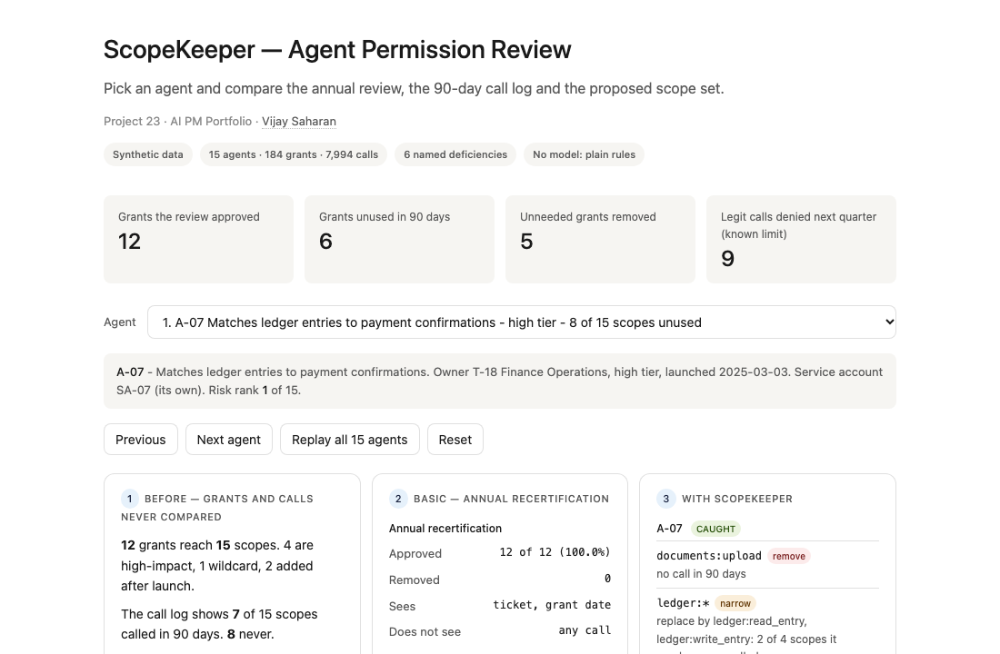
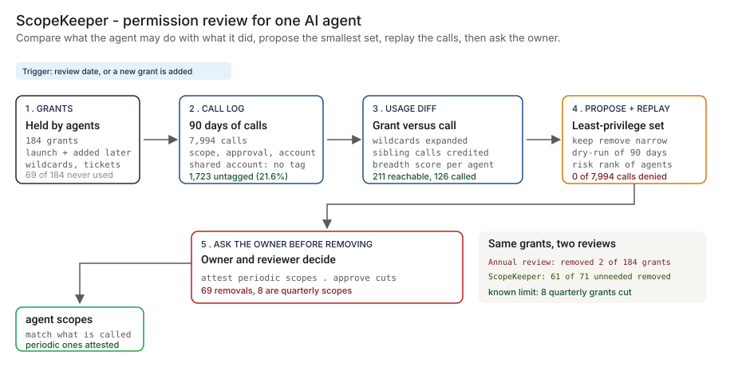
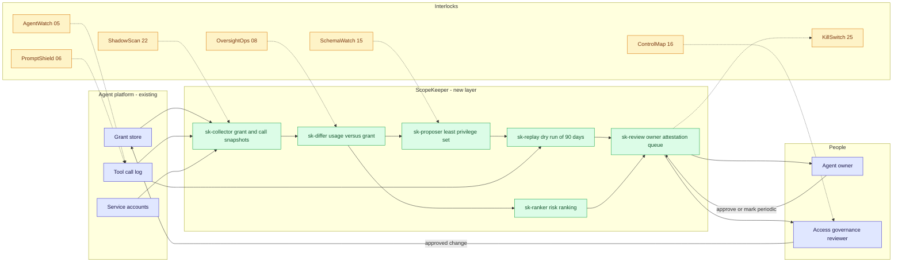
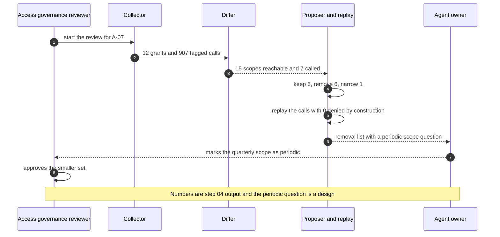

# 🔑 ScopeKeeper — Agent Permission Review for Tool-Calling AI Agents

**A portfolio prototype for cutting an AI agent's permissions to what it actually uses: a usage-versus-grant diff, a breadth score, a proposed least-privilege scope set per agent, a dry-run replay of 90 days of calls and a risk ranking. Aligned to the least-privilege theme of [NIST SP 800-53 Rev 5](https://csrc.nist.gov/pubs/sp/800/53/r5/upd1/final) (control AC-6), the excessive-agency theme in the [OWASP LLM Top 10](https://genai.owasp.org/llm-top-10/), the [NIST AI RMF](https://www.nist.gov/itl/ai-risk-management-framework) and the ongoing-monitoring expectation in [SR 26-2](https://www.federalreserve.gov/supervisionreg/srletters/SR2602.htm) (which replaced SR 11-7, the 2011 predecessor, in April 2026).**

**▶ Static demo, no install:** [open on GitHub Pages](https://vj-shipped-anyway.github.io/ai-pm-portfolio/23-scopekeeper-agent-permission-review/demo.html)

[](https://vj-shipped-anyway.github.io/ai-pm-portfolio/23-scopekeeper-agent-permission-review/demo.html)

**What it shows** (🟢 measured on synthetic data; the script is named in brackets):

- 🟢 Unneeded grants removed: 61 of 71 (85.9%) (`step_04`), against 1 of 71 (1.4%) for the annual review
- 🟢 Effective entitlements: 211 before, 126 after, 40.3% cut (`step_04`)
- 🟢 Known limit: 8 quarterly grants are removed, and the next quarter would deny 51 legitimate calls (`step_04`, from `rare_use_truth.csv`)

_A portfolio prototype on synthetic data, not a production case study. The framing, how to read the numbers and the regulatory note are folded below._


[](./demo.html)



> **▶ 30-second demo:** the [clickable demo](./demo.html) gets you the full story in 30 seconds with no install.

<details>
<summary>Framing, how to read the numbers, and the regulatory note</summary>

> **Regulatory note.** This README cites SR 11-7 or its replacement, [SR 26-2](https://www.federalreserve.gov/supervisionreg/srletters/SR2602.htm) (Federal Reserve, OCC and FDIC, April 17, 2026). SR 26-2 sets no enforceable standards, is aimed mainly at banks with over $30 billion in assets, and places generative AI and agentic AI outside its scope. Here those citations name the design basis for validation, monitoring and inventory practices, or serve as an analogy. They are not a claim that the project meets SR 26-2 or that SR 26-2 governs the systems it examines.

> **Framing:** This is a portfolio prototype, not a production case study. The six-deficiency taxonomy, the architecture, the data generator and the walkthrough are mine. Every number below is either printed by a script in this folder on data I generated, or is modeled with its assumption named. Production validation (a real grant store, real call logs, agent owners agreeing to an attestation flag, an access-governance read) is what the next role does.

> **Reading the numbers — credibility tags inline.** Every number in this README and the demo is tagged 🟢 **Measured** (printed by a script in `src/` on the shipped synthetic data: 15 agents, 184 grants, 7,994 calls over 90 days, 71 grants the generator marked as not needed), 🟡 **Modeled** (extrapolated from that data, with the assumption named in one line), or 🔴 **Hypothetical** (designed and reasoned about, never tested). Full convention in the [master README's "Reading the numbers" section](../README.md#-reading-the-numbers). **All data is synthetic and generated by a seeded script. The truth is known because the data is synthetic: the generator decided which grants each agent needs, so it can say exactly which removals are right and which are wrong.**

</details>

---

## 🔥 Demo in 30 seconds

Open the static, no-Python demo: [`demo.html`](./demo.html).
Pick one of the 15 agents from the dropdown, or use Next agent and Replay all 15 agents. Three cards show the same agent three ways: the grants against the calls nobody compares, the annual recertification (approved, with a ticket on every line), and ScopeKeeper (the proposed scope set, what is removed or narrowed, the replay result). The running totals at the top end at the 🟢 measured numbers: 182 grants approved by the review, 69 unused in 90 days, 61 unneeded grants removed, and 51 legitimate calls the cut would deny next quarter, which is the known limit.

To run the four-step walkthrough on your laptop:

```bash
git clone https://github.com/Vj-shipped-anyway/ai-pm-portfolio
cd ai-pm-portfolio/23-scopekeeper-agent-permission-review/src
python3 step_01_status_quo.py
python3 step_02_annual_recertification.py
python3 step_03_deficiencies_exposed.py
python3 step_04_with_scopekeeper.py
```

To regenerate the synthetic data (the output is identical on every run): `python3 ../data/_generate.py`.
To run the Streamlit prototype: `pip install -r requirements.txt`, then `streamlit run app.py` from `src/` (or `streamlit run 23-scopekeeper-agent-permission-review/src/app.py` from the repo root).

---

## 💰 Why this lands — competitive positioning

Teams that notice excess agent access usually start with one of two things: the annual recertification they already run, or a report that lists grants with no recent use. I compare approaches rather than vendors, so the table below scores those two and the new layer on the same synthetic grants and calls.

| Capability | Annual recertification | Unused-grant report (log counts only) | **ScopeKeeper** |
| --- | --- | --- | --- |
| Finds grants with no call in 90 days | No usage column. Removes 🟢 1 of 69 (1.4%) | Yes: 🟢 69 of 184 (37.5%) listed | Yes: 🟢 69 of 184, each with a reason |
| Removes grants no agent needs | 🟢 1 of 71 (1.4%) | A person acts on the list; not applied here | 🟢 61 of 71 (85.9%) |
| Narrows a wildcard to the scopes called | No: the wildcard is approved whole | No: a wildcard called once counts as used | Yes: 🟢 4 wildcards narrowed, 12 entitlements cut |
| Replays the result on real calls before it is applied | No: its own removals would deny 🟢 142 calls | No | Yes: 🟢 0 of 7,994 denied (by construction, in-sample) |
| Handles calls with no agent tag on a shared account | No | Not addressed by a plain count | Credits every agent that could have made the call; 🟢 10 unneeded grants stay as the price |
| Ranks agents by exposure | No | No | Yes: impact-weighted unused access, unapproved calls, shared account |
| Sees a scope used once a quarter | Approves it because it is on the list | No: lists it as unused | No: 🟢 8 quarterly grants removed (the known limit). Owner attestation flag: 🔴 designed, not built |
| Where it still fails | Everything above | Everything ScopeKeeper adds | Quarterly scopes; unneeded grants that a sibling on a shared account keeps in use; owners who do not answer the attestation flag |

**Position:** *ScopeKeeper does not replace the platform's grant store, the access-governance workflow or the tool-call gate. It adds the comparison nobody runs: what each agent may do against what it did, a smaller set that still covers every call, and a replay before anything is removed. It is not observability (that is AgentWatch, 05) and not injection defense (that is PromptShield, 06). A recertification tells you a ticket exists. This tells you the access is used, or is not.*

---

## The honest version (why this exists)

The failure mode this prototype is built around: an AI agent calls tools, and each tool call needs a scope. Scopes are granted at launch from a template and added over time for one-off tasks. The control is an annual access recertification in which the agent's manager approves what is on the list. The list shows names, dates and ticket numbers. It does not show a single call, so a grant nobody has used looks the same as one used every day. A wildcard such as `accounts:*` looks like one line.

This is a prototype on synthetic data. I wrote the generator, the truth files, the diff, the proposal rule, the replay and the ranking. The calls are produced by a seeded script, not by an agent or a model, and no model is used anywhere in this repo. The truth is known because the data is synthetic: the generator decides which grants each agent needs, so it can say which removals are right. A real estate does not hand you that, which is why the first job in a real deployment would be exporting a real grant store and a real tool-call log. Nothing here is a real bank, agent, platform, vendor or incident.

The data is dense on purpose (71 of 184 grants are unneeded by design, 10 are quarterly) so that every effect appears often enough to count. It is a test set, not an estimate of how many grants a real agent holds without need. The utility section scales the per-agent result to an estate with a named assumption.

If you run agents that call tools through scopes and have a recertification that approves everything, fork it. The usage-versus-grant diff, the shared-account crediting rule and the replay-before-removal step are the parts worth lifting. Validating them against a real grant store and call log is the work the next role would do.

---

## Prereqs to run this on your laptop (in plain English)

You don't need a cluster, a cloud account or an API key. You need:

- **Python 3.** The four step scripts, the data generator and the demo builder use only the standard library (for example `csv`, `json`, `collections`, `datetime` and `pathlib`), so there is nothing to install for them. They are written for Python 3.9 and tested on it; they use no syntax newer than 3.9.
- **Git**, to clone the repo. `brew install git` / `winget install git`.
- **`src/requirements.txt` — only for the Streamlit app.** It lists `streamlit`, `pandas`, `numpy` and `plotly`. The step scripts do not import any of them. Run `pip install -r src/requirements.txt` only if you want the app.
- **No API key.** There is no model call, no network call and no secret anywhere. The diff, the proposal, the replay and the ranking are plain rules you can read.
- **Not needed:** a database, containers, Kubernetes or a cloud account. They appear in [`ARCHITECTURE.md`](./ARCHITECTURE.md) as the production design, not as prototype requirements.

Each step script finishes in seconds and writes its CSV or JSON to `src/out/`. The clickable `demo.html` runs in any browser with zero install. If a step does not run from a fresh clone, that's a bug in the README. Open an issue.

---

## Executive summary (90 seconds)

**Problem.** A modeled bank runs 15 AI agents that call tools through scopes (read an account, write a ledger entry, send an e-mail, initiate a payment). Scopes are granted at launch and added over time, and the control is an annual recertification where the manager approves what is on the list. Nobody compares the grants with the calls the agent made. 🟢 The review approved 182 of 184 grants (98.9%) and removed 2, both for a missing ticket. 🟢 The call log shows 69 of 184 grants (37.5%) with no call in 90 days, and the generator's truth says 71 grants (38.6%) are not needed by the agent that holds them.

**Product.** ScopeKeeper, a review layer that reads the grants and 90 days of calls: a **usage-versus-grant diff** that credits untagged shared-account calls to every agent that could have made them; a **breadth score** per agent; a **proposed least-privilege scope set** that keeps what was called, removes what was not and replaces a wildcard by the scopes used; a **dry-run replay** of the 90 days under the proposal; and a **risk ranking** of agents. A person approves every change. No model is used.

**Measured and modeled performance.**

- 🟢 **Unneeded grants removed: 61 of 71 (85.9%)** (`step_04`), against 1 of 71 (1.4%) for the annual review.
- 🟢 **Effective entitlements: 211 before, 126 after, 40.3% cut** (`step_04`). Narrowing 4 wildcards accounts for 12 of the cut.
- 🟢 **Dry-run replay: 0 of 7,994 calls denied** (`step_04`). This is by construction: the proposal is built from these same calls. The annual review's own removals, replayed the same way, deny 142 calls (`step_02`).
- 🟢 **Known limit: 8 quarterly grants are removed, and the next quarter would deny 51 legitimate calls** (`step_04`, from `rare_use_truth.csv`). A 90-day log cannot show a quarterly scope. The fix is an owner attestation flag, 🔴 designed and not built.
- 🟢 **Second miss: 10 unneeded grants stay** because untagged calls on shared accounts are credited to every agent that could have made them (`step_04`).
- 🟢 **High-impact calls without the required human approval: 118 of 1,243 (9.5%)** (`step_03`). ScopeKeeper surfaces them and ranks agents on them; it does not fix them.
- 🟡 **Utility: (4.07 − 0.07) × 200 = about 800 unneeded grants removed**, assuming 200 agents in a bank's estate, and about 680 legitimate calls denied next quarter until owners attest the periodic scopes.
- 🔴 **Design target: an attestation question on every removal proposal, answered inside the access-review queue.** Designed in `ARCHITECTURE.md`, never built or tested with real owners.

**Call to action.** Fork this repo. Swap [`data/agents.csv`](./data/agents.csv), [`data/scope_catalog.csv`](./data/scope_catalog.csv), [`data/grants.csv`](./data/grants.csv) and [`data/calls.csv`](./data/calls.csv) for exports from your agent platform, and call `usage_index`, `grant_usage`, `propose` and `replay_calls` on them. The two truth files exist only because the data is synthetic.

---

## 🗺️ What this walkthrough covers

1. **The use case** — 15 agents holding 184 grants over 30 scopes
2. **Sample data** — six synthetic files: agents, scope catalog, grants, 90 days of calls, and two truth files
3. **Step 1 — Before ScopeKeeper** — who holds what, how many wildcards, how many high-impact grants
4. **Step 2 — Basic approach** — the annual recertification; what it approves and removes
5. **Step 3 — The six named deficiencies** — each with a count from the dataset
6. **Step 4 — The fix (ScopeKeeper)** — diff, proposal, replay, ranking; scored against the truth, with the known limit printed
7. **Utility delivered** — a multiplied number with the assumption named
8. **Architecture & call flow** — topology and a per-agent sequence
9. **PM artifacts** — PRD and architecture

> Non-technical reader: skip the code blocks. The plain-English explanation and the output tables tell the story.
> Technical reader: every code block runs. `cd src && python3 step_NN_*.py` and you'll see the same output.

Total reading time: about 12 minutes deep, 3 minutes if you skim.

---

## 🎯 The Use Case

**A modeled bank's agent platform. 15 agents, each holding scopes that let it call tools.**

An agent answers customer questions, posts month-end adjustments, drafts wires or sends payment reminders. Each action is a scope in a catalog of 30: read an account, write a ledger entry, send an e-mail, initiate a payment. Some scopes are wildcards such as `accounts:*`. The catalog marks the scopes where a human must approve the call. Scopes are granted when the agent launches and added when a project asks for them. Once a year the manager approves the list.

Three things are true in the synthetic data:

- **A wildcard used for one scope.** The daily liquidity report agent (A-13) holds `accounts:*` and `ledger:*`. 🟢 It reaches 19 scopes and called 6. The annual review approved every line.
- **Approval skipped.** The collections agent (A-10) sends payment reminders. 🟢 30 of its calls to approval-required scopes carried no human approval. Its grants were approved all the same.
- **Three agents, one account.** A-04, A-05 and A-06 share service account SA-01. 🟢 651 calls on it carry no agent tag, so the log cannot say which of the three made them.

The agent platform owner owns the agents, the agent owners ask for the scopes, the access-governance reviewer runs the recertification, and the model risk reviewer has to explain what each deployed agent was allowed to do. ScopeKeeper is designed for those four.

---

## 📊 Sample Data

Six CSVs in [`data/`](./data/), generated by [`data/_generate.py`](./data/_generate.py) (standard library, seeded, deterministic: running it twice produces identical files). Documented in [`data/README.md`](./data/README.md). One preview each, real rows from the files:

**[`data/agents.csv`](./data/agents.csv)** — 15 agents on 11 service accounts; 7 agents share 3 of them.

```
agent_id,owner,purpose,service_account,risk_tier,launched_on
A-01,T-11 Retail Servicing,Answers customer balance and transaction questions,SA-04,medium,2025-02-10
A-02,T-14 Cards,Triages card dispute intake,SA-05,medium,2025-03-24
A-03,T-16 Payments,Tells customers where a payment is,SA-06,medium,2025-04-14
A-04,T-16 Payments,Prepares routine payments for operator release,SA-01,high,2025-05-05
```

**[`data/scope_catalog.csv`](./data/scope_catalog.csv)** — 30 scopes, 5 of them wildcards. `impact` is read, write, external_message or money_movement; `needs_human_approval` says a person must approve the call.

```
scope,kind,impact,needs_human_approval
accounts:read_balance,specific,read,no
accounts:read_transactions,specific,read,no
accounts:read_profile,specific,read,no
accounts:update_contact,specific,write,no
accounts:close_account,specific,write,yes
accounts:*,wildcard,write,yes
```

**[`data/grants.csv`](./data/grants.csv)** — 184 grants. `ticket_id` is blank on 2 of them.

```
agent_id,scope,granted_on,ticket_id
A-01,accounts:*,2025-02-10,TKT-41005
A-01,cases:create,2025-02-10,TKT-41032
A-01,cases:read,2025-02-10,TKT-41036
A-01,documents:read,2025-02-10,TKT-41050
```

**[`data/calls.csv`](./data/calls.csv)** — 7,994 calls over 90 days (`day` 1 is 2026-07-20, the review date is 2026-10-17). On a shared service account the agent tag is logged on half the calls only; `agent_id` is empty on the rest.

```
call_id,agent_id,day,scope_used,human_approved,service_account
C00001,A-03,1,accounts:read_balance,not_required,SA-06
C00002,A-08,1,accounts:read_balance,not_required,SA-08
C00003,A-08,1,payments:read_status,not_required,SA-08
C00004,A-09,1,cases:read,not_required,SA-02
```

**[`data/rare_use_truth.csv`](./data/rare_use_truth.csv)** — 10 legitimate grants used on a quarterly cycle. The last use is before the window and the next use is after the review date, so a 90-day review sees them as unused. `calls_next_quarter` is what the cut would deny.

```
agent_id,scope,last_use_date,cycle_days,next_use_date,calls_next_quarter,why
A-02,ledger:read_entry,2026-07-09,124,2026-11-10,3,quarterly chargeback true-up
A-04,ledger:post_adjustment,2026-07-09,122,2026-11-08,4,quarter-end adjustment
A-05,ledger:write_entry,2026-07-12,100,2026-10-20,5,quarterly true-up posting
A-06,payments:initiate_payment,2026-07-18,110,2026-11-05,9,quarterly fee sweep
```

**[`data/needed_truth.csv`](./data/needed_truth.csv)** — for every grant: does the agent really need it, and why. This is the ground truth the scoring uses.

```
agent_id,scope,needed,basis,needed_scopes
A-01,accounts:*,yes,wildcard_partly_used,accounts:read_balance;accounts:read_transactions
A-01,cases:create,yes,daily_use,cases:create
A-01,cases:read,yes,daily_use,cases:read
A-01,documents:read,yes,daily_use,documents:read
```

The truth: 🟢 71 of 184 grants (38.6%) are not needed; 32 of 184 (17.4%) were added after launch; 10 are quarterly. The data includes two hard cases on purpose: scopes that a sibling on a shared account calls, which make an unneeded grant look used, and scopes used once a quarter, which make a needed grant look unused.

---

## 🔧 Step 1 — Before ScopeKeeper: grants and calls are never compared

**In plain English:** Each agent holds a list of scopes. Nobody counts how many of them it uses. This step only describes the starting point: who holds what, and how much of it is high-impact.

```bash
python3 src/step_01_status_quo.py
```

The script counts grants, expands each wildcard to the scopes it reaches and flags the grants where the catalog says a human must approve the call:

```
WILDCARD GRANTS (a wildcard reaches every specific scope in its namespace)
  A-01  accounts:*   reaches 5 specific scopes, impact write
  A-04  payments:*   reaches 5 specific scopes, impact money_movement
  A-07  ledger:*     reaches 4 specific scopes, impact write
  A-09  messages:*   reaches 4 specific scopes, impact external_message
  A-13  accounts:*   reaches 5 specific scopes, impact write
  A-13  ledger:*     reaches 4 specific scopes, impact write
  A-14  cases:*      reaches 3 specific scopes, impact write
  A-14  payments:*   reaches 5 specific scopes, impact money_movement
```

**Result:**

```
HIGH-IMPACT GRANTS (the catalog says a human must approve the call)
  57 of 184 grants (write 20, external_message 17, money_movement 20)

RESULT
  Grants held:                                  184 (8 wildcards)
  Effective entitlements (agent x specific scope, wildcards expanded): 211
  Added after launch:                           32 of 184 (17.4%)
  Grants with no ticket reference:              2 of 184
  Control in place:                             annual recertification (step 2)
  Script that compares grants with calls:       none
```

🟢 184 grants reach 211 effective entitlements once wildcards are expanded. Nothing in the repo or in the review process compares them with the calls. That comparison is what the next steps add.

---

## 🤖 Step 2 — With the basic approach: annual recertification

**In plain English:** The manager gets the list of grants once a year and approves what is on it. A grant with a ticket reference is approved; a grant with no reference is revoked. Nobody opens the call log.

```bash
python3 src/step_02_annual_recertification.py
```

```
ASSUMPTIONS (modeled):
  R1  a grant with a ticket reference is approved; a grant with none is revoked
  R2  the reviewer does not open the call log
  R3  one pass a year; this run is that pass
```

```
RESULT
  Approved: 182 of 184 grants (98.9%)
  Removed:  2 of 184 grants (1.1%), all for a missing ticket, none for lack of use
  Agents whose whole list was approved: 13 of 15
    removed A-09 messages:*: the agent called it in the window
    removed A-15 ledger:write_entry: no call in the window
  Dry-run of the 90 days of calls under what the review left in place: 142 of 7,994 calls denied
```

- **The review approves almost everything.** 🟢 182 of 184 grants (98.9%) approved, 13 of 15 agents at 100.0%.
- **It removes by paperwork, not by use.** 🟢 Both removals are for a missing ticket. One of them hit a grant the agent used: replayed against the 90 days of calls, the result denies 142 calls. In the data the missing ticket happened to land on a grant in use. The rule in assumption R1 has no way to tell.

---

## 🔬 Step 3 — Where this still breaks: 6 named deficiencies

| # | Deficiency | What goes wrong | Count in this dataset |
| --- | --- | --- | --- |
| 1 | **Grants never used** | A grant with no call in 90 days looks the same on the list as one used daily. | 🟢 69 of 184 grants (37.5%); 20 are high-impact |
| 2 | **Over-broad scopes** | A wildcard is approved as one line; calls touched one or two of the scopes it reaches. | 🟢 4 of 8 wildcard grants; narrowing them cuts 12 entitlements |
| 3 | **Privilege creep** | Scopes added for a one-off task stay after the task ends. | 🟢 20 of 32 after-launch grants (62.5%) unused, against 49 of 152 (32.2%) at launch |
| 4 | **Shared service account** | The log names the account, not the agent, so calls cannot be attributed. | 🟢 1,723 of 7,994 calls (21.6%) carry no agent tag; 12 grants look used only because of them |
| 5 | **High-impact calls without approval** | The catalog says a human must approve; the call was logged without one. | 🟢 118 of 1,243 approval-required calls (9.5%) |
| 6 | **Recertification removes almost nothing** | The review checks a ticket, not use. | 🟢 Removed 2 of 184 grants; the usage diff finds 69 unused; the review removed 1 of them |

```bash
python3 src/step_03_deficiencies_exposed.py
```

```
(1) Grants that were never used in 90 days
    69 of 184 grants (37.5%) have no call in the window, directly or through a shared account.
    By impact: read 31, write 23, external_message 4, money_movement 11.
    20 of them are high-impact (the catalog says a human must approve the call).

(2) Over-broad scopes: a wildcard grant where calls touched one or two specific scopes
    4 of 8 wildcard grants touched only 1 or 2 of the scopes they reach; 1 touched none, 3 touched 3 or more.
      A-01 accounts:*   touched 2 of 5
      A-07 ledger:*     touched 2 of 4
      A-13 accounts:*   touched 1 of 5
      A-13 ledger:*     touched 1 of 4
    Narrowing those 4 wildcards to the scopes used cuts 12 entitlements.
    1 more wildcard grant looks wider in use only because siblings on the shared account called through it.

(3) Privilege creep: grants added after launch that were never used
    32 of 184 grants (17.4%) were added after launch.
    20 of those 32 (62.5%) have no call in the window; launch grants: 49 of 152 (32.2%).
    Of the unused after-launch grants, 9 are high-impact and 6 move money.

(4) Shared service account: calls that cannot be attributed to one agent
    7 agents share 3 service accounts. 1,723 of 7,994 calls (21.6%) carry no agent tag.
    By account: SA-01 651, SA-02 572, SA-03 500.
    352 of those calls are to scopes that need human approval.
    12 grants look used only because of untagged calls; by the generator's truth 10 of them are not needed by that agent.

(5) High-impact calls made without the human approval the catalog requires
    118 of 1,243 calls to approval-required scopes (9.5%) were logged with no human approval.
    By impact: write 28, external_message 74, money_movement 16.
    8 agents, plus 47 calls with no agent tag. Largest: (no tag) 47, A-10 30, A-07 25, A-06 7.
    The recertification list has no column for this; the grants were approved all the same.

(6) Recertification removed almost nothing, although the usage diff finds many unused grants
    Recertification removed 2 of 184 grants; the usage diff finds 69 unused.
    Of the 69 unused grants, recertification removed 1 (1.4%).
    1 of its 2 removals hit a grant that was in use; replaying the 90 days under that result denies 142 calls.

Recertification checks that a ticket exists. It does not check that the access is used.
```

The review confirms that access was requested. **The product is the comparison with use, the narrowed set and the replay, not another approval step.**

---

## 🛠️ Step 4 — The fix: ScopeKeeper

Five parts, all plain rules, no model:

1. **Usage-versus-grant diff.** For every grant: was a scope it reaches called in the window? A call with an agent tag credits that agent. A call with no tag is credited to every agent on the account who could have made it, so a grant in use is never marked unused. The price is that a sibling's use can keep an unneeded grant alive.
2. **Breadth score.** Per agent, the share of its effective entitlements it never called.
3. **Proposed scope set.** Keep what was called, remove what was not, replace a wildcard by the specific scopes called. Every row carries a reason.
4. **Dry-run replay.** Replay the 90 days of calls under the proposal and count the calls denied. A call with no tag is tested against the union of the agents on its account, because the account is all the platform could see.
5. **Risk ranking.** Points per agent: tier multiplier × impact-weighted unused entitlements, plus 2 per call logged without the required approval, plus 10 for a shared account. The weights are assumptions of a modeled bank, not legal advice and not a standard.

```bash
python3 src/step_04_with_scopekeeper.py
```

**The diff and the proposal, per agent:**

```
USAGE VERSUS GRANT (one row per agent, largest breadth first)
agent  tier    reach proposed  cut  breadth  keep  remove  narrow
------ ------- ----- -------- ---- -------- ----- ------- -------
A-13   low        19        6   13    68.4%     4       6       2
A-07   high       15        7    8    53.3%     5       6       1
A-14   medium     18        9    9    50.0%     7       5       0
A-15   high       12        6    6    50.0%     6       6       0
A-01   medium     16        9    7    43.8%     7       4       1
A-08   high       14        8    6    42.9%     8       6       0
A-03   medium     12        7    5    41.7%     7       5       0
A-12   low        12        7    5    41.7%     7       5       0
A-11   medium     13        8    5    38.5%     8       5       0
A-04   high       16       10    6    37.5%     6       6       0
A-02   medium     13        9    4    30.8%     9       4       0
A-09   medium     15       11    4    26.7%     8       4       0
A-05   high       12        9    3    25.0%     9       3       0
A-10   high       12        9    3    25.0%     9       3       0
A-06   high       12       11    1     8.3%    11       1       0
```

```
PROPOSAL
  Grants: keep 111, remove 69, narrow 4 (a wildcard replaced by the scopes called)
  Effective entitlements: 211 before, 126 after (85 cut, 40.3%); narrowing the wildcards accounts for 12 of the cut

DRY-RUN REPLAY (the 90 days of calls under the proposed sets)
  Calls replayed: 7,994; denied: 0
  By construction: the proposal is built from these same calls, so in-sample denials are 0 by design.
  The replay is not vacuous: the self-check removes one busy scope from one agent and calls are denied.
  Calls to approval-required scopes logged without approval: 118 (the proposal keeps the scope; these calls would be held for a human)
  For comparison, the recertification result replayed the same way denies 142 calls.
```

**The risk ranking, top of the list:**

```
RISK RANKING (unused access by impact and tier, plus unapproved calls, plus a shared account)
  points = tier x sum of impact weights of unused entitlements + 2 x unapproved calls + 10 if the account is shared
  weights (assumptions of a modeled bank): read 1, write 3, external_message 5, money_movement 8; tier high x3, medium x2, low x1
 # agent  tier    unused scopes unapproved shared  points
 1 A-07   high                8         25     no     146
 2 A-10   high                3         30    yes     127
 3 A-14   medium              9          0     no      82
 4 A-13   low                13          0    yes      55
 5 A-08   high                6          1     no      53
 6 A-04   high                6          0    yes      52
 7 A-15   high                6          0     no      51
 8 A-05   high                3          1    yes      45
```

**Measured against the generator's truth:**

```
MEASURED AGAINST THE GENERATOR'S TRUTH (data/needed_truth.csv)
  Grants the agent does not need: 71 of 184 (38.6%)
  Removed by recertification: 1 of 71 (1.4%); needed grants it removed: 1
  Removed by ScopeKeeper:     61 of 71 (85.9%); needed grants it removed: 8 (the quarterly ones, see the known limit)
  Entitlements the agents do not need: 91 of 211; cut 77, kept 14; needed entitlements cut: 8
```

- **85 of 211 entitlements cut.** 🟢 77 of the 91 entitlements the agents do not need are cut; 14 stay; 8 needed ones are cut (the quarterly scopes below).
- **Replay agrees with the log on every call, and that is not a claim about the future.** 🟢 0 of 7,994 denied. The proposal is built from these same calls, so the number is 0 by construction. The self-check removes one busy scope from one agent and confirms calls are then denied, so the replay is not vacuous. The informative number is the next-quarter count below.
- **Flagged, not fixed.** 🟢 118 calls to approval-required scopes carried no human approval. The proposal keeps the scope and the replay marks these calls for the approval check, which is the human-approval step in OversightOps (08), 🔴 designed, none built.

### The known limit, left in on purpose

A scope used once a quarter looks unused in a 90-day window. 🟢 10 grants in the data are legitimate and quarterly; the proposal removes 8 of them.

```
KNOWN LIMIT (left in on purpose)
  A scope used once a quarter looks unused in a 90-day window. 10 grants in the data are legitimate and quarterly (data/rare_use_truth.csv).
  The proposal removes 8 of them. Their next use falls after the review date, so the first quarter after
  the cut would deny 51 legitimate calls (by construction, from rare_use_truth.csv):
    A-02 ledger:read_entry            next use 2026-11-10, 3 calls  (quarterly chargeback true-up)
    A-04 ledger:post_adjustment       next use 2026-11-08, 4 calls  (quarter-end adjustment)
    A-07 documents:upload             next use 2026-10-28, 9 calls  (quarter-end reconciliation pack)
    A-08 accounts:read_transactions   next use 2026-11-03, 8 calls  (quarter-end tie-out)
    A-08 documents:upload             next use 2026-10-28, 6 calls  (quarter-end close pack)
    A-11 cases:close                  next use 2026-11-01, 8 calls  (quarterly stale-case sweep)
    A-12 documents:upload             next use 2026-11-09, 5 calls  (quarterly rate-sheet publication)
    A-13 documents:upload             next use 2026-11-11, 8 calls  (quarterly regulatory extract)
    A-05 ledger:write_entry           kept only because a sibling on the shared account called the scope
    A-06 payments:initiate_payment    kept only because a sibling on the shared account called the scope
  Owners would see 69 removal proposals; 8 of them (11.6%) are periodic scopes.
  The logs cannot show this. The fix is an owner attestation flag on each removal proposal
  ("is this scope periodic?"). It is designed, not built, and not tested with real owners.
```

🟢 The first quarter after the cut would deny 51 legitimate calls (by construction, from `rare_use_truth.csv`), and 8 of 69 removal proposals (11.6%) are periodic scopes. The logs cannot show this; only the owner knows. The fix is a question on each removal proposal ("is this scope periodic?") that the owner answers before the removal is applied. That flag is 🔴 designed in the PRD and never tested with real owners. If owners answered it correctly, those 51 calls would not be denied; that is 🟡 modeled, because it assumes owners answer correctly.

### The second miss, from shared service accounts

```
ALSO KEPT (second miss, from shared service accounts)
  10 grants the agent does not need stay in the proposal, because untagged calls on a shared
  account are credited to every agent that could have made them:
    A-05 payments:initiate_payment
    A-05 payments:schedule_transfer
    A-06 kyc:read_case
    A-06 ledger:read_entry
    A-06 payments:initiate_wire
    A-06 ledger:write_entry
    A-09 payments:read_status
    A-10 documents:read
    A-10 messages:draft_email
    A-12 ledger:read_entry
  The fix is one service account per agent, not something the logs can show either.
```

🟢 10 unneeded grants stay because the safe rule (never mark a grant in use as unused) credits a sibling's calls to every agent on the account. 2 of the 10 quarterly grants also survive only for this reason. The fix is one service account per agent, not something the logs can show.

Other limits, stated plainly: the proposal reads scope names, not the arguments of a call, so it cannot see that a payment scope was used only for small amounts; a 90-day window is a choice, not a finding; and an agent launched a week ago has too little history to propose from.

---

## 📐 Utility Delivered

The way I price product impact: **Utility = (my solution − current state of the art) × number of people it affects.**

Here the terms are unneeded grants removed per agent and the number of agents in an estate. Each agent touches four roles: the agent platform owner, the agent owner, the access-governance reviewer and the model risk reviewer. Going from "the list was approved" to "this grant was never used, here is the smaller set and the replay" is not an outcome by itself. *Doing it for every agent in an estate is.*

```
UTILITY (unneeded grants removed per agent, then scaled to an estate)
  Recertification: 1 unneeded grant removed over 15 agents -> 0.07 per agent
  ScopeKeeper:     61 unneeded grants removed over 15 agents -> 4.07 per agent
  Cost side: 51 legitimate calls denied next quarter over 15 agents -> 3.4 per agent
  MODELED: 200 agents in a bank's estate (assumption, not measured; edit AGENTS_IN_ESTATE).
  Utility = (4.07 - 0.07) x 200 = about 800 unneeded grants removed
  and about 680 legitimate calls denied next quarter until owners attest the periodic scopes
  Sensitivity to estate size: 50 agents: 200, 100 agents: 400, 200 agents: 800, 500 agents: 2000
```

| Term | Value | Where it comes from |
| --- | --- | --- |
| Current state of the art (annual recertification), unneeded grants removed per agent | 🟢 **0.07** | `step_04`: 1 of 71 unneeded grants removed, over 15 agents |
| My solution (ScopeKeeper), unneeded grants removed per agent | 🟢 **4.07** | `step_04`: 61 of 71 removed, over 15 agents |
| Share of unneeded grants removed (the delta) | 🟢 **85.9%** against **1.4%** | `step_04`: 61 of 71 against 1 of 71 |
| Replay denials in the 90 days | 🟢 0 of 7,994 | `step_04`; by construction |
| Cost: legitimate calls denied next quarter, per agent | 🟢 3.4 | `step_04`: 51 calls over 15 agents, from `rare_use_truth.csv` |
| Per-agent lift | 🟢 4.07 − 0.07 | Unneeded grants removed per agent, per review |
| Number it affects: agents in the estate | 🟡 **200** | **Assumption, not a statistic:** a bank's estate holds 200 agents with this mix of grants. Edit `AGENTS_IN_ESTATE` in `step_04` to use your own |
| Assumption that makes the lift real | 🟡 A person approves each removal, and owners mark periodic scopes before the cut | If owners ignore the removal list, the lift shrinks toward zero |
| **Utility** | 🟡 **(4.07 − 0.07) × 200 = about 800 unneeded grants removed** | Per review; scales with the unneeded grants per agent in your estate |

Sensitivity to the estate-size assumption (🟡, same per-agent lift): 50 agents gives 200, 100 gives 400, 200 gives 800 and 500 gives 2000. At the same mix, the cost side is about 680 legitimate calls denied in the next quarter for 200 agents until the periodic scopes are attested.

🔴 What I have not measured: how many removals an owner will approve, how long an owner takes to answer an attestation question, and what any of this costs to run. The synthetic estate is dense by design; a real estate may hold fewer or more unneeded grants per agent. Treat the per-agent number as a property of this mix of grants, not a forecast.

---

## 🔄 Architecture & Call Flow

How each review cycle flows through the system. GitHub renders these diagrams natively. Component names match [`ARCHITECTURE.md`](./ARCHITECTURE.md).

**System topology:**



**Per-agent sequence** (A-07, the agent ranked first by risk):



See [`assets/scopekeeper-flow.svg`](./assets/scopekeeper-flow.svg) for a static visual of the same flow.

**Interlocks (all 🔴 designed, none built):**

- [05 AgentWatch](../05-agentwatch-agent-observability/) supplies the tool-call log. ScopeKeeper reads it nightly and AgentWatch can flag a call to a scope the proposal removed.
- [06 PromptShield](../06-promptshield-prompt-injection-defense/) is the tool-call gate. ScopeKeeper supplies the approved scope set the gate enforces, so an injected instruction has fewer scopes to reach.
- [08 OversightOps](../08-oversightops-hitl-workflow/) holds the human approvals. ScopeKeeper reads them to find calls that carried none and routes the owner's attestation questions through the same queue.
- [15 SchemaWatch](../15-schemawatch-tool-schema-drift/) watches tool changes. A tool that changes its schema or adds an action is a reason to re-run the diff for the agents that hold its scopes.
- [16 ControlMap](../16-controlmap-ai-obligation-crosswalk/) maps AI obligations to controls; ScopeKeeper's review evidence is what an access obligation would point to. [22 ShadowScan](../22-shadowscan-unsanctioned-ai-discovery/) finds unsanctioned AI use, which has no grant record to review. [25 KillSwitch](../25-killswitch-ai-fallback-drills/) runs fallback drills; a narrowed scope set is one more state to drill.

---

## 📋 PM Artifacts

The PM artifacts that show how I'd run this product if I owned the seat. This README is the walkthrough; the rest of the folder holds:

- [`PRD.md`](./PRD.md) — the product requirements doc: users, backlog, KPIs, rollout, open questions.
- [`ARCHITECTURE.md`](./ARCHITECTURE.md) — the systems doc: components, data model, security, failure behavior, operations. A design, not deployed.
- [`demo.html`](./demo.html) — clickable, no-install walkthrough; every number is generated from the scripts in `src/` by `src/_build_demo.py`.
- [`data/`](./data/) — the six synthetic CSVs and the generator. `data/README.md` explains the ground-truth rules.
- [`src/`](./src/) — runnable step scripts and the Streamlit prototype.

Run the walkthrough end-to-end:

```bash
cd src
python3 step_01_status_quo.py
python3 step_02_annual_recertification.py
python3 step_03_deficiencies_exposed.py
python3 step_04_with_scopekeeper.py
```

---

## 🚀 Fork this for your team

```bash
git clone https://github.com/Vj-shipped-anyway/ai-pm-portfolio
cd ai-pm-portfolio/23-scopekeeper-agent-permission-review

# 1. Run the synthetic walkthrough as is
cd src
python3 step_01_status_quo.py
python3 step_02_annual_recertification.py
python3 step_03_deficiencies_exposed.py
python3 step_04_with_scopekeeper.py

# 2. Open the interactive demo
open ../demo.html            # static snapshot of the synthetic run; it does not read data/
```

To point it at your own estate, replace four files and keep their columns:

- `data/agents.csv`: one row per agent: `agent_id, owner, purpose, service_account, risk_tier, launched_on`
- `data/scope_catalog.csv`: one row per scope: `scope, kind, impact, needs_human_approval` (`kind` is `specific` or `wildcard`; a wildcard is `namespace:*`)
- `data/grants.csv`: one row per grant: `agent_id, scope, granted_on, ticket_id`
- `data/calls.csv`: one row per call: `call_id, agent_id, day, scope_used, human_approved, service_account` (`agent_id` empty when the log has no tag; `day` is 1 to 90 counted from the window start in `step_01`)

The functions that do the work take plain dicts, so you can call them directly:

```python
# from src/
from step_01_status_quo import load_all, usage_index, grant_usage, replay_calls
from step_04_with_scopekeeper import propose, proposed_sets

data = load_all()
gu = grant_usage(data, usage_index(data))     # one row per grant: used or not, which scopes were touched
proposal = propose(data, gu)                  # keep, remove or narrow, each with a reason
allowed = proposed_sets(data, proposal)       # agent id -> set of scopes it keeps
denied = replay_calls(data, allowed)          # calls the proposal would deny
```

`data/needed_truth.csv` and `data/rare_use_truth.csv` exist only because the data is synthetic. `load_all` reads them and steps 3 and 4 use them to score, so on real exports supply the two files with headers only and ignore the lines that score against them; `usage_index`, `grant_usage`, `propose` and `replay_calls` do not read them. Set `AS_OF` and `WINDOW_DAYS` in `step_01` to your own review date and window.

If you run it on a real grant store and call log and get something useful, open an issue or send me what your owners did with it. I'd rather see that than what I think it should do.

---

## 👤 Author

**Vijay Saharan** — Sr Product / Program Manager · AI in BFSI · Enterprise AI Platforms · CRE as a study interest

[LinkedIn](https://www.linkedin.com/in/vijaysaharan/) · Tagline: *AI Platform PM · Designs access governance for the tools agents call, under regulated constraint*

---

## 🙌 Acknowledgements

- **[NIST SP 800-53 Rev 5](https://csrc.nist.gov/pubs/sp/800/53/r5/upd1/final), control AC-6 (least privilege)** — the theme the proposal is aligned to: give each account only the access its function needs. The sentence is a paraphrase written for this exercise, not the text of the control.
- **[OWASP LLM Top 10](https://genai.owasp.org/llm-top-10/)** — the excessive-agency theme behind treating an agent's scope list as something to shrink, not only to approve.
- **[NIST AI RMF](https://www.nist.gov/itl/ai-risk-management-framework)** — the 'Measure' and 'Manage' functions map onto the usage diff and the owner decision.
- **SR 11-7 (the 2011 predecessor), replaced in April 2026 by [SR 26-2](https://www.federalreserve.gov/supervisionreg/srletters/SR2602.htm)** — the model-risk guidance the work is compared with. A record of what each deployed agent was allowed to do, against what it did, is the kind of ongoing-monitoring evidence a reviewer would ask for. Paraphrase written for this exercise, not the text of the guidance.
- **Sibling projects in this repo** — [05 AgentWatch](../05-agentwatch-agent-observability/), [06 PromptShield](../06-promptshield-prompt-injection-defense/), [08 OversightOps](../08-oversightops-hitl-workflow/) and [15 SchemaWatch](../15-schemawatch-tool-schema-drift/), [16 ControlMap](../16-controlmap-ai-obligation-crosswalk/), [22 ShadowScan](../22-shadowscan-unsanctioned-ai-discovery/) and [25 KillSwitch](../25-killswitch-ai-fallback-drills/), the seven interlocks.
