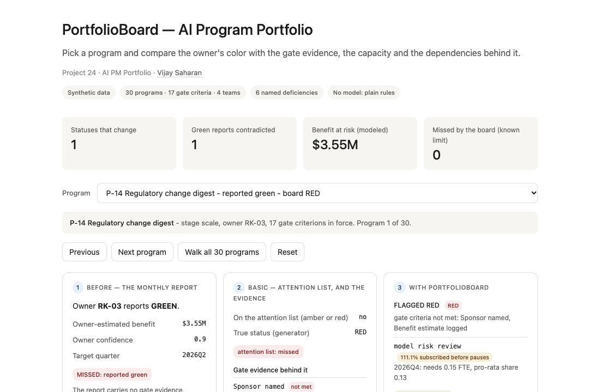
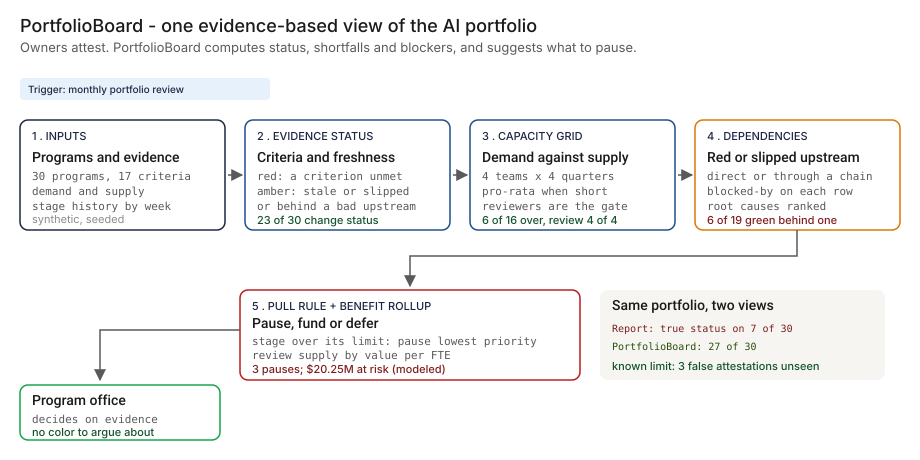
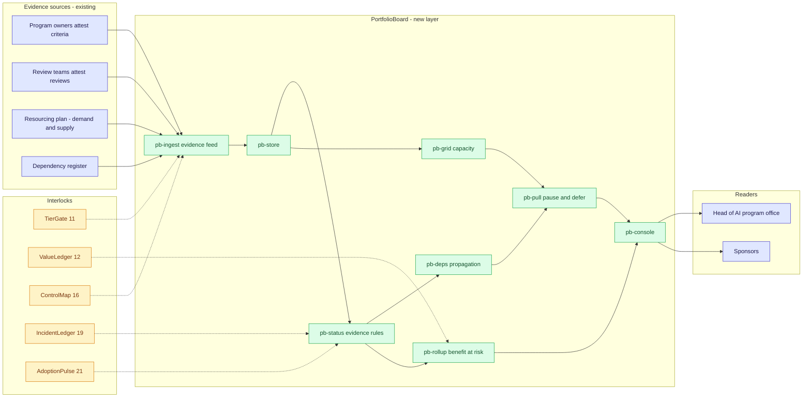
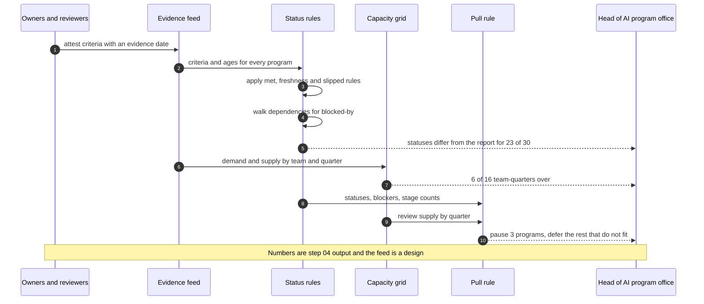

# 🧭 PortfolioBoard — An AI Program Portfolio Run on Gate Evidence, Capacity and Dependencies

**A portfolio prototype for running a bank's AI programs on gate evidence instead of owner-picked colors: an evidence status per program, a capacity grid for scarce reviewers, dependency propagation, a pull rule that suggests what to pause, and a benefit-at-risk rollup. Aligned to the [NIST AI RMF](https://www.nist.gov/itl/ai-risk-management-framework) 'Govern' function and written against [SR 26-2](https://www.federalreserve.gov/supervisionreg/srletters/SR2602.htm), the current model risk guidance that replaced its 2011 predecessor (SR 11-7) in April 2026, as the model-risk guidance the work is compared with.**

**▶ Static demo, no install:** [open on GitHub Pages](https://vj-shipped-anyway.github.io/ai-pm-portfolio/24-portfolioboard-ai-program-portfolio/demo.html)

[](https://vj-shipped-anyway.github.io/ai-pm-portfolio/24-portfolioboard-ai-program-portfolio/demo.html)

**What it shows** (🟢 measured on synthetic data; the script is named in brackets):

- 🟢 23 of 30 statuses change once evidence is applied (20 worse than reported, 3 better; `step_04`)
- 🟢 The board shows the true status for 27 of 30 programs; the report does for 7 of 30 (`step_04`)
- 🟢 Reviewers: 6 of 16 team-quarters are over; model risk review is over in 4 of 4 quarters, 161.9% of supply at worst (`step_03`)

_A portfolio prototype on synthetic data, not a production case study. The framing, how to read the numbers and the regulatory note are folded below._


[](./demo.html)



> **▶ 30-second demo:** the [clickable demo](./demo.html) gets you the full story in 30 seconds with no install.

<details>
<summary>Framing, how to read the numbers, and the regulatory note</summary>

> **Regulatory note.** This README cites SR 11-7 or its replacement, [SR 26-2](https://www.federalreserve.gov/supervisionreg/srletters/SR2602.htm) (Federal Reserve, OCC and FDIC, April 17, 2026). SR 26-2 sets no enforceable standards, is aimed mainly at banks with over $30 billion in assets, and places generative AI and agentic AI outside its scope. Here those citations name the design basis for validation, monitoring and inventory practices, or serve as an analogy. They are not a claim that the project meets SR 26-2 or that SR 26-2 governs the systems it examines.

> **Framing:** This is a portfolio prototype, not a production case study. The six-deficiency taxonomy, the status rules, the pull rule, the architecture, the data generator and the walkthrough are mine. Every number below is either printed by a script in this folder on data I generated, or is modeled with its assumption named. Production validation (a real gate-evidence feed, review teams that agree to attest in it, real demand and supply, a model-risk read) is what the next role does.

> **Reading the numbers — credibility tags inline.** Every number in this README and the demo is tagged 🟢 **Measured** (printed by a script in `src/` on the shipped synthetic data: 30 programs, 17 gate criteria, 286 evidence rows, 16 team-quarters, 90 stage visits), 🟡 **Modeled** (extrapolated from that data, with the assumption named in one line), or 🔴 **Hypothetical** (designed and reasoned about, never tested). Full convention in the [master README's "Reading the numbers" section](../README.md#-reading-the-numbers). **All data is synthetic and generated by a seeded script. The truth is known because the data is synthetic: the generator decided which evidence is missing, stale or false, so it can say what each program's status truly is. Benefit figures are owner estimates, never measured benefit.**

</details>

---

## 🔥 Demo in 30 seconds

Open the static, no-Python demo: [`demo.html`](./demo.html).
Pick one of the 30 programs from the dropdown, or use Next program and Walk all 30 programs. Three cards show the same program three ways: the owner's color in the monthly report, the basic way to read that report (an attention list of ambers and reds) next to the gate evidence it cannot see, and PortfolioBoard (the evidence status, what blocks the program, the reviewer shortfall and whether to pause, fund or defer it). The running totals at the top end at the 🟢 measured numbers: 23 statuses change, 16 green reports are contradicted, $20.25M of owner-estimated benefit sits on programs that are red by evidence (🟡 modeled), and 3 programs are missed by the board.

To run the four-step walkthrough on your laptop:

```bash
git clone https://github.com/Vj-shipped-anyway/ai-pm-portfolio
cd ai-pm-portfolio/24-portfolioboard-ai-program-portfolio/src
python3 step_01_rag_status_report.py
python3 step_02_rag_attention_list.py
python3 step_03_deficiencies_exposed.py
python3 step_04_with_portfolioboard.py
```

To regenerate the synthetic data (the output is identical on every run): `python3 ../data/_generate.py`.
To run the Streamlit prototype: `pip install -r requirements.txt`, then `streamlit run app.py` from `src/` (or `streamlit run 24-portfolioboard-ai-program-portfolio/src/app.py` from the repo root).

---

## 💰 Why this lands — competitive positioning

Program offices that outgrow the monthly color usually reach for one of two cheap fixes: a gate-checklist spreadsheet next to the report, or an owner questionnaire before each review. I compare approaches rather than vendors, so the table below scores the report as it is sent against the new layer on the same synthetic portfolio. The spreadsheet and questionnaire columns are described, not measured: I did not build either.

| Capability | RAG report as sent | Gate-checklist spreadsheet | Owner questionnaire | **PortfolioBoard** |
| --- | --- | --- | --- | --- |
| Shows which green programs fail a gate criterion | No. 🟢 4 of 19 green reports fail one and the report shows none | Only if the checklist is current and someone reads it against the colors | Only what owners choose to disclose | 🟢 4 found, and 16 of 19 green reports are not green on the board |
| Separates stale evidence from missing evidence | No | If someone adds an age column and keeps it | No | 🟢 10 of 30 programs carry stale evidence, each marked stale |
| Shows reviewer demand against supply | No | A separate sheet, not linked to program status | No | 🟢 6 of 16 team-quarters over; model risk review over in 4 of 4 |
| Shows what waits on a red or slipped upstream program | No. 🟢 6 of 19 green reports sit behind one | A column of upstream names; propagation is by hand | Only what owners choose to disclose | 🟢 6 found, 2 of them only through a chain |
| Shows work in progress against a limit | No | A count per stage if someone makes it | No | 🟢 2 of 5 stages above their limit, with pause suggestions |
| Shows benefit at risk | Shows $2.15M as red | Sums owner estimates by color | Owner estimates | 🟡 $20.25M of $60.35M (33.6%) on red-by-evidence programs |
| Status equals the true status | 🟢 7 of 30 (23.3%) | Not built, not measured | Not built, not measured | 🟢 27 of 30 (90.0%), by construction apart from 3 planted false attestations |
| Where it still fails | Everything above | A checklist nobody updates | Optimism, in a longer form | A false attestation looks like a true one; benefit figures are owner estimates |

**Position:** *PortfolioBoard does not replace the program owners, the stage gates or the review teams. It adds the layer that computes the portfolio view from the evidence those processes already produce: which programs fail their gates, where reviewers run short, what waits on what, and what to pause when a stage is overloaded. A color tells you what the owner thinks. This tells you what the evidence says and what to do about it.*

---

## The honest version (why this exists)

The failure mode this prototype is built around: an AI program office receives one color per program each month, and each owner picks their own. Green is cheap to report and expensive to check. The report cannot show that a green program is missing its risk review, that several programs need the same reviewers in the same quarter, that a program depends on a platform that slipped, or that a stage holds more programs than it can move.

This is a prototype on synthetic data. I wrote the generator, the gate criteria, the evidence files, the status rules, the capacity grid, the dependency propagation, the pull rule and the benefit rollup. The programs, owners and teams are invented, and no model is used anywhere in this repo. The truth is known because the data is synthetic: the generator decided which criteria are unmet, which evidence is stale, which programs are slipped and which attestations are false, and it wrote the answer to a separate truth file that no decision reads. A real estate does not hand you that, which is why the first job in a real deployment is wiring a real gate-evidence feed and checking a sample of the "met" flags against the documents.

The portfolio is dense on purpose, so that every effect appears often enough to count. Owners in the generator report optimistically (green evidence is reported green 85% of the time, amber evidence 65%, red evidence 55%; these are design choices, not observations). It is a test set, not an estimate of how many real programs are mis-reported; that frequency is a separate, named assumption.

If you run an AI program office and have had a green program fail its first review, fork it. The gate-criteria vocabulary, the status rules and the pull rule are the parts worth lifting. Validating them against a real evidence feed is the work the next role would do.

---

## Prereqs to run this on your laptop (in plain English)

You don't need a cluster, a cloud account or an API key. You need:

- **Python 3.** The four step scripts, the data generator and the demo builder use only the standard library (for example `csv`, `json`, `math`, `random` and `pathlib`), so there is nothing to install for them. They are written for Python 3.9 and tested on it; they use no syntax newer than 3.9.
- **Git**, to clone the repo. `brew install git` / `winget install git`.
- **`src/requirements.txt` — only for the Streamlit app.** It lists `streamlit`, `pandas`, `numpy` and `plotly`. The step scripts do not import any of them. Run `pip install -r src/requirements.txt` only if you want the app.
- **No API key.** There is no model call, no network call and no secret anywhere. The status rules, the capacity grid, the dependency walk and the pull rule are plain code you can read.
- **Not needed:** a database, containers, Kubernetes or a cloud account. They appear in [`ARCHITECTURE.md`](./ARCHITECTURE.md) as the production design, not as prototype requirements.

Each step script finishes in seconds and writes its CSV or JSON to `src/out/`. The clickable `demo.html` runs in any browser with zero install. If a step does not run from a fresh clone, that's a bug in the README. Open an issue.

---

## Executive summary (90 seconds)

**Problem.** A modeled bank runs 30 AI programs. Once a month each owner picks a red, amber or green status and sends it to the head of the AI program office with a benefit estimate. 🟢 19 of 30 programs (63.3%) report green, and the report carries no evidence behind any of them. Against what each program's evidence says, 🟢 4 of those 19 green programs fail a gate criterion, 🟢 6 sit behind a red or slipped upstream program, 🟢 6 of 16 team-quarters have demand above supply, and 🟢 2 of 5 stages hold more programs than their limit.

**Product.** PortfolioBoard, a status layer for the program office: an **evidence status** per program from the gate criteria and their freshness; a **capacity grid** of planned demand against supply for four teams over four quarters; **dependency propagation** that names the red or slipped upstream programs behind each program; a **pull rule** that suggests which programs to pause when a stage is above its work-in-progress limit and how to spend the scarce review team; and a **benefit-at-risk rollup**, labeled modeled.

**Measured and modeled performance.**

- 🟢 **23 of 30 statuses change once evidence is applied** (20 worse than reported, 3 better; `step_04`). 16 of 19 green reports are not green on the board.
- 🟢 **The board shows the true status for 27 of 30 programs; the report does for 7 of 30** (`step_04`). This agreement is by construction apart from the 3 false attestations the generator planted, which the board cannot see.
- 🟢 **Reviewers:** 6 of 16 team-quarters are over; model risk review is over in 4 of 4 quarters, 161.9% of supply at worst (`step_03`).
- 🟢 **Work in progress:** build holds 8 against a limit of 6 and pilot 6 against 5 (`step_03`).
- 🟢 **Review queue:** 12.7 weeks waiting at the gates after build and pilot against 3.1 weeks after idea and discovery (`step_03`).
- 🟡 **Benefit at risk: $20.25M of $60.35M (33.6%)** sits on programs that are red by evidence; the report shows $2.15M as red. Owner estimates, never measured benefit.
- 🟡 **Utility: (27 − 7) ÷ 30 × 35 = about 23.3 owners and sponsors** who see a true status for their program, assuming one sponsor per 3 programs and that the board is read and acted on.
- 🔴 **Design target: a nightly status run on a gate-evidence feed from the systems that hold reviews and approvals.** Designed in `ARCHITECTURE.md`, never built or timed.

**Call to action.** Fork this repo. Swap [`data/program_evidence.csv`](./data/program_evidence.csv), [`data/capacity.csv`](./data/capacity.csv) and [`data/demand.csv`](./data/demand.csv) for exports from your review systems and your resourcing plan, and call the functions in `step_03` and `step_04` on them. The truth file exists only because the data is synthetic.

---

## 🗺️ What this walkthrough covers

1. **The use case** — 30 AI programs at a modeled bank, one color each
2. **Sample data** — 10 files: programs, gate criteria, evidence, capacity, demand, dependencies, stage history, limits, policy and a truth file
3. **Step 1 — Before PortfolioBoard** — the monthly report as sent; what it counts and what it cannot show
4. **Step 2 — Basic approach** — read the report as an attention list; what it catches and misses against the truth
5. **Step 3 — The six named deficiencies** — each with a count from the dataset
6. **Step 4 — The fix (PortfolioBoard)** — evidence status, capacity grid, dependencies, pull rule, benefit rollup; measured against the truth, with the known limit printed
7. **Utility delivered** — a multiplied number with the assumption named
8. **Architecture & call flow** — topology and a monthly board run
9. **PM artifacts** — PRD and architecture

> Non-technical reader: skip the code blocks. The plain-English explanation and the output tables tell the story.
> Technical reader: every code block runs. `cd src && python3 step_NN_*.py` and you'll see the same output.

Total reading time: about 12 minutes deep, 3 minutes if you skim.

---

## 🎯 The Use Case

**The head of the AI program office at a modeled bank. 30 programs, 25 owners, one monthly report.**

Programs move through five stages (idea, discovery, build, pilot, scale), and each stage is entered through a gate with criteria: an owner named, a risk tier assigned, an evaluation plan attached, a risk review complete, a security review complete, a rollback plan. Four teams supply the scarce work: data science, engineering, model risk review and security review. Programs depend on shared platforms, data feeds and an approval service that other programs own. The owners report a color each month.

Three things happen in the synthetic data:

- **A green that fails its gate.** P-14 Regulatory change digest (scale, owner RK-03) is reported green with $3.55M of estimated benefit. 2 gate criteria are not met (Sponsor named and Benefit estimate logged). 🟢 The board shows it RED.
- **A reviewer queue.** Model risk review plans for 12.1 FTE of work in 2027Q2 against 7.5 FTE of supply. 🟢 That is 161.9% of supply.
- **A shared service that is red.** P-05 Evaluation harness service (pilot) is red on the evidence; its owner reports amber. 🟢 8 programs depend on it (3 directly, 5 through a chain); 5 of them are reported green.

The head of the AI program office owns the report, the program owners own the programs, the model risk and security review leads own the scarce queues, and the sponsors fund the work. PortfolioBoard is designed for those four.

---

## 📊 Sample Data

Ten files in [`data/`](./data/), generated by [`data/_generate.py`](./data/_generate.py) (standard library, seeded, deterministic: running it twice produces identical files). Documented in [`data/README.md`](./data/README.md). One preview each for the files that carry the story:

**[`data/programs.csv`](./data/programs.csv)** — 30 programs: stage (idea 5, discovery 6, build 8, pilot 6, scale 5), owner, the owner's color, the owner's benefit estimate and confidence, target quarter.

```
program_id,name,stage,owner,self_reported_rag,est_benefit_usd,benefit_confidence,target_quarter
P-01,Complaint triage assistant,pilot,CX-01,green,2550000,0.9,2027Q3
P-02,Enterprise model gateway,scale,TC-01,green,1450000,0.9,2026Q3
P-03,Dispute case summarizer,build,OP-01,red,1650000,0.7,2027Q2
P-04,KYC document extraction,scale,OP-02,green,4550000,0.7,2026Q3
P-05,Evaluation harness service,pilot,DS-01,amber,2100000,0.9,2027Q3
```

**[`data/gate_criteria.csv`](./data/gate_criteria.csv)** — 17 criteria across 5 gates, each with who attests it and a freshness rule in days. **[`data/program_evidence.csv`](./data/program_evidence.csv)** — 286 rows: one per program and criterion in force at its stage, `met` yes or no, and the age of the evidence.

```
criterion_id,gate,gate_name,criterion,attested_by,max_age_days
K01,1,Intake,Owner named,owner,365
K02,1,Intake,Risk tier assigned,model_risk_review,365
K03,1,Intake,Use case registered in intake,owner,365
K04,2,Discovery entry,Sponsor named,owner,365
```

```
program_id,criterion_id,met,evidence_age_days
P-01,K01,yes,152
P-01,K02,yes,193
P-01,K03,yes,120
P-01,K04,yes,102
P-01,K05,yes,66
```

**[`data/capacity.csv`](./data/capacity.csv)** — supply in FTE for four teams over four quarters. **[`data/demand.csv`](./data/demand.csv)** — 464 rows of planned need by program, team and quarter.

```
team,quarter,supply_fte
data_science,2026Q4,27.0
data_science,2027Q1,27.0
data_science,2027Q2,27.0
data_science,2027Q3,27.0
```

```
program_id,team,quarter,need_fte
P-01,data_science,2026Q4,1.10
P-01,engineering,2026Q4,1.60
P-01,model_risk_review,2026Q4,0.41
P-01,security_review,2026Q4,0.51
P-01,data_science,2027Q1,0.89
```

**[`data/dependencies.csv`](./data/dependencies.csv)** — 25 edges, typed platform, data feed or approval. **[`data/stage_history.csv`](./data/stage_history.csv)** — 90 stage visits with the week entered, the week the review gate was requested and the week exited (blank while still there). **[`data/wip_limits.csv`](./data/wip_limits.csv)** — a limit per stage, a policy assumption of the modeled bank.

```
program_id,depends_on,dep_type
P-03,P-17,approval
P-04,P-05,platform
P-04,P-17,approval
P-05,P-02,platform
P-06,P-01,data_feed
```

```
program_id,stage,entered_week,review_requested_week,exited_week
P-01,idea,102,131,132
P-01,discovery,132,156,158
P-01,build,158,179,196
P-01,pilot,196,,
P-02,idea,72,87,89
```

**[`data/program_truth.csv`](./data/program_truth.csv)** — what each program's status truly is, from the true criteria states. Used only to score: no step reads it to make a decision.

```
program_id,true_evidence_status,true_blocked_by,true_status,false_attestation
P-01,AMBER,,AMBER,
P-02,GREEN,,GREEN,
P-03,RED,P-05,RED,
P-04,AMBER,P-05,AMBER,
P-05,RED,,RED,
```

Truth totals: 6 green, 11 amber, 13 red by true status. The weeks are counted from the first week of 2023Q1 in 13-week quarters; the as-of week is 200, in 2026Q4.

The data includes three hard cases on purpose: criteria whose evidence is old enough to be stale but still marked met, programs whose target quarter has passed, and 3 criteria attested met with fresh evidence that are not truly met, which nothing in the files reveals.

---

## 🔧 Step 1 — Before PortfolioBoard: the monthly report

**In plain English:** Each owner picks a color for their program. The program office counts them and adds up the benefit estimates. That is the whole report.

```bash
python3 src/step_01_rag_status_report.py
```

```
stage       programs  green  amber  red    owner-estimated benefit
---------- -------- ------ ------ ----   ------------------------
idea               5      2      2    1                     $5.55M
discovery          6      3      3    0                     $9.65M
build              8      6      1    1                    $15.15M
pilot              6      3      3    0                    $15.55M
scale              5      5      0    0                    $14.45M
all               30     19      9    2                    $60.35M
```

```
RESULT
  Reported status:        green 19, amber 9, red 2
  Programs reporting green: 19 of 30 (63.3%)
  Benefit total:          $60.35M (owner estimates, not measured)
  Benefit in programs reported green: $40.75M (67.5%); amber $17.45M; red $2.15M
  Owners who report:      25 distinct owners for 30 programs
```

🟢 The counts and the benefit total are printed by `step_01`. The benefit figures are owner estimates, not measured benefit. What the report cannot show is the list below, and Step 3 puts a number on each item.

```
WHAT THE REPORT CANNOT SHOW
  1  Which programs reported green fail their gate criteria
  2  Where demand for scarce reviewers exceeds supply
  3  Which programs wait on an upstream program that is red or slipped
  4  How much work is in flight per stage, against its limit
  5  How much of the promised benefit is at risk
  6  Whether the review queue is the bottleneck
  Step 03 puts a number on each.
```

---

## 🤖 Step 2 — With the basic approach: read the report as an attention list

**In plain English:** Put every amber and red on a list and spend the monthly review on those. It is cheap and it is what most program offices do. It is scored here against the true status the generator wrote.

```bash
python3 src/step_02_rag_attention_list.py
```

```
REPORTED STATUS (rows) AGAINST TRUE STATUS (columns)
               true GREEN  true AMBER  true RED
reported GREEN          3           9         7
reported AMBER          3           2         4
reported RED            0           0         2
```

```
RESULT
  Attention list length:                      11 of 30 programs
  Programs whose true status is not green:    24 of 30
  Truly not green and on the list (caught):   8 of 24 (33.3%)
  Truly not green but reported green (missed): 16 of 24 (66.7%)
  On the list but truly green (false alarm):  3 of 11
  Programs truly red:                         13; reported red on 2, reported green on 7
  Reported color equals true status:          7 of 30 (23.3%)
  Owner-estimated benefit in the missed programs: $37.20M
```

- **The list is short because green is cheap.** 🟢 It holds 11 of 30 programs. Of the 24 programs whose true status is not green, it catches 8 and misses 16 (66.7%), because the owner reported them green.
- **It cannot rank by evidence.** 🟢 3 of the 11 programs on the list are truly green, and of the 13 programs that are truly red, the owners reported red on 2.
- **Largest misses, by owner-estimated benefit:**

```
LARGEST MISSED PROGRAMS (reported green, true status not green)
program name                              stage      true     benefit
P-04    KYC document extraction           scale      AMBER     $4.55M
P-06    Call center agent assist          pilot      RED       $4.15M
P-14    Regulatory change digest          scale      RED       $3.55M
P-01    Complaint triage assistant        pilot      AMBER     $2.55M
P-09    Customer master data feed         scale      AMBER     $2.45M
P-18    Meeting note summarizer           scale      RED       $2.45M
P-22    Prompt and tool registry          build      RED       $2.45M
P-19    Branch FAQ assistant              discovery  RED       $2.15M
  ...
```

---

## 🔬 Step 3 — Where this still breaks: 6 named deficiencies

| # | Deficiency | What goes wrong | Count in this dataset |
| --- | --- | --- | --- |
| 1 | **Green programs that fail their gate criteria** | The color is a judgment; the criteria are facts. | 🟢 4 of 19 green reports (21.1%) have a criterion not met; 6 more have evidence past its freshness rule |
| 2 | **Demand above supply for scarce reviewers** | Programs queue for the same people in the same quarter. | 🟢 6 of 16 team-quarters over; model risk review over in 4 of 4 quarters |
| 3 | **Green programs behind a red or slipped upstream program** | The dependency is invisible in a per-program color. | 🟢 6 of 19 green reports (31.6%); 2 only through a chain |
| 4 | **Stages above their work-in-progress limit** | More programs in flight than the stage can move; time in stage grows. | 🟢 2 of 5 stages: build (8 against 6) and pilot (6 against 5) |
| 5 | **Benefit at risk is invisible** | The report shows only what owners color red. | 🟡 $20.25M of $60.35M (33.6%) on red-by-evidence programs against $2.15M shown red |
| 6 | **The review queue is the bottleneck** | Time is lost waiting at the gate, not working. | 🟢 12.7 weeks waiting at the build and pilot gates against 3.1 at the idea and discovery gates |

```bash
python3 src/step_03_deficiencies_exposed.py
```

```
(a) Green programs that fail their gate criteria
    4 of 19 programs reported green have at least one gate criterion not met (21.1%); 6 unmet criteria in all.
    6 more reported green have every criterion met but some evidence older than its freshness rule.
    e.g. P-14 Regulatory change digest (scale): not met: Sponsor named, Benefit estimate logged
    e.g. P-19 Branch FAQ assistant (discovery): not met: Data source approved, Benefit estimate logged
    e.g. P-18 Meeting note summarizer (scale): not met: Rollback plan tested
```

```
(b) Team-quarters where demand exceeds supply
    team                          2026Q4          2027Q1          2027Q2          2027Q3
    data science            25.0 / 27.0     25.8 / 27.0     26.6 / 27.0     23.5 / 27.0 
    engineering             33.3 / 38.0     35.6 / 41.0     43.7 / 44.0     42.5 / 46.0 
    model risk review        7.8 /  7.0*    11.1 /  7.0*    12.1 /  7.5*     8.1 /  8.0*
    security review          7.4 /  9.0     10.3 / 10.0*    11.4 / 10.5*     8.7 / 11.0 
    (demand / supply in FTE; * = demand exceeds supply)
    6 of 16 team-quarters are over. Model risk review is over in 4 of 4 quarters, short by 9.62 FTE-quarters in total.
    Worst cell: model risk review in 2027Q2, demand 161.9% of supply.
```

```
(c) Green programs that depend on a red or slipped upstream program
    6 of 19 programs reported green sit behind an upstream program that is red by evidence or slipped (31.6%).
    4 depend on it directly; 2 reach it only through a chain.
    e.g. P-04 KYC document extraction: behind P-05 (red)
    e.g. P-06 Call center agent assist: behind P-05 (red, through a chain)
    e.g. P-10 Policy question answering: behind P-05 (red, through a chain)
```

```
(d) Stages above their work-in-progress limit
    stage       WIP  limit  exits/26wk  WIP / exits per wk  mean of completed      gap
    idea          5      8           6             21.7 wk            20.0 wk    +8.3%
    discovery     6      6           6             26.0 wk            27.7 wk    -6.0%
    build         8      6           4             52.0 wk            36.2 wk   +43.4%
    pilot         6      5           5             31.2 wk            24.8 wk   +25.8%
    scale         5     10           0                 n/a                n/a      n/a
    2 of 5 stages are above their limit: build (8 against 6), pilot (6 against 5).
    build: average time in stage by WIP / throughput is 52.0 weeks; the visits that completed in the window took 36.2 weeks on average.
    pilot: average time in stage by WIP / throughput is 31.2 weeks; the visits that completed in the window took 24.8 weeks on average.
    WIP counted from stage_history.csv matches the stage in programs.csv for all 30 programs: yes.
```

- **Deficiency 4 and the check.** Average time in stage is work in progress divided by throughput (a general queueing relation, used here as a check against the stage history). 🟢 Within their limits, idea and discovery differ from the mean of the visits that completed in the last 26 weeks by 8.3% and -6.0%. Above their limits, build differs by 43.4% and pilot by 25.8%. The two measures are not the same quantity: the first says how long a program entering today waits if the trailing exit rate holds, the second is what finished programs took. A widening gap is the sign that work is piling up in the stage.
- **Deficiency 5 is modeled.** 🟡 It sums owner estimates on programs that are red by evidence. Assumption: the estimate is what the owner would deliver if nothing were wrong.

```
(e) Benefit at risk (modeled: owner estimates)
    10 programs are red by evidence. They carry $20.25M of the $60.35M owner-estimated benefit (33.6%).
    The red-amber-green report shows $2.15M as red. $10.60M of the at-risk benefit sits in programs reported green.
```

```
(f) The review queue as the bottleneck
    exit gate after   visits  weeks of work  weeks at review  share waiting  waiting now
    idea                  25           21.4              2.6          11.0%            1
    discovery             19           26.5              3.7          12.4%            1
    build                 11           21.3             13.7          39.2%            2
    pilot                  5           14.4             10.4          41.9%            2
    Gates after build and pilot (model risk and security review): 12.7 weeks waiting on average.
    Gates after idea and discovery: 3.1 weeks. The heavy gates wait 4.1 times as long.
    4 of the 6 programs waiting at a gate now are at those two heavy gates.
```

- **Deficiencies 2 and 6 are set up by the generator.** Supply for model risk review is sized below planned demand, and the gates after build and pilot are given longer waits (data README). What step 3 shows is that the files expose both and the layer can compute them, not that real portfolios look like this.

A status report carries none of this. **The product is the layer that computes it, not a prettier report.**

---

## 🛠️ Step 4 — The fix: PortfolioBoard

Five parts, all plain rules, no model:

1. **Evidence status.** RED if any gate criterion in force at the program's stage is not met. AMBER if every criterion is met but some evidence is older than its freshness rule, if the program is slipped (target quarter passed, not yet at scale), or if it depends, directly or through a chain, on a program that is red by evidence or slipped. Otherwise GREEN. Every status carries its reason.
2. **Capacity grid.** Planned demand against supply, four teams over four quarters, with each program's pro-rata share where a team is short.
3. **Dependency propagation.** For each program, the upstream programs that block it, found by walking the dependency edges.
4. **Pull rule.** In any stage above its work-in-progress limit, suggest pausing the lowest-priority programs, ranked red first, then blocked by an upstream program, then amber, then clear, and within each by the lowest owner-estimated value per model-risk-review FTE. Programs that other programs depend on are never suggested. Then, quarter by quarter, spend the review team's supply on the rest, unblocked first and then by value per review FTE, and defer what does not fit.
5. **Benefit-at-risk rollup.** Owner-estimated benefit on programs that are red by evidence, with the blocked, slipped and stale programs shown separately. Modeled.

```bash
python3 src/step_04_with_portfolioboard.py
```

**The board, first rows (red first, then by benefit):**

```
BOARD STATUS (one row per program: red first, then by owner-estimated benefit)
program name                              stage     reported board action  why
P-14    Regulatory change digest          scale     green    RED   FUND    2 unmet (K04, K06)
P-23    Trade surveillance alert triage   discovery amber    RED   FUND    2 unmet (K02, K06); behind P-05
P-18    Meeting note summarizer           scale     green    RED   FUND    1 unmet (K16)
P-22    Prompt and tool registry          build     green    RED   FUND    1 unmet (K09); 1 stale (K03); slipped (2026Q2)
P-19    Branch FAQ assistant              discovery green    RED   FUND    2 unmet (K05, K06); slipped (2026Q2); behind P-05
P-05    Evaluation harness service        pilot     amber    RED   FUND    1 unmet (K11)
P-03    Dispute case summarizer           build     red      RED   PAUSE   1 unmet (K07); 1 stale (K09); behind P-05
P-25    Wealth client briefing pack       discovery amber    RED   FUND    1 unmet (K05)
P-29    HR policy assistant               idea      amber    RED   FUND    1 unmet (K03)
P-20    Complaint root-cause clustering   idea      red      RED   FUND    3 unmet (K01, K02, K03)
P-04    KYC document extraction           scale     green    AMBER FUND    2 stale (K07, K09); behind P-05
P-06    Call center agent assist          pilot     green    AMBER FUND    1 stale (K01); behind P-05
  ... 18 more rows in out/step_04_board.csv
```

**What changes once evidence is applied:**

```
STATUS CHANGES ONCE EVIDENCE IS APPLIED
  Reported:  green 19, amber 9, red 2
  Board:     green 6, amber 14, red 10
  Programs whose status changes: 23 of 30 (76.7%); 20 worse than reported, 3 better
  Reported green but not green on the board: 16 of 19 (84.2%); 4 of them red
```

🟢 23 of 30 statuses change, 20 of them downward: the owners are optimistic by construction (see the data README). 3 programs are better on the board than in the report.

**Capacity and dependencies:**

```
CAPACITY GRID (demand / supply in FTE; * = demand exceeds supply)
  team                          2026Q4          2027Q1          2027Q2          2027Q3
  data science            25.0 / 27.0     25.8 / 27.0     26.6 / 27.0     23.5 / 27.0 
  engineering             33.3 / 38.0     35.6 / 41.0     43.7 / 44.0     42.5 / 46.0 
  model risk review        7.8 /  7.0*    11.1 /  7.0*    12.1 /  7.5*     8.1 /  8.0*
  security review          7.4 /  9.0     10.3 / 10.0*    11.4 / 10.5*     8.7 / 11.0 
  6 of 16 team-quarters are over. Model risk review is over in 4 of 4 quarters.
```

```
DEPENDENCY PROPAGATION (programs that block others)
  P-05 Evaluation harness service     red              blocks 8 programs (3 directly, 5 through a chain)
  P-13 Document corpus ingestion      slipped          blocks 3 programs (3 directly, 0 through a chain)
  P-22 Prompt and tool registry       red and slipped  blocks 1 program (1 directly, 0 through a chain)
```

**The pull rule, and what it does and does not fix:**

```
PULL RULE (suggestions, not decisions)
  idea       WIP 5 against a limit of 8: within limit
  discovery  WIP 6 against a limit of 6: within limit
  build      WIP 8 against a limit of 6: above limit
  pilot      WIP 6 against a limit of 5: above limit
  scale      WIP 5 against a limit of 10: within limit
  PAUSE P-03 Dispute case summarizer (build, red, rank 1 of 6): 1 unmet (K07); 1 stale (K09); behind P-05
  PAUSE P-10 Policy question answering (build, blocked, rank 2 of 6): behind P-05
  PAUSE P-27 AML narrative quality checker (pilot, blocked, rank 1 of 3): 2 stale (K02, K12); behind P-05, P-13
  Programs that other programs depend on are never on the pause list.
  build: held at 6 with today's throughput, WIP / throughput falls from 52.0 to 39.0 weeks (modeled)
  pilot: held at 5 with today's throughput, WIP / throughput falls from 31.2 to 26.0 weeks (modeled)
```

```
MODEL RISK REVIEW SUPPLY, QUARTER BY QUARTER (FTE; paused programs taken out, modeled)
  quarter   supply  demand  % of supply  after pause  funded  programs deferred
  2026Q4       7.0     7.8       111.1%          6.4     6.4                  0
  2027Q1       7.0    11.1       158.6%          9.2     6.8                  4
  2027Q2       7.5    12.1       161.9%         11.1     7.5                  8
  2027Q3       8.0     8.1       101.2%          7.0     7.0                  0
  Model risk review is over in 4 of 4 quarters as planned and in 2 of 4 after the pauses (short by 9.62 FTE-quarters, then 5.78).
  Plan quarter 2026Q4: 0 programs deferred. Later quarters: 8 programs deferred at least once. Pausing and deferring is a scheduling answer; the rest is a hiring or scope decision.
```

- **Pausing 3 programs does not close the review gap.** 🟢 Model risk review is over in 4 of 4 quarters as planned and in 2 of 4 after the pauses (🟡 assuming the pauses hold for all four quarters). Scheduling answers part of it. The rest is a hiring or scope decision, and the board puts the size of it in front of the person who has to make it.
- **WIP and time in stage.** 🟡 Holding build at its limit with today's throughput moves WIP divided by throughput from 52.0 to 39.0 weeks, and pilot from 31.2 to 26.0. That assumes throughput does not fall when WIP does.

**Benefit at risk, modeled:**

```
BENEFIT AT RISK (modeled: owner estimates, never measured benefit)
  red by evidence                        10 programs   $20.25M
  blocked by a red or slipped upstream    7 programs   $18.35M
  slipped                                 3 programs    $5.20M
  stale evidence only                     4 programs    $8.55M
  clear                                   6 programs    $8.00M
  total                                  30 programs   $60.35M
  At risk = red by evidence: $20.25M of $60.35M (33.6%). Weighted by the owners' own confidence: $14.62M.
```

**Measured against the truth file:**

```
MEASURED AGAINST THE TRUTH FILE
  Board status equals true status:     27 of 30 (90.0%)
  Reported color equals true status:   7 of 30 (23.3%)
  Evidence status equals true evidence status: 27 of 30
  Blocked-by sets equal the truth:     30 of 30
  The board and the generator apply the same stated rules, so agreement is by construction
  except for the 3 false attestations the generator planted.
```

- **27 of 30 against 7 of 30, and why that is not a claim about production.** The board and the generator apply the same stated rules to the same files, so they agree on every program except the 3 where the generator planted a false attestation. What the number shows is the size of the gap between an owner-picked color and a rule-based status on this dataset, not how often real owners are wrong.

### The known limit, left in on purpose

Status is only as good as the self-attested evidence. The board reads "met" and an age; it cannot read the document. In this data, 3 programs show AMBER on the board while their true status is RED:

| program | criterion attested met with fresh evidence | board | true status |
| --- | --- | --- | --- |
| P-06 | K07 Evaluation plan attached | AMBER | RED |
| P-07 | K07 Evaluation plan attached | AMBER | RED |
| P-24 | K05 Data source approved | AMBER | RED |

```
KNOWN LIMIT (left in on purpose)
  Status is only as good as the self-attested evidence.
  Programs with a criterion marked met whose evidence is older than its freshness rule: 10 of 30 (14 criteria).
  The board shows them as stale; it cannot tell whether the criterion still holds.
  Programs where the board status differs from the true status: 3 of 30.
    P-06 Call center agent assist: board AMBER, true RED; K07 Evaluation plan attached attested met with fresh evidence, not truly met
    P-07 Credit memo drafting: board AMBER, true RED; K07 Evaluation plan attached attested met with fresh evidence, not truly met
    P-24 Vendor contract clause finder: board AMBER, true RED; K05 Data source approved attested met with fresh evidence, not truly met
  Benefit figures are owner estimates. Measured benefit would come from a holdout comparison
  (ValueLedger, 12), designed and not built.
```

- 🟢 10 of 30 programs have a criterion marked met whose evidence is older than its freshness rule (14 criteria). The board marks them stale; it cannot tell whether the criterion still holds.
- Benefit figures are owner estimates. A measured benefit, against a holdout, is what [12 ValueLedger](../12-valueledger-ai-benefit-tracking/) is for. That link is 🔴 designed, none built here.
- The mitigation is in the process, not the code: a sample audit of "met" flags against the documents, with the audit result feeding the status. It is 🔴 designed in the PRD, never tested with real reviewers.

Other limits, stated plainly: demand figures are what owners plan, not what they will use; the pause and fund order uses owner-estimated value, which an owner can inflate; a pause suggestion is a suggestion, and the pause only holds if someone with authority agrees to it.

---

## 📐 Utility Delivered

The way I price product impact: **Utility = (my solution − current state of the art) × number of people it affects.**

Here the terms are the share of programs shown with their true status, and the owners and sponsors who read the report. Going from "the owner says green" to "the evidence says red, and here is why" is not an outcome by itself. *Doing it for every program, every month, for everyone who acts on the report, is.*

| Term | Value | Where it comes from |
| --- | --- | --- |
| Current state of the art (the report as sent), programs shown with the true status | 🟢 **7 of 30** | `step_04`: reported color equals the true status |
| My solution (PortfolioBoard), programs shown with the true status | 🟢 **27 of 30** | `step_04`: board status equals the true status; the 3 misses are the planted false attestations |
| Delta: programs whose status changes once evidence is applied | 🟢 **23 of 30** | `step_04`: board status differs from the reported color |
| Number it affects: owners and sponsors | 🟡 **35** | **Assumption, not a statistic:** 25 distinct owners in `programs.csv` (🟢) plus 10 sponsors at one per 3 programs (🟡). Edit `PROGRAMS_PER_SPONSOR` in `step_01` to use your own |
| Assumption that makes the lift real | 🟡 The board is read, and a red leads to action before the next gate | If nobody acts on it, the lift is a better picture and nothing more |
| **Utility** | 🟡 **(27 − 7) ÷ 30 × 35 = about 23.3 owners and sponsors** | Owners and sponsors who see a true status for their program in each monthly report |

🔴 What I have not measured: what an owner does with a red, how often real attestations are false, and what any of this costs to run. The synthetic portfolio is also much denser in problems than a real one. Treat the lift as a property of this mix, not a forecast.

---

## 🔄 Architecture & Call Flow

How a monthly board run flows through the system. GitHub renders these diagrams natively. Component names match [`ARCHITECTURE.md`](./ARCHITECTURE.md).

**System topology:**



**Monthly board run** (one run over the 30 programs):



See [`assets/portfolioboard-flow.svg`](./assets/portfolioboard-flow.svg) for a static visual of the same flow.

**Interlocks (all 🔴 designed, none built):**

- [11 TierGate](../11-tiergate-ai-usecase-intake/) is intake and tiering. A program's risk tier (criterion K02) and its intake registration (K03) would come from TierGate instead of an owner's attestation, and intake would feed the portfolio.
- [12 ValueLedger](../12-valueledger-ai-benefit-tracking/) measures benefit against a holdout. Its measured figure would replace the owner's estimate in the benefit rollup, and the rollup would stop being modeled.
- 21 AdoptionPulse would supply adoption evidence for the scale gate (for example "pilot results reviewed").
- 16 ControlMap would be the source of gate evidence for control criteria (for example "control evidence complete").
- 19 IncidentLedger would feed incidents into a program's status.

---

## 📋 PM Artifacts

The PM artifacts that show how I'd run this product if I owned the seat. This README is the walkthrough; the rest of the folder holds:

- [`PRD.md`](./PRD.md) — the product requirements doc: users, backlog, KPIs, rollout, open questions.
- [`ARCHITECTURE.md`](./ARCHITECTURE.md) — the systems doc: components, data model, security, failure behavior, operations. A design, not deployed.
- [`demo.html`](./demo.html) — clickable, no-install walkthrough; every number is generated from the scripts in `src/` by `src/_build_demo.py`.
- [`data/`](./data/) — the ten synthetic files and the generator. `data/README.md` explains the truth rules.
- [`src/`](./src/) — runnable step scripts and the Streamlit prototype.

Run the walkthrough end-to-end:

```bash
cd src
python3 step_01_rag_status_report.py
python3 step_02_rag_attention_list.py
python3 step_03_deficiencies_exposed.py
python3 step_04_with_portfolioboard.py
```

---

## 🚀 Fork this for your team

```bash
git clone https://github.com/Vj-shipped-anyway/ai-pm-portfolio
cd ai-pm-portfolio/24-portfolioboard-ai-program-portfolio

# 1. Run the synthetic walkthrough as is
cd src
python3 step_01_rag_status_report.py
python3 step_02_rag_attention_list.py
python3 step_03_deficiencies_exposed.py
python3 step_04_with_portfolioboard.py

# 2. Open the interactive demo
open ../demo.html            # static snapshot of the synthetic run; it does not read data/
```

To point it at your own portfolio, replace these files and keep their columns:

- `data/programs.csv`: `program_id, name, stage, owner, self_reported_rag, est_benefit_usd, benefit_confidence, target_quarter`
- `data/gate_criteria.csv` and `data/program_evidence.csv`: your gates, their criteria and freshness rules, and one attestation per program and criterion
- `data/capacity.csv` and `data/demand.csv`: supply and planned need by team and quarter
- `data/dependencies.csv`, `data/stage_history.csv`, `data/wip_limits.csv` and `data/policy.csv`

The functions that do the work take plain dicts, so you can call them directly:

```python
# from src/
from step_01_rag_status_report import load_all
from step_04_with_portfolioboard import analyze

board = analyze(load_all())          # one row per program: status, reason, blocked-by, action
rows = board["rows"]
```

`data/program_truth.csv` exists only because the data is synthetic. Steps 2 and 4 read it to score the result, so on real exports the "equals the true status" lines cannot be computed: you will not have a truth file. Delete `program_truth.csv` and the scoring lines, or replace it with the outcome of a sample audit.

If you run it on a real evidence feed and get something useful, open an issue or send me what your reviewers did with it. I'd rather see that than what I think it should do.

---

## 🛠️ Why this is a Streamlit prototype, not a production app

Streamlit was the right tool for this prototype. It would be the wrong tool for production. Worth saying out loud so a platform lead hears the architectural judgment.

**Streamlit is right for:**
- Validating the status, capacity and pull-rule mechanic in days, not weeks
- Walking a head of AI program office, a program owner or a model risk lead through the four-step story on a free deploy
- Single-tenant, single-page workflows where the UI doesn't have to scale
- Internal tools where one or two people are the only daily users

**Streamlit is wrong for:**
- A shared board many owners and sponsors open at once, with live updates when an attestation lands
- Hardened auth (OIDC, SAML, fine-grained RBAC) with separate roles for owners, reviewers and the program office
- Evidence ingestion from several review systems with retries, audit and replay
- Brand-controlled UX inside the program office's existing reporting

**If PortfolioBoard graduated from prototype to product, the production shape would be (🔴 design, not built):**
- Ingest: a scheduled puller and a webhook per source system, writing attestations as immutable events with the attestation date
- Status, grid, dependencies and pull rule: stateless workers (Python) running on a schedule and on each new attestation
- Data plane: Postgres for programs, criteria, attestations, statuses and decisions; object storage with retention for the monthly board snapshot
- Console: a web app behind the bank's single sign-on, read-only for sponsors, with a challenge flow for owners
- Observability: OpenTelemetry into the platform's existing monitoring; evidence feed lag and status run age as the first SLOs
- Governance: the monthly snapshot and the audit-sample results written to the model-risk record, with the interlocks above

The portfolio prototype is the conversation-starter. The production architecture is the second meeting.

---

## 👤 Author

**Vijay Saharan** — Sr Product / Program Manager · AI in BFSI · Enterprise AI Platforms · CRE as a study interest

[LinkedIn](https://www.linkedin.com/in/vijaysaharan/) · Tagline: *AI Program PM · Runs the AI portfolio on gate evidence, capacity and dependencies, under regulated constraint*

---

## 🙌 Acknowledgements

- **[NIST AI RMF](https://www.nist.gov/itl/ai-risk-management-framework)** — the 'Govern' function maps onto the idea that accountability for AI programs sits with named owners and is checked against evidence, not asserted.
- **[SR 26-2](https://www.federalreserve.gov/supervisionreg/srletters/SR2602.htm)**, which replaced its 2011 predecessor (SR 11-7) in April 2026 — the model-risk guidance the work is compared with. Any statement about its themes in this repo is a paraphrase written for this exercise, not the text of the rule.
- **Stage-gate and work-in-progress limits** — general portfolio and flow methods the status rules and the pull rule borrow from. The relation used for the time-in-stage check (average time in stage equals work in progress divided by throughput) is the standard queueing result, applied here to the stage history.
- **Sibling projects in this repo** — [11 TierGate](../11-tiergate-ai-usecase-intake/) and [12 ValueLedger](../12-valueledger-ai-benefit-tracking/), the two interlocks that exist; 16 ControlMap, 19 IncidentLedger and 21 AdoptionPulse are the other three, designed and none built.
