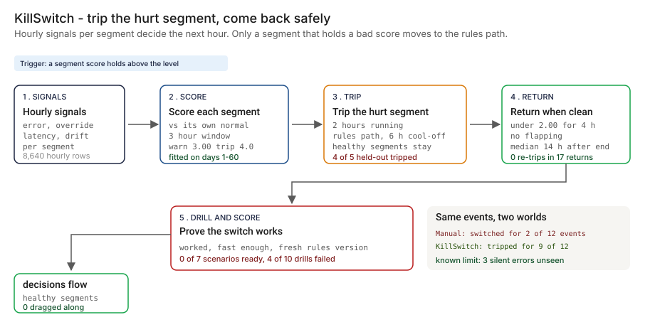

# Architecture — KillSwitch

The systems doc most PM writeups skip. Databases, where the code runs, encryption posture, user management, network, operational runbooks. What you'd hand to your CISO and your platform engineering lead on day one.

> **Status.** This is the design for the production shape. The repo implements the product mechanic as a prototype (hourly per-segment scoring, a tier state machine, a drill scorecard, over synthetic data, with a Streamlit app). Nothing below is claimed as deployed or load-tested. The prototype fits the trip level on days 1-60 and scores it on days 61-90. Where a figure is a design target, it says so (🔴).

This doc is cloud-agnostic where the design allows it and explicit where it doesn't. Every BFSI shop is on AWS, GCP or Azure (or two of three). GCP is shown as primary; AWS and Azure equivalents are called out inline.



---

## 1. Logical architecture

KillSwitch is a control for the fallback path. It does not replace the service's monitoring, the model, the rules engine or the incident process. It sits between a degraded signal and a customer decision, and decides one thing per segment: keep the model path, tell a person, or move to the rules path.

Nine components. Three sit between a signal and a customer decision; six do not.

| Component | Responsibility | Language / framework | In the decision path? | Stateful? |
| --- | --- | --- | --- | --- |
| `ks-collector` | Pulls per-segment metrics and the complaints feed from the platform's monitoring and case system. Writes them to the store. | Python 3 on Cloud Functions / Lambda / Functions | No, async | No |
| `ks-store` | Holds baselines, scores, path transitions, policy versions, rules versions and drill results. | PostgreSQL 15 | Yes (state of record) | Stateful |
| `ks-scorer` | Scores each signal against the segment's own baseline over a rolling window, with a volume guard. The prototype's `seg_scores`. | Python | No, async | No |
| `ks-controller` | Owns the per-segment state machine (normal, warn, fallback), applies cool-off and the return rule, writes every transition with its reason. The prototype's `segment_schedule`. | Python, FastAPI, Pydantic v2 | Yes (control plane) | No |
| `ks-flag` | The per-segment path flag the decision router reads, from a local cache with a short time-to-live. Uses the platform's feature-flag service where there is one. | Existing flag service, or a thin service | Yes (data plane, read-only) | Stateful |
| `ks-rules-registry` | Versions of the rules path with an owner, a release date and a test result. Feeds the drill scorecard and blocks an automatic trip when the rules are stale. | Python, PostgreSQL | No | Stateful |
| `ks-drill` | Schedules drills, runs them in a low-traffic window or against shadow traffic, records the result, builds the scorecard. The prototype's `drill_scorecard`. | Python workers | No | No |
| `ks-console` | Current state per segment, warns, overrides, recovery timelines, the scorecard, evidence bundles. | React + Next.js + Tailwind | No | No |
| `ks-telemetry` | OpenTelemetry spans and metrics from every component, exported off the decision path. | OTel Collector to the platform's monitoring | No, async | No |

**What is in the decision path, and what is not.** A customer decision reads the segment flag and nothing else from KillSwitch. The controller writes the flag; the scorer, the collector and the drill service support it. If every KillSwitch component but the flag were down, decisions would continue on whatever path each segment was last set to. That is deliberate: the control plane may fail, the data plane holds.

**Shadow scoring (🔴 design, not built).** While a segment is on the rules path the model path keeps scoring a copy of its traffic, so the scorer can see whether it has recovered. Without that the segment would return blind. The prototype assumes this: its metrics describe the model path whether or not it is serving.

**Repo structure** (production shape; monorepo):

```
killswitch/
├── apps/
│   ├── collector/      # metrics and complaints ingestion
│   ├── scorer/         # baselines, window scores, volume guard
│   ├── controller/     # FastAPI: state machine, flag writer, override API
│   ├── drill/          # scheduler, runners, scorecard
│   └── console/        # review UI
├── libs/
│   ├── policy/         # window, persistence, hysteresis, cool-off, recovery criteria
│   └── stats/          # rate z-scores, window pooling, baselines
├── infra/
│   ├── terraform/      # multi-cloud IaC (gcp, aws, azure)
│   ├── kubernetes/     # Helm charts + Kustomize overlays
│   └── policies/       # OPA bundles, IAM templates, network policies
├── docs/
│   ├── ARCHITECTURE.md
│   ├── runbooks/
│   └── api/            # OpenAPI spec
└── tests/
    ├── unit/
    ├── integration/
    └── calibration/    # trips and returns replayed against labeled incident history
```

---

## 2. Physical / deployment architecture

### Runtime

| Component | GCP (primary) | AWS | Azure | Why |
| --- | --- | --- | --- | --- |
| `ks-collector` | Cloud Functions gen 2 + Cloud Scheduler | Lambda + EventBridge | Functions + Event Grid | Small scheduled job |
| `ks-scorer` | Cloud Run jobs | ECS Fargate tasks | Container Apps jobs | Stateless, short-lived, runs once per scoring interval |
| `ks-controller` | Cloud Run (min instances 1) | ECS Fargate | Container Apps | Stateless API; a warm instance keeps transitions prompt |
| `ks-drill` | GKE worker pool | EKS worker pool | AKS worker pool | Runs scenarios against shadow or low-traffic environments |
| `ks-console` | Cloud Run | ECS Fargate | Container Apps | Stateless UI |
| `ks-store` | Cloud SQL for PostgreSQL | RDS for PostgreSQL | Azure Database for PostgreSQL | The platform team already runs it |

**Failure behavior (the decision that matters most).** The controller has one rule for every failure: hold the current state. A segment on the model path stays there, a segment on the rules path stays there, and nothing returns automatically until the signals are readable again. The one exception is a person using the override. Any change to that rule needs a named owner and a line-2 sign-off.

| Failure | Behavior | Alert |
| --- | --- | --- |
| Signal feed down or late | Segments hold their state; no automatic return; scores marked stale | P2 |
| Flag service unreachable | Decision nodes hold the last known path per segment | P2 |
| Controller down | Segments hold; a person can still move a segment by hand | P2 |
| Rules version stale or last drill failed | No automatic trip for that segment; warn and page instead | P3 |
| Window too thin to score a rate | Rate signals skipped for that window; latency and drift still count | P4 |
| Telemetry sink down | Buffer locally, drop with a counter once full | P4 |

**Latency.** The only new wait on a customer decision is a read of a cached flag. 🔴 Design target: a flag change is honored by every decision node within one cache refresh, set at 30 seconds in the design. It has not been measured in this repo. In the prototype, metrics are hourly, so the fastest possible trip is 2 hours after an event starts; a production scorer would run on a finer interval.

### Network topology

```
Platform monitoring / complaints system
   │   read-only API token
   ▼
[ks-collector] ──► [PostgreSQL: metrics, baselines]
                         │
                         ▼
                    [ks-scorer] ──► scores
                         │
                         ▼
                  [ks-controller] ◄── override API (two-person rule) ◄── [ks-console] behind the bank's SSO
                         │
           ┌─────────────┼──────────────┐
           ▼             ▼              ▼
     [ks-flag]     transition log   OTel Collector ──► monitoring
           │
           ▼
   Decision router: model path | rules path (versions from [ks-rules-registry])

Out of band:
   [ks-drill] runs scenarios against the router in a low-traffic window or against shadow traffic
   Interlocks (all designed, none built): DriftSentinel (02), AgentWatch (05), OversightOps (08), SchemaWatch (15), IncidentLedger (19), ScopeKeeper (23)
```

### Region & DR

- Primary and DR regions follow the decision service's own footprint. KillSwitch does not get a different recovery objective than the service whose fallback it controls.
- Region-specific instances where data residency applies. Each has its own database and key ring; metrics and complaints do not replicate across regions.

---

## 3. Data architecture

### Databases by purpose

| Store | Purpose | Why this store |
| --- | --- | --- |
| **PostgreSQL 15** | Baselines, scores, path transitions, policy versions, rules versions, drill results, overrides, audit log | Relational integrity for the audit trail; the platform team already runs it |
| **Object storage with Object Lock (WORM)** | Evidence bundles per event: the timeline, the scores, the decisions that moved | Write-once-read-many for the record-keeping policy |
| **Redis** (optional) | The flag's cache and idempotency keys for the override API | TTL eviction handles cleanup |

### PostgreSQL schema (the consequential tables)

```sql
-- The normal level of each signal for each segment, from a healthy period a person approved
CREATE TABLE segment_baselines (
    service        TEXT NOT NULL,
    segment        TEXT NOT NULL,
    signal         TEXT NOT NULL,                 -- error_rate / override_rate / latency / drift
    normal_rate    DOUBLE PRECISION,              -- the two rate signals
    normal_mean    DOUBLE PRECISION,              -- latency and drift
    normal_sd      DOUBLE PRECISION,
    healthy_from   TIMESTAMPTZ NOT NULL,
    healthy_to     TIMESTAMPTZ NOT NULL,
    approved_by    TEXT NOT NULL,
    PRIMARY KEY (service, segment, signal, healthy_from)
);

-- One row per segment and hour; partitioned by month
CREATE TABLE segment_scores (
    service        TEXT NOT NULL,
    segment        TEXT NOT NULL,
    hour_ts        TIMESTAMPTZ NOT NULL,
    error_z        DOUBLE PRECISION,
    override_z     DOUBLE PRECISION,
    latency_z      DOUBLE PRECISION,
    drift_z        DOUBLE PRECISION,
    score          DOUBLE PRECISION NOT NULL,     -- the worst of the four
    lead_signal    TEXT NOT NULL,
    window_decisions INT NOT NULL,
    PRIMARY KEY (service, segment, hour_ts)
) PARTITION BY RANGE (hour_ts);

-- Every change of path, with its reason; append-only, partitioned by month
CREATE TABLE path_transitions (
    transition_id  UUID NOT NULL DEFAULT gen_random_uuid(),
    service        TEXT NOT NULL,
    segment        TEXT NOT NULL,
    occurred_at    TIMESTAMPTZ NOT NULL DEFAULT NOW(),
    from_state     TEXT NOT NULL,                 -- normal / warn / fallback
    to_state       TEXT NOT NULL,
    reason         TEXT NOT NULL,                 -- the sentence an on-call person reads
    score          DOUBLE PRECISION,
    policy_version INT NOT NULL,
    actor          TEXT NOT NULL,                 -- controller / user
    approved_by    TEXT,                          -- required for a manual return
    PRIMARY KEY (transition_id, occurred_at)
) PARTITION BY RANGE (occurred_at);

-- The thresholds and the evidence they were fitted on
CREATE TABLE policy_versions (
    policy_version INT PRIMARY KEY,
    trip_level     DOUBLE PRECISION NOT NULL,     -- standard errors
    warn_fraction  DOUBLE PRECISION NOT NULL,
    clear_fraction DOUBLE PRECISION NOT NULL,
    clear_hours    INT NOT NULL,
    cool_off_hours INT NOT NULL,
    fit_from       TIMESTAMPTZ NOT NULL,
    fit_to         TIMESTAMPTZ NOT NULL,
    held_out_report_uri TEXT NOT NULL,            -- the scoring on days the fit never saw
    approved_by    TEXT NOT NULL,
    approved_at    TIMESTAMPTZ NOT NULL DEFAULT NOW()
);

-- Versions of the rules path, each with an owner
CREATE TABLE rules_versions (
    rules_version_id UUID PRIMARY KEY DEFAULT gen_random_uuid(),
    service        TEXT NOT NULL,
    version        TEXT NOT NULL,
    released_at    TIMESTAMPTZ NOT NULL,
    owner          TEXT NOT NULL,
    tests_passed   BOOLEAN NOT NULL,
    UNIQUE (service, version)
);

-- Every drill and how it went
CREATE TABLE drill_results (
    drill_id       UUID PRIMARY KEY DEFAULT gen_random_uuid(),
    service        TEXT NOT NULL,
    scenario       TEXT NOT NULL,
    ran_at         TIMESTAMPTZ NOT NULL,
    minutes_to_fallback INT,                      -- null when it failed
    success        BOOLEAN NOT NULL,
    failure_reason TEXT,
    rules_version_id UUID NOT NULL REFERENCES rules_versions,
    scorecard_status TEXT NOT NULL                -- pass / pass_with_gaps / fail
);

-- Audit log (immutable, append-only, partitioned by month)
CREATE TABLE audit_log (
    audit_id       UUID NOT NULL DEFAULT gen_random_uuid(),
    occurred_at    TIMESTAMPTZ NOT NULL DEFAULT NOW(),
    actor_id       TEXT NOT NULL,
    actor_type     TEXT NOT NULL,                 -- user / service_account
    action         TEXT NOT NULL,
    resource_type  TEXT NOT NULL,
    resource_id    TEXT NOT NULL,
    request_id     TEXT NOT NULL,
    payload        JSONB,
    result         TEXT NOT NULL,                 -- success / failure / forbidden
    PRIMARY KEY (audit_id, occurred_at)
) PARTITION BY RANGE (occurred_at);
```

**What is stored about customers.** Nothing. KillSwitch works on counts and rates per segment and hour. It never stores a customer's decision input or output. Where a reviewer needs to see which decisions ran on the rules path, the decision log of the AI service holds them under its own retention and access rules.

### Retention & data classification

The retention periods below are design defaults. Confirm each against the bank's own record-retention schedule before use.

| Data class | Retention (design default) | Storage | Classification |
| --- | --- | --- | --- |
| Path transitions and overrides | 7 years | Postgres, archive to Object Lock | Confidential |
| Policy versions and held-out reports | 7 years | Postgres, archive to Object Lock | Confidential |
| Drill results and rules versions | 7 years | Postgres | Internal |
| Hourly scores | 2 years | Postgres (monthly partitions, drop old) | Internal |
| Evidence bundles | 7 years | Object storage with Object Lock | Confidential |
| Flag cache | TTL, minutes | Redis | Internal |
| Audit log | 7 years | Postgres partitioned, archive to Object Lock | Confidential |

---

## 4. Security architecture

A controller that can move a customer segment between decision paths is a privileged system. It is designed as one.

### Encryption

- **At rest.** AES-256 with customer-managed keys (CMEK / CMK) in Cloud KMS, AWS KMS or Azure Key Vault, one key ring per region. Keys never cross a region boundary.
- **In transit.** TLS 1.3 north-south. mTLS east-west through the service mesh.
- **Database-level.** Transparent data encryption on PostgreSQL, encryption at rest on Redis.

### Secrets management

- **Primary store.** HashiCorp Vault or the cloud secret manager. No long-lived static credentials.
- **Application secrets** (monitoring read token, flag service credential, database passwords): fetched at boot through workload identity, rotated on the bank's schedule with dual-credential rolling.
- **Service-account keys.** None. Workload Identity on GCP, IAM Roles for Service Accounts on AWS, Managed Identity on Azure.

### Identity provider & user management

- **IdP.** Whatever the bank already runs (Okta, Microsoft Entra ID, Ping). SAML 2.0 and OIDC. KillSwitch does not run its own.
- **MFA.** Enforced at the IdP, not in the app.
- **Sessions.** OIDC ID token plus signed session cookie (HttpOnly, Secure, SameSite=Strict), with absolute and idle expiry set by bank policy.
- **Service-to-service identity.** SPIFFE IDs; each component has its own workload identity and mTLS enforces it at every hop.

### RBAC matrix

Authorization is enforced at the controller API with OPA, and every decision is written to `audit_log`.

| Role | Can | Maps to (bank role) |
| --- | --- | --- |
| `ks:viewer` | Read states, scores, timelines and the scorecard | Audit, executives |
| `ks:oncall` | Viewer + acknowledge a warn, propose a manual trip or return | On-call engineer |
| `ks:owner` | On-call rights + approve a return, approve a policy version for their service | Service owner |
| `ks:validator` | Viewer + approve a policy version and any override of a trip | Line-2 model risk |
| `ks:admin` | Config, integrations, role management | Platform engineering lead |

A manual return needs a proposer and a different approver. Both are recorded in `path_transitions`. Nobody holds the right to move every segment alone.

### Network controls

- **Perimeter.** VPC Service Controls (GCP), PrivateLink plus Network Firewall (AWS) or Private Endpoints (Azure). No public ingress for the controller; the collector reaches only the monitoring and case-system endpoints on an allow-list.
- **Lateral.** Network policies and layer-7 inspection on the service mesh; the controller can write the flag and read the store, and can reach nothing else.
- **Ingress.** The console sits behind the bank's SSO; decision nodes read the flag over mTLS.
- **Zero-trust.** Every inter-service call is authenticated. No "trusted internal network" assumption.

### Threat model

| Threat | Mitigation |
| --- | --- |
| A forged or replayed signal feed trips segments on purpose (a denial of service by fallback) | Signed feeds, an allow-list of sources, a per-segment cap on trips per day that pages a person instead of tripping again. |
| A forged feed hides a real degradation | Staleness is a signal: a feed that stops moving marks scores stale and holds state. The model-risk team compares scores with the incident history. |
| Baselines quietly shifted so a degradation looks normal | Baselines are versioned with the healthy period and an approver; a change needs a second approver and is written to the audit log. |
| One account moves the whole service | Per-segment flags, no role that moves every segment, a different approver for every manual return. |
| A stale rules version is used as the fallback | The registry records version age; an automatic trip is blocked when the version is stale or the last drill failed. |
| Complaint text injected to steer the scorer | Only counts enter the scorer. Text never does. |
| Flapping induced by noise near a threshold | Persistence, hysteresis and cool-off are the policy; a trip count above the budget pages a person. |

---

## 4a. APIs consumed and exposed

KillSwitch is a glue layer. Every external dependency is listed with its protocol, auth model, and what happens when it is down.

### APIs consumed (north-bound, what we depend on)

| External service | Protocol / auth | What we call | Failure mode |
| --- | --- | --- | --- |
| Platform monitoring | Metrics query API, read-only token from Vault | Per-segment error rate, override rate, latency, drift score, decision counts | Segments hold their state; scores marked stale |
| Case system | Read-only API | Complaint counts per segment and hour | Complaint signal skipped; the four other signals still count |
| Feature-flag service | Vendor REST or internal API, workload identity | Write the per-segment path flag | Decision nodes hold the last known path |
| Rules engine deploy API | Internal API | Rules version in force, release date, test result | Registry marks the version unknown; automatic trip blocked |
| Bank IdP (Okta / Entra / Ping) | SAML 2.0 + OIDC | Console login, role lookup | Existing sessions continue |
| Model-risk record (GRC tool) | Vendor REST, service principal | File transitions and evidence bundles | Local audit trail continues; sync resumes later |
| Monitoring (OpenTelemetry to the platform's stack) | OTLP over TLS | Metrics and traces | Local buffer |
| Paging and chat | REST / webhook | Alert routing | Email fallback |

### APIs we expose (south-bound, what others call us)

| Surface | Protocol / auth | Consumers |
| --- | --- | --- |
| `GET /v1/segments/{segment}/state` | OpenAPI 3.1 over HTTPS, mTLS service identity | Decision nodes, dashboards, AgentWatch (05) |
| `POST /v1/segments/{segment}/override` | mTLS plus user token, two-person rule on return | Console |
| `GET /v1/drills/scorecard` | mTLS service identity | Operational-resilience dashboard |
| Console API | OIDC bearer, role-checked by OPA | `ks-console` |
| Webhooks (outbound) | HTTPS POST, HMAC-SHA256 signed | Incident management (IncidentLedger 19), model-risk record |

### API-design opinions (the choices a reviewer will ask about)

- **REST and OpenAPI, not GraphQL.** The surface is one state endpoint, one override endpoint, one scorecard and a console. OpenAPI generates the client for decision nodes and the console SDK from one spec.
- **State is cheap and cacheable.** Decision nodes ask "which path is this segment on" constantly; the answer is a small document with a TTL.
- **The response carries the reason, not just the state.** The state, the reason, the score and the policy version come back every time, so an on-call person can read it without a meeting.
- **Idempotency key on override.** A retried click must not create a second transition. UUID v4 in the `Idempotency-Key` header.
- **Webhooks are signed, not just authenticated.** HMAC-SHA256 with a per-consumer rotating secret.
- **Versioning in the path** (`/v1/`), with a deprecation window announced in headers.

---

## 5. Operational architecture

### Observability

| Signal | Tool | Why |
| --- | --- | --- |
| Application logs and traces | OpenTelemetry into the platform's existing monitoring | The on-call person's existing pane |
| Transitions over time | Postgres + dashboards | Trips, returns, re-trips and false trips per segment |
| Flag staleness and trip latency | Metrics | Drives the hold-state behavior |
| Audit log | Postgres, archived to Object Lock | Record-keeping |

**SLOs worth owning.**

| SLO | Why it is the PM's number |
| --- | --- |
| **Scenarios whose last drill passed all three scorecard criteria** | The north star for readiness. A fallback nobody has drilled is a plan, not a capability. |
| **Trip delay** (event start to first hour on the rules path) | The cost side of detection. |
| **False trips against the budget** | Too many and people stop trusting the switch. |
| **Re-trips within 6 hours of a return** | The flapping measure. |
| **Flag staleness** | 🔴 Design target is under one cache refresh; not measured. |

### Alerting

| Severity | Trigger | Channel |
| --- | --- | --- |
| P1 | A trip was needed and the flag change did not reach decision nodes | Paging |
| P2 | Signal feed stale; controller or flag service down | Paging (low urgency) + chat |
| P3 | A warn; a stale rules version blocked an automatic trip | Chat |
| P4 | Thin window; daily digest of warns that closed without a trip | Email |

### Rollout

Shadow first: score and show nothing. Then advisory warns, then an automatic trip for one segment, then all segments where the scorecard is green, as laid out in the PRD. Automatic fallback of the controller to advisory mode if the false-trip budget is breached.

### Backup & DR

- **PostgreSQL.** Continuous WAL streaming to object storage, daily snapshots, point-in-time recovery inside the retention window.
- **Object stores.** Object Lock and versioning for evidence bundles and archived transitions.
- **Flag service.** The last known state of every segment is also written to the store, so a rebuilt flag service starts from the truth.
- **DR drill cadence.** Quarterly failover to the secondary region, validated against the decision service's own recovery objective, and scored on the same scorecard as everything else.

### Runbooks (one page each, in `docs/runbooks/`)

- `segment-tripped.md` — a trip landed: read the timeline, confirm the cause, decide whether to hold
- `warn-review.md` — a warn landed: what to look at, how to close it
- `manual-return.md` — return a segment by hand: propose, approve, record
- `feed-stale.md` — the signal feed stopped moving: hold state, find the source
- `rules-refresh.md` — refresh the rules path, run the test suite, run a drill
- `drill-run.md` — run a scenario, record the result, read the scorecard
- `silent-error-found.md` — a degradation was found by a person that no signal showed: add it to the labeled history

---

## 6. Compliance posture

Alignment, not certification. These are the frameworks the design is written against. Obligation statements are paraphrases written for this exercise, not the text of any rule.

| Framework | How the design relates |
| --- | --- |
| **SR 26-2** (current model-risk guidance from the Federal Reserve, OCC and FDIC, April 2026; it replaced the 2011 predecessor, SR 11-7) | Ongoing monitoring of a model, and a plan for when its performance degrades. The transition log, the thresholds with their fit and held-out evidence, and the drill results are the record for that theme. |
| **SR 20-24** (interagency operational-resilience paper) | The theme of identifying critical operations, setting tolerances for disruption, and testing that recovery works. The drill scorecard is the testing evidence; the recovery timeline is the tolerance evidence. |
| **SR 23-4** (interagency third-party risk guidance) | If the model or the rules engine is a third party's, the contingency plan for that dependency includes this fallback. |
| **NIST AI RMF** | The Manage function maps to responding to a degraded system and recovering from it; Measure maps to the scoring. |
| **EU AI Act, human oversight** | The expectation that a person can intervene in or interrupt a high-risk system. The override API and the two-person return are the hook. |
| **SOC 2 Type II, GDPR, India data localization** | Regional instances, counts and rates only (no customer values stored), append-only audit. |

---

## 7. What's deliberately not here

- **Detection of drift or agent failures.** DriftSentinel (02) and AgentWatch (05) detect. KillSwitch uses what they detect and decides, drills and recovers.
- **The model or the rules engine.** KillSwitch moves traffic between them. It does not train, tune or host either.
- **A human fallback queue.** Cases the rules path cannot decide go to a person; that queue is OversightOps (08).
- **A claim that it detects every degradation.** A silent error that moves no signal is a known limit, covered by a canary and an outcome backtest that are designed here and not built.
- **A standalone authentication system.** It uses the bank's IdP.
- **Severity-aware tripping in v1.** The first version trips on signals alone. It does not yet compare the expected harm of the model path with the quality gap of the rules path.

Holding that line is the scope discipline: each item above is something a team would be tempted to absorb, and each one is already owned by another system or another phase.

---

## Appendix — sample API contract

```python
# GET /v1/segments/affluent/state
# Auth: mTLS service identity
# Response 200
{
    "segment": "affluent",
    "state": "fallback",
    "since": "day 63 14:00",
    "reason": "worst signal above the trip level for 2 hours running",
    "trip_level": 4.0,
    "warn_level": 3.00,
    "clear_level": 2.00,
    "earliest_return": "6 hours after the trip, then 4 hours under the clear level",
    "policy_version": 1,
    "rules_version": {"version": "illustrative", "age_days": 3, "last_drill": "pass"},
    "evidence_uri": "object-lock://killswitch/evidence/..."
}
```

The segment, the times and the levels in the example are the prototype's `step_04` output for event E08 on the synthetic data. The policy version, the rules version and the URI are illustrative.

OpenAPI spec lives at `docs/api/openapi.yaml` and is the source of truth for the decision-node client and the console.

See also: [README](./README.md), [PRD](./PRD.md), and the [clickable demo](https://vj-shipped-anyway.github.io/ai-pm-portfolio/25-killswitch-ai-fallback-drills/demo.html).
