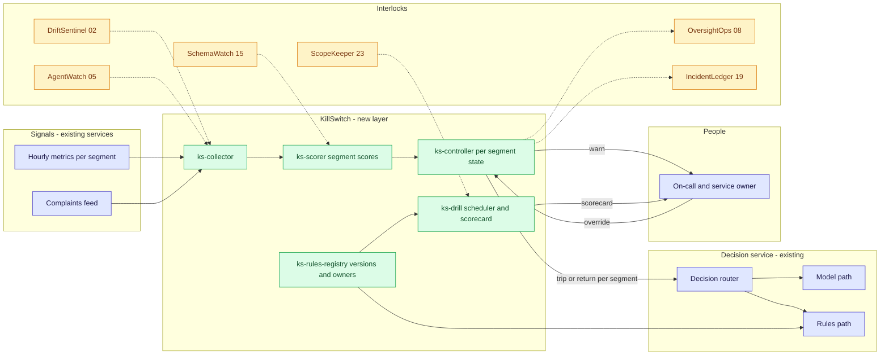
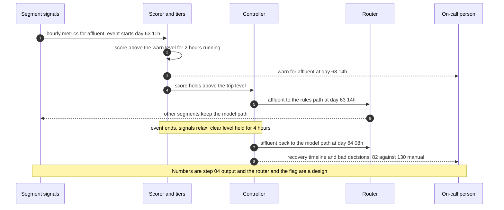

# 🛑 KillSwitch — Fallback and Degradation Drills for an AI Decision Service

**A portfolio prototype for the part of AI operations that usually has no owner: the trigger that moves a degraded customer segment to a simple rules path, the per-segment switch, the careful way back, and a scorecard for the drills that prove it works. Aligned to the operational-resilience expectations in [SR 20-24](https://www.federalreserve.gov/supervisionreg/srletters/SR2024.htm) and the ongoing-monitoring expectation in [SR 26-2](https://www.federalreserve.gov/supervisionreg/srletters/SR2602.htm) (which replaced the 2011 predecessor, SR 11-7, in April 2026), and to the 'Manage' function of the [NIST AI RMF](https://www.nist.gov/itl/ai-risk-management-framework).**

> **Regulatory note.** This README cites SR 11-7 or its replacement, [SR 26-2](https://www.federalreserve.gov/supervisionreg/srletters/SR2602.htm) (Federal Reserve, OCC and FDIC, April 17, 2026). SR 26-2 sets no enforceable standards, is aimed mainly at banks with over $30 billion in assets, and places generative AI and agentic AI outside its scope. Here those citations name the design basis for validation, monitoring and inventory practices, or serve as an analogy. They are not a claim that the project meets SR 26-2 or that SR 26-2 governs the systems it examines.

**▶ Static demo, no install:** [open on GitHub Pages](https://vj-shipped-anyway.github.io/ai-pm-portfolio/25-killswitch-ai-fallback-drills/demo.html)

> **Framing:** This is a portfolio prototype, not a production case study. The six-deficiency taxonomy, the tier-and-recovery design, the drill scorecard, the data generator and the walkthrough are mine. Every number below is either printed by a script in this folder on data I generated, or is modeled with its assumption named. Production validation (a real decision service, a real incident history, a rules engine with an owner, an operational-resilience read) is what the next role does.

> **Reading the numbers — credibility tags inline.** Every number in this README and the demo is tagged 🟢 **Measured** (printed by a script in `src/` on the shipped synthetic data: 8,640 hourly rows for 4 segments over 90 days, 12 degradation events, 10 drills), 🟡 **Modeled** (built on an assumption named in one line), or 🔴 **Hypothetical** (designed and reasoned about, never tested). Full convention in the [master README's "Reading the numbers" section](../README.md#-reading-the-numbers). **All data is synthetic and generated by a seeded script. The truth is known because the data is synthetic: the generator decided when each event started and ended, so it can say exactly how many decisions each one spoiled. The fallback rules path is a stub: its quality numbers were set by the generator and are not measurements of any real rules engine or model. No model is used anywhere in this repo.** Thresholds are set on days 1-60 and scored on days 61-90; both are reported.


[](./demo.html)


> **▶ 30-second demo:** the [clickable demo](./demo.html) gets you the full story in 30 seconds with no install.

---

## 🔥 Demo in 30 seconds

Open the static, no-Python demo: [`demo.html`](./demo.html).
Pick one of the 12 degradation events from the dropdown, or use Next event and Replay all 12 events. Three cards show the same event three ways: the manual switch-off (late, or never), one threshold on the overall error rate (loud events only), and KillSwitch (warn, trip only the hurt segment, come back when the signals are clean). The running totals at the top add up the bad decisions each approach serves across the event windows, and the decisions served in silent errors, which is the known limit.

To run the four-step walkthrough on your laptop:

```bash
git clone https://github.com/Vj-shipped-anyway/ai-pm-portfolio
cd ai-pm-portfolio/25-killswitch-ai-fallback-drills/src
python3 step_01_manual_switch_off.py
python3 step_02_single_threshold_alert.py
python3 step_03_deficiencies_exposed.py
python3 step_04_with_killswitch.py
```

To regenerate the synthetic data (the output is identical on every run): `python3 ../data/_generate.py`.
To run the Streamlit prototype: `pip install -r requirements.txt`, then `streamlit run app.py` from `src/` (or `streamlit run 25-killswitch-ai-fallback-drills/src/app.py` from the repo root).

---

## 💰 Why this lands — competitive positioning

Teams that think about a fallback usually have one of two things: a runbook that says a person will switch the AI off, or a single alert on the service's error rate. I compare approaches rather than vendors, so the table below scores those two and the new layer on the same synthetic 90 days. The single threshold is tuned to the same false-trip budget as KillSwitch (at most 2 false trips in the 60 fit days), so the comparison is like for like.

| Capability | Manual switch-off | One threshold on the overall error rate | **KillSwitch** |
| --- | --- | --- | --- |
| Events switched or tripped before they ended | 🟡 2 of 12 (modeled: a notice level and a decision delay) | 🟢 3 of 12 tuned; 🟢 11 of 12 at twice normal | 🟢 9 of 12 |
| Held-out days 61-90 | 🟡 1 of 5 | 🟢 1 of 5 | 🟢 4 of 5, median 2.5 h |
| False trips (days 1-90) | n/a (perfect triage assumed) | 🟢 0 when tuned; 🟢 101 at twice normal | 🟢 2 |
| Moves only the hurt segment | No: all four, always | No: all four, always | Yes: 🟢 0 healthy decisions dragged along, by construction |
| Hysteresis and cool-off | No | No | Yes: 🟢 0 of 17 returns re-tripped within 6 hours |
| Drilled and scored | 🟢 4 of 10 drills failed | Same drills, no scorecard | Scorecard: 🟢 0 of 7 scenarios ready |
| Sees a silent error | Never: no complaints | No | No: 🟢 3 of 3 missed (the known limit) |
| Where it still fails | Short events end before the switch lands; small segments never produce a complaint cluster | Misses the events the biggest segment hides; flaps at the sensitive setting: 🟢 268 switches in 90 days | The way back is slow: 🟢 median 14 h on the rules path after an event ends. On the 3 events both tripped, the single threshold served fewer bad decisions (🟢 678 against 1,219) |

**Position:** *KillSwitch does not replace the service's monitoring, the incident process or the rules engine. It adds the control that sits between a degraded signal and a customer decision: define the trigger per segment, switch only what is hurt, bring it back only when it is clean, and score whether the switch has been drilled. A single alert tells you something is wrong. This decides, drills and recovers.* It is not a duplicate of drift or agent monitoring: those detect, and this uses what they detect.

---

## The honest version (why this exists)

The failure mode this prototype is built around: an AI decision service has a fallback path, a simple rules engine, and the plan for a bad day is "we will switch it off manually." Nobody has defined what makes the switch flip, rehearsed flipping it, measured how long the way back takes, or asked whether all customer segments have to fall back when only one is degraded. When it does go wrong, the people who find out first are customers in the smallest segments, and they are the least likely to generate enough complaints for anyone to notice.

This is a prototype on synthetic data. I wrote the generator, the event list, the stub rules-path quality numbers, the signal scoring, the tier and recovery rules, the baseline comparisons and the drill scorecard. The hourly metrics and the drills are produced by a seeded script, not by a service or a model, and no model is used anywhere in this repo. The truth is known because the data is synthetic: the generator decides when each event starts and ends, so it can say how many decisions each one spoiled. A real estate does not hand you that, which is why the first job in a real deployment would be a history of real degradations, labeled after the fact. Nothing here is a real bank, service, model, vendor or incident.

The event list is dense on purpose (12 events in 90 days, with 8 hitting a single segment) so that every effect appears often enough to count. It is a test set, not an estimate of how often a real service degrades; that frequency is a separate, named assumption in the utility section.

If you run an AI decision service and your fallback plan is a person with a switch, fork it. The signal-to-tier rules, the per-segment state machine and the drill scorecard are the parts worth lifting. Validating them against a real incident history is the work the next role would do.

---

## Prereqs to run this on your laptop (in plain English)

You don't need a cluster, a cloud account or an API key. You need:

- **Python 3.** The four step scripts, the data generator and the demo builder use only the standard library (for example `csv`, `json`, `math`, `statistics` and `pathlib`), so there is nothing to install for them. They are written for Python 3.9 and tested on it; they use no syntax newer than 3.9.
- **Git**, to clone the repo. `brew install git` / `winget install git`.
- **`src/requirements.txt` — only for the Streamlit app.** It lists `streamlit`, `pandas`, `numpy` and `plotly`. The step scripts do not import any of them. Run `pip install -r src/requirements.txt` only if you want the app.
- **No API key.** There is no model call, no network call and no secret anywhere. The scoring, the tiers, the state machine and the scorecard are plain rules you can read.
- **Not needed:** a database, containers, Kubernetes or a cloud account. They appear in [`ARCHITECTURE.md`](./ARCHITECTURE.md) as the production design, not as prototype requirements.

Each step script finishes in seconds and writes its CSV or JSON to `src/out/`. The clickable `demo.html` runs in any browser with zero install. If a step does not run from a fresh clone, that's a bug in the README. Open an issue.

---

## Executive summary (90 seconds)

**Problem.** A modeled bank runs an AI decision service for four customer segments: consumer, small business, affluent and new to bank. A simple rules engine is the fallback path. Over 90 synthetic days the service suffers 12 degradation events; 8 hit one segment and 3 are silent errors that move no metric. The plan is "we will switch it off manually." 🟡 The manual process switches before the event ends for 2 of 12 events, and 🟡 3,384 of the 3,931 bad decisions those events would serve are served anyway (86.1%). The manual figures are modeled: they rest on a notice level of 12 complaints in 3 hours and a 4-hour decision delay, with perfect triage.

**Product.** KillSwitch, a control for the fallback path: **four signals per segment and hour** (error rate, override rate, latency, drift score) **scored against the segment's own normal** over a 3-hour window, with rates scored in standard errors and skipped when the window holds too few decisions; a **warn tier** that tells a person and a **trip tier** that moves only the hurt segment to the rules path; **hysteresis and a cool-off** so the segment returns only when its score stays clean; a **recovery timeline**; and a **drill scorecard** that judges every drill on three things: it worked, it was fast enough, it used a fresh rules version.

**Measured and modeled performance.**

- 🟢 **Held out (days 61-90): tripped for 4 of 5 events, median 2.5 hours in, 1 false trip** (`step_04`). The trip level was fitted on days 1-60, where it tripped for 5 of 7 events with 1 false trip. 2 hours is the floor of this design: hourly metrics, 2 hours running.
- 🟢 **Bad decisions per event, days 61-90: 223 with KillSwitch against 255 with the tuned single threshold** (`step_04`), 12.5% fewer. Per 100,000 decisions: 445 against 508.
- 🟡 **Against the manual plan: 298 per event, 25.2% fewer.** Modeled: it rests on the 4-hour decision delay and the complaint notice level.
- 🟢 **No flapping: 0 of 17 returns re-tripped within 6 hours and 0 returned before the event ended** (`step_04`). The twice-normal threshold re-tripped 52 of 134 (`step_02`).
- 🟢 **Only the hurt segment moves: 0 healthy decisions dragged along** (`step_04`), by construction: a segment trips only on its own signals. The modeled manual switch drags 🟡 971 along (`step_01`).
- 🟢 **Drills: 4 of 10 failed, 3 of those 4 on a stale rules version; the scorecard marks 0 of 7 scenarios ready** (`step_03`, `step_04`). The scorecard scores drills; it does not fix them.
- 🟢 **Known limit, left in on purpose: 3 silent errors, none tripped, 340 bad decisions served in them** (`step_04`). Nothing in this repo detects them.
- 🟢 **The price of a careful way back: a median 14 hours on the rules path after an event ends** (`step_04`). On the 3 events both approaches tripped, the single threshold served fewer bad decisions (678 against 1,219).
- 🟡 **Utility: (255 − 223) × 4 = 128 bad decisions avoided per quarter**, assuming 4 degradation events a quarter.
- 🔴 **Design target: a per-segment state flag that every decision node honors within one refresh interval, with the model path scoring in shadow while a segment is on the rules path.** Designed in `ARCHITECTURE.md`, never built or timed.

**Call to action.** Fork this repo. Swap [`data/metrics_hourly.csv`](./data/metrics_hourly.csv) for hourly per-segment exports from your decision service, keep the columns, and call `analyze` from `step_04` on them. Write your own policy rows in [`data/policy.csv`](./data/policy.csv). The truth file and the stub quality numbers exist only because the data is synthetic.

---

## 🗺️ What this walkthrough covers

1. **The use case** — an AI decision service with a rules-engine fallback, four segments, and a plan that says "switch it off manually"
2. **Sample data** — 8,640 hourly rows, 12 degradation events, stub fallback quality, 10 drills, a policy file
3. **Step 1 — Before KillSwitch** — the manual switch-off; how long bad decisions run and what the switch costs
4. **Step 2 — Basic approach** — one threshold on the overall error rate, tuned to a false-trip budget on days 1-60
5. **Step 3 — The six named deficiencies** — each with a count from the dataset
6. **Step 4 — The fix (KillSwitch)** — tiers, per-segment trip, hysteresis, recovery timeline, drill scorecard; scored on days 61-90, with the known limit printed
7. **Utility delivered** — a multiplied number with the assumption named
8. **Architecture & call flow** — topology and a per-event sequence
9. **PM artifacts** — PRD and architecture

> Non-technical reader: skip the code blocks. The plain-English explanation and the output tables tell the story.
> Technical reader: every code block runs. `cd src && python3 step_NN_*.py` and you'll see the same output.

Total reading time: about 12 minutes deep, 3 minutes if you skim.

---

## 🎯 The Use Case

**A modeled bank's AI decision service. Four customer segments, one rules-engine fallback, and a plan that is a person with a switch.**

The service makes decisions in real time for consumer, small-business, affluent and new-to-bank customers. When it degrades, a simple rules engine can take over. It is less accurate than a healthy model, and its quality gap differs by segment (stub numbers in [`data/fallback_rules.csv`](./data/fallback_rules.csv)). The service owner and the operational-resilience lead have to answer four questions nobody has: what trips the switch, who flips it, how long until it is safe to come back, and whether everything has to fall back when one segment is hurt.

Four things happen in the synthetic 90 days:

- **A small segment regresses and nobody hears.** Event E08 degrades the affluent segment for 16 hours. Complaints from a segment this size never cluster: the busiest 3 hours reach 8 against a notice level of 12. 🟢 130 bad decisions are at stake and the manual plan 🟡 serves all of them. KillSwitch trips affluent only, 3 hours in, and returns it 5 hours after the event ends: 🟢 82 bad decisions in total.
- **A loud outage ends before the switch lands.** Event E04 takes an upstream service down for 4 hours. Complaints cluster within the hour, but with a 4-hour decision delay the switch would land after the outage ends, so nothing is switched and 🟡 814 bad decisions are served. Here the single threshold does better than KillSwitch (🟢 403 against 724), because it trips in 1 hour and returns sooner. That is the cost of a careful way back.
- **A drill fails for a boring reason.** 🟢 4 of 10 drills fail, mostly because the rules version is older than 30 days: for example, it rejects current product codes.
- **A silent error.** Three events move no metric enough to see. They serve bad decisions until they stop, and nothing here notices.

---

## 📊 Sample Data

Five CSVs in [`data/`](./data/), generated by [`data/_generate.py`](./data/_generate.py) (standard library, seeded, deterministic: running it twice produces identical files). Documented in [`data/README.md`](./data/README.md). One preview each:

**[`data/metrics_hourly.csv`](./data/metrics_hourly.csv)** — 8,640 rows: 90 days × 24 hours × 4 segments. Hour 0 is a constant epoch; days 1-60 are hours 0-1439 and days 61-90 are hours 1440-2159. The first rows:

| hour | segment | decisions | error_rate | latency_p95_ms | drift_score | override_rate | complaints |
| --- | --- | --- | --- | --- | --- | --- | --- |
| 0 | `consumer` | 80 | 0.0125 | 165.2 | 0.0881 | 0.0125 | 0 |
| 0 | `small_business` | 20 | 0.0 | 206.7 | 0.0804 | 0.0 | 0 |
| 0 | `affluent` | 11 | 0.0 | 162.1 | 0.0606 | 0.0 | 0 |
| 0 | `new_to_bank` | 10 | 0.1 | 264.6 | 0.089 | 0.0 | 0 |
| 1 | `consumer` | 55 | 0.0 | 175.1 | 0.08 | 0.01818 | 0 |
| 1 | `small_business` | 16 | 0.0 | 201.0 | 0.0552 | 0.1875 | 0 |

**[`data/degradation_events.csv`](./data/degradation_events.csv)** — the 12 events. This is the truth: `end_hour` is the first healthy hour, `bad_decision_rate` is the share of decisions in the affected segments that are bad while the event is active, and `ramp_hours` is how long a drift event takes to build.

| event_id | start_hour | end_hour | type | segments | bad_decision_rate | ramp_hours | signal_scale |
| --- | --- | --- | --- | --- | --- | --- | --- |
| E01 | 110 | 116 | `tool_failure` | `new_to_bank` | 0.3 | 0 | 1.0 |
| E02 | 246 | 306 | `drift` | `affluent` | 0.14 | 12 | 1.0 |
| E03 | 393 | 407 | `model_regression` | `consumer;small_business` | 0.18 | 0 | 1.0 |
| E04 | 561 | 565 | `upstream_outage` | `consumer;small_business;affluent;new_to_bank` | 0.35 | 0 | 1.0 |
| E05 | 730 | 766 | `silent_error` | `small_business` | 0.1 | 0 | 1.0 |
| E06 | 982 | 990 | `tool_failure` | `affluent;small_business` | 0.28 | 0 | 0.9 |
| E07 | 1232 | 1262 | `silent_error` | `new_to_bank` | 0.09 | 0 | 1.0 |
| E08 | 1499 | 1515 | `model_regression` | `affluent` | 0.2 | 0 | 1.0 |
| E09 | 1623 | 1628 | `upstream_outage` | `consumer;small_business` | 0.32 | 0 | 0.9 |
| E10 | 1737 | 1777 | `silent_error` | `affluent` | 0.11 | 0 | 1.0 |
| E11 | 1875 | 1923 | `drift` | `new_to_bank` | 0.2 | 12 | 1.0 |
| E12 | 2029 | 2041 | `model_regression` | `consumer` | 0.16 | 0 | 0.8 |

Event mix: 3 model regressions, 2 upstream outages, 2 drifts, 2 tool failures and 3 silent errors. Eight hit one segment. Seven fall in days 1-60 and five in days 61-90.

**[`data/fallback_rules.csv`](./data/fallback_rules.csv)** — per segment, the modeled decision quality of the model path and the rules path. **Stubs: set by the generator, not measurements of any real model or rules engine.** `quality_gap` is what the rules path costs, per decision, when the model is healthy.

| segment | model_path_quality | rules_path_quality | quality_gap | label |
| --- | --- | --- | --- | --- |
| `consumer` | 0.94 | 0.9 | 0.04 | stub: set by the generator, not a measurement |
| `small_business` | 0.91 | 0.84 | 0.07 | stub: set by the generator, not a measurement |
| `affluent` | 0.93 | 0.85 | 0.08 | stub: set by the generator, not a measurement |
| `new_to_bank` | 0.88 | 0.76 | 0.12 | stub: set by the generator, not a measurement |

**[`data/drills.csv`](./data/drills.csv)** — 10 planned fallback drills. `minutes_to_fallback` is empty when the drill failed.

| drill_id | date_hour | scenario | minutes_to_fallback | success | failure_reason | rules_version_age_days |
| --- | --- | --- | --- | --- | --- | --- |
| D01 | 82 | `full_switch_off` |  | no | rules version stale: rejected current product codes | 38 |
| D02 | 250 | `full_switch_off` |  | no | rules version stale: rejected current product codes | 45 |
| D03 | 446 | `upstream_outage` | 47 | yes |  | 53 |
| D04 | 634 | `segment_switch_off` |  | no | rules version stale: rate table out of date | 61 |
| D05 | 851 | `model_regression` | 58 | yes |  | 2 |
| D06 | 1018 | `full_switch_off` | 53 | yes |  | 9 |
| D07 | 1239 | `recovery_return` |  | no | switch config not deployed to one segment | 18 |
| D08 | 1498 | `tool_failure` | 57 | yes |  | 29 |
| D09 | 1762 | `segment_switch_off` | 38 | yes |  | 3 |
| D10 | 2030 | `full_switch_off` | 48 | yes |  | 14 |

**[`data/policy.csv`](./data/policy.csv)** — the policy design and the assumptions of a modeled bank (window, persistence, hysteresis, cool-off, recovery criteria, the false-trip budget, the manual process, the drill targets). The trip level is the one value left out: step 4 fits it on days 1-60. The thresholds and weights here are assumptions of a modeled bank, not legal advice.

The data includes three hard cases on purpose: silent errors that move no metric enough to see, small segments whose events never produce a complaint cluster, and benign one-hour blips (a retry storm, a slow minute) that are not degradations.

---

## 🔧 Step 1 — Before KillSwitch: "we will switch it off manually"

**In plain English:** A person notices when complaints cluster, takes some hours to decide, and flips one switch that moves every segment to the rules path. Short events end before the switch lands, and small segments never generate enough complaints to be noticed.

```bash
python3 src/step_01_manual_switch_off.py
```

The assumptions are in the script header and printed with the result:

```
ASSUMPTIONS (modeled):
  A1  a person notices when complaints, all segments together, reach 12 in a rolling 3 hours
  A2  then 4 hours to decide and flip the switch, and 4 hours after the event ends to flip it back
  A3  the switch is all-or-nothing: every segment moves to the rules path
  A4  triage is perfect, so every manual number here is a floor on the harm
  A5  a cluster noticed after the event has ended triggers no switch
```

**Event by event:**

```
event starts         type              segments       hrs noticed        switch          delay bad served bad total
----------------------------------------------------------------------------------------------------------------
E01   day 5 14:00    tool failure      ntb              6 never          no switch         n/a         47        47
E02   day 11 06:00   drift             aff             60 never          no switch         n/a        212       212
E03   day 17 09:00   model regression  cons+smb        14 day 17 12:00   day 17 16:00      7 h        617       785
E04   day 24 09:00   upstream outage   all 4            4 day 24 10:00   no switch         n/a        814       814
E05   day 31 10:00   silent error      smb             36 never          no switch         n/a        144       144
E06   day 41 22:00   tool failure      aff+smb          8 never          no switch         n/a         67        67
E07   day 52 08:00   silent error      ntb             30 never          no switch         n/a         76        76
E08   day 63 11:00   model regression  aff             16 never          no switch         n/a        130       130
E09   day 68 15:00   upstream outage   cons+smb         5 day 68 16:00   no switch         n/a        474       474
E10   day 73 09:00   silent error      aff             40 never          no switch         n/a        120       120
E11   day 79 03:00   drift             ntb             48 never          no switch         n/a        237       237
E12   day 85 13:00   model regression  cons            12 day 85 16:00   day 85 20:00      7 h        445       527

  bad served = bad decisions from the degraded model path; bad total adds the quality gap of the rules path
  for every decision the manual switch moved (including healthy segments). Segments: cons consumer, smb small business, aff affluent, ntb new to bank.
```

```
RESULT (by period)
  days 1-60   events  7   switched in time  1   not switched  6   median delay 7 h   bad decisions per event 306
  days 61-90  events  5   switched in time  1   not switched  4   median delay 7 h   bad decisions per event 298
  days 1-90   events 12   switched in time  2   not switched 10   median delay 7 h   bad decisions per event 303

  Events with a manual switch before they ended:  2 of 12
  Events nobody switched for: E01, E02, E04, E05, E06, E07, E08, E09, E10, E11
  Median hours from event start to the switch (those switched): 7 h (modeled: built on assumptions A1 and A2)
  Bad decisions served by the degraded model path: 3,384 of 3,931 that doing nothing would have served
  Healthy-segment decisions moved to the rules path by the all-or-nothing switch: 971 (cost 89 bad-decision equivalents)
```

🟡 The switch lands before the event ends for 2 of 12 events; 2 are noticed too late (E04, E09) and 8 never produce a complaint cluster. 🟡 3,384 of 3,931 bad decisions are served (86.1%). All of this rests on assumptions A1 and A2, and the delay of 7 hours rests on two events, so treat it as an illustration, not an estimate. The sensitivity table the script prints moves both assumptions:

```
SENSITIVITY to the two assumptions (days 1-90; the run above is the last row)
  For reference, doing nothing serves 328 bad decisions per event (3,931 over 12 events).
  complaints to notice  decision delay  switched in time  bad decisions per event
                     6             1 h           9 of 12                      332
                     6             2 h           9 of 12                      361
                     6             4 h           6 of 12                      385
                     9             1 h           5 of 12                      246
                     9             2 h           5 of 12                      277
                     9             4 h           3 of 12                      309
                    12             1 h           4 of 12                      235
                    12             2 h           4 of 12                      268
                    12             4 h           2 of 12                      303
```

The table moves both assumptions. With a notice level of 6 complaints and a 1-hour delay the manual process switches for 9 of 12 events, yet serves 332 bad decisions per event, about what doing nothing serves (328): the all-or-nothing switch costs as much as it saves, because it moves every segment for a problem that is usually in one.

---

## 🤖 Step 2 — With the basic approach: one threshold on the overall error rate

**In plain English:** Watch the service's overall error rate. When an hour is above a threshold, move the whole service to the rules path; when it is back under, move it back. No tiers, no segments, no hysteresis, no volume guard. The fallback is automatic, so there is no human delay here, which makes the comparison with step 1 conservative.

```bash
python3 src/step_02_single_threshold_alert.py
```

The threshold is set on days 1-60 and scored on days 61-90. Two settings are shown: the most sensitive threshold on a fixed grid whose false trips stay within the budget (2 in the 60 fit days; the same budget KillSwitch is tuned to), and twice the normal overall error rate, a common rule of thumb.

```
THRESHOLD SWEEP on days 1-60 (the fit period). Lower = more sensitive.
  threshold  trips  false trips  of them 22:00-06:00  events caught  switches/day
       1.5%    165          138                   68         7 of 7          5.50
       2.0%     74           56                   45         6 of 7          2.47
       2.5%     35           26                   24         5 of 7          1.17
       3.0%     25           15                   15         5 of 7          0.83
       4.0%      8            4                    4         3 of 7          0.27
       5.0%      5            3                    3         2 of 7          0.17
       6.0%      2            0                    0         2 of 7          0.07   <- tuned (most sensitive within budget)
       8.0%      2            0                    0         2 of 7          0.07
      10.0%      1            0                    0         1 of 7          0.03
      15.0%      1            0                    0         1 of 7          0.03
```

```
TUNED: threshold 6.00%
  days 1-60   caught  2 of  7   median delay  3.5 h   false trips   0   switches/day 0.07   bad decisions per event   283
  days 61-90  caught  1 of  5   median delay    1 h   false trips   0   switches/day 0.07   bad decisions per event   255
  days 1-90   caught  3 of 12   median delay    1 h   false trips   0   switches/day 0.07   bad decisions per event   271
```

```
TWICE NORMAL: threshold 1.79%
  days 1-60   caught  6 of  7   median delay  6.5 h   false trips  76   switches/day 3.27   bad decisions per event   377
  days 61-90  caught  5 of  5   median delay   12 h   false trips  25   switches/day 2.40   bad decisions per event   287
  days 1-90   caught 11 of 12   median delay   11 h   false trips 101   switches/day 2.98   bad decisions per event   339
```

- **The tuned threshold (6.0%) is quiet and mostly blind.** 🟢 It trips for 3 of 12 events (the loud ones), has 0 false trips on days 61-90, and misses 9 (E01, E02, E03, E05, E07, E08, E10, E11, E12). An event in one segment barely moves a rate dominated by the biggest segment.
- **Making it more sensitive buys catches at the price of false trips.** 🟢 At 1.8% (twice the normal 0.89%) it trips for 11 of 12 events, but raises 101 false trips and 268 fallback switches in 90 days. It also trips during 3 of 3 silent errors, which move no signal, so "caught" overstates detection there. The sweep shows the shape: 🟢 15 false trips on days 1-60 at 3.0%, 56 at 2.0%, and 3 of the 3 false trips at 5.0% start between 22:00 and 06:00, when few decisions make the overall rate noisy.

---

## 🔬 Step 3 — Where this still breaks: 6 named deficiencies

| # | Deficiency | What goes wrong | Count in this dataset |
| --- | --- | --- | --- |
| 1 | **Manual detection is slow, or never happens** | Complaints cluster late or not at all, and a decision delay follows. | 🟡 10 of 12 events not switched before they ended; 3,384 of 3,931 bad decisions served (86.1%) |
| 2 | **One threshold misses events or raises false trips** | The overall rate is dominated by the biggest segment and is noisy at night. | 🟢 Tuned: misses 9 of 12. Twice normal: 101 false trips in 90 days |
| 3 | **Without hysteresis the fallback flaps** | Signals hover around one threshold, so the service switches on and off. | 🟢 268 switches in 90 days at twice normal (2.98 a day, worst day 10) |
| 4 | **The fallback is untested** | Drills fail, on a stale rules version or a missing step, and nobody scores them. | 🟢 4 of 10 drills failed; 3 of those 4 on a stale rules version; 0 of 6 that worked met the 30-minute target |
| 5 | **Recovery is unmanaged** | The service returns when one hour looks fine, then falls back again. | 🟢 52 of 134 returns re-tripped within 6 hours; 22 returns happened while an event was still active (median -1 h from the end of an event to the last return) |
| 6 | **The switch is all-or-nothing** | A problem in one segment moves every segment to the weaker rules path. | 🟢 Moving every segment costs more than it saves in 7 of 8 single-segment events; 🟡 in those events the manual switch dragged along 482 healthy decisions (971 across all 12) |

```bash
python3 src/step_03_deficiencies_exposed.py
```

```

====================================================================================================
Step 3 - Six deficiencies of the status quo and the basic approach, with counts
====================================================================================================

(1) Manual detection is slow, or never happens
    10 of 12 events were not switched off before they ended (2 noticed too late: E04, E09; 8 never produced a complaint cluster).
    Median hours from start to the switch where it happened: 7 h (modeled: assumes a 4 h decision delay).
    Bad decisions served by the degraded model path: 3,384 of 3,931 (86.1%).

(2) A single threshold either misses events or raises false trips
    Tuned to the budget (6.0%): misses 9 of 12 events (E01, E02, E03, E05, E07, E08, E10, E11, E12), 0 false trips.
    Twice normal (1.8%): catches 11 of 12, but raises 101 false trips in 90 days.

(3) Without hysteresis the fallback flaps
    Twice-normal threshold: 268 fallback switches in 90 days (2.98 a day, worst day 10).
    Tuned threshold: 6 switches in 90 days (0.07 a day).

(4) The fallback is untested
    4 of 10 drills failed; 3 of those 4 ran on a rules version older than 30 days.
    4 of 10 drills used a stale rules version, and 1 of the 6 that worked was stale.
    Where it worked, the switch took a median 50.5 minutes (slowest 58); 0 of 6 met the 30-minute target.
      D01: rules version stale: rejected current product codes
      D02: rules version stale: rejected current product codes
      D04: rules version stale: rate table out of date
      D07: switch config not deployed to one segment

(5) Recovery is unmanaged
    Twice-normal threshold: 52 of 134 returns re-tripped within 6 hours; 22 returns happened while an event was still active.
    Twice-normal: median -1 h from the end of an event to the last return (events it caught; negative means it came back before the event ended).
    Tuned threshold: 0 of 3 returns re-tripped; median 3 h from the end of an event to the return (events it caught).
    Manual: the return is 4 h after the event ends by assumption (modeled), with no check that the service is healthy.

(6) The switch is all-or-nothing
    8 of 12 events hit one segment. In those, the switch moved healthy decisions: manual 482, tuned threshold 0, twice-normal 6,565.
    Across all 12 events: manual 971, tuned threshold 383, twice-normal 8,694.
    If a switch fired the hour each single-segment event began and held until it ended, 79,847 of 90,596 decisions moved (88.1%) would be healthy.
    event  type              segment          bad decisions at stake  cost: move all  cost: move one
    E01    tool failure      new_to_bank                          47             123              19
    E02    drift             affluent                            212           1,016             133
    E05    silent error      small_business                      144             684             101
    E07    silent error      new_to_bank                          76             639             101
    E08    model regression  affluent                            130             358              52
    E10    silent error      affluent                            120             716              88
    E11    drift             new_to_bank                         237             992             156
    E12    model regression  consumer                            575             273             144
    Moving every segment costs more than the bad decisions it avoids in 7 of 8 events; moving only the affected one, in 1.

The basic approach finds some events and mishandles the rest. The product is the per-segment decision,
the hysteresis and the drill, not the alarm.

Wrote src/out/step_03_deficiencies.csv and step_03_summary.json
```

"Safe to return" here is the synthetic truth, the hour the event ended; a real service would not know it. The all-or-nothing table is an upper bound: it assumes a switch fires the hour each single-segment event begins and is held until it ends. It shows that for small segments the weaker rules path costs more than the event does.

The basic approach finds some events and mishandles the rest. **The product is the per-segment decision, the hysteresis and the drill, not the alarm.**

---

## 🛠️ Step 4 — The fix: KillSwitch

Five parts, all plain rules, no model:

1. **Signals.** Four per segment and hour: error rate, override rate, latency and drift score. Each is scored against the segment's own healthy level from days 1-60 (the healthy hours are picked with the synthetic truth, as a person would pick them by hand) over a 3-hour window. Rates are scored in standard errors, so a quiet night hour does not shout, and are not scored at all when the window holds fewer than 60 decisions.
2. **Tiers.** Warn: the worst signal's score is at or above the warn level (0.75 × the trip level) for 2 hours running. A person is told; nothing switches. Trip: the same at the trip level. That segment, and only that segment, moves to the rules path.
3. **Hysteresis and cool-off.** A tripped segment stays on the rules path for at least 6 hours and returns only after its score stays under the clear level (0.50 × the trip level) for 4 hours running.
4. **Drill scorecard.** Every drill is judged on three things: it worked, it was fast enough, and it ran on a fresh rules version. A scenario is ready only if its last drill passed all three and is recent.
5. **Fit on days 1-60, scored on days 61-90.** The trip level is the lowest candidate whose false trips stay within the budget the single threshold was tuned to. Days 61-90 are never used to choose.

```bash
python3 src/step_04_with_killswitch.py
```

**The fit.** The right-hand columns are shown for honesty; they were not used to choose.

```
FIT on days 1-60: the lowest trip level (in standard errors) with at most 2 false trips
The right-hand columns are shown for honesty; days 61-90 were not used to choose.
  trip level  false trips 1-60  caught 1-60 |  false trips 61-90  caught 61-90  bad per event 61-90
         3.0                10       5 of 7 |                  5        4 of 5                  292
         3.5                 6       5 of 7 |                  1        4 of 5                  237
         4.0                 1       5 of 7 |                  1        4 of 5                  223   <- fitted
         4.5                 1       5 of 7 |                  1        4 of 5                  226
         5.0                 1       5 of 7 |                  0        4 of 5                  212
         5.5                 0       5 of 7 |                  0        4 of 5                  212
         6.0                 0       5 of 7 |                  0        4 of 5                  213
         7.0                 0       5 of 7 |                  0        3 of 5                  223
         8.0                 0       5 of 7 |                  0        3 of 5                  223
        10.0                 0       5 of 7 |                  0        2 of 5                  262

Fitted levels: warn 3.00, trip 4.0, clear 2.00 standard errors above each segment's normal.
```

```
In units a person reads (typical daytime window; latency and drift are window means):
  segment          window     error rate: normal / warn / trip   latency ms: normal / trip   drift: normal / trip
  consumer          1,179     0.80% /  1.58% /  1.83%          181 /   214        0.081 / 0.114
  small_business      261     1.12% /  3.08% /  3.73%          210 /   249        0.084 / 0.119
  affluent            163     0.65% /  2.54% /  3.16%          170 /   202        0.075 / 0.109
  new_to_bank         123     1.69% /  5.17% /  6.33%          240 /   287        0.090 / 0.125
```

**Event by event, and the way back:**

```
TIMELINE per event (KillSwitch, days 1-90). Delay = hours from the start of the event to the first hour on the rules path.
  event type              segments   starts         warn           tripped         delay moved           back  bad total
  E01   tool failure      ntb        day 5 14:00    day 5 16:00    day 5 16:00       2 h ntb             +8 h         38
  E02   drift             aff        day 11 06:00   day 11 09:00   day 11 10:00      4 h aff            +29 h        210
  E03   model regression  cons+smb   day 17 09:00   day 17 11:00   day 17 11:00      2 h cons+smb        +6 h        433
  E04   upstream outage   all 4      day 24 09:00   day 24 11:00   day 24 11:00      2 h all 4          +16 h        724
  E05   silent error      smb        day 31 10:00   -              no trip           n/a -                  -        144
  E06   tool failure      aff+smb    day 41 22:00   day 42 00:00   day 42 00:00      2 h smb+aff        +14 h        165
  E07   silent error      ntb        day 52 08:00   -              no trip           n/a -                  -         76
  E08   model regression  aff        day 63 11:00   day 63 14:00   day 63 14:00      3 h aff             +5 h         82
  E09   upstream outage   cons+smb   day 68 15:00   day 68 17:00   day 68 17:00      2 h cons+smb       +17 h        329
  E10   silent error      aff        day 73 09:00   -              no trip           n/a -                  -        120
  E11   drift             ntb        day 79 03:00   day 79 07:00   day 79 07:00      4 h ntb            +25 h        207
  E12   model regression  cons       day 85 13:00   day 85 15:00   day 85 15:00      2 h cons           +12 h        350
  back = hours after the event ended when the last tripped segment returned to the model path.
```

```
RECOVERY TIMELINE (segments that tripped)
  event segment         tripped        returned        hours on rules path  after event end
  E01   new_to_bank     day 5 16:00    day 6 04:00                    12 h             +8 h
  E02   affluent        day 11 10:00   day 14 23:00                   85 h            +29 h
  E03   consumer        day 17 11:00   day 18 04:00                   17 h             +5 h
  E03   small_business  day 17 14:00   day 18 05:00                   15 h             +6 h
  E04   consumer        day 24 11:00   day 25 01:00                   14 h            +12 h
  E04   small_business  day 24 11:00   day 25 05:00                   18 h            +16 h
  E04   affluent        day 24 11:00   day 25 00:00                   13 h            +11 h
  E04   new_to_bank     day 24 11:00   day 25 00:00                   13 h            +11 h
  E06   small_business  day 42 00:00   day 42 20:00                   20 h            +14 h
  E06   affluent        day 42 01:00   day 42 17:00                   16 h            +11 h
  E08   affluent        day 63 14:00   day 64 08:00                   18 h             +5 h
  E09   consumer        day 68 17:00   day 69 07:00                   14 h            +11 h
  E09   small_business  day 68 17:00   day 69 13:00                   20 h            +17 h
  E11   new_to_bank     day 79 07:00   day 82 04:00                   69 h            +25 h
  E12   consumer        day 85 15:00   day 86 13:00                   22 h            +12 h
```

**Fitted on days 1-60, scored on days 61-90, three approaches on the same budget:**

```
RESULT
Fitted on days 1-60, scored on days 61-90. Same budget, same data, three approaches:

 days 1-60
  manual switch-off (modeled) caught  1 of  7   median delay    7 h   false trips   0   switches/day 0.03   bad decisions per event   306
  single threshold (tuned)   caught  2 of  7   median delay  3.5 h   false trips   0   switches/day 0.07   bad decisions per event   283
  KillSwitch                 caught  5 of  7   median delay    2 h   false trips   1   switches/day 0.37   bad decisions per event   259

 days 61-90
  manual switch-off (modeled) caught  1 of  5   median delay    7 h   false trips   0   switches/day 0.07   bad decisions per event   298
  single threshold (tuned)   caught  1 of  5   median delay    1 h   false trips   0   switches/day 0.07   bad decisions per event   255
  KillSwitch                 caught  4 of  5   median delay  2.5 h   false trips   1   switches/day 0.40   bad decisions per event   223

 Days 61-90 detail
  Bad decisions per 100,000 decisions: manual 594, single threshold 508, KillSwitch 445
  KillSwitch protected 5,310 decisions in the affected segments, moved 0 decisions in segments no event touched, and stayed on the rules path for 4,866 decisions after events ended
  Cost of the rules path in bad-decision equivalents: while events were active 334, after they ended 254, in segments no event touched 0, false trips 27
  Returns 6: 0 before the event ended, 0 re-tripped within 6 hours
  Days 1-90 returns 17: 0 before the event ended, 0 re-tripped within 6 hours; median 14 h from the end of an event to the return
  Warns raised (days 1-90): 30; 18 led to a trip, 12 did not (a person looks and closes them). The warn came an hour or more before the trip on 3 of 15 justified trips (median lead 0 h)
```

**The six deficiencies, before and after:**

```
THE SIX DEFICIENCIES, BEFORE AND AFTER (days 1-90)
  (1) Detection        manual switched for 2 of 12 events; KillSwitch tripped for 9 of 12 (median 2 h from the start of the event)
  (2) Misses and noise single threshold (tuned) missed 9 of 12; KillSwitch missed 3 (E05, E07, E10) with 2 false trips; twice-normal raised 101
  (3) Flapping         returns that re-tripped within 6 hours: twice-normal 52 of 134; KillSwitch 0 of 17
  (4) Drills           the scorecard flags 10 of 10 drills and marks 0 of 7 scenarios ready; it scores the drills, it does not fix them
  (5) Recovery         returns before the event ended: twice-normal 22, KillSwitch 0; the price is a median 14 h on the rules path after an event ends
  (6) All-or-nothing   healthy decisions dragged along by an event's switch: manual 971, single threshold 383, twice-normal 8,694, KillSwitch 0 (by construction: a segment trips only on its own signals)
```

- **It finds what the threshold cannot.** 🟢 KillSwitch trips for 9 of 12 events (the single threshold, 3), with a median delay of 2 hours. On days 61-90 it trips for 4 of 5. 2 hours is the floor of this design.
- **The warn tier adds little lead time here.** 🟢 30 warns in 90 days; 18 led to a trip and 12 did not. The warn came an hour or more before the trip on 3 of 15 justified trips. It mostly puts a person in the loop on borderline signals; it is not an early-warning system on abrupt events.
- **The fit is not fragile in the middle and is fragile at the edges.** 🟢 Trip levels from 4.0 to 6.0 all trip for 4 of 5 held-out events; 10.0 trips for 2 of 5, and 3.0 raises false trips (10 on days 1-60).

**Where each approach wins:**

```
WHERE EACH APPROACH WINS (days 1-90, bad decisions in the event windows, false trips not included)
  group                                   events  KillSwitch  single threshold   manual
  caught by both                               3       1,219               678    1,356   E04, E06, E09
  caught only by KillSwitch                    6       1,320             2,235    1,938   E01, E02, E03, E08, E11, E12
  caught by neither                            3         340               340      340   E05, E07, E10
  Where both trip, the single threshold's instant return costs fewer bad decisions than KillSwitch's careful one.
```

**The drill scorecard:**

```
DRILL SCORECARD (a drill passes only if it worked, was fast enough and used a fresh rules version)
  0 PASS, 6 PASS WITH GAPS, 4 FAIL of 10 drills (target 30 minutes, rules version at most 30 days old)
    D01 full_switch_off     FAIL            rules version stale: rejected current product codes
    D02 full_switch_off     FAIL            rules version stale: rejected current product codes
    D03 upstream_outage     PASS WITH GAPS  slow: 47 min against a 30 min target; stale rules version (53 days old)
    D04 segment_switch_off  FAIL            rules version stale: rate table out of date
    D05 model_regression    PASS WITH GAPS  slow: 58 min against a 30 min target
    D06 full_switch_off     PASS WITH GAPS  slow: 53 min against a 30 min target
    D07 recovery_return     FAIL            switch config not deployed to one segment
    D08 tool_failure        PASS WITH GAPS  slow: 57 min against a 30 min target
    D09 segment_switch_off  PASS WITH GAPS  slow: 38 min against a 30 min target
    D10 full_switch_off     PASS WITH GAPS  slow: 48 min against a 30 min target
  Scenarios ready: 0 of 7
    full_switch_off     NOT READY  last drill D10: pass with gaps
    segment_switch_off  NOT READY  last drill D09: pass with gaps
    upstream_outage     NOT READY  last drill D03: pass with gaps
    model_regression    NOT READY  last drill D05: pass with gaps
    tool_failure        NOT READY  last drill D08: pass with gaps
    drift               NOT READY  never drilled
    recovery_return     NOT READY  last drill D07: fail
  Clean passes if the target were 30 min: 0, 45 min: 1, 60 min: 5 (an assumption of the modeled bank).
```

🟢 0 drills pass cleanly, 6 pass with gaps and 4 fail; 0 of 7 scenarios are ready. The 30-minute target is an assumption of a modeled bank, and the sensitivity line shows how much rests on it: clean passes at other targets are 30 min: 0, 45 min: 1, 60 min: 5.

### The known limit, left in on purpose

KillSwitch cannot trip on what no metric shows. 3 of the 12 events are silent errors, and none is tripped.

```
WHAT IT STILL GETS WRONG (known limit, left in on purpose)
  days 1-60: 2 of 2 silent errors missed, 220 bad decisions served in them
  days 61-90: 1 of 1 silent errors missed, 120 bad decisions served in them
    E05 small business, 36 h: peak score 2.0 (warn level 3.00), 144 bad decisions served, no trip
    E07 new to bank, 30 h: peak score 2.7 (warn level 3.00), 76 bad decisions served, no trip
    E10 affluent, 40 h: peak score 2.1 (warn level 3.00), 120 bad decisions served, no trip
  Events missed that were not silent errors: 0
  Silent errors move no signal enough to see; nothing in this repo detects them. A golden-set canary or an outcome
  backtest would (designed, not built). The trip level was fitted on 7 synthetic events, so treat
  the fitted level as a property of this data, not of any real service; the fit table above shows how it moves.
  The way back is conservative: after events ended KillSwitch kept 12,840 decisions on the rules path (days 1-90), a cost of 746 bad-decision equivalents. A faster return is a design option, not tested here.
  The warn tier bought little lead time: see the warn line above. It mostly puts a person in the loop on borderline signals.
```

🟢 The silent errors serve 340 bad decisions between them (220 on days 1-60 and 120 on days 61-90). The mitigation is in the process, not the code: a golden-set canary or an outcome backtest would see them. That is 🔴 designed in the PRD, never tested. The other limits are stated plainly: the trip level was fitted on 7 synthetic events, the way back is conservative, and the rules-path quality gaps are stubs, so the size of every gain depends on a number I chose.

---

## 📐 Utility Delivered

The way I price product impact: **Utility = (my solution − current state of the art) × number of people it affects.**

Here the terms are bad decisions per event and degradation events per quarter. Each event lands on the service owner, the operational-resilience lead, the on-call engineer and the customers whose decisions were wrong. Going from "something alerts" to "this segment is tripped, held and returned on a rule" is not an outcome by itself. *Doing it for every event a service of this shape suffers in a quarter is.*

| Term | Value | Where it comes from |
| --- | --- | --- |
| Current state of the art (one tuned threshold), bad decisions per event | 🟢 **255** | `step_04`, days 61-90: expected bad decisions inside event windows plus the cost of false trips, divided by the 5 held-out events |
| My solution (KillSwitch), bad decisions per event | 🟢 **223** | `step_04`, same period and same accounting |
| Per-event lift | 🟢 255 − 223 = **32** | Bad decisions avoided per event, measured on the held-out days |
| Number it affects: degradation events per quarter | 🟡 **4** | **Assumption, not a statistic:** a service of this shape suffers 4 meaningful degradations a quarter. Edit `EVENTS_PER_QUARTER` in `step_04` to use your own |
| Assumption that makes the lift real | 🟡 The trip is honored: the router switches the segment, the rules version is fresh, a person responds to the warn | If the fallback fails as often as the drills did (40%), the lift falls to about 19 per event |
| **Utility** | 🟡 **(255 − 223) × 4 = 128 bad decisions avoided per quarter** | Against the single threshold. Against the manual plan: (298 − 223) × 4 = 300, modeled on the 4-hour decision delay |

Sensitivity to the events-per-quarter assumption (🟡, same per-event lift against the single threshold): 2 gives 64, 4 gives 128, 8 gives 256, 12 gives 384.

For scale: the synthetic service handled 250,681 decisions on days 61-90 (`step_04` prints the count). Per 100,000 decisions that is 594 bad decisions with the manual plan (🟡 modeled), 508 with the tuned single threshold and 445 with KillSwitch (🟢).

🔴 What I have not measured: how a real rules engine compares with a real model (the quality gaps are stubs), how often a real service degrades, whether a person acts on a warn, or what any of this costs to run. The synthetic estate is also much denser than a real one. Treat the per-event number as a property of this mix of events, not a forecast.

---

## 🔄 Architecture & Call Flow

How each event flows through the system. GitHub renders these diagrams natively. Component names match [`ARCHITECTURE.md`](./ARCHITECTURE.md).

**System topology:**



**Per-event sequence** (E08, a model regression in the affluent segment):



See [`assets/killswitch-flow.svg`](./assets/killswitch-flow.svg) for a static visual of the same flow.

**Interlocks (all 🔴 designed, none built):**

- [02 DriftSentinel](../02-driftsentinel-model-drift-monitoring/) supplies the drift signal. It detects; KillSwitch decides what a drift score means for each segment's path.
- [05 AgentWatch](../05-agentwatch-agent-observability/) supplies error and latency signals. Same split: it detects, this decides, drills and recovers.
- [08 OversightOps](../08-oversightops-hitl-workflow/) would own the human fallback queue: the people who take cases while a segment is on the rules path.
- [15 SchemaWatch](../15-schemawatch-tool-schema-drift/) can tell KillSwitch that a tool the service calls changed shape, so an error spike after a release is labeled known drift before it trips a segment.
- 19 IncidentLedger: a trip would open an incident with the timeline attached.
- 23 ScopeKeeper: a review of what the rules path is permitted to do before it takes decisions.

---

## 📋 PM Artifacts

The PM artifacts that show how I'd run this product if I owned the seat. This README is the walkthrough; the rest of the folder holds:

- [`PRD.md`](./PRD.md) — the product requirements doc: users, backlog, KPIs, rollout, open questions.
- [`ARCHITECTURE.md`](./ARCHITECTURE.md) — the systems doc: components, data model, security, failure behavior, operations. A design, not deployed.
- [`demo.html`](./demo.html) — clickable, no-install walkthrough; every number is generated from the scripts in `src/` by `src/_build_demo.py`.
- [`data/`](./data/) — the five synthetic CSVs and the generator. `data/README.md` explains the ground-truth rules.
- [`src/`](./src/) — runnable step scripts and the Streamlit prototype.

Run the walkthrough end-to-end:

```bash
cd src
python3 step_01_manual_switch_off.py
python3 step_02_single_threshold_alert.py
python3 step_03_deficiencies_exposed.py
python3 step_04_with_killswitch.py
```

---

## 🚀 Fork this for your team

```bash
git clone https://github.com/Vj-shipped-anyway/ai-pm-portfolio
cd ai-pm-portfolio/25-killswitch-ai-fallback-drills

# 1. Run the synthetic walkthrough as is
cd src
python3 step_01_manual_switch_off.py
python3 step_02_single_threshold_alert.py
python3 step_03_deficiencies_exposed.py
python3 step_04_with_killswitch.py

# 2. Open the interactive demo
open ../demo.html            # static snapshot of the synthetic run; it does not read data/
```

To point it at your own service, replace these files and keep their columns:

- `data/metrics_hourly.csv`: one row per segment and hour: `hour, segment, decisions, error_rate, latency_p95_ms, drift_score, override_rate, complaints`
- `data/fallback_rules.csv`: `segment, model_path_quality, rules_path_quality, quality_gap` (yours will be measured, not stubs)
- `data/drills.csv`: `drill_id, date_hour, scenario, minutes_to_fallback, success, failure_reason, rules_version_age_days`
- `data/policy.csv`: your window, persistence, hysteresis, cool-off and drill targets

The functions that do the work take plain lists and dicts, so you can call them directly:

```python
# from src/
from step_01_manual_switch_off import load_all
from step_04_with_killswitch import analyze, drill_scorecard

data = load_all()                # reads data/*.csv
A = analyze(data)                # baselines, segment scores, the fitted trip level, schedules, scoring
A["fb"]["affluent"]              # True in the hours the affluent segment is on the rules path
drill_scorecard(data)            # worked, fast enough, fresh rules version
```

`data/degradation_events.csv` exists only because the data is synthetic. The step scripts read it to define events and to score the result, so on real exports you will have to label past degradations yourself, and the accuracy lines in steps 1 to 4 cannot be computed until you do. `healthy_hours` needs the same labels; on a real service a person picks a healthy period by hand.

If you run it on a real incident history and get something useful, open an issue or send me what your service owners did with it. I'd rather see that than what I think it should do.

---

## 🛠️ Why this is a Streamlit prototype, not a production app

Streamlit was the right tool for this prototype. It would be the wrong tool for production. Worth saying out loud so a platform lead hears the architectural judgment.

**Streamlit is right for:**
- Validating the tier, trip and recovery mechanic in days, not weeks
- Walking a service owner, an operational-resilience lead or a model risk reviewer through the four-step story on a free deploy
- Single-tenant, single-page workflows where the UI doesn't have to scale
- Internal tools where one or two platform engineers are the only daily users

**Streamlit is wrong for:**
- A control in the decision path. A trip has to be a flag that every decision node reads within a defined time, not a page that reruns on every widget change
- Hardened auth (OIDC, SAML, fine-grained RBAC) with separate roles for the service owner, on-call, validators and auditors
- Large metric history. Scoring minute-level signals for many services needs a streaming job and a time-series store
- Brand-controlled UX inside the operations console where on-call people already work

**If KillSwitch graduated from prototype to product, the production shape would be (🔴 design, not built):**
- Collector and scorer: a streaming job reading per-segment metrics and the complaints feed, writing scores and baselines per segment
- Controller: a small service that owns the per-segment state machine, writes every transition with its reason, and publishes the desired path to a flag service
- Router: the decision service reads the per-segment flag from a local cache with a short time-to-live and holds its last known state if the flag service is unreachable
- Rules registry and drill service: versioned rules with an owner and a test suite, a drill scheduler and the scorecard
- Data plane: Postgres for state, transitions, policy versions and drill results; object storage with retention for evidence bundles
- Observability: OpenTelemetry into the platform's existing monitoring; trip latency and flag staleness as the first SLOs
- Governance: transitions and overrides written to the model-risk record, with the interlocks above

The portfolio prototype is the conversation-starter. The production architecture is the second meeting.

---

## 👤 Author

**Vijay Saharan** — Sr Product / Program Manager · AI in BFSI · Enterprise AI Platforms · CRE as a study interest

[LinkedIn](https://www.linkedin.com/in/vijaysaharan/) · Tagline: *AI Platform PM · Designs the fallback, the drill and the way back for AI decision services, under regulated constraint*

---

## 🙌 Acknowledgements

- **[SR 20-24](https://www.federalreserve.gov/supervisionreg/srletters/SR2024.htm)** — the interagency operational-resilience paper: the model-risk guidance the work is compared with on testing that recovery actually works. A fallback nobody has drilled is a plan, not a capability.
- **[SR 26-2](https://www.federalreserve.gov/supervisionreg/srletters/SR2602.htm)** — the current model-risk guidance from the Federal Reserve, OCC and FDIC (April 2026), which replaced the 2011 predecessor, SR 11-7. The ongoing-monitoring and contingency theme is what the trip and the scorecard are written against. Obligation statements in this repo are paraphrases written for this exercise, not the text of the rule.
- **[NIST AI RMF](https://www.nist.gov/itl/ai-risk-management-framework)** — the 'Manage' function maps onto responding to a degraded system and recovering from it.
- **Sibling projects in this repo** — [02 DriftSentinel](../02-driftsentinel-model-drift-monitoring/), [05 AgentWatch](../05-agentwatch-agent-observability/), [08 OversightOps](../08-oversightops-hitl-workflow/) and [15 SchemaWatch](../15-schemawatch-tool-schema-drift/), four of the interlocks.
