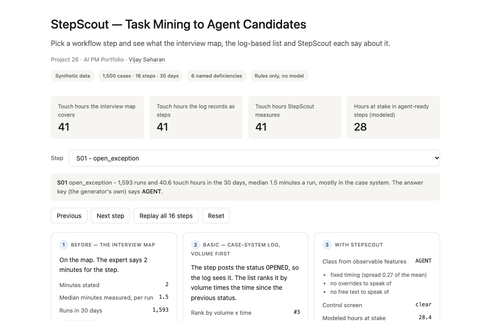
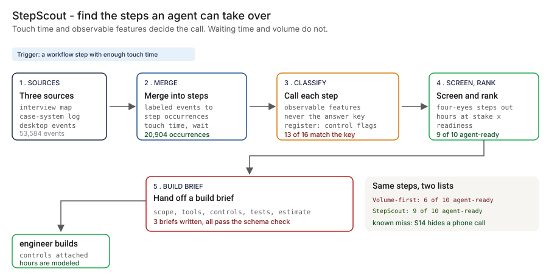
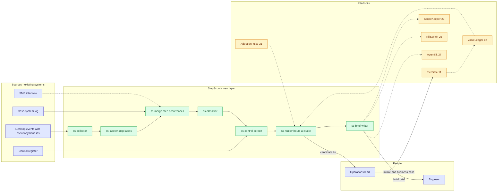
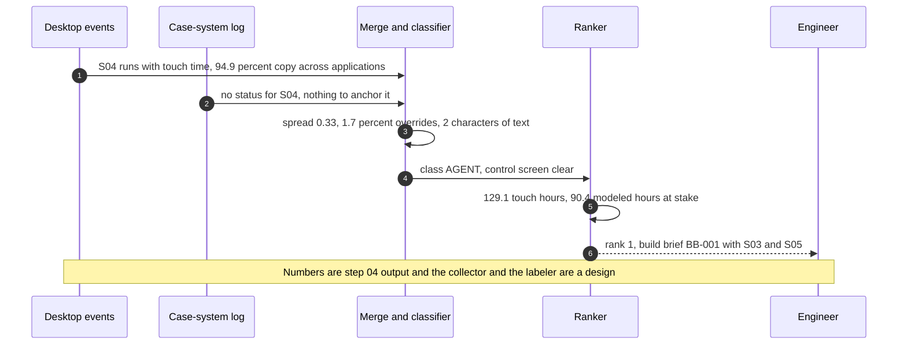

# 🔎 StepScout — Task Mining to Agent Candidates

**A portfolio prototype for finding which steps of an operations workflow an AI agent can take over: task-level mining of desktop and system events, a readiness and control screen per step, a ranked candidate list with hours at stake, and a build brief an engineer can pick up. Written against the 'Map' function of the [NIST AI RMF](https://www.nist.gov/itl/ai-risk-management-framework): know the context an AI system will work in before you point it at anything.**

**▶ Static demo, no install:** [open on GitHub Pages](https://vj-shipped-anyway.github.io/ai-pm-portfolio/26-stepscout-task-mining-agent-candidates/demo.html)

[](https://vj-shipped-anyway.github.io/ai-pm-portfolio/26-stepscout-task-mining-agent-candidates/demo.html)

**What it shows** (🟢 measured on synthetic data; the script is named in brackets):

- 🟢 Interview map: 24.8% of cases, 1 of 151 real paths (`step_03`)
- 🟢 Off-system work: 44.8% of touch time is outside the case system; the interview names 3 of the 6 applications (`step_03`)
- 🟢 Known miss, left in on purpose: S14 choose_resolution_route is classified AGENT; the key says HUMAN_JUDGMENT. It ranks #10 (`step_04`)

_A portfolio prototype on synthetic data, not a production case study. The framing and how to read the numbers are folded below._


[](./demo.html)



> **▶ 30-second demo:** the [clickable demo](./demo.html) gets you the full story in 30 seconds with no install.

<details>
<summary>Framing and how to read the numbers</summary>

> **Framing:** This is a portfolio prototype, not a production case study. The six-deficiency taxonomy, the step features and classifier rules, the control screen, the ranking, the build-brief writer, the data generator and the walkthrough are mine. Every number below is either printed by a script in this folder on data I generated, or is modeled with its assumption named. Production validation (real desktop events under a works-council and data-protection review, a labeled sample of steps, an engineer who builds from a brief) is what the next role does.

> **Reading the numbers — credibility tags inline.** Every number in this README and the demo is tagged 🟢 **Measured** (printed by a script in `src/` on the shipped synthetic data: 1,500 cases, 53,584 desktop events, 19,050 status events, 16 steps, 14 workers, 30 days), 🟡 **Modeled** (built on an assumption named in one line), or 🔴 **Hypothetical** (designed and reasoned about, never tested). Full convention in the [master README's "Reading the numbers" section](../README.md#-reading-the-numbers). **All data is synthetic and generated by a seeded script. The answer key (which steps an agent can take over) is the generator's own, and I planted the behavior in the events that the classifier reads, so every accuracy number shows the method working on this data, not on a real queue. No model is used anywhere in this repo: the classifier is plain rules, and the agent a build brief describes is not built. The share of touch time an agent removes (70%) is a stub for a real agent's result: a named assumption, never a measurement.** Task mining records what employees do at their desktops. That is a privacy and works-council question this prototype only designs for (pseudonymous worker ids, counts of typed characters and never the text, aggregate views): 🔴 designed, not built.

</details>

---

## 🔥 Demo in 30 seconds

Open the static, no-Python demo: [`demo.html`](./demo.html).
Pick one of the 16 workflow steps from the dropdown, or use Next step and Replay all 16 steps. Three cards show the same step three ways: the interview map (is it on the path the expert described?), the case-system log ranked by volume times time (does it see the step, and what does it credit?), and StepScout (the call from observable features, the control screen, the hours at stake). The running totals at the top add up the touch hours each approach can account for as you move through the workflow.

To run the four-step walkthrough on your laptop:

```bash
git clone https://github.com/Vj-shipped-anyway/ai-pm-portfolio
cd ai-pm-portfolio/26-stepscout-task-mining-agent-candidates/src
python3 step_01_interview_process_map.py
python3 step_02_system_log_mining.py
python3 step_03_deficiencies_exposed.py
python3 step_04_with_stepscout.py
```

To regenerate the synthetic data (the output is identical on every run): `python3 ../data/_generate.py`.
To run the Streamlit prototype: `pip install -r requirements.txt`, then `streamlit run app.py` from `src/` (or `streamlit run 26-stepscout-task-mining-agent-candidates/src/app.py` from the repo root).

---

## 💰 Why this lands — competitive positioning

Teams that want to put an agent on part of an operations queue usually pick the steps from one of three places: an interview with a subject-matter expert, a process-mining pass over the case system's log, or a list from that log ranked by volume times time. I compare approaches rather than vendors, so the table below scores those three and the new layer on the same synthetic 30 days.

| Capability | SME interview map | Case-system log mining | Volume-first ranked list | **StepScout** |
| --- | --- | --- | --- | --- |
| Share of real cases the picture describes | 🟢 24.8% (one path of 151 real paths) | 🟢 All 1,500 cases, but 107 variants that merge true paths; 3 of 16 steps never appear | Same as the log | 🟢 All 1,500 cases and 16 of 16 steps; 2.4% of desktop events carry no step label |
| Touch time against waiting | Minutes per step as the expert remembers them; no waits | Counts both as work: 🟢 touch is 6.9% of elapsed time | 🟢 Credits 15.0 times the hours of touch | Separates them per step |
| Work outside the case system | Names 3 of 6 applications | None: 🟢 44.8% of touch time is invisible | Same as the log | 🟢 All 6 applications; phone calls stay unseen (10.1% of handling time) |
| Rework | No loop | A REOPENED status exists, but cycle time stops at the first close: 🟢 140 cases, 81 touch hours after it | Same as the log | Attributes the rework hours to their steps |
| Agent-ready steps in the top 10 | 🟡 Picks by stated minutes; no list | No list | 🟢 6 of 10 | 🟢 9 of 10 |
| Control screen | None | None | None: 🟢 4 of 10 touch restricted data or a four-eyes control | Four-eyes steps out of the list; 🟢 2 conditioned |
| Hours at stake | 🟡 950 stated hours (cases times 38 minutes) | Elapsed hours, waiting included | Elapsed hours, waiting included | 🟡 Modeled touch hours with one named assumption, never measured |
| Where it still fails | One expert's happy path | Cannot see a step that posts no status; counts waiting as work | Judgment steps rise to the top because they wait | A judgment made off the desktop looks like a rule: 🟢 S14 is the known miss |

**Position:** *StepScout does not replace the interview, the case system's log or the intake process. It adds the step-level evidence that sits between "we should put an agent here" and an engineer's first line of code: how long each step really takes a person, what it looks like when a person does it, whether it touches a control, and what it is worth if an agent took it over. The interview says where to look, the log says what the case system saw, and this says what a person did.* It does not decide which pilots a bank funds or what an agent is permitted to do: those are owned by 11 TierGate and 12 ValueLedger (intake and the business case) and by 23 ScopeKeeper (agent permissions); see the interlocks below.

---

## The honest version (why this exists)

The failure mode this prototype is built around: an operations team decides to put an agent on part of a queue, and the candidates come from three places that each miss something. The interview describes one happy path. The case system's log never sees work done in a spreadsheet, an email or a second application, and it counts waiting as work. A list ranked by volume times time puts the steps that wait longest at the top, and those are often the steps that need judgment. The result is an agent pilot aimed at the wrong step, and a bank finds that out after the build.

This is a prototype on synthetic data. I wrote the generator, the planted behavior in the events, the step features, the classifier rules and thresholds, the control screen, the ranking, the build-brief writer and its validator, and the baseline comparisons. The desktop and system events are produced by a seeded script, not by a miner or a case system, and no model is used anywhere in this repo. The truth is known because the data is synthetic: the generator decided which steps an agent can take over, so it can score every call. A real estate does not hand you that, which is why the first job in a real deployment would be a sample of steps that a person who knows the work has classified by hand, and a privacy and works-council review before any desktop event is collected. Nothing here is a real bank, process, vendor or person.

The workflow is dense on purpose (1,500 cases, 151 real paths, two decoys and a rework loop) so that every effect appears often enough to count. It is a test set, not an estimate of how any real queue behaves.

If you run an operations queue and your pilot list came from an interview and a process-mining pass, fork it. The step features, the control screen and the build-brief shape are the parts worth lifting. Validating them against a hand-labeled sample of real steps is the work the next role would do.

---

## Prereqs to run this on your laptop (in plain English)

You don't need a cluster, a cloud account or an API key. You need:

- **Python 3.** The four step scripts, the data generator and the demo builder use only the standard library (for example `csv`, `json`, `statistics`, `bisect` and `pathlib`), so there is nothing to install for them. They are written for Python 3.9 and tested on it; they use no syntax newer than 3.9.
- **Git**, to clone the repo. `brew install git` / `winget install git`.
- **`src/requirements.txt` — only for the Streamlit app.** It lists `streamlit`, `pandas`, `numpy` and `plotly`. The step scripts do not import any of them. Run `pip install -r src/requirements.txt` only if you want the app.
- **No API key.** There is no model call, no network call and no secret anywhere. The classifier, the control screen, the ranking and the brief writer are plain rules you can read.
- **Not needed:** a database, containers, Kubernetes or a cloud account. They appear in [`ARCHITECTURE.md`](./ARCHITECTURE.md) as the production design, not as prototype requirements.

The whole walkthrough runs in a few seconds and each step writes its CSV or JSON to `src/out/`. The clickable `demo.html` runs in any browser with zero install. The desktop-events file is about 4 MB, the largest data file in the repo. If a step does not run from a fresh clone, that's a bug in the README. Open an issue.

---

## Executive summary (90 seconds)

**Problem.** A modeled bank runs a payment-exception queue (wire repair): a returned payment lands in a work queue, and a worker reads the reason, looks up the original payment, copies fields between applications, checks the match, screens the party, judges any ambiguous match, drafts a correction, gets a second person to approve it, resubmits, writes a note and closes the case. In 30 synthetic days it handles 1,500 cases through 16 steps, 14 workers and 6 applications. The operations lead wants an agent on part of it and has three inputs. 🟢 The interview map describes a path that 24.8% of cases follow. 🟢 The case-system log never records 3 of the 16 steps, and 44.8% of touch time is spent outside the case system. 🟢 The volume-first list's top 10 holds 6 steps an agent can take over; counted separately, 4 of its 10 steps touch restricted data or a four-eyes control, with no control screen.

**Product.** StepScout, an evidence layer between "put an agent here" and an engineer's first line of code: **merge** desktop and system events into step occurrences with touch time and wait; **classify** each step as AGENT, AGENT_HITL, HUMAN_JUDGMENT or HUMAN_CONTROL from observable features only (overrides, free text, repeats, timing spread, writes, outbound email, plus the control register's flags); **screen** it for four-eyes controls and restricted data; **rank** the survivors by modeled hours at stake times readiness; and write a **build brief** (build-brief/v1) an engineer can pick up.

**Measured and modeled performance.**

- 🟢 **Interview map: 24.8% of cases, 1 of 151 real paths** (`step_03`). The log shows 107 variants (`step_02`).
- 🟢 **Off-system work: 44.8% of touch time is outside the case system; the interview names 3 of the 6 applications** (`step_03`).
- 🟢 **Touch is 6.9% of elapsed time; the volume-first list credits 15.0 times the hours of touch** (`step_03`).
- 🟢 **Rework: 140 reopened cases (9.3%), 81 touch hours the headline cycle time leaves out** (`step_03`).
- 🟢 **Volume-first top 10: 6 of 10 agent-ready by the answer key; 4 of 10 touch restricted data or a four-eyes control** (`step_03`, `step_04`).
- 🟢 **StepScout: 13 of 16 steps classified as the key says (81.2%); agent-ready precision 92.3%, recall 100.0%; top 10 holds 9 agent-ready steps** (`step_04`). The key is the generator's own and I planted the signals.
- 🟢 **Handling time attributed to a named step: 87.8%, against at most 49.6% from the log alone** (38.2 points recovered; `step_04`). 10.1% stays off the desktop.
- 🟡 **Hours at stake: 592 agent-ready hours in StepScout's top 10 against 371 in the volume-first list**, per 30 days. Modeled: an agent removes 70% of a step's touch time.
- 🟡 **Utility: (42.3 − 26.5) × 14 = 221 hours per 30 days**, assuming both teams build their top 10.
- 🟢 **Known miss, left in on purpose: S14 choose_resolution_route** is classified AGENT; the key says HUMAN_JUDGMENT. It ranks #10 (`step_04`). Nothing observable separates it from a rule.
- 🔴 **Design target: a desktop collector with pseudonymous ids and aggregate-only views, a step labeler, and a control register fed by the data-classification and control owners.** Designed in `ARCHITECTURE.md`, never built or timed.

**Call to action.** Fork this repo. Swap [`data/desktop_events.csv`](./data/desktop_events.csv) and [`data/system_events.csv`](./data/system_events.csv) for your own exports, keep the columns, write your own register rows in [`data/step_catalog.csv`](./data/step_catalog.csv), and call `analyze` from `step_04` on them. The answer-key column and the planted columns exist only because the data is synthetic; on real data you label a sample of steps yourself to score the classifier.

---

## 🗺️ What this walkthrough covers

1. **The use case** — a wire-repair queue, a case system that sees part of it, and a plan to put an agent on some of it
2. **Sample data** — six files: 1,500 cases, 53,584 desktop events, 19,050 status events, an interview map, a step catalog with the answer key, 14 workers
3. **Step 1 — Before StepScout** — the interview process map and its total minutes
4. **Step 2 — Basic approach** — process-mine the case-system log; variants, cycle time and the volume-first candidate list
5. **Step 3 — The six named deficiencies** — each with a number from the dataset
6. **Step 4 — The fix (StepScout)** — merge, classify, screen, rank and brief; scored against the key, with the known miss printed
7. **Utility delivered** — a multiplied number with the assumption named
8. **Architecture & call flow** — topology and a per-step sequence
9. **PM artifacts** — PRD and architecture

> Non-technical reader: skip the code blocks. The plain-English explanation and the output tables tell the story.
> Technical reader: every code block runs. `cd src && python3 step_NN_*.py` and you'll see the same output.

Total reading time: about 12 minutes deep, 3 minutes if you skim.

---

## 🎯 The Use Case

**A modeled bank's payment-exception queue. 16 steps, 14 workers, 6 applications, and a case-system log that sees part of it.**

A returned or exception payment lands in a work queue. The operations lead has to answer a question nobody can answer from the inputs they have: which steps would an agent really take over, what are they worth, and which ones must stay with a person? The queue handles 1,500 cases in 30 days. The first twelve steps (S01 to S12) are the shared wire-repair workflow; four more (S13 to S16) are added here.

Four things happen in the synthetic 30 days:

- **A big step the log never sees.** S04 copy_beneficiary_fields moves values between applications through a spreadsheet in 94.9% of its runs. It takes 129.1 touch hours, the most of any step the key says an agent can do end to end, and it posts no status, so the case-system log never records that it happened. It is #1 on StepScout's list and absent from the volume-first list.
- **A step that waits.** S13 triage_beneficiary_bank_reply is #1 on the volume-first list: the log credits it 6,882 hours. The desktop shows 153.0 touch hours, and it is a judgment step. A person reads a reply from another bank and decides what it means.
- **A control.** S09 approve_four_eyes is #2 on the volume-first list. It is the second pair of eyes, and it stays with a person. S10 resubmit_payment may run only after S09 approves, so an agent on S10 needs a gate.
- **A judgment hidden in a phone call.** S14 choose_resolution_route looks rule-based on the desktop: a short pick, the tightest timing of any step, no free text, almost no overrides. The worker decides on a phone call before the pick, and no file records the call. It is the known miss.

---

## 📊 Sample Data

Six files in [`data/`](./data/), generated by [`data/_generate.py`](./data/_generate.py) (standard library, seeded, deterministic: running it twice produces identical files). Documented in [`data/README.md`](./data/README.md). One preview each:

**[`data/cases.csv`](./data/cases.csv)** — 1,500 cases created over 30 calendar days (22 working days). `variant_id` is the path the case really took, rework included; `reopened` is the reopen flag. Two columns are the generator's own record and are used only to measure and to score: `true_path` (not shown below) and `offdesk_min_truth`, minutes of work off the desktop that no event file records.

| case_id | created | first_closed | final_closed | reason_code | variant_id | reopened | primary_worker | offdesk_min_truth |
| --- | --- | --- | --- | --- | --- | --- | --- | --- |
| `C00001` | 2026-09-01T08:06:59 | 2026-09-02T09:16:43 | 2026-09-02T09:16:43 | `R02_name_mismatch` | `V62` | 0 | `W08` | 13.2 |
| `C00002` | 2026-09-01T08:07:01 | 2026-09-01T12:28:06 | 2026-09-01T12:28:06 | `R06_cutoff_missed` | `V02` | 0 | `W05` | 0.0 |
| `C00003` | 2026-09-01T08:07:06 | 2026-09-02T16:38:01 | 2026-09-02T16:38:01 | `R05_missing_field` | `V03` | 0 | `W06` | 13.7 |
| `C00004` | 2026-09-01T08:08:50 | 2026-09-02T14:53:53 | 2026-09-02T14:53:53 | `R05_missing_field` | `V08` | 0 | `W04` | 15.0 |
| `C00005` | 2026-09-01T08:20:30 | 2026-09-01T16:11:11 | 2026-09-01T16:11:11 | `R02_name_mismatch` | `V01` | 0 | `W09` | 0.0 |

**[`data/desktop_events.csv`](./data/desktop_events.csv)** — 53,584 task-mining style events: pseudonymous worker, application, action, the step label the miner infers, start, end, and `typed_chars`, a count and never the text. Steps 1 to 3 never read `step_id`; step 4 does. 2.4% of events carry no label.

| case_id | worker_id | application | action | step_id | start | end | typed_chars |
| --- | --- | --- | --- | --- | --- | --- | --- |
| `C00004` | `W04` | `case_system` | `open` | `S01` | 2026-09-01T08:32:39 | 2026-09-01T08:33:42 | 0 |
| `C00004` | `W04` | `case_system` | `read` | `S02` | 2026-09-01T08:34:04 | 2026-09-01T08:35:20 | 0 |
| `C00004` | `W04` | `case_system` | `copy` | `S03` | 2026-09-01T08:35:40 | 2026-09-01T08:35:51 | 0 |
| `C00004` | `W04` | `payments_hub` | `paste` | `S03` | 2026-09-01T08:35:53 | 2026-09-01T08:35:59 | 0 |
| `C00004` | `W04` | `payments_hub` | `search` | `S03` | 2026-09-01T08:36:01 | 2026-09-01T08:38:07 | 0 |

**[`data/system_events.csv`](./data/system_events.csv)** — 19,050 case-system status changes. Only the steps that post a status appear here; S03, S04 and S15 never do.

| case_id | status | ts | worker_id |
| --- | --- | --- | --- |
| `C00001` | `RECEIVED` | 2026-09-01T08:06:59 | `system` |
| `C00001` | `OPENED` | 2026-09-01T08:51:49 | `W08` |
| `C00001` | `REASON_CODED` | 2026-09-01T08:53:17 | `W08` |
| `C00001` | `MATCH_CHECKED` | 2026-09-01T09:09:52 | `W08` |
| `C00001` | `SCREENED` | 2026-09-01T09:15:12 | `W08` |

**[`data/sme_process_map.csv`](./data/sme_process_map.csv)** — the happy path as an interview gives it: 11 steps, minutes per step, three systems named.

| seq | step_id | step | systems_named | owner_role | minutes_per_step |
| --- | --- | --- | --- | --- | --- |
| 1 | `S01` | Open the exception from the queue | case system | operator | 2 |
| 2 | `S02` | Read the reason code | case system | operator | 2 |
| 3 | `S03` | Look up the original payment | payments hub | operator | 5 |
| 4 | `S04` | Copy the beneficiary details | case system | operator | 3 |

**[`data/step_catalog.csv`](./data/step_catalog.csv)** — the 16 steps. The register columns are what a team could supply without knowing the answer. `truth_class` is the **answer key**, the generator's own, and the classifier never reads it. Columns of planted parameters are left out of the preview; they are in the file.

| step_id | step_name | process_order | status_event | restricted_data | control_flag | gated_by | truth_class |
| --- | --- | --- | --- | --- | --- | --- | --- |
| `S01` | `open_exception` | 1 | `OPENED` | 0 | 0 |  | `AGENT` |
| `S02` | `read_reason_code` | 2 | `REASON_CODED` | 0 | 0 |  | `AGENT` |
| `S15` | `check_cutoff_and_value_date` | 3 |  | 0 | 0 |  | `AGENT` |
| `S03` | `lookup_original_payment` | 4 |  | 0 | 0 |  | `AGENT` |
| `S04` | `copy_beneficiary_fields` | 5 |  | 0 | 0 |  | `AGENT` |
| `S05` | `match_name_account` | 6 | `MATCH_CHECKED` | 0 | 0 |  | `AGENT` |
| `S06` | `screen_watchlist` | 7 | `SCREENED` | 1 | 0 |  | `AGENT` |
| `S07` | `judge_ambiguous_match` | 8 | `MATCH_REVIEWED` | 1 | 0 |  | `HUMAN_JUDGMENT` |
| `S16` | `request_info_from_originator` | 9 | `INFO_REQUESTED` | 0 | 0 |  | `AGENT_HITL` |
| `S13` | `triage_beneficiary_bank_reply` | 10 | `REPLY_LOGGED` | 0 | 0 |  | `HUMAN_JUDGMENT` |
| `S14` | `choose_resolution_route` | 11 | `ROUTE_SET` | 0 | 0 |  | `HUMAN_JUDGMENT` |
| `S08` | `draft_correction` | 12 | `CORRECTION_DRAFTED` | 0 | 0 |  | `AGENT_HITL` |
| `S09` | `approve_four_eyes` | 13 | `APPROVED` | 0 | 1 |  | `HUMAN_CONTROL` |
| `S10` | `resubmit_payment` | 14 | `RESUBMITTED` | 0 | 0 | `S09` | `AGENT_HITL` |
| `S11` | `write_case_note` | 15 | `NOTE_ADDED` | 0 | 0 |  | `AGENT` |
| `S12` | `close_case` | 16 | `CLOSED` | 0 | 0 |  | `AGENT` |

**[`data/workers.csv`](./data/workers.csv)** — 14 workers with pseudonymous ids, a role, a team and a tenure band. No names, no staff numbers.

The data includes three hard cases on purpose: a step that waits (S13) and is not agent-ready, a step the log never sees (S04), and a judgment that looks like a rule (S14).

---

## 🔧 Step 1 — Before StepScout: the interview process map

**In plain English:** Someone who knows the work walks you through it. You write down the steps and how long each takes. The result is one path, minutes per step, and the systems the expert thinks of. It is a good place to start and a poor place to stop.

```bash
python3 src/step_01_interview_process_map.py
```

```
====================================================================================================
Step 1 - Before StepScout: the interview process map
====================================================================================================

Source: data/sme_process_map.csv - an interview with one subject-matter expert. Nothing measured.

seq  step  what the expert says                       systems named            owner      minutes
----------------------------------------------------------------------------------------------------
  1  S01   Open the exception from the queue          case system              operator         2
  2  S02   Read the reason code                       case system              operator         2
  3  S03   Look up the original payment               payments hub             operator         5
  4  S04   Copy the beneficiary details               case system              operator         3
  5  S05   Check that name and account match          case system              operator         4
  6  S06   Screen the party against the watch list    screening application    operator         3
  7  S08   Draft the correction                       case system              operator         8
  8  S09   Second person approves                     case system              approver         3
  9  S10   Resubmit the payment                       payments hub             operator         3
 10  S11   Write the case note                        case system              operator         4
 11  S12   Close the case                             case system              operator         1
----------------------------------------------------------------------------------------------------
           Total, one case                                                                     38

What the map says: 11 steps, 1 path, 0 loops, no waits, 3 systems named (case system, payments hub, screening application).
If every one of the 1,500 cases took this path: 1,500 x 38 min = 950 hours in the 30 days (modeled from the interview, not measured).

An interview-driven pick takes the steps with the most stated minutes:
  S08  Draft the correction                        8 min  ->   200 stated hours
  S03  Look up the original payment                5 min  ->   125 stated hours
  S05  Check that name and account match           4 min  ->   100 stated hours
  S11  Write the case note                         4 min  ->   100 stated hours
  S04  Copy the beneficiary details                3 min  ->    75 stated hours

The map describes one happy path. Steps 2 and 3 count how many real cases take it.

Wrote src/out/step_01_process_map.csv and step_01_summary.json
```

🟡 The map implies 950 hours of work in the 30 days if every case followed it. That is the expert's estimate times the case count, not a measurement. An interview-driven pick would take the steps with the most stated minutes: S08, S03, S05 and S11.

---

## 🤖 Step 2 — With the basic approach: process-mine the case-system log

**In plain English:** Read the status changes the case system recorded. Count the variants, measure the time from receipt to close, and for each status multiply how often it happens by the time since the previous status. The biggest products go on top. This is cheap, it covers every case, and it is the list most teams start from.

```bash
python3 src/step_02_system_log_mining.py
```

```
====================================================================================================
Step 2 - Process-mine the case-system log, rank by volume times time
====================================================================================================

Source: data/system_events.csv only. 19,050 status changes on 1,500 cases. No desktop data, no answer key.

VARIANTS (the sequence of statuses per case)
  107 distinct variants in the log.
  The most common: 523 cases (34.9%).
  It takes 13 variants to cover 80% of cases.
  Rework: 140 REOPENED statuses (9.3% of cases).
  Top variants (each status shown as the step that posts it; rcv = receipt):
     523 cases (34.9%)  rcv > S01 > S02 > S05 > S06 > S08 > S09 > S10 > S11 > S12
     161 cases (10.7%)  rcv > S01 > S02 > S05 > S06 > S16 > S13 > S14 > S08 > S09 > S10 > S11 > S12
     128 cases ( 8.5%)  rcv > S01 > S02 > S05 > S06 > S14 > S08 > S09 > S10 > S11 > S12
     109 cases ( 7.3%)  rcv > S01 > S02 > S05 > S06 > S07 > S14 > S08 > S09 > S10 > S11 > S12
      67 cases ( 4.5%)  rcv > S01 > S02 > S05 > S06 > S16 > S13 > S13 > S14 > S08 > S09 > S10 > S11 > S12

CYCLE TIME (receipt to the first CLOSED, working hours)
  median 8.5 h   mean 11.3 h   90th percentile 21.5 h
  On the wall clock, nights and weekends included, the median is 23.3 h.

THE USUAL CANDIDATE LIST: volume x time since the previous status, biggest first
  rank  status              step  name                           volume  mean min    hours
     1  REPLY_LOGGED        S13   triage_beneficiary_bank_reply   1,112     371.3    6,882
     2  APPROVED            S09   approve_four_eyes               1,833     154.2    4,712
     3  OPENED              S01   open_exception                  1,500     111.3    2,782
     4  CORRECTION_DRAFTED  S08   draft_correction                1,833      39.7    1,214
     5  MATCH_CHECKED       S05   match_name_account              1,500      38.5      962
     6  MATCH_REVIEWED      S07   judge_ambiguous_match             345     134.3      772
     7  RESUBMITTED         S10   resubmit_payment                1,640      17.5      478
     8  ROUTE_SET           S14   choose_resolution_route           819      31.9      435
     9  SCREENED            S06   screen_watchlist                1,500       7.0      176
    10  INFO_REQUESTED      S16   request_info_from_originator      548      19.1      174
  Below the cut: S11 (NOTE_ADDED), S12 (CLOSED), S02 (REASON_CODED)

  Steps in the workflow the log never records: 3 of 16 (S15, S03, S04).
  The list's top 10 are credited 18,586 hours; each hour is the time since the previous status, so it contains waiting.

What this approach gets right: it is cheap, it covers every case, and the variants show real paths. Step 3 counts what it cannot see.

Wrote src/out/step_02_variants.csv, step_02_candidates_volume_first.csv and step_02_summary.json
```

- **The list puts waiting at the top.** 🟢 S13, S09 and S01 lead because the minutes between statuses are mostly waiting: a reply from another bank, a second person who is busy, a queue before anyone opens the case.
- **The log's most common variant covers 34.9% of cases** and lumps together true paths that differ only in steps that post no status.

---

## 🔬 Step 3 — Where this still breaks: 6 named deficiencies

| # | Deficiency | What goes wrong | Count in this dataset |
| --- | --- | --- | --- |
| 1 | **The interview map covers one path** | Real cases take many paths, and the loops are not on the map. | 🟢 372 of 1,500 cases (24.8%) took the documented path; 151 real paths |
| 2 | **Work outside the case system is invisible** | Spreadsheets, email and a second application leave no status. | 🟢 44.8% of touch time is outside the case system; 3 of 16 steps post no status |
| 3 | **Elapsed time is mostly wait, and the log counts both as work** | Touch time is a small share of the time between statuses. | 🟢 Touch is 6.9% of elapsed time; the list credits 15.0 times the hours of touch |
| 4 | **Rework loops are hidden** | Cycle time stops at the first close, so reopened cases look fast. | 🟢 140 cases (9.3%); 81 touch hours after the first close |
| 5 | **The volume-first top 10 contains steps an agent cannot take over** | Judgment and control steps wait, so they rank high. | 🟢 6 of 10 agent-ready; the other 4 are judgment or control |
| 6 | **The volume-first list has no control screen** | Nothing says which candidates touch restricted data or a four-eyes control. | 🟢 4 of 10 touch restricted data or a four-eyes control |

```bash
python3 src/step_03_deficiencies_exposed.py
```

```
====================================================================================================
Step 3 - Six deficiencies of the interview map and the log-based list, with numbers
====================================================================================================

(1) The interview map covers one path
    372 of 1,500 cases (24.8%) took exactly the documented path, with no reopen (the generator's record of the true path).
    The cases took 151 distinct paths; the map is 1 of them. It takes 21 paths to cover 80% of cases.
    5 of 16 steps are not on the map (S15, S07, S16, S13, S14); they are 15.1% of all step occurrences.
    The log is no better: it shows 107 variants (three steps post no status, so true paths that differ only there look the same). Its most common one covers 34.9% of cases.

(2) Work outside the case system is invisible to the log
    44.8% of desktop touch time is spent outside the case system (1,255 touch hours in all).
    Share of touch time by application: case system 55.2%, payments hub 16.9%, spreadsheet 5.2%, matching tool 7.4%, screening application 7.6%, email 7.6%
    The interview names 3 systems; the desktop shows 6 applications. The 3 never named hold 20.2% of touch time.
    3 of 16 steps post no status at all (S15, S03, S04): the log never records that they happened.

(3) Elapsed time is mostly wait, and the log counts both as work
    Per case, receipt to first close: median 8.5 working hours; touch time in that span: median 43 minutes.
    Over all cases: 16,942 elapsed hours, 1,175 touch hours -> touch is 6.9% of elapsed time.
    The volume-first list credits 18,875 hours to the workflow's steps; the desktop shows 1,255 hours of touch. It credits 15.0 times the hours of work.

(4) Rework loops are outside the headline cycle time
    140 cases (9.3%) were reopened; the log records 140 REOPENED statuses, but cycle time stops at the first close.
    For those cases the mean is 12.0 h to the first close and 44.5 h to the last.
    The rework adds 81 touch hours (6.4% of all touch time) and 4,545 elapsed hours. The interview map has no loop for it.

(5) The volume-first top 10 contains steps an agent cannot take over
    By the answer key, 6 of the top 10 are agent-ready (AGENT or AGENT_HITL).
      not ready: S13 triage_beneficiary_bank_reply (HUMAN_JUDGMENT)
      not ready: S09 approve_four_eyes (HUMAN_CONTROL)
      not ready: S07 judge_ambiguous_match (HUMAN_JUDGMENT)
      not ready: S14 choose_resolution_route (HUMAN_JUDGMENT)
    The steps the log never records (S15, S03, S04) are all agent-ready: 3 of 3. The list cannot propose them.

(6) The volume-first list has no control screen
    4 of the top 10 touch restricted data or a four-eyes control:
      S09 approve_four_eyes: four-eyes control
      S07 judge_ambiguous_match: restricted data
      S10 resubmit_payment: may run only after S09 approves
      S06 screen_watchlist: restricted data

The interview map and the log find some steps and mishandle the rest. The product is the touch time,
the readiness call and the control screen per step, not another ranking.

Wrote src/out/step_03_deficiencies.csv and step_03_summary.json
```

The interview map and the log find some steps and mishandle the rest. **The product is the touch time, the readiness call and the control screen per step, not another ranking.**

---

## 🛠️ Step 4 — The fix: StepScout

Six parts, all plain rules, no model:

1. **Merge.** Group the labeled desktop events into step occurrences per case (a new occurrence when the step changes or the events are more than 10 minutes apart), and attach the case-system status events. The merge is checked: how many status events land on an occurrence of the right step.
2. **Classify.** Per step, from observable features only: how often workers override a proposed value, how many characters they type, how often the step repeats within a case, how much its touch time varies, whether it writes to the payments hub or sends email, and the register's control flag. A step is HUMAN_JUDGMENT if at least 2 of 4 judgment signals fire (overrides at 20% or more, 200 or more characters of free text, 1.3 or more runs per case, a timing spread of 0.5 or more). Otherwise it is AGENT_HITL if it writes to the hub, sends email, is overridden at 5% or more, or carries 80 or more characters of free text. Otherwise AGENT. The register's four-eyes flag makes a step HUMAN_CONTROL. The thresholds are my choices.
3. **Screen.** Four-eyes steps leave the candidate list and judgment steps are left to a person. Candidates that touch restricted data, or may run only after an approval, stay and carry conditions into the brief.
4. **Rank.** Modeled hours at stake times readiness (AGENT 1.0, AGENT_HITL 0.6; ranking weights, not measurements). Hours at stake is 30 days of touch time times **one named assumption**: an agent removes 70% of a step's touch time. It is modeled and never measured.
5. **Score.** Against the generator's answer key: accuracy, precision and recall of agent-ready steps, the top 10 against the volume-first list, the share of handling time recovered, and the known miss. A check shuffles the answer key in the catalog and shows the classes do not move.
6. **Brief.** Adjacent top-10 steps form a pack of up to three. For the three packs with the highest ranking score, write a build-brief/v1 file to `src/out/` and validate it with a stdlib check.

```bash
python3 src/step_04_with_stepscout.py
```

**Merge, classify and screen:**

```
1. MERGE desktop and system events
   53,584 desktop events (2.4% the miner could not label) and 19,050 status events on 1,500 cases -> 20,904 step occurrences.
   Status events (written by a person) that land on a labeled occurrence of the right step: 17,334 of 17,550 (98.8%).

2. CLASSIFY from observable features (the register supplies the control flags; the answer key is not read)
   Judgment if at least 2 of: overrides >= 20%, free text >= 200 characters, repeats >= 1.3, timing spread >= 0.5.
   Agent with a person (HITL) if: writes to the hub, sends email, overrides >= 5%, or free text >= 80 characters.

   step name                            runs  touch h med min spread  rpt  text  ovr% xcopy%  class
   S01  open_exception                 1,593     40.6     1.5   0.27 1.09     0   0.0    0.0  AGENT
   S02  read_reason_code               1,467     24.9     1.0   0.28 1.00     0   0.0    0.0  AGENT
   S15  check_cutoff_and_value_date      339      8.5     1.5   0.23 1.00     0   0.0    0.0  AGENT
   S03  lookup_original_payment        1,640    117.9     4.1   0.38 1.09     0   1.8   52.0  AGENT
   S04  copy_beneficiary_fields        1,500    129.1     4.9   0.33 1.00     2   1.7   94.9  AGENT
   S05  match_name_account             1,500     82.9     3.2   0.35 1.00    15   6.2    0.0  AGENT_HITL
   S06  screen_watchlist               1,500     94.0     3.6   0.32 1.00    41   0.0    0.0  AGENT
   S07  judge_ambiguous_match            345     51.5     7.6   0.69 1.15   255  48.7   28.4  HUMAN_JUDGMENT
   S16  request_info_from_originator     548     42.7     4.3   0.40 1.00   158  12.6    8.4  AGENT_HITL
   S13  triage_beneficiary_bank_reply  1,113    153.0     7.1   0.62 1.76   435  33.3   48.8  HUMAN_JUDGMENT
   S14  choose_resolution_route          819     26.7     2.0   0.20 1.04     0   2.4    0.0  AGENT
   S08  draft_correction               1,833    194.9     5.9   0.44 1.22   159  22.9    0.0  AGENT_HITL
   S09  approve_four_eyes              1,829     73.1     2.2   0.43 1.22     0   0.8    0.0  HUMAN_CONTROL
   S10  resubmit_payment               1,639     74.8     2.6   0.33 1.09     0   0.0   66.3  AGENT_HITL
   S11  write_case_note                1,639     84.4     2.9   0.34 1.09   218   3.7    0.0  AGENT_HITL
   S12  close_case                     1,600     27.1     1.0   0.23 1.09     0   0.0    0.0  AGENT

3. CONTROL SCREEN
   S06 screen_watchlist: conditioned
       - restricted data: scoped read access, every hit logged, no raw hits in agent output; scope review before build
   S07 judge_ambiguous_match: left to a person: judgment
   S13 triage_beneficiary_bank_reply: left to a person: judgment
   S09 approve_four_eyes: blocked: stays with a person (four-eyes)
   S10 resubmit_payment: conditioned
       - runs only after S09 is approved by a different person; the agent never approves its own work
```

**The ranked candidates (🟡 hours at stake are modeled):**

```
4. RANKED CANDIDATES: modeled hours at stake x readiness (assumption: an agent removes 70% of a step's touch time)
   rank step name                           class       ready  touch h  hours at stake (modeled)   score
      1 S04  copy_beneficiary_fields        AGENT         1.0    129.1                      90.4    90.4  <- top 10
      2 S03  lookup_original_payment        AGENT         1.0    117.9                      82.6    82.6  <- top 10
      3 S08  draft_correction               AGENT_HITL    0.6    194.9                     136.5    81.9  <- top 10
      4 S06  screen_watchlist               AGENT         1.0     94.0                      65.8    65.8  <- top 10
      5 S11  write_case_note                AGENT_HITL    0.6     84.4                      59.1    35.4  <- top 10
      6 S05  match_name_account             AGENT_HITL    0.6     82.9                      58.0    34.8  <- top 10
      7 S10  resubmit_payment               AGENT_HITL    0.6     74.8                      52.4    31.4  <- top 10
      8 S01  open_exception                 AGENT         1.0     40.6                      28.4    28.4  <- top 10
      9 S12  close_case                     AGENT         1.0     27.1                      19.0    19.0  <- top 10
     10 S14  choose_resolution_route        AGENT         1.0     26.7                      18.7    18.7  <- top 10
     11 S16  request_info_from_originator   AGENT_HITL    0.6     42.7                      29.9    17.9
     12 S02  read_reason_code               AGENT         1.0     24.9                      17.4    17.4
     13 S15  check_cutoff_and_value_date    AGENT         1.0      8.5                       6.0     6.0
```

**Scored against the answer key:**

```
5. SCORED AGAINST THE ANSWER KEY (the generator's own key)
   Classification accuracy: 13 of 16 steps (81.2%).
      S05 match_name_account: predicted AGENT_HITL, key says AGENT
      S14 choose_resolution_route: predicted AGENT, key says HUMAN_JUDGMENT
      S11 write_case_note: predicted AGENT_HITL, key says AGENT
   Agent-ready steps (AGENT or AGENT_HITL): precision 92.3% (12 of 13 predicted), recall 100.0% (12 of 12 true).
   Key independence check: shuffling the answer key leaves every class unchanged: yes.

   Top 10 compared:
      volume-first list : 6 of 10 agent-ready; 4 touch restricted data or a four-eyes control; overlap with the best possible ten 6
      StepScout         : 9 of 10 agent-ready; overlap with the best possible ten 9; blocked or left to a person: 0; conditioned: S06, S10
      Real hours at stake in the list (agent-ready steps only): volume-first 371 h (57.5% of the 645 h ceiling), StepScout 592 h (91.7%)

   pos  volume-first top 10               ready  StepScout top 10                  ready 
     1  S13 triage_beneficiary_bank_reply NO     S04 copy_beneficiary_fields       yes   
     2  S09 approve_four_eyes             NO     S03 lookup_original_payment       yes   
     3  S01 open_exception                yes    S08 draft_correction              yes   
     4  S08 draft_correction              yes    S06 screen_watchlist              yes   
     5  S05 match_name_account            yes    S11 write_case_note               yes   
     6  S07 judge_ambiguous_match         NO     S05 match_name_account            yes   
     7  S10 resubmit_payment              yes    S10 resubmit_payment              yes   
     8  S14 choose_resolution_route       NO     S01 open_exception                yes   
     9  S06 screen_watchlist              yes    S12 close_case                    yes   
    10  S16 request_info_from_originator  yes    S14 choose_resolution_route       NO    

   Handling time (desktop touch plus off-desktop work, 1,397 h in all):
      the case-system log alone can attribute at most 49.6% (time spent in the case system; it records timestamps, not durations)
      the merged view attributes 87.8% to a named step: 38.2 points recovered
      still unseen: 10.1% off the desktop (phone calls), 2.1% on the desktop but not labeled
```

- **It finds what the log cannot.** 🟢 S04 and S03, the agent-ready steps with the most touch time after S08, post no status, so the log-based list cannot propose them. They are #1 and #2 on StepScout's list.
- **It stops proposing what an agent cannot take over.** 🟢 S13, S09 and S07 are gone from the list. 6 of the volume-first top 10 were agent-ready; 9 of StepScout's are.
- **It is more cautious than the key in two places.** 🟢 S05 and S11 are classified AGENT_HITL where the key says AGENT: workers override the match tool's result in 6.2% of runs and type 218 characters in a case note. The cost is a lower readiness weight, not a wrong candidate.

### The known miss, left in on purpose

StepScout cannot see a judgment that is made off the desktop.

```
WHAT IT STILL GETS WRONG (known miss, left in on purpose)
   S14 choose_resolution_route: classified AGENT, the key says HUMAN_JUDGMENT.
   On the desktop it looks rule-based: timing spread 0.20 (the tightest of the 16 steps), 0 characters of text, overrides in 2% of runs, 1.0 run per case.
   The judgment happens in a phone call before the pick, and no file records the call. Ranked #10 with 18.7 modeled hours at stake (inside the top 10).
   Work off the desktop stays invisible: 141 hours of calls in the data (10.1% of handling time), plus 2.1% on the desktop that the miner could not label.
   Task mining of employee desktops is a privacy and works-council question this prototype only designs for (pseudonymous ids,
   no keystroke content, aggregate views): designed, not built.
   The classes are scored against a key whose signals I planted, so accuracy shows the method works on this data, not on a real queue.
```

🟢 S14 sits at #10 with 18.7 modeled hours at stake, so it reaches a build brief: BB-002 packs it with S08. The brief's own shadow-mode test (agreement with the worker's saved result on golden cases) is where a wrong route would show up. That is 🔴 designed, never run. What would find it earlier is a check of whether similar inputs lead to different choices, which needs the inputs the prototype does not capture: also 🔴 designed, not built. The other limits are stated plainly: the thresholds are mine, the signals were planted, the 70% removal share is an assumption, and the desktop events record counts of typed characters, never what was typed.

**Build briefs** (build-brief/v1; the shape the contract fixes, validated by a stdlib check, with a negative check that a bad brief is rejected):

```
6. BUILD BRIEFS (build-brief/v1, validated with a stdlib check)
   BB-001  S03, S04, S05  AGENT_HITL  231.0 modeled hours  valid: yes
   BB-002  S14, S08       AGENT_HITL  155.1 modeled hours  valid: yes
   BB-003  S10, S11, S12  AGENT_HITL  130.4 modeled hours  valid: yes
   Negative check: a brief with a bad estimate is rejected with 2 problems.

UTILITY (modeled)
   Agent-ready hours at stake in the list a team would build from: StepScout 592 h, volume-first 371 h (42.3 and 26.5 per worker per 30 days, 14 workers).
   (42.3 - 26.5) = 15.8 hours per worker per 30 days; x 14 workers = 221 hours per 30 days. Assumption: both teams build their top 10 and an agent removes 70% of touch time.
```

An excerpt of `src/out/BB-001.json`, the pack an engineer picks up:

```json
{
  "schema": "build-brief/v1",
  "brief_id": "BB-001",
  "candidate": {
    "name": "lookup_original_payment + copy_beneficiary_fields + match_name_account",
    "workflow": "wire repair (payment exception handling)",
    "steps": [
      "S03",
      "S04",
      "S05"
    ],
    "automation_class": "AGENT_HITL"
  },
  "scope": {
    "in_scope": [
      "S03 lookup_original_payment",
      "S04 copy_beneficiary_fields",
      "S05 match_name_account"
    ]
  },
  "tools": [
    {
      "name": "case_system",
      "access": "write",
      "allowed_actions": [
        "read",
        "write_fields"
      ]
    },
    {
      "name": "matching_tool",
      "access": "read",
      "allowed_actions": [
        "read"
      ]
    }
  ],
  "controls": {
    "hitl_gates": [
      {
        "step": "S05",
        "reason": "workers override it in 6% of runs",
        "approver_role": "operator"
      }
    ],
    "four_eyes": []
  },
  "acceptance": [
    {
      "id": "A1",
      "metric": "field agreement with the worker's saved result, shadow mode",
      "threshold": 0.98,
      "how_measured": "Run beside workers on golden cases and compare field by field."
    }
  ],
  "estimate": {
    "hours_at_stake_modeled": 231.0,
    "assumption": "An agent removes 70% of a step's touch time (modeled, not measured). Hours are touch hours in the 30 days of data."
  }
}
```

Everything in a brief except `estimate` is 🔴 design: the thresholds are targets, the controls are requirements, and none has been tested. The estimate is 🟡 modeled with its assumption named in the file.

---

## 📐 Utility Delivered

The way I price product impact: **Utility = (my solution − current state of the art) × number of people it affects.**

Here the terms are agent-ready hours at stake per worker in the top 10 a team would build from, and the workers who do the work. Each worker loses hours of copy, lookup and re-keying to steps an agent can take over; aiming the pilots at the right ten steps is not an outcome by itself. *Doing it for every worker on the queue is.*

| Term | Value | Where it comes from |
| --- | --- | --- |
| Current state of the art (volume-first top 10), agent-ready hours at stake per worker per 30 days | 🟡 **26.5** | `step_04`: touch hours of the agent-ready steps in the list, times the 70% removal assumption, divided by 14 workers. Steps the key says are not agent-ready count zero |
| My solution (StepScout top 10), same measure | 🟡 **42.3** | `step_04`, same accounting. S14 is in the list and counts zero |
| Lift per worker per 30 days | 🟡 42.3 − 26.5 = **15.8 hours** | |
| Number it affects | 🟢 **14 workers** | `data/workers.csv` |
| Assumptions that make the lift real | 🟡 An agent removes 70% of a step's touch time; both teams build their top 10; the answer key is right | Edit `REMOVAL_SHARE` in `step_04` to use your own. Both lists get the same assumption, so the lift measures aim, not agent quality |
| **Utility** | 🟡 **15.8 × 14 = 221 hours per 30 days** | Against the volume-first list |

For scale: the two top-10 lists hold 371 and 592 agent-ready hours at stake of a 645-hour ceiling (every agent-ready step, 57.5% and 91.7%).

🔴 What I have not measured: what a real agent removes from a real step, whether the engineer's build matches the brief, how long a build takes, or what any of this costs to run. The synthetic queue is also much more regular than a real one. Treat the lift as a property of this mix of steps, not a forecast.

---

## 🔄 Architecture & Call Flow

How a candidate flows through the system. GitHub renders these diagrams natively. Component names match [`ARCHITECTURE.md`](./ARCHITECTURE.md).

**System topology:**



**Per-step sequence** (S04, a step the log never sees):



See [`assets/stepscout-flow.svg`](./assets/stepscout-flow.svg) for a static visual of the same flow.

**Interlocks (all 🔴 designed, none built):**

- Hand-off to intake and the business case is by 11 TierGate and 12 ValueLedger: a StepScout candidate list is evidence for an intake form, and measured touch time after a build is what ValueLedger would track against the modeled hours.
- Agent permissions are by 23 ScopeKeeper, which reviews what an agent is permitted to do before a brief is built. The brief's tools list is the input.
- Fallback is by 25 KillSwitch: each brief names a per-step flag that returns the step to the manual queue, and KillSwitch designs the trip, the way back and the drill.
- Adoption is by 21 AdoptionPulse, which measures whether workers use what was built.
- 27 AgentKit takes a brief of this shape as its input.

A build brief is the pack an engineer picks up.

---

## 📋 PM Artifacts

The PM artifacts that show how I'd run this product if I owned the seat. This README is the walkthrough; the rest of the folder holds:

- [`PRD.md`](./PRD.md) — the product requirements doc: users, backlog, KPIs, rollout, open questions.
- [`ARCHITECTURE.md`](./ARCHITECTURE.md) — the systems doc: components, data model, security, failure behavior, operations. A design, not deployed.
- [`demo.html`](./demo.html) — clickable, no-install walkthrough; every number is generated from the scripts in `src/` by `src/_build_demo.py`.
- [`data/`](./data/) — the six synthetic files and the generator. `data/README.md` explains the answer key and the planted behavior.
- [`src/`](./src/) — runnable step scripts and the Streamlit prototype.

Run the walkthrough end-to-end:

```bash
cd src
python3 step_01_interview_process_map.py
python3 step_02_system_log_mining.py
python3 step_03_deficiencies_exposed.py
python3 step_04_with_stepscout.py
```

---

## 🚀 Fork this for your team

```bash
git clone https://github.com/Vj-shipped-anyway/ai-pm-portfolio
cd ai-pm-portfolio/26-stepscout-task-mining-agent-candidates

# 1. Run the synthetic walkthrough as is
cd src
python3 step_01_interview_process_map.py
python3 step_02_system_log_mining.py
python3 step_03_deficiencies_exposed.py
python3 step_04_with_stepscout.py

# 2. Open the interactive demo
open ../demo.html            # static snapshot of the synthetic run; it does not read data/
```

To point it at your own queue, replace these files and keep their columns:

- `data/desktop_events.csv`: `case_id, worker_id, application, action, step_id, start, end, typed_chars` (pseudonymous worker ids, a count of typed characters and never the text)
- `data/system_events.csv`: `case_id, status, ts, worker_id`
- `data/step_catalog.csv`: the register columns (`step_id, step_name, process_order, status_event, restricted_data, control_flag, gated_by, data_fields`). `truth_class` and the `planted_*` columns exist only because the data is synthetic
- `data/cases.csv`: `case_id, created, first_closed, final_closed, reason_code, variant_id, reopened, primary_worker`. `true_path` and `offdesk_min_truth` are the generator's own record
- `data/sme_process_map.csv`: your interview notes

The functions that do the work take plain lists and dicts, so you can call them directly:

```python
# from src/
from step_01_interview_process_map import load_all
from step_04_with_stepscout import analyze, validate_brief

data = load_all()                # reads data/*.csv
A = analyze(data)                # merge, classes, control screen, ranking, scoring, briefs
A["classes"]["S04"]              # {"class": "AGENT", "reasons": [...]}
A["ranked"][:3]                  # the top candidates with modeled hours at stake
validate_brief(A["briefs"][0])   # [] when the brief matches build-brief/v1
```

On real data the answer-key lines in step 4 cannot be computed until you classify a sample of steps by hand, and the step label (`step_id`) has to come from a miner you have already approved. Collect desktop events only after the privacy and works-council review: pseudonymous ids, no keystroke content, and views that are aggregate by step, not by worker.

If you run it on a real queue and get something useful, open an issue or send me what your operations team did with it. I'd rather see that than what I think it should do.

---

## 🛠️ Why this is a Streamlit prototype, not a production app

Streamlit was the right tool for this prototype. It would be the wrong tool for production. Worth saying out loud so a platform lead hears the architectural judgment.

**Streamlit is right for:**
- Validating the merge, classify, screen and rank mechanic in days, not weeks
- Walking an operations lead, a works-council representative or a risk reviewer through the four-step story on a free deploy
- Single-tenant, single-page workflows where the UI doesn't have to scale
- Internal tools where one or two analysts are the only daily users

**Streamlit is wrong for:**
- A collector on employees' desktops. That is an agent with its own signing, update and consent story, not a page that reruns on every widget change
- Hardened auth (OIDC, SAML, fine-grained RBAC) with separate roles for the operations lead, the data-protection officer, the works-council observer and an auditor
- Large event history. Millions of desktop events need a streaming job and a time-series store
- Aggregate-only views with a minimum group size enforced by the database, not by a page

**If StepScout graduated from prototype to product, the production shape would be (🔴 design, not built):**
- Collector and labeler: a desktop collector that writes pseudonymous events, and a labeler that turns application and action patterns into step labels
- Merge and classifier: a batch job that builds step occurrences, joins the case-system log and writes step features and classes
- Register: owned by the data-classification and control owners, versioned, with an approver
- Ranker and brief writer: ranking by hours at stake and readiness, and a writer that validates every brief against the schema
- Data plane: Postgres for steps, features, classes, rankings and briefs; object storage with retention for evidence bundles
- Observability: OpenTelemetry into the platform's existing monitoring; label coverage and merge match rate as the first SLOs
- Governance: every brief and every change of class written to an audit record, with the interlocks above

The portfolio prototype is the conversation-starter. The production architecture is the second meeting.

---

## 👤 Author

**Vijay Saharan** — Sr Product / Program Manager · AI in BFSI · Enterprise AI Platforms · CRE as a study interest

[LinkedIn](https://www.linkedin.com/in/vijaysaharan/) · Tagline: *AI Platform PM · Finds the steps an agent can take over, and says which ones must stay with a person, under regulated constraint*

---

## 🙌 Acknowledgements

- **[NIST AI RMF](https://www.nist.gov/itl/ai-risk-management-framework)** — the 'Map' function: establish the context and the intended use before an AI system is built. The control screen and the build brief are the places that context is written down.
- **Data-protection and works-council rules** — named without links. Task mining records employee activity, which these rules treat as a serious matter wherever they apply. The design choices here (pseudonymous ids, counts of typed characters and never text, step-level and aggregate views, no ranking of workers) respond to that, and none is built.
- **EU AI Act** — named without a link. Systems that monitor or evaluate workers fall in a high-risk category; StepScout is designed to describe steps and never to score people. Whether a given deployment is in scope is a legal question this repo does not answer.
- **Sibling projects in this repo** — 11 TierGate, 12 ValueLedger, 21 AdoptionPulse, 23 ScopeKeeper, 25 KillSwitch and 27 AgentKit, the interlocks.
