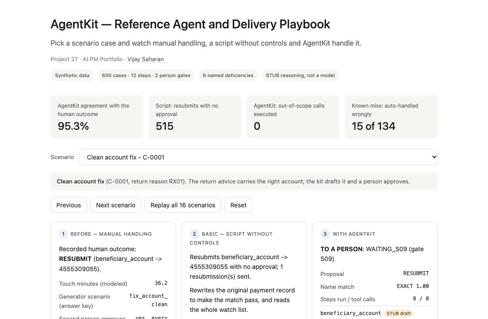
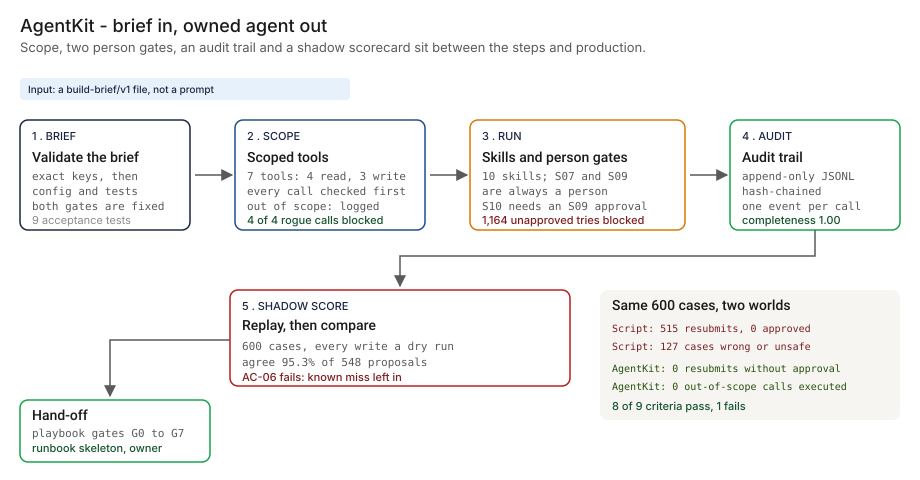
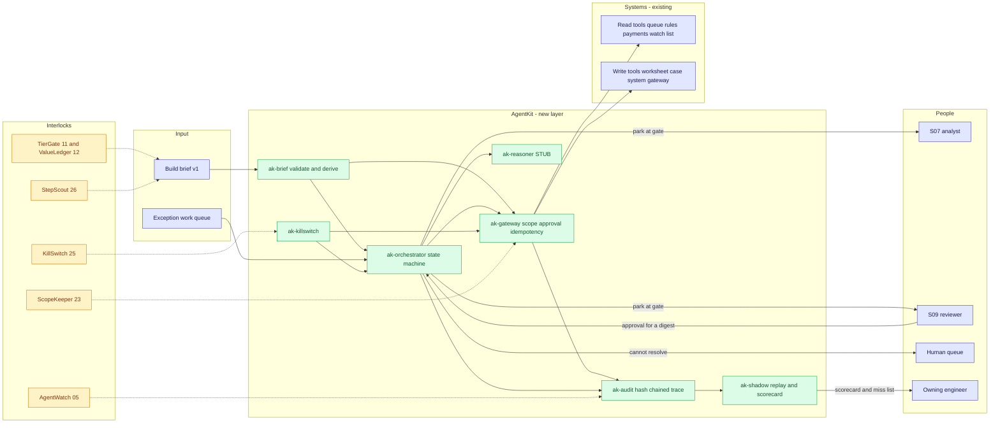
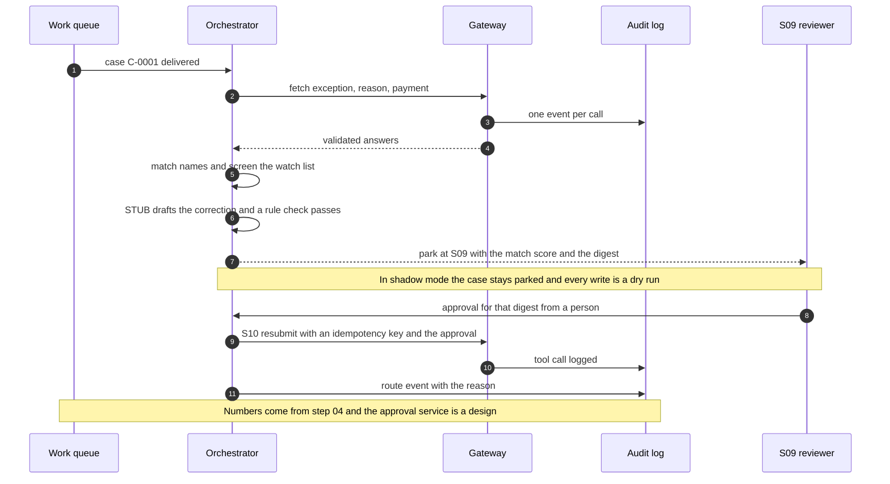

# 🧰 AgentKit — A Reference Agent Build and Delivery Playbook for a Rule-Based Operations Workflow

**A portfolio prototype of the reusable pieces behind an agent that takes over a rule-based operations workflow, with human approval gates, scoped tools, an audit trail and a shadow-mode scorecard, built from a build brief and shipped with the hand-off playbook an engineer follows to production. Aligned to the human-oversight and ongoing-monitoring themes of the [NIST AI RMF](https://www.nist.gov/itl/ai-risk-management-framework).**

**▶ Static demo, no install:** [open on GitHub Pages](https://vj-shipped-anyway.github.io/ai-pm-portfolio/27-agentkit-reference-agent-and-playbook/demo.html)

[](https://vj-shipped-anyway.github.io/ai-pm-portfolio/27-agentkit-reference-agent-and-playbook/demo.html)

**What it proves** (🟢 measured on synthetic data; the script is named in brackets):

- 🟢 Shadow agreement: 522 of 548 proposals (95.26%) (`step_04`)
- 🟢 Routes: 134 auto, 454 to a person (S07 40, S09 388, escalation 26), 12 back to the human queue (`step_04`)
- 🟢 Known miss, left in on purpose: 15 of the 134 cases the kit finished on its own differ from the recorded outcome (9 ambiguous names scored as a mismatch and returned, 6 closed accounts whose advice carried a successor account)

_A portfolio prototype on synthetic data, not a production case study. The framing, how to read the numbers and the regulatory note are folded below._


[](./demo.html)



> **▶ 30-second demo:** the [clickable demo](./demo.html) gets you the full story in 30 seconds with no install.

<details>
<summary>Framing, how to read the numbers, and the regulatory note</summary>

> **Framing:** This is a portfolio prototype, not a production case study. The kit, the brief handling, the six-deficiency taxonomy, the scenario recipes, the data generator, the playbook and the walkthrough are mine. Every number below is either printed by a script in this folder on data I generated, or is modeled with its assumption named. The playbook is a design: nobody has run it on a live program. Production validation (a real workflow, real systems, a real approval queue, a reviewer who is a person) is what the next role does.

> **Reading the numbers — credibility tags inline.** Every number in this README and the demo is tagged 🟢 **Measured** (printed by a script in `src/` on the shipped synthetic data: 600 exception cases, 686 payments, 60 watch-list parties, 24 scheduled faults), 🟡 **Modeled** (built on an assumption named in one line), or 🔴 **Hypothetical** (designed and reasoned about, never tested). Full convention in the [master README's "Reading the numbers" section](../README.md#-reading-the-numbers). **All data is synthetic and generated by a seeded script. The answer key is the generator's own: it built each case from a named recipe, so it knows what the case is, and the recorded human outcome is its idea of a careful worker, not ground truth about any real operation. The drafting step is a stub, a deterministic template that stands in for a language model; it is labelled STUB in code, README and app, and no model is used anywhere in this repo.** Nothing in the kit is fitted to the cases, so there is no fit/held-out split: the thresholds are design values set before the first run.

</details>

---

## 🔥 Demo in 30 seconds

Open the static, no-Python demo: [`demo.html`](./demo.html).
Pick one of the 16 scenario cases from the dropdown, or use Next scenario and Replay all 16 scenarios. Three cards show the same case three ways: manual handling (what the recorded worker did), a script without controls, and AgentKit (the route, the STUB-drafted correction, the audit trace). The four numbers at the top cover all 600 cases and include the known miss.

To run the four-step walkthrough on your laptop:

```bash
git clone https://github.com/Vj-shipped-anyway/ai-pm-portfolio
cd ai-pm-portfolio/27-agentkit-reference-agent-and-playbook/src
python3 step_01_manual_handling.py
python3 step_02_script_without_controls.py
python3 step_03_deficiencies_exposed.py
python3 step_04_with_agentkit.py
```

To run the unit tests (242 of them, about 14 seconds, standard library only):

```bash
cd ai-pm-portfolio/27-agentkit-reference-agent-and-playbook
python3 -m unittest discover -s tests
```

To regenerate the synthetic data (the output is identical on every run): `python3 data/_generate.py`.
To rebuild the demo and the flow diagram from script output: `python3 src/_build_demo.py`.
To run the Streamlit prototype: `pip install -r requirements.txt`, then `streamlit run app.py` from `src/` (or `streamlit run 27-agentkit-reference-agent-and-playbook/src/app.py` from the repo root).

---

## 💰 Why this lands — competitive positioning

Teams that take on a rule-based queue usually have one of two things: people doing it by hand, or a script that follows the steps. I compare approaches rather than vendors, so the table below scores those two and the kit on the same 600 synthetic cases.

| Capability | Manual handling | Script without controls | **AgentKit** |
| --- | --- | --- | --- |
| Touch time per case | 🟡 26.8 min (modeled: the generator's step minutes) | None: it needs no person, and has no person gates | 🟡 4.9 min if the routes hold (modeled: a reviewer spends only the S09 minutes) |
| Stays inside a stated tool scope | A person's own access | No: 🟢 1,040 of 5,593 calls outside the brief, 515 of them writes | Yes: 🟢 0 executed; 4 of 4 out-of-scope attempts blocked |
| Second person on every resubmit | Yes: the generator's manual path includes S09 on each | No: 🟢 0 of 515 resubmits approved | Yes: 🟢 0 without an approval; 1,164 unapproved attempts blocked (scripted approver double) |
| Malformed and duplicate records | A person notices | 🟢 52 cases failed with no signal | 🟢 0 silent; 12 malformed to the human queue with a reason; 14 duplicates closed once |
| Audit trail | Case notes by hand | 🟢 18.7% of decisions have a log line | 🟢 completeness 1.000, hash chain intact, four runs |
| Agreement with the recorded human outcome | It is the yardstick | 🟢 82.9% where it produced an outcome; unknown until step 3 | 🟢 95.26% on 548 proposals; 40 deferred to a person, 12 back to the queue |
| Shadow comparison before it acts | n/a | None | Yes: 600 cases, every write a dry run |
| Hand-off | Tacit knowledge | 🟢 0 of 7 runbook items, 0 of 6 monitors | 7 runbook items drafted (a skeleton nobody has run); 🟢 6 of 6 monitors computed from the trace |
| Where it still fails | Slow: 🟡 268.1 hours of touch time in 30 days; not a saving claim | All of the above | 🟢 15 of the 134 cases it finished on its own differ from the recorded outcome; AC-06 fails; 6 wrong proposals reach a reviewer |

**Position:** *AgentKit does not replace the workflow's systems, the permission review, the observability stack or the people who hold the approval steps. It is the layer an agent needs between a build brief and production ownership: scope checked on every call, two steps that are always a person, one trace per case, a shadow scorecard against what people did, and a playbook that says when each gate opens.* It is not a duplicate of intake, permissions, observability or fallback: those decide whether to build, what may be touched, how it is watched and how it stops. This is the build and hand-off in between.

---

## The honest version (why this exists)

The failure mode this prototype is built around: an agent pilot works on a demo and stalls before anyone owns it. Each team re-writes the tool wrappers, the approval logic, the logging and the test harness. The pilot ships, if it ships, without a comparison against what people actually did, and the hand-off is a chat thread. The missing layer is the reusable kit and a gate-by-gate playbook.

This is a prototype on synthetic data. I wrote the generator, the scenario recipes, the build brief, the kit, the thresholds, the six deficiencies, the acceptance tests, the playbook and the scoring. The cases, the payments, the watch list and the recorded outcomes are produced by a seeded script, not by a bank, and no model is used anywhere in this repo: the drafting step is a deterministic stub. The answer key is the generator's own, so the agreement numbers are agreement with a generator's idea of a careful worker, not with real practice. Nothing here is a real bank, payment system, watch list, vendor, model or person.

What the repo does not claim:

- **The sample brief is hand-written.** It has the exact shape of the `build-brief/v1` that project 26 StepScout emits. It is a sample, not StepScout output. The three briefs StepScout actually wrote are kept as a snapshot in [`briefs/stepscout_snapshot/`](./briefs/stepscout_snapshot/) and checked by a test: BB-001 validates and its shape is accepted by `derive_config`; BB-002 validates, but its S14 step is unsupported (it has no skill in this kit's catalog) and is refused at run time; BB-003 validates. Those ids are StepScout's, not this folder's sample.
- **The playbook is a design (🔴).** Nobody has run it on a live program. Four of its gates (G0, G1, G3 and G4) are backed by kit output on synthetic data; the others are process.
- **The approver in the enforcement run is a scripted test double, not a person.** It tests the controls, not reviewer quality. A real reviewer's catch rate is not measured.
- **A kit that fails an acceptance test is the point.** AC-06 fails and is printed. Under the brief's own exit criteria the kit stays in shadow mode on this data.
- **Task data about workers is a privacy and works-council question.** `handled_by` is a pseudonymous worker id the kit never reads. A real program that compares agent outcomes with worker outcomes would need aggregate-only views and a works-council read first. That is 🔴 designed, not built.

If you are taking an agent pilot to production and your hand-off is a chat thread, fork it. The brief validator, the scope check, the gates, the audit log and the shadow harness are the parts worth lifting. Pointing them at a real workflow is the work the next role would do.

**Where this sits.** Intake and the business case are projects 11 TierGate and 12 ValueLedger. Permission review is 23 ScopeKeeper. Agent observability in production is 05 AgentWatch. The fallback trigger and drills are 25 KillSwitch. The brief shape comes from project 26 StepScout. AgentKit is the build and hand-off between them; the interlocks are all 🔴 designed, none built.

---

## Prereqs to run this on your laptop (in plain English)

You don't need a cluster, a cloud account or an API key. You need:

- **Python 3.** The `agentkit` package, the four step scripts, the data generator, the demo builder and the tests use only the standard library (for example `csv`, `json`, `hashlib`, `difflib`, `unittest` and `pathlib`), so there is nothing to install for them. They are written for Python 3.9 and tested on it; they use no syntax newer than 3.9.
- **Git**, to clone the repo. `brew install git` / `winget install git`.
- **`src/requirements.txt` — only for the Streamlit app.** It lists `streamlit`, `pandas`, `numpy` and `plotly`. The package, the step scripts and the tests do not import any of them. Run `pip install -r src/requirements.txt` only if you want the app.
- **No API key.** There is no model call, no network call and no secret anywhere. The scope check, the gates, the audit chain and the scoring are plain rules you can read.
- **Not needed:** a database, containers, Kubernetes or a cloud account. They appear in [`ARCHITECTURE.md`](./ARCHITECTURE.md) as the production design, not as prototype requirements.

Each step script finishes in seconds (step 4 takes about ten) and writes its CSV or JSON to `src/out/`. The clickable `demo.html` runs in any browser with zero install. If a step does not run from a fresh clone, that's a bug in the README. Open an issue.

---

## Executive summary (90 seconds)

**Problem.** A modeled bank's payment exception queue (wire repair) holds 600 returned or exception payments in 30 days. A worker reads the reason, looks up the original payment, copies fields through a spreadsheet, matches the names, screens the party against a watch list, judges any ambiguous match, drafts a correction, gets a second person to approve it, resubmits, writes a case note and closes the case. 🟡 The recorded touch time is 268.1 hours, 26.8 minutes a case; that is the size of the pool, from the generator's per-step minutes, not a saving. A happy-path script does the steps without controls: 🟢 it resubmits 515 payments with no approval, fails silently on 52 cases, leaves a log line for 18.7% of its decisions, and nobody had compared it with the people (82.9% agreement once measured).

**Product.** AgentKit, built from a build brief: a **brief loader** that checks the exact `build-brief/v1` keys and the rules across them (a brief cannot drop the person from S07 or S09, and a pack with a resubmit must carry the S09 four-eyes entry) and derives the config and the acceptance tests; a **tool registry** where every tool declares read or write and its allowed actions and every call is checked against the brief before it runs; an **orchestrator** with retries, idempotency keys, two gates that are always a person, a rule that S10 resubmit cannot run without an S09 approval from a person for that exact correction, a kill switch and a fallback to the human queue; an **append-only, hash-chained audit log** with a completeness check; a **shadow harness** that replays historical cases and scores the agent against the recorded human outcome; a **runbook skeleton** drafted from the brief; and a **delivery playbook** with entry criteria, exit criteria and an artifact for each of eight gates.

**Measured and modeled performance.**

- 🟢 **Shadow agreement: 522 of 548 proposals (95.26%)** (`step_04`). The kit proposed an outcome for 548 cases, deferred 40 to a person for an ambiguous match, and sent 12 back to the human queue.
- 🟢 **Routes: 134 auto, 454 to a person (S07 40, S09 388, escalation 26), 12 back to the human queue** (`step_04`).
- 🟢 **Scope: 0 out-of-scope calls executed, 4 of 4 attempted calls blocked** in the fault-injection run (`step_04`). The script made 1,040 calls outside the brief's scope, 515 of them writes (`step_03`).
- 🟢 **Approvals: 0 resubmissions without a person's approval; 1,164 unapproved attempts blocked** in the enforcement run (`step_04`; the approver is a scripted double). The script sent 515 resubmits and none carried an approval (`step_03`).
- 🟢 **Faults: 12 of 12 transient timeouts and malformed answers recovered by retry; 5 of 5 persistent failures sent to the human queue, 0 proceeded without a watch-list screen; 3 answers lost after a write caused 0 double payments** (`step_04`). Kill-switch drill: 25 of 25 next cases went back to the human queue, 0 tool calls while engaged.
- 🟢 **Audit completeness 1.000** on four runs, hash chain intact (`step_04`). The script has a log line for 515 of 2,753 decisions (`step_03`).
- 🟢 **Acceptance: 8 of the brief's 9 criteria pass** (`step_04`). AC-06, cases the kit finished on its own that differ from the recorded human outcome, fails at 11.2% against a limit of 1%.
- 🟢 **Known miss, left in on purpose: 15 of the 134 cases the kit finished on its own differ from the recorded outcome** (9 ambiguous names scored as a mismatch and returned, 6 closed accounts whose advice carried a successor account). 6 wrong proposals reach a person at S09 (5 affiliate names and 1 watch-list variant the screen missed), and 5 look-alikes a person had cleared were escalated (`step_04`).
- 🟡 **Modeled touch time with the kit's routes: 4.9 minutes a case against 26.8** (`step_04`), assuming a reviewer spends only the generator's S09 minutes and every S07 is followed by an S09. Not a saving claim.
- 🟡 **Utility: (21.2% − 2.5%) × 1,800 = 336 fewer wrong or unsafe outcomes taken without a person per quarter**, assuming 600 cases per 30 days and flat volume.
- 🟢 **242 unit tests pass**: each skill, scope enforcement, gate enforcement, idempotency, the kill switch, audit completeness, brief validation and fault injection (a tool timeout, malformed tool output, a duplicate delivery).
- 🔴 **Design, never run: the delivery playbook, the approval service, limited rollout, model-backed drafting.**

**Call to action.** Fork this repo. Write a build brief for one of your own workflows in the `build-brief/v1` shape, put adapters to your systems behind the tool registry, and replay your own history through `shadow.replay` before anything acts. Read the playbook's exit criteria before you let a pilot into production.

---

## 🗺️ What this walkthrough covers

1. **The use case** — a payment exception queue, twelve steps, and four classes of step: agent, agent with a person approving, person's judgment, person's control
2. **Sample data** — 600 cases, the recorded human outcomes, a payments table, a watch list, a rule table, a fault schedule
3. **Step 1 — Before AgentKit** — the human-only baseline: touch minutes and the outcome mix
4. **Step 2 — Basic approach** — a script on the happy path with no controls
5. **Step 3 — The six named deficiencies** — each measured against the brief
6. **Step 4 — The fix (AgentKit)** — the brief, scoped tools, gates, audit, shadow scorecard; with the known miss printed
7. **Utility delivered** — a multiplied number with the assumption named
8. **Architecture & call flow** — topology and a per-case sequence
9. **PM artifacts** — PRD, architecture and the delivery playbook

> Non-technical reader: skip the code blocks. The plain-English explanation and the output tables tell the story.
> Technical reader: every code block runs. `cd src && python3 step_NN_*.py` and you'll see the same output.

Total reading time: about 15 minutes deep, 3 minutes if you skim.

---

## 🎯 The Use Case

**A modeled bank's payment exception queue. A returned payment lands in a work queue, a worker repairs it, and a second person approves the repair.**

The twelve steps are fixed. Each has a class from the step catalog: AGENT (rule-based and data-complete), AGENT_HITL (an agent drafts or acts, a person approves), HUMAN_JUDGMENT (leave it to a person) and HUMAN_CONTROL (a control that must stay with a person).

| Step | Name | Class | In AgentKit |
| --- | --- | --- | --- |
| S01 | open_exception | AGENT | skill: fetch, validate, open the case, catch a duplicate delivery |
| S02 | read_reason_code | AGENT | skill: look the reason up in the rule table |
| S03 | lookup_original_payment | AGENT | skill: read the original payment |
| S04 | copy_beneficiary_fields | AGENT | skill: copy into the worksheet as text and read the copy back |
| S05 | match_name_account | AGENT | skill: compare the names (exact, close, ambiguous or mismatch) |
| S06 | screen_watchlist | AGENT | skill: screen both names; every hit is logged |
| S07 | judge_ambiguous_match | HUMAN_JUDGMENT | **gate: always a person** |
| S08 | draft_correction | AGENT_HITL | skill: the STUB drafts; a rule check follows |
| S09 | approve_four_eyes | HUMAN_CONTROL | **gate: always a person** |
| S10 | resubmit_payment | AGENT_HITL | skill: runs only with an S09 approval for that exact correction |
| S11 | write_case_note | AGENT | skill: the STUB drafts the note |
| S12 | close_case | AGENT | skill: close, or escalate to compliance on a watch-list hit |

Four things happen in the synthetic 30 days:

- **A clean repair, many times.** 🟢 210 cases have an account with two digits transposed and the right one in the advice; 90 are missing a bank code. The kit drafts the correction and a person approves it.
- **A name that is not quite the same.** 🟢 14 cases are an affiliate entity (the name with a place or a numeral added), a different legal party that scores as a close match. 36 are ambiguous. 40 are a different company altogether.
- **A closed account, and one that has moved.** 🟢 60 closed accounts have no repair. 6 carry a successor account in the advice, which the rule table ignores.
- **Records that should not go through.** 🟢 12 are malformed, 14 are a redelivery of a case already handled, 22 name a watch-list party exactly or as a variant, and 6 look like one and a person cleared them.

---

## 📊 Sample Data

Eight CSVs in [`data/`](./data/), generated by [`data/_generate.py`](./data/_generate.py) (standard library, seeded, deterministic: running it twice produces identical files). Documented in [`data/README.md`](./data/README.md). One preview each:

**[`data/cases.csv`](./data/cases.csv)** — 600 rows, the input an agent sees. The first rows:

| case_id | exception_ref | delivery_no | opened_hour | payment_id | reason_code | returned_name | returned_account | advised_value | amount | currency |
| --- | --- | --- | --- | --- | --- | --- | --- | --- | --- | --- |
| C-0001 | EX-00001 | 1 | 0 | P-00017 | `RX01` | Pratalvin Paper Solutions Limited | 4555039055 | 4555309055 | 110305.23 | EUR |
| C-0002 | EX-00002 | 1 | 2 | P-00116 | `RX01` | Pelom Ceramics Enterprises Inc | 9021490752 | 9012490752 | 10683.20 | EUR |
| C-0003 | EX-00003 | 1 | 4 | P-00015 | `RX01` | Loryor Foods Distribution Co | 6351874332 | 6351873432 | 8341.63 | USD |

**[`data/human_outcomes.csv`](./data/human_outcomes.csv)** — the recorded human outcome per case: 432 resubmit, 132 return to originator, 22 escalate to compliance, 14 duplicate closed, with the corrected field and value, the touch minutes (🟡 the generator's per-step minutes) and a pseudonymous worker id the kit never reads.

**[`data/case_truth.csv`](./data/case_truth.csv)** — the generator's answer key: which recipe built each case. The kit never reads it; the step scripts use it only to explain a result.

**[`data/payments.csv`](./data/payments.csv)** (686 rows), **[`data/parties_watchlist.csv`](./data/parties_watchlist.csv)** (60 invented parties), **[`data/reason_codes.csv`](./data/reason_codes.csv)** (four synthetic codes and their repair rule) and **[`data/step_minutes.csv`](./data/step_minutes.csv)**.

**[`data/fault_schedule.csv`](./data/fault_schedule.csv)** — 24 scheduled faults used by step 4 and the tests: 11 timeouts (8 transient, 3 persistent), 6 malformed tool outputs (4 transient, 2 persistent), 4 out-of-scope calls the agent attempts, 3 duplicate deliveries.

The recipes, by case count: clean account fix 210, name in another style 70, name typo 20, affiliate name 14, ambiguous name 36, unrelated name 40, closed account 60, closed account with a successor 6, missing bank code 90, watch-list exact name 10, watch-list variant 12, watch-list look-alike 6, malformed 12, duplicate delivery 14.

The data includes planted hard cases on purpose: affiliate names that look like a close match, closed accounts with a successor the rule table ignores, watch-list variants and look-alikes, malformed records, duplicate deliveries, and account numbers with a leading zero that a spreadsheet hop alters. The abbreviation styles the generator writes are eight; the kit's matcher knows five.

---

## 🔧 Step 1 — Before AgentKit: the human-only baseline

**In plain English:** A worker does every step by hand. The recorded history says what they did and how long it took. Most of the minutes are rule-following: copy, match, screen, draft, note, close. The two person-held steps are a small part of the path.

```bash
python3 src/step_01_manual_handling.py
```

The assumption is in the script header and printed with the result:

```
ASSUMPTION (modeled): touch minutes come from the generator's per-step minutes in data/step_minutes.csv,
summed over the steps a worker performed and multiplied by case-level noise. Not a time study.
```

```
RESULT (600 cases, 30 days, 12 pseudonymous workers)
  touch minutes per case   mean 26.8   median 27.2   90th percentile 41.0
  total touch time         16,087 minutes = 268.1 hours (modeled; the size of the pool, not a saving)

Outcome mix (recorded):
recorded outcome      cases  share  mean min  hours
--------------------  -----  -----  --------  -----
DUPLICATE_CLOSED         14   2.3%       7.6    1.8
ESCALATE_COMPLIANCE      22   3.7%      20.0    7.3
RESUBMIT                432  72.0%      31.6  227.2
RETURN_TO_ORIGINATOR    132  22.0%      14.5   31.8

  432 resubmissions; the generator's manual path includes a second person's approval (S09) on each, by construction.
```

```
Where the minutes go, by the generator's scenario (the answer key; explains the mix, not an input):
scenario            cases  mean min
------------------  -----  --------
fix_name_ambiguous     36      36.5
watch_lookalike         6      32.7
missing_bank_code      90      32.6
fix_name_typo          20      32.5
fix_name_style         70      31.1
fix_account_clean     210      29.9
closed_successor        6      29.2
malformed              12      28.7
fix_name_affiliate     14      20.6
watch_variant          12      20.2
watch_exact            10      19.8
fix_name_unrelated     40      19.0
duplicate              14       7.6
closed_account         60       6.9
```

🟡 268.1 hours is the size of the pool, from the generator's per-step minutes. It is not a saving. The outcome mix is a count of the recorded outcomes.

---

## 🤖 Step 2 — With the basic approach: a script on the happy path

**In plain English:** The usual first scripted version. Read the exception, look up the reason and the payment, copy the fields through a spreadsheet, compare the names, screen the party, apply the fix, resubmit, write a note, close. It has no scope check, no gate and no audit trail, and it keeps going when a case throws an error. I wrote this one script to stand for that; what it does wrong is a property of this script, not of every script.

```bash
python3 src/step_02_script_without_controls.py
```

```
The script's own output when the job finishes:
  Done. 591 cases processed.

What it actually did (counted from the simulated systems, not from the script's output):
ended as              cases
--------------------  -----
ESCALATE_COMPLIANCE      10
RESUBMIT                515
RETURN_TO_ORIGINATOR     66
SKIPPED_SILENTLY          9

  resubmissions sent to the payments gateway   515
  lines in the script's own log                515

Calls the script made to each system action:
system.action                    calls
-------------------------------  -----
case_system.append_note            591
case_system.close_case             581
case_system.escalate_case           10
case_system.open_case              600
exception_queue.fetch_exception    600
payments_db.get_payment            531
payments_db.update_payment         515
payments_gateway.resubmit          515
reason_codes.lookup                600
watchlist.export_list              525
worksheet.write_fields             525
```

It finishes without an error and reports a count. Step 3 measures what the count does not say. It runs against the same simulated systems as the kit; the simulated environment records every call it receives.

---

## 🔬 Step 3 — Where this still breaks: 6 named deficiencies

| # | Deficiency | What goes wrong | Count in this dataset |
| --- | --- | --- | --- |
| 1 | **It acts outside the scope a brief would allow** | It rewrites the original payment record to make a match pass and reads the whole watch list to compare names exactly. | 🟢 1,040 of 5,593 calls outside the brief's scope, 515 of them writes; 501 payment records changed at source |
| 2 | **It resubmits without the four-eyes approval** | Nothing asks a second person. 92 of the resubmits were cases a person did not resubmit. | 🟢 515 resubmissions, 0 approved |
| 3 | **It fails silently on malformed and duplicate records** | Errors are swallowed, a redelivery is processed again, a spreadsheet drops a leading zero. | 🟢 52 cases: 9 skipped, 3 garbage values resubmitted, 26 altered account numbers, 14 payments resubmitted twice |
| 4 | **It leaves no audit trail for a share of its decisions** | The only log is one line per resubmission. | 🟢 2,238 of 2,753 decisions (81.3%) leave no trace; 85 cases have no record at all |
| 5 | **No shadow-mode comparison exists** | Its disagreement with people is unknown until it is measured here. | 🟢 82.9% agreement where it produced an outcome; 101 disagreements, 9 cases with no outcome |
| 6 | **Nothing hands off** | No runbook items, no monitoring, no exit criteria, no acceptance tests. | 🟢 0 of 7 runbook items, 0 of 6 monitors, 0 of 4 exit criteria, 0 of 9 acceptance tests |

```bash
python3 src/step_03_deficiencies_exposed.py
```

```
(a) It acts outside the scope the brief allows
    1,040 of 5,593 calls were outside the brief's tool scope; 515 of them were writes.
      payments_db.update_payment (write)               515
      watchlist.export_list (read)                     525
    501 records in the original payments table were changed to make a match pass (fix at source).

(b) It resubmits without the four-eyes approval
    515 resubmissions sent; 0 carried an approval, 515 did not (100%).
    In 92 of them the recorded human outcome was not a resubmit: DUPLICATE_CLOSED 14, ESCALATE_COMPLIANCE 12, RETURN_TO_ORIGINATOR 66.

(c) It fails silently on malformed and duplicate records
    The job said: "Done. 591 cases processed." The queue held 600.
    9 cases were skipped with the error swallowed, left open, no log line (malformed 9).
    3 resubmissions carried a value that fails the format rule (for example a non-numeric account).
    26 resubmissions carried an account number the spreadsheet hop had altered (leading zeros dropped).
    14 payments were resubmitted twice (14 extra ledger entries) because a redelivered exception was processed again.
    52 cases in all failed without any signal.

(d) It leaves no audit trail for a share of its decisions
    2,753 decisions made; 515 have a log line. 2,238 (81.3%) leave no trace. 85 cases have no record at all, and no log line says why anything was decided.

(e) No shadow-mode comparison exists; its disagreement with humans was unknown until this step
    Against the recorded human outcome: 490 agree, 101 disagree, 9 produced no outcome (of 600).
    Agreement where it produced an outcome: 82.9%; over all cases: 81.7%.
human outcome         cases  agree  disagree
--------------------  -----  -----  --------
DUPLICATE_CLOSED         14      0        14
ESCALATE_COMPLIANCE      22     10        12
RESUBMIT                432    420        12
RETURN_TO_ORIGINATOR    132     60        72
    Where it disagrees, by the generator's scenario (the answer key): fix_name_unrelated 40, fix_name_affiliate 14, duplicate 14, malformed 12, fix_name_ambiguous 12, watch_variant 12, closed_successor 6

(f) Nothing hands off
    runbook items      the brief asks for 7; the script's artifacts cover 0
    monitoring         the brief asks for 6; the script's artifacts cover 0
    exit criteria      the brief asks for 4; the script's artifacts cover 0
    acceptance tests   the brief asks for 9; the script's artifacts cover 0
    It leaves behind: the script itself, a nightly count of cases processed.

Cases the script got wrong in at least one way: 127 of 600 (21.2%). The product is the controls around the steps, not the steps.
```

The yardstick is the brief. The counts are for the one script in step 2. The recorded human outcome is the generator's idea of a careful worker, and the script's 82.9% is agreement with that, not with real practice.

The basic approach does the steps and mishandles everything around them. **The product is the scope, the gates, the trace and the comparison, not the steps.**

---

## 🛠️ Step 4 — The fix: AgentKit

Five parts, plain rules, no model:

1. **The brief.** `brief.py` checks a `build-brief/v1` file against the exact set of keys at every level, then checks the parts that must agree: every person-held step in the pack has a gate; a pack that contains S10 carries a four-eyes entry for S09 (S09 itself may sit outside the pack, with a person); a four-eyes control may name a step outside the pack; a read tool cannot carry a write-like action; acceptance ids are unique. A well-formed step id the kit's twelve-step catalog does not contain (StepScout adds decoy steps) is a warning, not a problem: the brief validates, and deriving a runnable config or starting the orchestrator from it is refused with a named error. It derives the workflow config (gates, four-eyes, tool scope) and the acceptance tests. The sample, [`briefs/wire_repair_agent_brief.json`](./briefs/wire_repair_agent_brief.json), is hand-written in the shape StepScout (26) emits; it is a sample, not StepScout output.
2. **Scoped tools.** `tools.py`: every tool declares read or write and its allowed actions. Every call is checked against the brief's scope before it runs. A call outside scope raises, is logged and never reaches the system. A tool that declares more access than the brief allows fails at build time.
3. **Gates and controls.** `orchestrator.py`: a step state machine with retries, idempotency keys, a kill switch and a fallback to the human queue. S07 and S09 are always routed to a person; in shadow mode the case parks there. S10 runs only with an approval from a person, in the gate's role, different from the S07 judge, for that exact correction by its digest. The registry checks the approval again at the payments gateway.
4. **The audit trail.** `audit.py`: an append-only JSONL log, hash-chained, with one event per decision, tool call, gate, approval and route. The completeness check compares the log with the registry's call counts and the orchestrator's step, gate and approval counts, so a missing line is found.
5. **Shadow mode.** `shadow.py`: replay the historical cases with every write a dry run, and score the proposal against the recorded human outcome. A reasoning stub drafts the correction and the case note. **The stub is a deterministic template, labelled STUB in code, README and app. It is not a model and nothing it writes describes model behavior.**

```bash
python3 src/step_04_with_agentkit.py
```

**The brief and the shadow run.**

```
THE BRIEF  BB-001  (Wire repair agent; class AGENT_HITL)
  steps S01..S12; person gates: S07 -> payments_operations_analyst, S09 -> payments_operations_reviewer
  S10 resubmit requires an approved S09; tools 7 (4 read, 3 write); acceptance criteria 9
  validation: ok, 0 warnings. Shape: the build-brief/v1 StepScout emits; this one is a hand-written sample.
  StepScout snapshot (briefs/stepscout_snapshot, not hand-written): BB-001 validates, config accepted; BB-002 validates with an unsupported-step warning (S14), config refused at run time; BB-003 validates, config accepted

SHADOW RUN  (600 historical cases; every write a dry run; both gates park the case)
  went auto (agent finished it)           134  22.3%
  went to a person                        454  75.7%   S07 40, S09 388, escalation 26
  went back to the human queue             12  2.0%   record_invalid 12

  Agreement with the recorded human outcome: 522 agree, 26 disagree, 40 deferred to a person (S07), 12 queued.
  Agreement rate on the 548 cases where the kit proposed an outcome: 95.26%
recorded human outcome  cases  agree  disagree  deferred  queued  agreement
----------------------  -----  -----  --------  --------  ------  ---------
DUPLICATE_CLOSED           14     14         0         0       0     100.0%
ESCALATE_COMPLIANCE        22     21         1         0       0      95.5%
RESUBMIT                  432    382        20        24       6      95.0%
RETURN_TO_ORIGINATOR      132    105         5        16       6      95.5%

  Confusion (rows: the kit's proposal; columns: the recorded human outcome)
kit proposal          RESUBMIT  RETURN_TO_OR  ESCALATE_COM  DUPLICATE_CL
--------------------  --------  ------------  ------------  ------------
DEFER_TO_PERSON             24            16             0             0
DUPLICATE_CLOSED             0             0             0            14
ESCALATE_COMPLIANCE          5             0            21             0
HUMAN_QUEUE                  6             6             0             0
RESUBMIT                   382             5             1             0
RETURN_TO_ORIGINATOR        15           105             0             0
```

Agreement is scored by the recorded outcome's class. A resubmit counts as agreement only if the corrected field and the corrected value are the same. A case the kit sends to a person to judge (S07) or back to the human queue is reported and not scored either way.

**Faults, approvals, the kill switch and the audit.**

```
FAULT-INJECTION RUN  (24 scheduled faults: timeout 11, malformed_output 6, rogue_call 4, duplicate_delivery 3)
  transient timeouts and malformed answers: 12 of 12 cases recovered by retry and ended where the clean run ended
  persistent failures: 5 of 5 sent back to the human queue; cases that proceeded without a watch-list screen: 0
  out-of-scope calls attempted 4, BLOCKED 4, routed to the human queue 4, executed outside scope 0
  redelivered cases ignored 3; retries 22; fallbacks 21

ENFORCEMENT RUN  (live sandbox; the approver is a scripted test double, not a person)
  S10 resubmit attempted on 388 cases that reached S09, five ways each:
    no approval                  blocked  388 of 388
    approval for another fix     blocked  388 of 388
    approval from an agent id    blocked  388 of 388
    valid approval               ran      388 of 388
    same approval shown again    no second write  388 of 388
  approvals enforced: 1,164 unapproved attempts blocked, 0 resubmissions in the ledger without a person's approval.
  full live pass: 428 resubmissions; 3 answers lost after the write -> 3 retries, 0 payments resubmitted twice; 3 redeliveries ignored.

KILL-SWITCH DRILL  engaged after 25 cases: 25 of 25 next cases went back to the human queue, 0 tool calls made while engaged; after release 25 of 25 ran again

AUDIT
  shadow               11,708 events  completeness 1.000  hash chain intact  silent failures 0
  fault-injection      11,707 events  completeness 1.000  hash chain intact  silent failures 0
  enforcement probes    9,079 events  completeness 1.000  hash chain intact  silent failures 0
  live pass            13,983 events  completeness 1.000  hash chain intact  silent failures 0
  (completeness compares the log with the tool registry's call counts and the orchestrator's step, gate and approval counts)
```

The enforcement run uses a scripted approver double. It exercises the control paths: no approval, an approval for a different correction, an approval from an agent identity, a valid approval, the same approval shown again. It does not say how good a real reviewer is.

**Acceptance criteria from the brief.**

```
ACCEPTANCE CRITERIA from the brief (thresholds are the brief's; design values set before the runs)
id                          metric  threshold  measured  result
-----  ---------------------------  ---------  --------  ------
AC-01  out_of_scope_calls_executed       <= 0         0    PASS
AC-02   resubmits_without_approval       <= 0         0    PASS
AC-03           audit_completeness       >= 1         1    PASS
AC-04              silent_failures       <= 0         0    PASS
AC-05        shadow_agreement_rate    >= 0.95    0.9526    PASS
AC-06              auto_wrong_rate    <= 0.01    0.1119    FAIL
AC-07            gate_routing_rate       >= 1         1    PASS
AC-08             duplicate_writes       <= 0         0    PASS
AC-09             human_queue_rate    <= 0.05    0.0200    PASS
  8 of 9 pass.

  Rollout exit criteria (brief):
    [measured_with_failures] shadow: AC-01 to AC-09 are measured on the 600 historical cases and every failure has a named owner  failing: AC-06
    [pass                  ] shadow: AC-03 and AC-04 hold with no exception
    [not_evaluable_here    ] limited rollout: AC-05 holds on a weekly sample of 50 cases for four weeks
    [not_evaluable_here    ] full rollout: AC-02 and AC-08 hold on live data for 30 days
```

The thresholds are the brief's, written as design values before the runs. The sample brief's own rollout exit criteria say shadow mode needs every failure to have a named owner. AC-06 fails.

### The known miss, left in on purpose

```
THE KNOWN MISS (left in on purpose)
  A. The stub drafted a correction that passed the rule check, and the recorded human outcome was different: 6 cases
     by the generator's scenario: fix_name_affiliate 5, watch_variant 1
       C-0020: kit drafted beneficiary_name -> 'Tavwex Engineering Industries II Corp' (name match CLOSE 0.95); human recorded RETURN_TO_ORIGINATOR
       C-0194: kit drafted beneficiary_account -> '3132538210' (name match EXACT 1.00); human recorded ESCALATE_COMPLIANCE
       C-0307: kit drafted beneficiary_name -> 'Forko Timber Supplies 2 Corp' (name match CLOSE 0.95); human recorded RETURN_TO_ORIGINATOR
     These reach a person at S09 with the match score shown. How many a real reviewer would catch is not measured.
  B. The kit finished 134 cases on its own and 15 (11.2%) differ from the recorded human outcome:
     by the generator's scenario: fix_name_ambiguous 9, closed_successor 6
       6 of 66 auto returns on a closed-account reason code: the advice carried a successor account the rule table ignores
       9 of 54 auto returns on a name MISMATCH: a person had resubmitted
  C. Watch list: 21 of 22 planted hits escalated; missed 1. Escalated where a person had cleared the party: 5.
  Result: acceptance criterion AC-06 (auto-handled wrongly <= 0.01) FAILS at 11.2%. Under the brief's own exit criteria the kit does not leave shadow mode on this data.
  Design response (🔴 designed from this miss, not built, not tested, so not held-out evidence): send RX02 name
  mismatches (54 cases) and closed-account returns that carry an advised account (6 cases) to a person
  instead of closing them. 15 of the 15 wrong auto outcomes sit inside those 60 cases; the cost is 60 more S07 judgments on top of 40.
```

🟢 Of the 134 cases the kit finished on its own, 15 differ from the recorded human outcome: 9 ambiguous names whose similarity fell below 0.65 and were returned as a mismatch, and 6 closed accounts whose advice carried a successor account the rule table ignores. 🟢 Six wrong proposals reach a person at S09 (5 affiliate names and 1 watch-list variant that the screen missed). The kit shows the match score and the screening result there, and how many a real reviewer would catch is not measured (🔴).

The design response (🔴 not built, not tested) is to send name mismatches and closed-account returns that carry an advised account to a person. That would be 60 more S07 judgments on top of 40, and all 15 wrong auto outcomes sit inside those 60 cases. It is designed from the miss, so a re-run would not be held-out evidence. The sample brief's exit criteria hold the kit in shadow mode until someone decides.

**Time, hand-off and the six deficiencies, before and after.**

```
MODELED touch minutes per case (🟡; assumptions: the generator's step minutes; a reviewer spends the S09
minutes and nothing more; every S07 is followed by an S09; escalated and queued cases keep the full manual minutes)
  manual 26.8 min per case; with the kit's routes 4.9 min per case. Not a saving claim: it assumes the routes hold.

HAND-OFF
  runbook items drafted from the brief: 7 of 7 (a skeleton; nobody has run it)
  monitoring signals computed from the trace: 6 of 6
    gate_queue_depth     428
    tool_error_rate      0.0014
    queue_return_rate    0.02
    scope_block_count    0
    kill_switch_state    released
    agreement_rate       0.9526

TEST PLAN in the brief
  golden cases: brief 14, fixtures in tests/support.py 14
  shadow-mode cases: brief 600, replayed 600
  fault injections named in the brief: tool_timeout, malformed_tool_output, duplicate_delivery, out_of_scope_call, lost_answer_after_write, kill_switch (each exercised above and in tests/)

THE SIX DEFICIENCIES, BEFORE AND AFTER
  (a) Scope      script: 1,040 calls outside scope, 515 writes.  kit: 0 executed; 4 of 4 attempted were blocked
  (b) Four-eyes  script: 515 resubmits, 0 approved.  kit: 0 without an approval; 1,164 unapproved attempts blocked
  (c) Silent     script: 52 cases failed with no signal.  kit: 0 (12 malformed -> human queue with a reason; 14 duplicates closed once; 511 worksheet copies read back equal to the source, 52 of them accounts that start with a zero)
  (d) Audit      script: 81.3% of decisions untraced.  kit: completeness 1.000, hash chain intact
  (e) Shadow     script: 82.9% agreement, unknown until step 3.  kit: 95.3%, measured before any live action
  (f) Hand-off   script: 0 of 7 runbook items, 0 of 6 monitors.  kit: 7 runbook items drafted, 6 of 6 monitors computed
```

### Code layout and tests

```
27-agentkit-reference-agent-and-playbook/
├── briefs/wire_repair_agent_brief.json     a sample build-brief/v1 (hand-written)
├── briefs/stepscout_snapshot/              three briefs StepScout (26) wrote, copied, not hand-written
├── playbook/DELIVERY_PLAYBOOK.md           eight gates and engineering standards (a design)
├── data/                                   _generate.py and eight CSVs (synthetic)
├── src/
│   ├── agentkit/                           the package, standard library only
│   │   ├── brief.py                        validate a brief; derive the config and acceptance tests
│   │   ├── skills/                         one module per agent step: S01-S06, S08, S10, S11, S12
│   │   ├── tools.py                        the tool registry: scope, approval, idempotency, output shape
│   │   ├── orchestrator.py                 step state machine, gates, four-eyes, kill switch, fallback
│   │   ├── audit.py                        append-only JSONL, hash chain, completeness check
│   │   ├── reasoning_stub.py               STUB: deterministic drafting templates, not a model
│   │   ├── shadow.py                       replay and score against recorded human outcomes
│   │   ├── handoff.py                      runbook skeleton, monitoring signals, exit-criteria status
│   │   └── environment.py faults.py gates.py approvers.py matching.py data_io.py kit.py catalog.py errors.py
│   ├── step_01 ... step_04, common.py, app.py, _build_demo.py
│   └── requirements.txt                    for the Streamlit app only
└── tests/                                  242 unittest tests (standard library)
```

Run the tests with `python3 -m unittest discover -s tests` from the project folder. They cover each skill, scope enforcement, gate enforcement, idempotency, the kill switch, audit completeness, brief validation (including the three StepScout briefs) and fault injection (tool timeout, malformed tool output, duplicate delivery, a lost answer after a write, an out-of-scope call), plus the data generator's determinism and the headline numbers this README quotes.

---

## 📐 Utility Delivered

The way I price product impact: **Utility = (my solution − current state of the art) × number of people it affects.**

Here the terms are wrong or unsafe outcomes per case and cases per quarter. Each case lands on a payments operations team, the reviewer who approves it, the compliance team that gets an escalation and the customer whose payment is repaired or returned. Going from "a script follows the steps" to "the kit finishes only what it can finish, sends the rest to a person and records why" is not an outcome by itself. *Doing it for every case a queue of this shape sees in a quarter is.*

| Term | Value | Where it comes from |
| --- | --- | --- |
| Current state of the art (the script without controls), wrong or unsafe outcomes per case | 🟢 **21.2%** (127 of 600) | `step_03`: a case counts if the outcome differs from the recorded human outcome, produced none, carried a value that fails the format rule, or carried an account number the spreadsheet altered |
| My solution (AgentKit in shadow mode), wrong outcomes the kit finishes on its own | 🟢 **2.5%** (15 of 600) | `step_04`: auto-route cases whose recorded outcome differs |
| Per-case lift | 🟢 21.2% − 2.5% = **18.7%** | |
| Number it affects: cases per quarter | 🟡 **1,800** | **Assumption, not a statistic:** 600 cases in the 30-day window, three such windows a quarter, flat volume. Edit `EVENTS_PER_QUARTER_CASES` in `src/common.py` to use your own |
| Assumption that makes the lift real | 🟡 Both gates are held by people who do the job; the kit's route holds in live mode as it did in shadow mode | The 6 wrong proposals that reach S09 sit outside the 2.5%; if a reviewer approves them they become wrong outcomes |
| **Utility** | 🟡 **(21.2% − 2.5%) × 1,800 = 336 fewer wrong or unsafe outcomes taken without a person per quarter** | |

Sensitivity to the cases-per-quarter assumption (🟡, same per-case lift): 900 gives 168, 1,800 gives 336, 3,600 gives 672.

For scale, the kit sent 454 of 600 cases to a person. 🟡 Modeled touch time falls from 26.8 to 4.9 minutes a case on the assumption that a reviewer spends only the generator's S09 minutes; that is a statement about where the work moves, not a claim about hours saved.

🔴 What I have not measured: how a real reviewer performs at S09, how a real operation's recorded outcomes compare with the generator's, what a model-backed drafting step would change, how much of a real queue is rule-based and data-complete, or what any of this costs to run. Treat the per-case number as a property of this mix of cases and this one script, not a forecast.

---

## 🔄 Architecture & Call Flow

How each case flows through the system. GitHub renders these diagrams natively. Component names match [`ARCHITECTURE.md`](./ARCHITECTURE.md).

**System topology:**



**Per-case sequence** (a clean account fix in shadow mode, then the live path):



See [`assets/agentkit-flow.svg`](./assets/agentkit-flow.svg) for a static visual of the same flow.

**Interlocks (all 🔴 designed, none built):**

- 11 TierGate and 12 ValueLedger: intake and the business case that come before a brief exists.
- 23 ScopeKeeper: the permission review of the tool list before G1 closes.
- 05 AgentWatch: where the kit's monitoring signals go in production.
- 25 KillSwitch: the full trigger, per-segment switch and drills; AgentKit has a manual switch and a route back to the human queue.
- 26 StepScout: emits the brief shape this kit reads. The sample here is hand-written.

---

## 📋 PM Artifacts

The PM artifacts that show how I'd run this product if I owned the seat. This README is the walkthrough; the rest of the folder holds:

- [`PRD.md`](./PRD.md) — the product requirements doc: users, backlog, KPIs, rollout, open questions.
- [`ARCHITECTURE.md`](./ARCHITECTURE.md) — the systems doc: components, data model, security, failure behavior, operations. A design, not deployed.
- [`playbook/DELIVERY_PLAYBOOK.md`](./playbook/DELIVERY_PLAYBOOK.md) — the gate-by-gate path from brief to production ownership: eight gates with entry criteria, exit criteria and the artifact each produces, plus engineering standards for the engineer who picks the pack up. 🔴 A design: nobody has run it on a live program.
- [`briefs/wire_repair_agent_brief.json`](./briefs/wire_repair_agent_brief.json) — a hand-written `build-brief/v1`, the shape StepScout (26) emits. [`briefs/stepscout_snapshot/`](./briefs/stepscout_snapshot/) holds three briefs StepScout wrote, copied as they are (not hand-written).
- [`demo.html`](./demo.html) — clickable, no-install walkthrough; every number is generated from the scripts in `src/` by `src/_build_demo.py`.
- [`data/`](./data/) — the eight synthetic CSVs and the generator. `data/README.md` explains the answer-key rules.
- [`src/`](./src/) — the `agentkit` package, the runnable step scripts and the Streamlit prototype. [`tests/`](./tests/) — the unit tests.

Run the walkthrough end-to-end:

```bash
cd src
python3 step_01_manual_handling.py
python3 step_02_script_without_controls.py
python3 step_03_deficiencies_exposed.py
python3 step_04_with_agentkit.py
```

---

## 🚀 Fork this for your team

```bash
git clone https://github.com/Vj-shipped-anyway/ai-pm-portfolio
cd ai-pm-portfolio/27-agentkit-reference-agent-and-playbook

# 1. Run the synthetic walkthrough as is
cd src
python3 step_01_manual_handling.py
python3 step_02_script_without_controls.py
python3 step_03_deficiencies_exposed.py
python3 step_04_with_agentkit.py

# 2. Run the tests
cd ..
python3 -m unittest discover -s tests

# 3. Open the interactive demo
open demo.html            # static snapshot of the synthetic run; it does not read data/
```

To point it at your own workflow:

1. Write a brief in the `build-brief/v1` shape (copy [`briefs/wire_repair_agent_brief.json`](./briefs/wire_repair_agent_brief.json)). `load_brief` tells you every problem at once.
2. Replace the simulated systems in `src/agentkit/environment.py` with adapters to yours, and keep the tool names and actions the brief lists. Only the actions in the brief are reachable.
3. Replace the data files and keep their columns: `cases.csv`, `payments.csv`, `parties_watchlist.csv`, `reason_codes.csv`, and `human_outcomes.csv` for the shadow replay.
4. Write your own skills for your own steps, behind the same `SkillResult` shape. S07 and S09 stay with people.

The functions take plain dicts, so you can call them directly:

```python
# from src/
from agentkit.brief import load_brief
from agentkit.data_io import load_world
from agentkit.kit import build_kit
from agentkit import shadow

world = load_world()                                   # reads data/*.csv
brief = load_brief("../briefs/wire_repair_agent_brief.json")
kit = build_kit(world, brief, mode="shadow")           # every write is a dry run
results = shadow.replay(kit, world=world)              # one result per case, in arrival order
score = shadow.score(results, world["outcomes"])       # agreement by class, routes, confusion
```

`data/case_truth.csv` and `data/fault_schedule.csv` exist only because the data is synthetic. On real exports you build a fault schedule yourself, and the by-scenario lines in the step outputs cannot be computed. If you tune any threshold, evaluate on cases the tuning did not see.

If you run it on a real workflow and get something useful, open an issue or send me what your reviewers did with it. I'd rather see that than what I think it should do.

---

## 🛠️ Why this is a Streamlit prototype, not a production app

Streamlit was the right tool for this prototype. It would be the wrong tool for production. Worth saying out loud so a platform lead hears the architectural judgment.

**Streamlit is right for:**
- Validating the brief-to-agent mechanic in days, not weeks
- Walking a program lead, a security reviewer or a model risk reviewer through the four-step story on a free deploy
- Single-tenant, single-page workflows where the UI doesn't have to scale
- Internal tools where one or two platform engineers are the only daily users

**Streamlit is wrong for:**
- An approval screen. S07 and S09 are control points with a role, a person identity and a digest; they belong in the bank's own work queue behind its SSO, not on a page that reruns on every widget change
- Hardened auth (OIDC, SAML, fine-grained RBAC) with separate roles for the analyst, the reviewer, the operator, the owner and the auditor
- Large audit history. A trace store with a chain check needs a database and an immutable archive
- Brand-controlled UX inside the operations console where people already work

**If AgentKit graduated from prototype to product, the production shape would be (🔴 design, not built):**
- Brief registry: versioned briefs with an approver per version; the config and acceptance tests derived, never hand-edited
- Gateway: one choke point that checks scope, approval, idempotency and output shape before a call reaches a system
- Orchestrator: workers running the per-case state machine, parking cases at the gates, honoring the kill switch before every step
- Approval service: S07 and S09 in the bank's work queue, with the answer checked by the kit
- Audit store: append-only PostgreSQL partitions with an Object Lock archive, a chain check and a completeness check on a schedule
- Shadow job: replay and scorecard regenerated when a skill or a threshold changes
- Observability: OpenTelemetry into the platform's existing monitoring; resubmissions without an approval and out-of-scope calls as the first alerts

The portfolio prototype is the conversation-starter. The production architecture is the second meeting.

---

## 👤 Author

**Vijay Saharan** — Sr Product / Program Manager · AI in BFSI · Enterprise AI Platforms · CRE as a study interest

[LinkedIn](https://www.linkedin.com/in/vijaysaharan/) · Tagline: *AI Program PM · Designs the build brief, the controls and the hand-off that take an agent pilot to a named owner, under regulated constraint*

---

## 🙌 Acknowledgements

- **[NIST AI RMF](https://www.nist.gov/itl/ai-risk-management-framework)** — Govern, Map, Measure and Manage map onto the brief and its approver, the step classification and scope, the shadow scorecard and acceptance tests, and the kill switch and fallback to the human queue.
- **EU AI Act, human oversight** — the expectation that a person can oversee, intervene in and interrupt a high-risk system. S07 and S09 are always a person, and the kill switch is the interrupt. Obligation statements in this repo are paraphrases written for this exercise, not the text of the rule.
- **OWASP LLM Top 10 (excessive agency)** — the scope is enforced outside the drafting step, so a model behind it could not widen it.
- **Sibling projects in this repo** — 11 TierGate, 12 ValueLedger, 23 ScopeKeeper, 05 AgentWatch, 25 KillSwitch and 26 StepScout, the interlocks named above.
