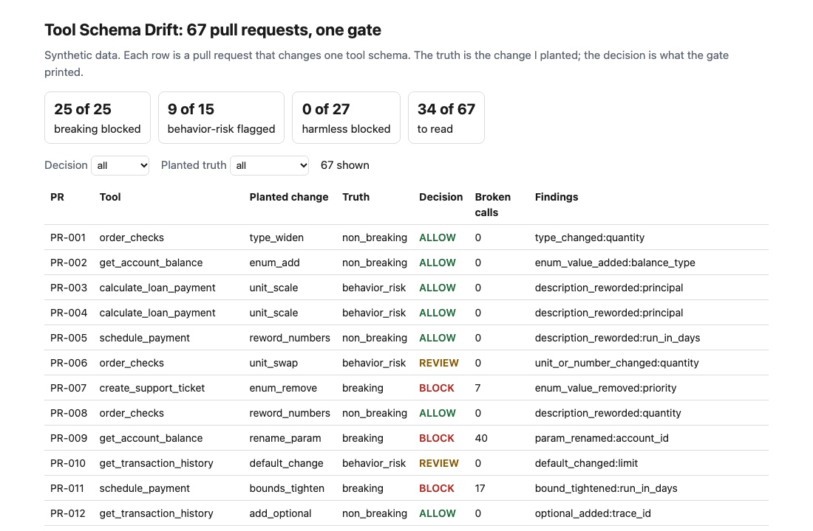
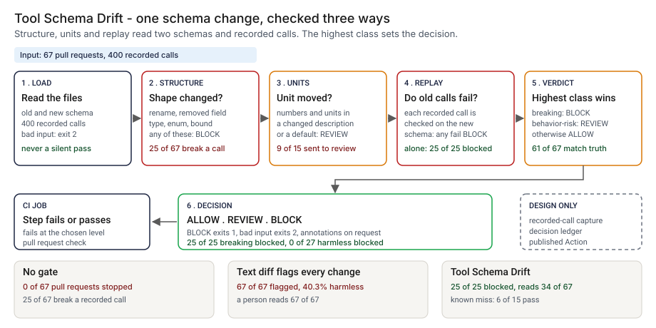
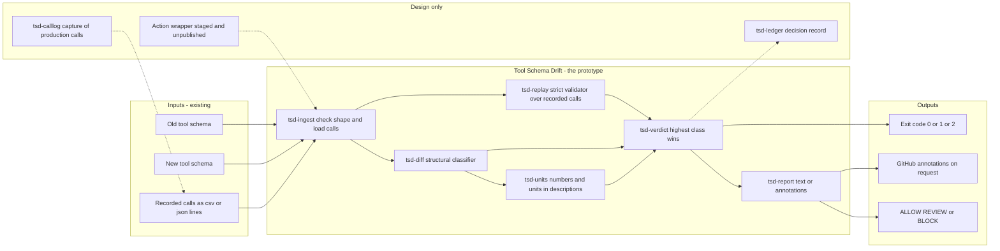
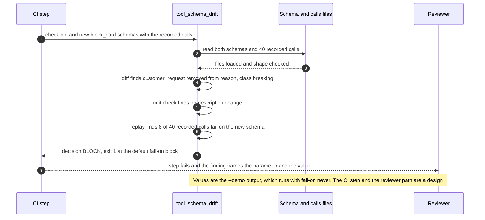

# 🧱 Tool Schema Drift: a pull-request gate for the schema an agent was told

**I wanted to know what a tool-calling agent meets when the schema underneath it changes, and which changes a pull-request check can stop. This is a command-line gate and a staged GitHub Action: it compares two revisions of a tool schema, replays recorded calls against the new one, and prints ALLOW, REVIEW or BLOCK.** It lifts the classifier from [15 SchemaWatch](../15-schemawatch-tool-schema-drift/) and adds bound checks, a command-line exit code and a scored set of 67 pull requests.

**▶ Static demo, no install:** [open demo.html](./demo.html)

[](./demo.html)

## Executive summary (90 seconds)

**Problem.** A team at a modeled bank keeps a catalogue of tools behind an agent, and the schema of a tool changes in a pull request. The engineer who owns the catalogue and the reviewer who approves the change see a diff and green unit tests on the code behind the tool. Nothing replays the calls the agent already makes against the new schema, and nothing reads a changed description for a number or a unit that moved. 🟢 On 67 synthetic pull requests, a pipeline with no schema gate stops 0 of 67, while 25 of 67 break at least one recorded call and 728 of 2680 (recorded call, pull request) pairs fail (`step_01_no_gate.py`). The agent finds out from failed calls in production, or not at all for the behavior-risk changes.

**Product.** Tool Schema Drift is a command that reads two revisions of a tool schema and, if you give it one, a file of recorded calls, and prints ALLOW, REVIEW or BLOCK. Three checks feed one rule. Structure: a parameter that is removed or renamed, a field that becomes required, a type that narrows, an enum value that goes or a bound that tightens is breaking. Units: a description whose numbers or units changed, or a default that changed, is behavior-risk, because the structure still validates calls that now mean something else. Replay: each recorded call is validated against the new schema, and any failure forces BLOCK. The highest class wins. The command exits 1 at the level you choose (BLOCK by default) and 2 for malformed input, so a pipeline step fails with a reason. There is no model call; the rules are plain code you can read.

**Measured and modeled performance.**

- 🟢 **No gate: 0 of 67 pull requests stopped.** 25 of 67 break at least one recorded call, and 728 of 2680 (recorded call, pull request) pairs fail (`step_01_no_gate.py`).
- 🟢 **A text diff that flags every change flags 67 of 67,** and 40.3% of the flags are harmless (`step_02_textual_diff.py`).
- 🟢 **Each half fails alone:** replay alone blocks 25 of 25 breaking pull requests and flags 0 of 15 behavior-risk ones, and with only 3 recorded calls per tool it blocks 23 of 25; structure alone blocks 25 of 25 and flags 4 of 15 (`step_03_deficiencies_exposed.py`).
- 🟢 **Together: 25 of 25 breaking blocked,** 9 of 15 behavior-risk sent to review, 0 of 27 harmless blocked; the decision matches the planted truth on 61 of 67 (`step_04_with_gate.py`).
- 🟢 **A person reads 34 of 67 pull requests instead of 67** (`step_04_with_gate.py`).
- 🟢 **Known miss: 6 of 15 behavior-risk changes pass.** Three meaning flips (PR-027, PR-038 and PR-053) and three scale changes (PR-003, PR-004 and PR-028) (`step_04_with_gate.py`).
- 🟡 **Utility: (67 − 34) / 67 × 200 = 98.5 pull requests a year a person does not have to read,** assuming 200 pull requests a year touch a tool schema.
- 🔴 **Design target: a decision within 120 seconds of a pull request update.** Designed in [`ARCHITECTURE.md`](./ARCHITECTURE.md), never built or timed.

**What I would ask a head of operations to decide.** Whether a changed default or a moved unit in a tool description should send a pull request to a person, and whether one failed replayed call should block a merge. I set both as my policy, not as a measurement. My recommendation is to make the structure and replay rules blocking on one tool catalogue, run the unit rule in advisory mode first, and record calls that cover every parameter of every tool, since a log of 3 calls per tool missed 2 of 25 breaking changes here.

**Call to action.** Fork the repo. Swap `data/pr_cases.csv` and `data/recorded_calls.csv` for your own exports and keep the columns `pr_id, tool, old_schema_json, new_schema_json` and `call_id, tool, args_json`, or skip the data and point `check` at two schema files and a calls file from your repo. To call it from code, import `diff_schemas`, `replay` and `decide` from `src/tool_schema_drift.py`, and add the units your catalogue uses to the unit table in that file. Send findings by opening an issue: say which finding kind fired and how many pull requests, not the schema itself.

_A portfolio prototype on synthetic data. Nothing here is deployed, load-tested or used by anyone, and the Action is staged and has not run on GitHub._

## Run one now

```bash
cd 28-tool-schema-drift/src && python3 tool_schema_drift.py --demo
```

It prints:

```text
tool: block_card   version 1.0.0 -> 1.0.1
  [breaking     ] enum_value_removed     reason           `customer_request` was removed from `reason`. Calls that send it are rejected.
replay: 8 of 40 recorded calls fail on the new schema
decision: BLOCK
```

Standard library only, Python 3.9 or newer. To check your own files: `python3 tool_schema_drift.py check old.json new.json --calls calls.csv`. It exits 1 on BLOCK, so a CI step fails; `--format github` prints annotations.

## What the numbers say

**What it shows** (🟢 measured on synthetic data: 67 planted pull requests and 400 recorded calls; the script is named in brackets):

- 🟢 No schema gate: 0 of 67 pull requests stopped, 25 of 67 break at least one recorded call, and 728 of 2680 (recorded call, pull request) pairs fail (`step_01`)
- 🟢 A text diff that flags every change flags 67 of 67, and 40.3% of the flags are harmless (`step_02`)
- 🟢 Replay alone blocks 25 of 25 breaking pull requests and flags 0 of 15 behavior-risk ones; with only 3 recorded calls per tool it blocks 23 of 25 (`step_03`)
- 🟢 Structure alone blocks 25 of 25 breaking and flags 4 of 15 behavior-risk (`step_03`)
- 🟢 Structure, units and replay together: 25 of 25 breaking blocked, 9 of 15 behavior-risk sent to review, 0 of 27 harmless blocked, and a person reads 34 of 67 instead of 67 (`step_04`)

## What it still gets wrong

- 🟢 Six of the 15 behavior-risk changes pass (`step_04` prints each one). Three are meaning flips such as "exclusive of the end date" that carry no number and no unit (PR-027, PR-038 and PR-053). Three are scale changes such as "in dollars" becoming "in thousands of dollars": the unit word is the same, so the unit check sees nothing (PR-003, PR-004 and PR-028).
- **The test set and the classifier share an author.** I planted the changes and wrote the rules, so 25 of 25 shows the rules cover what I planted. The first version of the set was easier; I then added seven hard cases, four rewordings that keep the same numbers (all four allowed, so none was a false alarm) and three scale changes (all missed). Treat the result as a ceiling for these rules, not a rate on a real tool catalogue, which I have not tested.
- **Replay is only as good as the calls you recorded.** The 3-call run above shows the cost of a thin log; the structural check does not depend on it.
- Supported keywords are type, enum, required, minimum, maximum, maxLength, default and items. Not supported: pattern, format, oneOf, anyOf, nested objects. The unit list is short and English only. There is no semantic-version check.
- A changed tool description is where tool poisoning enters, which the [OWASP MCP Top 10](https://owasp.org/www-project-mcp-top-10/) lists. This gate flags a description that moves a number or a unit. It does not read a description for malicious instructions.

## Use it in CI

[`action/`](./action/README.md) holds a staged GitHub Action and the steps to publish it from its own repository, which a Marketplace listing requires. It has not been published and has not run on GitHub. What is tested is the command it wraps (`tests/test_cli.py`; the whole suite has 28 tests).

## How the four steps fit

| Step | Question | Script |
|---|---|---|
| 1 | What does the agent meet when nothing checks the schema? | `step_01_no_gate.py` |
| 2 | What does flagging every textual change cost? | `step_02_textual_diff.py` |
| 3 | Where does each half fail alone? | `step_03_deficiencies_exposed.py` |
| 4 | What do structure, units and replay catch together? | `step_04_with_gate.py` |

Run any of them from `src/`. Data is generated by [`data/_generate.py`](./data/README.md); the check in `tools/check_repo.py` confirms that a rerun reproduces every file and that the green numbers above appear in a script's output.

## Utility delivered

The way I price product impact: **utility = (my solution − current state of the art) × the number of people or items it affects.**

Here the item is a pull request that touches a tool schema. Each one lands on the engineer who owns the catalogue and the reviewer who approves it. The common basic approach is a text diff that flags every change; the table prices the gate against it by how many pull requests a person has to read.

| Term | Value | Where it comes from |
| --- | --- | --- |
| Current state of the art (text diff that flags every change), pull requests a person reads | 🟢 **67 of 67** | `step_02_textual_diff.py`; 40.3% of the flags are harmless |
| My solution (Tool Schema Drift), pull requests a person reads | 🟢 **34 of 67** | `step_04_with_gate.py`; 25 of 25 breaking blocked, 0 of 27 harmless blocked |
| Lift per pull request | 🟢 67 of 67 read minus 34 of 67 read | The 34 are the 25 breaking blocked and the 9 behavior-risk sent to review (`step_04_with_gate.py`) |
| Number it affects: pull requests a year that touch a tool schema | 🟡 **200** | **Assumption, not a statistic.** Replace it with your own count of schema pull requests in a year |
| Assumption that makes the lift real | 🟡 The reviewer does not open a pull request the gate allows, and the recorded calls cover the parameters of each tool | Thin logs cost replay: with 3 recorded calls per tool it blocks 23 of 25 breaking, while structure alone still blocks 25 of 25 (🟢 `step_03_deficiencies_exposed.py`) |
| **Utility** | 🟡 **(67 − 34) / 67 × 200 = 98.5 pull requests a year a person does not have to read** | Assumes the 200 behave like the 67 planted ones. The 6 missed behavior-risk changes sit among the pull requests not read, so this counts reading saved and does not price those misses |

Sensitivity to the count assumption (🟡, same lift): 100 pull requests a year gives 49.3, 200 gives 98.5, 400 gives 197.0.

🔴 What I have not measured: how long a person takes to read a schema pull request, what a rejected call costs in production, how often a tool schema changes in a real catalogue, or how many calls a real agent leaves in its log. The planted set is dense on purpose, 25 of 67 breaking and 15 of 67 behavior-risk (`step_01_no_gate.py`); a real catalogue sees far fewer. Treat the result as a property of this mix of cases, not a forecast.

---

## Architecture and call flow

Component names match [`ARCHITECTURE.md`](./ARCHITECTURE.md). GitHub renders the diagrams natively.



**System topology:**



**Per-run sequence** (the `--demo` run, one removed enum value on `block_card`):



**Interlocks (all red, designed, none built):**

- [15 SchemaWatch](../15-schemawatch-tool-schema-drift/) is where the classifier came from. The code here is a copy with bound checks added; this folder does not import or read 15's files.
- [05 AgentWatch](../05-agentwatch-agent-observability/) watches tool use in production. It is a possible source for the recorded calls that `tsd-calllog` would hold.
- [06 PromptShield](../06-promptshield-prompt-injection-defense/) defends the request path at run time. This gate reviews a schema at change time, so the two would sit at different points.
- [61 MCP Scope Lint](../61-mcp-scope-lint/) reads a tool manifest and scores how broad the grant is. It could run beside this gate on the same pull request; neither reads the other's output.

---

## PM artifacts

The PM artifacts that show how I would run this product if I owned the seat. This README is the walkthrough; the rest of the folder holds:

- [`PRD.md`](./PRD.md): the product requirements doc, with users, backlog, KPIs, rollout and open questions.
- [`ARCHITECTURE.md`](./ARCHITECTURE.md): the systems doc, with components, data model, security, failure behavior and operations. A design, not deployed.
- [`demo.html`](./demo.html): clickable, no-install walkthrough, built from the step outputs by `src/_build_demo.py`.
- [`data/`](./data/): the 10 tool schemas, the 67 synthetic pull requests with their planted truth, the 400 recorded calls and the seeded generator. `data/README.md` explains how the truth is set.
- [`src/`](./src/): `tool_schema_drift.py`, `common.py`, the four step scripts and the demo builder.
- [`tests/`](./tests/): 28 unittest tests, including a golden test that pins the numbers above and tests for bad input and hostile strings.
- [`action/`](./action/README.md): the staged GitHub Action and the steps to publish it. Not published, not run on GitHub.

Run the four steps end to end:

```bash
cd src
python3 step_01_no_gate.py
python3 step_02_textual_diff.py
python3 step_03_deficiencies_exposed.py
python3 step_04_with_gate.py
```

---

## Aligned to

The [MCP specification's security guidance](https://modelcontextprotocol.io/specification/draft/basic/security_best_practices) and the OWASP MCP Top 10 treat tool definitions as inputs that need review when they change. This gate is one review step. It is a prototype, aligned to that guidance. It makes no claim of conformity to that guidance.

## Data and limits

Synthetic, seeded, byte-for-byte reproducible. Nothing comes from any employer or real tool catalogue. A prototype on synthetic data, not a production case study.

## Fork it

Swap `data/pr_cases.csv` and `data/recorded_calls.csv` for your own exports and keep the columns, or skip the data and point `check` at two schema files from your repo. Read the [PRD](./PRD.md) for the scope I held to.

## Prereqs to run this on your laptop

You need Python 3.9 or newer and nothing else. The command, the four step scripts and the data generator use only the standard library, so there is nothing to install. There is no API key, no network call and no model call anywhere in the folder. To run the tests, use `python3 -m unittest discover -s tests` from this folder. The production pieces in [`ARCHITECTURE.md`](./ARCHITECTURE.md) (the recorded-call capture, the decision ledger, a published Action) are a design, not something you need or can run.

## Author

**Vijay Saharan**, Sr Product / Program Manager · AI in BFSI · Enterprise AI Platforms

[LinkedIn](https://www.linkedin.com/in/vijaysaharan/)
