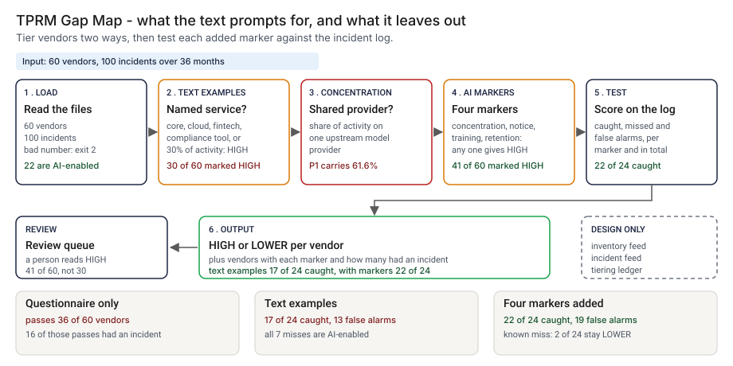

# Architecture: TPRM Gap Map

> **Status.** This is the design for a production shape. The repo implements the product mechanic as a prototype: a command, `src/tprm_gap_map.py`, that reads a vendor file and an incident log, tiers each vendor by the proposed text's own examples and again with four added characteristics, and counts how many vendors with each characteristic had a material incident, run here over 60 synthetic vendors. Nothing below is claimed as deployed or load-tested. Where a figure is a design target, it says so.

GCP is primary; AWS and Azure sit beside it.



---

## 1. Logical architecture

TPRM Gap Map is a batch function: a vendor file and an incident log in, a tier per vendor and a table of how each characteristic performed out. It does not decide whether a bank complies with anything, and it reads no contract.

Eight components: three decide the outcome, five support or report.

| Component | Responsibility | Language or framework | Decides the outcome? | Stateful? |
| --- | --- | --- | --- | --- |
| `tgm-ingest` | Loads the vendor file and the incident log and turns the numeric fields into numbers. | Python 3.9+, stdlib. Prototype: `read_table`, `load_vendors` in `src/tprm_gap_map.py` | Partly: refuses bad numbers with exit 2 | No |
| `tgm-map` | The guidance map: each stage of the proposed text, its section, how the text prompts it, the evidence an AI-enabled vendor needs. | Hand-written CSV. Prototype: `data/guidance_map.csv`, `run_map` | No, it names the gaps | Stateful, in git |
| `tgm-terms` | Counts AI wording in a text file the user extracted. | Python. Prototype: `ai_term_hits`, `run_terms` | No | No |
| `tgm-concentration` | The share of a service type's activity that sits on each upstream provider, grouped by service type. | Python. Prototype: `upstream_shares` | Yes, feeds one characteristic | No |
| `tgm-tier` | HIGH under the text's examples (`tier_text`), and HIGH when any of four characteristics holds for an AI-enabled service (`indicators`, `tier_ai`). | Python. Prototype: those three functions | Yes | No |
| `tgm-test` | Scores a tier against the incident log: caught, missed, false alarms. | Python. Prototype: `material_vendors`, `score` | No, the owner decides what to adopt | No |
| `tgm-report` | Prints the tiers, the characteristic table and the scores. | Python. Prototype: `run_tier`, `safe` | No | No |
| `tgm-ledger` | Appends one record per run (design). Prototype analog: `src/out/step_04_vendors.csv`. | PostgreSQL plus object storage with a retention lock (design) | No | Stateful |

**What decides the outcome.** The numeric checks on the input, the concentration share and the tier rules. The map, the term count, the scores, the report and the ledger inform or record. The tier rules are plain: a named service type or a share of activity of 30 or more, or one of four flags on an AI-enabled service.

**Repo structure** (production shape):

```
tprm-gap-map/
├── gap/        # ingest.py, concentration.py, tier.py, test.py, report.py
├── map/        # guidance_map.csv, changed by pull request when the text changes
├── config/     # characteristic set and thresholds, reviewed
├── ledger/     # tiering record writer
├── infra/      # terraform for gcp, aws, azure
└── tests/      # unit, golden (synthetic-set numbers), hostile strings
```

---

## 2. Physical and deployment architecture

A scheduled batch job that runs when the vendor inventory or the incident log refreshes. No server is kept warm.

| Component | GCP (primary) | AWS | Azure | Why |
| --- | --- | --- | --- | --- |
| Batch job (ingest to report) | Cloud Run job | ECS Fargate task | Container Apps job | Stateless, one pass, short-lived |
| Vendor and incident extracts | Cloud Storage, versioned | S3, versioned | Blob Storage, versioned | The inventory and incident systems write, the job reads; versioning keeps the exact bytes a run used |
| `tgm-map`, config | Files in the repo | Same | Same | A change lands in history with its reviewer |
| `tgm-ledger` | Cloud SQL for PostgreSQL | RDS for PostgreSQL | Azure Database for PostgreSQL | The platform team already runs it |

**Failure behavior (the decision that matters most).** The tool must never silently pass: an input it cannot trust should stop the run with a reason, not produce a tier. The prototype stops on every input it cannot read, and names the ones it can read but cannot score; the table lists each, with what is still only a design.

| Failure | Prototype today | Design | Alert |
| --- | --- | --- | --- |
| Vendor or incident file missing, or a non-numeric share or day count | Exit 2, one `input error` line | Same | P3 |
| Vendor file missing a column the tiering reads, or a short row | Exit 2, one line naming the column | Same | P3 |
| Incident log with rows but no `material` or `vendor_id` column | Exit 2, one line naming the column | Same | P3 |
| Header-only vendor file | Exit 2: a header and no vendor rows | Same | P3 |
| Header-only incident log | Tiers are printed and a line says the characteristics were not scored | Same | P3 |
| Service type outside the eight listed, such as a typo | Tiered LOWER unless the share is high, and a line names the value and its count | Reject the value against the registry's list of service types | P3 |
| AI-enabled vendor with no upstream provider | Printed as a count: it cannot show as concentrated | Same, and list the vendors | P4 |
| Ledger or feed unavailable | Not built | The tiers stand; the record queues locally | P3 |

**Latency.** The prototype is one pass over 60 vendors and a log; I have not timed it. 🔴 Design target: a refreshed tiering within 10 minutes of an inventory or incident-log change.

---

## 3. Data architecture

| Entity | Key | What it holds | Real columns in the prototype |
| --- | --- | --- | --- |
| Vendor | `vendor_id` | Service type, share of activity, upstream provider, notice, training flag, retention, four due-diligence documents | `data/vendors.csv`: `vendor_id`, `service_type`, `activity_share_pct`, `upstream_provider`, `model_change_notice_days`, `trains_on_bank_data`, `bank_data_retained_days`, `soc_report`, `insurance`, `financial_ok`, `key_personnel` |
| Incident | `vendor_id`, `month` | Cause, hours of customer impact, whether material (4 hours or more) | `data/incident_log.csv`: `vendor_id`, `month`, `cause`, `customer_impact_hours`, `material` |
| Label | `vendor_id` | Whether the vendor had a material incident and the causes | `data/vendor_truth.csv`: `vendor_id`, `high_risk`, `material_causes`. Derived from the log, not from the tier rules; synthetic only |
| Guidance row | `stage` | Section, what the text says, how it prompts, AI evidence, a note | `data/guidance_map.csv`: `stage`, `section_of_proposed_guidance`, `what_the_text_says`, `how_the_text_prompts_it`, `evidence_for_an_ai_enabled_vendor`, `note` |
| Tiering record | `run_id`, `vendor_id` | Design: tier under both rules, flags that fired, characteristic set and thresholds, SHA-256 of both files, tool version, time | Prototype: `src/out/step_04_vendors.csv` |

**Retention** is a design choice, not a measurement; confirm each value against the bank's own record-retention schedule.

| Data | Retention (🔴 design default) | Storage |
| --- | --- | --- |
| Tiering records | 7 years | PostgreSQL, archived to object storage with a retention lock |
| Vendor and incident extracts a run used | Same as the record, so the run can be reproduced | Versioned object storage |

**Lineage.** A tier traces back in three hops: the record names the run, the characteristic set, the thresholds and the hash of both files; versioned storage returns those bytes; and the rules are deterministic, so re-running `tier_ai` reproduces the tier. In the prototype the trace is a row of `step_04_vendors.csv`.

**Deliberately not stored.** Contract text, incident narratives, personal data and the vendor's own documents. The job needs the flags, the counts and the ids.

---

## 4. Security architecture

**Identity and roles.** The job runs under the platform's workload identity and has no user account.

| Role | Can | Maps to |
| --- | --- | --- |
| `tgm:runner` | Read both extracts and the config; write a tiering record | The job's service identity |
| `tgm:approver` | Approve a change to the characteristic set or a threshold, never on their own change | Third-party risk or AI governance lead's delegate |
| `tgm:auditor` | Read records and config history | Internal audit |
| `tgm:admin` | Manage roles, buckets and the ledger | Platform engineering lead |

**Secrets.** None. The job calls no model and no external service, so no key is in its path; the extracts are reached through workload identity.

**Data classification and what leaves the boundary.** Vendor identity, incident detail and impact hours are confidential. The prototype uses synthetic ids such as `V001`. In the prototype nothing leaves the machine. In the design the tiers and the ledger write leave the job.

| Threat | Example | Mitigation in the design |
| --- | --- | --- |
| Hostile string in a vendor field echoed into a log | An `upstream_provider` holding a newline and text that looks like a log line | `safe` writes control characters and line separators as visible escapes in the concentration line, and `tests/test_cli_and_map.py` covers a hostile provider name and a hostile service type. The design applies the same escape to every field before it reaches a log line |
| A vendor flag is edited to avoid HIGH | `bank_data_retained_days` lowered by hand | Extracts come from the inventory with a hash; a changed hash for a finished run is an alert |
| The incident log is trimmed so a marker looks good | Months or causes dropped | The record stores the log hash and the window; the report prints both |
| A simulated result is quoted as evidence about real vendors | The counts in this README cited for a real bank | Every output and README says synthetic; the design adds the data source to the report header |

---

## 5. Operational architecture

**SLIs.** Vendors per tier per run; AI-enabled vendors with a blank notice, training or retention field; vendors with no upstream provider; days since the incident extract refreshed; catches and false alarms per characteristic per run (prototype baseline: 🟢 22 of 24 caught and 19 false alarms with all four, `step_04_with_ai_fields.py`); runs rejected.

**SLOs (all 🔴 design targets, none measured).**
- A refreshed tiering within 10 minutes of an extract change.
- Every in-scope AI-enabled vendor tiered in every run, or listed as rejected.
- Every run that changes a tier of record reviewed by a named person within one business day (planning estimate).
- 99.9 percent of runs written to the ledger.

**Alerts.** P3: repeated input rejections, or a blank AI field on a vendor in scope (chat). P4: a weekly digest of vendors whose tier changed (email).

**Runbooks** (one page each, in `docs/runbooks/`):
- `input-rejected.md`: read the one-line reason, fix the extract, re-run.
- `blank-ai-fields.md`: chase the notice, training and retention fields with the vendor manager.
- `changing-a-characteristic.md`: propose, re-run the synthetic set and the real log, compare, approve.
- `guidance-text-changed.md`: re-read the final text against each row of the map and update the sections cited.

**On-call and ownership.** The third-party risk lead owns the tiers and the characteristic set. The vendor manager owns the vendor file. The incident process owner owns the log. Platform engineering owns the job. Nobody is paged for a tier change.

**Change control.** The map, the characteristic set and the thresholds are versioned. A change needs a proposer and a different approver, and the synthetic set is re-run against `tests/test_golden.py` before merge, so a change that moves the catch or false-alarm count shows in the diff.

---

## 6. Alignment and posture

Alignment, not certification. The README's "Aligned to" section cites one source, restated with the same wording: the proposed interagency third-party risk management guidance, docket OCC-2026-0793, as released 2026-09-11 for comment. It is a proposal and may change.

- **What the design does.** It maps the stages of that proposal to the evidence an AI-enabled vendor needs, and tests the kind of characteristic the agencies ask commenters about against an incident log.
- **What it does not claim.** It gives no legal advice and does not say what an examiner will expect. It is not compliant with the proposal or any other standard, holds no certification, and I cite no other regulation.

---

## 7. What is deliberately not here

- **A real incident history.** The log is simulated from hazard rates I chose before the first run, so every count shows a method, not how often real vendors fail.
- **Two material-incident vendors that stay LOWER.** 🟢 2 of 24 (`step_04_with_ai_fields.py`).
- **Fewer false alarms.** 🟢 19 against 13 once the characteristics are added (`step_04_with_ai_fields.py`).
- **A tuned concentration line.** The 30% line is a choice; at 20% the catch is 23 of 24.
- **Concentration across several vendors in the text.** The text covers it inside one third party. Several vendors sharing one provider is not named.
- **A settled reading.** The map is my reading of one proposed text, and the classification of each row is a judgment.
- **Predicting examiner behavior, scoring real vendors, or submitting a comment.** Out of scope, as is any model call.

---

## Appendix: sample contract

The call is the prototype's own. Its output for the bundled `--demo` run is under "Run one now" in the README.

```bash
python3 tprm_gap_map.py tier vendors.csv --incidents log.csv
```

Output lines: vendor count and AI-enabled count; HIGH counts under the text's examples and with the characteristics; upstream concentration by service type; for each characteristic, vendors with it and how many had a material incident; and the catches. Exit status: 0 on a run, 2 for an unreadable file or a bad number.
