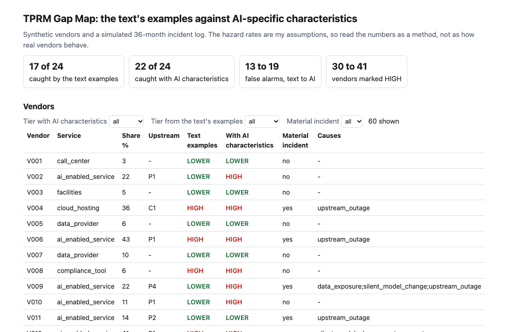
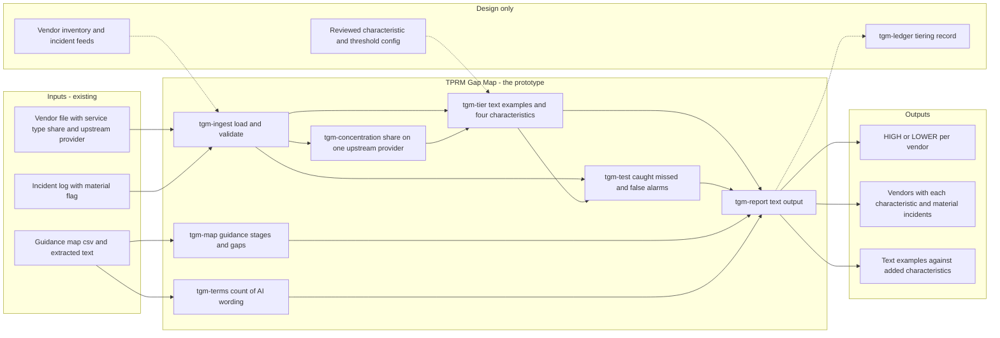
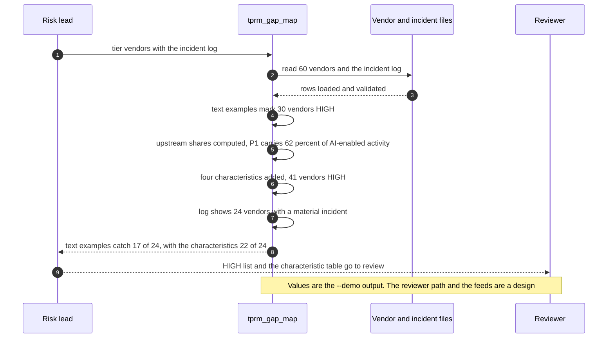

# 🗺️ TPRM Gap Map: what the proposed third-party guidance prompts for an AI-enabled vendor

**I read the proposed interagency third-party risk management (TPRM) guidance (released 2026-09-11) to see what it asks a bank to hold on an AI-enabled vendor. This prototype maps each stage of the text to that evidence, then tests four AI-specific characteristics against a simulated incident log, because the agencies ask which characteristics should mark a relationship as high risk.** It extends [18 VendorLens](../18-vendorlens-ai-vendor-due-diligence/).

**▶ Static demo, no install:** [open demo.html](./demo.html)

[](./demo.html)

## Executive summary (90 seconds)

**Problem.** A third-party risk lead at a modeled bank has to decide what evidence to hold on a vendor that sells an AI-enabled service. The proposed interagency guidance is principles-based and uses no AI wording, so the bank's tiering falls back on the service types the text names and on share of activity. 🟢 On 60 synthetic vendors, the due-diligence questionnaire passes 36 of 60, and 16 of those passes had a material incident in 36 months (`step_01_due_diligence_only.py`). The text's own examples mark 30 of 60 HIGH and miss 7 of the 24 vendors with a material incident, all 7 of them AI-enabled services (`step_02_text_examples.py`). The agencies ask commenters which characteristics should mark a relationship as high risk; this tests four against an incident log.

**Product.** TPRM Gap Map is one command with three jobs. It maps each stage of the proposed text to the evidence an AI-enabled vendor needs and marks whether the text names it, covers it by principle, gives an example, or does not mention it. It tiers vendors in two ways: HIGH under a text-examples rule I set (one of the service types the text names as central to operations, or a share of activity of 30% or more, a line I chose), and HIGH when any of four added characteristics holds for an AI-enabled service: one upstream model provider carries 30% or more of its group's activity, the contract gives zero days' notice before a model change, the vendor trains on bank data, or bank data is kept 365 days or more. And it counts, for each characteristic, how many vendors with it had a material incident in an incident log you supply. There is no model call; the rules are plain code you can read.

**Measured and modeled performance.**

- 🟢 **The questionnaire passes 36 of 60 vendors, and 16 of those passes had a material incident** (`step_01_due_diligence_only.py`).
- 🟢 **The text's examples catch 17 of 24 material-incident vendors** with 30 of 60 marked HIGH and 13 false alarms; all 7 misses are AI-enabled services (`step_02_text_examples.py`).
- 🟢 **One upstream model provider carries 61.6% of AI-enabled activity** across 14 of 22 AI-enabled vendors, and a single outage there reached all 14 at once (`step_03_deficiencies_exposed.py`).
- 🟢 **Four characteristics added: 22 of 24 caught,** 41 of 60 marked HIGH, 19 false alarms against 13 (`step_04_with_ai_fields.py`).
- 🟢 **Each alone, added to the text's examples:** long data retention catches 22 of 24 with 16 false alarms; no notice before a model change catches 20 with 16; training on bank data catches 20 with 14; concentration catches 19 with 19 (`step_04_with_ai_fields.py`).
- 🟢 **Known miss: 2 of 24 material-incident vendors stay LOWER,** V011 and V039 (`step_04_with_ai_fields.py`).
- 🟡 **Utility: (22/24 − 17/24) × 20 = 4.2 material-incident vendors flagged HIGH that the text's examples would leave LOWER,** assuming 20 vendors with a material incident in a 36-month window.
- 🔴 **Design target: a refreshed tiering within 10 minutes of an inventory or incident-log change.** Designed in [`ARCHITECTURE.md`](./ARCHITECTURE.md), never built or timed.

**What I would ask a head of operations to decide.** Whether a vendor that gives no notice before a model change, trains on bank data, keeps bank data a year or more, or sits on a concentrated upstream provider should be HIGH regardless of its service type, knowing a reviewer then reads 41 vendors in place of 30. The log here is simulated from hazard rates I chose, so I would not adopt any marker on this evidence. My recommendation is to run the test on the bank's own incident history first, and to start with long data retention, which catches 22 of 24 alone with 16 false alarms.

**Call to action.** Fork the repo. Swap `data/vendors.csv` and `data/incident_log.csv` for your own exports and keep the columns listed in [`data/README.md`](./data/README.md), then run `python3 tprm_gap_map.py tier vendors.csv --incidents log.csv`. To call it from code, import `tier_text`, `tier_ai`, `upstream_shares` and `score` from `src/tprm_gap_map.py`. Re-read `data/guidance_map.csv` against the final text when it is issued. Send findings by opening an issue: say which characteristic you tested and the counts, not the vendors.

_A portfolio prototype on synthetic data. Nothing here is deployed, load-tested or used by anyone, and it has not been run on a real vendor list or incident history._

## Run one now

```bash
cd 29-tprm-gap-map/src && python3 tprm_gap_map.py --demo
```

It prints:

```text
vendors: 60   AI-enabled: 22
HIGH under the text's examples: 30   with AI characteristics added: 41
upstream concentration (share of the service type's activity): P1 (ai_enabled_service) 62%, P2 (ai_enabled_service) 27%, P3 (ai_enabled_service) 8%, P4 (ai_enabled_service) 4%, C1 (cloud_hosting) 50%, C2 (cloud_hosting) 30%, C3 (cloud_hosting) 20%
candidate characteristic: vendors with it, of which had a material incident
  concentrated_upstream: 14, 8
  no_model_change_notice: 10, 7
  trains_on_bank_data: 4, 3
  long_data_retention: 11, 8
material incident in the log: 24 vendors
text examples catch 17 of 24; with AI characteristics 22 of 24
```

Standard library only, Python 3.9 or newer. `python3 tprm_gap_map.py map` prints the guidance map. `python3 tprm_gap_map.py tier vendors.csv --incidents log.csv` runs the same test on your own files (columns in [data/README.md](./data/README.md)).

## What I found in the text

The text is principles-based and says it is non-enforceable. It sets out four components a bank may consider, which I split into the stages below (identification, risk assessment, due diligence, contract, monitoring, termination, subcontractors, resilience, residual risk, governance), and most of them can hold an AI-enabled vendor without change. Two things stand out:

- I extracted the text from the agencies' PDF on 2026-10-22 and counted AI wording with `python3 tprm_gap_map.py terms TEXT_FILE`. It read 8,926 words and found 0 occurrences of artificial intelligence, machine learning, generative, algorithm, large language model, neural, LLM or AI. Reproduce it from the [OCC copy](https://www.occ.gov/news-issuances/news-releases/2026/nr-ia-2026-77a.pdf) and any PDF-to-text tool.
- The agencies ask commenters whether a list of characteristics that generally indicate high risk would help, and which to include. The text names services central to operations (core processing, cloud processing, cloud storage, compliance tools, fintech partners) and says only core processing is likely to be assessed as higher risk by most banks. I use all five as the text-examples rule, and the 30% share line is mine.

[`data/guidance_map.csv`](./data/guidance_map.csv) has 16 rows. Two are marked "not mentioned": AI-specific high-risk characteristics, and AI evidence in due diligence. The text mentions concentration risk once, in a footnote, about relying on one third party for extensive services; several vendors sharing one upstream provider is not mentioned. The map classifies each stage as named, principle, example or not mentioned, with the section of the proposal.

## What the numbers say

**What it shows** (🟢 measured on synthetic data: 60 vendors and a simulated 36-month incident log; the script is named in brackets):

- 🟢 A due-diligence questionnaire passes 36 of 60 vendors, and 16 of those passes had a material incident (`step_01`)
- 🟢 The text's own examples mark 30 of 60 vendors HIGH and catch 17 of the 24 vendors with a material incident; all 7 misses are AI-enabled services, and there are 13 false alarms (`step_02`)
- 🟢 One upstream model provider carries 61.6% of AI-enabled activity across 14 of 22 AI-enabled vendors, and a single outage there reached all 14 at once (`step_03`)
- 🟢 Adding four AI-specific characteristics marks 41 of 60 HIGH and catches 22 of 24, with 19 false alarms against 13 (`step_04`)
- 🟢 Added alone to the text's examples, long data retention catches 22 of 24 with 16 false alarms; no notice before a model change catches 20 with 16; training on bank data catches 20 with 14 (`step_04`)

## What it still gets wrong

- **The incident log is simulated from hazard rates I chose before the first run** (`data/_generate.py`). Change them and every number moves. The result shows how to test a characteristic against a log, not how often real vendors fail.
- 🟢 Two material-incident vendors stay LOWER with the AI characteristics added (`step_04` prints V011 and V039).
- More flags mean more false alarms: 19 against 13. A reviewer reads 41 vendors instead of 30.
- The concentration threshold of 30% is a choice. At 20% the catch is 23 of 24; at 30% and 50% it is 22 of 24, because only one provider sits above 30% (`step_04`).
- The map is my reading of one proposed text. It is a proposal, it may change, and the classification of each row is a judgment. It is not legal advice and it says nothing about what an examiner will expect.

## How the four steps fit

| Step | Question | Script |
|---|---|---|
| 1 | What does the questionnaire alone say? | `step_01_due_diligence_only.py` |
| 2 | What do the text's own examples catch? | `step_02_text_examples.py` |
| 3 | What do they miss, and what do the misses share? | `step_03_deficiencies_exposed.py` |
| 4 | What changes with four AI-specific characteristics? | `step_04_with_ai_fields.py` |

Data is generated by [`data/_generate.py`](./data/README.md); `tools/check_repo.py` confirms a rerun reproduces every file and that the green numbers above appear in a script's output. [PRD](./PRD.md).

## Utility delivered

The way I price product impact: **utility = (my solution − current state of the art) × the number of people or items it affects.**

Here the item is a vendor that goes on to have a material incident, which lands on the third-party risk lead who owns its review and on the business line that depends on it. The common basic approach is the tiering the text's own examples give; the table prices the four added characteristics against it.

| Term | Value | Where it comes from |
| --- | --- | --- |
| Current state of the art (the text's examples), material-incident vendors caught | 🟢 **17 of 24** | `step_02_text_examples.py`; 13 false alarms |
| My solution (four AI characteristics added), material-incident vendors caught | 🟢 **22 of 24** | `step_04_with_ai_fields.py`; 19 false alarms |
| Lift per material-incident vendor | 🟢 22 of 24 minus 17 of 24 | The cost is review load: 41 of 60 vendors marked HIGH against 30 of 60 (`step_04_with_ai_fields.py`) |
| Number it affects: vendors with a material incident in a 36-month window | 🟡 **20** | **Assumption, not a statistic.** Replace it with your own count from your incident history |
| Assumption that makes the lift real | 🟡 The characteristics predict incidents in your vendors as they do in this log, and a HIGH vendor gets the extra review | The log is simulated from hazard rates I fixed before the first run, so the lift shows the method. Two material-incident vendors still stay LOWER: 🟢 2 of 24 (`step_04_with_ai_fields.py`) |
| **Utility** | 🟡 **(22/24 − 17/24) × 20 = 4.2 material-incident vendors flagged HIGH that the text's examples would leave LOWER** | The tool flags a vendor for review; it does not prevent an incident, and the 6 extra false alarms are a cost this arithmetic does not price |

Sensitivity to the count assumption (🟡, same lift): 10 vendors gives 2.1, 20 gives 4.2, 40 gives 8.3.

🔴 What I have not measured: what a material incident costs the bank, how long a reviewer takes per HIGH vendor, whether real incident rates look like my hazard rates, or how many vendors a real estate would flag. The synthetic set is dense on purpose, 24 of 60 vendors with a material incident (`step_01_due_diligence_only.py`); a real estate sees far fewer. Treat the result as a property of this log, not a forecast.

---

## Architecture and call flow

Component names match [`ARCHITECTURE.md`](./ARCHITECTURE.md). GitHub renders the diagrams natively.


**System topology:**



**Per-run sequence** (the `--demo` run, 60 vendors against the simulated log):



**Interlocks (all red, designed, none built):**

- [18 VendorLens](../18-vendorlens-ai-vendor-due-diligence/) is the project this one extends. This folder does not import or read its files; the two would share the vendor record.
- [19 IncidentLedger](../19-incidentledger-ai-incident-response/) is a possible source for the incident log, with its own severity rubric. The material flag here (4 hours or more) is a separate definition.
- [45 Concentration Register](../45-concentration-register/) takes each provider out of a dependency register in turn. It would supply upstream concentration from real dependencies where this folder uses a vendor-file column.
- [44 Inventory Check](../44-inventory-check/) tests an inventory of generative and agentic systems. It is a possible home for the AI-enabled flag on a vendor.

---

## PM artifacts

The PM artifacts that show how I would run this product if I owned the seat. This README is the walkthrough; the rest of the folder holds:

- [`PRD.md`](./PRD.md): the product requirements doc, with users, backlog, KPIs, rollout and open questions.
- [`ARCHITECTURE.md`](./ARCHITECTURE.md): the systems doc, with components, data model, security, failure behavior and operations. A design, not deployed.
- [`demo.html`](./demo.html): clickable, no-install walkthrough, built from the step outputs by `src/_build_demo.py`.
- [`data/`](./data/): the 60 synthetic vendors, the simulated incident log, the labels derived from it, the hand-written guidance map and the seeded generator. `data/README.md` explains how the labels are set.
- [`src/`](./src/): `tprm_gap_map.py`, `common.py`, the four step scripts and the demo builder.
- [`tests/`](./tests/): 26 unittest tests, including a golden test that pins the numbers above.

Run the four steps end to end:

```bash
cd src
python3 step_01_due_diligence_only.py
python3 step_02_text_examples.py
python3 step_03_deficiencies_exposed.py
python3 step_04_with_ai_fields.py
```

---

## Aligned to

The proposed interagency third-party risk management guidance, docket OCC-2026-0793, as released 2026-09-11 for comment. A prototype aligned to a proposal. It makes no claim of conformity to that guidance.

## Data and limits

Synthetic, seeded, byte-for-byte reproducible. Nothing comes from any employer, bank or real vendor. A prototype on synthetic data, not a production case study.

## Fork it

Replace `data/vendors.csv` and `data/incident_log.csv` with your own exports and keep the columns. The useful output is the table of how many vendors with each characteristic had a material incident.

## Prereqs to run this on your laptop

You need Python 3.9 or newer and nothing else. The command, the four step scripts and the data generator use only the standard library, so there is nothing to install. There is no API key, no network call and no model call anywhere in the folder. To run the tests, use `python3 -m unittest discover -s tests` from this folder. The production pieces in [`ARCHITECTURE.md`](./ARCHITECTURE.md) (the vendor and incident feeds, the reviewed characteristic config, the tiering ledger) are a design, not something you need or can run.

## Author

**Vijay Saharan**, Sr Product / Program Manager · AI in BFSI · Enterprise AI Platforms

[LinkedIn](https://www.linkedin.com/in/vijaysaharan/)
