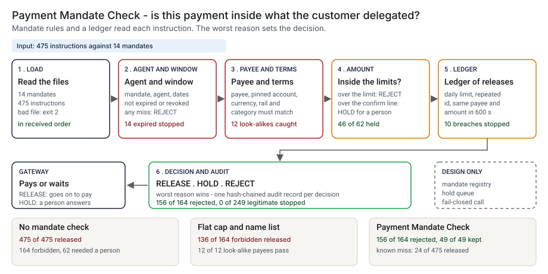

# Architecture: Payment Mandate Check

> **Status.** This is the design for a production shape. The repo implements the product mechanic as a prototype: a command, `src/payment_mandate_check.py`, that reads a mandate file and a batch of payment instructions, decides each one against its mandate in the order received, and writes a hash-chained audit record, run here over 475 synthetic instructions against 14 mandates. Nothing below is claimed as deployed or load-tested, and nothing has been connected to a real gateway. Where a figure is a design target, it says so.

GCP is primary; AWS and Azure sit beside it.



---

## 1. Logical architecture

Payment Mandate Check is a gate between an agent and the release of money: a mandate and an instruction in, RELEASE, HOLD or REJECT out, with a reason code for each reason. It does not move money, verify that an account belongs to a payee, or read the memo.

Eight components: four decide the outcome, four support, record or report.

| Component | Responsibility | Language or framework | Decides the outcome? | Stateful? |
| --- | --- | --- | --- | --- |
| `pmc-ingest` | Loads and validates both files: strict timestamps, decimal amounts, unique `submission_id`. Refuses with a line number. | Python 3.9+, stdlib. Prototype: `load_mandates`, `parse_mandates`, `load_instructions`, `parse_ts`, `parse_amount` | Yes, by refusing: exit 2 | No |
| `pmc-rules` | Per-instruction rules in five groups: identity, window, payee, terms, amount. Each raises reasons with a class. | Python. Prototype: `check_batch` (the `identity`, `window`, `payee`, `terms`, `amount` groups), `REASONS` | Yes | No |
| `pmc-ledger` | What was released: the daily total, instruction ids already seen, same payee and amount within 600 seconds. Only released instructions count. | Python, in memory. `check_batch` (the `ledger` group). Production: a durable store (design) | Yes | Stateful |
| `pmc-verdict` | REJECT if any reason is of class REJECT, else HOLD if any is HOLD, else RELEASE; maps the worst decision to an exit code at `--fail-on`. | Python. Prototype: `DECISION_RANK`, `run_check` | Yes | No |
| `pmc-audit` | One record per decision, each carrying the hash of the one before it; verifies a file, and the head hash if given. | Python. Prototype: `audit_records`, `verify_audit`, `read_audit` | No | Stateful, append-only file |
| `pmc-report` | Prints decisions with reason codes. Turns control characters in untrusted text into visible escapes. | Python. Prototype: `render`, `safe` | No | No |
| `pmc-mandates` | Consent capture and revocation delivery (design). Prototype analog: `data/mandates.json`. | Consent team's service (design) | No, but wrong data here defeats the gate | Stateful |
| `pmc-holdq` | Where a HOLD waits for a person (design). | Queue plus review screen (design) | No | Stateful |

**What decides the outcome.** The input check, the per-instruction rules, the ledger and the verdict. The audit record, the report, the mandate source and the hold queue carry or record the decision. The check trusts `received_at` and the mandate file as given, and it compares the category, rail and account an instruction declares with the mandate without verifying them.

**Repo structure** (production shape):

```
payment-mandate-check/
├── gate/       # ingest, rules, ledger, verdict, report
├── audit/      # chain writer and verifier
├── mandates/   # adapter to the consent and revocation source
├── holdq/      # hold queue adapter
├── infra/      # terraform for gcp, aws, azure
└── tests/      # unit, golden (planted-set numbers), hostile strings
```

---

## 2. Physical and deployment architecture

The prototype is a batch command. The production shape is a synchronous call the gateway makes for each instruction, so the check sits in the path of release and is sized for that.

| Component | GCP (primary) | AWS | Azure | Why |
| --- | --- | --- | --- | --- |
| Check service (`pmc-ingest`, `pmc-rules`, `pmc-ledger`, `pmc-verdict`, `pmc-report`) | Cloud Run service | ECS Fargate service | Container Apps | Stateless request path |
| `pmc-ledger` state | Cloud SQL for PostgreSQL (or Memorystore for the day totals) | RDS for PostgreSQL | Azure Database for PostgreSQL | Daily totals and ids must survive a restart |
| `pmc-audit` | Append-only table, archived to Cloud Storage with a retention lock | Same, to S3 | Same, to Blob Storage | Written in order; the head hash is copied where the gateway cannot write |
| `pmc-mandates` | Read replica or cached read of the consent source | Same | Same | Revocation must arrive before the next instruction |
| `pmc-holdq` | Pub/Sub plus a review app | SQS plus a review app | Service Bus plus a review app | Decouples the answer |

**Failure behavior (the decision that matters most).** The check must never silently release. In production the gateway treats no answer, a timeout or an error from the check as HOLD, not RELEASE. In the prototype a file that cannot be read exits 2, and that fails the run even with `--fail-on never`.

| Failure | Behavior | Alert |
| --- | --- | --- |
| Mandate file empty, not a list, a duplicate `mandate_id`, a bad currency or a bad limit | Exit 2, one `input error` line on stderr | P2 if repeated, else P3 |
| Instruction file with a missing column, a short or long line, an empty or repeated `submission_id`, a bad timestamp, a NUL byte, or no rows | Exit 2 with the line | P3 |
| Instruction names a mandate not in the file | REJECT `UNKNOWN_MANDATE`; if all do, a note says to check `mandate_id` | P3 |
| Amount is not a positive decimal with at most two places | REJECT `BAD_AMOUNT` | P4 |
| Audit file cannot be written or read, or is not JSON lines | Exit 2; a broken chain exits 1 | P2 on a broken chain |
| Check unreachable or timed out (design) | The gateway holds the instruction | P2 |

**Latency.** The prototype is one pass over a file; I have not timed it. 🔴 Design target: a decision within 200 milliseconds of the gateway receiving an instruction.

---

## 3. Data architecture

| Entity | Key | What it holds | Real columns in the prototype |
| --- | --- | --- | --- |
| Mandate | `mandate_id` | Customer, the one agent it was issued to, currency, limits, validity, revocation, rails, categories, payees pinned to an account | `data/mandates.json`: `mandate_id`, `customer_id`, `agent_id`, `currency`, `per_payment_limit`, `daily_limit`, `human_confirm_above`, `valid_from`, `expires_at`, `revoked_at`, `rails`, `categories`, `payees` |
| Instruction | `submission_id` | What the agent asked to pay. `instruction_id` is the agent's key and repeats across mandates | `data/instructions.csv`: `submission_id`, `instruction_id`, `mandate_id`, `agent_id`, `received_at`, `payee_id`, `payee_account_ref`, `amount`, `currency`, `rail`, `category`; `payee_name` and `memo` are accepted and ignored |
| Decision and reasons | `submission_id` | The decision and a list of reason codes with a class and a detail sentence | Prototype: `src/out/step_04_decisions.csv` |
| Audit record | `seq` | `seq`, ids, payee, amount, currency, time, `input_sha256`, decision, reason codes, `rule_set`, `prev`, `hash` | Prototype: `src/out/step_04_audit.jsonl` |
| Planted truth | `submission_id` | The scenario planted and the decision it deserves | `data/truth.csv`: `submission_id`, `kind`, `truth_decision`, `group_id`. Exists only because the data is synthetic |

**Retention** is a design choice, not a measurement; confirm each value against the bank's own record-retention schedule.

| Data | Retention (🔴 design default) | Storage |
| --- | --- | --- |
| Audit records | 7 years | Append-only table, archived with a retention lock |
| Instruction rows a record hashed | Same as the record, so a decision can be re-run | Versioned object storage |

**Lineage.** A decision traces back in three hops: the audit record carries the `submission_id`, the `input_sha256` of the row and the `rule_set`; the stored row and mandate version return the inputs; and the rules are deterministic given the order received, so re-running `check_batch` reproduces the decision. In the prototype the trace is a record of `step_04_audit.jsonl`.

**Deliberately not stored.** The memo, the payee name and the account reference never enter the audit record, only the row hash. The check holds no card or bank credential.

---

## 4. Security architecture

**Identity and roles.** The service runs under workload identity and has no user account.

| Role | Can | Maps to |
| --- | --- | --- |
| `pmc:gateway` | Call the check; receive a decision | The payment gateway's service identity |
| `pmc:approver` | Answer a HOLD; approve a change to a threshold, never on their own instruction or change | Operations approver |
| `pmc:auditor` | Read decisions, audit records and the head hash | Internal audit |
| `pmc:admin` | Manage roles, stores and the hold queue | Platform engineering lead |

**Secrets.** The check holds no payment credential and calls no model. The gateway holds the credentials that move money; a RELEASE is a decision, not a payment.

**Data classification and what leaves the boundary.** Mandates, amounts and account references are confidential. The prototype data is synthetic, with made-up names. In the prototype nothing leaves the machine. In the design the decision and reasons go back to the gateway, the audit record goes to the ledger, and the head hash goes to a store the gateway cannot write.

| Threat | Example | Mitigation in the design |
| --- | --- | --- |
| Hostile string in a memo, payee name or id echoed into a log | A memo with a newline and text that looks like a log line or a command | `safe` turns control characters and line separators into visible escapes before any output, and memo and name are not read by any rule; `tests/` cover hostile text |
| The audit file is rewritten after the fact | A decision edited and every later hash recomputed | The chain finds an edit in place: 🟢 record 238 in the planted set (`step_04_with_mandate_check.py`). It cannot stop a full rebuild, so the head hash is kept where the gateway cannot write |
| Records cut off the end of the audit file | The last records deleted | Found only against a recorded head hash; the design records it at the end of every batch |
| A threshold is changed to make a REJECT go away | `human_confirm_above` raised | Pull request with a different approver; the audit record stores the `rule_set` |

---

## 5. Operational architecture

**SLIs.** Decisions per class per mandate per day; reason codes per week; HOLDs waiting and their age; unknown-mandate instructions; chain verification result; head hash recorded versus current; time to decision.

**SLOs (all 🔴 design targets, none measured).**
- Decision within 200 milliseconds of the gateway receiving an instruction.
- Every released agent payment has a decision and an audit record.
- Every HOLD answered by a person within one business day (planning estimate).
- 99.9 percent of decisions written to the audit store.

**Alerts.** P2: a broken audit chain, a check that is unreachable and holding instructions, or a revocation feed behind (page to the gateway owner). P3: repeated input rejections, or an unknown-mandate note (chat).

**Runbooks** (one page each, in `docs/runbooks/`):
- `hold-answered.md`: read the reason sentence, check the mandate, approve or reject, record who.
- `audit-chain-broken.md`: stop releases on the affected mandates, find the first failing record, preserve the file.
- `revocation-late.md`: find instructions decided after the revocation time and review them.
- `changing-a-threshold.md`: propose, re-run the planted set, approve.

**On-call and ownership.** The gateway owner owns the check and the runbooks. The consent team owns the mandates. The operations approver owns the hold queue. Internal audit holds the head hash. Nobody is paged for a HOLD.

**Change control for rules and thresholds.** Rules, thresholds and the 600-second window are versioned and carry a `rule_set` name that is written into every audit record. A change needs a proposer and a different approver, and the planted set is re-run against `tests/test_golden.py` before merge, so a change that moves a count shows in the diff.

---

## 6. Alignment and posture

Alignment, not certification. The README's "Aligned to" section cites one source, restated with the same wording about what was read: Governor Christopher Waller's speech ["Payments in the Age of AI Agents"](https://www.federalreserve.gov/newsevents/speech/waller20260928a.htm), given at Sibos 2026 in Miami (the page is dated September 29, 2026; I read it on 2026-10-23). In his description of the agent-delegated model the buyer sets constraints and guardrails, the authentication question becomes whether the agent has authority to pay for the buyer, and card networks are publishing specifications that include registering agents and logging cardholders' approvals.

- **What the design does.** The mandate is the buyer's constraint, the check asks whether this instruction is inside it, and the audit record logs the answer.
- **What it does not claim.** I have not read the card-network specifications he mentions, and I cite no regulation. It is not compliant with the speech's theme or any other standard, holds no certification, and I have not read or mapped any other source.

---

## 7. What is deliberately not here

- **Split payments under the threshold.** 🟢 16 of 16 split pieces are released (`step_03_deficiencies_exposed.py`). The rules look at one instruction at a time against a daily total.
- **The memo.** 🟢 8 of 8 memo-contradicts-category payments are released (`step_03_deficiencies_exposed.py`). The memo is the agent's free text, and the check does not read it.
- **Proof that a declared account belongs to the payee.** Category, rail and account are what the agent says.
- **Authorship of the audit chain.** It shows consistency. Anyone who can write the file can rebuild every hash.
- **Rolling windows and exchange rates.** One currency per mandate, a calendar day, and no cap on queued holds. The validity checks assume the gateway stamps `received_at`.
- **Capturing consent, revocation delivery, a hold queue, or moving money.** Designed here, none built.

---

## Appendix: sample contract

The call is the prototype's own. Its output for the bundled `--demo` run is under "Run one now" in the README.

```bash
python3 payment_mandate_check.py check mandates.json instructions.csv --audit audit.jsonl --fail-on reject
python3 payment_mandate_check.py verify audit.jsonl --head <the head hash you recorded>
```

Exit status for `check`: 0 below `--fail-on`, 1 at or above it, 2 for bad input. For `verify`: 0 for an intact chain, 1 for a broken one, 2 for an unreadable file.
