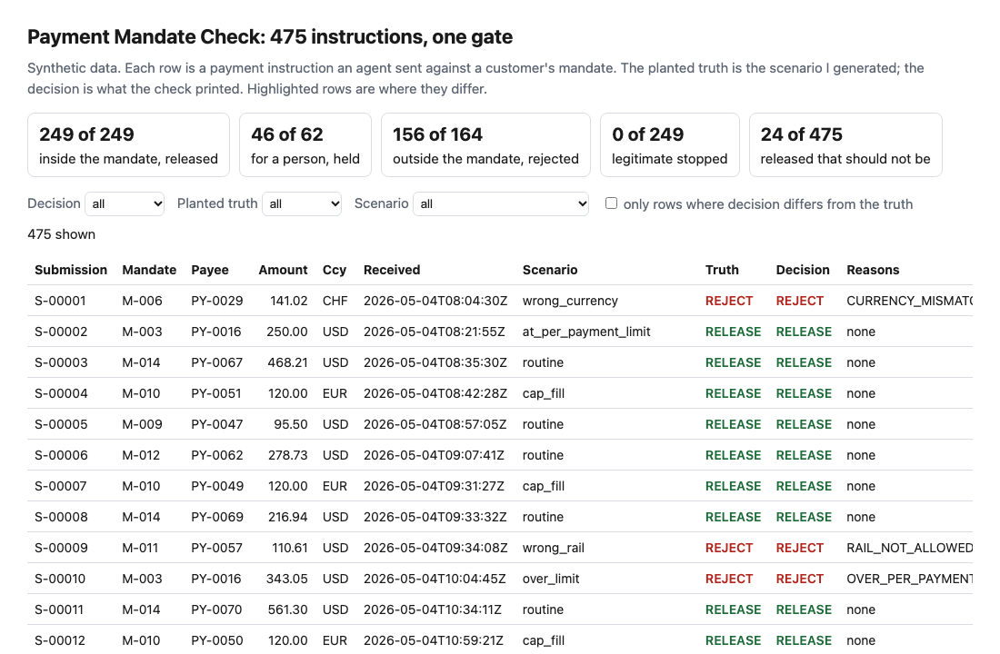
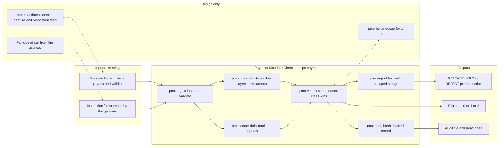
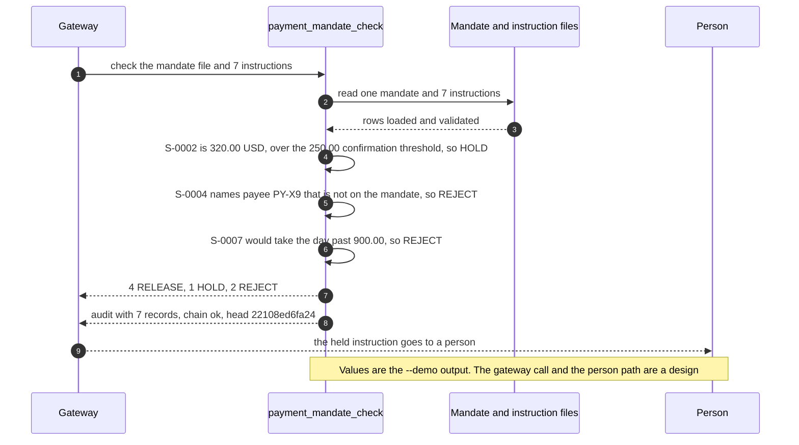

# 🧾 Payment Mandate Check: does the agent have the authority to pay this?

**I wanted to know what stands between an AI agent and a payment its customer never delegated, and how much of that a check at the point of release can stop. This is a command-line tool that compares each payment instruction with the customer's mandate (limits, payees, expiry) before anything is released, prints RELEASE, HOLD or REJECT with the reasons, and writes a hash-chained audit record.** It takes two ideas from earlier projects: from [23 ScopeKeeper](../23-scopekeeper-agent-permission-review/), that an agent's permission says which call it may make and not how much or to whom; from [27 AgentKit](../27-agentkit-reference-agent-and-playbook/), a gate where the agent stops and a person answers, and an audit trail chained by hashes. I wrote both ideas again here and import nothing across folders.

**▶ Static demo, no install:** [open demo.html](./demo.html)

[](./demo.html)

## Executive summary (90 seconds)

**Problem.** A customer at a modeled bank lets an AI agent pay on their behalf, inside limits: these payees, up to this amount, until this date. The engineer who owns the payment gateway and the person who approves what is held for review see a credential that says the agent may submit payments, and nothing that says how much, to whom or until when. 🟢 On 475 synthetic instructions against 14 mandates, a gateway with no mandate check releases 475 of 475, 164 of them forbidden by the mandate and 62 that needed a person, and 37,521.25 USD of the forbidden ones parse as an amount (`step_01_no_mandate_check.py`). The customer finds out from a statement, or never.

**Product.** Payment Mandate Check is a command that reads a mandate file and a batch of instructions and prints RELEASE, HOLD or REJECT for each instruction, in the order the gateway received it. Per-instruction rules: the mandate exists and was issued to this agent; the instruction falls inside the validity window and before any revocation; the payee is on the mandate with the account the mandate pins; the currency, rail and category are allowed; the amount is inside the per-payment limit, and a person confirms above the confirmation threshold. Ledger rules count only released instructions: the daily limit, a repeated instruction id, and the same payee and amount again within 600 seconds. Any reason of class REJECT rejects, otherwise any HOLD reason holds, otherwise the instruction is released. Each decision writes a hash-chained audit record. The command exits 1 at the level you choose (REJECT by default) and 2 for malformed input. There is no model call; the rules are plain code you can read.

**Measured and modeled performance.**

- 🟢 **No mandate check: 475 of 475 instructions released,** 164 forbidden by the mandate and 62 that needed a person (`step_01_no_mandate_check.py`).
- 🟢 **A flat 1,000.00 cap and a list of 70 approved payee names releases 136 of 164 forbidden instructions** and 60 of 62 that needed a person, stops 6 of 249 legitimate ones, and lets 12 of 12 look-alike payees through (`step_02_flat_cap_and_name_list.py`).
- 🟢 **Each half fails alone:** the per-instruction checks release 28 forbidden instructions and 30 that needed a person; the ledger alone releases 133 and 46 (`step_03_deficiencies_exposed.py`).
- 🟢 **Together: 249 of 249 inside the mandate released,** 46 of 62 held, 156 of 164 rejected, 49 of 49 hard negatives released; the decision matches the planted truth on 451 of 475 (`step_04_with_mandate_check.py`).
- 🟢 **Audit: 475 records chain;** one decision edited after the fact is found at record 238, and cutting records off the end is found only against a head hash recorded elsewhere (`step_04_with_mandate_check.py`).
- 🟢 **Known miss: 24 of 475 are released that should not be:** 16 pieces of split payments and 8 memo-contradicts-category payments (`step_04_with_mandate_check.py`).
- 🟡 **Utility: (156/164 − 28/164) × 500 = 390.2 forbidden instructions a year stopped that a flat cap and name list would release,** assuming 500 forbidden instructions reach the gateway each year.
- 🔴 **Design target: a decision within 200 milliseconds of the gateway receiving an instruction.** Designed in [`ARCHITECTURE.md`](./ARCHITECTURE.md), never built or timed.

**What I would ask a head of operations to decide.** Whether a payment an agent submits should be released only when it sits inside a mandate the customer set, with a person confirming above the confirmation threshold and whenever a payee's account differs from the one the mandate pins. The 600-second window, the calendar-day limit and "above" meaning strictly above are my policy, not a measurement. My recommendation is to run it in shadow beside the live gateway on one agent product with `--fail-on never`, compare its HOLD and REJECT lines with what customers disputed, and set the threshold and the window against that before it gates anything. Record the audit head hash somewhere the gateway cannot write.

**Call to action.** Fork the repo. Swap `data/mandates.json` and `data/instructions.csv` for your own and keep the columns, which are listed at the top of [`src/payment_mandate_check.py`](./src/payment_mandate_check.py), then run `python3 payment_mandate_check.py check mandates.json instructions.csv --audit audit.jsonl`. To call it from code, import `load_mandates`, `check_batch` and `verify_audit` from that file. Send findings by opening an issue: say which reason code fired and how many instructions, not account numbers or payees.

_A portfolio prototype on synthetic data. Nothing here is deployed, load-tested or used by anyone, and it has not been run against a real gateway or real payments._

## Run one now

```bash
cd 30-payment-mandate-check/src && python3 payment_mandate_check.py --demo
```

It prints:

```text
  S-0001 RELEASE    180.00 USD to PY-D1 on M-DEMO  inside the mandate
  S-0002 HOLD       320.00 USD to PY-D2 on M-DEMO  OVER_CONFIRM_THRESHOLD: a person confirms above 250.00
  S-0003 RELEASE    240.00 USD to PY-D1 on M-DEMO  inside the mandate
  S-0004 REJECT      90.00 USD to PY-X9 on M-DEMO  PAYEE_NOT_LISTED: payee_id is not on the mandate
  S-0005 RELEASE    240.00 USD to PY-D2 on M-DEMO  inside the mandate
  S-0006 RELEASE    240.00 USD to PY-D1 on M-DEMO  inside the mandate
  S-0007 REJECT     100.00 USD to PY-D2 on M-DEMO  OVER_DAILY_LIMIT: 900.00 already released today, limit 900.00
7 instructions: 4 RELEASE, 1 HOLD, 2 REJECT
audit: 7 records, chain ok, head 22108ed6fa24
```

Standard library only, Python 3.9 or newer. To check your own files:

```bash
python3 payment_mandate_check.py check mandates.json instructions.csv --audit audit.jsonl
python3 payment_mandate_check.py verify audit.jsonl --head <the head hash you recorded>
```

`check` prints the HOLD and REJECT lines (add `--show all` for every line) and exits 1 when an instruction reaches `--fail-on` (default `reject`; `hold` and `never` also work). It exits 2 with one line on stderr for a file it cannot read as a mandate list or an instruction table. The columns and the mandate fields are listed at the top of [`src/payment_mandate_check.py`](./src/payment_mandate_check.py).

## What the numbers say

**What it shows** (🟢 measured on synthetic data: 475 planted instructions against 14 mandates; the script is named in brackets):

- 🟢 No mandate check: 475 of 475 instructions released, 164 of them forbidden by the mandate and 62 that needed a person; 37,521.25 USD of the forbidden ones parse as an amount (`step_01`)
- 🟢 A flat 1,000.00 cap plus a list of 70 approved payee names releases 136 of 164 forbidden instructions and 60 of 62 that needed a person, stops 6 of 249 legitimate ones, and lets 12 of 12 look-alike payees through (same name, different payee id) (`step_02`)
- 🟢 The per-instruction checks alone release 28 forbidden instructions and 30 that needed a person; the ledger alone releases 133 and 46. The ledger is what stops 10 daily-limit breaches, 10 repeated instruction ids and 14 near-duplicates (`step_03`)
- 🟢 The full check releases 249 of 249 instructions that are inside the mandate, holds 46 of 62 that need a person, rejects 156 of 164 that are outside it, and releases 49 of 49 hard negatives (a limit to the cent, the last second of a mandate, hostile text in the memo); 451 of 475 decisions match the planted truth (`step_04`)
- 🟢 The audit record chains 475 records; one decision edited after the fact is found at record 238; cutting records off the end is found only when the head hash was recorded elsewhere (`step_04`)

🟡 **Modeled, assumptions named:** the near-duplicate window is 600 seconds (my choice); the daily limit runs over a UTC calendar day of the time the gateway received the instruction; only released payments use up the day; "confirm above" means strictly above; a mandate's expiry second is still inside it and its revocation second is outside; the flat cap in step 2 is read as the same number in any currency. None of these comes from a rule.

🔴 **Hypothetical:** capturing the customer's consent in a form the gateway can check, delivering a revocation to the gateway in time, and what a person sees when an instruction is held. I did not build or test any of that.

## What it still gets wrong

- 🟢 24 of 475 instructions are released that should not be, and the scripts print them (`step_03`, `step_04`). Sixteen are the second and third pieces of 8 payments split so that each piece sits under the confirmation threshold while the total does not; the rules look at one instruction at a time against a daily total, and nothing adds up one payee over an hour. Eight are payments whose declared category is allowed and whose memo says gift cards for resale. The check does not read the memo, on purpose, because it is the agent's free text.
- **The data and the rules share an author.** I planted the scenarios and wrote the rules. Eight kinds of hard negative and two kinds of hard miss are in the set on purpose, but 0 stopped of 249 legitimate is a ceiling for these rules, not a rate on real traffic, which I have not tested.
- **The instruction describes itself.** Category, rail and account are what the agent says. The check compares them with the mandate. It does not verify that an account belongs to the payee or that the goods were bought.
- **The audit chain shows consistency, not authorship.** Anyone who can write the file can rebuild every hash after an edit. Keep the head hash somewhere the gateway cannot write.
- Money is a decimal with at most two places, one currency per mandate, no exchange rates. The day is a calendar day, not a rolling window. A held instruction does not use up the day, so an agent can queue many holds; I do not cap how many.
- Times must be `YYYY-MM-DDTHH:MM:SSZ` and `received_at` must be stamped by the gateway. If the agent supplies its own clock, the validity checks mean nothing.

## How the four steps fit

| Step | Question | Script |
|---|---|---|
| 1 | What goes out when the agent's credential is the only control? | `step_01_no_mandate_check.py` |
| 2 | What does a flat cap and a payee-name list stop? | `step_02_flat_cap_and_name_list.py` |
| 3 | Where does each half of the mandate check fail alone, and what is the known limit? | `step_03_deficiencies_exposed.py` |
| 4 | What do the rules, the ledger and the audit record catch together? | `step_04_with_mandate_check.py` |

Run any of them from `src/`. Data is generated by [`data/_generate.py`](./data/README.md); `tools/check_repo.py` at the repository root confirms that a rerun reproduces every file and that the green numbers above appear in a script's output. The tests (`tests/`, 52 in all) pin those numbers and cover malformed input, hostile strings, the edges of every limit and the audit chain. `python3 -m unittest discover -s tests` from this folder runs them.

## Utility delivered

The way I price product impact: **utility = (my solution − current state of the art) × the number of people or items it affects.**

Here the item is a forbidden instruction, one the mandate does not allow. Each one lands on the customer who delegated, the gateway owner who released it and whoever takes the dispute. The common basic approach is a flat cap plus a list of approved payee names; the table prices the mandate check against it.

| Term | Value | Where it comes from |
| --- | --- | --- |
| Current state of the art (flat 1,000.00 cap and 70 approved payee names), forbidden instructions released | 🟢 **136 of 164** | `step_02_flat_cap_and_name_list.py`; it also stops 6 of 249 legitimate ones |
| My solution (Payment Mandate Check), forbidden instructions rejected | 🟢 **156 of 164** | `step_04_with_mandate_check.py`; 0 of 249 legitimate stopped |
| Lift per forbidden instruction | 🟢 156 of 164 rejected, against 136 of 164 released | The flat cap stops what is left of the 164 after the 136 it releases; it lets 12 of 12 look-alike payees through (`step_02_flat_cap_and_name_list.py`) |
| Number it affects: forbidden instructions reaching the gateway in a year | 🟡 **500** | **Assumption, not a statistic.** Replace it with your own count of agent-submitted payments a year that the customer's mandate does not allow |
| Assumption that makes the lift real | 🟡 The gateway calls the check before release, treats HOLD and REJECT as not released, and the mandate file matches what the customer delegated | If only part is wired in, the per-instruction checks alone release 🟢 28 forbidden instructions and the ledger alone releases 133 (`step_03_deficiencies_exposed.py`) |
| **Utility** | 🟡 **(156/164 − 28/164) × 500 = 390.2 forbidden instructions a year stopped that a flat cap and name list would release** | The 28 is 164 minus the 136 the flat cap releases. Assumes the 500 behave like the 164 planted ones. The 8 of 164 not rejected are the memo cases |

Sensitivity to the count assumption (🟡, same lift): 100 a year gives 78.0, 500 gives 390.2, 2000 gives 1561.0.

🔴 What I have not measured: what a forbidden payment costs in money or in disputes, how long a person takes to clear a HOLD, what a wrongly held legitimate payment costs the customer, or how an agent's real traffic splits between inside and outside a mandate. The planted set is dense on purpose, 164 of 475 forbidden (`step_01_no_mandate_check.py`); a real gateway sees far fewer. Treat the result as a property of this mix of cases, not a forecast.

---

## Architecture and call flow

Component names match [`ARCHITECTURE.md`](./ARCHITECTURE.md). GitHub renders the diagrams natively.


**System topology:**



**Per-run sequence** (the `--demo` run, seven instructions on one mandate):



**Interlocks (all red, designed, none built):**

- [27 AgentKit](../27-agentkit-reference-agent-and-playbook/) is where the gate and the hash-chained audit idea came from, and [23 ScopeKeeper](../23-scopekeeper-agent-permission-review/) is where the point that a permission does not say how much or to whom came from. I wrote both ideas again here and import nothing across folders.
- [34 Audit Chain](../34-audit-chain/) is a command that verifies a hash-chained log and keeps an anchor outside it. It would be the home for the head hash this tool asks you to record elsewhere.
- [08 OversightOps](../08-oversightops-hitl-workflow/) designs human-in-the-loop review. It is a possible shape for the queue `pmc-holdq` would feed.
- [72 Scam Friction Sim](../72-scam-friction-sim/) counts what a payment hold costs the people who did nothing wrong. It is a possible way to tune how many instructions a HOLD sends to a person.

---

## PM artifacts

The PM artifacts that show how I would run this product if I owned the seat. This README is the walkthrough; the rest of the folder holds:

- [`PRD.md`](./PRD.md): the product requirements doc, with users, backlog, KPIs, rollout and open questions.
- [`ARCHITECTURE.md`](./ARCHITECTURE.md): the systems doc, with components, data model, security, failure behavior and operations. A design, not deployed.
- [`demo.html`](./demo.html): clickable, no-install walkthrough, built from the step outputs by `src/_build_demo.py`.
- [`data/`](./data/): the 14 synthetic mandates, the 475 planted instructions, their planted truth and the seeded generator. `data/README.md` explains how the truth is set.
- [`src/`](./src/): `payment_mandate_check.py`, `common.py`, the four step scripts and the demo builder.
- [`tests/`](./tests/): 52 unittest tests, including a golden test that pins the numbers above and tests for bad input, hostile strings, the edges of every limit and the audit chain.

Run the four steps end to end:

```bash
cd src
python3 step_01_no_mandate_check.py
python3 step_02_flat_cap_and_name_list.py
python3 step_03_deficiencies_exposed.py
python3 step_04_with_mandate_check.py
```

---

## Aligned to

Governor Christopher Waller's speech ["Payments in the Age of AI Agents"](https://www.federalreserve.gov/newsevents/speech/waller20260928a.htm), given at Sibos 2026 in Miami (the page is dated September 29, 2026; its address ends 20260928a; I read it on 2026-10-23). In his description of the agent-delegated model the buyer sets constraints and guardrails and the agent then pays on its own; the authentication question changes from whether the buyer is an authorized payer to whether the agent has authority to pay for the buyer; and card networks are publishing specifications that include registering agents and logging cardholders' approvals. This tool is one reading of that: the mandate is the buyer's constraint, the check asks whether this instruction is inside it, and the audit record logs the answer. I have not read the card-network specifications he mentions, and I cite no regulation. It is a prototype, aligned to that theme. It makes no claim of conformity to that guidance.

## Data and limits

Synthetic, seeded, byte-for-byte reproducible. Nothing comes from any employer, customer, bank or real payee; company names are made up from syllables. A prototype on synthetic data, not a production case study. The scenarios, the planted truth and the assumptions are listed in [`data/README.md`](./data/README.md).

## Fork it

Swap `data/mandates.json` and `data/instructions.csv` for your own and keep the columns, or point `check` at two files from your gateway. Delete `truth.csv` if you have no planted labels; the tool never reads it, only the step scripts do. Read the [PRD](./PRD.md) for the scope I held to.

## Prereqs to run this on your laptop

You need Python 3.9 or newer and nothing else. The command, the four step scripts and the data generator use only the standard library, so there is nothing to install. There is no API key, no network call and no model call anywhere in the folder. To run the tests, use `python3 -m unittest discover -s tests` from this folder. The production pieces in [`ARCHITECTURE.md`](./ARCHITECTURE.md) (the mandate registry, the hold queue, the fail-closed gateway call) are a design, not something you need or can run.

## Author

**Vijay Saharan**, Sr Product / Program Manager · AI in BFSI · Enterprise AI Platforms

[LinkedIn](https://www.linkedin.com/in/vijaysaharan/)
