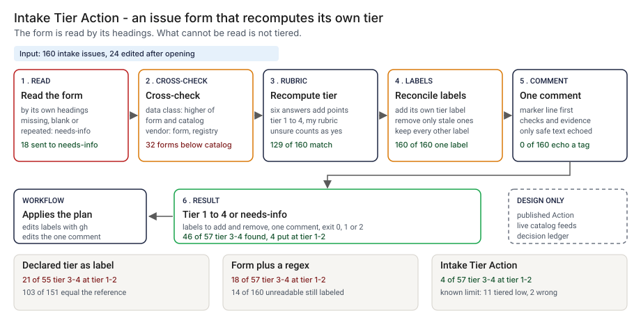

# Architecture: Intake Tier Action

> **Status.** This is the design for a production shape. The repo implements the product mechanic as a prototype: a command, `src/intake_tier_action.py`, that reads an AI intake issue body by the form's headings, recomputes the risk tier from six answers, cross-checks two of them against a catalog and a registry, and says which labels and which comment the issue should carry, run here over 160 synthetic issues. A GitHub Action is staged in `action/` and has not been published or run on GitHub. Nothing below is claimed as deployed or load-tested. Where a figure is a design target, it says so.

GCP is primary; AWS and Azure sit beside it.



---

## 1. Logical architecture

Intake Tier Action is a function between an issue form and the label that orders a review queue: one issue body, two optional registers and the current labels in; a tier or needs-info, two label lists and a comment out. It does not approve anything and reads no free text with a model.

Eight components: five decide the outcome, three support or report.

| Component | Responsibility | Language or framework | Decides the outcome? | Stateful? |
| --- | --- | --- | --- | --- |
| `ita-ingest` | Reads the body by the form's own headings. A heading that is missing, blank, repeated or out of range is a problem that stops the tier. | Python 3.9+, stdlib. Prototype: `read_text`, `split_sections`, `read_form` in `src/intake_tier_action.py` | Yes, by refusing: needs-info | No |
| `ita-crosscheck` | Higher of form and catalog for the data class, higher of form and registry for the vendor model; a blank or unsure customer-facing answer counts as yes. | Python. Prototype: the catalog, registry and customer-facing branches of `assess`; `load_catalog`, `load_registry` | Yes | No |
| `ita-rubric` | Adds points over six answers; tier = min(4, 1 + points // 4). | Python. Prototype: `POINTS`, `tier_from_score`, `assess` | Yes | No |
| `ita-labels` | Chooses `ai-tier:N`, `tier-mismatch` or `needs-info`, and removes only the labels the tool owns. | Python. Prototype: `wanted_labels`, `plan_labels`, `MANAGED`, `load_labels` | Yes | No |
| `ita-report` | Builds the one comment and the text or annotation output. Reduces echoed text to safe characters. | Python. Prototype: `render_comment`, `render_text`, `render_github`, `evidence_for`, `safe_text`, `escape_annotation` | No | No |
| `ita-action` | Runs the command on an opened or edited issue and applies labels and comment with `gh`. | Composite Action, staged in `action/action.yml`; not published | No | No |
| `ita-feeds` | Live catalog and registry exports (design). Prototype analog: `data/catalog.csv`, `data/registry.csv`. | Scheduled export to object storage (design) | No, but stale data defeats the cross-check | Stateful |
| `ita-ledger` | Appends one record per decision (design). Prototype analog: `src/out/step_04_results.json`. | PostgreSQL plus object storage with a retention lock (design) | No | Stateful |

**What decides the outcome.** The heading reader, the cross-checks, the rubric and the label plan. The comment, the Action wrapper, the feeds and the ledger carry or record it. The tool trusts the catalog and the registry where they have an entry, and the rubric points are mine.

**Repo structure** (production shape):

```
intake-tier-action/
├── tier/       # ingest, crosscheck, rubric, labels, report
├── action/     # composite Action, issue form, example workflow
├── rubric/     # points and cut-offs, changed by pull request
├── feeds/      # catalog and registry export adapters
├── ledger/     # decision record writer
├── infra/      # terraform for gcp, aws, azure
└── tests/      # unit, golden (planted-set numbers), hostile strings
```

---

## 2. Physical and deployment architecture

One short-lived step in a workflow that runs when an issue is opened or edited. There is no server to keep warm.

| Component | GCP (primary) | AWS | Azure | Why |
| --- | --- | --- | --- | --- |
| Workflow step (`ita-ingest` to `ita-report`) | Self-hosted runner on GKE, or a GitHub-hosted runner | Runner on EKS, or a GitHub-hosted runner | Runner on AKS, or a GitHub-hosted runner | Stateless, one pass |
| `ita-feeds` | Cloud Storage, versioned | S3, versioned | Blob Storage, versioned | Data and procurement teams write, the step reads |
| `ita-ledger` | Cloud SQL for PostgreSQL | RDS for PostgreSQL | Azure Database for PostgreSQL | The platform team already runs it |

**Failure behavior (the decision that matters most).** The tool must never assign a tier it could not compute, and never leave a stale tier label. A body it cannot read does not become a tier: it becomes needs-info with the reason, and a file it cannot read ends the run with exit 2.

| Failure | Behavior | Alert |
| --- | --- | --- |
| Body missing, not UTF-8, or holding a NUL byte | Exit 2, one `input error` line; the step fails and the labels stay as they were | P3 |
| Body empty, no form, a heading missing or blank, a heading repeated, or a value not allowed | Decision NEEDS_INFO: label `needs-info`, a comment that lists each problem, no tier | None; P4 if a sponsor stays in needs-info for a week |
| Catalog, registry or labels file with a bad row, a missing column or the wrong type; `--registry` without an issue number | Exit 2 with the reason | P3 |
| Dataset blank or not in the catalog | Flag `DATASET_NOT_GIVEN` or `DATASET_NOT_IN_CATALOG`; the tier uses the form's class | P4 |
| `gh` call fails when applying labels or the comment (design) | The step fails visibly; the old labels stay; the next edit retries | P3 |

**Latency.** The prototype is one pass over one issue body; I have not timed it. 🔴 Design target: labels and comment updated within 60 seconds of an issue edit.

---

## 3. Data architecture

| Entity | Key | What it holds | Real columns in the prototype |
| --- | --- | --- | --- |
| Issue | `issue_number` | The body as opened and, if edited, as edited | `data/issues.csv`: `issue_number`, `title`, `body_v1`, `body_v2` |
| Form field | `issue_number`, heading | The ten headings the form writes: summary, sponsor unit, dataset name, customer-facing, decision autonomy, data class, vendor model, regulatory scope, financial exposure band, declared tier | Read from the body by `read_form` |
| Dataset | `dataset_name` | The class the catalog records | `data/catalog.csv`: `dataset_name`, `catalog_class`; 🟢 23 datasets |
| Registry row | `issue_number` | The vendor model procurement recorded | `data/registry.csv`: `issue_number`, `vendor_model`, `source`; 🟢 83 rows |
| Result | `issue_number` | Decision, tier, score, declared tier, flags, problems, labels to add and remove | Prototype: `src/out/step_04_results.json` |
| Decision record | `decision_id` | Design: issue, edit number, SHA-256 of the body, catalog and registry versions, rubric version, result, time | Not in the prototype |
| Planted truth | `issue_number` | The true attributes and the reference tier | `data/issue_truth.csv`, `data/dataset_truth.csv`. Hidden from the tool; exists only because the data is synthetic |

**Retention** is a design choice, not a measurement; confirm each value against the bank's own record-retention schedule.

| Data | Retention (🔴 design default) | Storage |
| --- | --- | --- |
| Decision records | 7 years | PostgreSQL, archived to object storage with a retention lock |
| Issue bodies | Per the repository's own policy | The issue tracker |
| Catalog and registry exports a decision used | Same as the record, so it can be re-run | Versioned object storage |

**Lineage.** A label traces back in three hops: the record names the issue, the edit, the body hash and the catalog, registry and rubric versions; versioned storage returns those bytes; and the rules are deterministic, so re-running `assess` reproduces the tier. In the prototype the trace is `step_04_results.json`.

**Deliberately not stored.** The summary text is not copied into the comment or the record, only the body hash. The comment echoes the dataset name after it is reduced to safe characters.

---

## 4. Security architecture

**Identity and roles.** The step runs under the workflow's token with `issues: write` and `contents: read`, and has no user account of its own.

| Role | Can | Maps to |
| --- | --- | --- |
| `ita:runner` | Read the issue and the feeds; edit labels and the one comment; write a record | The workflow token |
| `ita:approver` | Approve a change to the rubric or the label set, never on their own change | Second-line reviewer |
| `ita:auditor` | Read records and config history | Internal audit |
| `ita:admin` | Manage runners, feeds, labels and the ledger | Platform engineering lead |

**Secrets.** None beyond the workflow token; no model or vendor service is called. The staged Action passes the body, number and labels through environment variables and the body goes in on standard input; `tests/test_action.py` checks that no `${{ }}` expression sits inside a shell block.

**Data classification and what leaves the boundary.** Issue text is internal and can carry confidential use-case detail. The prototype data is synthetic. In the prototype nothing leaves the machine. In the design the labels, one comment and the ledger write leave the step.

| Threat | Example | Mitigation in the design |
| --- | --- | --- |
| Hostile issue text becomes a workflow command | A summary with a line that starts with `::` | `escape_annotation` rewrites `%`, carriage return and newline; `safe_text` keeps only letters, digits, space and a few marks in anything echoed. 🟢 0 workflow commands forged across 9 hostile bodies (`step_04_with_action.py`) |
| A mention, tag or link in a comment | A body that tries to ping a team | The summary is never echoed. 🟢 0 of 160 comments echo a mention, tag, link or command (`step_04_with_action.py`) |
| The sponsor edits the form after review to lower the tier | Data class lowered once approved | Every edit re-runs the step; the design ties approval to the issue version so an edit reopens it |
| A person adds or removes a tier label by hand | `ai-tier:1` added to an issue | The next edit reconciles it; the design restricts label permission and alerts on a human label change |

---

## 5. Operational architecture

**SLIs.** Issues per decision per week; needs-info age; tier-mismatch rate; flags per code; share of issues with a catalog and a registry entry; input rejections; time to label. Prototype baseline: 🟢 142 of 160 tiered and 18 sent to needs-info, `step_04_with_action.py`.

**SLOs (all 🔴 design targets, none measured).**
- Labels and comment updated within 60 seconds of an issue edit.
- Every opened AI intake issue carries exactly one tier-or-needs-info label.
- Every tier-mismatch read by a named reviewer within one business day (planning estimate).
- 99.9 percent of decisions written to the ledger.

**Alerts.** P3: repeated input rejections, a failed `gh` call, or a feed older than its refresh window (chat).

**Runbooks** (one page each, in `docs/runbooks/`):
- `needs-info.md`: read the problems in the comment, fix the form, save; the comment updates.
- `tier-mismatch.md`: compare the declared and recomputed tier, read the flags, decide.
- `catalog-contradiction.md`: send a data-class flag to the steward.
- `changing-the-rubric.md`: propose, re-run the planted set, approve.

**On-call and ownership.** The intake lead owns the step, the labels and the runbooks. The data steward owns the catalog and the vendor manager owns the registry. The second-line reviewer owns the rubric. Nobody is paged for a tier-mismatch.

**Change control.** The rubric, the label set and the form headings are versioned. A change needs a proposer and a different approver, and the planted set is re-run against `tests/test_golden.py` before merge, so a change that moves a count shows in the diff.

---

## 6. Alignment and posture

Alignment, not certification. The README's "Aligned to" section cites one source, restated with the same wording about what was read: the [FINOS AI Governance Framework](https://air-governance-framework.finos.org/), version 2, 20 October 2025, which I read on 23 October 2026. Its [heuristic risk identification page](https://air-governance-framework.finos.org/heuristic-assessment.html) asks, before deployment, about the use case and who is affected, the sensitivity of the data, where the model comes from, whether the output is advisory or automated, and which regulations apply, and it suggests a Low, Medium or High rating in its last step, based on the severity and likelihood of risks after controls. This form sets a tier at intake, before any control, so it is not that rating. The page does not define fixed tiers or scores. I read the heuristic page and the start of the front page through a fetch tool, not the full catalogue.

- **What the design does.** It turns five of those questions and an exposure band into form fields and recomputes a tier from them, with the checks shown.
- **What it does not claim.** The point rubric and the tier numbers are mine, not FINOS's. It is not compliant with the framework or any other standard, holds no certification, and I have not read or mapped any other source.

---

## 7. What is deliberately not here

- **A data class understated everywhere.** 🟢 11 issues are tiered with a data class below the true class, because the form and the catalog both understate it or the dataset was left blank (`step_04_with_action.py`).
- **A tier that is always right.** The tier is wrong on 2 of those, and the rubric points are mine.
- **A reading that forgives.** 🟢 18 of 160 issues go to needs-info, 4 of them complete forms with a pasted heading (`step_04_with_action.py`).
- **A verified body format.** The parser expects `### label`, a blank line, then the answer; I did not check it against a real GitHub issue.
- **Several catalogs, checkboxes, other languages, or a form that changes its labels.** The unit of work is one issue body.
- **A registry keyed any other way.** It is keyed by issue number, which assumes procurement files against the intake issue.
- **Approval, free-text reading with a model, hosting, or a published Action.** A Marketplace listing is a later, separate step.

---

## Appendix: sample contract

The call is the prototype's own. Its output for the bundled `--demo` run (issue 301) is under "Run one now" in the README.

```bash
python3 intake_tier_action.py check body.md --catalog catalog.csv --registry registry.csv \
    --issue-number 301 --labels labels.json --out-dir out/ --format github --fail-on mismatch
```

It writes `labels_add.txt`, `labels_remove.txt` and `comment.md` to `out/`. Exit status: 0 below `--fail-on`, 1 at or above it, 2 for input it cannot read.
