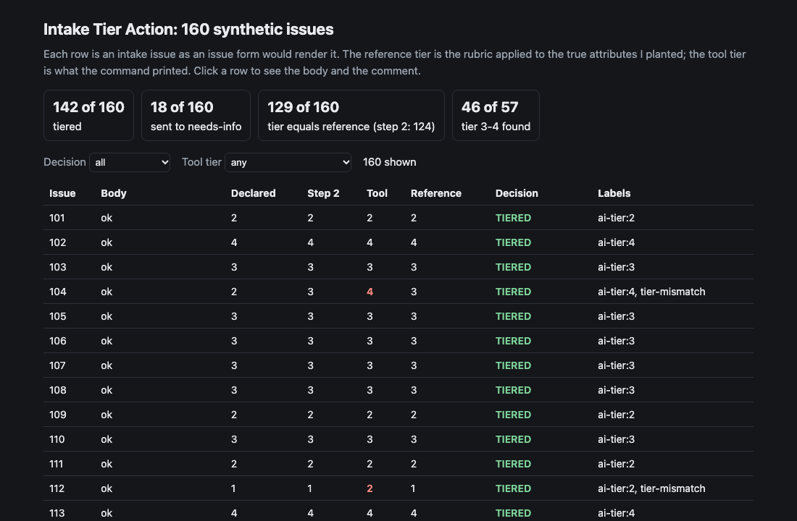
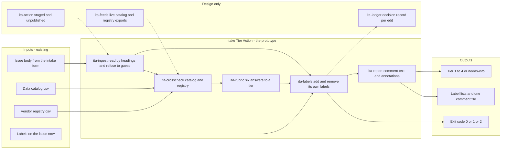
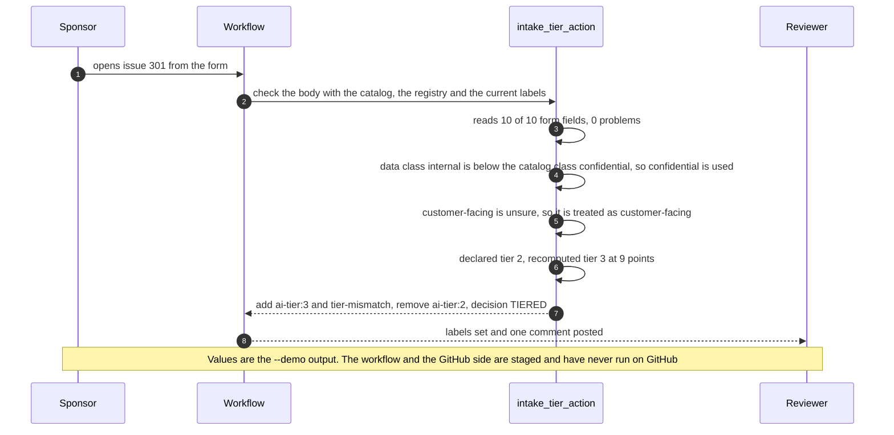

# 🏷️ Intake Tier Action: an issue form that recomputes its own risk tier

**I wanted to know what happens when AI intake lives in a GitHub issue form and a workflow, not the sponsor, decides the tier label. This is a command-line tool and a staged GitHub Action: it reads the issue body by the form's headings, recomputes the tier from six answers, checks two of them against a data catalog and a vendor registry, and says which labels to set and which stale ones to remove. If it cannot read the body, it says so and sets no tier.** It extends the rubric from [11 TierGate](../11-tiergate-ai-usecase-intake/) to a form that GitHub renders and a workflow that can be re-run on every edit.

**▶ Static demo, no install:** [open demo.html](./demo.html)

[](./demo.html)

## Executive summary (90 seconds)

**Problem.** At a modeled bank, AI use cases arrive as GitHub issues. The sponsor fills in a form and declares a tier, and that declaration becomes the label. The person who runs AI intake and the reviewer who picks the next issue from a label see the sponsor's own answer, which is the one most likely to be low for the use cases that matter. 🟢 On 160 synthetic intake issues, the declared tier equals the reference tier on 103 of 151 readable declared tiers, and 21 of 55 tier 3-4 issues are declared at tier 1-2 (`step_01_declared_label.py`). A form plus a regex gets 124 of 160 tiers right and still labels 14 of 160 bodies with a required input missing (`step_02_form_and_regex.py`), ends 8 of 24 edited issues with two tier labels and posts 184 comments for 160 issues (`step_03_deficiencies_exposed.py`).

**Product.** Intake Tier Action is a command and a staged GitHub Action that reads an issue body by the form's own headings and refuses to guess: a heading that is missing, blank, repeated or out of range gives needs-info and no tier. When the body reads, it recomputes the tier from six answers with a point rubric of my own, tier = min(4, 1 + points // 4). It takes the higher of the form and a data catalog for the data class, the higher of the form and a vendor registry for the vendor model, and counts a blank or unsure customer-facing answer as customer-facing until confirmed. It then says which labels to add and which of its own labels to remove, so a re-run on edit leaves one tier label and any other label alone, and it writes one comment that starts with a marker. It echoes only text it has made safe. The command exits 1 at the level you choose (never by default) and 2 for input it cannot read. There is no model call; the rules are plain code you can read.

**Measured and modeled performance.**

- 🟢 **Declared tier as the label: 103 of 151 readable declared tiers equal the reference,** and 21 of 55 tier 3-4 issues are declared at tier 1-2 (`step_01_declared_label.py`).
- 🟢 **Issue form plus a regex: 124 of 160 tiers equal the reference,** 18 of 57 tier 3-4 issues get tier 1-2, and 14 of 160 bodies with a required input missing still get a tier label (`step_02_form_and_regex.py`).
- 🟢 **Seven deficiencies of that workflow, counted:** a pasted heading is read as the answer on 4 of 4 bodies, 8 of 24 edited issues end with two tier labels, and 5 of 160 bodies carry a line that starts with `::` (`step_03_deficiencies_exposed.py`).
- 🟢 **This tool: 142 of 160 issues tiered and 18 sent to needs-info;** 129 of 160 tiers equal the reference; 46 of 57 tier 3-4 issues found, 4 put at tier 1-2, 7 sent to needs-info (`step_04_with_action.py`).
- 🟢 **Edits and hostile text:** after 24 edits every one of 160 issues carries exactly one tier-or-needs-info label, 0 workflow commands are forged in the log, and 0 of 160 comments echo a mention, tag, link or command (`step_04_with_action.py`).
- 🟢 **Known limit: 11 issues are tiered with a data class below the true class,** and the tier is wrong on 2 of them, issues 141 and 155 (`step_04_with_action.py`).
- 🟡 **Utility: (18/57 − 4/57) × 40 = 9.8 tier 3-4 issues a year that no longer carry a tier 1-2 label,** assuming 40 tier 3-4 issues a year.
- 🔴 **Design target: labels and comment updated within 60 seconds of an issue edit.** Designed in [`ARCHITECTURE.md`](./ARCHITECTURE.md), never built or timed.

**What I would ask a head of operations to decide.** Whether the tier on an AI intake issue should be recomputed by a workflow from the form and two registers, with needs-info for anything it cannot read, instead of taken from the sponsor. Strict reading costs a look: 18 of 160 issues here go to needs-info, 4 of them complete forms with a pasted heading. The rubric points are mine, not a framework's. My recommendation is to open one real issue from the form and compare its body with what the parser expects, then run the Action on a throwaway repository with a reviewer still approving every tier, and replace my rubric with the bank's own.

**Call to action.** Fork the repo. Swap `data/issues.csv`, `data/catalog.csv` and `data/registry.csv` for exports of your own and keep the columns (`issue_number, title, body_v1, body_v2`; `dataset_name, catalog_class`; `issue_number, vendor_model, source`), or point `check` at one issue body. Change the headings in `FIELDS` to match your form. To call it from code, import `assess`, `wanted_labels` and `plan_labels` from `src/intake_tier_action.py`. Send findings by opening an issue: say which check code fired and how many issues, not issue text.

_A portfolio prototype on synthetic data. Nothing here is deployed, load-tested or used by anyone, and the Action is staged and has not run on GitHub._

## Run one now

```bash
cd 31-intake-tier-action/src && python3 intake_tier_action.py --demo
```

It prints:

```text
issue 301: 10 of 10 form fields read, 0 problems
declared tier 2 -> recomputed tier 3 (9 points)
  DATA_CLASS_BELOW_CATALOG   form says internal; the catalog records confidential for `d_card_disputes`; using confidential
  CUSTOMER_FACING_AMBIGUOUS  customer-facing answer is 'unsure'; treated as customer-facing until the sponsor confirms
  TIER_DECLARED_BELOW        sponsor declared tier 2; the rubric on the checked inputs gives tier 3 (9 points)
  note: the registry has no entry for issue 301
labels: add ai-tier:3, tier-mismatch; remove ai-tier:2
decision: TIERED
```

Standard library only, Python 3.9 or newer. To check your own issue: `python3 intake_tier_action.py check body.md --catalog catalog.csv --labels labels.json --out-dir out/`. Use `-` in place of `body.md` to read the body from standard input.

## What the numbers say

**What it shows** (🟢 measured on synthetic data: 160 planted intake issues; the script is named in brackets):

- 🟢 Declared tier as the label: 103 of 151 readable declared tiers equal the reference tier, and 21 of 55 tier 3-4 issues are declared at tier 1-2 (`step_01`)
- 🟢 Issue form plus a regex: 124 of 160 tiers equal the reference, 18 of 57 tier 3-4 issues get tier 1-2, and 14 of 160 bodies with a required input missing still get a tier label (`step_02`)
- 🟢 Seven named deficiencies of that workflow, each counted: a pasted heading is read as the answer on 4 of 4 bodies, 8 of 24 edited issues end with two tier labels, 184 comments are posted for 160 issues, and 5 of 160 bodies carry a line that starts with `::` (`step_03`)
- 🟢 This tool: 142 of 160 issues tiered and 18 sent to needs-info; 129 of 160 tiers equal the reference (124 for the regex), 129 of 142 among the tiered; 46 of 57 tier 3-4 issues found, 4 put at tier 1-2, 7 sent to needs-info (`step_04`)
- 🟢 Labels and comments: after 24 edits every one of 160 issues carries exactly one tier-or-needs-info label, the unrelated label is kept on 160 of 160, and edited issues that match the reference go from 14 of 24 to 24 of 24 (`step_04`)
- 🟢 Hostile text: 0 workflow commands forged in the log and 0 of 160 comments echo a mention, tag, link or command, across 9 bodies that carry such lines (`step_04`)
- 🟢 Hard negatives that could have raised false alarms: needs-info on 0 of 13 intact bodies with odd case or padding and 0 of 16 with Windows line endings; DATA_CLASS_ABOVE_CATALOG raised 12 times and the tier stayed at the form's class (`step_04`)

## What it still gets wrong

- 🟢 **The known limit.** 11 issues are tiered with a data class below the true class, because the form and the catalog both understate it (8) or the sponsor left the dataset blank (3). The tier is wrong on 2 of them, issues 141 and 155 (`step_03` and `step_04` print them). The bands are four points wide, so one point of data class often does not change the tier, which is why 2 and not 11.
- 🟢 **Six tiers too high, seven too low.** The 13 misses have these causes, and one issue can have more than one: 6 treat a blank or unsure customer-facing answer as customer-facing when it was not (the flag was raised 13 times and 2 were right), 4 have a vendor left off the form that the registry does not list, 2 have a customer-facing "no" that was wrong, 2 have a data class below the true class, and 1 has a catalog that overstates the class (`step_04`).
- 🟢 **The text cue is a weak signal.** A summary that mentions a customer while the form says "no" raised a flag 33 times and 3 were truly customer-facing. My first version let the cue raise the tier; I changed it to a flag only, so it does not move the tier (`step_04`).
- 🟢 **Strict reading costs a look.** 7 of 57 tier 3-4 issues get no tier until the sponsor fixes the form, and 4 complete forms are sent to needs-info only because a pasted block repeats a heading (`step_04`). I chose that over guessing which answer counts.
- **The test set and the rules share an author.** I wrote the generator and the rules, so the numbers above are a ceiling for these rules on this data, not a rate on real intake. The mention rates, error rates and the 4% of bodies that arrive with no form are parameters I picked.
- 🟡 **The rubric is mine.** The points per answer and the cut-offs (tier = min(4, 1 + points // 4)) are an assumption carried over from project 11. The same goes for the evidence list in the comment. Neither comes from a framework.
- 🟡 **The body format is from memory.** The parser expects `### label`, a blank line, then the answer, and `_No response_` for an empty optional field. I did not verify this against a real GitHub issue. If the format differs, the tool sends the issue to needs-info and names the heading it could not find; it does not guess.
- 🟡 **The registry is keyed by issue number**, which assumes procurement files its vendor decisions against the intake issue. That is an invented export.
- Not supported: checkboxes, several catalogs, headings in another language, a form that changes its labels between versions. The unit of work is one issue body.

## Use it in CI

[`action/`](./action/README.md) holds a staged GitHub Action, the issue form it reads, an example workflow and the steps to publish it from its own repository. It has not been published and has not run on GitHub. What is tested is the command it wraps (`tests/test_cli.py`) and that the staged files agree with the tool (`tests/test_action.py`).

## How the four steps fit

| Step | Question | Script |
|---|---|---|
| 1 | What does the declared tier as a label get right? | `step_01_declared_label.py` |
| 2 | What does an issue form and a regex add? | `step_02_form_and_regex.py` |
| 3 | Where does that workflow break? | `step_03_deficiencies_exposed.py` |
| 4 | What do strict reading, cross-checks and label reconciliation fix? | `step_04_with_action.py` |

Run any of them from `src/`. Data is generated by [`data/_generate.py`](./data/README.md); the check in `tools/check_repo.py` confirms that a rerun reproduces every file and that the green numbers above appear in a script's output.

## Utility delivered

The way I price product impact: **utility = (my solution − current state of the art) × the number of people or items it affects.**

Here the item is a tier 3-4 intake issue, the kind that needs the most review. Each one lands on the person who runs intake and the reviewer who picks the next issue from a label. The common basic approach is an issue form read by a regex; the table prices the tool against it by how many tier 3-4 issues still carry a tier 1-2 label.

| Term | Value | Where it comes from |
| --- | --- | --- |
| Current state of the art (issue form plus a regex), tier 3-4 issues labeled tier 1-2 | 🟢 **18 of 57** | `step_02_form_and_regex.py`; it also labels 14 of 160 bodies with a required input missing |
| My solution (Intake Tier Action), tier 3-4 issues put at tier 1-2 | 🟢 **4 of 57** | `step_04_with_action.py`; 46 of 57 tiered 3-4 and 7 sent to needs-info |
| Lift per tier 3-4 issue | 🟢 18 of 57 minus 4 of 57 | The cost is a look at the form: 18 of 160 issues go to needs-info, 4 of them complete forms with a pasted heading (`step_04_with_action.py`) |
| Number it affects: tier 3-4 intake issues a year | 🟡 **40** | **Assumption, not a statistic.** Replace it with your own count of high-tier intake issues in a year |
| Assumption that makes the lift real | 🟡 The body format matches what GitHub writes, the catalog and registry are right where they have an entry, and a sponsor fixes a needs-info issue | I did not verify the body format against a real issue. The data class can still be understated on both the form and the catalog: 🟢 11 issues are tiered with a data class below the true class and the tier is wrong on 2 (`step_04_with_action.py`) |
| **Utility** | 🟡 **(18/57 − 4/57) × 40 = 9.8 tier 3-4 issues a year that no longer carry a tier 1-2 label** | Assumes the 40 behave like the 57 planted ones. The 7 tier 3-4 issues sent to needs-info carry no tier until the form is fixed, and are not counted as stopped |

Sensitivity to the count assumption (🟡, same lift): 20 issues a year gives 4.9, 40 gives 9.8, 80 gives 19.6.

🔴 What I have not measured: how long a reviewer spends on an issue, what an under-tiered use case costs when it reaches review late, how many real sponsors leave a form incomplete, or how GitHub renders a real issue form. The planted set is dense on purpose, 57 of 160 issues at tier 3-4 (`step_02_form_and_regex.py`); a real intake sees fewer. Treat the result as a property of this mix of cases, not a forecast.

---

## Architecture and call flow

Component names match [`ARCHITECTURE.md`](./ARCHITECTURE.md). GitHub renders the diagrams natively.


**System topology:**



**Per-run sequence** (the `--demo` run, issue 301):



**Interlocks (all red, designed, none built):**

- [11 TierGate](../11-tiergate-ai-usecase-intake/) is where the rubric came from. The points are carried over as an assumption; this folder does not import or read 11's files.
- [35 TierGate Skill](../35-tiergate/) recomputes a tier from an intake CSV in a command and a staged skill. This folder does the same for an issue body, and the two would share one rubric file.
- [24 PortfolioBoard](../24-portfolioboard-ai-program-portfolio/) runs a bank's AI programs on gate evidence. It is a possible consumer of a tier once a reviewer confirms it.
- [44 Inventory Check](../44-inventory-check/) tests an inventory of generative and agentic systems. It is a possible home for an issue once its tier is confirmed.

---

## PM artifacts

The PM artifacts that show how I would run this product if I owned the seat. This README is the walkthrough; the rest of the folder holds:

- [`PRD.md`](./PRD.md): the product requirements doc, with users, backlog, KPIs, rollout and open questions.
- [`ARCHITECTURE.md`](./ARCHITECTURE.md): the systems doc, with components, data model, security, failure behavior and operations. A design, not deployed.
- [`demo.html`](./demo.html): clickable, no-install walkthrough, built from the step outputs by `src/_build_demo.py`.
- [`data/`](./data/): the 160 synthetic intake issues with their hidden truth, the catalog, the registry and the seeded generator. `data/README.md` explains how the truth is set.
- [`src/`](./src/): `intake_tier_action.py`, `common.py`, the four step scripts and the demo builder.
- [`tests/`](./tests/): 55 unittest tests, including a golden test that pins the numbers above and tests for bad input and hostile strings.
- [`action/`](./action/README.md): the staged GitHub Action, the issue form it reads, an example workflow and the steps to publish it. Not published, not run on GitHub.

Run the four steps end to end:

```bash
cd src
python3 step_01_declared_label.py
python3 step_02_form_and_regex.py
python3 step_03_deficiencies_exposed.py
python3 step_04_with_action.py
```

---

## Aligned to

The [FINOS AI Governance Framework](https://air-governance-framework.finos.org/) (version 2, 20 October 2025; I read it on 23 October 2026) is a catalogue of risks and mitigations for generative AI in financial services. Its [heuristic risk identification page](https://air-governance-framework.finos.org/heuristic-assessment.html) asks, before deployment, about the use case and who is affected, the sensitivity of the data, where the model comes from (third party, self-hosted or in-house), whether the output is advisory or automated, and which regulations apply, and it suggests a Low, Medium or High rating in its last step, based on the severity and likelihood of risks after controls. This form sets a tier at intake, before any control, so it is not that rating. The page does not define fixed tiers or scores. This form turns five of those questions and an exposure band into dropdowns and adds a point rubric of my own, so the tier numbers are mine, not FINOS's. I read the heuristic page and the start of the front page through a fetch tool, not the full catalogue. This is a prototype, aligned to that framework's questions. It makes no claim of conformity to that guidance.

## Data and limits

Synthetic, seeded, byte-for-byte reproducible. Nothing comes from any employer, customer or real bank, and no real company appears. A prototype on synthetic data, not a production case study. The data README lists every error parameter.

## Fork it

Swap `data/issues.csv`, `data/catalog.csv` and `data/registry.csv` for exports of your own issues and keep the columns, or skip the data and point `check` at one issue body. Change the headings in `FIELDS` to match your form. Read the [PRD](./PRD.md) for the scope I held to.

## Prereqs to run this on your laptop

You need Python 3.9 or newer and nothing else. The command, the four step scripts and the data generator use only the standard library, so there is nothing to install. There is no API key, no network call and no model call anywhere in the folder; the staged Action calls GitHub only when you publish and run it yourself. To run the tests, use `python3 -m unittest discover -s tests` from this folder. The production pieces in [`ARCHITECTURE.md`](./ARCHITECTURE.md) (the live catalog and registry feeds, the decision ledger, a published Action) are a design, not something you need or can run.

## Author

**Vijay Saharan**, Sr Product / Program Manager · AI in BFSI · Enterprise AI Platforms

[LinkedIn](https://www.linkedin.com/in/vijaysaharan/)
