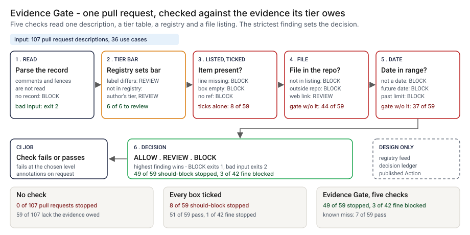

# Architecture: Evidence Gate

> **Status.** This is the design for a production shape. The repo implements the product mechanic as a prototype: a command, `src/evidence_gate.py`, that reads the AI change record in a pull request description, a tier table, a registry and a file listing, applies the checks and prints ALLOW, REVIEW or BLOCK, run here over 107 synthetic pull request descriptions. A GitHub Action is staged in `action/` and has not been published or run on GitHub. Nothing below is claimed as deployed or load-tested. Where a figure is a design target, it says so.

GCP is primary; AWS and Azure sit beside it.



---

## 1. Logical architecture

Evidence Gate is a function at the merge button: a description, a tier table, a registry and a file listing in, a decision out. It does not open the evidence or call a model.

Eight components: five decide the outcome, three support or report.

| Component | Responsibility | Language or framework | Decides the outcome? | Stateful? |
| --- | --- | --- | --- | --- |
| `evg-ingest` | Loads the description (a file or the `pull_request` event JSON), tier table, registry and listing. Rejects bad input with a one-line message. | Python 3.9+, standard library. Prototype: `load_body`, `load_tiers`, `load_registry`, `load_files` in `src/evidence_gate.py` | Yes, by refusing: exit 2 | No |
| `evg-parse` | Reads the change record. Drops HTML comments and fenced code first. Matches evidence by explicit id only. | Python. Prototype: `visible_lines`, `parse_record`, `parse_tier`, `parse_date` | Yes, it defines what the gate sees | No |
| `evg-bar` | Sets the bar: the registry tier if listed, else the author's. Returns the items that tier owes, cumulatively. In production the registry arrives from `evg-registry-feed`, an export of the inventory (design). | Python. Prototype: `required_ids`, `data/tier_evidence.csv`, `data/registry.csv` | Yes, config | Stateful, in git and the feed |
| `evg-rules` | Checks each owed item; returns findings such as `evidence_missing`, `not_ticked`, `reference_not_found`, `stale`, `tier_mismatch`. | Python. Prototype: `evaluate`, `_check_entry`, `KIND_CLASS` | Yes | No |
| `evg-verdict` | Highest class wins; maps it to an exit code at `--fail-on`. | Python. Prototype: `decide`, `DECISION_RANK`, `run_check` | Yes | No |
| `evg-report` | Prints text or GitHub annotations. Escapes untrusted strings. | Python. Prototype: `render`, `escape_annotation`, `clean`, `quote` | No | No |
| `evg-action` | Runs the command on a `pull_request` event; inputs through environment variables. | Composite GitHub Action, staged in `action/action.yml`, not published | No | No |
| `evg-ledger` | Appends one record per decision; counts to monitoring, off the decision path (design). Prototype analog: `src/out/step_04_decisions.json`. | PostgreSQL, object storage with a retention lock, OpenTelemetry (design) | No | Stateful |

**What decides the outcome.** The input check, the parser, the bar, the item checks and the verdict. The rest carry or record the decision. The gate trusts the date typed on a line and treats a path in the listing as proof the file exists.

**Repo structure** (production shape):

```
evidence-gate/
├── gate/       # ingest, parse, bar, rules, verdict, report
├── action/     # composite Action wrapper
├── config/     # tier table and limits, changed by pull request
├── registry/   # feed from the use-case inventory
├── ledger/     # decision record writer
├── infra/      # terraform for gcp, aws, azure
├── docs/runbooks/
└── tests/      # unit, golden, hostile
```

---

## 2. Physical and deployment architecture

The gate is one short-lived process in the CI job that already runs on a pull request.

| Component | GCP (primary) | AWS | Azure | Why |
| --- | --- | --- | --- | --- |
| Gate process | Cloud Build step or Cloud Run job | CodeBuild step or ECS Fargate task | Azure Pipelines step or Container Apps job | Stateless, one pass, runs where the check runs |
| `evg-registry-feed` | Scheduled export to Cloud Storage, versioned | Export to S3, versioned | Export to Blob Storage, versioned | The gate reads one version, and the version is recorded |
| `evg-ledger` | Cloud SQL for PostgreSQL | RDS for PostgreSQL | Azure Database for PostgreSQL | The platform team already runs it |

**Failure behavior (the decision that matters most).** The gate must never silently pass. A missing, empty or malformed input does not become ALLOW: it ends the run with exit 2 and a one-line reason, and that exit fails the CI step even with `--fail-on never`. An owed item that is not in the record is a finding.

| Failure | Behavior | Alert |
| --- | --- | --- |
| Tier table, registry, listing or event JSON missing, empty or malformed; one use case at two tiers; description not UTF-8; `--as-of` not a date | Exit 2, one line on stderr naming the file and row | P2 if repeated, else P3 |
| Description empty or `body` null | Finding `no_record`: BLOCK | None |
| Use case not in the registry | Finding `tier_unverified`: REVIEW, the author's tier is the bar | P4 |
| `--files` omitted (the staged Action always supplies it) | References are not checked and a note says so; the decision stands | P3 in the design |
| Ledger or telemetry unavailable (design) | The decision and exit code stand; the record queues locally and the gap is listed | P3 |

**Latency.** I have not timed the prototype. 🔴 Design target: a decision within 60 seconds of the pull request event.

Recovery is a re-run from the same inputs and as-of date.

---

## 3. Data architecture

| Entity | Key | What it holds | Real columns in the prototype |
| --- | --- | --- | --- |
| Evidence item | `evidence_id` | Name, first tier, freshness limit in days | `data/tier_evidence.csv`: `evidence_id`, `evidence_item`, `first_tier`, `max_age_days` |
| Use case | `use_case_id` | The registry tier that sets the bar | `data/registry.csv`: `use_case_id`, `tier`, `owner_unit`. The gate reads the first two |
| Change record | pull request, evidence id | Declared tier; per line: ticked, `ref`, `date` | Parsed from `data/pr_cases.csv`: `pr_id`, `body`. The gate reads only `body` |
| File listing | path | Repository paths, one per line | `data/repo_files.txt` |
| Decision record | `decision_id` | Design: pull request, commit, use case, tiers, findings, decision, input hashes, as-of date, tool version | Prototype: `src/out/step_04_decisions.json` |
| Planted truth | `pr_id` | The defect planted and the decision it deserves | `data/pr_truth.csv`: `pr_id`, `use_case_id`, `true_tier`, `defect_kind`, `truth_class`, `bad_items`. Synthetic data only |

**Retention** is a design choice; confirm it against the bank's own schedule. 🔴 Design default: decision records for 7 years in PostgreSQL, archived to object storage with a retention lock; the input versions a decision used are kept as long, so it can be reproduced.

**Lineage.** A decision traces back in three hops: the record names the pull request, commit, as-of date and the hash of each input; the versioned store returns those bytes; and the rules are deterministic once the as-of date is fixed, so re-running `evaluate` reproduces the findings. Without `--as-of` the prototype uses today, and an item can go stale between two runs.

**Deliberately not stored.** The evidence documents, and the free text of the description beyond the parsed record and its hash.

---

## 4. Security architecture

**Identity and roles.** The gate runs under the CI platform's workload identity and has no account of its own. `evg:runner` reads the inputs and writes a decision record. `evg:approver` (governance lead or second-line reviewer) approves a change to the tier table or a limit, never their own. `evg:auditor` reads decisions and config history. `evg:admin` manages roles and the ledger.

**Secrets.** The gate holds none and never calls a model. The staged Action takes its inputs through environment variables and reads no token. The CI identity reaches the store and ledger through workload identity, with no static keys.

**Data classification and what leaves the boundary.** Use case ids, tiers, evidence ids, paths and dates are internal. A real description may carry confidential free text, which the gate does not need. In the prototype nothing leaves the machine. In the design three things leave the job: the exit code, the annotations and the ledger write.

| Threat | Example | Mitigation in the design |
| --- | --- | --- |
| Hostile string in a description echoed into a log or annotation | A `ref:` holding a newline and text that looks like a workflow command | `escape_annotation` rewrites `%`, carriage return and newline; `clean` and `quote` blank control characters and cut length. `tests/test_cli.py` checks that hostile text cannot forge a workflow command |
| The author lowers the bar | A declared tier below the registry tier | The registry sets the bar and the mismatch is a REVIEW; the tier table changes only through a reviewed change |
| A stub file added to satisfy the listing | A one-line file at the referenced path | The gate cannot see this: presence is checked, quality is not. A content check is in the backlog |
| A limit or the registry is changed to make a BLOCK go away | A limit raised from 90 to 365 days | Pull request with a different approver; every decision stores the table hash |

---

## 5. Operational architecture

**SLIs.** Decisions per class per repository per week (prototype baseline: 🟢 a reviewer is asked to look at 16 of 107 pull requests, `step_04_with_gate.py`); input rejections; use cases not in the registry; checks run without a listing; age of the registry export; blocks overturned after review.

**SLOs (all 🔴 design targets, none measured).**
- Decision available within 60 seconds of the pull request event.
- Every merge to an in-scope AI use case passes the gate and leaves a decision record.
- Every REVIEW read within one business day (planning estimate).
- 99.9 percent of decisions written to the ledger.

**Alerts.** P2: repeated input rejections on one repository, or the ledger down over a day (low-urgency page to the CI owner). P3: a check run without a listing, or a changed hash for a finished decision (chat). P4: a daily digest of REVIEW decisions (email).

**Runbooks** (one page each, in `docs/runbooks/`):
- `evidence-blocked.md`: read the finding, fix the description or add the file, re-run.
- `tier-mismatch.md`: compare the declared tier with the registry, fix the label or the registry.
- `changing-a-limit.md`: propose, re-run the planted set, compare with the golden numbers, approve.
- `registry-stale.md`: find why the registry holds a use case at the wrong tier, and fix it at the source.

**On-call and ownership.** The CI owner owns the runner and runbooks, the governance lead the tier table and limits, the registry owner the feed. Nobody is paged for a BLOCK or a REVIEW.

**Change control.** Rules and limits are versioned in the repo; a change needs a proposer and a different approver. Before merge, the planted set is re-run against the pinned numbers in `tests/test_golden.py`, so a change that moves the blocked count shows in the diff. Rollout is shadow, then calibration, then enforcement, as the PRD lays out.

---

## 6. Alignment and posture

Alignment, not certification. The README's "Aligned to" section cites one source: the [FINOS AI Governance Framework](https://air-governance-framework.finos.org/), a catalogue of risks and mitigations for generative AI whose home page is marked version 2, 20 October 2025. I read the home page and the start of its mitigation list through a page fetch on 2026-10-23.

- **What the design does.** It checks that the evidence a team says it holds is attached to the change that needs it, at the one point work cannot skip.
- **What it does not claim.** It implements none of the framework's mitigations and does not map E01 to E11 to its identifiers, which needs a read of each mitigation page. It makes no claim of conformity to the framework or any other standard, holds no certification, and I have not read or mapped any other source.

---

## 7. What is deliberately not here

- **Reading the evidence.** Presence, not quality. A one-line file named like an independent validation passes.
- **Proof of a date or a signature.** It checks the date typed on the line, not the file's history.
- **A full markdown parser.** 🟢 Evidence written as a table is blocked, which is 3 of 42 fine pull requests (`step_04_with_gate.py`).
- **Wrong content behind a real path.** 🟢 4 of 59 should-block pull requests pass this way. A rule that the path must contain the use case id would catch them; I left it out because it infers structure from a naming convention.
- **A registry that is always current.** 🟢 3 of 59 should-block pass because the registry holds the use case one tier too low and the author copies it (`step_03_deficiencies_exposed.py`).
- **A true tier for a new use case.** One not yet registered that declares a tier too low reaches REVIEW, not BLOCK.
- **Framework identifiers, hosting, a published Action.** A Marketplace listing is a later step.

---

## Appendix: sample contract

```bash
python3 evidence_gate.py check --event "$GITHUB_EVENT_PATH" --tiers tier_evidence.csv \
  --registry registry.csv --files repo_files.txt --as-of 2026-10-16 --fail-on block --format github
```

Exit status: 0 below `--fail-on`, 1 at or above it, 2 for bad input. The `--demo` output is under "Run one now" in the README.
