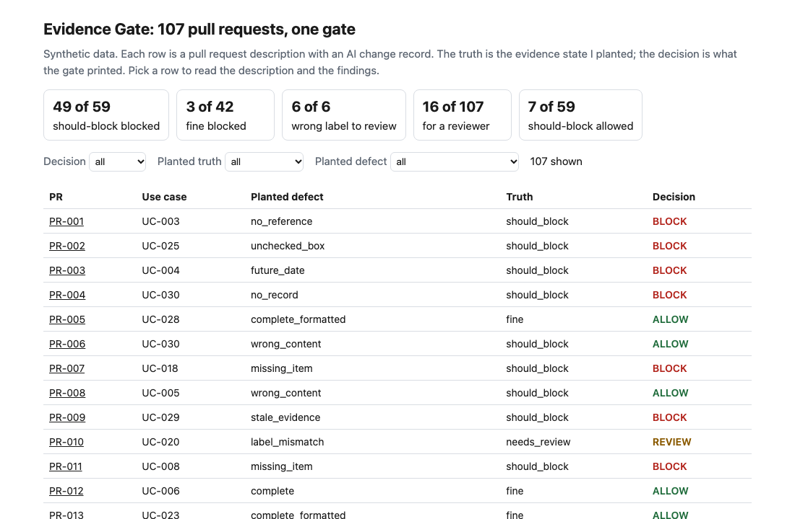
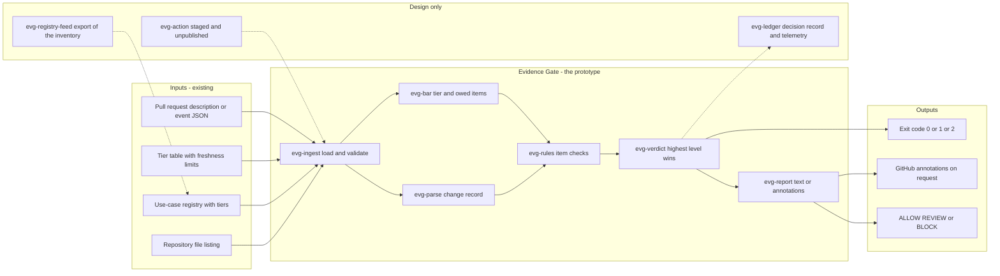
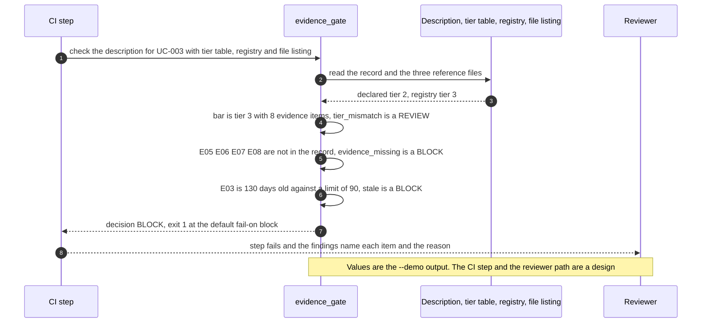

# 🧾 Evidence Gate: no merge without the evidence the tier requires

**I wanted to know what it takes to make "we have the evidence" something a pull request has to show, not just say. This is a command-line gate and a staged GitHub Action: it reads the AI change record in a pull request description, looks up what the use case's tier requires, checks that each piece of evidence is listed, ticked, points at a file in the repository and is in date, and prints ALLOW, REVIEW or BLOCK.** It takes the tier-to-evidence table from [11 TierGate](../11-tiergate-ai-usecase-intake/) and the idea of a freshness limit from [24 PortfolioBoard](../24-portfolioboard-ai-program-portfolio/), and moves the check to the one place work cannot skip: the merge button.

**▶ Static demo, no install:** [open demo.html](./demo.html)

[](./demo.html)

Tags used below: 🟢 measured (a script in this folder prints the number), 🟡 modeled (the assumption is named), 🔴 hypothetical (reasoned about, never tested).

## Executive summary (90 seconds)

**Problem.** A team at a modeled bank changes an AI use case through a pull request. The template lists the evidence the use case's risk tier requires, and nothing reads it. The engineer who ships the change, the reviewer who approves it and the governance lead who owns the tier table see ticked boxes and cannot tell a real file from a typed one without opening every link. 🟢 On 107 synthetic pull request descriptions, a process with no check stops 0 of 107, 59 of 107 lack evidence their true tier requires, and 129 of 642 owed evidence items are missing, stale or unusable (`step_01_no_gate.py`). A change merges with a gap, and the gap is found by a reviewer or by nobody.

**Product.** Evidence Gate is a command that reads the AI change record in a pull request description and applies plain rules; there is no model call. The registry tier sets the bar when the use case is listed, and a declared tier that disagrees is a REVIEW. The tier table says which evidence items that bar owes, and a higher tier owes everything below it. Each owed item must be listed, ticked, point at a path that is in the repository's file listing and carry a real date that is not in the future and is within the item's freshness limit. A missing, unticked, unreferenced, unlisted, stale or future-dated item is a BLOCK; an external link, or a tier the gate cannot confirm, is a REVIEW. The highest level wins. The command exits 1 at the level you choose (BLOCK by default) and 2 for malformed input, so a CI step fails with a reason.

**Measured and modeled performance.**

- 🟢 **No gate: 0 of 107 pull requests stopped.** 59 of 107 lack the evidence their true tier requires, and 129 of 642 owed items are missing, stale or unusable (`step_01_no_gate.py`).
- 🟢 **Requiring every box to be ticked passes 98 of 107,** stops 8 of 59 should-block pull requests and lets 51 through (`step_02_checklist_rule.py`).
- 🟢 **The gate blocks 49 of 59 should-block pull requests;** in all 46 blocked descriptions that have a record, the items it names are exactly the items I planted as bad (`step_04_with_gate.py`).
- 🟢 **Each input earns its place:** without the registry the gate blocks 41 of 59, without the file listing 44, without the dates 37, and the parser alone 24 (`step_03_deficiencies_exposed.py`).
- 🟢 **Judgment calls land where intended:** 6 of 6 wrong-tier-label pull requests go to review, and 8 of 8 reformatted descriptions and 2 of 2 with evidence on its last valid day are allowed (`step_04_with_gate.py`).
- 🟢 **Known misses and false alarms:** 7 of 59 should-block pull requests pass (4 point at a real file with another use case's evidence, 3 copy a registry that is one tier too low), and 3 of 42 fine ones are blocked because the evidence is a markdown table (`step_03_deficiencies_exposed.py`, `step_04_with_gate.py`).
- 🟡 **Utility: (49/59 − 8/59) × 40 = 27.8 should-block pull requests a year stopped that a tick check would pass,** assuming 40 should-block pull requests reach the gate each year.
- 🔴 **Design target: a decision within 60 seconds of the pull request event.** Designed in [`ARCHITECTURE.md`](./ARCHITECTURE.md), never built or timed.

**What I would ask a head of operations to decide.** Whether a merge to an AI use case should require the evidence its registry tier names to be listed, ticked, present in the repository and in date, with the registry and not the author setting the tier. My recommendation is to run it in advisory mode (`--fail-on never`) on one repository for one release cycle, replace my freshness limits with the ones your policy sets, and name an owner for the registry, since 3 of the 7 misses are a registry one tier too low.

**Call to action.** Fork the repo. Swap `data/tier_evidence.csv` for your own tier table and `data/registry.csv` for an export of your use-case inventory, keep the columns, then point `check` at a description file (`--body`) or a `pull_request` event (`--event`) and at the output of `git ls-files` (`--files`). To call it from code, import `parse_record` and `evaluate` from `src/evidence_gate.py`. Send findings by opening an issue: say which finding kind fired and how many items, not the description text.

_A portfolio prototype on synthetic data. Nothing here is deployed, load-tested or used by anyone, and the Action is staged and has not run on GitHub._

## Run one now

```bash
cd 32-evidence-gate/src && python3 evidence_gate.py --demo
```

It prints:

```text
use case UC-003   declared tier 2   registry tier 3   bar: tier 3, 8 evidence items
  [review] tier_mismatch          the record declares tier 2 but the registry holds 'UC-003' at tier 3; the registry sets the bar
  [block ] evidence_missing       E05, E06, E07, E08 are required at tier 3 and not in the record
  [block ] stale                  E03 is 130 days old; the limit is 90
decision: BLOCK
```

Standard library only, Python 3.9 or newer. To check your own description: `python3 evidence_gate.py check --body pr_body.md --tiers tier_evidence.csv --registry registry.csv --files repo_files.txt`. It exits 1 on BLOCK, so a CI step fails; `--format github` prints annotations. The gate reads one block of the description, a use case, a declared tier and one line per evidence item:

```text
Use case: UC-014
Declared tier: 2
- [x] E01 Use-case card | ref: evidence/UC-014/E01-use-case-card.md | date: 2026-09-02
```

Text inside HTML comments and fenced code blocks is not read, so the example line in a template's comment does not count.

## What the numbers say

**What it shows** (🟢 measured on synthetic data: 107 planted pull request descriptions, 36 use cases; the script is named in brackets):

- 🟢 No gate: 0 of 107 pull requests stopped, 59 of 107 lack evidence their true tier requires, and 129 of 642 owed evidence items are missing, stale or unusable (`step_01`)
- 🟢 A check that every box is ticked passes 98 of 107, stops 8 of the 59 and lets 51 through (`step_02`)
- 🟢 The gate blocks 49 of the 59, and in all 46 blocked descriptions that have a record, the items it names are exactly the items I planted as bad (`step_04`)
- 🟢 It sends 6 of 6 wrong-tier-label pull requests to review, and allows 8 of 8 reformatted descriptions (CRLF line endings, `[X]`, bold labels) and 2 of 2 with evidence dated on its last valid day (`step_04`)
- 🟢 Take one input away from the gate and the blocked count falls: without the registry 41 of 59, without the file listing 44, without the dates 37, parser alone 24 (`step_03`)
- 🟢 A reviewer is asked to look at 16 of 107 pull requests; the author fixes the 52 that are blocked (`step_04`)
- 🟡 The freshness limits (90 days for evaluation results and CRO sign-off, 180 or 365 for the rest) are my assumptions, in [`data/tier_evidence.csv`](./data/tier_evidence.csv). The limit is inclusive: evidence dated exactly that many days before the as-of date is valid.

## What it still gets wrong

- 🟢 7 of the 59 should-block pull requests pass (`step_04` prints each). Four are a reference to a real file that holds another use case's evidence: the listing proves the file is there, not what it says. A rule that the path must contain the use case id would catch them, and I left it out on purpose, because it infers structure from a naming convention. Three are use cases the registry holds one tier too low, where the author copies the registry (PR-031, PR-034 and PR-067).
- 🟢 3 of the 59 only reach review: a use case not yet in the registry that declares a tier one below its true one. The gate cannot know the true tier, so it asks a person.
- 🟢 3 of 42 fine pull requests are blocked because the evidence is a markdown table, not the template's lines. 7 of 42 fine ones go to review: 4 with a link outside the repository and 3 new use cases that declared the right tier. I accept both costs.
- **The test set and the rules share an author.** I planted the cases and wrote the rules, and every finding kind exists because I planted a case for it, so 49 of 59 shows the rules cover what I planted. Treat it as a ceiling, not a rate on real descriptions, which I have not tested. The set is dense in problems on purpose (59 of 107 should be blocked).
- **The date is the author's claim.** The gate checks the date typed on the line, not the file's history. A stale document with a fresh date typed next to it passes.
- **Presence, not quality.** It does not open the evidence. A one-line file named `E05-independent-validation.md` passes.
- The parser is not a full markdown parser. It handles HTML comments and fenced code blocks, labelled fields and the template's line format. Tables, indented code blocks and free prose are not read.
- Evidence must be a path in the repository to be checked. A link to a wiki is only sent to review.

## Use it in CI

[`action/`](./action/README.md) holds a staged GitHub Action and the steps to publish it from its own repository, which a Marketplace listing requires. It has not been published and has not run on GitHub. What is tested is the command it wraps (`tests/test_cli.py`, 55 tests in all across four files).

## How the four steps fit

| Step | Question | Script |
|---|---|---|
| 1 | What happens when the template is only a template? | `step_01_no_gate.py` |
| 2 | What does requiring every box to be ticked catch? | `step_02_checklist_rule.py` |
| 3 | What does the gate lose when one input is taken away, and what does it still miss? | `step_03_deficiencies_exposed.py` |
| 4 | What do the parser, the tier table, the file listing and the dates catch together? | `step_04_with_gate.py` |

Run any of them from `src/`. Data is generated by [`data/_generate.py`](./data/README.md); the check in `tools/check_repo.py` confirms that a rerun reproduces every file and that the green numbers above appear in a script's output.

## Utility delivered

The way I price product impact: **utility = (my solution − current state of the art) × the number of people or items it affects.**

Here the item is a pull request that should have been blocked. Each one lands on the engineer who has to fix it, the reviewer who would otherwise open every link, and the governance lead who owns the tier table. The common basic approach is a rule that every box is ticked; the table prices the gate against it.

| Term | Value | Where it comes from |
| --- | --- | --- |
| Current state of the art (every box ticked), should-block pull requests stopped | 🟢 **8 of 59** | `step_02_checklist_rule.py`; it also stops 1 of 42 fine pull requests |
| My solution (Evidence Gate), should-block pull requests stopped | 🟢 **49 of 59** | `step_04_with_gate.py`; 3 of 42 fine pull requests blocked, all with evidence written as a table |
| Lift per should-block pull request | 🟢 49 of 59 minus 8 of 59 | The tick rule passes 51 of 59, by planted defect: missing_item 7, tier_understated 8, stale_evidence 6, missing_ref_file 5, no_reference 5 and others (`step_02_checklist_rule.py`) |
| Number it affects: should-block pull requests reaching the gate in a year | 🟡 **40** | **Assumption, not a statistic.** Replace it with your own count of merged changes in a year that lacked evidence the tier required |
| Assumption that makes the lift real | 🟡 The registry is kept current, the file listing is supplied, and authors write the evidence in the template's line format | Without the registry the gate blocks 🟢 41 of 59 (`step_03_deficiencies_exposed.py`); a registry one tier too low is one of the two kinds it cannot catch |
| **Utility** | 🟡 **(49/59 − 8/59) × 40 = 27.8 should-block pull requests a year stopped that a tick check would pass** | Assumes the 40 behave like the 59 planted ones |

Sensitivity to the count assumption (🟡, same lift): 20 pull requests a year gives 13.9, 40 gives 27.8, 80 gives 55.6.

🔴 What I have not measured: how long a reviewer spends opening links today, what a blocked merge costs a release, how often real authors skip the template, or how fast a real registry drifts. The cost side is real: the gate blocks 3 of 42 fine pull requests and the tick rule 1 of 42 (`step_04_with_gate.py`, `step_02_checklist_rule.py`). The planted set is dense on purpose, 59 of 107 should be blocked (`step_01_no_gate.py`); a real repository sees far fewer. Treat the result as a property of this mix of cases, not a forecast.

---

## Architecture and call flow

Component names match [`ARCHITECTURE.md`](./ARCHITECTURE.md). GitHub renders the diagrams natively.


**System topology:**



**Per-run sequence** (the `--demo` run, a tier-3 use case declared at tier 2):



**Interlocks (all red, designed, none built):**

- [11 TierGate](../11-tiergate-ai-usecase-intake/) is where the tier-to-evidence table comes from. This folder copies the list of 11 items and their first tiers; it does not read 11's files. In the design, intake would write the registry that `evg-registry-feed` exports.
- [24 PortfolioBoard](../24-portfolioboard-ai-program-portfolio/) supplied the idea of a freshness limit. The limits here are my own assumptions, and nothing is imported.
- [09 LineageLog](../09-lineagelog-ai-decision-audit/) is a possible home for the decision record (`evg-ledger`).

---

## PM artifacts

The PM artifacts that show how I would run this product if I owned the seat. This README is the walkthrough; the rest of the folder holds:

- [`PRD.md`](./PRD.md): the product requirements doc, with users, backlog, KPIs, rollout and open questions.
- [`ARCHITECTURE.md`](./ARCHITECTURE.md): the systems doc, with components, data model, security, failure behavior and operations. A design, not deployed.
- [`demo.html`](./demo.html): clickable, no-install walkthrough, built from the step outputs by `src/_build_demo.py`.
- [`data/`](./data/): the synthetic tier table, registry, file listing, 107 pull request descriptions and their planted truth, and the seeded generator. `data/README.md` explains how the truth is set.
- [`src/`](./src/): `evidence_gate.py`, `common.py`, the four step scripts and the demo builder.
- [`tests/`](./tests/): 55 unittest tests across four files, including a golden test that pins the numbers above and tests for bad input and hostile strings.
- [`action/`](./action/README.md): the staged GitHub Action and the steps to publish it. Not published, not run on GitHub.

Run the four steps end to end:

```bash
cd src
python3 step_01_no_gate.py
python3 step_02_checklist_rule.py
python3 step_03_deficiencies_exposed.py
python3 step_04_with_gate.py
```

---

## Aligned to

The [FINOS AI Governance Framework](https://air-governance-framework.finos.org/) is a catalogue of risks and mitigations for generative AI; its home page is marked version 2, 20 October 2025. I read the home page and the start of its mitigation list through a page fetch on 2026-10-23, and the catalogue lists preventative mitigations with identifiers such as AIR-PREV-005 (System Acceptance Testing). This gate implements none of them and does not map E01 to E11 to the framework's identifiers: that needs a read of each mitigation page and is not done. What it does is narrower. It checks that the evidence a team says it holds is attached to the change that needs it. It is a prototype, aligned to that kind of governance practice. It makes no claim of conformity to that guidance.

## Data and limits

Synthetic, seeded, byte-for-byte reproducible. Nothing comes from any employer, bank or real repository. 🔴 A team would keep a registry current and fill the template in honestly; I have not tested either. A prototype on synthetic data, not a production case study.

## Fork it

Swap `data/tier_evidence.csv` for your own tier table and `data/registry.csv` for an export of your use-case inventory, keep the columns, and point `check` at a description file. Read the [PRD](./PRD.md) for the scope I held to.

## Prereqs to run this on your laptop

You need Python 3.9 or newer and nothing else. The gate, the four step scripts and the data generator use only the standard library, so there is nothing to install. There is no API key, no network call and no model call anywhere in the folder. To run the tests, use `python3 -m unittest discover -s tests` from this folder. The production pieces in [`ARCHITECTURE.md`](./ARCHITECTURE.md) (the registry feed, the decision ledger, telemetry, a published Action) are a design, not something you need or can run.

## Author

**Vijay Saharan**, Sr Product / Program Manager · AI in BFSI · Enterprise AI Platforms

[LinkedIn](https://www.linkedin.com/in/vijaysaharan/)
