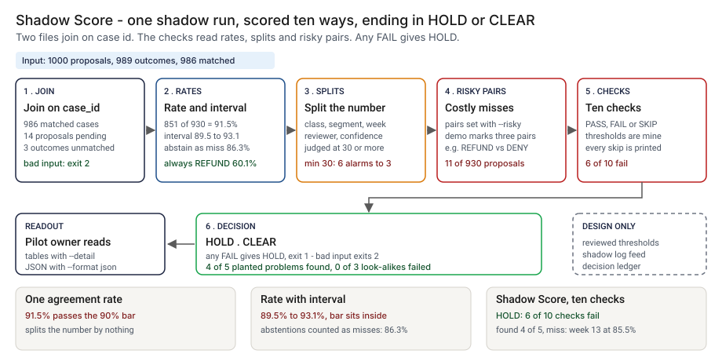

# Architecture: Shadow Score

> **Status.** This is the design for a production shape. The repo implements the product mechanic as a prototype: a command, `src/shadow_score.py`, that reads the proposals an agent made in shadow mode and the outcomes people recorded, joins them on `case_id`, runs ten checks and prints HOLD or CLEAR, run here over 1000 synthetic proposals and 989 outcomes. Nothing below is claimed as deployed or load-tested. Where a figure is a design target, it says so.

GCP is primary; AWS and Azure sit beside it.



---

## 1. Logical architecture

Shadow Score sits between a shadow log and a steering decision: two exports and options in, a scorecard and a decision out. It does not run the agent or decide that an agent may act.

Eight components: five decide the outcome, three support or report.

| Component | Responsibility | Language or framework | Decides the outcome? | Stateful? |
| --- | --- | --- | --- | --- |
| `ss-ingest` | Reads both files and refuses a malformed one with a one-line message. | Python 3.9+, standard library. Prototype: `read_rows`, `parse_proposals`, `parse_outcomes` in `src/shadow_score.py` | Yes, by refusing: exit 2 | No |
| `ss-config` | The thresholds and the list of costly proposed-versus-recorded pairs. In production, a reviewed config file; in the prototype, options. | Prototype: the `Rules` dataclass, `DEMO_RISKY`, command-line options | Yes, config | Stateful, in git (design) |
| `ss-score` | Joins on `case_id`, counts pending and unmatched cases, and computes the rates, the Wilson interval and the group splits. | Python. Prototype: `score`, `judge`, `tally`, `wilson`, `groups`, `reviewer_groups`, `confidence_bands` | Yes | No |
| `ss-checks` | Ten checks, `C01` to `C10`, each PASS, FAIL or SKIP with a reason. | Python. Prototype: `evaluate` | Yes | No |
| `ss-verdict` | Any FAIL gives HOLD, else CLEAR. Maps HOLD to exit 1 unless `--fail-on never`. | Python. Prototype: `decide`, `run_check` | Yes | No |
| `ss-report` | Prints the scorecard, `--detail` tables or JSON. Escapes untrusted strings. | Python. Prototype: `render`, `clean`, `pct` | No | No |
| `ss-feed` | Exports the shadow log into the two layouts on a schedule (design). | A scheduled job reading the agent's log store | No | Stateful |
| `ss-ledger` | Appends one record per readout and counts readouts and rejections to monitoring, off the decision path (design). | PostgreSQL, object storage with a retention lock, OpenTelemetry | No | Stateful |

**What decides the outcome.** The input check, the thresholds and risky pairs, the join and splits, the ten checks and the verdict. The report, feed and ledger carry or record the decision. The scorecard measures agreement with a person, not correctness.

**Repo structure** (production shape):

```
shadow-score/
├── scorecard/  # ingest, score, checks, verdict, report
├── config/     # thresholds and risky pairs, changed by pull request
├── feed/       # scheduled export of the shadow log
├── ledger/     # readout record writer
├── infra/      # terraform for gcp, aws, azure
├── docs/runbooks/
└── tests/      # unit, golden, hostile
```

---

## 2. Physical and deployment architecture

The scorecard is one short-lived batch job run when a readout is due.

| Component | GCP (primary) | AWS | Azure | Why |
| --- | --- | --- | --- | --- |
| Scorecard job | Cloud Run job or Cloud Build step | ECS Fargate task or CodeBuild step | Container Apps job or Azure Pipelines step | Stateless, one pass over two files |
| `ss-feed` | Scheduled export to Cloud Storage, versioned | Export to S3, versioned | Export to Blob Storage, versioned | The job reads one version, and the version is recorded |
| `ss-ledger` | Cloud SQL for PostgreSQL | RDS for PostgreSQL | Azure Database for PostgreSQL | The platform team already runs it |

**Failure behavior (the decision that matters most).** The scorecard must never silently pass. A malformed input does not become CLEAR: it ends the run with exit 2 and a one-line reason. A check that cannot run prints SKIP with the reason, and the decision line counts the skips.

| Failure | Behavior | Alert |
| --- | --- | --- |
| File missing, empty, header only, undecodable or truncated; a repeated or missing column; a blank or duplicate `case_id`; a bad `day`, `confidence` or blank `human_outcome` | Exit 2, one line on stderr naming the file and row | P3 |
| No `case_id` appears in both files | Exit 2 saying so, with both counts | P2 if repeated |
| Proposals with no outcome yet, or outcomes with no proposal | Counted and printed, not scored | P4 |
| No `--risky` pairs, no group with 30 proposals, or no proposals | The check prints SKIP with the reason; the decision can be CLEAR with skips | P3 in the design |
| Ledger unavailable (design) | The decision stands; the record queues locally | P3 |

---

## 3. Data architecture

| Entity | Key | What it holds | Real columns in the prototype |
| --- | --- | --- | --- |
| Proposal | `case_id` | What the agent proposed, with its value and confidence; blank outcome means it abstained | `data/proposals.csv`: `case_id`, `segment`, `day`, `proposed_outcome`, `proposed_value`, `confidence` |
| Recorded outcome | `case_id` | What the person recorded and who handled it | `data/outcomes.csv`: `case_id`, `human_outcome`, `human_value`, `handled_by` |
| Joined case | `case_id` | Derived: week as `day // 7`, kind (agree, disagree on outcome, disagree on value, abstained), risky flag | Built in `score` |
| Check result | readout, `C01` to `C10` | Threshold, measured value, PASS, FAIL or SKIP, reason | `evaluate`; `step_04_scorecard.json` |
| Readout record | `readout_id` | Design: the two file hashes, thresholds, risky pairs, decision, failing checks, tool version, time | Prototype analog: `src/out/step_04_scorecard.json` |
| Planted truth | `case_id` | What should have happened, and the planted problem | `data/case_truth.csv`: `case_id`, `true_outcome`, `planted`; `data/planted_problems.csv`. Synthetic data only |

**Retention** is a design choice, not a measurement; confirm it against the bank's own schedule. 🔴 Design default: readout records for 7 years in PostgreSQL, archived to object storage with a retention lock; the two exports a readout used are kept as long, so it can be reproduced. `handled_by` names a person; the design stores a pseudonym.

**Lineage.** A decision traces back in three hops: the record names the file hashes, thresholds and risky pairs; the versioned store returns those bytes; and the scorecard is deterministic (no clock, locale or random draw), so re-running it reproduces the checks.

**Deliberately not stored.** The case content, the customer and any dispute text. The scorecard needs only ids, labels, amounts and the reviewer.

---

## 4. Security architecture

**Identity and roles.** The job runs under the platform's workload identity. `ss:runner` reads the exports and config and writes a readout record. `ss:approver` (two people: pilot owner and second-line reviewer) approves a change to a threshold or the risky pairs. `ss:auditor` reads records and config history. `ss:admin` manages roles and the ledger.

**Secrets.** None. The job never calls a model and holds no key. It reaches storage and the ledger through workload identity, with no static keys.

**Data classification and what leaves the boundary.** Case ids, segments, outcome labels and refund amounts are internal. `handled_by` identifies staff and is restricted. In the prototype nothing leaves the machine. In the design two things leave the job: the exit code and the ledger write.

| Threat | Example | Mitigation in the design |
| --- | --- | --- |
| Hostile string in a segment, reviewer id or case id echoed into the output | A `handled_by` holding a newline and a fake `decision: CLEAR` line | `clean` escapes control characters and cuts length before anything is printed. `tests/test_cli.py` checks hostile group names and a hostile case id in an error stay on one line |
| Thresholds tuned until the result is CLEAR | `--min-lower` or `--group-floor` lowered at run time | Thresholds come from the reviewed config; every record stores the values used; a mismatch is an alert |
| Proposals written after the outcome was known | An agent or an export that sees the person's answer first | The scorecard cannot see this: the files carry no proposal time. The design's `ss-feed` records it and refuses a proposal later than its outcome |
| A reviewer gap used to rank people | A gap of 17.1 points read as a finding about the reviewer | The report names a gap as a question: the agent may be the one that is wrong. Reviewer ids are pseudonyms |
| An export is edited after the run | Rows removed from a weak week | Versioned storage; the record stores both hashes; a changed hash is an alert |

---

## 5. Operational architecture

**SLIs.** Readouts per agent per month; HOLD against CLEAR; SKIPs per readout; input rejections; share of proposals with no outcome yet (prototype baseline: 🟢 14 pending and 3 unmatched in a run of 1000 proposals, `step_01_one_number.py`); age of the export; readouts whose thresholds differ from the approved config.

**SLOs (all 🔴 design targets, none measured).**
- Scorecard available within 60 seconds of the two exports landing (I have not timed the prototype).
- Every exit review for an in-scope agent has a readout record.
- Every HOLD read by the pilot owner within one business day (planning estimate).
- 99.9 percent of readouts written to the ledger.

**Alerts.** P2: repeated "no case_id in both files" for one agent, or the ledger down for more than a day (low-urgency page to the pilot owner). P3: input rejections, a production readout with a SKIP on C01 to C05, a thresholds mismatch, or a changed hash (chat). P4: a weekly digest of HOLDs (email).

**Runbooks** (one page each, in `docs/runbooks/`):
- `hold-readout.md`: read the failing checks, open the groups behind them, decide fix, wait or override with a written reason.
- `input-rejected.md`: find which export broke and re-run from the feed.
- `changing-a-threshold.md`: propose, re-run the planted set, compare with the golden numbers, approve.
- `reviewer-gap.md`: how to read a gap and who may see reviewer ids.

**On-call and ownership.** The pilot owner owns the readout and runbooks, the queue owner the export and pseudonyms, the second-line reviewer the thresholds and risky pairs. Nobody is paged for a HOLD.

**Change control.** Thresholds, risky pairs and checks are versioned in the repo; a change needs a proposer and a different approver. Before merge, the planted set is re-run against `tests/test_golden.py`, so a change that moves a count shows in the diff.

---

## 6. Alignment and posture

Alignment, not certification. The README's "Aligned to" section cites one source, restated with the same wording about what was read: the [NIST AI Agent Standards Initiative](https://www.nist.gov/news-events/news/2026/02/announcing-ai-agent-standards-initiative-interoperable-and-secure), announced on February 17, 2026 (page updated February 18), which I read on October 23, 2026. It sets out three pillars (industry-led standards, open-source protocols, and research on agent security and identity), says its aim is for agents to be adopted with confidence, and says further guidelines will follow.

- **What the design does.** It measures an agent's record against people, in more than one number, before the agent acts.
- **What it does not claim.** That page describes no method for scoring an agent against people, so nothing is implemented from NIST. It makes no claim of conformity to that guidance or any other standard, holds no certification, and I have not read any other source.

---

## 7. What is deliberately not here

- **Correctness.** 🟢 17 of 851 agreements are cases where the agent and the person are both wrong (`step_03_deficiencies_exposed.py`). Two files cannot show them; a second reviewer on a sample could.
- **A trusted yardstick.** The person is sometimes wrong, and the reviewer-gap check cannot say whether the reviewer or the agent is right.
- **A floor per outcome class.** 🟢 REQUEST_DOCS sits at 82.8% on 87 proposals and passes every check (`step_04_with_scorecard.py`). Coverage per class is checked; agreement per class is not.
- **A margin on floors.** 🟢 Week 13 is a planted problem at 85.5% against a floor of 85.0% and passes (`step_04_with_scorecard.py`).
- **Correction for many looks.** Weeks, segments and reviewers are each judged at a flat floor, so on a larger set chance alone will flag some.
- **Thresholds from a standard.** The ten thresholds and the risky pairs are my defaults. CLEAR means no check failed, not that the agent may act.
- **Running the agent, hosting, or a model call.** Labels match as written and one recorded outcome is read per case.

---

## Appendix: sample contract

```bash
python3 shadow_score.py check proposals.csv outcomes.csv --risky REFUND:DENY --format json --fail-on hold
```

JSON has three top-level keys: `decision`, `checks` (each with `id`, `name`, `threshold`, `measured`, `result`, `detail`) and `score`. Exit status: 0 for CLEAR, 1 for HOLD with `--fail-on hold`, 2 for bad input.
