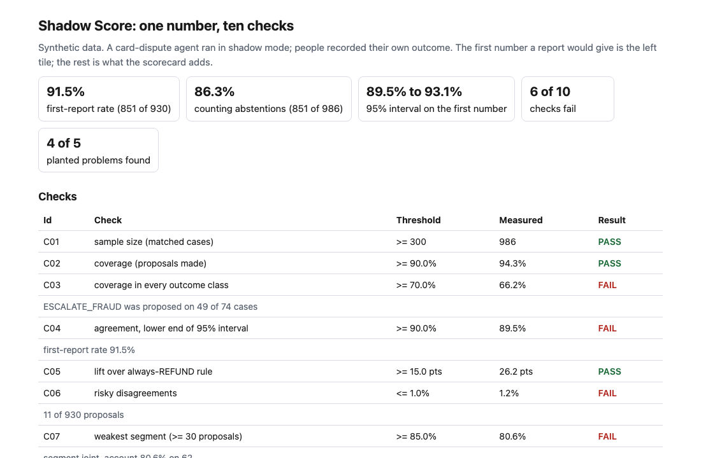
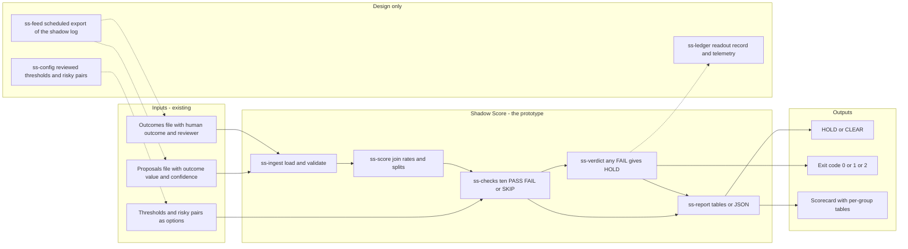
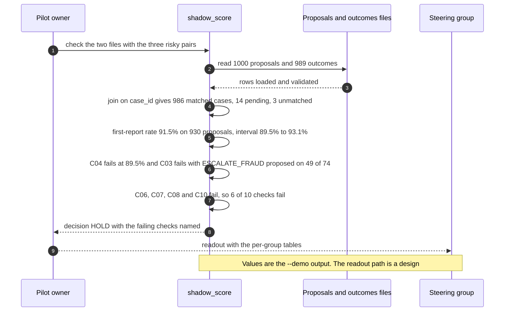

# 📏 Shadow Score: agent versus human outcome

**I wanted to know what a shadow-mode agreement rate leaves out. When I ran the agent in [27 AgentKit](../27-agentkit-reference-agent-and-playbook/) the report said it agreed with the recorded human outcome on 522 of 548 proposals. That is one number whose denominator the agent partly chose, with no interval, no baseline and no split by group. This is a command-line scorecard over two CSV files, the agent's proposals and the outcomes people recorded: it joins them, says what did not join, runs ten checks and prints HOLD or CLEAR.**

**▶ Static demo, no install:** [open demo.html](./demo.html)

[](./demo.html)

## Executive summary (90 seconds)

**Problem.** A team at a modeled bank runs a card-dispute agent in shadow mode while people record their own outcome for the same cases. The person who owns the pilot has to say whether the agent should leave shadow mode, and the steering group reads the answer. The report they get is one agreement rate. 🟢 On 1000 synthetic cases it says the agent agreed on 851 of 930 proposals (91.5%), drops 56 abstentions from the denominator, and splits the number by nothing, so 79 disagreements are left for a person to read to find out why (`step_01_one_number.py`). The number passes a 90% bar and nobody sees which segment, week, reviewer or outcome class is weak.

**Product.** Shadow Score is a command that reads two CSV files, the agent's proposals and the outcomes people recorded, and joins them on `case_id`. It reports what did not join, then prints the first-report rate with a 95% interval, the rate that counts abstentions as misses, and the rate of a rule that always proposes the most common outcome. It splits agreement by recorded outcome, segment, week, reviewer and stated confidence, and judges a group only when it has at least 30 proposals. Ten checks, each PASS, FAIL or SKIP with a reason, then give HOLD or CLEAR. Which disagreements are costly is set with `--risky`, and the thresholds are my defaults, changed with options. It exits 1 on HOLD and 2 for input it cannot read. There is no model call.

**Measured and modeled performance.**

- 🟢 **The usual report passes:** 851 of 930 is 91.5% against a bar of 90%, and the confusion matrix shows 69 off-diagonal cases that say nothing about where or who (`step_01_one_number.py`, `step_02_overall_agreement.py`).
- 🟢 **The number is softer than it looks:** the 95% interval is 89.5% to 93.1%, so the bar sits inside it; counting abstentions as misses gives 86.3%; a rule that always proposes REFUND agrees on 60.1% (`step_03_deficiencies_exposed.py`).
- 🟢 **Small groups raise false alarms:** flagging any group under the floor raises 6 alarms, 3 planted problems and 3 look-alikes with 6 to 10 proposals; with a 30-proposal minimum it raises 3 and 0 (`step_03_deficiencies_exposed.py`).
- 🟢 **A drift hides in the average:** two weeks sit at 82.4% on 131 proposals against 93.0% elsewhere, and the all-weeks rate moves only to 91.5% (`step_03_deficiencies_exposed.py`).
- 🟢 **The scorecard prints HOLD: 6 of 10 checks fail.** It finds 4 of 5 planted problems and fails 0 of 3 look-alikes (`step_04_with_scorecard.py`).
- 🟢 **Known misses:** week 13 is a planted problem at 85.5% against a floor of 85.0% and passes; 17 of 851 agreements are cases where the agent and the person are both wrong; REQUEST_DOCS sits at 82.8% on 87 proposals with no floor of its own (`step_04_with_scorecard.py`, `step_03_deficiencies_exposed.py`).
- 🟡 **Utility: (4/5 − 0/5) × 10 = 8.0 weak spots a year named that a single rate hides,** assuming 10 real weak spots sit in the shadow runs read each year.
- 🔴 **Design target: a scorecard within 60 seconds of the two exports landing.** Designed in [`ARCHITECTURE.md`](./ARCHITECTURE.md), never built or timed.

**What I would ask a head of operations to decide.** Whether an exit criterion for shadow mode should be the lower end of an interval and a set of group checks, and not a single rate against a bar. I would adopt the scorecard as a readout on one real shadow log, ask the business to name which disagreements are costly (my three pairs are marked in the demo run only), and treat the ten thresholds as mine until a policy sets them. CLEAR means no check failed; it does not mean the agent may act.

**Call to action.** Fork the repo. Export your agent's proposals and your reviewers' outcomes to the two CSV layouts in [`data/README.md`](./data/README.md), pass the costly pairs with `--risky PROPOSED:HUMAN`, and change the thresholds with the options. To call it from code, import `Rules`, `score` and `evaluate` from `src/shadow_score.py`. Send findings by opening an issue: say which check fired and on how many cases, not the data itself.

_A portfolio prototype on synthetic data. Nothing here is deployed, load-tested or used by anyone._

## Run one now

```bash
cd 33-shadow-score/src && python3 shadow_score.py --demo
```

It prints:

```text
shadow-score: 986 matched cases (14 proposals have no outcome yet, 3 outcomes have no proposal)
  first-report rate   91.5%  (agreed on 851 of 930 proposals; 56 abstentions dropped)
  95% interval        89.5% to 93.1%
  all matched cases   86.3%  (abstentions count as misses)
  always REFUND   60.1%  (the most common recorded outcome)

  id   check                                  threshold   measured  result
  C01  sample size (matched cases)               >= 300        986  PASS
  C02  coverage (proposals made)               >= 90.0%      94.3%  PASS
  C03  coverage in every outcome class         >= 70.0%      66.2%  FAIL
  C04  agreement, lower end of 95% interval    >= 90.0%      89.5%  FAIL
  C05  lift over always-REFUND rule          >= 15.0 pts   26.2 pts  PASS
  C06  risky disagreements                      <= 1.0%       1.2%  FAIL
  C07  weakest segment (>= 30 proposals)       >= 85.0%      80.6%  FAIL
  C08  weakest week (>= 30 proposals)          >= 85.0%      79.7%  FAIL
  C09  agreement at confidence >= 0.90         >= 90.0%      95.7%  PASS
  C10  reviewer gap (agreement vs the rest)  <= 10.0 pts   17.1 pts  FAIL
    C03: ESCALATE_FRAUD was proposed on 49 of 74 cases
    C04: first-report rate 91.5%
    C06: 11 of 930 proposals
    C07: segment joint_account 80.6% on 62
    C08: week 12 79.7% on 69
    C10: reviewer W07 75.7% against 92.8% for the rest
  too few cases to judge, not counted: segment intl_atm 62.5% on 8; week 6 60.0% on 10; reviewer W09 50.0% on 6
decision: HOLD  (6 of 10 checks fail, 0 skipped)
```

Standard library only, Python 3.9 or newer. To score your own files: `python3 shadow_score.py check proposals.csv outcomes.csv --risky REFUND:DENY`. It exits 1 on HOLD, 0 on CLEAR and 2 for input it cannot read; `--detail` adds the per-group tables, `--format json` prints everything. Column names are in [data/README.md](./data/README.md).

## What the numbers say

**What it shows** (🟢 measured on synthetic data: 1,000 triaged cases and 989 recorded outcomes; the script is named in brackets):

- 🟢 The usual report says the agent agreed on 851 of 930 proposals (91.5%), and it names no segment, week, reviewer or outcome class (`step_01`)
- 🟢 Against a bar of 90% that single number passes, and the confusion matrix has 69 off-diagonal cases that say nothing about where or who (`step_02`)
- 🟢 The first-report rate drops 56 abstentions; counting them as misses gives 86.3%, and the agent proposed on only 49 of 74 ESCALATE_FRAUD cases (`step_03`, `step_04`)
- 🟢 The 95% interval on the first-report rate is 89.5% to 93.1%, so the bar sits inside it; a rule that always proposes REFUND agrees on 60.1% (`step_03`)
- 🟢 Flagging any group under the floor, whatever its size, raises 6 alarms: 3 planted problems and 3 look-alikes with 6 to 10 proposals. With a 30-proposal minimum it raises 3 and 0 (`step_03`)
- 🟢 Two drift weeks sit at 82.4% on 131 proposals against 93.0% elsewhere, and the all-weeks rate moves to only 91.5% (`step_03`)
- 🟢 Of 69 outcome disagreements, the generator's truth sides with the agent in 19 and with the person in 50 (`step_03`)
- 🟢 The scorecard fails 6 of 10 checks and prints HOLD. It finds 4 of 5 planted problems and fails 0 of 3 look-alikes (`step_04`)

## What it still gets wrong

- 🟢 One planted problem passes. Week 13 is a drift week at 85.5% against a floor of 85.0% (`step_04` prints it). A floor is a cliff, and a week half a point above it is clear.
- **Agreement is not correctness.** 17 of 851 agreements are cases where the agent and the person are both wrong against the truth: 16 planted, plus one where two separate errors landed on the same outcome (`step_03` and `step_04`). Two files cannot show these. Catching them takes a second reviewer on a sample, which this tool does not do.
- **The person is the yardstick, and the person is sometimes wrong.** The truth sides with the person in 50 of 69 disagreements only because I wrote the truth. On real data you would not know. The reviewer-gap check names reviewer W07 as far from the rest; it cannot say whether W07 or the agent is right.
- **No check holds a floor on agreement per outcome class.** REQUEST_DOCS sits at 82.8% on 87 proposals and passes everything (`step_04` prints it). Coverage per class is checked; agreement per class is not.
- **The test set and the rules share an author.** I planted the problems and wrote the checks, so 4 of 5 shows the checks cover what I planted, not what a real queue holds. I set the planted rates by design, ran the scorecard and changed some of them (case count, size of the drift, how strict W07 is, the value-error rate) before settling, so the set is tuned to be visible. The seed is the folder number and was not re-rolled. Treat the result as a ceiling, not a rate on a real queue, which I have not tested.
- **The thresholds are my defaults** (🟡 assumptions: 300 cases, 90% coverage, 70% coverage per outcome class, 90% at the lower end of the interval, a 15-point lift, 1% risky, 85% floor, 30 proposals per group, 90% at confidence 0.90 or more, 10-point reviewer gap). Which pairs are risky is also my call, and the pairs are marked in the demo run only. None of it comes from a standard. CLEAR means no check failed, not that the agent may act.
- Fourteen weeks, six segments and nine reviewers are each judged at a flat floor with no correction for the number of looks, so on a larger set chance alone will flag some. Labels match as written, values compare as numbers, one recorded outcome per case, and a week is day // 7.

## How the four steps fit

| Step | Question | Script |
|---|---|---|
| 1 | What does the shadow report say today? | `step_01_one_number.py` |
| 2 | What do a bar and a confusion matrix add? | `step_02_overall_agreement.py` |
| 3 | What does the single number hide? | `step_03_deficiencies_exposed.py` |
| 4 | What do ten checks over the two files catch? | `step_04_with_scorecard.py` |

Run any of them from `src/`. Data is generated by [`data/_generate.py`](./data/README.md); the check in `tools/check_repo.py` confirms that a rerun reproduces every file and that the green numbers above appear in a script's output. `python3 _build_demo.py` rebuilds the demo page from what step 4 writes to `src/out/`.

## Utility delivered

The way I price product impact: **utility = (my solution − current state of the art) × the number of people or items it affects.**

Here the item is a weak spot: a segment, week, reviewer or outcome class where the agent is worse than the headline. Each one lands on the pilot owner who has to decide whether the agent leaves shadow mode, and on the steering group that reads the decision. The common basic approach is one agreement rate against a bar; the table prices the scorecard against it.

| Term | Value | Where it comes from |
| --- | --- | --- |
| Current state of the art (one rate against a 90% bar), planted problems named | 🟢 **none of the 5** | `step_01_one_number.py`: the report splits the number by nothing; `step_02_overall_agreement.py`: it meets the bar |
| My solution (Shadow Score), planted problems named | 🟢 **4 of 5** | `step_04_with_scorecard.py`; 0 of 3 look-alikes fail a check |
| Lift per readout | 🟢 4 of 5 minus none of 5 | The scorecard names joint_account, week 12, ESCALATE_FRAUD coverage and reviewer W07; it misses week 13 at 85.5% against a floor of 85.0% (`step_04_with_scorecard.py`) |
| Number it affects: real weak spots in the shadow runs read in a year | 🟡 **10** | **Assumption, not a statistic.** Replace it with your own count of segments, weeks, reviewers or classes that a closer look would flag |
| Assumption that makes the lift real | 🟡 The recorded outcome is a usable yardstick, and the weak spots have at least 30 proposals each | The truth sides with the person in 🟢 50 of 69 outcome disagreements and with the agent in 19 (`step_03_deficiencies_exposed.py`); a group under 30 is shown as too few to judge and not counted |
| **Utility** | 🟡 **(4/5 − 0/5) × 10 = 8.0 weak spots a year named that a single rate hides** | Assumes the 10 look like the 5 planted ones |

Sensitivity to the count assumption (🟡, same lift): 5 weak spots a year gives 4.0, 10 gives 8.0, 20 gives 16.0.

🔴 What I have not measured: what leaving shadow mode early costs, how long a readout takes with and without the tables, how often real queues have weak spots of this size, or how often the person and not the agent is wrong. The planted problems were sized to be visible in a group of 60 to 75 cases and tuned before the seed was fixed (`data/README.md`), so treat 4 of 5 as a ceiling for these checks, not a rate.

---

## Architecture and call flow

Component names match [`ARCHITECTURE.md`](./ARCHITECTURE.md). GitHub renders the diagrams natively.


**System topology:**



**Per-run sequence** (the `--demo` run on the bundled files):



**Interlocks (all red, designed, none built):**

- [27 AgentKit](../27-agentkit-reference-agent-and-playbook/) is the agent whose shadow run I scored first. Shadow Score copies none of its code and reads none of its data; in the design, `ss-feed` would export its log into the two CSV layouts.
- [05 AgentWatch](../05-agentwatch-agent-observability/) watches a feature after release. Shadow Score reads a shadow run before the agent acts and does no production monitoring.
- [09 LineageLog](../09-lineagelog-ai-decision-audit/) is a possible home for the readout record (`ss-ledger`).

---

## PM artifacts

The PM artifacts that show how I would run this product if I owned the seat. This README is the walkthrough; the rest of the folder holds:

- [`PRD.md`](./PRD.md): the product requirements doc, with users, backlog, KPIs, rollout and open questions.
- [`ARCHITECTURE.md`](./ARCHITECTURE.md): the systems doc, with components, data model, security, failure behavior and operations. A design, not deployed.
- [`demo.html`](./demo.html): clickable, no-install walkthrough, built from the step outputs by `src/_build_demo.py`.
- [`data/`](./data/): the synthetic proposals and outcomes, the planted truth and problems, and the seeded generator. `data/README.md` explains how the truth is set.
- [`src/`](./src/): `shadow_score.py`, `common.py`, the four step scripts and the demo builder.
- [`tests/`](./tests/): 46 unittest tests across three files, including a golden test that pins the numbers above and tests for bad input and hostile strings.

Run the four steps end to end:

```bash
cd src
python3 step_01_one_number.py
python3 step_02_overall_agreement.py
python3 step_03_deficiencies_exposed.py
python3 step_04_with_scorecard.py
```

---

## Aligned to

The [NIST AI Agent Standards Initiative](https://www.nist.gov/news-events/news/2026/02/announcing-ai-agent-standards-initiative-interoperable-and-secure) was announced on February 17, 2026 (page updated February 18); I read it on October 23, 2026. It sets out three pillars (industry-led standards, open-source protocols, and research on agent security and identity), says its aim is for agents to be adopted with confidence, and says further guidelines will follow. It describes no method for scoring an agent against people, so this scorecard implements nothing from NIST. I cite it only as the setting. The page does not say this; it is my view that, before an agent acts, its record against people should be measured and read in more than one number. This is a prototype, aligned to that aim. It makes no claim of conformity to that guidance. It extends the shadow harness in [27 AgentKit](../27-agentkit-reference-agent-and-playbook/); it copies none of its code and reads none of its data.

## Data and limits

Synthetic, seeded, byte-for-byte reproducible: card-dispute cases for an invented bank. Nothing comes from any employer, customer or real bank. A prototype on synthetic data, not a production case study.

## Fork it

Export your agent's proposals and your reviewers' outcomes to the two CSV layouts in [data/README.md](./data/README.md), pass the pairs that cost more than an ordinary disagreement with `--risky`, and change the thresholds with the options. Read the [PRD](./PRD.md) for the scope I held to.

## Prereqs to run this on your laptop

You need Python 3.9 or newer and nothing else. The scorecard, the four step scripts and the data generator use only the standard library, so there is nothing to install. There is no API key, no network call and no model call anywhere in the folder. To run the tests, use `python3 -m unittest discover -s tests` from this folder. The production pieces in [`ARCHITECTURE.md`](./ARCHITECTURE.md) (reviewed thresholds, the shadow log feed, the readout ledger) are a design, not something you need or can run.

## Author

**Vijay Saharan**, Sr Product / Program Manager · AI in BFSI · Enterprise AI Platforms

[LinkedIn](https://www.linkedin.com/in/vijaysaharan/)
