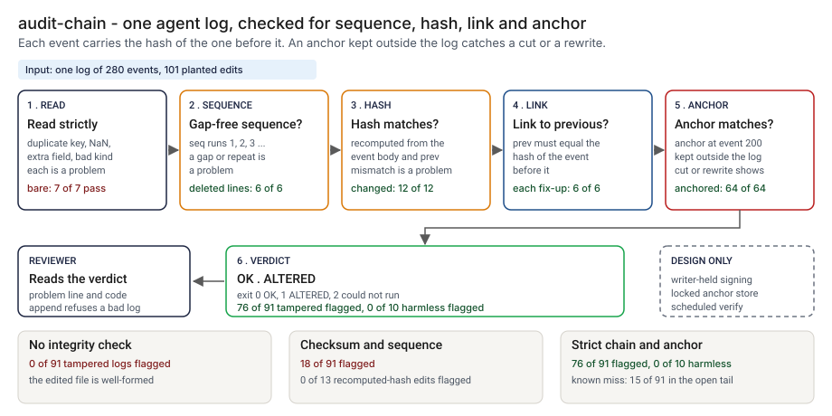

# Architecture: audit-chain (hash-chained log)

> **Status.** This is the design for a production shape. The repo implements the product mechanic as a prototype: a command, `src/audit_chain.py`, that writes an append-only JSON-lines log in which each event carries the hash of the one before it, and verifies it with an optional anchor, run here against 101 planted edits of one synthetic log of 280 events. Nothing below is claimed as deployed or load-tested. Where a figure is a design target, it says so.

GCP is primary; AWS and Azure sit beside it.



---

## 1. Logical architecture

audit-chain is a log format and a verifier. The writer appends events; the verifier says whether anything shows a sign of alteration. It cannot say the log is complete or true.

Eight components: five in the prototype, three design only.

| Component | Responsibility | Language or framework | Decides the outcome? | Stateful? |
| --- | --- | --- | --- | --- |
| `ac-ingest` | Reads lines strictly. A duplicate key, extra field, unknown kind or NaN is a problem. | Python 3.9+, standard library. Prototype: `read_lines`, `_parse_line`, `_check_event` in `src/audit_chain.py` | Yes | No |
| `ac-writer` | Appends one event with `seq`, `prev` and `hash`; no update or delete. Refuses to extend a log that does not verify. | Python. Prototype: `AuditLog.append`, `digest`, `dumps_event`, `run_append` | Yes, it defines the bytes | Stateful, the log file |
| `ac-verify` | Checks sequence, hash and link per event, then the anchor. | Python. Prototype: `verify_lines` | Yes | No |
| `ac-anchor` | Takes and loads an anchor: the sequence number and hash of one event. | Python. Prototype: `make_anchor`, `load_anchor`, `run_anchor` | Yes, it sees a cut or a rewrite | Stateful, kept outside the log |
| `ac-report` | Prints the verdict and up to 10 problems; sets exit 0, 1 or 2. Escapes untrusted strings. | Python. Prototype: `render`, `escape`, `run_verify` | No | No |
| `ac-signer` | Signs each event with a writer-held key, so a forged append fails (design). | A key service (design) | Would decide | Stateful, key |
| `ac-store` | Holds logs and anchors under a retention lock, with different owners (design). | Object storage with a retention lock | No | Stateful |
| `ac-scheduler` | Runs `anchor` and `verify` on a schedule; alerts on a failed or missed run (design). | A scheduled job | No | No |

**What decides the outcome.** The strict read, the three per-event checks and the anchor. The rest carry or run them. The anchor decides whether a cut or a full rewrite is seen, up to the event it names.

**Repo structure** (production shape):

```
audit-chain/
├── chain/      # ingest, writer, verify, anchor, report
├── signer/     # event signing with a writer-held key
├── scheduler/  # verify and anchor jobs
├── infra/      # terraform for gcp, aws, azure
├── docs/runbooks/
└── tests/      # unit, golden, hostile
```

---

## 2. Physical and deployment architecture

The writer is a library inside the agent service; the verifier is a short-lived job. The design rests on separating who can write the log from who can write the anchor.

| Component | GCP (primary) | AWS | Azure | Why |
| --- | --- | --- | --- | --- |
| Writer, one per log | Cloud Run service pinned to one instance, or a GKE StatefulSet | ECS service with a count of one, or an EKS StatefulSet | Container Apps with one replica, or an AKS StatefulSet | The chain has one writer; the prototype has no locking |
| Log copies | Cloud Storage with a bucket lock | S3 with Object Lock | Blob Storage with immutability policy | Old bytes stay as written |
| Anchor store | A separate project, bucket lock | A separate account, Object Lock | A separate subscription, immutability policy | The editor of the log has no write path to it |
| Verify and anchor jobs | Cloud Scheduler to a Cloud Run job | EventBridge Scheduler to an ECS task | A Container Apps job on a schedule | Stateless, exit code to alert |
| Signing key | Cloud KMS | AWS KMS | Azure Key Vault | The key never leaves the service |

**Failure behavior (the decision that matters most).** The verifier must never silently pass. A log it cannot read, or one that is empty, does not become OK: it exits 2 with one line. A line that is cut off or is not an event counts as a sign of alteration, because that is what a damaged log is.

| Failure | Behavior | Alert |
| --- | --- | --- |
| Log missing, unreadable or a directory; anchor not JSON or malformed | Exit 2, one line naming the file | P3; P2 if repeated |
| Log empty | Exit 2, noting an emptied log looks the same without an anchor; with an anchor, `shorter_than_anchor`, exit 1 | P2 |
| A line cut off, not JSON or not an event; a bad hash, link or sequence; a strict-read problem; an anchor mismatch or too few events | Problem with line number and code; exit 1; first 10 shown, the rest counted | P1 page to security on a production log |
| No `--anchor` given | Verdict can be OK, and the output says events cut from the end would not be noticed | P3 in production |
| `append` or `anchor` on a log that does not verify | Refuses, prints the problems, leaves the file alone, exit 1 | P2 |
| Two writers | The chain forks and `verify` reports it; there is no locking | P2 |
| A scheduled run never happens (design) | A missed run is an alert | P2 |

---

## 3. Data architecture

| Entity | Key | What it holds | Real fields in the prototype |
| --- | --- | --- | --- |
| Event | `seq` within one log | One agent action, hash-linked to the one before it | `seq`, `case_id`, `step`, `kind`, `actor`, `detail`, `prev`, `hash`; the hash covers the first six |
| Anchor | log, `seq` | The sequence number and hash of one event | `version` (1), `seq`, `hash` in `data/example_anchor.json` |
| Verify report | log, run | Events read, head hash, problems (`line`, `seq`, `code`, `message`) | `verify_lines`; codes seen in step 4 include `hash_mismatch`, `link_broken`, `seq_gap`, `anchor_mismatch`, `shorter_than_anchor`, `duplicate_key`, `extra_field` |
| Action input | `case_id`, `step` | The actions the log is built from | `data/actions.csv`: `case_id`, `step`, `kind`, `actor`, `detail_json` |
| Planted edit | `tamper_id` | The edit, where it starts, whether it touches an anchored event, and whether it is harmful | `data/tamper_plan.csv`: `tamper_id`, `op`, `seq`, `count`, `region`, `truth`. Synthetic data only |

**Retention** is a design choice, not a measurement; confirm it against the bank's own schedule. 🔴 Design default: logs and anchors for 7 years under a retention lock, and the verify results with them.

**Lineage.** A verdict traces back in three hops: the report names a line and a code; the line is one event, with its `case_id`, `step` and `prev`; and the chain links that event to every one before it, back to the genesis value. The hash is defined over Python's JSON encoding, so a writer in another language must reproduce it exactly.

**Deliberately not stored.** Customer content and free text. The design asks `detail` to carry references, such as case and document ids.

---

## 4. Security architecture

**Identity and roles.** Separation of write paths is the control. `ac:writer` appends to its own log and cannot write the anchor store. `ac:custodian` writes anchors and cannot write a log. `ac:verifier` and `ac:auditor` read. `ac:admin` manages roles and locks and cannot edit stored bytes.

**Secrets.** The prototype holds none. In the design the signing key lives in a key service, and only the writer's identity can ask it to sign.

**Data classification and what leaves the boundary.** Case ids, actor ids and `detail` text are confidential. In the prototype nothing leaves the machine. In the design the log copies and anchors go to locked storage, and the exit code and alert leave the job.

| Threat | Example | Mitigation in the design |
| --- | --- | --- |
| An event is changed, removed, reordered or inserted | An approval flipped from declined to approved | Hash, link and sequence checks name the line. 🟢 The bare chain flags 48 of 91 and the strict chain with an anchor 76 of 91 (`step_03_deficiencies_exposed.py`, `step_04_chain_and_anchor.py`) |
| Every hash after the edit is recomputed, or the log is cut from the end | A full rewrite; the last 10 events removed | The anchor shows both, up to the anchored event. After the last anchor only the chain protects the log, so the interval is the attacker's window |
| The anchor is edited by the person who edits the log | Both files changed together | A custodian with a different owner and a retention lock; the writer has no path to the anchor store |
| A forged append | A new event written with the algorithm | The prototype cannot tell it from a real one. The design signs events with a writer-held key |
| Hostile string in a log field echoed into the output | A `case_id` or key holding a newline and a fake `verdict: OK` | `escape` rewrites `%` and every control character before printing. `tests/test_cli.py` checks that text from the log cannot start a new output line, and that a hostile key and path are escaped |
| One line that parses to two values | A duplicate key read differently by another reader | The strict read flags it. 🟢 The bare chain passes 7 of 7 duplicate-key lines (`step_03_deficiencies_exposed.py`) |

---

## 5. Operational architecture

**SLIs.** Scheduled verifies that ran and their exit codes; problems by code; age of the last good verify; age of the last anchor and the open tail in events; append refusals. Prototype baseline: 🟢 15 of 91 planted edits pass, all in the open tail (`step_04_chain_and_anchor.py`).

**SLOs (all 🔴 design targets, none measured).**
- A failed scheduled verify alerts within 15 minutes (I have not timed the prototype).
- An anchor is taken at least as often as the policy interval, which is a choice for the security reviewer and not a number I measured.
- Every ALTERED verdict on a production log is read by a named person within one business day (planning estimate).

**Alerts.** P1: exit 1 on a production log (page to the security reviewer). P2: a missed or twice-failed scheduled run, a log that is empty, a second writer, an append refused. P3: exit 2 once, a run with no anchor. P4: a weekly digest of anchors and tail lengths.

**Runbooks** (one page each, in `docs/runbooks/`):
- `log-altered.md`: copy the bytes, read the first problem, compare with the locked copy and the anchor, open an incident.
- `anchor-custody.md`: take, store and rotate anchors.
- `append-refused.md`: a log that does not verify; do not edit it, find the first problem.
- `second-writer.md`: how a fork shows and how to resolve it.

**On-call and ownership.** The engineer who owns the agent owns the writer and the runbooks. The security reviewer owns custody and the interval. The platform team owns the storage and the schedule.

**Change control.** The hash definition is a contract. A change to it is a new log format with a new version, never an edit in place, since every old log would fail. Before merge the planted edits are re-run against `tests/test_golden.py`, so a change that moves a count shows in the diff.

---

## 6. Alignment and posture

Alignment, not certification. The README's "Aligned to" section cites one source, restated with the same wording about what was read: the [NIST AI Risk Management Framework 1.0](https://airc.nist.gov/airmf-resources/airmf/5-sec-core/) (2023), the MANAGE function, whose Core page on NIST's AI Resource Center I read on 2026-10-23. Subcategory MANAGE 4.3 asks that incidents and errors are communicated to relevant AI actors and that the processes for tracking, responding to and recovering from them are followed and documented. The framework does not prescribe a log format or a hash chain.

- **What the design does.** An incident record is useful in review only if the reviewer can tell it was not changed afterwards. This is one way to give them that check.
- **What it does not claim.** It makes no claim of conformity to the framework or any other standard, holds no certification, and I have not read or mapped any other source.

---

## 7. What is deliberately not here

- **A forged append.** 🟢 0 of 6 forged appends are flagged and 6 of 6 legitimate appends accepted (`step_03_deficiencies_exposed.py`). Telling them apart needs a writer-held key, which I have not built.
- **The open tail.** 🟢 15 of 91 planted edits pass, all after the last anchor: 6 forged appends, 4 full rewrites, 4 cuts that keep every anchored event, and the edit of the last event with its own hash recomputed (`step_04_chain_and_anchor.py`).
- **A safe place for the anchor.** The tool writes and reads an anchor file; it does not store it.
- **An action that was never logged.** The check against an orchestrator's own counts is not copied here.
- **Time.** The sequence number shows order, not time. A timestamp in `detail` is only as true as the writer.
- **Several writers.** There is no file locking, and `append` reads the whole file each time.
- **Another language's hash.** The encoding is Python's JSON; a log from another language is untested.

---

## Appendix: sample contract

```bash
python3 audit_chain.py append agent.jsonl --case C0001 --kind case_start --detail '{"source": "queue_a"}'
python3 audit_chain.py anchor agent.jsonl --out anchor.json
python3 audit_chain.py verify agent.jsonl --anchor anchor.json
```

Exit status of `verify`: 0 for no sign of alteration, 1 for a sign of it, 2 when it could not run.
