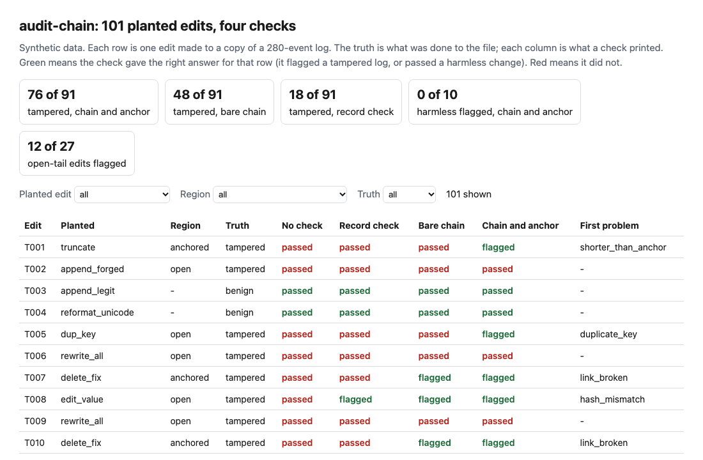
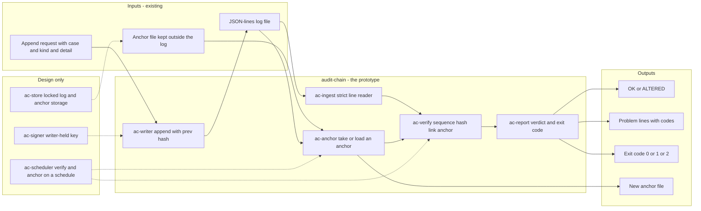
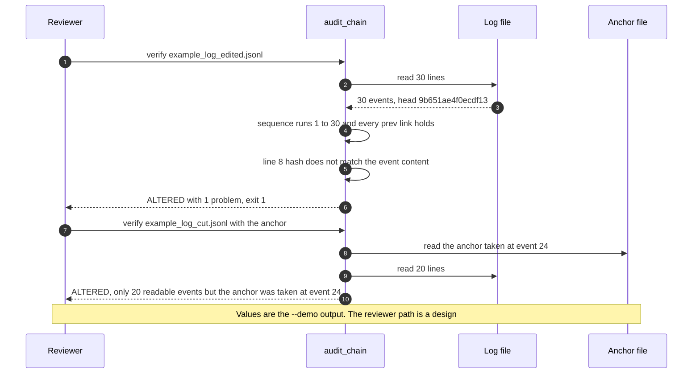

# 🔗 audit-chain (hash-chained log): an append-only trail for agent actions, checked with one command

**I wanted to know how much of an agent's audit trail a reviewer can trust once someone with write access to the file wants it to say something else, and which edits a single command can find. This is a command-line tool: an append-only JSON-lines log where each event carries the hash of the one before it, a `verify` command, and an anchor you keep outside the log. I took the log from the [AgentKit audit module](../27-agentkit-reference-agent-and-playbook/) and attacked it with 101 planted edits.** The chain finds a changed, removed, reordered or inserted event anywhere in the file, except that the last event can be rewritten with its own hash recomputed. It cannot see a cut from the end or a rewrite that recomputes every hash; an anchor can, but only up to the event it was taken at.

**▶ Static demo, no install:** [open demo.html](./demo.html)

[](./demo.html)

## Executive summary (90 seconds)

**Problem.** An agent at a modeled bank acts on cases, and the only record of what it did is a file its own operators can edit. The engineer who owns the agent's logging, and the reviewer or auditor who has to rely on the file after an incident, cannot tell whether what they read is what the agent wrote. 🟢 On one synthetic log of 280 events with 101 planted edits, 91 of them tampering, a log with no integrity check flags 0 of 91 tampered copies, and an approval changed from declined to approved is still a well-formed event (`step_01_no_integrity_check.py`). The incident review rests on a trail that nothing could have checked.

**Product.** audit-chain is a command and a small library. It writes agent actions as an append-only JSON-lines log in which each event carries the SHA-256 hash of the one before it, with no update or delete. `verify` reads the log strictly (a duplicate key, a field outside the hash, an unknown kind or a NaN is a problem), checks that the sequence runs from 1 without a gap, recomputes each hash, checks each link to the event before it and, when given an anchor, checks the event the anchor names. `anchor` records the sequence number and hash of one event, to be kept where the log's writer cannot edit it. `append` refuses to extend a log that does not verify. Exit 0 means nothing shows a sign of alteration, 1 means something does, 2 means it could not run. There is no model call and no signing key.

**Measured and modeled performance.**

- 🟢 **No integrity check: 0 of 91 tampered logs flagged,** and 0 of 10 harmless changes (`step_01_no_integrity_check.py`).
- 🟢 **A checksum on each event plus a sequence check flags 18 of 91:** all 12 changed values and all 6 deleted lines, and none of the 13 value edits where the hash was recomputed (`step_02_record_checksums.py`).
- 🟢 **The bare chain flags 48 of 91.** It closes the renumbered delete, the swap and the insert, and 12 of 13 recomputed edits; it still passes all 12 full rewrites, all 10 cuts and all 6 forged appends (`step_03_deficiencies_exposed.py`).
- 🟢 **The strict chain check plus an anchor at event 200 flags 76 of 91:** 64 of 64 edits that touch event 200 or earlier and 12 of 27 that only touch the open tail after it. It flags 0 of 10 harmless changes (`step_04_chain_and_anchor.py`).
- 🟢 **Known misses: 15 of 91 pass,** all in the open tail: 6 forged appends, 4 full rewrites, 4 cuts that keep every anchored event, and the edit of the last event with its own hash recomputed (`step_04_chain_and_anchor.py`).
- 🟢 **A forged append and a real one are the same bytes:** 0 of 6 forged appends flagged, 6 of 6 legitimate appends accepted (`step_03_deficiencies_exposed.py`).
- 🟡 **Utility: (76/91 − 18/91) × 20 = 12.7 tampered logs a year caught that a checksum with a sequence check would pass,** assuming 20 altered logs reach a review each year.
- 🔴 **Design target: a scheduled verify with an alert within 15 minutes of a failed run.** Designed in [`ARCHITECTURE.md`](./ARCHITECTURE.md), never built or timed.

**What I would ask a head of operations to decide.** Whether an agent's audit trail should be verifiable by someone other than the people who can write to it, and who holds the anchor. My recommendation is to adopt the chain for any agent whose log a reviewer will rely on, keep the anchor in a place the log's editor cannot reach, and take an anchor at a fixed interval, since whatever is written after the last anchor is protected by the chain alone. The interval is a policy choice and not something I measured.

**Call to action.** Fork the repo. Point `verify` at any JSON-lines log written with the event layout in `src/audit_chain.py`, or start one with `append`; take an anchor with `anchor` and keep it outside the log's reach. To call it from code, use `AuditLog` to write and `verify_lines` and `make_anchor` to check. To rerun the comparison on your own actions, replace `data/actions.csv`. Send findings by opening an issue: say which problem code fired and on how many lines, not the log itself.

_A portfolio prototype on synthetic data. Nothing here is deployed, load-tested or used by anyone._

## Run one now

```bash
cd 34-audit-chain/src && python3 audit_chain.py --demo
```

It prints:

```text
[a log nobody touched]
verify: example_log.jsonl   30 events   head 9b651ae4f0ecdf13
  anchor at event 24: hash matches
verdict: OK
[one approval changed after the fact]
verify: example_log_edited.jsonl   30 events   head 9b651ae4f0ecdf13
  line 8 (seq 8): hash does not match the event content
verdict: ALTERED (1 problem)
[the last 10 events removed]
verify: example_log_cut.jsonl   20 events   head 04bcf6997c76c5ba
  log: only 20 readable events, but the anchor was taken at event 24; events were removed or cannot be read
verdict: ALTERED (1 problem)
```

Standard library only, Python 3.9 or newer. To use it on your own agent:

```bash
python3 audit_chain.py append agent.jsonl --case C0001 --kind case_start --detail '{"source": "queue_a"}'
python3 audit_chain.py anchor agent.jsonl --out anchor.json      # keep this file where the log's editor cannot reach
python3 audit_chain.py verify agent.jsonl --anchor anchor.json
```

`verify` exits 0 when nothing in the log shows a sign of alteration, 1 when something does (including a line that is cut off or is not an event), and 2 when it could not run: a missing or empty file, a bad anchor, bad arguments. Without `--anchor` it says in its output that events removed from the end would not be noticed.

## What the numbers say

**What it shows** (🟢 measured on synthetic data: one log of 280 events and 101 planted edits, each applied to its own copy; the script is named in brackets):

- 🟢 No integrity check: 0 of 91 tampered logs flagged, and the edited file still holds well-formed events (`step_01`)
- 🟢 A checksum on each event plus a gap-free sequence check flags 18 of 91: all 12 changed values and all 6 deleted lines. It flags 0 of 13 value edits where the hash was recomputed, and 0 of 6 renumbered deletes, 0 of 6 swaps and 0 of 6 inserts (`step_02`)
- 🟢 The bare chain, as the AgentKit module shipped it, flags 48 of 91. It closes the renumbered delete, the swap and the insert, and 12 of 13 value edits with the hash recomputed; the one that passes is the edit of event 280, the last, because nothing after it holds its hash (`step_03`)
- 🟢 The bare chain still passes all 7 duplicate-key lines, all 7 lines with a field outside the hash, all 12 full rewrites, all 10 cuts and all 6 forged appends (`step_03`)
- 🟢 The strict chain check plus an anchor at event 200 flags 76 of 91: 64 of 64 edits that touch event 200 or earlier and 12 of 27 that only touch the open tail after it. It flags 0 of 10 harmless changes (`step_04`)

## What it still gets wrong

- 🟢 15 of 91 planted edits pass step 4, all in the open tail: 6 forged appends, 4 full rewrites, 4 cuts that keep every anchored event, and the edit of the last event with its own hash recomputed (`step_04` prints each group). Whatever is written after the last anchor is protected by the chain alone, so the interval between anchors is the window an attacker has.
- 🟢 A forged append and a real one are the same bytes: 0 of 6 forged appends flagged, 6 of 6 legitimate appends accepted (`step_03`). Telling them apart needs a key held by the writer, so a forged event fails to verify. I have not built that.
- **The anchor is only as good as where you keep it.** If the person who can edit the log can also edit the anchor, nothing is detected. The tool writes and reads an anchor file; it does not store it anywhere safe.
- **An action that was never logged leaves no trace.** AgentKit checks the log against the orchestrator's own counts; I did not copy that check here.
- **The sequence number is not a clock.** The chain shows order, not time. A timestamp in `detail` is only as true as the writer.
- **Single writer.** There is no file locking. Two writers fork the chain, and `verify` reports it. `append` reads the whole file each time.
- **The hash is defined over Python's JSON encoding** (sorted keys, compact separators, ASCII). The generator in `data/` is a second writer, but it is also Python. I have not tested a log written by another language.
- **The planted edits and the checks share an author.** I chose which edits to plant and wrote the rules, so 76 of 91 shows the checks cover what I thought of, not what an attacker would try. The set includes the cases I expected to miss and the harmless rewrites I expected to pass, but it is a ceiling, not a rate on real logs.

## How the four steps fit

| Step | Question | Script |
|---|---|---|
| 1 | What does a reader get from a log with no integrity check? | `step_01_no_integrity_check.py` |
| 2 | What does a checksum on each event, plus a sequence check, catch? | `step_02_record_checksums.py` |
| 3 | Where does that fail, and where does the bare chain still fail? | `step_03_deficiencies_exposed.py` |
| 4 | What does the strict chain check plus an anchor catch? | `step_04_chain_and_anchor.py` |

Run any of them from `src/`. The tool is `src/audit_chain.py`; `src/common.py` holds the planted edits and the weaker checks the steps compare against. Data is generated by [`data/_generate.py`](./data/README.md); `tools/check_repo.py` confirms that a rerun reproduces every file and that the green numbers above appear in a script's output. There are 80 unit tests, including a golden test that pins the step 4 numbers, tests for empty, wrong-type and cut-off input, and tests with hostile strings in the log.

What I took from the earlier projects: the event layout, the event kinds and the hash from [27 AgentKit](../27-agentkit-reference-agent-and-playbook/), and the problem from [09 LineageLog](../09-lineagelog-ai-decision-audit/). The 09 exam pack describes its record as immutable and hash-anchored, but its code sets `immutable: True` as a literal and carries a placeholder policy hash; nothing in it computes a digest. This project is a check that could back a claim like that. The code in `src/audit_chain.py` is changed from AgentKit's in three ways, listed at the top of the file: `detail` is a dict argument, the log is read strictly, and an anchor can be taken and checked.

## Utility delivered

The way I price product impact: **utility = (my solution − current state of the art) × the number of people or items it affects.**

Here the item is an altered log: an edit made after the fact by someone with write access, which lands on the reviewer or auditor who has to rely on the trail. The common basic approach is a checksum on each event with a gap-free sequence check; the table prices the strict chain and an anchor against it.

| Term | Value | Where it comes from |
| --- | --- | --- |
| Current state of the art (checksum on each event plus a sequence check), tampered logs flagged | 🟢 **18 of 91** | `step_02_record_checksums.py`; it flags 0 of 10 harmless changes |
| My solution (strict chain check plus an anchor at event 200), tampered logs flagged | 🟢 **76 of 91** | `step_04_chain_and_anchor.py`; it flags 0 of 10 harmless changes |
| Lift per altered log | 🟢 76 of 91 minus 18 of 91 | The checksum passes the renumbered delete, the swap, the insert and the recomputed-hash edit, by planted edit: delete_fix 6, swap_fix 6, insert_fix 6, edit_rehash 13 (`step_03_deficiencies_exposed.py`) |
| Number it affects: altered logs reaching a review in a year | 🟡 **20** | **Assumption, not a statistic.** Replace it with your own count of agent logs a year that someone with write access might have changed |
| Assumption that makes the lift real | 🟡 The anchor is kept where the log's editor cannot reach it, and edits fall at or before the anchored event | If the editor can also edit the anchor, nothing is detected; with no anchor the bare chain flags 🟢 48 of 91 (`step_03_deficiencies_exposed.py`), and the 27 edits after the anchor are caught 12 of 27 (`step_04_chain_and_anchor.py`) |
| **Utility** | 🟡 **(76/91 − 18/91) × 20 = 12.7 tampered logs a year caught that a checksum with a sequence check would pass** | Assumes the 20 look like the 91 planted ones |

Sensitivity to the count assumption (🟡, same lift): 10 altered logs a year gives 6.4, 20 gives 12.7, 40 gives 25.5.

🔴 What I have not measured: how often a real log is altered, what an undetected alteration costs, how long a reviewer needs with and without the check, or how an attacker who knows the algorithm would behave. The planted set was written by the author of the checks and includes the cases I expected to miss, so 76 of 91 is a ceiling for these checks, not a detection rate.

---

## Architecture and call flow

Component names match [`ARCHITECTURE.md`](./ARCHITECTURE.md). GitHub renders the diagrams natively.


**System topology:**



**Per-run sequence** (the `--demo` run: an edited log, then a cut log checked against an anchor):



**Interlocks (all red, designed, none built):**

- [27 AgentKit](../27-agentkit-reference-agent-and-playbook/) is where the event layout, the event kinds and the hash come from. This folder copies them and changes three things, listed at the top of `src/audit_chain.py`; it does not import 27.
- [09 LineageLog](../09-lineagelog-ai-decision-audit/) is where the problem came from. In the design, its record would call `verify` before a reviewer relies on it.
- [05 AgentWatch](../05-agentwatch-agent-observability/) is a possible consumer: an alert when a scheduled `verify` exits 1.

---

## PM artifacts

The PM artifacts that show how I would run this product if I owned the seat. This README is the walkthrough; the rest of the folder holds:

- [`PRD.md`](./PRD.md): the product requirements doc, with users, backlog, KPIs, rollout and open questions.
- [`ARCHITECTURE.md`](./ARCHITECTURE.md): the systems doc, with components, data model, security, failure behavior and operations. A design, not deployed.
- [`demo.html`](./demo.html): clickable, no-install walkthrough, built from the step outputs by `src/_build_demo.py`.
- [`data/`](./data/): the synthetic actions, the 101 planted edits and the worked example logs, and the seeded generator. `data/README.md` explains how the truth is set.
- [`src/`](./src/): `audit_chain.py`, `common.py`, the four step scripts and the demo builder.
- [`tests/`](./tests/): 80 unittest tests, including a golden test that pins the numbers above and tests for empty, wrong-type and cut-off input and for hostile strings in the log.

Run the four steps end to end:

```bash
cd src
python3 step_01_no_integrity_check.py
python3 step_02_record_checksums.py
python3 step_03_deficiencies_exposed.py
python3 step_04_chain_and_anchor.py
```

---

## Aligned to

The [NIST AI Risk Management Framework 1.0](https://airc.nist.gov/airmf-resources/airmf/5-sec-core/) (2023), the MANAGE function. I read the Core page on NIST's AIRC site on 2026-10-23; a banner on it says AI RMF 1.0 is being updated. Subcategory MANAGE 4.3 asks that incidents and errors are communicated to relevant AI actors and that the processes for tracking, responding to and recovering from them are followed and documented. The framework does not prescribe a log format or a hash chain. My reading is narrower: an incident record is only useful in review if the reviewer can tell it was not changed afterwards, and this tool is one way to give them that check. It is a prototype, aligned to that function. It makes no claim of conformity to that guidance.

## Data and limits

Synthetic, seeded, byte-for-byte reproducible. Nothing comes from any employer, customer or real agent. 🟡 The anchor at event 200 is an assumption I chose for the example; no rule sets that interval. A prototype on synthetic data, not a production case study.

## Fork it

Point `verify` at any JSON-lines log written with the event layout in `src/audit_chain.py`, or start one with `append`. To rerun the comparison on your own actions, replace `data/actions.csv` (columns `case_id`, `step`, `kind`, `actor`, `detail_json`), change `ANCHOR_SEQ` and the plan sizes in `data/_generate.py` to fit the length of your log, and run it. Read the [PRD](./PRD.md) for the scope I held to.

## Prereqs to run this on your laptop

You need Python 3.9 or newer and nothing else. The tool, the four step scripts and the data generator use only the standard library, so there is nothing to install. There is no API key, no network call and no model call anywhere in the folder. To run the tests, use `python3 -m unittest discover -s tests` from this folder. The production pieces in [`ARCHITECTURE.md`](./ARCHITECTURE.md) (the signing key, the locked store, the scheduled verify) are a design, not something you need or can run.

## Author

**Vijay Saharan**, Sr Product / Program Manager · AI in BFSI · Enterprise AI Platforms

[LinkedIn](https://www.linkedin.com/in/vijaysaharan/)
