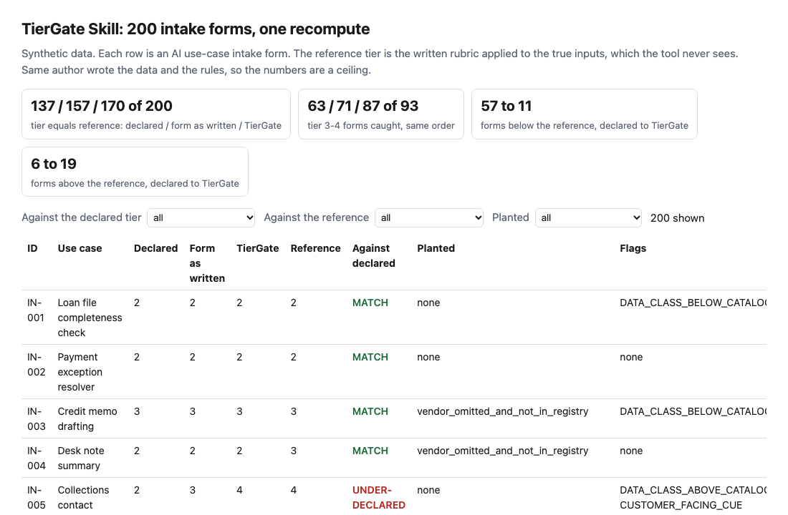
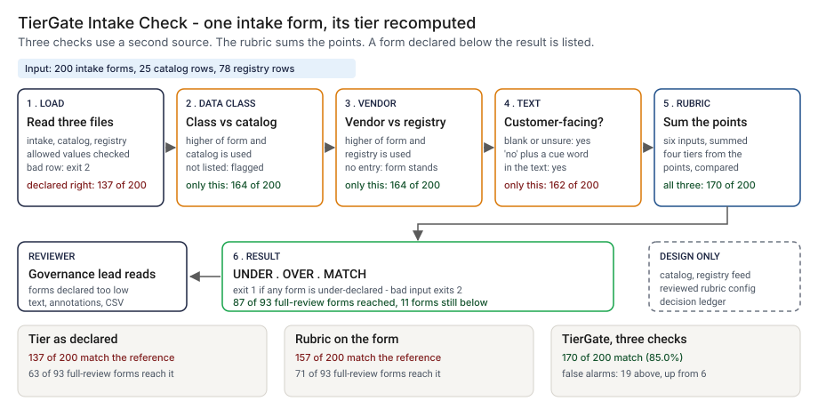
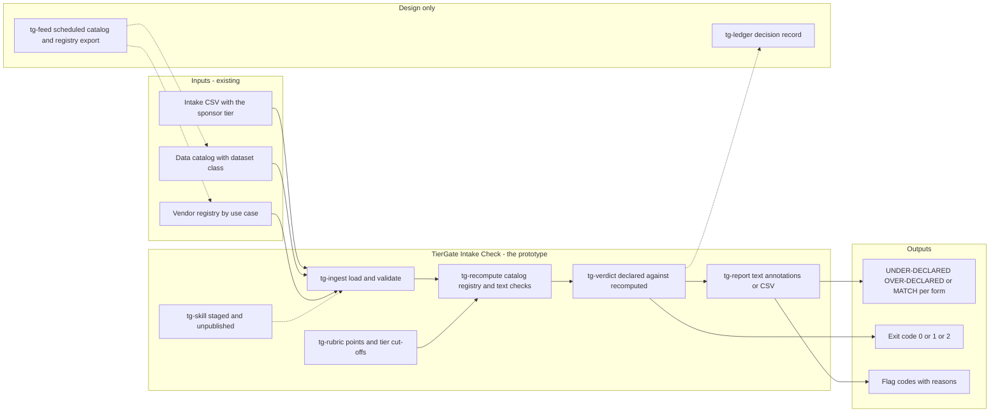
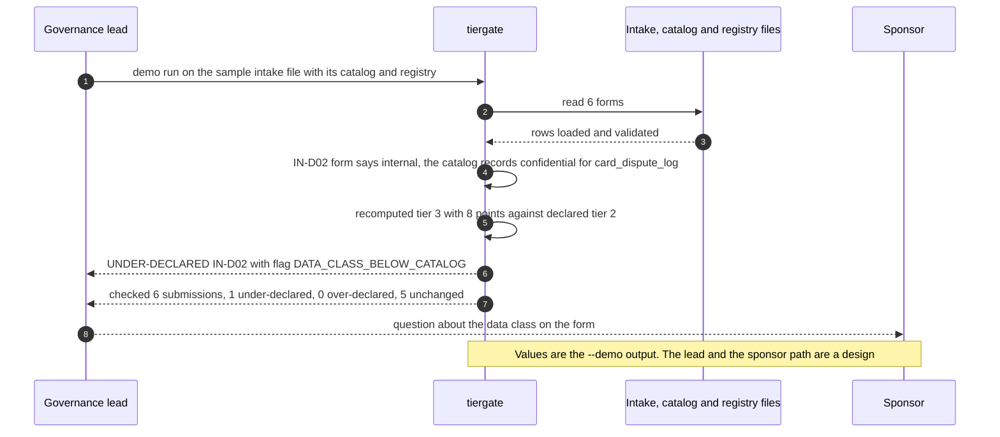

# 🚦 TierGate Skill: recompute the tier a sponsor declared

**I wanted to know how far a sponsor's own risk tier can be trusted at the front door of AI governance, and what a reviewer can recompute in a minute from files that already exist. This is a command-line check and a staged Agent Skill: it reads an intake CSV, recomputes the tier with a written rubric, cross-checks the data class against the data catalog and the vendor model against the vendor registry, and lists every form declared below its recomputed tier.** It lifts the recompute from [11 TierGate](../11-tiergate-ai-usecase-intake/) and adds a command line, an exit code, input checks, GitHub annotations and a skill file. On 200 synthetic forms the declared tier is wrong on 63.

**▶ Static demo, no install:** [open demo.html](./demo.html)

[](./demo.html)

## Executive summary (90 seconds)

**Problem.** At a modeled bank a sponsor fills in an AI intake form and writes the risk tier on it, and the tier sets how deep the review goes. The governance lead who triages the forms and the model risk reviewer who receives the full-review ones see the sponsor's tier and nothing that checks it, while the answers behind it come from the person who benefits from a light review. 🟢 On 200 synthetic forms the declared tier equals the reference tier on 137 (68.5%), 57 are declared below it, and of the 93 forms the reference sends to full review, 30 get the light review (`step_01_declared_tier.py`). A form that should have gone to full review does not, and the miss shows up later or never.

**Product.** TierGate Intake Check is a command and a staged Agent Skill. It reads an intake CSV and applies a written rubric of six inputs, summed into four tiers. It recomputes the tier on the inputs that have a second source: the data class is the higher of the form and the data catalog, the vendor model is the higher of the form and the vendor registry, and the customer-facing answer counts as yes when it is blank or `unsure`, or when the title or description names the people served. It prints every form whose declared tier is below the recomputed tier, with the reason, and exits 1 when there is one and 2 for malformed input. The skill file tells an agent how to run the command and what to say about its limits. There is no model call in the command.

**Measured and modeled performance.**

- 🟢 **The declared tier is taken as given:** it equals the reference on 137 of 200 forms (68.5%), 57 are below and 6 above, and 63 of 93 full-review forms reach full review (67.7%) (`step_01_declared_tier.py`).
- 🟢 **Re-adding the rubric on the form as written gets 157 of 200 (78.5%)** and 71 of the 93 full-review forms (76.3%) (`step_02_rescore_the_form.py`).
- 🟢 **Each check alone:** catalog only 164 of 200 and 81 of 93; registry only 164 and 74; text rules only 162 and 76, with 12 forms above the reference (`step_03_deficiencies_exposed.py`).
- 🟢 **All three together: 170 of 200 (85.0%) and 87 of 93 full-review forms (93.5%).** Forms below the reference fall from 57 to 11; against what the sponsors declared, 63 forms are under-declared and 4 over-declared (`step_04_with_tiergate.py`).
- 🟢 **The recompute buys its recall with false alarms:** forms above the reference rise from 6 to 19, and 15 of those 19 carry a planted hard negative (`step_04_with_tiergate.py`).
- 🟢 **Known misses:** 11 of 200 forms stay below the reference, 8 of them with a vendor dependency missing from the form and the registry; 9 of 200 (4.5%) have a wrong class and no second source that disagrees (`step_04_with_tiergate.py`, `step_03_deficiencies_exposed.py`).
- 🟡 **Utility: (87/93 − 71/93) × 150 = 25.8 full-review forms a year routed to full review that the rubric on the form as written would send to the light review,** assuming 150 full-review forms reach the front door each year.
- 🔴 **Design target: a result within 60 seconds of an intake export landing.** Designed in [`ARCHITECTURE.md`](./ARCHITECTURE.md), never built or timed.

**What I would ask a head of operations to decide.** Whether a sponsor's tier should be recomputed from the data catalog and the vendor registry before a form is routed, and who owns those two sources. My recommendation is to run it in advisory mode on one real intake export, treat UNDER-DECLARED as a question to the sponsor and not a rejection, and decide whether a blank or `unsure` answer should count as customer-facing; I made it so, and it raises forms above the reference.

**Call to action.** Fork the repo. Swap `data/intake_submissions.csv`, `data/data_catalog.csv` and `data/vendor_registry.csv` for your own exports and keep the visible columns, then point `check` at the three files. To call it from code, import `read_intake`, `read_catalog`, `read_registry` and `run_check` from `src/tiergate.py`. The rubric is at the top of that file, and `data/_generate.py` keeps its own copy to score the truth. Send findings by opening an issue: say which flag code fired and on how many forms, not the form text.

_A portfolio prototype on synthetic data. Nothing here is deployed, load-tested or used by anyone, and the skill is staged and has not been loaded into an agent runtime._

## Run one now

```bash
cd 35-tiergate/src && python3 tiergate.py --demo
```

It prints:

```text
UNDER-DECLARED  IN-D02  Card dispute drafting aide  declared tier 2, recomputed tier 3 (8 points)
  DATA_CLASS_BELOW_CATALOG  form says internal; the catalog records confidential for card_dispute_log; using confidential
checked 6 submissions: 1 under-declared, 0 over-declared, 5 unchanged
```

Standard library only, Python 3.9 or newer. To check your own files: `python3 tiergate.py check intake.csv --catalog catalog.csv --registry registry.csv`. It exits 1 when a form is declared below its recomputed tier, 2 when the input is malformed (one line on stderr), and `--format github` prints annotations.

## What the numbers say

**What it shows** (🟢 measured on synthetic data: 200 planted intake forms; the script is named in brackets):

- 🟢 The declared tier equals the reference tier on 137 of 200 forms (68.5%); 57 are declared below it and 6 above. Of 93 forms the reference sends to full review, 63 (67.7%) get there and 30 get the light review (`step_01`)
- 🟢 Re-adding the rubric points on the form as written gets 157 of 200 (78.5%) and 71 of the 93 full-review forms (76.3%) (`step_02`)
- 🟢 One check at a time: catalog only 164 of 200 and 81 of 93; registry only 164 and 74; text rules only 162 and 76, with 12 forms above the reference (`step_03`)
- 🟢 All three together: 170 of 200 (85.0%), 87 of 93 full-review forms (93.5%), forms below the reference 57 down to 11, forms above it 6 up to 19 (`step_04`)
- 🟢 Against what the sponsors declared, 63 forms are under-declared and 4 over-declared; 133 are unchanged (`step_04`)

## What it still gets wrong

- 🟢 11 of 200 forms stay below the reference after the recompute, and `step_04` prints each one: 8 have a vendor dependency that is missing from the form and from the registry, 2 have a data class understated on the form while the catalog entry is stale, and 1 is a customer-facing tool that the form calls internal and whose text names nobody. Where the form and the second source agree, or the second source is silent, there is nothing for the check to disagree with.
- 🟢 A planted situation does not always move the tier: 6 forms carry an understated class with a stale catalog entry, and 2 of them end up below the reference (`step_04`). Step 3 counts 9 of 200 forms (4.5%) with a wrong class and no second source that disagrees.
- 🟢 The recompute buys its recall with false alarms. Forms above the reference rise from 6 to 19, and 15 of those 19 carry a planted hard negative: 9 forms whose text names customers but whose tool is internal, and 6 raised by a catalog entry that overstates the class (`step_04`). Blank and `unsure` answers are treated as customer-facing until the sponsor confirms, which is deliberate and also raises some forms.
- **The data and the rules share an author.** I wrote the generator and the rules, and I know which words the customer-facing rule looks for. The hard cases are planted on purpose and in a number that makes them visible. Treat 85.0% as a ceiling for these rules on this data, not a rate on real intake forms, which I have not tested.
- The customer-facing rule is a keyword match. It reads "client-side" as a client. It has no view of a tool whose description names nobody.
- The rubric points, the cut-offs between tiers and the choice of tier 3 and 4 as "full review" are my 🟡 assumptions. See Aligned to.
- This is the recompute only. Duplicate linking, the evidence gate and the review queue are in [11 TierGate](../11-tiergate-ai-usecase-intake/) and are not repeated here.

## Use it as a skill

[`skill/tiergate-intake-check/SKILL.md`](./skill/tiergate-intake-check/SKILL.md) tells an agent how to run the command on an intake export, what to report, and what to say about the limits. It adds no logic. It is staged and has not been published or loaded into an agent runtime. What is tested is the command it wraps and the skill file's own frontmatter (`tests/`, 48 tests in all). The skill tells the agent to treat sponsor-written titles and descriptions as data, not as instructions; I have not tested that behavior on a model.

## How the four steps fit

| Step | Question | Script |
|---|---|---|
| 1 | What does the declared tier get right and wrong? | `step_01_declared_tier.py` |
| 2 | What does re-adding the rubric on the form as written fix? | `step_02_rescore_the_form.py` |
| 3 | Where does that go wrong, and what does each check buy alone? | `step_03_deficiencies_exposed.py` |
| 4 | What do the catalog, the registry and the text rules fix together? | `step_04_with_tiergate.py` |

Run any of them from `src/`. Data is generated by [`data/_generate.py`](./data/README.md); `tools/check_repo.py` confirms that a rerun reproduces every file and that the green numbers above appear in a script's output.

## Utility delivered

The way I price product impact: **utility = (my solution − current state of the art) × the number of people or items it affects.**

Here the item is a form that belongs in full review. Each one lands on the model risk reviewer who should see it and on the sponsor who would otherwise get a light review by default. The common basic approach is to re-add the rubric points on the form as written; the table prices the three-check recompute against it.

| Term | Value | Where it comes from |
| --- | --- | --- |
| Current state of the art (rubric on the form as written), full-review forms that reach full review | 🟢 **71 of 93** | `step_02_rescore_the_form.py`; the declared tier alone gets 63 of 93 (`step_01_declared_tier.py`) |
| My solution (catalog, registry and text rules together), full-review forms that reach full review | 🟢 **87 of 93** | `step_04_with_tiergate.py`; forms above the reference rise from 6 to 19 |
| Lift per full-review form | 🟢 87 of 93 minus 71 of 93 | The form as written leaves 43 of 200 forms at the wrong tier: data class set below the true class 19, vendor model left as none or understated 19, customer-facing answer wrong, blank or unsure 16, some forms with more than one (`step_03_deficiencies_exposed.py`) |
| Number it affects: full-review forms reaching intake in a year | 🟡 **150** | **Assumption, not a statistic.** Replace it with your own count of intake forms a year that belong in full review |
| Assumption that makes the lift real | 🟡 The catalog and the registry are kept current, and the sponsor's wrong answer is not wrong in the second source too | Where the form and the catalog are both wrong, or the dataset has no entry, the check has nothing to disagree with: 🟢 9 of 200 forms (4.5%) (`step_03_deficiencies_exposed.py`) |
| **Utility** | 🟡 **(87/93 − 71/93) × 150 = 25.8 full-review forms a year routed to full review that the rubric on the form as written would send to the light review** | Assumes the 150 behave like the 93 planted ones |

Sensitivity to the count assumption (🟡, same lift): 75 forms a year gives 12.9, 150 gives 25.8, 300 gives 51.6.

🔴 What I have not measured: what a form routed to the wrong depth costs, how long a reviewer spends on a flagged form, how stale a real catalog or registry is, or how real sponsors write descriptions. The cost side is the 19 forms above the reference, a reviewer's time spent on forms that did not need it. The reference tier is the rubric on the true inputs, so every figure measures recovery of that result from noisy forms, not how a bank tiers its use cases.

---

## Architecture and call flow

Component names match [`ARCHITECTURE.md`](./ARCHITECTURE.md). GitHub renders the diagrams natively.



**System topology:**



**Per-run sequence** (the `--demo` run on 6 sample forms):



**Interlocks (all red, designed, none built):**

- [11 TierGate](../11-tiergate-ai-usecase-intake/) is where the rubric comes from. This folder copies its points and cut-offs and adds the command line, the exit code and the checks; it does not import 11.
- [32 Evidence Gate](../32-evidence-gate/) reads a registry of use cases and their tiers to set the evidence a pull request owes. In the design, the recomputed tier would be what that registry holds. Neither folder reads the other's files.
- [16 ControlMap](../16-controlmap-ai-obligation-crosswalk/) lists a TierGate feed, where the tier sets the classes an obligation applies to, as a v0.3 item in its own PRD backlog. Nothing here is connected to it.

---

## PM artifacts

The PM artifacts that show how I would run this product if I owned the seat. This README is the walkthrough; the rest of the folder holds:

- [`PRD.md`](./PRD.md): the product requirements doc, with users, backlog, KPIs, rollout and open questions.
- [`ARCHITECTURE.md`](./ARCHITECTURE.md): the systems doc, with components, data model, security, failure behavior and operations. A design, not deployed.
- [`demo.html`](./demo.html): clickable, no-install walkthrough, built from the step outputs by `src/_build_demo.py`.
- [`data/`](./data/): the synthetic intake forms, data catalog and vendor registry, the hidden truth columns, and the seeded generator. `data/README.md` explains how the truth is set.
- [`src/`](./src/): `tiergate.py`, `common.py`, the four step scripts and the demo builder.
- [`tests/`](./tests/): 48 unittest tests across three files, including a golden test that pins the numbers above and tests for bad input and hostile strings.
- [`skill/`](./skill/tiergate-intake-check/SKILL.md): the staged Agent Skill that runs the command. Not published, not loaded into an agent runtime.

Run the four steps end to end:

```bash
cd src
python3 step_01_declared_tier.py
python3 step_02_rescore_the_form.py
python3 step_03_deficiencies_exposed.py
python3 step_04_with_tiergate.py
```

---

## Aligned to

The [FINOS AI Governance Framework](https://air-governance-framework.finos.org/) (v2, 20 October 2025). I read its page [A heuristic approach to identifying GenAI risks](https://air-governance-framework.finos.org/heuristic-assessment.html) on 2026-10-23. It asks a team to assess a use case on factors such as internal or customer-facing users, data sensitivity, third-party or in-house models, and advisory or automated decisions, and it covers applicable regulation. Five of the six rubric inputs here map onto those factors; the financial exposure band is my own addition. The page defines no numeric tiers or scores and suggests qualitative ratings such as Low, Medium and High, given in its last step after controls. This prototype tiers at intake, before any control, so its tier is not that rating, and the points and cut-offs are my 🟡 assumption, not a reading of that text. This is a prototype, aligned to that guidance. It makes no claim of conformity to that guidance.

## Data and limits

Synthetic, seeded, byte-for-byte reproducible. Nothing comes from any employer, customer or real intake process. The reference tier is the rubric applied to the true inputs, so every accuracy figure measures how well a method recovers that result from noisy forms. A prototype on synthetic data, not a production case study.

## Fork it

Swap `data/intake_submissions.csv`, `data/data_catalog.csv` and `data/vendor_registry.csv` for your own exports and keep the visible columns, or skip the data and point `check` at three files from your intake tool. Read the [PRD](./PRD.md) for the scope I held to. The rubric is at the top of `src/tiergate.py`, and `data/_generate.py` keeps its own copy to score the truth; change both, regenerate the data and rerun the steps.

## Prereqs to run this on your laptop

You need Python 3.9 or newer and nothing else. The command, the four step scripts and the data generator use only the standard library, so there is nothing to install. There is no API key, no network call and no model call anywhere in the folder. To run the tests, use `python3 -m unittest discover -s tests` from this folder. The production pieces in [`ARCHITECTURE.md`](./ARCHITECTURE.md) (the catalog and registry feed, the reviewed rubric config, the decision ledger) are a design, not something you need or can run.

## Author

**Vijay Saharan**, Sr Product / Program Manager · AI in BFSI · Enterprise AI Platforms

[LinkedIn](https://www.linkedin.com/in/vijaysaharan/)
