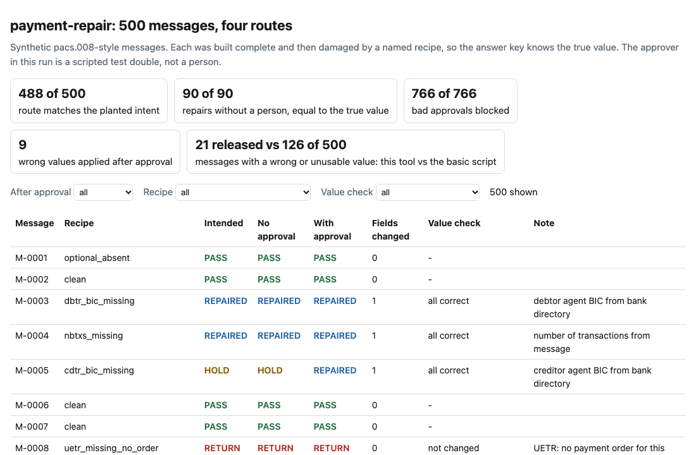
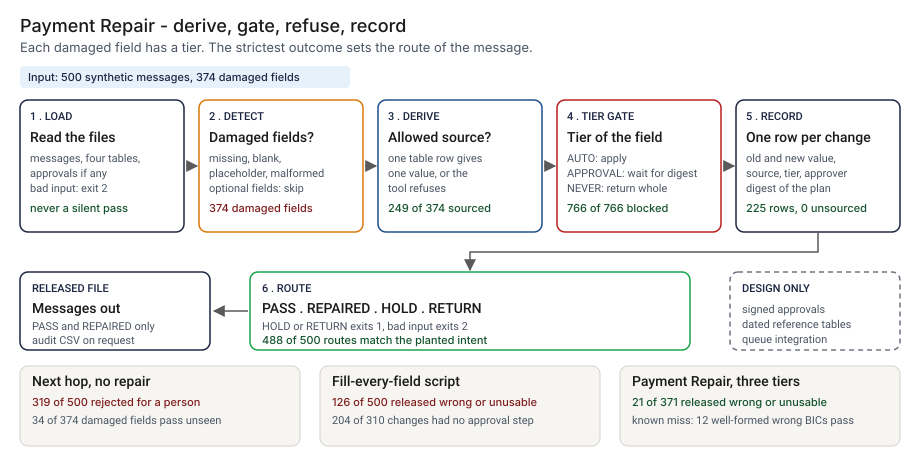
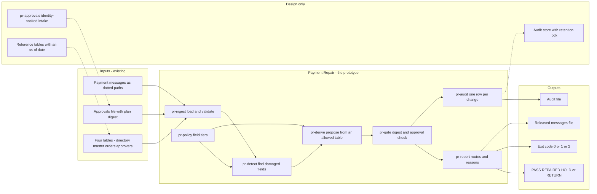
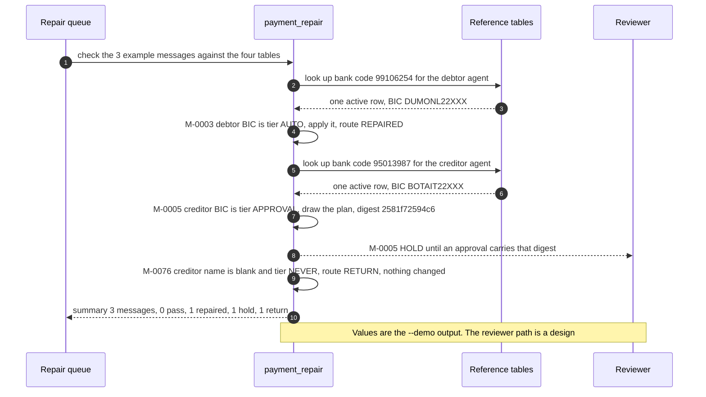

# 🧾 payment-repair (AgentKit extension): a repair agent for pacs.008-style messages, with approval gates

**I wanted to know how much of a missing-field queue a repair agent can clear without guessing, and where it has to stop. This is a command-line tool and a synthetic set of 500 pacs.008-style payment messages. It finds the required fields that are missing, blank, placeholders or malformed, fills the ones a bank table can supply, holds the ones that decide where the money goes until a person approves that exact change, and sends back the rest untouched.** It extends [27 AgentKit](../27-agentkit-reference-agent-and-playbook/) with a message set and a repair tool, and imports nothing from it.

**▶ Static demo, no install:** [open demo.html](./demo.html)

[](./demo.html)

## Executive summary (90 seconds)

**Problem.** A payments-operations lead owns a queue of payment messages that the next hop rejected for a missing or unusable required field, and a reviewer approves any repair before it goes out. Today each rejected message waits for a person, even when a bank table holds the answer. 🟢 In 500 synthetic pacs.008-style messages with 374 damaged fields, a presence check at the next hop rejects 319 of 500 messages, catches 340 of the 374 damaged fields and lets 34 through as if complete; a table or the message itself holds the true value for 249 of the 374, and only the originator can say for 125 (`step_01_no_repair.py`). The quick fix, one script that fills every empty field and releases, writes 62 fields wrong and releases 126 of 500 messages with a wrong or unusable required value (`step_03_deficiencies_exposed.py`).

**Product.** Payment Repair is a command that reads pacs.008-style messages, four reference tables and, if you have them, approvals, and puts every message on one of four routes. It finds the required fields that are missing, blank, placeholders or malformed and gives each field a tier from a policy table I wrote. AUTO fields (number of transactions, debtor agent BIC, debtor name) are filled from the message or a table when exactly one usable row exists. APPROVAL fields (creditor agent BIC, creditor country, UETR, charge bearer) decide where the money goes or what the payment is, so the plan waits for an approval that carries the digest of that exact plan, from an active person with the reviewer role who did not enter the payment order. NEVER fields (amount, currency, creditor name, both IBANs, end-to-end id) have no allowed source, so the message goes back untouched, and one refusal returns the whole message with no partial repair. The routes are PASS, REPAIRED, HOLD and RETURN. The command exits 1 when a message is held (at `--fail-on return`, only when one is returned) and 2 for malformed input, and it writes one audit row per applied change. There is no model call; the rules are plain code you can read.

**Measured and modeled performance.**

- 🟢 **No repair step: 319 of 500 rejected, 34 of 374 damaged fields pass as complete.** A table or the message holds the true value for 249 of 374, and only the originator can say for 125 (`step_01_no_repair.py`).
- 🟢 **A fill-every-field script writes 62 fields wrong and releases 126 of 500 messages with a wrong or unusable required value.** 204 of its 310 changes land on fields the policy puts behind a person, and it keeps no record of source or approver for any of its 350 changed fields (`step_02_fill_script.py`, `step_03_deficiencies_exposed.py`).
- 🟢 **The routes: 488 of 500 match the planted intent.** 90 of 90 repairs made without a person equal the true value, 129 of 129 returned messages are untouched, and none of the 144 messages that should pass was touched (`step_04_with_repair_tool.py`).
- 🟢 **The gate: 766 of 766 bad approvals blocked** and 125 of 125 valid approvals applied (`step_04_with_repair_tool.py`).
- 🟢 **After approval, 21 of 371 released messages carry a wrong or unusable required value, against 126 of 500** for the basic script; 126 of 135 approved changes equal the true value (`step_04_with_repair_tool.py`).
- 🟢 **Known misses:** 12 well-formed creditor BICs that belong to a different bank pass, and 9 wrong proposals reach the gate and are applied by a scripted approver. A real reviewer's catch rate is not measured (`step_04_with_repair_tool.py`).
- 🟡 **Utility: (126/500 − 21/500) × 1,000 = 210 messages a year not released with a wrong or unusable required value,** assuming 1,000 messages enter the tool each year.
- 🔴 **Design target: a route for a message within 5 seconds of it landing in the queue, and approvals accepted only from an identity system.** Designed in [`ARCHITECTURE.md`](./ARCHITECTURE.md), never built or timed.

**What I would ask a head of operations to decide.** Whether the creditor BIC, creditor country, UETR and charge bearer should stay behind a named approver, or move to automatic repair because a bank table supplies them. I set them to APPROVAL as my policy, not as a measurement. My recommendation is to adopt the three tiers as written, run the tool in shadow on one real queue export with a real reviewer, and count how many proposals the reviewer rejects before moving any field from APPROVAL to AUTO; the 9 wrong proposals here were approved by a scripted test double.

**Call to action.** Fork the repo. Swap `data/messages.json` and the four reference files (`bic_directory.csv`, `customer_master.csv`, `payment_orders.csv`, `approvers.csv`) for your own exports and keep the column names, then run `check` with your approvals file. Change the tiers in `POLICY` at the top of `src/payment_repair.py` to match your own rule table. To call it from code, import `repair_all` (or `repair_message` for one message) from `src/payment_repair.py`. Make sure each approval comes from a person recorded in the registry and not from the operator running the tool. Send findings by opening an issue: say which field and tier and how many messages, not the message data.

_A portfolio prototype on synthetic data. Nothing here is deployed, load-tested or used by anyone, and the approver in the run is a scripted test double._

## Run one now

```bash
cd 36-payment-repair/src && python3 payment_repair.py --demo
```

It prints:

```text
M-0003  REPAIRED  1 change(s) applied; rule tier AUTO, no person needed
    debtor agent BIC: missing, value from bank directory (bank code 99106254, one active row) -> DUMONL22XXX  [AUTO]
M-0005  HOLD      waiting for a person to approve this plan
    creditor agent BIC: blank, value from bank directory (bank code 95013987, one active row) -> BOTAIT22XXX  [APPROVAL]
    digest 2581f72594c6d6453a03ab2f00d771836f2feb2802a736c333be474915346b0b
M-0076  RETURN    back to the originator; nothing was changed
    creditor name: blank; no table may supply a beneficiary name; a saved payee list can be stale
summary: 3 messages: 0 pass, 1 repaired, 1 hold, 1 return
```

Standard library only, Python 3.9 or newer. To check your own files: `python3 payment_repair.py check messages.json --refs refdir --approvals approvals.csv`. It exits 1 when a message is held or returned (`--fail-on return` ignores holds) and 2 for malformed input. `--out` writes the released messages and `--audit-out` writes one row per applied change.

Read the three routes in that output. The debtor's bank code has one active directory row, so the tool fills the BIC without a person (tier AUTO). The creditor's BIC comes from the same directory but decides where the money goes, so the plan waits for a person, and the 64-character digest is what an approval has to carry. The creditor name has no allowed source, so the message goes back untouched.

## The policy table

🟡 Modeled: this table is my assumption. It is not a reading of any rulebook, and the required fields are the ones this project's rules name, not the ones the ISO 20022 text names.

| Field | Source the tool may use | Tier | Refuses when |
|---|---|---|---|
| number of transactions | the message itself (one transaction) | AUTO | never |
| debtor agent BIC | bank directory by the debtor IBAN's bank code | AUTO | not exactly one active row in that country |
| debtor name | customer master by the debtor IBAN | AUTO | no row, a joint account, or an account that is not open |
| creditor agent BIC | bank directory by the creditor IBAN's bank code | APPROVAL | not exactly one active row in that country |
| creditor country | first two letters of the creditor IBAN | APPROVAL | the IBAN is itself unusable |
| UETR, charge bearer | the payment order with the same end-to-end id | APPROVAL | not exactly one order |
| amount, currency, creditor name, both IBANs, end-to-end id | none | NEVER | always |

A message with any refusal is returned whole: no partial repair. A message with only AUTO changes is repaired. A message with an APPROVAL change waits for an approval that carries the digest of that exact plan, from an active person with the reviewer role who did not enter the payment order.

## What the numbers say

**What it shows** (🟢 measured on synthetic data: 500 messages with 374 damaged fields; the script is named in brackets):

- 🟢 Status quo: a presence check at the next hop rejects 319 of 500 messages, catches 340 of 374 damaged fields and lets 34 through as if complete; a table or the message itself holds the true value for 249 of the 374, and only the originator can say for 125 (`step_01`)
- 🟢 A script that fills every empty field and releases: 310 required fields filled, 62 written wrong, and 126 of 500 messages released with a wrong or unusable required value (`step_02`, `step_03`)
- 🟢 The same script: 204 of its 310 changes land on fields the policy puts behind a person; it has no approval step and keeps no record of source or approver for any of its 350 changed fields (`step_03`)
- 🟢 The tool: 488 of 500 routes match the planted intent; 90 of 90 repairs made without a person equal the true value; 129 of 129 returned messages are left untouched; none of the 144 messages that should pass was touched (`step_04`)
- 🟢 The gate: 766 of 766 bad approvals blocked (no approval, another plan's digest, an agent, a person who left the team, a person without the reviewer role, the person who entered the order, a message changed after the plan was drawn up) and 125 of 125 valid approvals applied (`step_04`)
- 🟢 After approval: 126 of 135 approved changes equal the true value, and 21 of 371 released messages carry a wrong or unusable required value, against 126 of 500 for the basic script (`step_04`)
- 🟢 Record: 225 audit rows for 225 fields changed, none without a source (`step_04`)
- 🟢 Hard negatives left alone: 30 of 30 messages with missing optional fields, 8 of 8 names that contain "unknown" or "N/A", 6 of 6 eight-character BICs (`step_04`)

## What it still gets wrong

- 🟢 Twelve messages carry a well-formed creditor BIC that belongs to a different bank, and all 12 pass (`step_03`, `step_04`). The tool checks presence and shape, not consistency between the BIC and the IBAN's bank code.
- 🟢 Nine wrong proposals reach the gate and 9 are applied: 5 where the directory still lists a bank's old BIC as active, 4 where the creditor lives outside the IBAN country (`step_04`). The approver in this run is a scripted test double that approves any plan whose digest matches. 🔴 How many of the 9 a real reviewer would catch is not measured.
- **The data and the rules share an author.** I planted the damage and wrote the rules, and I wrote the intended route per recipe, so 488 of 500 shows the rules cover what I planted. The true values come from the generator, which removed them from complete messages; the intended routes are my policy stated twice. Treat the result as a ceiling, not a rate on real traffic, which I have not tested.
- **An approval here is a row in a CSV file.** The tool checks the digest and the registry, not who typed the row. A production version needs approvals that come from an identity system or a signed workflow step. 🔴 Designed, not built.
- One transaction per message, flat dotted paths and not XML, and no address checks. Unknown keys are ignored, so a misspelt path shows up as a missing field and an extra key. The placeholder list is short and English only, and a creditor whose whole name is a placeholder word, such as "NA", is treated as missing. BIC, IBAN and currency checks are shape checks of my own; IBAN check digits are not computed.
- Reference tables are read as given, with no as-of date. A stale directory is exactly the case the second bullet counts.

## How the four steps fit

| Step | Question | Script |
|---|---|---|
| 1 | What does the next hop do with a message that has a missing field? | `step_01_no_repair.py` |
| 2 | What does one script that fills every empty field do? | `step_02_fill_script.py` |
| 3 | Where does that script go wrong, scored against the answer key? | `step_03_deficiencies_exposed.py` |
| 4 | What do derivation, a refusal list, an approval gate and an audit record change? | `step_04_with_repair_tool.py` |

Run any of them from `src/`. Data is produced by [`data/_generate.py`](./data/README.md); `tools/check_repo.py` confirms that a rerun reproduces every file and that the green numbers above appear in a script's output. The `tests/` folder holds 75 unittest tests, including a golden test that pins these numbers and tests for malformed input and hostile strings.

## Utility delivered

The way I price product impact: **utility = (my solution − current state of the art) × the number of people or items it affects.**

Here the item is a message in the repair queue. Each one lands on the payments-operations lead who owns the queue, the reviewer who approves a repair, and whoever takes the call when a wrong value reaches the next hop. The common fast approach is one script that fills every empty field and releases; the table prices the tool against it.

| Term | Value | Where it comes from |
| --- | --- | --- |
| Current state of the art (script that fills every empty field), messages released with a wrong or unusable required value | 🟢 **126 of 500** | `step_03_deficiencies_exposed.py`; it writes 62 fields wrong and releases all 500 |
| My solution (Payment Repair, valid approvals on file), same measure | 🟢 **21 of 371 released** | `step_04_with_repair_tool.py`; 129 messages go back untouched, none are held, and the 21 are 12 well-formed wrong BICs, 5 stale directory BICs and 4 foreign creditor countries |
| Lift per message | 🟢 126 of 500 minus 21 of 371 released | The 21 sit among the 500 that entered, so per 500 messages in the count is 126 against 21. The tool does not clear every message: 129 of 500 go back to the originator |
| Number it affects: messages entering the tool in a year | 🟡 **1,000** | **Assumption, not a statistic.** Replace it with your own count of messages in the repair queue in a year |
| Assumption that makes the lift real | 🟡 The queue mix resembles the planted one, and each approval is a real reviewer reading the evidence | The approver in the run is a scripted test double that approves any plan whose digest matches, so it approved all 9 wrong proposals. A real reviewer may catch some of them; that is not measured |
| **Utility** | 🟡 **(126/500 − 21/500) × 1,000 = 210 messages a year not released with a wrong or unusable required value** | Assumes the 1,000 behave like the 500 planted ones, and reads the 21 of 371 released as 21 of the 500 that entered |

Sensitivity to the count assumption (🟡, same lift): 500 messages a year gives 105, 1,000 gives 210, 2,000 gives 420.

🔴 What I have not measured: what a wrong value on a released message costs once it moves money, how long a reviewer takes to read a held plan, what a returned message costs the originator, how often a directory goes stale, or what share of a real queue is refusals. The planted set is dense on purpose, 356 of 500 carry a planted defect (`step_01_no_repair.py`); a real queue differs. Treat the result as a property of this mix of cases, not a forecast.

---

## Architecture and call flow

Component names match [`ARCHITECTURE.md`](./ARCHITECTURE.md). GitHub renders the diagrams natively.



**System topology:**



**Per-run sequence** (the `--demo` run, three messages that take three routes):



**Interlocks (all red, designed, none built):**

- [27 AgentKit](../27-agentkit-reference-agent-and-playbook/) is where I took the digest-bound approval, the approver who is not the proposer and the audit record. An agent built from it would call this tool as one of its steps. This folder imports nothing from it.
- [08 OversightOps](../08-oversightops-hitl-workflow/) would route a held plan to a role-aware reviewer queue and be the source of the approval row (`pr-approvals`).
- [34 audit-chain](../34-audit-chain/) is a possible home for the audit rows, so a later edit to the file can be found.
- [30 Payment Mandate Check](../30-payment-mandate-check/) checks a payment instruction against a customer's mandate before release. A repaired message could reach it next. Payment Repair does not read the mandate.

---

## PM artifacts

The PM artifacts that show how I would run this product if I owned the seat. This README is the walkthrough; the rest of the folder holds:

- [`PRD.md`](./PRD.md): the product requirements doc, with users, backlog, KPIs, rollout and open questions.
- [`ARCHITECTURE.md`](./ARCHITECTURE.md): the systems doc, with components, data model, security, failure behavior and operations. A design, not deployed.
- [`demo.html`](./demo.html): clickable, no-install walkthrough, built from the step outputs by `src/_build_demo.py`.
- [`data/`](./data/): the synthetic messages, the four reference tables, the approver registry, the answer key and the seeded generator. `data/README.md` explains how the truth is set.
- [`src/`](./src/): `payment_repair.py`, `common.py`, the four step scripts and the demo builder.
- [`tests/`](./tests/): 75 unittest tests, including a golden test that pins the numbers above and tests for malformed input and hostile strings.

Run the four steps end to end:

```bash
cd src
python3 step_01_no_repair.py
python3 step_02_fill_script.py
python3 step_03_deficiencies_exposed.py
python3 step_04_with_repair_tool.py
```

---

## Aligned to

Governor Christopher Waller's speech ["Payments in the Age of AI Agents"](https://www.federalreserve.gov/newsevents/speech/waller20260928a.htm), Sibos 2026, Miami, 2026-09-29, which I read on 2026-10-23. It covers AI in payments; the part I used is about agents that shop and pay for a buyer. It says the delegated model needs more extensive trust mechanisms and guardrails, asks who is on the hook when an agent makes the wrong purchase, and asks what balance between convenience and "purposeful friction" suits agent authorization. It does not mention ISO 20022 or the repair of payment messages. I borrowed the framing only: here the friction is the approval gate and the refusal list, applied to an agent inside a bank.

The message names are modeled on the ISO 20022 pacs.008 element names, which I have not checked against the standard. I could not read the standard (the ISO site returned HTTP 403 on 2026-10-23), so I cite nothing from it: the set is pacs.008-style, not validated against the schema, and the required fields are the policy table above. From [27 AgentKit](../27-agentkit-reference-agent-and-playbook/) I took the pattern of an approval bound to a digest of the exact correction, an approver who must be a person and not the proposer, and an audit record. The code here is written from scratch. This is a prototype, aligned to those ideas. It makes no claim of conformity to them.

## Data and limits

Synthetic, seeded, byte-for-byte reproducible. Nothing comes from any employer, customer or real bank, and every company, BIC and account is invented. A prototype on synthetic data, not a production case study. [`data/README.md`](./data/README.md) lists every file and every planted recipe. [`PRD.md`](./PRD.md) holds the scope I held to.

## Fork it

Swap `data/messages.json` and the four reference CSV files for your own exports and keep the column names, then run `check` with your approvals file. Change the tiers in `POLICY` at the top of `src/payment_repair.py` to match your own rule table, and re-run the steps to see which of your fields move from AUTO to APPROVAL. If you tune a rule, score it on messages the tuning did not see.

## Prereqs to run this on your laptop

You need Python 3.9 or newer and nothing else. The tool, the four step scripts and the data generator use only the standard library, so there is nothing to install. There is no API key, no network call and no model call anywhere in the folder. To run the tests, use `python3 -m unittest discover -s tests` from this folder. The production pieces in [`ARCHITECTURE.md`](./ARCHITECTURE.md) (identity-backed approvals, the audit store, dated reference tables) are a design, not something you need or can run.

## Author

**Vijay Saharan**, Sr Product / Program Manager · AI in BFSI · Enterprise AI Platforms

[LinkedIn](https://www.linkedin.com/in/vijaysaharan/)
