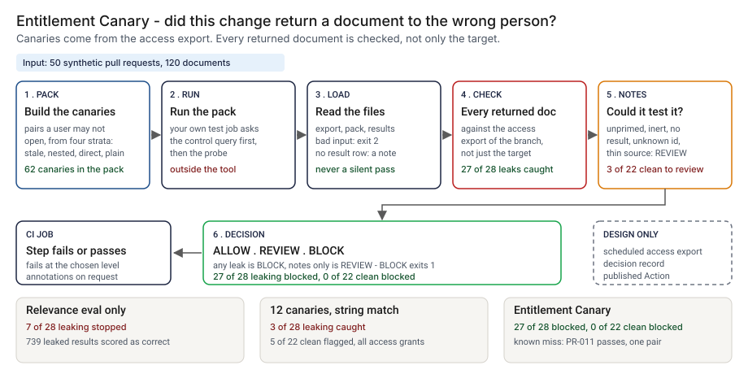

# Architecture: Entitlement Canary

> **Status.** This is the design for a production shape. The repo implements the product mechanic as a prototype: a command, `src/entitlement_canary.py`, that builds canaries (user and document pairs the user may not open) from an access export, reads what a test harness got back for each, checks every returned document against the export and prints ALLOW, REVIEW or BLOCK. It runs here over 50 synthetic pull requests against a toy retrieval system. A GitHub Action is staged in `action/`, unpublished and not run on GitHub. Nothing below is claimed as deployed or load-tested; a design target says so.

GCP is primary; AWS and Azure sit beside it.



---

## 1. Logical architecture

Entitlement Canary sits between a retrieval system's test job and a merge: an access export, a pack and a results file in, a decision out. It does not run the retrieval system, read generated answers or call a model.

Eight components: five decide the outcome, three run, report or record.

| Component | Responsibility | Language or framework | Decides the outcome? | Stateful? |
| --- | --- | --- | --- | --- |
| `ec-ingest` | Loads the export, pack and results; rejects malformed input | Python 3.9+, standard library. Prototype: `check_access`, `read_rows`, `load_pack`, `load_results`, `split_ids` | Yes, by refusing: exit 2 | No |
| `ec-resolver` | Who may open what: nested groups count, a deny entry wins, a document with no allow entry is closed | Python. Prototype: `index_access`, `closure`, `split_acl`, `can_open`, `reason_for` | Yes | No |
| `ec-pack` | Picks closed pairs from four strata with a minimum per source; writes the pack | Python. Prototype: `closed_pairs`, `stratum_of`, `make_canaries`, `build_pack`, `write_pack` | Yes: decides what is tested | No |
| `ec-check` | Checks every returned document, counts notes, picks the decision | Python. Prototype: `evaluate` | Yes | No |
| `ec-report` | Prints text or annotations; escapes strings from the input | Python. Prototype: `render`, `escape_annotation`, `safe` | No | No |
| `ec-harness` | Runs the control and the probe against the retrieval system and writes the results file | The team's own test job (contract in `action/README.md`). Prototype stand-in: `System`, `run_harness` in `src/common.py` | No, but the check trusts it | The system under test has a cache |
| `ec-action` | Runs the check in a CI job, inputs through environment variables | Composite GitHub Action, staged in `action/action.yml` | No | No |
| `ec-ledger` | One record per decision (design). Prototype analog: `src/out/step_04_decisions.csv` | PostgreSQL plus object storage with a retention lock (design) | No | Stateful |

**What decides the outcome.** The input check, the resolver, the pack and the check. A leak is a returned document the resolver says the asker may not open; any leak is a BLOCK. The harness decides what the check sees and the check cannot audit it: it reads the `primed` column the harness wrote.

**Repo structure** (production shape):

```
entitlement-canary/
├── canary/     # ingest, resolver, pack, check, report
├── action/     # composite Action wrapper
├── export/     # scheduled access export (design)
├── ledger/     # decision record writer
├── infra/      # terraform for gcp, aws, azure
├── docs/runbooks/
└── tests/      # unit, golden (planted-set numbers), hostile strings
```

---

## 2. Physical and deployment architecture

One short-lived process in the pipeline that already tests the retrieval change. No server to keep warm.

| Component | GCP (primary) | AWS | Azure | Why |
| --- | --- | --- | --- | --- |
| Check process | Cloud Build step or Cloud Run job | CodeBuild step or ECS Fargate task | Azure Pipelines step or Container Apps job | Stateless, runs where the tests run |
| Access export, pack, results | Cloud Storage, versioned | S3, versioned | Blob Storage, versioned | Keeps the bytes a decision used |
| Test identities for the harness | Service accounts with no production rights | IAM roles, same | Managed identities, same | The harness impersonates users without holding real tokens |
| `ec-ledger` | Cloud SQL for PostgreSQL | RDS for PostgreSQL | Azure Database for PostgreSQL | Already run by the platform team |

**Failure behavior (the decision that matters most).** The check must never silently pass. ALLOW means every canary ran, every returned document was checked and no note was raised. Anything less is a REVIEW, and a returned document the asker may not open is a BLOCK.

| Failure | Behavior | Alert |
| --- | --- | --- |
| Export, pack or results empty, wrong type, missing column, duplicate or empty `canary_id`, `primed` not yes or no, results naming canaries not in the pack, no result row for any canary | Exit 2, one line on stderr, CI step fails | P2 if repeated, else P3 |
| A canary has no result row, or names a user or document missing from the export | REVIEW with the ids listed | P3 |
| A returned id is not in the export | REVIEW: it cannot be checked | P3 |
| A canary is not primed, or its control query did not return the target (inert) | REVIEW: a clean probe proves nothing | P3 |
| A source has fewer canaries than `--min-per-source` | REVIEW with the source named | P4 |
| A user may now open the target (retired) | Counted, not a leak | P4 digest |
| Ledger unavailable (design) | The decision and exit code stand; the record queues locally | P3 |

**Latency.** I have not timed the prototype. 🔴 Design target: a decision within 60 seconds of the results file landing.

---

## 3. Data architecture

| Entity | Key | Real columns in the prototype |
| --- | --- | --- |
| Access export | `user_id`, `doc_id` | `access_base.json`: `groups` (`parent`, `child`), `users` (`user_id`, `direct_groups`), `documents` (`doc_id`, `title`, `source`, `acl`, `acl_at_index`) |
| Canary | `canary_id` | Pack CSV: `canary_id`, `user_id`, `doc_id`, `query`, `stratum`, `source`, `prime_user` |
| Result | `canary_id` | Results CSV: `canary_id`, `returned_doc_ids`, `primed`, `control_returned_doc_ids` |
| Decision record | `pr_id` | Design: pull request, hashes of the three files, tool version, leaks, notes, decision. Prototype: `step_04_decisions.csv` with `pr_id`, `change_kind`, `truth`, `decision`, `leaking_canaries`, `retired`, `inert`, `leaked_pairs`, `aimed` |

**Retention** is a design choice, not a measurement; confirm it against the bank's record-retention schedule. 🔴 Design default: decision records 7 years in PostgreSQL archived with a retention lock; the three input files a decision used, the same period, in versioned storage.

**Lineage.** A decision traces back in three hops: the record names the pull request and the hashes of the export, pack and results; the versioned store returns those bytes; and the resolver is deterministic, so re-running `evaluate` reproduces each leak line (canary, user, document, denying rule). The same seed builds the same pack, so the seed belongs in the commit message.

**Deliberately not stored.** Document text, generated answers, anything beyond document ids. The pack's `query` is built from a title, so a pack is as sensitive as those titles.

---

## 4. Security architecture

**Identity and roles.** The check runs under the CI platform's workload identity with no user account. `ec:runner` reads the three files and writes a decision record. `ec:approver` approves a change to quotas or access rules, never their own. `ec:auditor` reads decisions and config history. `ec:admin` manages roles, buckets and the ledger.

**Secrets.** The check holds none and calls no model. The harness is the sensitive piece: it must ask the retrieval system as a test user. The design gives it test identities with no production rights, never real users' tokens; the check never sees them.

**Data classification and what leaves the boundary.** An access export says who may open what; treat it as restricted. In the prototype everything is synthetic and nothing leaves the machine. In the design three things leave the job: the exit code, annotations on the pull request, and the ledger write. An annotation names a document title, visible to anyone who can read the pull request; the design lets a team print ids only.

| Threat | Example | Mitigation in the design |
| --- | --- | --- |
| Hostile string in a title, user id or document id echoed into a log or annotation | A title holding a newline and text that looks like a workflow command | `escape_annotation` rewrites `%`, carriage return and newline; `safe` writes non-printable characters as escapes. `tests/test_check.py` covers a forged command and one-line output |
| The harness reports `primed: yes` without running the control | A shared-cache leak stays hidden | The check cannot see this. The design asks for a harness contract test and signs the results file in the job |
| The wrong export | The main-branch export is checked against a branch that changed the ACLs | The Action takes the export path from the branch under test; the ledger stores its hash |
| A change tuned to a fixed pack | A fix that clears the known pairs only | The pack is a sample; the design rebuilds it on a schedule with a new seed and records the seed |

---

## 5. Operational architecture

**SLIs.** Decisions per level per week (prototype baseline on clean synthetic pull requests: 🟢 0 of 22 blocked and 3 of 22 sent to review, `step_04_with_canary.py`); input rejections; canaries run over canaries in the pack; inert, unprimed and retired counts; pull requests a person has to read (🟢 30 of 50 in the prototype); age of the pack; time to decision.

**SLOs (all 🔴 design targets, none measured).**
- A decision within 60 seconds of the results file landing.
- Every pull request that touches the retrieval layer leaves a decision record.
- Every BLOCK read by a named person within one business day (planning estimate).
- A pack no older than the last export change that added a source or groups.

**Alerts.** P2: repeated input rejections, or the ledger down for more than a day. P3: a BLOCK on a protected branch, or a REVIEW for inert or unprimed canaries. P4: a daily digest of REVIEW causes.

**Runbooks** (in `docs/runbooks/`): `leak-found.md` (reproduce with the leaked pair, find the change, fix, re-run); `review-inert.md` (fix the harness so the control returns the target); `rebuild-pack.md` (new seed, same quotas); `changing-a-quota.md` (propose, re-run the planted set, approve).

**On-call and ownership.** The retrieval-layer owner owns the check, harness and runbooks; the access owner owns the export. Nobody is paged for a REVIEW.

**Change control.** Rules, quotas and the resolver are versioned in the repo. A change needs a proposer, a different approver and a re-run of the planted set against the pinned numbers in `tests/test_golden.py`, so a change that moves a count shows in the diff.

---

## 6. Alignment and posture

Alignment, not certification. The README's "Aligned to" section cites the [OWASP Top 10 for LLM Applications 2025](https://genai.owasp.org/llm-top-10/): sensitive information disclosure (LLM02:2025, read 2026-10-23), where it recommends least-privilege access to data, and vector and embedding weaknesses (LLM08:2025, read 2026-10-23), where it calls for permission-aware vector stores and warns of context leaking between users who share a store.

- **What the design does.** It tests, on each change, whether the store you built still returns only what the asker may open.
- **What it does not claim.** It does not build a permission-aware store. It makes no claim of conformity to that guidance, holds no certification, and I have not read or mapped any other source.

---

## 7. What is deliberately not here

- **A pair-by-pair guarantee.** 🟢 PR-011, a delegation change that leaks one pair with no canary aimed at it, passes, and 7 of the 27 blocks have no canary aimed at a leaked pair (`step_04_with_canary.py`). The pack is a sample; a smaller one could miss those blocks.
- **Generated answers.** The tool sees document ids; a leak that appears only in generated text is invisible to it.
- **Role, attribute or per-chunk rules.** Group names and ACL entries are plain strings.
- **A real retrieval system.** The stand-in is a keyword index with an entitlement filter; I have not tested a real one.
- **A trusted harness.** The check reads `primed` and cannot tell whether the control ran.
- **Rules for a system that treats a missing ACL as public**, and the stale-ACL stratum without an `acl_at_index` export.
- **Hosting, a published Action, a model call.**

---

## Appendix: sample contract

The call is the prototype's own; the `--demo` output is in the README.

```bash
python3 entitlement_canary.py build-pack access.json --out pack.csv
python3 entitlement_canary.py check access.json pack.csv results.csv --fail-on block
```

Results file, one row per canary: `canary_id,returned_doc_ids,primed,control_returned_doc_ids`, with ids separated by `;`. Exit status: 0 below `--fail-on`, 1 at or above it, 2 for bad input.
