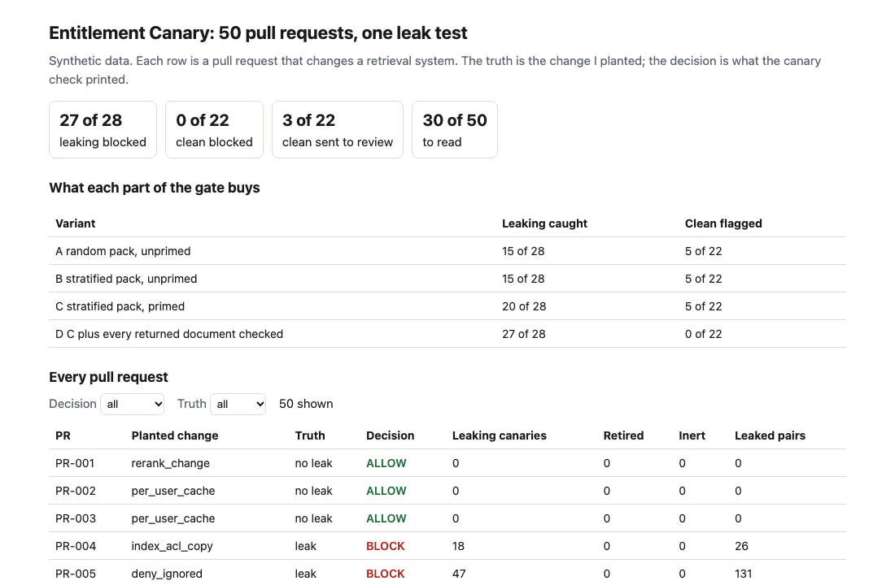
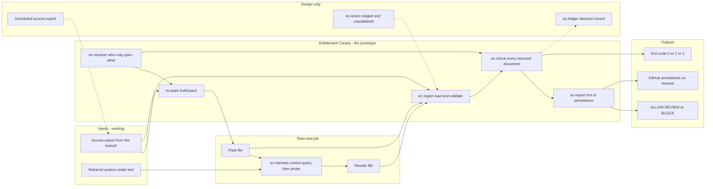
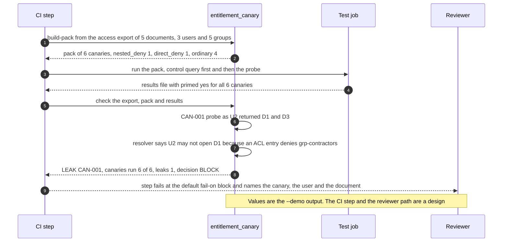

# 🐤 Entitlement Canary (leak test for retrieval)

**I wanted to know whether a pull request to a retrieval system can return a document to someone who may not open it, and whether the checks most teams run would notice. A relevance eval does not: a leaked document that matches the question counts as a correct answer. This is a command-line tool and a staged GitHub Action: it builds a pack of canaries from an access export, reads what your test harness got back for each one, and prints ALLOW, REVIEW or BLOCK.** It extends the canary pack in [20 CorpusGate](../20-corpusgate-rag-entitlements/) into a check that runs on a pull request, in the shape of [28 Tool Schema Drift](../28-tool-schema-drift/).

**▶ Static demo, no install:** [open demo.html](./demo.html)

[](./demo.html)

## Executive summary (90 seconds)

**Problem.** An engineer owns the retrieval layer of an assistant that answers from internal documents, and a reviewer approves each change to it: index settings, the access filter, the cache, a new document source. The gate in CI is a relevance eval, and a document that matches the question counts as a correct answer whether or not the asker may open it. 🟢 On 50 synthetic pull requests, 28 return a document to someone who may not open it. The relevance eval stops 7 of the 28 and 9 of the 22 clean ones; 26 of the 28 return at least one leaked document to the eval queries, and in those runs 923 results went to a user who may not open them and 739 were scored as correct answers (`step_01_relevance_only.py`). A leak ships, and the team hears about it from a user.

**Product.** Entitlement Canary is a command with two jobs. `build-pack` reads an access export (groups, users, documents with ACLs), works out who may open what (nested membership counts, a deny entry wins, a document with no allow entry is closed) and picks canaries: a user, a document that user may not open, and a query built to retrieve it. They come from four strata (stale access list, nested deny, direct deny, ordinary) with a minimum per document source. Your own test job runs the pack against your retrieval system, asking a control query as an entitled user first and then the probe as the blocked user, and writes a results file. `check` reads that file and checks every returned document, not only the target, against the access export of the pull request's branch. A returned document the asker may not open is a BLOCK. A run with no leak that could not test everything (a canary with no result, a control that did not run or did not return the target, a returned id the export does not know, a source with too few canaries) is a REVIEW. Otherwise it is ALLOW. The command exits 1 at the level you choose (BLOCK by default) and 2 for malformed input. There is no model call; the rules are plain code you can read.

**Measured and modeled performance.**

- 🟢 **Relevance eval alone: 7 of 28 leaking pull requests stopped, and 9 of 22 clean ones.** It scored 739 of 923 leaked results as correct answers (`step_01_relevance_only.py`).
- 🟢 **Twelve hand-picked canaries with a string match catch 3 of 28** and flag 5 of 22 clean pull requests, all five of them access grants (`step_02_string_match.py`).
- 🟢 **A pack of 60 random canaries catches 15 of 28; the stratified pack catches 15 of 28 unprimed and 20 of 28 with a control query run first;** each flags 5 of 22 clean pull requests (`step_03_deficiencies_exposed.py`).
- 🟢 **Checking every returned document against the branch's access export: 27 of 28 caught, 0 of 22 clean flagged** (`step_03_deficiencies_exposed.py`).
- 🟢 **The full gate blocks 27 of 28 leaking pull requests and 0 of 22 clean ones,** sends 3 of 22 clean ones to review, and a person reads 30 of 50 (`step_04_with_canary.py`).
- 🟢 **Known misses:** PR-011, a delegation change that leaks one pair, passes; 7 of the 27 blocks have no canary aimed at a leaked pair; 3 of 62 canaries have no control query (`step_04_with_canary.py`).
- 🟡 **Utility: (27/28 − 7/28) × 12 = 8.6 leaking pull requests a year stopped that a relevance eval would pass,** assuming 12 leaking pull requests reach the check each year.
- 🔴 **Design target: a decision within 60 seconds of the results file landing.** Designed in [`ARCHITECTURE.md`](./ARCHITECTURE.md), never built or timed.

**What I would ask a head of operations to decide.** Whether a REVIEW (the control query did not run, or did not return the target) should fail the step the way a BLOCK does. In the prototype it does not: `--fail-on block` is the default, and that is my policy, not a measurement. My recommendation is to run the check in shadow on one real retrieval repository, read every NOTE it prints, and fix the harness first, because a check that cannot tell whether the control ran can pass a shared-cache leak.

**Call to action.** Fork the repo. Replace `data/access_base.json` with an export of your own groups, users and document ACLs and keep the keys (`groups`, `users`, `documents`), build a pack with `build-pack`, write a harness that records what your retrieval system returns (the contract is in [`action/README.md`](./action/README.md)), then run `check`. To call it from code, import `build_pack` and `evaluate` from `src/entitlement_canary.py`. Make sure the harness maps chunks to document ids and writes `primed` from what happened. Send findings by opening an issue: say which stratum and which note, not the export itself.

_A portfolio prototype on synthetic data. Nothing here is deployed, load-tested or used by anyone, the retrieval system in the runs is a toy stand-in, and the Action is staged and has not run on GitHub._

## Run one now

```bash
cd 37-entitlement-canary/src && python3 entitlement_canary.py --demo
```

It prints:

```text
access: 5 documents, 3 users, 5 groups
pack: 6 canaries (nested_deny 1, direct_deny 1, ordinary 4)
LEAK CAN-001 [nested_deny] U2 was returned D1 "Payments runbook [DOC-0001]": an ACL entry denies grp-contractors
canaries run 6 of 6; leaks 1; retired (the user may now open the target) 0; inert 0; unprimed 0
decision: BLOCK
```

Standard library only, Python 3.9 or newer. To use it on your own files: `python3 entitlement_canary.py build-pack access.json --out pack.csv`, run the pack through your retrieval system with your own harness (the contract is in [`action/README.md`](./action/README.md)), then `python3 entitlement_canary.py check access.json pack.csv results.csv`. It exits 1 on BLOCK, so a CI step fails; `--format github` prints annotations.

## What the numbers say

**What it shows** (🟢 measured on synthetic data: 120 documents, 20 users, 50 planted pull requests, 28 of which leak; the script is named in brackets):

- 🟢 The usual gate is a relevance eval. It stops 7 of 28 leaking pull requests, and 9 of 22 clean ones. In the eval runs of the leaking pull requests, 923 results went to a user who may not open them and 739 of those were scored as correct answers (`step_01`)
- 🟢 Twelve hand-picked canaries with a string match catch 3 of 28 and flag 5 of 22 clean pull requests, all five of them access grants (`step_02`)
- 🟢 A pack of 60 random canaries catches 15 of 28; the stratified pack catches 15 of 28 unprimed and 20 of 28 with a control query run first; each flags 5 of 22 clean pull requests (`step_03`)
- 🟢 Checking every returned document against the access export of the pull request's branch, not only the canary's target: 27 of 28 caught, 0 of 22 clean flagged (`step_03`)
- 🟢 The full gate blocks 27 of 28 leaking pull requests and 0 of 22 clean ones, sends 3 of 22 clean ones to review, and a person reads 30 of 50 (`step_04`)

## What it still gets wrong

- 🟢 One leaking pull request passes: PR-011, a delegation change that leaks one (user, document) pair, with no canary aimed at it (`step_04` prints it). The other three delegation pull requests are blocked, one of them by a canary aimed at its pair.
- 🟢 7 of the 27 blocks have no canary aimed at a leaked pair: some other canary's results held a document its user may not open, and the check reads every returned document. That is luck as much as design, and a smaller or differently drawn pack could miss them (`step_04`).
- 🟢 Stratifying the pack does not beat drawing it at random on its own: both catch 15 of 28 unprimed. The random pack caught the flat-group change in all 5 pull requests by luck of the draw and the stratified pack in none; checking every returned document caught all 5 on the stratified pack (`step_03`).
- 🟢 3 of 62 canaries have no control query, because nobody may open the target today (`step_04`).
- **The test set and the rules share an author.** I planted the changes and wrote the check, so 27 of 28 shows the rules cover what I planted. I changed the data design and the prime-user rule after early runs (the data README says how). Treat the result as a ceiling for these rules, not a rate on a real retrieval system, which I have not tested.
- **The retrieval system is a stand-in**: a keyword index with an entitlement filter and a few settings. A real one has chunks, embeddings, a reranker and answer generation. The tool sees only the document ids your harness reports, so a leak that appears only in generated text is invisible to it.
- **The check trusts the harness.** It reads the `primed` column; it cannot tell whether the control query really ran first, and a cache shared between users shows only when it did.
- **The access rules are the ones in the module docstring**: a deny entry wins, nested membership counts, a document with no allow entry is closed. A system that treats a missing ACL as public needs different rules. The stale-ACL stratum needs an `acl_at_index` export, which many systems cannot produce.
- Group names and ACL entries are plain strings. Role-based, attribute-based and per-chunk rules are not modelled.

## Use it in CI

[`action/`](./action/README.md) holds a staged GitHub Action and the steps to publish it from its own repository, which a Marketplace listing requires. It has not been published and has not run on GitHub. What is tested is the command it wraps (`tests/test_check.py`; the whole suite has 41 tests).

## How the four steps fit

| Step | Question | Script |
|---|---|---|
| 1 | What does a relevance-only eval let through? | `step_01_relevance_only.py` |
| 2 | What does a short hand-written canary list with a string match catch? | `step_02_string_match.py` |
| 3 | What does each part of the pack and the run buy, and where is the limit? | `step_03_deficiencies_exposed.py` |
| 4 | What does the full gate decide on all 50 pull requests? | `step_04_with_canary.py` |

Run any of them from `src/`. Data is generated by [`data/_generate.py`](./data/README.md); the check in `tools/check_repo.py` confirms that a rerun reproduces every file and that the green numbers above appear in a script's output.

## Utility delivered

The way I price product impact: **utility = (my solution − current state of the art) × the number of people or items it affects.**

Here the item is a pull request that would leak. Each one lands on the engineer who owns the retrieval layer, the reviewer who signs off on it, and whoever would otherwise take the incident. The common basic approach is a relevance eval in CI; the table prices the check against it.

| Term | Value | Where it comes from |
| --- | --- | --- |
| Current state of the art (relevance eval), leaking pull requests stopped | 🟢 **7 of 28** | `step_01_relevance_only.py`; it also stops 9 of 22 clean ones |
| My solution (Entitlement Canary), leaking pull requests stopped | 🟢 **27 of 28** | `step_04_with_canary.py`; 0 of 22 clean pull requests blocked |
| Lift per leaking pull request | 🟢 27 of 28 minus 7 of 28 | The eval stops these kinds as follows: delegation_inherit 0 of 4, deny_ignored 0 of 5, flat_groups 5 of 5, index_acl_copy 1 of 4, new_source_no_acl 0 of 5, shared_cache 1 of 5 (`step_01_relevance_only.py`) |
| Number it affects: leaking pull requests reaching the check in a year | 🟡 **12** | **Assumption, not a statistic.** Replace it with your own count of changes in a year that returned a document to someone who may not open it |
| Assumption that makes the lift real | 🟡 The harness runs the control query first, writes `primed` from what happened, maps chunks to document ids, and the export comes from the branch under test | If the control does not run, a shared cache stays hidden: the stratified pack catches 15 of 28 unprimed, against 20 of 28 with the control first (`step_03_deficiencies_exposed.py`) |
| **Utility** | 🟡 **(27/28 − 7/28) × 12 = 8.6 leaking pull requests a year stopped that a relevance eval would pass** | Assumes the 12 behave like the 28 planted ones |

Sensitivity to the count assumption (🟡, same lift): 6 leaking pull requests a year gives 4.3, 12 gives 8.6, 24 gives 17.1.

🔴 What I have not measured: what a leak costs once it is found, how long a BLOCK takes to read and clear, what a false REVIEW costs a release, or how often a real change leaks. The planted set is dense on purpose, 28 of 50 leak (`step_01_relevance_only.py`); a real repository sees far fewer. Treat the result as a property of this mix of cases, not a forecast.

---

## Architecture and call flow

Component names match [`ARCHITECTURE.md`](./ARCHITECTURE.md). GitHub renders the diagrams natively.


**System topology:**



**Per-run sequence** (the `--demo` run, one nested-deny leak):



**Interlocks (all red, designed, none built):**

- [20 CorpusGate](../20-corpusgate-rag-entitlements/) is where the canary pack began. This tool turns it into a check that runs on a pull request. The two share no code and this folder does not read its files.
- [28 Tool Schema Drift](../28-tool-schema-drift/) is the shape I followed: a command, a staged Action and ALLOW, REVIEW or BLOCK. Both could run as steps in one pipeline.
- [09 LineageLog](../09-lineagelog-ai-decision-audit/) is a possible home for the decision record (`ec-ledger`).

---

## PM artifacts

The PM artifacts that show how I would run this product if I owned the seat. This README is the walkthrough; the rest of the folder holds:

- [`PRD.md`](./PRD.md): the product requirements doc, with users, backlog, KPIs, rollout and open questions.
- [`ARCHITECTURE.md`](./ARCHITECTURE.md): the systems doc, with components, data model, security, failure behavior and operations. A design, not deployed.
- [`demo.html`](./demo.html): clickable, no-install walkthrough, built from the step outputs by `src/_build_demo.py`.
- [`data/`](./data/): the synthetic access export, document text, eval queries, 50 planted pull requests and their truth, and the seeded generator. `data/README.md` explains how the truth is set.
- [`src/`](./src/): `entitlement_canary.py`, `common.py` (the toy retrieval system), the four step scripts and the demo builder.
- [`tests/`](./tests/): 41 unittest tests, including a golden test that pins the numbers above and tests for bad input and hostile strings.
- [`action/`](./action/README.md): the staged GitHub Action and the steps to publish it. Not published, not run on GitHub.

Run the four steps end to end:

```bash
cd src
python3 step_01_relevance_only.py
python3 step_02_string_match.py
python3 step_03_deficiencies_exposed.py
python3 step_04_with_canary.py
```

---

## Aligned to

The [OWASP Top 10 for LLM Applications 2025](https://genai.owasp.org/llm-top-10/) lists sensitive information disclosure (LLM02:2025, [page](https://genai.owasp.org/llmrisk/llm022025-sensitive-information-disclosure/), read 2026-10-23), where it recommends least-privilege access to data, and vector and embedding weaknesses (LLM08:2025, [page](https://genai.owasp.org/llmrisk/llm082025-vector-and-embedding-weaknesses/), read 2026-10-23), where it calls for permission-aware vector stores and warns of context leaking between users who share a store. This tool does not build a permission-aware store. It tests, on each change, whether the store you built still returns only what the asker may open. It is a prototype, aligned to that guidance. It makes no claim of conformity to it.

## Data and limits

Synthetic, seeded, byte-for-byte reproducible. Nothing comes from any employer, customer or real system. The 0.02 tolerance for the relevance eval in step 1 is an assumption (🟡), not taken from any standard. A prototype on synthetic data, not a production case study.

## Fork it

Replace `data/access_base.json` with an export of your own groups, users and document ACLs and keep the keys, build a pack with `build-pack`, and write a harness that records what your retrieval system returns. Read the [PRD](./PRD.md) for the scope I held to.

## Prereqs to run this on your laptop

You need Python 3.9 or newer and nothing else. The check, the four step scripts and the data generator use only the standard library, so there is nothing to install. There is no API key, no network call and no model call anywhere in the folder. To run the tests, use `python3 -m unittest discover -s tests` from this folder. The production pieces in [`ARCHITECTURE.md`](./ARCHITECTURE.md) (the scheduled access export, the decision ledger, a published Action) are a design, not something you need or can run.

## Author

**Vijay Saharan**, Sr Product / Program Manager · AI in BFSI · Enterprise AI Platforms

[LinkedIn](https://www.linkedin.com/in/vijaysaharan/)
