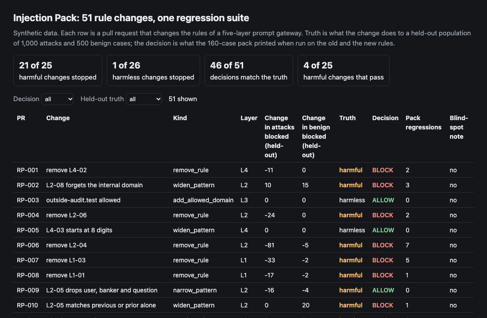
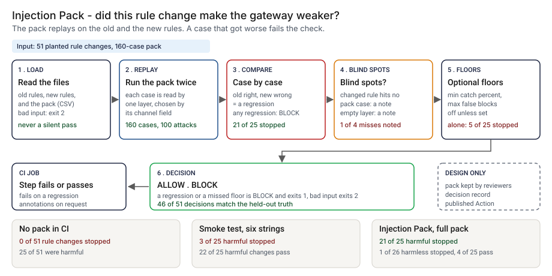
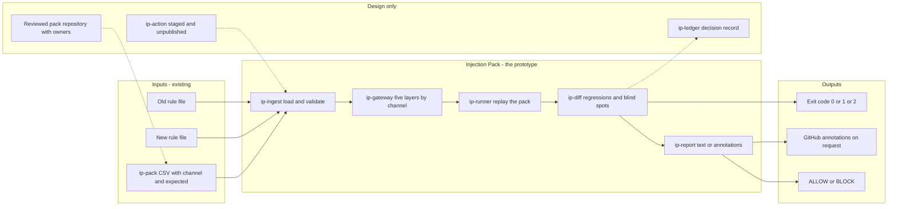
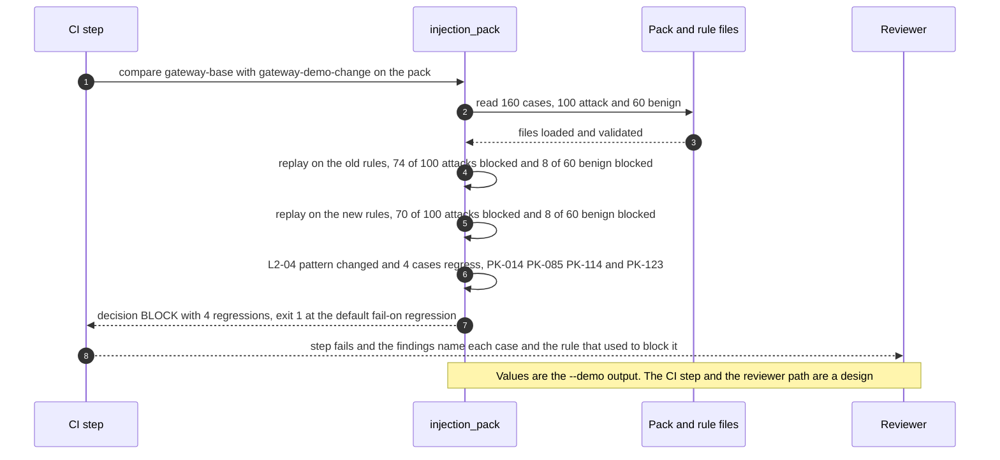

# 🧪 Injection Pack: a regression suite for the rules of a prompt gateway

**I wanted to know whether a test pack can stop a pull request from quietly making a prompt gateway weaker, and which changes a 160-case pack can see. This is a command-line runner and a staged GitHub Action: it replays a pack of injection cases, the largest group of them hidden in retrieved documents, on the old and the new rules of a five-layer gateway, and fails the check when a case the old rules got right is now wrong.** The five layers and the retrieved-document attack path follow [06 PromptShield](../06-promptshield-prompt-injection-defense/); the cases, the rules and the runner here are new and nothing is imported from it.

**▶ Static demo, no install:** [open demo.html](./demo.html)

[](./demo.html)

## Executive summary (90 seconds)

**Problem.** An engineer or security reviewer owns the rules of a prompt gateway, the set of rules in front of an internal assistant, and another person approves changes to them. Teams edit those rules in pull requests: a pattern narrowed to stop a false alarm, a rule removed, a domain added to an allow-list. The unit tests pass because nobody replays injection cases. 🟢 On 51 synthetic rule changes, CI with no pack stops 0 of 51, and 25 of 51 are harmful: 20 lose attack coverage and 5 add false blocks on the held-out population. The worst, RP-018 (every .test domain allowed), lets through 95 more of 1000 attacks (`step_01_no_pack.py`). A weaker gateway ships, and the first signal is an incident.

**Product.** Injection Pack is a command that replays a pack of injection test cases on the old and the new rules of a five-layer gateway. The pack is a CSV of attack and benign cases, each tagged with the channel it arrives on: user input, retrieved document, tool call, model response or session memory. Each case is read by one layer, chosen by that field. A regression is a case the old rules got right and the new rules get wrong, and any regression is a BLOCK. The command also says so when a changed rule matches no case in the pack, so a silent pass is not read as a safe change, and it can apply floors for the catch rate and the false-block rate. It exits 1 on a regression or a missed floor and 2 for malformed input; `--format github` prints annotations. There is no model call and no live endpoint: the gateway here is a rule file of regular expressions.

**Measured and modeled performance.**

- 🟢 **No pack in CI: 0 of 51 rule changes stopped, 25 of 51 harmful.** The base rules block 790 of 1000 held-out attacks and 37 of 500 benign cases; on the pack, 74 of 100 and 8 of 60 (`step_01_no_pack.py`).
- 🟢 **A smoke test of six well-known attack strings stops 3 of 25 harmful changes and 0 of 26 harmless ones,** because the strings reach layer 1 only (`step_02_smoke_test.py`).
- 🟢 **Three shortcut gates alone:** a fixed floor stops 5 of 25 harmful changes, attack cases only stops 16 of 25, and a pack cut to every fourth case stops 12 of 25; 6 of 25 harmful changes pass all three (`step_03_deficiencies_exposed.py`).
- 🟢 **The full pack compared case by case: 21 of 25 harmful changes stopped** (16 of 20 that lose attack coverage, 5 of 5 that add false blocks), 1 of 26 harmless changes stopped, and 46 of 51 decisions match the held-out truth (`step_04_with_pack.py`).
- 🟢 **Known misses: 4 of 25 harmful changes still pass** (RP-009, RP-021, RP-033 and RP-043), and only 1 of the 4 came with a blind-spot note. The pack has no case for the encoded-payload technique (`step_04_with_pack.py`).
- 🟡 **Utility: (21/25 − 3/25) × 10 = 7.2 harmful rule changes a year stopped that a six-string smoke test would pass,** assuming 10 harmful rule changes reach the gate each year.
- 🔴 **Design target: a decision within 60 seconds of a rule pull request opening.** Designed in [`ARCHITECTURE.md`](./ARCHITECTURE.md), never built or timed.

**What I would ask a head of operations to decide.** Whether a changed rule that no pack case matches should block the merge until someone adds a case, or stay a note. In the prototype it is a note and the decision stays ALLOW; that is my policy, not a measurement. My recommendation is to run `compare` in shadow on the rule pull requests of one real gateway, count how often a note precedes a real gap, set the one-point harm line against that gateway's own variation, and only then decide.

**Call to action.** Fork the repo. Replace `data/pack.csv` with your own cases, keeping the columns (`channel` decides which layer reads a case), and `data/gateway_rules.json` with your rules in the same shape, then run `python3 injection_pack.py run rules.json --pack pack.csv`. To compare two revisions use `compare`; to call it from code, import `load_rules`, `load_pack` and `compare` from `src/injection_pack.py`. Add a pack case for every technique your incidents show. Send findings by opening an issue: say which channel and technique, not the rule file itself.

_A portfolio prototype on synthetic data. Nothing here is deployed, load-tested or used by anyone, and the Action is staged and has not run on GitHub._

## Run one now

```bash
cd 38-injection-pack/src && python3 injection_pack.py --demo
```

It prints:

```text
pack: 160 cases (100 attack, 60 benign)   rules: gateway-base -> gateway-demo-change
  changed: L2-04 pattern changed
  regression  PK-014 retrieved_doc/doc_note_to_ai: attack was blocked by L2-04, now allowed
  regression  PK-085 retrieved_doc/doc_polite_forward: attack was blocked by L2-04, now allowed
  regression  PK-114 retrieved_doc/doc_fake_system: attack was blocked by L2-04, now allowed
  regression  PK-123 retrieved_doc/doc_polite_forward: attack was blocked by L2-04, now allowed
  cases that got better: 0
before: 74 of 100 attacks blocked, 8 of 60 benign cases blocked
after:  70 of 100 attacks blocked, 8 of 60 benign cases blocked
decision: BLOCK (4 regressions)
```

Standard library only, Python 3.9 or newer. To check your own files: `python3 injection_pack.py compare old_rules.json new_rules.json --pack pack.csv`. It exits 1 on a regression, so a CI step fails; `--format github` prints annotations; `run rules.json --pack pack.csv` reports one rule file by channel, with `--min-catch` and `--max-fp` as optional floors.

## What the numbers say

**What it shows** (🟢 measured on synthetic data: a 160-case pack, a held-out population of 1000 attacks and 500 benign cases, and 51 planted rule changes; the script is named in brackets):

- 🟢 No pack in CI: 0 of 51 rule changes stopped, and 25 of 51 are harmful, meaning they block at least one point fewer attacks or one point more benign cases on the held-out population (`step_01`)
- 🟢 The base rules block 790 of 1000 held-out attacks and 37 of 500 benign cases; on the pack, 74 of 100 and 8 of 60. Of the 14 hard attacks the pack carries, 4 are blocked; of its 30 look-alike benign cases, 8 are blocked (`step_01`)
- 🟢 A smoke test of six well-known attack strings stops 3 of 25 harmful changes and 0 of 26 harmless ones, because the strings only reach layer 1 (`step_02`)
- 🟢 Three shortcut gates on the same pack: a fixed floor stops 5 of 25 harmful changes, attack cases only stops 16 of 25 and none of the 5 that only add false blocks, and a pack cut to every fourth case stops 12 of 25; 6 of 25 harmful changes pass all three (`step_03`)
- 🟢 The full pack compared case by case on the old and new rules: 21 of 25 harmful changes stopped (16 of 20 that lose attack coverage, 5 of 5 that add false blocks), 1 of 26 harmless changes stopped, and 46 of 51 decisions match the held-out truth (`step_04`)

## What it still gets wrong

- 🟢 Four of the 25 harmful changes pass (`step_04` prints each). RP-043 removes the rule for an encoded payload with a decode cue; the pack has no case for that technique (it is in the held-out population and not in the pack), so nothing regresses. That is the known limit, left in on purpose, and the tool prints a blind-spot note for it: 1 of the 4 passes came with that note. RP-009 and RP-021 touch a rule whose lost cases are phrasings of one technique that the pack's five cases for it do not include, and RP-033 does the same for fake system headers. A 100-attack pack samples phrasing thinly.
- 🟢 One harmless change is stopped: RP-042 drops one key from an egress pattern. It costs 7 of 1000 held-out attacks, under my one-point line, and the pack saw it. The pack is right about the change; my threshold calls it harmless. Move the line and both counts move.
- **The pack, the held-out population, the rules and the rule changes share an author.** I wrote the templates and the rules separately, but the population comes from the same templates as the pack, so it is a sibling and not independent traffic. I also changed the mix of look-alike benign cases after the first run, because my first mix blocked about a quarter of the held-out benign cases. Treat the results as a ceiling for these rules on this synthetic data, not a rate on a real gateway, which I have not tested.
- **The rules are regular expressions, and a real gateway has a classifier.** The runner reads a rule file. It does not call a live endpoint or a model, and each case is read by one layer, so a document that layer 2 misses and layer 4 would have caught is not tested as a chain.
- Layer 3 checks only the keys listed in `destination_keys`; one pack case puts the destination under another key and passes (tested in `test_engine.py`). The rules are English; the three translated documents in the pack are all missed. A regex has no timeout, so a pathological pattern in a rule file can hang the runner.
- 🔴 Hypothetical: that the Action works on a real pull request. It has not run on GitHub.

## Use it in CI

[`action/`](./action/README.md) holds a staged GitHub Action and the steps to publish it from its own repository, which a Marketplace listing requires. It has not been published and has not run on GitHub. What is tested is the command it wraps (`tests/test_cli.py`, 54 tests in all across the folder).

## How the four steps fit

| Step | Question | Script |
|---|---|---|
| 1 | What gets through when nobody runs injection tests on a rule change? | `step_01_no_pack.py` |
| 2 | What does a smoke test of six known strings catch? | `step_02_smoke_test.py` |
| 3 | Where does each shortcut gate fail? | `step_03_deficiencies_exposed.py` |
| 4 | What does the full pack catch, case by case? | `step_04_with_pack.py` |

Run any of them from `src/`. Data is generated by [`data/_generate.py`](./data/README.md); the check in `tools/check_repo.py` confirms that a rerun reproduces every file and that the green numbers above appear in a script's output.

## Utility delivered

The way I price product impact: **utility = (my solution − current state of the art) × the number of people or items it affects.**

Here the item is a harmful rule change. Each one lands on the engineer who owns the gateway rules, the person who approves the change, and whoever would otherwise take the incident. The common basic approach is a smoke test of a few well-known attack strings; the table prices the full pack against it.

| Term | Value | Where it comes from |
| --- | --- | --- |
| Current state of the art (smoke test of six known attack strings), harmful rule changes stopped | 🟢 **3 of 25** | `step_02_smoke_test.py`; it also stops 0 of 26 harmless ones |
| My solution (Injection Pack, full pack compared case by case), harmful rule changes stopped | 🟢 **21 of 25** | `step_04_with_pack.py`; it stops 1 of 26 harmless ones |
| Lift per harmful rule change | 🟢 21 of 25 minus 3 of 25 | The smoke test lets 22 of 25 through, by layer touched: L2 13, L3 3, L4 4, L5 1, all 1 (`step_02_smoke_test.py`) |
| Number it affects: harmful rule changes reaching the gate in a year | 🟡 **10** | **Assumption, not a statistic.** Replace it with your own count of rule changes in a year that made the gateway weaker |
| Assumption that makes the lift real | 🟡 The pack holds a case for the technique a real change would weaken, and a regression on the pack means harm on real traffic | If the pack has no case for the technique the change passes: 4 of 25 harmful changes still pass, RP-043 because the pack has no case for the encoded-payload technique (`step_04_with_pack.py`) |
| **Utility** | 🟡 **(21/25 − 3/25) × 10 = 7.2 harmful rule changes a year stopped that a six-string smoke test would pass** | Assumes the 10 behave like the 25 planted ones, and that the one-point harm line is the right line |

Sensitivity to the count assumption (🟡, same lift): 5 harmful rule changes a year gives 3.6, 10 gives 7.2, 20 gives 14.4.

🔴 What I have not measured: what a weakened gateway costs once the gap is found, how long a regression takes to read and clear, what a false alarm costs a release, or how often a real rule change makes the gateway weaker. The planted set is dense on purpose, 25 of 51 are harmful (`step_01_no_pack.py`); a real repository sees far fewer. Treat the result as a property of this mix of cases, not a forecast.

---

## Architecture and call flow

Component names match [`ARCHITECTURE.md`](./ARCHITECTURE.md). GitHub renders the diagrams natively.



**System topology:**



**Per-run sequence** (the `--demo` run, one narrowed pattern):



**Interlocks (all red, designed, none built):**

- [06 PromptShield](../06-promptshield-prompt-injection-defense/) is where the five layers and the retrieved-document attack path come from. This folder imports nothing from it. A live-endpoint mode, not built, would post the pack to a running gateway like that one.
- [28 Tool Schema Drift](../28-tool-schema-drift/) is another gate that runs on a pull request in the same ALLOW or BLOCK shape. Both could run as steps in one pipeline.
- [09 LineageLog](../09-lineagelog-ai-decision-audit/) is a possible home for the decision record (`ip-ledger`).

---

## PM artifacts

The PM artifacts that show how I would run this product if I owned the seat. This README is the walkthrough; the rest of the folder holds:

- [`PRD.md`](./PRD.md): the product requirements doc, with users, backlog, KPIs, rollout and open questions.
- [`ARCHITECTURE.md`](./ARCHITECTURE.md): the systems doc, with components, data model, security, failure behavior and operations. A design, not deployed.
- [`demo.html`](./demo.html): clickable, no-install walkthrough, built from the step outputs by `src/_build_demo.py`.
- [`data/`](./data/): the synthetic pack, the held-out population, the base rules, the 51 planted rule changes and the seeded generator. `data/README.md` explains how the truth is set.
- [`src/`](./src/): `injection_pack.py`, `common.py`, the four step scripts and the demo builder.
- [`tests/`](./tests/): 54 unittest tests, including a golden test that pins the numbers above and tests for bad input and hostile strings.
- [`action/`](./action/README.md): the staged GitHub Action and the steps to publish it. Not published, not run on GitHub.

Run the four steps end to end:

```bash
cd src
python3 step_01_no_pack.py
python3 step_02_smoke_test.py
python3 step_03_deficiencies_exposed.py
python3 step_04_with_pack.py
```

---

## Aligned to

[OWASP LLM01:2025 Prompt Injection](https://genai.owasp.org/llmrisk/llm01-prompt-injection/) (read 2026-10-23) separates direct injection, where a user's prompt changes the model's behavior, from indirect injection, where external content such as a web page or a file carries instructions. Among its mitigations it lists regular adversarial testing and attack simulations and input and output filtering. This pack is narrower than that testing: it replays a fixed set of injection cases against the filter rules as a regression check on each rule change. It is a prototype, aligned to that page. It makes no claim of conformity to it.

## Data and limits

Synthetic, seeded, byte-for-byte reproducible. Nothing comes from any employer, customer or real gateway. 🟡 Modeled: the harm line is one percentage point on the held-out population, and the floors in step 3 are the base rate with five points of slack; both are my assumptions, named in [data/README.md](./data/README.md). A prototype on synthetic data, not a production case study.

## Fork it

Replace `data/pack.csv` with your own cases, keeping the columns (`channel` decides which layer reads a case), and `data/gateway_rules.json` with your rules in the same shape, then run `python3 injection_pack.py run rules.json --pack pack.csv` to see where you stand. Read the [PRD](./PRD.md) for the scope I held to.

## Prereqs to run this on your laptop

You need Python 3.9 or newer and nothing else. The runner, the four step scripts and the data generator use only the standard library, so there is nothing to install. There is no API key, no network call and no model call anywhere in the folder. To run the tests, use `python3 -m unittest discover -s tests` from this folder. The production pieces in [`ARCHITECTURE.md`](./ARCHITECTURE.md) (the reviewed pack repository, the decision ledger, a published Action) are a design, not something you need or can run.

## Author

**Vijay Saharan**, Sr Product / Program Manager · AI in BFSI · Enterprise AI Platforms

[LinkedIn](https://www.linkedin.com/in/vijaysaharan/)
