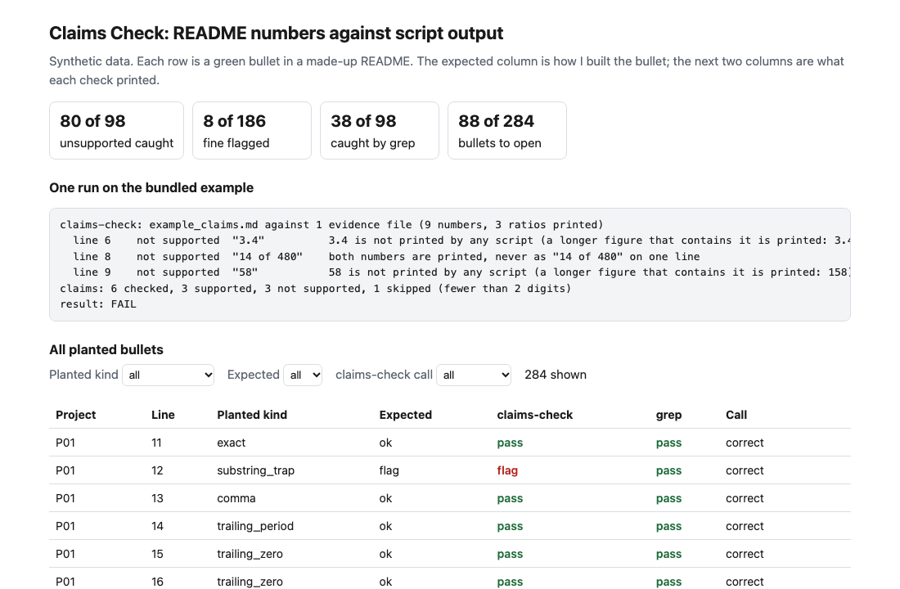
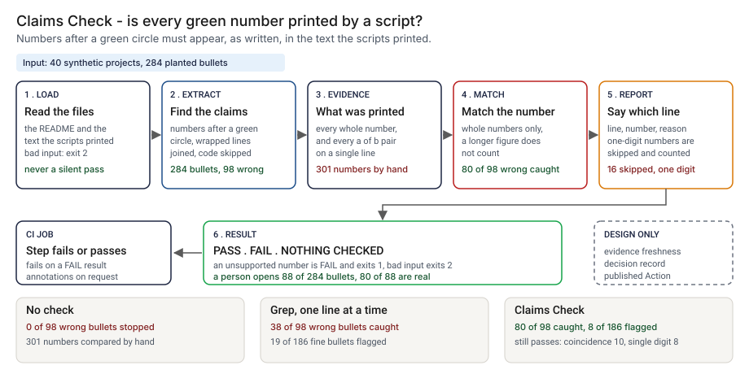
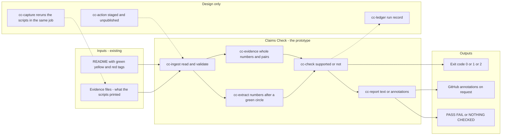
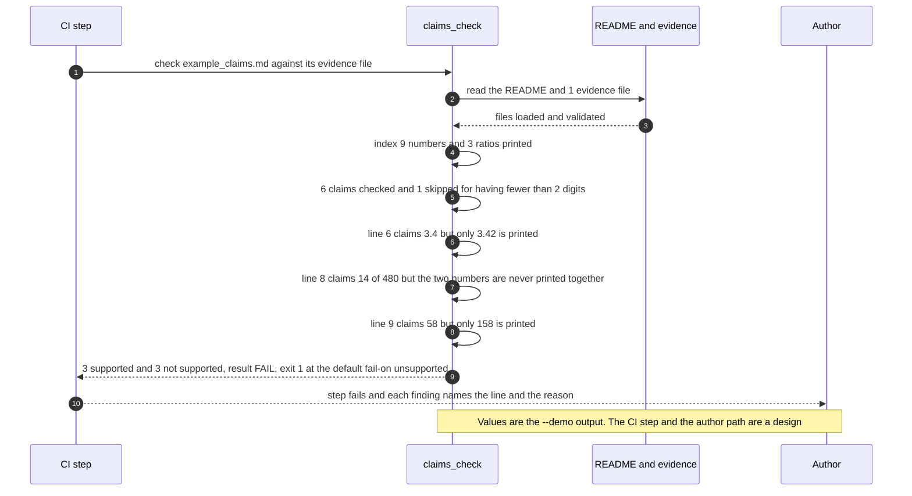

# 🧾 Claims Check: fail the build when a README number is not printed by a script

**I wanted to know how many of the numbers I tag as measured in my own READMEs are printed by a script, and how many were typed once and never checked again. This is a command-line check and a staged GitHub Action: it reads the numbers after each green circle in a README and fails when one is not printed, as a whole number, in the output of your scripts.** It is the number check from [`tools/check_repo.py`](../tools/check_repo.py) pulled out into a tool of its own, with three changes: whole-number matching, "a of b" matched as a pair, and wrapped bullets read as one item.

**▶ Static demo, no install:** [open demo.html](./demo.html)

[](./demo.html)

## Executive summary (90 seconds)

**Problem.** A README author publishes numbers next to code, and a reviewer approves the pull request that edits them. A figure that was right when it was typed goes stale when the script moves on, and CI stays green because nothing compares the two. A grep for the number does not fix it: it passes any number that is a piece of a longer one, and it reads a wrapped bullet one line at a time. 🟢 On 284 planted green bullets across 40 synthetic projects, 98 cite a number no script prints, the current CI stops 0 of 98, and a reviewer would compare 301 numbers by hand (`step_01_no_check.py`). A grep for each number catches 38 of 98 and flags 19 of 186 fine bullets (`step_02_grep_for_the_number.py`).

**Product.** Claims Check is a command that reads a README and the files holding what your scripts printed. It takes the numbers after each green circle, per paragraph, list item or table row, joins a bullet that wraps onto a second line, and skips fenced code, code spans, link targets and URLs. It then looks each number up as a whole number: 12 is not supported by a line that prints 112, and 40 is not supported by 40.3. A claim written "a of b" must be printed as a pair on one line. A number with fewer than two digits is skipped and counted. The result is PASS, FAIL or NOTHING CHECKED. The command exits 1 when a number is not printed and 2 when an input cannot be read, and `--format github` prints annotations. There is no model call and nothing is run; the rules are plain code you can read.

**Measured and modeled performance.**

- 🟢 **No check: 0 of 98 wrong bullets stopped,** and a reviewer would compare 301 numbers by hand (`step_01_no_check.py`).
- 🟢 **A grep for each number catches 38 of 98 wrong bullets and flags 19 of 186 fine ones.** It misses all 14 bullets whose number is a piece of a longer one, all 8 rounded figures, all 12 broken pairs and all 8 bullets that wrap onto a second line (`step_02_grep_for_the_number.py`).
- 🟢 **Each change adds catches:** reading claims first moves it to 46 of 98 with 0 of 186 false alarms, whole numbers to 68 of 98, and pairs to 80 of 98 (`step_03_deficiencies_exposed.py`).
- 🟢 **With all three changes a person opens 88 of 284 bullets, and 80 of 88 are real problems.** It catches 80 of 98 wrong bullets and flags 8 of 186 fine ones (`step_04_with_claims_check.py`).
- 🟢 **Known passes:** a wrong number that equals another printed number passes (coincidence 10 of 10), and so do wrong one-digit numbers (single_digit 8); 16 one-digit numbers are skipped (`step_04_with_claims_check.py`).
- 🟡 **Utility: (80/98 − 38/98) × 30 = 12.9 wrong green bullets a year caught that a grep would pass,** assuming 30 wrong green bullets are written each year.
- 🔴 **Design target: a result within 30 seconds of the evidence landing, from evidence captured in the same CI job.** Designed in [`ARCHITECTURE.md`](./ARCHITECTURE.md), never built or timed.

**What I would ask a head of operations to decide.** Whether a README that publishes green figures but has no number the check can read (the tags are missing, or every number has one digit) should fail the build or only warn. In the prototype it prints NOTHING CHECKED and exits 0; that is my policy, not a measurement. My recommendation is to run the check in shadow on one other README whose author agrees, count the flags the author overturns, keep two digits as the default, and capture the evidence in the same CI job so a stale file cannot pass.

**Call to action.** Fork the repo. Swap `data/projects.json` and `data/truth.csv` for your own READMEs and output, keeping the columns, or skip the data and point `check` at your README and a folder of captured output: `python3 claims_check.py check README.md --evidence out/*.txt`. To call it from code, import `extract_claims`, `index_evidence` and `check_claims` from `src/claims_check.py`. Tag your figures with the green, yellow and red circles the check reads, wrap identifiers such as `step_04` in backticks, and print "a of b" on one line in the script. Send findings by opening an issue: say which kind of bullet was flagged wrongly or passed, not your README.

_A portfolio prototype on synthetic data. Nothing here is deployed, load-tested or used by anyone, the tool has been run on this portfolio's own README and on nothing else, and the Action is staged and has not run on GitHub._

## Run one now

```bash
cd 39-claims-check/src && python3 claims_check.py --demo
```

It prints:

```text
claims-check: example_claims.md against 1 evidence file (9 numbers, 3 ratios printed)
  line 6    not supported  "3.4"          3.4 is not printed by any script (a longer figure that contains it is printed: 3.42)
  line 8    not supported  "14 of 480"    both numbers are printed, never as "14 of 480" on one line
  line 9    not supported  "58"           58 is not printed by any script (a longer figure that contains it is printed: 158)
claims: 6 checked, 3 supported, 3 not supported, 1 skipped (fewer than 2 digits)
result: FAIL
```

Standard library only, Python 3.9 or newer. To check your own README: `python3 claims_check.py check README.md --evidence out/*.txt`. It exits 1 when a number is not printed and 2 when an input cannot be read; `--format github` prints annotations.

## What the numbers say

**What it shows** (🟢 measured on synthetic data: 40 projects and 284 planted bullets, 98 of them wrong; the script is named in brackets):

- 🟢 With no check, 0 of 98 wrong bullets are stopped, and a reviewer would compare 301 numbers by hand (`step_01`)
- 🟢 The grep check from `check_repo.py` catches 38 of 98 wrong bullets and flags 19 of 186 fine ones (`step_02`)
- 🟢 That grep misses all 14 bullets whose number is a piece of a longer one, all 8 rounded figures, all 12 broken pairs and all 8 bullets that wrap onto a second line (`step_02`)
- 🟢 Reading claims first, with wrapped bullets joined and code spans and links skipped, moves it to 46 of 98 caught and 0 of 186 false alarms (`step_03`)
- 🟢 Matching whole numbers moves it to 68 of 98 caught, still 0 of 186 false alarms (`step_03`)
- 🟢 Matching "a of b" as a pair moves it to 80 of 98 caught: broken pairs go from 0 of 12 to 12 of 12 (`step_03`)
- 🟢 With all three changes a person opens 88 of 284 bullets, and 80 of 88 are real problems (`step_04`)

## What it still gets wrong

- 🟢 Numbers of one digit are skipped, 16 of them in this set, so a wrong small count passes (`step_04`). Checking them as well catches every wrong one and flags every bullet that carries a stray small numeral (`step_03`), which is why the default is two digits.
- 🟢 The pair rule has a price: it flags 8 of 186 fine bullets, the ones whose two numbers are printed on separate lines (`step_04`). Print "a of b" in the script, or pass `--no-pairs`.
- 🟢 A wrong number that equals another number the scripts print passes. All 10 such bullets pass (`step_04`); the row count and the seed are the usual accomplices. The tool checks that a number was printed, not what it was printed next to.
- **The data and the rules share an author.** I planted the wrong bullets and wrote the rules, so 80 of 98 shows that the rules cover what I planted. Treat it as a ceiling, not a rate on READMEs I have not seen. I have run it on this README (a test does that) and on nothing else.
- Evidence can be stale. If CI does not rerun the scripts, a number passes against last month's output. The tool reads files; it does not run anything.
- A rounded figure is flagged on purpose: write the number as the script prints it. The day in a printed date supports a claim of the same number, and so does any other printed number of the same value.
- Markdown paragraphs, lists and tables are read. HTML is not parsed. A number inside a Markdown link's text is a claim; a number inside a code span or a link target is not.

## Use it in CI

[`action/`](./action/README.md) holds a staged GitHub Action and the steps to publish it from its own repository, which a Marketplace listing requires. It has not been published and has not run on GitHub. What is tested is the command it wraps (`tests/test_cli.py`, 48 tests in all).

## How the four steps fit

| Step | Question | Script |
|---|---|---|
| 1 | What gets through when nothing ties README numbers to output? | `step_01_no_check.py` |
| 2 | What does grepping for each number cost and catch? | `step_02_grep_for_the_number.py` |
| 3 | What does each change to the check add, and what does it cost? | `step_03_deficiencies_exposed.py` |
| 4 | What do the default settings catch, and what still passes? | `step_04_with_claims_check.py` |

Run any of them from `src/`. Data is generated by [`data/_generate.py`](./data/README.md); the check in `tools/check_repo.py` confirms that a rerun reproduces every file and that the green numbers above appear in a script's output.

## Utility delivered

The way I price product impact: **utility = (my solution − current state of the art) × the number of people or items it affects.**

Here the item is a wrong green bullet: a number tagged as measured that no script prints. Each one lands on the README's author, the reviewer who approves the edit, and the reader who reruns the script. The common basic approach is a grep for each number, which is what `tools/check_repo.py` does; the table prices the tool against it.

| Term | Value | Where it comes from |
| --- | --- | --- |
| Current state of the art (grep, one line at a time), wrong bullets caught | 🟢 **38 of 98** | `step_02_grep_for_the_number.py`; it also flags 19 of 186 fine bullets |
| My solution (Claims Check), wrong bullets caught | 🟢 **80 of 98** | `step_04_with_claims_check.py`; it flags 8 of 186 fine bullets |
| Lift per wrong bullet | 🟢 80 of 98 minus 38 of 98 | The grep passes these, by planted kind: coincidence 10, pair_broken 12, rounded 8, single_digit 8, substring_trap 14, wrapped_bad 8 (`step_02_grep_for_the_number.py`) |
| Number it affects: wrong green bullets written in a year | 🟡 **30** | **Assumption, not a statistic.** Replace it with your own count of figures in a year that were wrong when published or went stale |
| Assumption that makes the lift real | 🟡 The evidence files are the current output of the scripts, and the author prints "a of b" on one line | If the evidence is stale, a number passes against old output; the tool reads files and runs nothing. If the wrong bullets are coincidences or one-digit numbers, nothing in `src/` catches them: coincidence 10 and single_digit 8 still pass (`step_04_with_claims_check.py`) |
| **Utility** | 🟡 **(80/98 − 38/98) × 30 = 12.9 wrong green bullets a year caught that a grep would pass** | Assumes the 30 behave like the 98 planted ones |

Sensitivity to the count assumption (🟡, same lift): 15 wrong green bullets a year gives 6.4, 30 gives 12.9, 60 gives 25.7.

🔴 What I have not measured: what a wrong published figure costs, how long a flag takes to read and clear, how often an author overturns a flag, or how often real READMEs go stale. The planted set is dense on purpose, 98 of 284 bullets are wrong (`step_01_no_check.py`); a real README has far fewer. Treat the result as a property of this mix of cases, not a forecast.

---

## Architecture and call flow

Component names match [`ARCHITECTURE.md`](./ARCHITECTURE.md). GitHub renders the diagrams natively.



**System topology:**



**Per-run sequence** (the `--demo` run, three numbers that do not hold):



**Interlocks (all red, designed, none built):**

- [51 memo-tieout](../51-memo-tieout/) applies the same tie-out idea to the figures in a credit memo and a spread. This folder does not read its files or code.
- [56 aigf-checks](../56-aigf-checks/) checks whether a crosswalk row still holds from the text a check printed. Both read printed output as evidence, and a shared evidence capture step (`cc-capture`) would serve both.
- [09 LineageLog](../09-lineagelog-ai-decision-audit/) is a possible home for the run record (`cc-ledger`).

---

## PM artifacts

The PM artifacts that show how I would run this product if I owned the seat. This README is the walkthrough; the rest of the folder holds:

- [`PRD.md`](./PRD.md): the product requirements doc, with users, backlog, KPIs, rollout and open questions.
- [`ARCHITECTURE.md`](./ARCHITECTURE.md): the systems doc, with components, data model, security, failure behavior and operations. A design, not deployed.
- [`demo.html`](./demo.html): clickable, no-install walkthrough, built from the step outputs by `src/_build_demo.py`.
- [`data/`](./data/): the 40 synthetic projects with their READMEs and printed output, the answer key for the 284 bullets, the worked example and the seeded generator. `data/README.md` explains how the truth is set.
- [`src/`](./src/): `claims_check.py`, `common.py`, the four step scripts and the demo builder.
- [`tests/`](./tests/): 48 unittest tests, including a golden test that pins the numbers above, a test that runs the tool on its own README, and tests for bad input and hostile strings.
- [`action/`](./action/README.md): the staged GitHub Action and the steps to publish it. Not published, not run on GitHub.

Run the four steps end to end:

```bash
cd src
python3 step_01_no_check.py
python3 step_02_grep_for_the_number.py
python3 step_03_deficiencies_exposed.py
python3 step_04_with_claims_check.py
```

---

## Aligned to

Nothing. I claim no alignment with a standard, framework or regulation. The credibility tags (green measured, yellow modeled, red hypothetical) are a convention of this portfolio, and this tool is what enforces the green ones. It is a prototype.

## Data and limits

Synthetic, seeded, byte-for-byte reproducible. Nothing comes from any employer, customer or real repository. 🟡 The two-digit minimum is my assumption, chosen to keep list numerals and step numbers out of the check. A prototype on synthetic data, not a production case study.

## Fork it

Swap `data/projects.json` and `data/truth.csv` for your own READMEs and output, keeping the columns, or skip the data and point `check` at your README and a folder of captured output. Read the [PRD](./PRD.md) for the scope I held to.

## Prereqs to run this on your laptop

You need Python 3.9 or newer and nothing else. The check, the four step scripts and the data generator use only the standard library, so there is nothing to install. There is no API key, no network call and no model call anywhere in the folder, and the tool never runs your scripts. To run the tests, use `python3 -m unittest discover -s tests` from this folder. The production pieces in [`ARCHITECTURE.md`](./ARCHITECTURE.md) (the evidence capture step, the run record, a published Action) are a design, not something you need or can run.

## Author

**Vijay Saharan**, Sr Product / Program Manager · AI in BFSI · Enterprise AI Platforms

[LinkedIn](https://www.linkedin.com/in/vijaysaharan/)
