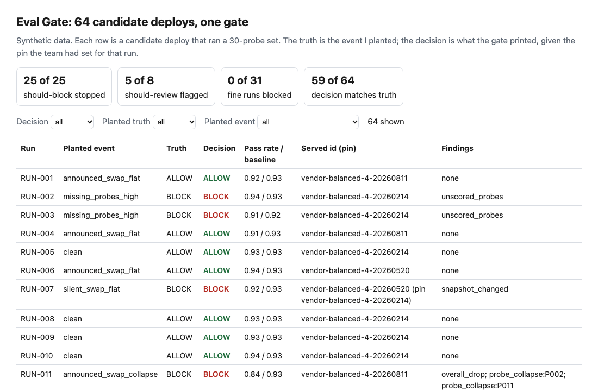
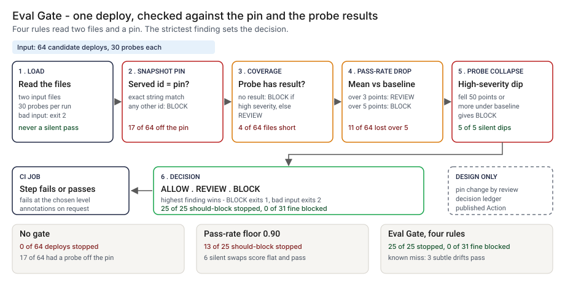
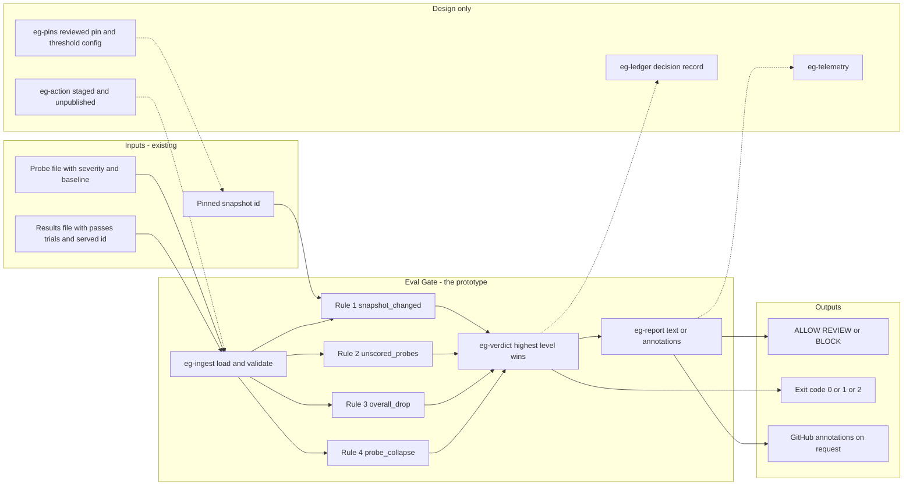
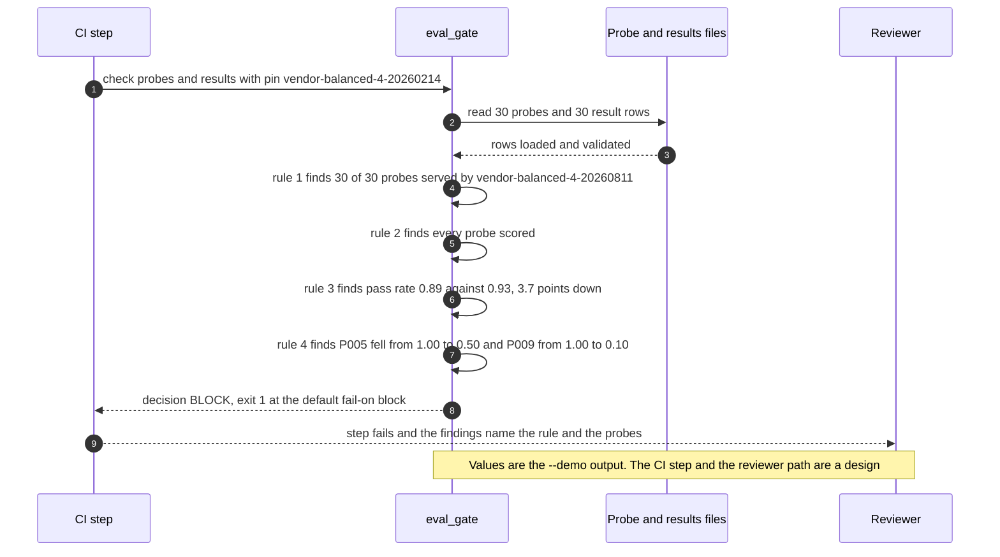

# 🚦 Eval Gate: a CI gate on probe-set regression

**I wanted to know what stops a deploy when a model vendor changes the snapshot behind an API name and the pass rate on my probes barely moves. In a pipeline that gates only on the pass rate, the answer is nothing. This is a command-line gate and a staged GitHub Action: it reads a probe file and a results file, compares the snapshot id each response reported with the one I pinned, and prints ALLOW, REVIEW or BLOCK.** It takes the CI gate in [04 EvalForge](../04-evalforge-llm-eval-platform/) and turns it into a command that reads two files, so any pipeline can run it. The 3 and 5 point lines are 04's; the rules around them are new.

**▶ Static demo, no install:** [open demo.html](./demo.html)

[](./demo.html)

## Executive summary (90 seconds)

**Problem.** A team at a modeled bank calls a hosted model through a name, and the vendor can change the snapshot behind that name. The engineer who owns the deploy pipeline and the reviewer who signs off on a new snapshot see the pass rate on the probe set and nothing else: no step compares the snapshot that answered with the one the team pinned. 🟢 On 64 synthetic candidate deploys of a 30-probe set, a pipeline with no check stops 0 of 64, while 17 of 64 had a probe answered by an id other than the pin and 11 of 64 lost more than 5 points of mean pass rate (`step_01_no_gate.py`). A changed snapshot ships, and the team hears about it from a complaint or from nothing.

**Product.** Eval Gate is a command that reads a probe file and a results file, applies four rules in order and prints ALLOW, REVIEW or BLOCK. `snapshot_changed`: any probe served by an id other than the pin is a BLOCK. `unscored_probes`: a probe with no result is a BLOCK if any such probe is high severity, otherwise a REVIEW. `overall_drop`: a mean pass rate more than 3 points under the mean baseline is a REVIEW, more than 5 points a BLOCK. `probe_collapse`: a high-severity probe 50 points or more under its baseline is a BLOCK. The highest level wins. The command exits 1 at the level you choose (BLOCK by default) and 2 for malformed input, so a pipeline step fails with a reason. There is no model call; the rules are plain code you can read.

**Measured and modeled performance.**

- 🟢 **No gate: 0 of 64 deploys stopped.** 17 of 64 had a probe answered by an id other than the pin, 7 of those partial rollouts, and 11 of 64 lost more than 5 points of mean pass rate (`step_01_no_gate.py`).
- 🟢 **A pass-rate floor of 0.90 stops 13 of 25 should-block deploys** and passes all 6 silent swaps whose scores did not move (`step_02_pass_rate_floor.py`).
- 🟢 **Each half fails alone:** an alarm on any id change stops 23 of 25 should-block deploys and 6 of 31 fine ones; the pin alone stops 17 of 25; the probe rules alone stop 17 of 25 (`step_03_deficiencies_exposed.py`).
- 🟢 **Together: 25 of 25 should-block deploys stopped,** 0 of 31 fine blocked and 1 of 31 sent to review; the decision matches the planted truth on 59 of 64 (`step_04_with_gate.py`).
- 🟢 **Review: 5 of 8 should-review deploys flagged.** Three subtle drifts (RUN-042, RUN-052 and RUN-061) pass; that is the known miss (`step_04_with_gate.py`).
- 🟢 **Noise: on 25 clean runs the mean drop is 0.2 points and the worst is 3.3 points, 1 over the 3-point review line** (`step_03_deficiencies_exposed.py`).
- 🟡 **Utility: (25/25 − 13/25) × 10 = 4.8 should-block deploys a year stopped that a 0.90 floor would pass,** assuming 10 should-block deploys reach the gate each year.
- 🔴 **Design target: a decision within 60 seconds of the results file landing.** Designed in [`ARCHITECTURE.md`](./ARCHITECTURE.md), never built or timed.

**What I would ask a head of operations to decide.** Whether a snapshot id that changed without an announcement should stop a deploy when the scores do not move. I set it to BLOCK as my policy, not as a measurement. My recommendation is to adopt the pin rule as written, run the drop rules in advisory mode on one real harness export first, and set the 3 and 5 point lines against that harness's own noise, since the worst clean run here sat 3.3 points under its baseline.

**Call to action.** Fork the repo. Swap `data/probes.csv` and `data/example_results.csv` (or `data/runs.csv`, which holds one `run_id` per run) for your own exports and keep the columns `probe_id, severity, baseline_rate` and `probe_id, passes, trials, served_model`, then point `check` at them with your pin. To call it from code, import `evaluate` from `src/eval_gate.py`. Make sure your harness writes `served_model` from the response and not from the request. Send findings by opening an issue: say which rule fired and how many probes, not the data itself.

_A portfolio prototype on synthetic data. Nothing here is deployed, load-tested or used by anyone, and the Action is staged and has not run on GitHub._

## Run one now

```bash
cd 40-eval-gate/src && python3 eval_gate.py --demo
```

It prints:

```text
run: single run   pin vendor-balanced-4-20260214   30 of 30 probes scored
pass rate 0.89 against a baseline of 0.93 (-3.7 points)
  [BLOCK ] snapshot_changed 30 of 30 probes were served by vendor-balanced-4-20260811, not the pinned vendor-balanced-4-20260214. Read the vendor's notice and re-run before moving the pin.
  [REVIEW] overall_drop     mean pass rate 0.89 is 3.7 points below the baseline 0.93 (review above 3.0, block above 5.0).
  [BLOCK ] probe_collapse   high-severity probe P005 fell from 1.00 to 0.50.
  [BLOCK ] probe_collapse   high-severity probe P009 fell from 1.00 to 0.10.
decision: BLOCK
```

Standard library only, Python 3.9 or newer. To check your own files: `python3 eval_gate.py check probes.csv results.csv --pin vendor-balanced-4-20260214`. It exits 1 on BLOCK, so a CI step fails; `--format github` prints annotations. The probe file needs `probe_id`, `severity` and `baseline_rate`; the results file needs `probe_id`, `passes`, `trials` and `served_model`.

## What the numbers say

**What it shows** (🟢 measured on synthetic data: 64 planted deploys of a 30-probe set; the script is named in brackets):

- 🟢 No check on the served id: 0 of 64 deploys stopped, 17 of 64 had a probe answered by an id other than the pin (7 of those were partial rollouts), and 11 of 64 lost more than 5 points of mean pass rate (`step_01_no_gate.py`)
- 🟢 A pass-rate floor of 0.90 stops 13 of 25 should-block deploys and passes all 6 silent swaps whose scores did not move (`step_02_pass_rate_floor.py`)
- 🟢 An alarm on any id change stops 23 of 25 should-block deploys and also stops 6 of 31 fine ones, the swaps the team had announced (`step_03_deficiencies_exposed.py`)
- 🟢 The pin alone stops 17 of 25 and 0 of 31 fine; the probe rules alone stop 17 of 25 and flag 5 of 8 should-review. They miss different deploys (`step_03_deficiencies_exposed.py`)
- 🟢 Pin, coverage, drop and collapse together: 25 of 25 should-block deploys stopped, 5 of 8 should-review flagged, 0 of 31 fine blocked and 1 of 31 sent to review; the decision matches the planted truth on 59 of 64 (`step_04_with_gate.py`)

## What it still gets wrong

- 🟢 Three subtle drifts pass: RUN-042, RUN-052 and RUN-061 (`step_04_with_gate.py` prints each). The id is unchanged and the mean pass rate moved about two points, which ten trials per probe cannot tell from noise; the worst clean run sat 3.3 points under its baseline.
- 🟢 1 of 31 fine runs goes to review on noise alone (`step_04_with_gate.py`), and one of the three moderate drifts reached BLOCK where I labeled it REVIEW.
- **The test set and the rules share an author.** I planted the events and wrote the rules, so 25 of 25 shows the rules cover what I planted. Treat it as a ceiling for these rules, not a rate on a real pipeline, which I have not tested.
- **The blocking of a silent swap that scores the same is my policy.** The truth label says an id change nobody announced is read before it ships. If you would rather ship on a flat score, drop the first rule; the other three still run.
- **The pin is only as good as the person who moves it.** Updating it without reading the vendor's notice turns rule one into a formality.
- The gate trusts `served_model`. If the harness copies the id it asked for instead of the one the response reported, or a gateway rewrites the id, the comparison means nothing. The match is an exact string; a vendor that reports the same model under two spellings would raise a false BLOCK.
- 🟡 The 3 and 5 point lines and the 0.90 pass-rate threshold are the constants 04 uses, taken here as assumptions. The 50-point collapse line is mine. None is tuned on real traffic.
- The gate reads `passes` as given. It does not judge answers, so judge noise is outside it, and it does not refresh the baseline.

## Use it in CI

[`action/`](./action/README.md) holds a staged GitHub Action and the steps to publish it from its own repository, which a Marketplace listing requires. It has not been published and has not run on GitHub. What is tested is the command it wraps (`tests/test_cli.py`; 46 tests in `tests/` in all).

## How the four steps fit

| Step | Question | Script |
|---|---|---|
| 1 | What ships when nothing checks the served snapshot? | `step_01_no_gate.py` |
| 2 | What does a pass-rate floor catch and miss? | `step_02_pass_rate_floor.py` |
| 3 | Where does each half fail alone? | `step_03_deficiencies_exposed.py` |
| 4 | What do pin, coverage, drop and collapse catch together? | `step_04_with_gate.py` |

Run any of them from `src/`. Data comes from [`data/_generate.py`](./data/README.md); the check in `tools/check_repo.py` confirms that a rerun reproduces every file and that the green numbers above appear in a script's output.

## Utility delivered

The way I price product impact: **utility = (my solution − current state of the art) × the number of people or items it affects.**

Here the item is a deploy that should have been stopped. Each one lands on the engineer who owns the pipeline, the reviewer who signs off on the snapshot, and whoever would otherwise take the complaint. The common basic approach is a floor on the mean pass rate; the table prices the gate against it.

| Term | Value | Where it comes from |
| --- | --- | --- |
| Current state of the art (pass-rate floor of 0.90), should-block deploys stopped | 🟢 **13 of 25** | `step_02_pass_rate_floor.py`; it also stops 1 of 31 fine deploys |
| My solution (Eval Gate), should-block deploys stopped | 🟢 **25 of 25** | `step_04_with_gate.py`; 0 of 31 fine deploys blocked |
| Lift per should-block deploy | 🟢 25 of 25 minus 13 of 25 | The floor lets these through, by planted event: announced_swap_collapse 1, missing_probes_high 2, silent_swap_collapse 3, silent_swap_flat 6 (`step_02_pass_rate_floor.py`) |
| Number it affects: should-block deploys reaching the gate in a year | 🟡 **10** | **Assumption, not a statistic.** Replace it with your own count of deploys in a year that should have been stopped |
| Assumption that makes the lift real | 🟡 The pipeline step fails on BLOCK, and the harness writes `served_model` from the response | If the harness copies the id it asked for, rule one compares the pin with the pin, and the lift falls to what the probe rules alone give: 🟢 17 of 25 (`step_03_deficiencies_exposed.py`) |
| **Utility** | 🟡 **(25/25 − 13/25) × 10 = 4.8 should-block deploys a year stopped that a 0.90 floor would pass** | Assumes the 10 behave like the 25 planted ones |

Sensitivity to the count assumption (🟡, same lift): 5 deploys a year gives 2.4, 10 gives 4.8, 20 gives 9.6.

🔴 What I have not measured: what a stopped deploy is worth in time or money, how long a BLOCK takes to read and clear, what a false block costs a release, or how often a vendor changes a snapshot. The planted set is dense on purpose, 25 of 64 should be blocked (`step_01_no_gate.py`); a real pipeline sees far fewer. Treat the result as a property of this mix of cases, not a forecast.

---

## Architecture and call flow

Component names match [`ARCHITECTURE.md`](./ARCHITECTURE.md). GitHub renders the diagrams natively.



**System topology:**



**Per-run sequence** (the `--demo` run, a silent swap with a collapsed probe):



**Interlocks (all red, designed, none built):**

- [04 EvalForge](../04-evalforge-llm-eval-platform/) would supply the probe set and the baselines. The 3 and 5 point lines are copied from it as constants; this folder does not import or read its files.
- [13 SwapBrief](../13-swapbrief-model-migration/) is the go or no-go brief for a deliberate move to a new snapshot. After it says go, the pin moves through the reviewed change in `eg-pins`. Eval Gate does not compare cost or latency.
- [05 AgentWatch](../05-agentwatch-agent-observability/) watches a feature after release. Eval Gate looks at a candidate deploy once, before release, and does no production monitoring.
- [09 LineageLog](../09-lineagelog-ai-decision-audit/) is a possible home for the decision record (`eg-ledger`).

---

## PM artifacts

The PM artifacts that show how I would run this product if I owned the seat. This README is the walkthrough; the rest of the folder holds:

- [`PRD.md`](./PRD.md): the product requirements doc, with users, backlog, KPIs, rollout and open questions.
- [`ARCHITECTURE.md`](./ARCHITECTURE.md): the systems doc, with components, data model, security, failure behavior and operations. A design, not deployed.
- [`demo.html`](./demo.html): clickable, no-install walkthrough, built from the step outputs by `src/_build_demo.py`.
- [`data/`](./data/): the synthetic probe set, the 64 candidate deploys, their pins and planted truth, and the seeded generator. `data/README.md` explains how the truth is set.
- [`src/`](./src/): `eval_gate.py`, `common.py`, the four step scripts and the demo builder.
- [`tests/`](./tests/): 46 unittest tests, including a golden test that pins the numbers above and tests for bad input and hostile strings.
- [`action/`](./action/README.md): the staged GitHub Action and the steps to publish it. Not published, not run on GitHub.

Run the four steps end to end:

```bash
cd src
python3 step_01_no_gate.py
python3 step_02_pass_rate_floor.py
python3 step_03_deficiencies_exposed.py
python3 step_04_with_gate.py
```

---

## Aligned to

The [NIST AI RMF Playbook](https://airc.nist.gov/AI_RMF_Knowledge_Base/Playbook/Measure), MEASURE 2.4, which I read on 2026-10-23 (the page shows no publication date). It covers monitoring AI systems once they are in production and suggests comparing production metrics with pre-deployment test results. This gate runs a related comparison earlier, on the candidate deploy, and does no production monitoring. It is a prototype, aligned to that guidance. It makes no claim of conformity to it.

## Data and limits

Synthetic, seeded, byte-for-byte reproducible. Nothing comes from any employer, vendor or real model. A prototype on synthetic data, not a production case study.

## Fork it

Swap `data/probes.csv` and `data/runs.csv` for your own exports and keep the columns, or skip the data and point `check` at your harness output. Read the [PRD](./PRD.md) for the scope I held to.

## Prereqs to run this on your laptop

You need Python 3.9 or newer and nothing else. The gate, the four step scripts and the data generator use only the standard library, so there is nothing to install. There is no API key, no network call and no model call anywhere in the folder. To run the tests, use `python3 -m unittest discover -s tests` from this folder. The production pieces in [`ARCHITECTURE.md`](./ARCHITECTURE.md) (the reviewed pin config, the decision ledger, telemetry, a published Action) are a design, not something you need or can run.

## Author

**Vijay Saharan**, Sr Product / Program Manager · AI in BFSI · Enterprise AI Platforms

[LinkedIn](https://www.linkedin.com/in/vijaysaharan/)
