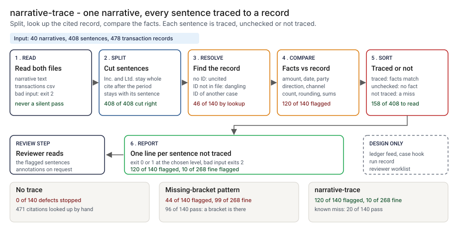

# Architecture: narrative-trace

> **Status.** This is the design for a production shape. The repo implements the product mechanic as a prototype: a command, `src/narrative_trace.py`, that splits a narrative into sentences, resolves each `[txn: ID]`, compares the facts a sentence states with the cited records and prints each sentence as traced, unchecked or not traced, run here over 40 synthetic narratives. No Action or service is staged. Nothing below is claimed as deployed or load-tested. Where a figure is a design target, it says so.

GCP is primary; AWS and Azure sit beside it.



---

## 1. Logical architecture

narrative-trace is a function between a case tool and a reviewer: a narrative and a transactions export in, a verdict per sentence out. It calls no model and files nothing.

Eight components: five decide the outcome, three support or report.

| Component | Responsibility | Language or framework | Decides the outcome? | Stateful? |
| --- | --- | --- | --- | --- |
| `nt-ingest` | Loads both files. Rejects empty, oversized, non-text, header-only, duplicate-ID or badly typed input with a one-line message. | Python 3.9+, standard library. Prototype: `read_text`, `load_records`, `Ledger` in `src/narrative_trace.py` | Yes, by refusing: exit 2 | No |
| `nt-split` | Cuts the text into sentences with offsets. Keeps "Inc." whole and a citation after the period with its sentence. | Python. Prototype: `split_sentences`, `_split_paragraph`, `ABBREV` | Yes | No |
| `nt-resolve` | Finds each `[txn: ID]`: none is uncited, an unknown ID is dangling, another case's ID is other-case. | Python. Prototype: `trace_sentence`, `CITE`, `Ledger.by_id` | Yes | No |
| `nt-compare` | Compares the amounts, dates, names, direction, channel and counts a sentence states with the cited records. | Python. Prototype: `check_facts`, `amounts_in`, `dates_in`, `direction_in`, `channels_in`, `counts_in` | Yes | No |
| `nt-verdict` | Maps findings to a status, and counts to an exit code at `--fail-on`. | Python. Prototype: `summarise`, `is_failure`, `UNTRACED` | Yes | No |
| `nt-report` | Prints text or GitHub annotations; escapes untrusted strings. | Python. Prototype: `render_text`, `render_github`, `clean`, `escape_data`, `escape_property`, `notes_for` | No | No |
| `nt-hook` | Starts a run when a draft is saved, posts the result to the case (design). | A small webhook receiver on the case tool (design) | No | No |
| `nt-record` | One record per run: input hashes, tool version, verdicts (design). | PostgreSQL plus object storage with a retention lock (design) | No | Stateful |

Three more pieces are design only and appear in the README diagram: `nt-feed`, a read-only ledger extract per case; `nt-queue`, the reviewer worklist; and `nt-telemetry`, off the decision path.

**What decides the outcome.** The input check, splitter, citation resolve, fact compare and verdict. The rest carry or record it. The tool compares a sentence with the records it cites; it does not know whether they are the right ones to cite.

**Repo structure** (production shape):

```
narrative-trace/
├── trace/      # ingest, split, resolve, compare, verdict, report
├── feed/       # ledger extract definition per case source
├── hook/       # case-tool trigger and result writer
├── record/     # run record writer
├── infra/      # terraform for gcp, aws, azure
├── docs/runbooks/
└── tests/      # unit, golden, splitter, hostile strings
```

---

## 2. Physical and deployment architecture

The check is one short-lived process that runs when a narrative moves toward review.

| Component | GCP (primary) | AWS | Azure | Why |
| --- | --- | --- | --- | --- |
| Trace process (`nt-ingest` to `nt-report`) | Cloud Run job | ECS Fargate task | Container Apps job | Stateless, one pass, no inbound traffic |
| `nt-hook` | Cloud Run service | Lambda or Fargate service | Container Apps service | One event per draft starts the job |
| `nt-feed` and the files a run used | Cloud Storage, versioned | S3, versioned | Blob Storage, versioned | The exact bytes a verdict used stay retrievable |
| `nt-record` | Cloud SQL for PostgreSQL | RDS for PostgreSQL | Azure Database for PostgreSQL | The platform team already runs it |

**Failure behavior (the decision that matters most).** The check must never silently pass. A missing, empty, oversized or malformed input does not become "no findings": it ends the run with exit 2 and a one-line reason, and that fails the step even with `--fail-on never`. A narrative that cites nothing is not clean: every sentence is reported uncited.

| Failure | Behavior | Alert |
| --- | --- | --- |
| Narrative or export missing, unreadable, over the size cap, not UTF-8 or empty | Exit 2, one line on stderr naming the file | P3 |
| Export with a missing column, wrong field count, duplicate `txn_id`, impossible date or non-numeric amount; `--case` with no `case_id` column | Exit 2 with the line number or reason | P3, P2 if repeated |
| No sentence cites a record, or none of the cited IDs is in the export | Findings for every sentence, plus a note that nothing could be traced or that the export may not match | P3 |
| Ledger feed late (design) | The run does not start; the narrative shows as not checked, never as a pass | P2 |
| Run record or telemetry down (design) | The verdict and exit code stand; the record queues locally | P3 |

**Latency.** The prototype is one pass over two small files; I have not timed it. 🔴 Design target: a result within 30 seconds of a draft being saved to the case. Recovery is a re-run from the same versioned inputs.

---

## 3. Data architecture

| Entity | Key | What it holds | Real columns in the prototype |
| --- | --- | --- | --- |
| Transaction record | `txn_id` | Case, date, amount, direction, channel, counterparty | `data/transactions.csv`: `txn_id`, `case_id`, `date`, `amount`, `direction`, `channel`, `counterparty` (empty for cash). `case_id` is needed only for `--case` |
| Narrative | `case_id` | Free text with `[txn: ID]` citations | `data/narratives.json`: `case_id`, `text`. The command reads a plain text file |
| Sentence | `case_id`, sentence number | Offsets, cited IDs, status, findings | In memory; step 4 writes `src/out/step_04_sentences.csv` |
| Run record | `run_id` | Design: case, both hashes, tool version, counts by status, findings, time | Prototype: `src/out/step_04_summary.json` |
| Planted truth | `case_id`, `sent_no` | The kind planted and the expected result | `data/truth.csv`: `case_id`, `sent_no`, `start`, `end`, `kind`, `expected`. Exists only because the data is synthetic |

**Retention** is a design choice; confirm it against the bank's own schedule. Run records and findings: 🔴 7 years design default, archived with a retention lock. The narrative and export a run used: the same period, in restricted versioned storage.

**Lineage.** The run record names the case, both hashes and the tool version; the versioned store returns those bytes; and the rules are deterministic (no clock, locale or random draw), so re-running `analyse` reproduces every sentence status. In the prototype the trace is a row of `step_04_sentences.csv`.

**Deliberately not stored.** A copy of the narrative text in the run record. It keeps hashes and counts, unless the bank's own policy asks for more.

---

## 4. Security architecture

**Identity and roles.** The trace runs under the platform's workload identity, with no account of its own. Roles: `nt:runner` reads one case's narrative and export and writes a run record (the job identity); `nt:approver` approves a change to the abbreviation list, word lists or tolerance rule, never their own (operations lead with the BSA / AML officer); `nt:auditor` reads run records, findings and config history (internal audit).

**Secrets.** The tool holds none and never calls a model, so no vendor key is in its path. The job uses workload identity, with no static keys. If a webhook or an Action is added, inputs pass through environment variables, never into a shell string.

**Data classification and what leaves the boundary.** Narrative text and transaction records are the bank's most restricted class; confirm against its own policy. In the prototype nothing leaves the machine. In the design three things leave the job: the exit code, the verdict lines posted to the case (each quotes at most 90 characters of a sentence), and the run record write.

| Threat | Example | Mitigation in the design |
| --- | --- | --- |
| Hostile string in a citation, counterparty name or file name echoed into a log or annotation | A citation holding a percent sign, a newline and text that looks like a workflow command | `escape_data` and `escape_property` rewrite `%`, carriage return and newline; `clean` flattens control characters. `tests/test_cli.py` covers a hostile citation, counterparty name and file name |
| Narrative or export edited after the check | A figure changed after the verdict, or an amount changed to match the text | Both hashes are stored; the case tool re-runs on a changed hash; a changed hash for a finished run is an alert |
| Wording edited until nothing is comparable | Amounts replaced by "a large sum" | Unchecked sentences are listed for the reviewer; the unchecked count per narrative is an SLI |

---

## 5. Operational architecture

**SLIs.** Narratives checked per week; sentences by status; input rejections; share of cited IDs found in the export; reviewer-reported false alarms; time to result. Prototype baseline on fine synthetic sentences: 🟢 10 of 268 flagged (`step_04_with_trace.py`).

**SLOs (all 🔴 design targets, none measured).**
- A result within 30 seconds of a draft being saved.
- Every narrative that reaches review has a run record for the version the reviewer sees.
- 99.9 percent of run records written.

**Alerts.** P2: repeated rejections for one source, or the feed late for more than a day. P3: no sentence cites a record, none of the cited IDs is in the export, or a changed hash. P4: a weekly digest of unchecked counts and false alarms.

**Runbooks** (one page each, in `docs/runbooks/`):
- `export-mismatch.md`: no cited ID is in the export; find the right extract and re-run.
- `false-alarm.md`: a reviewer reports a wrong flag; record the sentence class, not the text.
- `changing-a-rule.md`: propose, re-run the planted set, compare with the golden numbers, approve.
- `feed-late.md`: tell reviewers the narrative is not checked until the extract arrives.

**On-call and ownership.** The pipeline owner owns the runner, hook and runbooks. The operations lead owns the rules and the `--fail-on` choice; the BSA / AML officer approves rule changes. Nobody is paged for a not-traced sentence; that is the reviewer's worklist.

**Change control.** The abbreviation list, word lists and rounding rule live in the repo. A change needs a proposer and a different approver, and the planted set is re-run against the pinned numbers in `tests/test_golden.py`, so a change that moves the flagged count shows in the diff.

---

## 6. Alignment and posture

Alignment, not certification. The README cites one source, restated with the same wording about what was read: the FinCEN proposed AML/CFT program rule, announced in a [news release of 2026-04-07](https://www.fincen.gov/news/news-releases/fincen-proposes-rule-fundamentally-reform-financial-institution-programs). I read the release on 2026-10-23 and did not read the rule text. It describes a program judged on effectiveness and risk focus, and separates deficiencies of design from deficiencies of implementation. It does not mention suspicious activity report narratives or artificial intelligence.

- **What the design does.** It tests, on every narrative, that each statement traces to a record, and keeps a run record. That is the direction I take from the release, not a requirement it states.
- **What it does not claim.** It takes no requirement for narratives from the release and no limit, threshold or deadline from any rule. It makes no claim of conformity to that guidance, holds no certification, and I have not read or mapped any other source.

---

## 7. What is deliberately not here

- **Whether the narrative is complete or ready to file.** The check agrees a sentence with its record; it does not read for implication.
- **Laundered and mixed-record sentences.** 🟢 20 of 140 planted defects pass by default: 12 sentences that cite a real record and state something no field confirms, and 8 whose figures are each right for some cited record but bound to the wrong one (`step_04_with_trace.py`).
- **A way to tell an unsupported claim from a connecting sentence.** Both come back unchecked; `--fail-on unchecked` flags more of each, and the choice is the owner's.
- **Relative dates, amounts in words and unlisted names.** "The next day" and "nine thousand" are not read; "wrote a check" carries no direction.
- **Opening dates.** A date that is not a transaction date is read as a claim about the cited records, so it is flagged.
- **Real narratives.** The sentences are template-built and the data and the rules share an author, so the numbers are a ceiling; I have tested no real narrative.
- **Filing, hosting or a model call.** Out of scope.

---

## Appendix: sample contract

The call is the prototype's own; the `--demo` output is under "Run one now" in the README.

```bash
python3 narrative_trace.py check narrative.txt txns.csv --case C-007 --fail-on untraced --format text
```

A citation is `[txn: ID]` or `[txn: ID, ID]`. The export needs `txn_id`, `date`, `amount`, `direction`, `channel` and `counterparty`, plus `case_id` with `--case`. Exit status: 0 when no sentence is at or above `--fail-on`, 1 when one is, 2 for unreadable input.
