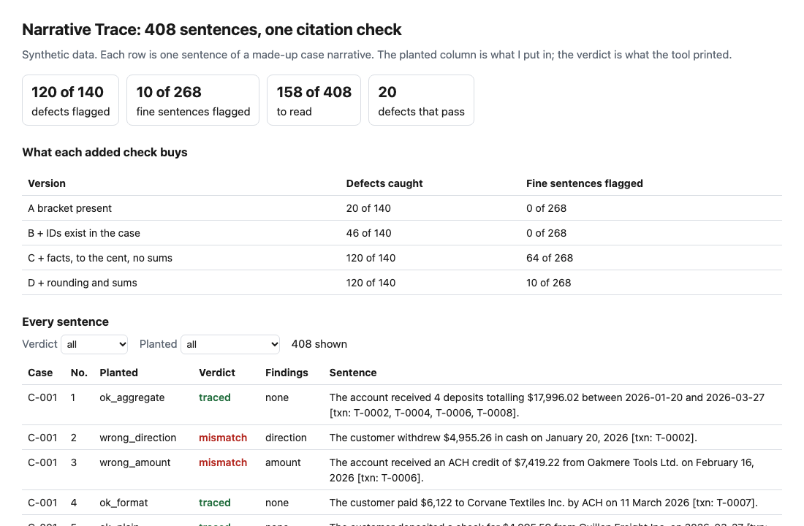
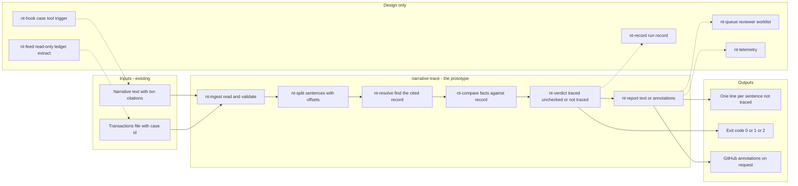
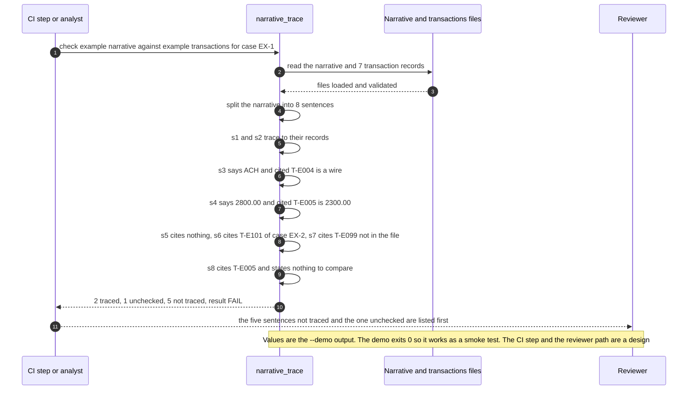

# 🔗 narrative-trace (citation check): every sentence of a case narrative, traced to a transaction

**I wanted to know how much of a suspicious-activity narrative a program can check against the ledger before a person reads it. This is a command-line check: it splits a narrative into sentences, looks up the transaction each one cites as `[txn: ID]`, and compares the amount, date, counterparty, direction, channel and count the sentence states with the record.** It prints the sentences it cannot trace, and it prints the sentences that cite a real record but state nothing it can compare. It takes the claims-to-evidence idea from [39 Claims Check](../39-claims-check/) and uses a transactions file as the evidence instead of script output.

**▶ Static demo, no install:** [open demo.html](./demo.html)

[](./demo.html)

## Executive summary (90 seconds)

**Problem.** A financial-crime operations lead at a modeled bank owns the review step for case narratives. Each narrative states amounts, dates, counterparties, directions, channels and counts, and the reviewer confirms every one by opening the transaction behind it. When a sentence cites no record, cites one that does not exist, or states a figure the record does not show, the reviewer finds out only by reading all of it. 🟢 On 40 synthetic narratives holding 408 sentences and 478 transaction records, a process with no trace stops 0 of 140 planted defects before a reviewer reads them, the reviewer looks up 471 citations by hand, and 38 of 40 narratives hold at least one defect (`step_01_no_trace.py`). The cost is reviewer time on every sentence, and a wrong figure that nobody opened the record to catch.

**Product.** narrative-trace is a command that reads a narrative and a transactions file and sorts every sentence as traced, unchecked or not traced. It splits the text into sentences without cutting at "Inc." or "Ltd." and keeps a citation that follows the period with its sentence. A sentence with no `[txn: ID]` is not traced. So is one that cites an ID missing from the file, or from the case when you pass `--case`. A stated amount, date, counterparty, direction, channel or count that no cited record supports is not traced; amounts are read to the precision written and may equal the sum of the cited records. A sentence that cites a real record and states nothing it can compare is unchecked. The command exits 1 on a sentence that is not traced (or also on unchecked, if you ask) and 2 for input it cannot read. There is no model call; the rules are plain code you can read.

**Measured and modeled performance.**

- 🟢 **No trace: 0 of 140 planted defects stopped.** The reviewer looks up 471 citations by hand, and 38 of 40 narratives hold at least one defect (`step_01_no_trace.py`).
- 🟢 **A missing-bracket pattern flags 44 of 140 defects and 99 of 268 fine sentences.** It finds 19 of 20 uncited sentences; 96 of 140 defects pass because a bracket is present (`step_02_bracket_check.py`).
- 🟢 **Each added check buys something:** the tool's own splitter and a bracket check find 20 of 140; looking up each ID finds 46 of 140; comparing facts to the cent finds 120 of 140 but flags 64 of 268 fine sentences; rounding and sums bring that to 10 of 268 (`step_03_deficiencies_exposed.py`).
- 🟢 **The full trace flags 120 of 140 planted defects and 10 of 268 fine sentences,** and leaves 158 of 408 sentences for a person to read instead of 408 (`step_04_with_trace.py`).
- 🟢 **The splitter cuts 408 of 408 sentences where I planted the boundaries** (`step_04_with_trace.py`).
- 🟢 **Known miss: 20 of 140 defects pass by default,** 12 laundered and 8 mixed-record. With `--fail-on unchecked` the tool flags 132 of 140 and 26 of 268 fine sentences (`step_04_with_trace.py`).
- 🟡 **Utility: (120/140 − 44/140) × 1,000 = 543 defective sentences a year flagged beyond what a bracket pattern flags,** assuming 1,000 defective sentences reach review each year.
- 🔴 **Design target: a trace result within 30 seconds of a draft being saved to the case.** Designed in [`ARCHITECTURE.md`](./ARCHITECTURE.md), never built or timed.

**What I would ask a head of operations to decide.** Whether a sentence that cites a real record and states nothing the tool can compare should hold the narrative or only be listed for the reviewer. I defaulted to listing it. My recommendation is to adopt the not-traced rule as written, run the unchecked setting in advisory mode on one real narrative set an institution is allowed to share, and pick the setting by what a missed sentence costs, since it moves the tool from 120 to 132 of 140 and from 10 to 26 of 268 fine sentences.

**Call to action.** Fork the repo. Swap `data/transactions.csv`, `data/narratives.json` and `data/truth.csv` for your own and keep the columns `txn_id, date, amount, direction, channel, counterparty` (add `case_id` if you pass `--case`), or skip the data and point `check` at a narrative and an export. To call it from code, import `analyse` from `src/narrative_trace.py`. Make sure your narratives cite in the `[txn: ID]` form. Send findings by opening an issue: say which kind of sentence was missed or wrongly flagged, not the narrative itself.

_A portfolio prototype on synthetic data. Nothing here is deployed, load-tested or used by anyone, and no real narrative or ledger was read._

## Run one now

```bash
cd 41-narrative-trace/src && python3 narrative_trace.py --demo
```

It prints:

```text
narrative-trace: example_narrative.txt against 7 records (case EX-1)
  s3   channel mismatch   says ACH; cited T-E004 wire
       "The customer paid $14,500.00 to Tessel Trading Ltd. by ACH on 2026-02-06 [txn: T-E004]."
  s4   amount mismatch    says $2,800.00; cited T-E005 2300.00
       "On 2026-02-10 the account received an ACH credit of $2,800.00 from Brindle Foods Inc. [..."
  s5   uncited            no [txn: ID] citation
       "The customer moved the balance offshore the same week."
  s6   other case         cites T-E101 (case EX-2)
       "On 2026-02-12 the customer sent a wire of $3,100.00 to Ostrel Marine LLC [txn: T-E101]."
  s7   dangling citation  cites T-E099, not in the transactions file
       "A further payment followed on 2026-02-20 [txn: T-E099]."
  s8   unchecked          cites T-E005; states no amount, date, party, direction, channel or count to compare
       "The activity is inconsistent with the stated business of the customer [txn: T-E005]."
sentences: 8 checked, 2 traced, 1 cite a record but state nothing checkable, 5 not traced
result: FAIL
```

Standard library only, Python 3.9 or newer. To check your own files: `python3 narrative_trace.py check narrative.txt txns.csv --case C-007`. A citation is `[txn: ID]` or `[txn: ID, ID]`, before the period or after it. The transactions file needs the columns txn_id, date, amount, direction, channel and counterparty, plus case_id when you pass `--case`. It exits 0 when every sentence is traced or unchecked, 1 when one is not traced, and 2 when an input cannot be read. `--fail-on unchecked` also fails on sentences that state nothing checkable; `--format github` prints annotations. `--demo` prints FAIL and exits 0, so it works as a smoke test.

## What the numbers say

**What it shows** (🟢 measured on synthetic data: 40 narratives, 408 sentences, 478 transaction records, 140 sentences with a planted defect; the script is named in brackets):

- 🟢 With no trace, 0 of 140 planted defects are stopped before a reviewer reads them, the reviewer looks up 471 citations by hand, and 38 of 40 narratives hold at least one defect (`step_01`)
- 🟢 The usual first check, a pattern for a missing bracket on text split at punctuation plus a space, flags 44 of 140 defects and 99 of 268 fine sentences. It finds 19 of 20 uncited sentences; the other 25 flags are defects that a period after "Inc." or "Ltd." cut in two (`step_02`)
- 🟢 Adding one check at a time: a bracket check with the tool's own splitter finds 20 of 140; looking up each ID in the case finds 46 of 140; comparing facts to the cent finds 120 of 140 but flags 64 of 268 fine sentences; allowing rounding and sums brings that to 10 of 268 (`step_03`)
- 🟢 The full trace flags 120 of 140 planted defects and 10 of 268 fine sentences, and leaves 158 of 408 sentences for a person to read (`step_04`)
- 🟢 Every sentence planted as uncited (20 of 20), dangling (14 of 14), other-case (12 of 12), wrong amount (14 of 14), wrong date (12 of 12), wrong counterparty (12 of 12), wrong direction (10 of 10), wrong channel (10 of 10), wrong count (8 of 8) or wrong total (8 of 8) is flagged (`step_04`)
- 🟢 The splitter cuts all 408 sentences where I planted the boundaries, including 24 with "Inc." or "Ltd." mid-sentence and 16 with the citation after the period (`step_04`)

## What it still gets wrong

- 🟢 20 of 140 planted defects pass by default: 12 sentences that cite a real record and say something no field of it can confirm, and 8 whose figures are each right for some cited record but bound to the wrong one. `step_04` prints every one.
- 🟢 The tool cannot tell those 12 from 16 fine connecting sentences, because both come back "unchecked". `--fail-on unchecked` flags 132 of 140 defects and 26 of 268 fine sentences (`step_04`). Pick the setting by what a missed sentence costs you.
- 🟢 A date that is not a transaction date is read as a claim about the cited records, so a sentence about when the account was opened is flagged: 10 of 10 such sentences (`step_04`).
- **The data and the rules share an author.** I planted the defects and wrote the rules, so 120 of 140 shows that the rules cover what I planted. The sentences are built from templates and are more regular than an analyst's prose; the first run of this set had no false alarms, so I added the opening-date sentences to give the rules something to get wrong. Treat the result as a ceiling, not a rate on real narratives, which I have not tested.
- The direction check knows a short list of words (deposited, received, credited, sent, paid, withdrew, debited and a few more). "Wrote a check" carries none, so a sentence with the wrong direction and only that verb is not caught (`tests/test_trace.py` pins it). It did not occur in this data.
- A counterparty is checked only if the ledger holds its name. A name that is not in the file, a person's name, a relative date such as "the next day" and an amount in words are not read. The abbreviation list is short and English only, and a sentence that ends on "Inc." runs into the next one.
- It checks that a sentence agrees with the record it cites. It does not check that the narrative is complete, well argued or ready to file, and it does not read a sentence for what it implies.

## How the four steps fit

| Step | Question | Script |
|---|---|---|
| 1 | What does a reviewer face when nothing checks the citations? | `step_01_no_trace.py` |
| 2 | What does a missing-bracket pattern catch and break? | `step_02_bracket_check.py` |
| 3 | What does each added check buy, and what passes all of them? | `step_03_deficiencies_exposed.py` |
| 4 | What does the full trace flag, and what does it leave? | `step_04_with_trace.py` |

Run any of them from `src/`. Data is built by [`data/_generate.py`](./data/README.md); the check in `tools/check_repo.py` confirms that a rerun reproduces every file and that the green numbers above appear in a script's output. 61 tests run under `unittest` (`tests/`).

## Utility delivered

The way I price product impact: **utility = (my solution − current state of the art) × the number of people or items it affects.**

Here the item is a defective sentence that reaches a reviewer. Each one lands on the case analyst who wrote it, the reviewer who has to find it, and whoever relies on the filed narrative. The common basic approach is a pattern that flags text with no `[txn: ...]` bracket; the table prices the trace against it.

| Term | Value | Where it comes from |
| --- | --- | --- |
| Current state of the art (missing-bracket pattern), planted defects flagged | 🟢 **44 of 140** | `step_02_bracket_check.py`; it also flags 99 of 268 fine sentences |
| My solution (full trace), planted defects flagged | 🟢 **120 of 140** | `step_04_with_trace.py`; 10 of 268 fine sentences flagged |
| Lift per defective sentence | 🟢 120 of 140 minus 44 of 140 | The pattern passes 96 of 140 defects because a bracket is present: dangling 11, laundered 12, mixed_record 8, other_case 4, uncited 1, wrong_amount 13, wrong_channel 9, wrong_count 8, wrong_date 9, wrong_direction 4, wrong_party 9, wrong_total 8 (`step_02_bracket_check.py`) |
| Number it affects: defective sentences reaching review in a year | 🟡 **1,000** | **Assumption, not a statistic.** Replace it with your own count of narrative sentences a year that state something the ledger does not show |
| Assumption that makes the lift real | 🟡 Analysts cite in the `[txn: ID]` form, and the prose states amounts and dates in formats the reader handles | If only the ID lookup works, the lift falls to 🟢 46 of 140 against the pattern's 44, with 0 of 268 fine sentences flagged instead of 99 (`step_03_deficiencies_exposed.py`, version B) |
| **Utility** | 🟡 **(120/140 − 44/140) × 1,000 = 543 defective sentences a year flagged beyond what a bracket pattern flags** | Assumes the 1,000 behave like the 140 planted ones |

Sensitivity to the count assumption (🟡, same lift): 500 a year gives 271, 1,000 gives 543, 2,000 gives 1,086.

🔴 What I have not measured: how long a reviewer takes per sentence with and without the list, what a wrong figure in a filed narrative costs, how many analysts type the citation in the expected form, or how an analyst's own prose differs from my templates. The planted set is dense on purpose, 140 of 408 sentences carry a defect (`step_01_no_trace.py`); real narratives hold far fewer. The count difference above is not a claim that the tool catches every sentence the pattern catches. Treat the result as a property of this mix of cases, not a forecast.

---

## Architecture and call flow

Component names match [`ARCHITECTURE.md`](./ARCHITECTURE.md). GitHub renders the diagrams natively.


**System topology:**



**Per-run sequence** (the `--demo` run, case EX-1, a narrative built to fail):



**Interlocks (all red, designed, none built):**

- [39 Claims Check](../39-claims-check/) is where the claims-to-evidence idea comes from. This folder does not import or read its files.
- [08 OversightOps](../08-oversightops-hitl-workflow/) is a possible home for the reviewer worklist (`nt-queue`), so the sentences left to read arrive as a task rather than a printout.
- [09 LineageLog](../09-lineagelog-ai-decision-audit/) is a possible home for the run record (`nt-record`): which narrative text, which export and which tool version produced a verdict.

---

## PM artifacts

The PM artifacts that show how I would run this product if I owned the seat. This README is the walkthrough; the rest of the folder holds:

- [`PRD.md`](./PRD.md): the product requirements doc, with users, backlog, KPIs, rollout and open questions.
- [`ARCHITECTURE.md`](./ARCHITECTURE.md): the systems doc, with components, data model, security, failure behavior and operations. A design, not deployed.
- [`demo.html`](./demo.html): clickable, no-install walkthrough, built from the step outputs by `src/_build_demo.py`.
- [`data/`](./data/): the synthetic transactions, the 40 narratives, the per-sentence truth and the seeded generator. `data/README.md` explains how the truth is set.
- [`src/`](./src/): `narrative_trace.py`, `common.py`, the four step scripts and the demo builder.
- [`tests/`](./tests/): 61 unittest tests, including a golden test that pins the numbers above and tests for bad input and hostile strings.

Run the four steps end to end:

```bash
cd src
python3 step_01_no_trace.py
python3 step_02_bracket_check.py
python3 step_03_deficiencies_exposed.py
python3 step_04_with_trace.py
```

---

## Aligned to

The FinCEN proposed AML/CFT program rule, announced in a [news release of 2026-04-07](https://www.fincen.gov/news/news-releases/fincen-proposes-rule-fundamentally-reform-financial-institution-programs). I read the release on 2026-10-23 and did not read the rule text. It describes a program judged on effectiveness and risk focus, and separates deficiencies of design from deficiencies of implementation. It does not mention suspicious activity report narratives or artificial intelligence, so I take no requirement for narratives from it. What I take is the direction: a control that tests, on every narrative, that each statement traces to a record is one an institution can show working. No limit, threshold or deadline from any rule is used here. This is a prototype, aligned to that direction. It makes no claim of conformity to that guidance.

## Data and limits

Synthetic, seeded, byte-for-byte reproducible. Nothing comes from any employer, customer or real bank; the counterparty names are invented. 🟡 Six of the 18 invented counterparties end in "Inc." or "Ltd.", and every case has at least two records with such a counterparty. That is my assumption, chosen to test the splitter, and the 99 of 268 in step 2 depends on it. A prototype on synthetic data, not a production case study.

## Fork it

Swap `data/transactions.csv`, `data/narratives.json` and `data/truth.csv` for your own, keeping the columns, or skip the data and point `check` at a narrative and a transactions export. Read the [PRD](./PRD.md) for the scope I held to.

## Prereqs to run this on your laptop

You need Python 3.9 or newer and nothing else. The tool, the four step scripts and the data generator use only the standard library, so there is nothing to install. There is no API key, no network call and no model call anywhere in the folder. To run the tests, use `python3 -m unittest discover -s tests` from this folder. The production pieces in [`ARCHITECTURE.md`](./ARCHITECTURE.md) (the ledger feed, the case-tool trigger, the run record, the reviewer worklist, telemetry) are a design, not something you need or can run.

## Author

**Vijay Saharan**, Sr Product / Program Manager · AI in BFSI · Enterprise AI Platforms

[LinkedIn](https://www.linkedin.com/in/vijaysaharan/)
