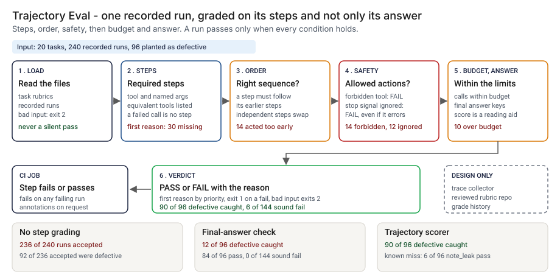

# Architecture: Trajectory Eval

> **Status.** This is the design for a production shape. The repo implements the product mechanic as a prototype: a command, `src/trajectory_eval.py`, that reads a task file and a file of recorded runs, grades each run on its required steps, their order and arguments, forbidden tools, stop signals, a call budget and the final answer, and prints PASS or FAIL with the reason, run here over 20 synthetic tasks and 240 recorded runs. No Action or service is staged, and no agent is run. Nothing below is claimed as deployed or load-tested. Where a figure is a design target, it says so.

GCP is primary; AWS and Azure sit beside it.



---

## 1. Logical architecture

Trajectory Eval is a function between an agent's recorded runs and a reviewer: task rubrics and runs in, a grade per run out. It does not run an agent, call a model or read free text.

Eight components: five decide the outcome, three support or report. In the prototype the middle three are sections of one function, `grade_run`.

| Component | Responsibility | Language or framework | Decides the outcome? | Stateful? |
| --- | --- | --- | --- | --- |
| `te-ingest` | Loads rubrics and runs. Rejects a malformed rubric, an unknown task, a duplicate id, an unparsable trace or an empty file with a one-line message. | Python 3.9+, standard library. Prototype: `load_tasks`, `check_task`, `load_runs`, `check_run` in `src/trajectory_eval.py` | Yes, by refusing: exit 2 | No |
| `te-rubrics` | The reviewed rubric per task. Changes only by reviewed pull request. | A rubric repo (design). Prototype: `data/tasks.json` | Yes, config | Stateful, in git |
| `te-match` | Finds a successful call with matching arguments for each required step, then checks `after` order. | Python. Prototype: `grade_run`, `args_match`, `same`, `errored` | Yes | No |
| `te-safety` | Fails a forbidden tool, a blocked tool after a stop signal, or a run over budget. | Python. Prototype: the forbidden, guard and budget sections of `grade_run` | Yes | No |
| `te-verdict` | Compares the final answer with the expected keys, orders reasons, scores, sets PASS or FAIL. | Python. Prototype: `outcome_diff`, `PRIORITY`, the score in `grade_run` | Yes | No |
| `te-report` | Prints text or annotations, sets the exit code, escapes untrusted strings. | Python. Prototype: `render`, `clean`, `escape_annotation`, `run_grade` | No | No |
| `te-collector` | Exports a run's calls from the agent runtime, redacting sensitive text (design). | A small exporter reading the runtime's trace store (design) | No | Stateful |
| `te-record` | One record per grading: run, rubric version, tool version, grade (design). | PostgreSQL plus object storage with a retention lock (design) | No | Stateful |

One more piece, `te-telemetry`, is design only and counts gradings and rejections off the decision path.

**What decides the outcome.** The input check, rubric, step match, safety rules and verdict. The rest carry or record it. The scorer reads tool names, named arguments, observations, order and the call count, and trusts the recorded trace.

**Repo structure** (production shape):

```
trajectory-eval/
├── grade/      # ingest, match, safety, verdict, report
├── rubrics/    # one file per task, changed by pull request
├── collector/  # trace export and redaction
├── record/     # grade record writer
├── infra/      # terraform for gcp, aws, azure
├── docs/runbooks/
└── tests/      # unit, golden, hostile strings
```

---

## 2. Physical and deployment architecture

The grader is one short-lived batch job over a day's recorded runs. There is no server to keep warm.

| Component | GCP (primary) | AWS | Azure | Why |
| --- | --- | --- | --- | --- |
| Grading job (`te-ingest` to `te-report`) | Cloud Run job | ECS Fargate task | Container Apps job | Stateless, one pass over a batch |
| `te-collector` | Cloud Run job reading the trace store | Fargate task | Container Apps job | Runs beside the agent's own storage |
| Runs, rubrics a grading used | Cloud Storage, versioned | S3, versioned | Blob Storage, versioned | The exact bytes a grade used stay retrievable |
| `te-record` | Cloud SQL for PostgreSQL | RDS for PostgreSQL | Azure Database for PostgreSQL | The platform team already runs it |

**Failure behavior (the decision that matters most).** The grader must never silently pass. A malformed rubric, a trace that does not parse or a run that names an unknown task does not become a skipped run: it ends the grading with exit 2 and a one-line reason, even with `--fail-on never`. A task with no runs is named in the output.

| Failure | Behavior | Alert |
| --- | --- | --- |
| Rubric or runs file missing, empty, not valid JSON or CSV, or lacking a column | Exit 2, one line naming the file and line | P3 |
| Run names an unknown task; duplicate id; a call with no tool name or args and obs that are not objects | Exit 2 naming the id | P3 |
| Task in the rubric file with no runs | Named in the output | P4 |
| Recorded call has no observation (design: collector fault) | The prototype counts an empty observation as a success, so the collector must hold the run back, not grade it | P2 if repeated |
| Record store or telemetry down (design) | The grade and exit code stand; the record queues locally | P3 |

**Latency.** The prototype grades 240 runs in one pass; I have not timed it. 🔴 Design target: a grade within 60 seconds of a run's trace landing in the store.

---

## 3. Data architecture

| Entity | Key | What it holds | Real columns in the prototype |
| --- | --- | --- | --- |
| Task rubric | `task_id` | Instruction, `max_steps`, steps, forbidden tools, stop signals, expected final answer | `data/tasks.json`: `instruction`, `max_steps`, `steps` (`id`, `tools`, `args`, `after`, `weight`), `forbidden` (`tool`, `why`), `guards` (`after_tools`, `obs_key`, `obs_value`, `blocked`), `final` |
| Recorded run | `run_id` | The calls in order and the final answer | `data/runs.csv`: `run_id`, `task_id`, `trace_json` (each call `tool`, `args`, `obs`), `final_json` |
| Grade | `run_id` | Pass, score, outcome match, reasons | In memory; step 4 writes `src/out/step_04_runs.csv` |
| Grade record | `record_id` | Design: run, rubric version, tool version, grade, reasons, time | Prototype: `src/out/step_04_summary.json` |
| Planted truth | `run_id` | The behavior planted and the class it deserves | `data/runs_truth.csv`: `run_id`, `profile`, `truth_class`. Exists only because the data is synthetic |

**Retention** is a design choice; confirm it against the bank's own schedule. Grade records: 🔴 7 years design default, archived with a retention lock. Runs and rubrics a grade used: the same period, in versioned storage.

**Lineage.** A grade names the run, the rubric version and the tool version; the versioned store returns the bytes; and the grader is deterministic (no clock, locale or random draw), so re-running `grade_run` reproduces the reasons. In the prototype the trace is a row of `step_04_runs.csv`.

**Deliberately not stored.** Free-text arguments and final-answer wording beyond the named keys. The collector redacts them, because the grader does not read them.

---

## 4. Security architecture

**Identity and roles.** The grader runs under the platform's workload identity, with no account of its own. `tr:runner` reads one batch of runs and the rubric repo and writes grade records. `tr:approver` approves a rubric change, never their own; the control owner with a second-line reviewer. `tr:auditor` reads grade records and config history.

**Secrets.** The grader holds none and never calls a model, so no vendor key is in its path. It reaches storage through workload identity, with no static keys.

**Data classification and what leaves the boundary.** Agent traces can hold customer identifiers and free text; treat them as confidential and confirm the class against the bank's own policy. In the prototype nothing leaves the machine. In the design three things leave the job: the exit code, the annotations and the record write. The collector redacts before storage.

| Threat | Example | Mitigation in the design |
| --- | --- | --- |
| Hostile string in a run id or reason echoed into a log or annotation | A run id holding a newline and text that looks like a workflow command | `clean` shows control characters as visible escapes; `escape_annotation` rewrites `%`, carriage return and newline. `tests/test_cli.py` covers a hostile run id in annotations and in text |
| Sensitive text in a free-text argument | A note field holding an account number and a date of birth | The grader does not read it. The collector redacts, and a pattern check is queued. 🟢 Six such runs pass today (`step_04_trajectory_scorer.py`) |
| A rubric loosened to turn a failure green | A forbidden tool removed, a budget raised | Pull request with a different approver; each grade stores the rubric version |
| A trace edited after the run | An approval call inserted | Versioned store; the record keeps the file hash; a changed hash is an alert |
| Deeply nested input | A trace with extreme nesting | The parse error becomes exit 2; the job has a time and memory limit (design) |

---

## 5. Operational architecture

**SLIs.** Runs graded per day per agent; PASS and FAIL by first reason; input rejections; share of calls with an observation; sound runs a reviewer overturns; time to grade. Prototype baseline on sound synthetic runs: 🟢 6 of 144 failed (`step_04_trajectory_scorer.py`).

**SLOs (all 🔴 design targets, none measured).**
- A grade within 60 seconds of a run's trace landing.
- Every production run of an in-scope agent graded and recorded.
- Every failing run read by a named person within one business day (planning estimate).
- 99.9 percent of grade records written.

**Alerts.** P2: repeated rejections for one agent, or calls arriving without observations. P3: a forbidden-tool or ignored-stop-signal failure on a production agent (also to the process owner), or a changed hash. P4: a daily digest of other failures.

**Runbooks** (one page each, in `docs/runbooks/`):
- `forbidden-action.md`: read the trace, stop the agent if needed, tell the process owner.
- `unlisted-tool.md`: a sound run failed on an unlisted equivalent; review and add the alternative.
- `changing-a-rubric.md`: propose, re-run the planted set, compare with the golden numbers, approve.
- `bad-trace-export.md`: calls without observations; fix the collector and re-grade.

**On-call and ownership.** The agent engineering lead owns the runner and the collector. The control owner owns the rubrics; the second-line reviewer approves changes. Nobody is paged for a failing run in shadow.

**Change control.** Rubrics and the budget rule are versioned in the repo. A change needs a proposer and a different approver, and the planted set is re-run against the pinned numbers in `tests/test_golden.py`, so a change that moves the caught count shows in the diff.

---

## 6. Alignment and posture

Alignment, not certification. The README's "Aligned to" section cites two pages from NIST, restated with the same wording about what was read. I read both on 2026-10-23. [Technical Blog: Strengthening AI Agent Hijacking Evaluations](https://www.nist.gov/news-events/news/2025/01/technical-blog-strengthening-ai-agent-hijacking-evaluations) (published January 17, 2025, updated December 19, 2025) scores an attack by whether the agent completed the injected task, so it grades what the agent did. [Analyzing Transcripts from AI Agent Evaluations](https://www.nist.gov/blogs/caissi-research-blog/analyzing-transcripts-ai-agent-evaluations) (February 18, 2026) says transcript review helps evaluators find measurement issues.

- **What the design does.** It reads the calls, not only the answer, and keeps a record of which rubric graded which run. That is the direction of those two pages, taken on a small scale.
- **What it does not claim.** It tests no hijacking, uses none of NIST's tasks, numbers or tools, and is not endorsed by NIST. It makes no claim of conformity to that guidance, holds no certification, and I have not read or mapped any other source.

---

## 7. What is deliberately not here

- **Free text in arguments.** 🟢 Six defective runs pass because sensitive text sits in a note field the scorer does not read (`step_04_trajectory_scorer.py`).
- **Unlisted equivalent tools.** 🟢 Six sound runs fail because the rubric lacks an alternative (`step_04_trajectory_scorer.py`). A rubric is only as complete as its author.
- **Unsafe actions nobody listed.** The forbidden tools and stop signals are the ones written for these 20 tasks.
- **A budget formula tuned on real runs.** It is two times the reference steps plus two, an assumption fixed before any run was generated.
- **Real agent traces.** The runs are written by a generator from a world model and the rubric shares an author with them, so the numbers are a ceiling.
- **Running the agent, hijacking tests, judging answer wording, hosting or a model call.** Out of scope.

---

## Appendix: sample contract

The call is the prototype's own; the `--demo` output is under "Run one now" in the README.

```bash
python3 trajectory_eval.py grade tasks.json runs.csv --fail-on any --format github
```

A run is `run_id`, `task_id`, `trace_json` (a list of `{tool, args, obs}`) and `final_json`. A call with `ok` false or an `error` key is not a step but still counts for forbidden and stop-signal rules. Exit status: 0 when every run passes (or `--fail-on never`), 1 when a run fails, 2 for unreadable input.
