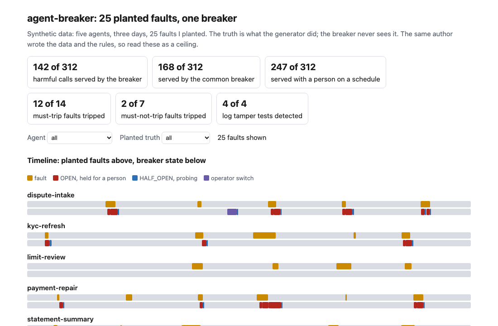
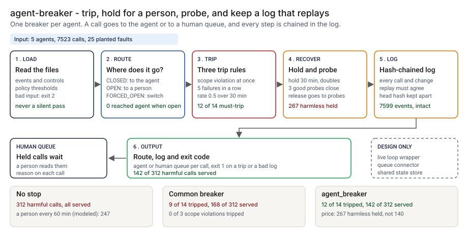
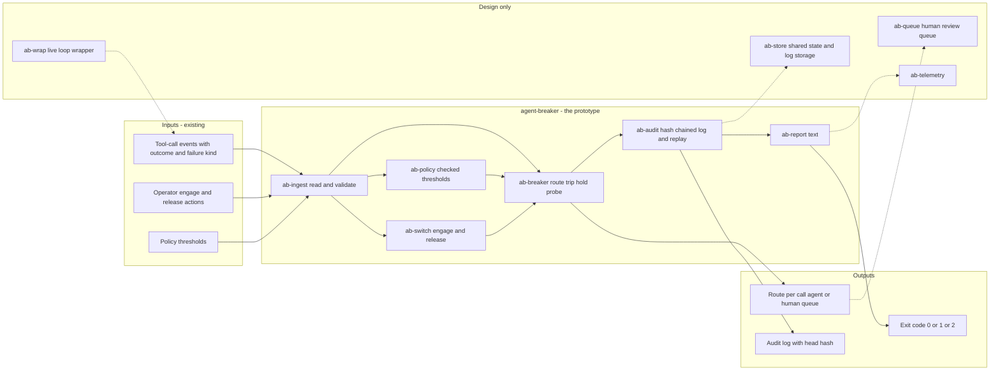
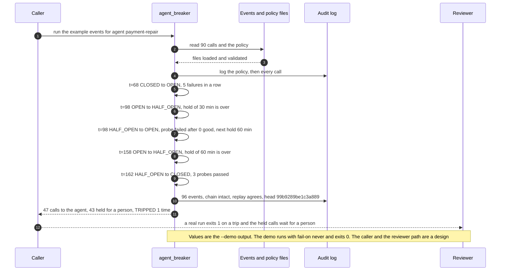

# 🔌 agent-breaker: a circuit breaker for an agent

**I wanted to know what it takes for an agent to stop itself: trip when it fails, hold its cases for a person, test the way back, and leave a log that proves what happened. This is a standard-library module and command line that does that. It routes an agent's calls to a human queue on a critical failure, a run of failures or a failure rate, probes before it lets the agent back, and writes a hash-chained log that a second run can reproduce line for line.** It takes the warn and clear fractions from [25 KillSwitch](../25-killswitch-ai-fallback-drills/) (the trip rules and every other number here are mine) and the operator switch and audit chain from [27 AgentKit](../27-agentkit-reference-agent-and-playbook/), and puts them in one breaker you can wrap around any tool-calling loop.

**▶ Static demo, no install:** [open demo.html](./demo.html)

[](./demo.html)

## Executive summary (90 seconds)

**Problem.** The engineer or operations owner of an agent that calls tools in a regulated workflow at a modeled bank wants the agent to stop itself when it starts failing. Today an agent that starts failing keeps taking cases. A person sees it late, flips a switch that nothing flips back, and afterwards nobody can show what happened or why the agent was allowed back. 🟢 Across 5 agents, 7523 calls over three days and 25 planted faults, 312 calls are harmful and with no stop every one is served (`step_01_no_breaker.py`). 🟡 With a person who reads each agent's failure rate every 60 minutes, 247 of the 312 are still served. The cost is harm that continues after the failure is visible, and a second-line reader who asks how it was stopped and gets no answer.

**Product.** agent-breaker is a standard-library module and command with one breaker per agent, taken from a field in the data. It has four states: CLOSED, OPEN, HALF_OPEN and FORCED_OPEN. It trips on one failure of a critical kind (a scope violation), on 5 failures in a row, or on a failure rate of 0.5 over a 30 minute window that holds at least 10 calls, and it warns at 0.75 of the trip level without switching anything. While open, the agent's calls go to a human queue for a hold of 30 minutes. The next calls are probes, and 3 good ones close the breaker; one failed probe re-opens it with a doubled hold, capped at 240 minutes. An operator switch engages and releases, and a release goes to probes, never straight to closed. Every call, transition, warn and control goes into a hash-chained log, and `verify` replays the calls through a fresh breaker to check it. It exits 1 when the breaker tripped or the log fails, and 2 for input it cannot read. There is no model call, and every threshold except two fractions copied from 25 is my assumption.

**Measured and modeled performance.**

- 🟢 **No stop: 312 of 7523 calls are harmful and every one is served** (`step_01_no_breaker.py`).
- 🟢 **The common breaker (5 failures in a row, a fixed 30 minute hold, one probe) trips 9 of 14 must-trip faults and 2 of 7 must-not-trip faults,** and serves 168 of 312 harmful calls. It trips 0 of 3 scope violations, and 3 of its 15 closes are followed by a new trip within 15 minutes (`step_02_consecutive_count.py`, `step_03_deficiencies_exposed.py`).
- 🟢 **agent_breaker trips 12 of 14 must-trip faults** (scope violations 3 of 3, flapping 2 of 2), a median of 13 minutes after the fault starts against 18 for the common breaker, and serves 142 of 312 harmful calls (`step_04_with_breaker.py`).
- 🟢 **The price: 267 harmless calls go to the human queue against 140 for the common breaker,** which is 1.57 held per harmful call avoided against 0.97 (`step_04_with_breaker.py`).
- 🟢 **The log: 7599 events, chain intact, replay agrees, 0 calls reached the agent while the breaker was open.** Of 4 tamper tests, 3 are detected from the log alone and 4 with the stored head hash (`step_04_with_breaker.py`).
- 🟢 **Known misses:** 0 of 2 silent-error faults tripped (33 of 312 harmful calls were reported ok), 0 of 2 slow-burn faults tripped, and 0 of 2 must-trip faults on the low-volume agent tripped (`step_04_with_breaker.py`).
- 🟡 **Utility: (12/14 − 9/14) × 28 = 6 must-trip faults a year stopped that the common breaker would miss,** assuming 28 must-trip faults reach the fleet each year.
- 🔴 **Design target: a route decision for each call within 50 milliseconds.** Designed in [`ARCHITECTURE.md`](./ARCHITECTURE.md), never built or timed.

**What I would ask a head of operations to decide.** How many harmless calls the human queue should absorb to stop harm sooner. Here the breaker holds 267 against 140 for the common one. My recommendation is to adopt the critical-failure and failures-in-a-row rules as written, back-test the rate rule on one real tool-call log before setting its line, and size the queue from that log, since I set the 0.5 trip rate before looking at the stream and moving it to 0.3 on this data would be tuning to my own faults.

**Call to action.** Fork the repo. Swap `data/events.csv` for an export of your own agent's tool calls and keep the columns `t_min, agent, case_id, outcome, failure_kind`, pass your thresholds with `--policy`, and group by the `agent` field. To call it from a loop, use `Fleet.admit` and `Fleet.record` from `src/agent_breaker.py`. Make sure the export records a failure kind for the failures that must trip at once. Send findings by opening an issue: say which rule fired and on which kind of fault, not the calls themselves.

_A portfolio prototype on synthetic data. Nothing here is deployed, load-tested or used by anyone, and no real agent or queue is connected._

## Run one now

```bash
cd 43-agent-breaker/src && python3 agent_breaker.py --demo
```

It prints:

```text
agent payment-repair   90 calls: 47 to the agent, 43 held for a person
  t=68    CLOSED      -> OPEN        5 failures in a row
  t=98    OPEN        -> HALF_OPEN   hold of 30 min is over, the next calls are probes
  t=98    HALF_OPEN   -> OPEN        probe failed after 0 good, next hold 60 min
  t=158   OPEN        -> HALF_OPEN   hold of 60 min is over, the next calls are probes
  t=162   HALF_OPEN   -> CLOSED      3 probes passed
audit: 96 events, chain intact, replay agrees; 0 calls reached the agent while the breaker was open; head 99b9289be1c3a889
decision: TRIPPED 1 time
```

Standard library only, Python 3.9 or newer. To back-test your own history: `python3 agent_breaker.py run events.csv --log audit.jsonl`, then `python3 agent_breaker.py verify audit.jsonl --head <hash>`. It exits 1 when the breaker tripped (run) or the log does not check out (verify), and 2 for input it cannot read. Inside a loop:

```python
fleet = Fleet(default_policy())
rec = fleet.admit(minute, "payment-repair", "case-1")   # rec["route"] is "agent" or "human_queue"
if rec["route"] == "agent":
    fleet.record(rec, "ok")                              # or "fail", with a failure kind
```

## What the numbers say

**What it shows** (🟢 measured on synthetic data: 5 agents, 7523 calls over three days, 25 planted faults; 🟡 modeled, with the assumption named; the script is named in brackets):

- 🟢 With no stop, 312 of the 7523 calls are harmful and every one is served (`step_01`)
- 🟡 A person who reads each agent's failure rate every 60 minutes engages the switch for 6 of 14 must-trip faults, and 247 of the 312 harmful calls are still served (`step_01`; the review interval, the 0.50 line and a 120 minute hold are my assumptions in `data/model_assumptions.csv`)
- 🟢 The common breaker (5 failures in a row, a fixed 30 minute hold, one probe) trips 9 of 14 must-trip faults and 2 of 7 must-not-trip faults, and 168 of 312 harmful calls are served (`step_02`)
- 🟢 Where it fails: 0 of 3 scope violations tripped, 3 of its 15 closes are followed by a new trip within 15 minutes, and raising the count to 8 trips only 3 of 14 must-trip faults (`step_03`)
- 🟢 agent_breaker trips 12 of 14 must-trip faults (scope violations 3 of 3, flapping 2 of 2), a median of 13 minutes after the fault starts against 18 for the common breaker, and serves 142 of 312 harmful calls (`step_04`)
- 🟢 The price: 267 harmless calls go to the human queue against 140 for the common breaker, which is 1.57 held per harmful call avoided against 0.97 (`step_04`)
- 🟢 The log: 7599 events, chain intact, replay agrees, 0 calls reached the agent while the breaker was open. Of 4 tamper tests, 3 are detected from the log alone and 4 with the stored head hash (`step_04`)

## What it still gets wrong

- 🟢 **Silent errors.** 33 of the 312 harmful calls were reported ok by the agent, and the breaker tripped on 0 of the 2 silent-error faults. It reads outcomes; it cannot read whether an outcome was right (`step_04`).
- 🟢 **A slow burn.** A 0.28 failure rate sits under the trip rate: 0 of 2 tripped and 30 of 30 harmful calls were served. One of the two raised a warn, which tells a person and switches nothing (`step_04`).
- 🟢 **A quiet agent.** `limit-review` never had more than 8 calls in a 30 minute window and the rate is scored from 10, so its 2 must-trip faults were not tripped (`step_04`).
- 🟢 **Long blips look like outages.** 2 of 7 must-not-trip faults tripped, the two that fail 5 or 6 times in a row. A count of failures cannot tell them from an outage (`step_04`).
- 🟢 **The way back is strict and costly.** One failed probe re-opens the breaker with a doubled hold. 2 probe failures were not harm, one close was premature (a new trip within 15 minutes), one fault was still held when the data ended, and the breaker held 267 harmless calls (`step_04`).
- 🟢 **I did not fit the trip rate.** I set 0.5 before looking at the stream. At 0.3 the same run serves 123 harmful calls and holds 202 harmless ones, better on both counts, but moving it now would be tuning to my own data (`step_04` prints the sweep). Most trips came from the count of failures in a row (10), then critical failures (3), and only 2 from the rate.
- **The chain is not a signature.** Anyone who can rewrite the whole file can build a consistent chain. A cut at an event boundary passes unless you kept the head hash somewhere else, which `step_04` shows (detected with the head, not without it). The replay catches a forged story with valid hashes; it does not catch a forged policy unless you pass `--policy`.
- **It is a back-test as shipped.** On a recorded history, a held call still has its recorded outcome in the file; the breaker never sees it and the log says so. `admit` and `record` allow one call in flight per agent. Wiring it into a live loop, timing out a call that never returns, and running it across processes are not built.
- **The test set and the rules share an author.** I planted the faults and wrote the rules, so the numbers are a ceiling for these rules on this stream, not a rate on real traffic. The set includes cases the rules should miss and cases that could raise a false alarm, and both are printed.

## How the four steps fit

| Step | Question | Script |
|---|---|---|
| 1 | What does the agent meet with an operator switch and a person on a schedule? | `step_01_no_breaker.py` |
| 2 | What does the common failures-in-a-row breaker stop? | `step_02_consecutive_count.py` |
| 3 | Where does it fail, and what stays unfixed? | `step_03_deficiencies_exposed.py` |
| 4 | What do critical path, rate window, backoff, probes and a replayable log add? | `step_04_with_breaker.py` |

Run any of them from `src/`. Data is produced by [`data/_generate.py`](./data/README.md); `tools/check_repo.py` confirms that a rerun reproduces every file and that the green numbers above appear in a script's output. The planted truth (which calls did harm, which faults must trip) comes from the generator; the rules in `agent_breaker.py` never read it.

## Utility delivered

The way I price product impact: **utility = (my solution − current state of the art) × the number of people or items it affects.**

Here the item is a must-trip fault: an episode in which an agent should have been stopped. Each one lands on the owner of the agent, the people whose cases the agent was handling, and the second-line reader who asks how it was stopped. The common basic approach is a breaker that trips on 5 failures in a row; the table prices this breaker against it.

| Term | Value | Where it comes from |
| --- | --- | --- |
| Current state of the art (5 failures in a row, a fixed 30 minute hold, one probe), must-trip faults tripped | 🟢 **9 of 14** | `step_02_consecutive_count.py`; it serves 168 of 312 harmful calls and sends 140 harmless calls to the human queue |
| My solution (agent_breaker), must-trip faults tripped | 🟢 **12 of 14** | `step_04_with_breaker.py`; it serves 142 of 312 harmful calls and sends 267 harmless calls to the human queue |
| Lift per must-trip fault | 🟢 12 of 14 minus 9 of 14 | The common breaker trips 0 of 3 scope violations, where agent_breaker trips 3 of 3 (`step_03_deficiencies_exposed.py`, `step_04_with_breaker.py`). The price is more held calls: 1.57 per harmful call avoided against 0.97 |
| Number it affects: must-trip faults reaching the fleet in a year | 🟡 **28** | **Assumption, not a statistic.** Replace it with your own count of episodes a year in which an agent should have been stopped |
| Assumption that makes the lift real | 🟡 The export records a failure kind, and a person works the human queue | If the export carries no failure kind, the critical rule has nothing to read and the scope violations stay missed: 🟢 0 of 3 tripped by the common breaker (`step_03_deficiencies_exposed.py`) |
| **Utility** | 🟡 **(12/14 − 9/14) × 28 = 6 must-trip faults a year stopped that the common breaker would miss** | Assumes the 28 behave like the 14 planted ones |

Sensitivity to the count assumption (🟡, same lift): 14 a year gives 3, 28 gives 6, 56 gives 12.

🔴 What I have not measured: what a harmful call costs, what a held call costs the people who work the queue, how long a probe takes in a live loop, or how often a real fleet has a fault. The planted set is dense on purpose, 312 of 7523 calls are harmful (`step_01_no_breaker.py`); a real fleet sees far fewer. Treat the result as a property of this mix of faults, not a forecast.

---

## Architecture and call flow

Component names match [`ARCHITECTURE.md`](./ARCHITECTURE.md). GitHub renders the diagrams natively.



**System topology:**



**Per-run sequence** (the `--demo` run, one agent, 90 calls):



**Interlocks (all red, designed, none built):**

- [25 KillSwitch](../25-killswitch-ai-fallback-drills/) is where the warn and clear fractions come from. They are copied into `data/policy.csv`; this folder does not import or read its files.
- [27 AgentKit](../27-agentkit-reference-agent-and-playbook/) holds the operator switch and audit chain this puts in one breaker. Wrapping its reference agent in `ab-wrap` is a design; no code here reads it.
- [08 OversightOps](../08-oversightops-hitl-workflow/) is a possible home for the human queue (`ab-queue`), so held calls arrive as tasks with a reviewer.
- [05 AgentWatch](../05-agentwatch-agent-observability/) watches an agent's outcomes in production. Its feed could supply the events; the breaker acts on them and does not monitor.

---

## PM artifacts

The PM artifacts that show how I would run this product if I owned the seat. This README is the walkthrough; the rest of the folder holds:

- [`PRD.md`](./PRD.md): the product requirements doc, with users, backlog, KPIs, rollout and open questions.
- [`ARCHITECTURE.md`](./ARCHITECTURE.md): the systems doc, with components, data model, security, failure behavior and operations. A design, not deployed.
- [`demo.html`](./demo.html): clickable, no-install walkthrough, built from the step outputs by `src/_build_demo.py`.
- [`data/`](./data/): the synthetic call stream, the planted faults and truth, the policy and assumptions, and the seeded generator. `data/README.md` explains how the truth is set.
- [`src/`](./src/): `agent_breaker.py`, `common.py`, the four step scripts and the demo builder.
- [`tests/`](./tests/): 60 unittest tests, including a golden test that pins the numbers above and tests for bad input and hostile strings.

Run the four steps end to end:

```bash
cd src
python3 step_01_no_breaker.py
python3 step_02_consecutive_count.py
python3 step_03_deficiencies_exposed.py
python3 step_04_with_breaker.py
```

---

## Aligned to

The [NIST AI Agent Standards Initiative](https://www.nist.gov/artificial-intelligence/ai-agent-standards-initiative) (page read 2026-10-24). It sets out three pillars: industry-led standards, community-led open protocols, and research into agent authentication, identity and security evaluation. It names no stop, hold or logging requirement and no threshold, so this prototype is aligned in direction only: a runtime control for an agent and an evidence trail that can be checked. Every number in `data/policy.csv` is my assumption except the warn and clear fractions, which come from [25](../25-killswitch-ai-fallback-drills/data/policy.csv). It is a prototype, aligned to that direction. It makes no claim of conformity to that guidance.

## Data and limits

Synthetic, seeded, byte-for-byte reproducible. Nothing comes from any employer, customer or real agent. The agents, the faults and the harm are made up by `data/_generate.py`. Credibility tags: 🟢 measured by a script in this folder, 🟡 modeled with the assumption named, 🔴 hypothetical. A prototype on synthetic data, not a production case study.

## Fork it

Keep the five columns of `events.csv` (`t_min`, `agent`, `case_id`, `outcome`, `failure_kind`) and point `run` at an export of your own agent's tool calls, with `--policy` for your thresholds. Group by the `agent` field, not by naming. Read the [PRD](./PRD.md) for the scope I held to.

## Prereqs to run this on your laptop

You need Python 3.9 or newer and nothing else. The module, the four step scripts and the data generator use only the standard library, so there is nothing to install. There is no API key, no network call and no model call anywhere in the folder, and no agent is connected: the calls are recorded rows. To run the tests, use `python3 -m unittest discover -s tests` from this folder. The production pieces in [`ARCHITECTURE.md`](./ARCHITECTURE.md) (the live-loop wrapper, the human queue connector, shared state and log storage, telemetry) are a design, not something you need or can run.

## Author

**Vijay Saharan**, Sr Product / Program Manager · AI in BFSI · Enterprise AI Platforms

[LinkedIn](https://www.linkedin.com/in/vijaysaharan/)
