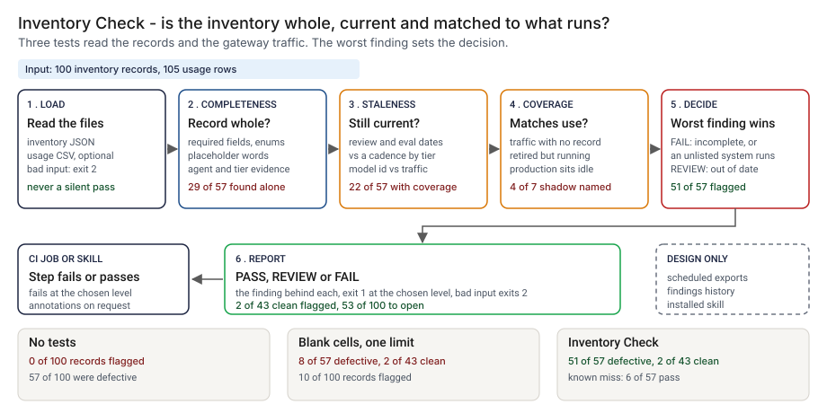

# Architecture: Inventory Check

> **Status.** This is the design for a production shape. The repo implements the product mechanic as a prototype: a command, `src/inventory_check.py`, that reads an inventory of generative and agentic AI systems and an optional gateway usage export, runs completeness, staleness and coverage tests and prints PASS, REVIEW or FAIL with the finding behind each, run here over 100 synthetic records and 105 usage rows. A skill that wraps it is staged in `skill/` and has not run in an agent harness. Nothing below is claimed as deployed or load-tested. Where a figure is a design target, it says so.

GCP is primary; AWS and Azure sit beside it.



---

## 1. Logical architecture

Inventory Check is a function between an inventory and a reviewer: records, usage rows and an as-of date in, findings and a decision out. It judges no system's safety and calls no model.

Eight components: six decide the outcome, two support or report.

| Component | Responsibility | Language or framework | Decides the outcome? | Stateful? |
| --- | --- | --- | --- | --- |
| `ic-ingest` | Loads both files. Rejects an empty, truncated, wrong-type, binary or deeply nested file and a bad `--as-of` with a one-line message. | Python 3.9+, standard library. Prototype: `load_inventory`, `load_usage`, `parse_date` in `src/inventory_check.py` | Yes, by refusing: exit 2 | No |
| `ic-config` | Field list, legal values, placeholder words, cadence by tier, idle and quiet windows. Changes by review only. | A reviewed config file (design). Prototype: `REQUIRED`, `ENUMS`, `PLACEHOLDERS`, `CADENCE_DAYS`, `IDLE_DAYS`, `RETIRED_QUIET_DAYS` | Yes, config | Stateful, in git |
| `ic-completeness` | Required fields, legal values, placeholders, agent fields, evidence owed at the tier. | Python. Prototype: `check_record` | Yes | No |
| `ic-staleness` | Review and evaluation dates against the cadence; model id against traffic. | Python. Prototype: `check_dates`, `check_model` | Yes | No |
| `ic-coverage` | Unlisted traffic, retired systems running, production systems idle. | Python. Prototype: `check_traffic`, `check_unlisted` | Yes | No |
| `ic-decide` | Worst severity wins; maps it to an exit code at `--fail-on`. | Python. Prototype: `decide`, `RANK`, `run_check` | Yes | No |
| `ic-report` | Prints text or annotations, names tests that did not run, escapes untrusted strings. | Python. Prototype: `render`, `notes_for`, `escape_annotation`, `show` | No | No |
| `ic-skill` | Tells an agent how to run the command and read the exit status. | An Agent Skill, staged in `skill/inventory-check/SKILL.md`, not installed | No | No |

Three more pieces are design only and appear in the README diagram: `ic-feed`, scheduled exports; `ic-record`, a history of findings and who read them; and `ic-telemetry`, off the decision path.

**What decides the outcome.** The input check, config, the three test families and the decision. The rest carry or record it. A PASS means the record passed these rules, not that the inventory is right.

**Repo structure** (production shape):

```
inventory-check/
├── check/      # ingest, completeness, staleness, coverage, decide, report
├── config/     # fields, cadences, windows, placeholder words, by pull request
├── skill/      # agent skill
├── feed/       # scheduled exports of inventory and usage
├── record/     # findings history writer
├── infra/      # terraform for gcp, aws, azure
├── docs/runbooks/
└── tests/      # unit, golden, hostile strings
```

---

## 2. Physical and deployment architecture

The check is one short-lived job that runs when the inventory changes and when a usage export lands.

| Component | GCP (primary) | AWS | Azure | Why |
| --- | --- | --- | --- | --- |
| Check job (`ic-ingest` to `ic-report`) | Cloud Build step or Cloud Run job | CodeBuild step or ECS Fargate task | Azure Pipelines step or Container Apps job | Stateless, one pass, runs where the inventory file is changed |
| `ic-feed` | Cloud Scheduler plus a Cloud Run job | EventBridge plus a Fargate task | A timed Container Apps job | The exports must be fresh |
| Files a run used | Cloud Storage, versioned | S3, versioned | Blob Storage, versioned | The exact bytes a finding used stay retrievable |
| `ic-record` | Cloud SQL for PostgreSQL | RDS for PostgreSQL | Azure Database for PostgreSQL | The platform team already runs it |

**Failure behavior (the decision that matters most).** The check must never silently pass. A missing, empty, malformed or wrong-type input does not become PASS: it ends the run with exit 2 and a one-line reason, even with `--fail-on never`. A run without a usage file says which tests did not run.

| Failure | Behavior | Alert |
| --- | --- | --- |
| Inventory missing, empty, not a JSON list, truncated, binary or deeply nested; usage file malformed; bad `--as-of` | Exit 2, one line on stderr | P3 |
| Record with a wrong-type or blank field, or a duplicate `system_id` | Findings, not a crash; a duplicate is a FAIL | P4 |
| No usage file given | Output says which tests did not run | P4 |
| Usage rows match no inventory id | Output says to check that both files use the same identifiers | P3 |
| Usage export stale (design) | Coverage is reported as not run, never PASS on old traffic | P2 |
| Findings history down (design) | The decision and exit code stand; the record queues locally | P3 |

**Latency.** The prototype is one pass over two small files; I have not timed it. 🔴 Design target: a result within 5 minutes of an inventory change or a usage export landing.

Recovery is a re-run from the same versioned files, as-of date and config.

---

## 3. Data architecture

| Entity | Key | What it holds | Real columns in the prototype |
| --- | --- | --- | --- |
| System record | `system_id` | One AI system: owners, kind, status, tier, model, dates, conditional evidence | `data/inventory.json`: the 13 required fields (`system_id`, `name`, `kind`, `status`, `business_owner`, `technical_owner`, `risk_tier`, `purpose`, `provider_type`, `model_id`, `data_class`, `customer_facing`, `last_reviewed`); conditionally `tools`, `permission_scope`, `human_approval`, `evaluation_ref`, `last_evaluated`, `independent_review_date`, `fallback_plan` |
| Usage row | `system_id`, `model_id` | One row per system and model id | `data/usage.csv`: `system_id`, `model_id`, `first_seen`, `last_seen`, `calls` |
| Finding | `system_id`, test, kind, field | Severity (fail or review) and a message | In memory; step 4 writes `src/out/step_04_systems.csv` |
| Run record | `run_id` | Design: as-of date, file hashes, config version, tool version, decision, counts by test | Prototype: `src/out/step_04_summary.json` |
| Planted truth | `system_id` | The case planted and the class it deserves | `data/inventory_truth.csv`, `data/shadow_truth.csv`. Exists only because the data is synthetic |

**Retention** is a design choice; confirm it against the bank's own schedule. Run records and findings: 🔴 7 years design default, with a retention lock. The files a run used: the same period.

**Lineage.** A finding names the system, test and field; the run record names the as-of date, both file hashes and the config version; the versioned store returns those bytes; and the rules are deterministic (the clock is not read when an as-of date is passed), so re-running `check` reproduces the findings.

**Deliberately not stored.** Prompts, responses and call content. The usage export holds counts, dates and ids only.

---

## 4. Security architecture

**Identity and roles.** The job runs under the platform's workload identity. `ic:runner` reads both files and writes run records; `ic:approver` approves a change to the field list, cadences or placeholder words, never their own (model risk with the inventory owner); `ic:auditor` reads findings, run records and config history.

**Secrets.** The tool holds none and never calls a model, so no vendor key is in its path. The job uses workload identity, with no static keys. If an agent harness runs the skill, paths and flags are passed as arguments, not interpolated into a shell string.

**Data classification and what leaves the boundary.** The inventory holds owner codes, purposes and model ids; the usage export holds ids and counts. Treat both as internal and confirm against the bank's own policy. In the prototype nothing leaves the machine; in the design the exit code, annotations and record write leave the job.

| Threat | Example | Mitigation in the design |
| --- | --- | --- |
| Hostile string in a system id, model id or purpose echoed into a log, annotation or report line | A `system_id` holding a newline and text that looks like a workflow command | `escape_annotation` follows the GitHub escaping rules; `show` cuts long values. `tests/test_cli.py` covers a hostile system id, hostile report values, a hostile usage id and lone surrogates |
| A record deleted to hide a system | The record of a running system removed | Traffic with no record is a FAIL under coverage, when a usage export is given |
| A shadow system hides behind a listed id | Calls under a listed system's id on the same model | The tool cannot see it; 🟢 3 of 7 shadow systems stay unnamed (`step_03_deficiencies_exposed.py`). A gateway contract tying an id to a key is the design answer |
| Placeholder and date gaming | A word the list lacks; a review date refreshed in bulk | A reviewed placeholder list and a named reviewer on each date change; 🟢 6 of 57 defective records pass today (`step_04_with_checks.py`) |
| Config changed to make a finding go away | A cadence lengthened | Pull request with a different approver; each run stores the config version |

---

## 5. Operational architecture

**SLIs.** Decisions per level per week; FAIL findings by kind; inventory age; usage export age; share of usage rows matched to a record; time to clear a finding; input rejections. Prototype baseline on clean synthetic records: 🟢 2 of 43 flagged (`step_04_with_checks.py`).

**SLOs (all 🔴 design targets, none measured).**
- A result within 5 minutes of an inventory change or a usage export landing.
- The usage export refreshed at least daily.
- Every FAIL finding read by a named person within one business day (planning estimate).
- 99.9 percent of runs recorded.

**Alerts.** P2: an unregistered system seen in traffic, or the usage export stale for more than a day. P3: repeated input rejections, or usage rows that match no record. P4: a weekly digest of REVIEW findings.

**Runbooks** (one page each, in `docs/runbooks/`):
- `unregistered-system.md`: find the owner of the traffic, register it or stop it.
- `review-overdue.md`: ask the business owner for a review; record the date and reviewer.
- `model-changed.md`: confirm the move to a new model id; update the record and its evaluation.
- `changing-a-cadence.md`: propose, re-run the planted set, compare with the golden numbers, approve.

**On-call and ownership.** The inventory owner owns the config, findings and runbooks; the model risk team approves cadences; the gateway team owns the usage export. Nobody is paged for a REVIEW.

**Change control.** The field list, cadences, windows and placeholder words are versioned in the repo. A change needs a different approver, and the planted set is re-run against `tests/test_golden.py`, so a change that moves the flagged count shows in the diff.

---

## 6. Alignment and posture

Alignment, not certification. The README's "Aligned to" section cites one source, restated with the same wording about what was read: [SR 26-2, Revised Guidance on Model Risk Management](https://www.federalreserve.gov/supervisionreg/srletters/SR2602.htm) (Federal Reserve, OCC and FDIC, April 17, 2026). I read the letter and its attached guidance ([PDF](https://www.federalreserve.gov/supervisionreg/srletters/SR2602a1.pdf)) on 2026-10-23 and took two things. Footnote 3 says generative AI and agentic AI models are not within the scope of the guidance, and says a bank's own risk management and governance practices should guide the controls for them. The Model Inventory section says an effective inventory holds enough information to understand model risk for each model and in aggregate, and names no required fields and no review frequency.

- **What the design does.** It tests an inventory of the systems the guidance leaves out, as a design for a bank's own practice, and records what ran.
- **What it does not claim.** The field list, the cadences and every window are mine. I did not map it clause by clause. It makes no claim of conformity to that guidance, holds no certification, and I have not read or mapped any other source.

---

## 7. What is deliberately not here

- **Novel placeholders.** 🟢 Three defective records carry a placeholder the word list does not hold, such as "see wiki", and pass (`step_04_with_checks.py`).
- **Bulk-refreshed review dates.** 🟢 Three defective records carry a date refreshed in bulk, with the last real review long before, and pass (`step_04_with_checks.py`).
- **Quarterly processes.** 🟢 Two clean records are flagged because a process that runs once a quarter looks idle (`step_04_with_checks.py`).
- **Shadow systems the export cannot name.** 🟢 Three of the 7 stay unnamed: one sends no system id and two send theirs under a listed system's id (`step_03_deficiencies_exposed.py`).
- **Truth outside the file.** Whether an owner still works at the bank, whether a purpose is true, or whether a model id in the export is the one the vendor served.
- **Real inventories.** Real fields are messier than mine, the share found will be lower, and a real usage export is not complete. The field list and every number are my assumptions.
- **Running a skill in a harness, hosting, or a model call.** Out of scope.

---

## Appendix: sample contract

The call is the prototype's own; the `--demo` output is under "Run one now" in the README.

```bash
python3 inventory_check.py check inventory.json --usage usage.csv --as-of 2026-09-30 --fail-on fail --format text
```

A record is a JSON object with the fields named in section 3. A usage row is `system_id,model_id,first_seen,last_seen,calls`. Exit status: 0 below `--fail-on`, 1 at or above it, 2 for bad input.
