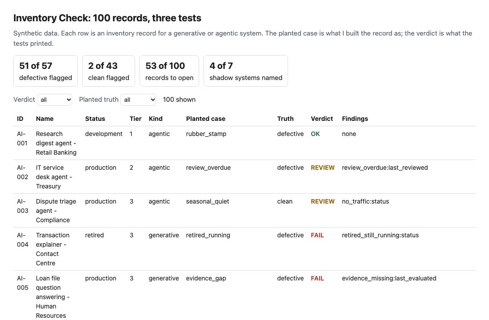
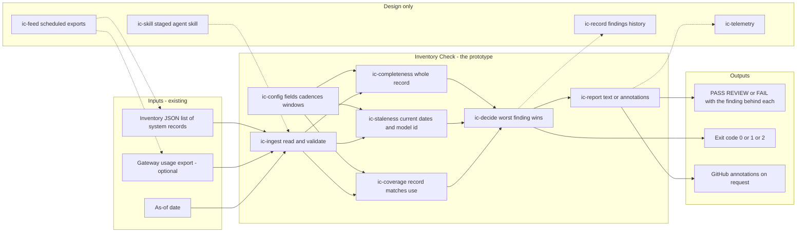
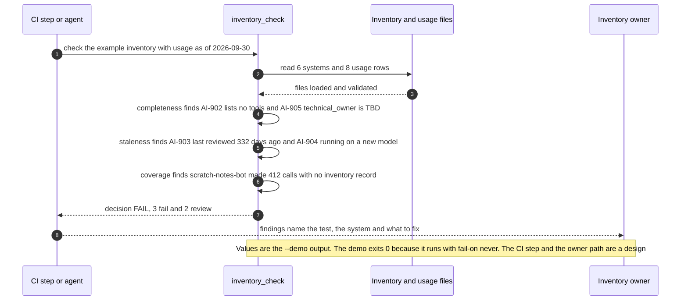

# 📋 Inventory Check: completeness, staleness and coverage tests for an inventory of generative and agentic systems

**I wanted to know whether the inventory of a bank's generative and agentic systems can be tested the way code is tested, because the current federal model risk guidance places those systems outside its scope. This is a command-line tool and a staged agent skill: it reads an inventory file and, if you have one, a model-gateway usage export, and prints PASS, REVIEW or FAIL with the finding behind each.** It takes its risk tiers and evidence-by-tier idea from [11 TierGate](../11-tiergate-ai-usecase-intake/), its stale-evidence idea from [16 ControlMap](../16-controlmap-ai-obligation-crosswalk/) and its command-line shape from [28 Tool Schema Drift](../28-tool-schema-drift/). I read their data and wrote my own code.

**▶ Static demo, no install:** [open demo.html](./demo.html)

[](./demo.html)

Tags: 🟢 measured (a script in this folder prints the number), 🟡 modeled (the assumption is named), 🔴 hypothetical.

## Executive summary (90 seconds)

**Problem.** The person who owns the inventory of AI systems at a modeled bank, and the model risk reviewer who relies on it, keep records of generative and agentic systems by hand, because the current federal model risk guidance places those systems outside its scope. A record can be blank, stale or missing, a system can run for months with no record, and nobody tests the file. 🟢 In 100 synthetic records, 57 are defective, 21 of the 35 production records at tier 3 or 4 among them, and with no tests 0 of 100 are flagged for a reviewer (`step_01_no_test.py`). 🟢 Seven shadow systems carry 85916 of 4167034 calls in the usage export, 2.1% of the traffic (`step_01_no_test.py`). The cost is a reviewer who finds a gap by reading the row, or when an incident forces the question.

**Product.** Inventory Check is a command, with a staged agent skill around it, that reads an inventory file and, if you have one, a model-gateway usage export, and prints PASS, REVIEW or FAIL with the finding behind each. Completeness: every required field is present and legal, no placeholder word stands for a value, an agentic system lists its tools, permission scope and human approval, and a production system carries the evidence its tier requires. Staleness: the last review and evaluation are inside the cadence for the tier (365, 270, 180 and 90 days), and the recorded model id matches recent traffic. Coverage: traffic from a system with no record is a FAIL, a retired system still running or a production system with no traffic is a finding. The decision is the worst finding. It exits 1 at the level you choose (FAIL by default) and 2 for input it cannot read, and without a usage file it says which tests did not run. There is no model call; every test is a plain rule, and the field list and every number are my assumptions.

**Measured and modeled performance.**

- 🟢 **No tests: 57 of 100 records are defective and 0 of 100 are flagged.** 21 of the 35 production records at tier 3 or 4 are defective (`step_01_no_test.py`).
- 🟢 **The common check, a blank-cell filter plus one 365-day review limit, flags 10 of 100 records,** finds 8 of 57 defects, and 2 of its flags are harmless (`step_02_blank_cells.py`).
- 🟢 **Each part fails alone:** completeness tests find 29 of 57 defective records, staleness and coverage 22 of 57, and without the usage file the tool finds 39 of 57; requiring all 20 columns on every row flags 41 of 43 clean records (`step_03_deficiencies_exposed.py`).
- 🟢 **Together: 51 of 57 defective records flagged and 2 of 43 clean ones,** 25 of 27 look-alike clean records left alone, and a person opens 53 of 100 records instead of all 100 (`step_04_with_checks.py`).
- 🟢 **The usage export names 4 of the 7 shadow systems,** and reports the traffic with no system id without attributing it (`step_04_with_checks.py`).
- 🟢 **Known misses:** 6 of 57 defective records pass, 3 with a placeholder the word list does not hold and 3 with a bulk-refreshed review date; 2 of 43 clean records are flagged; 3 of 7 shadow systems stay unnamed (`step_04_with_checks.py`, `step_03_deficiencies_exposed.py`).
- 🟡 **Utility: (51/57 − 8/57) × 114 = 86 defective records found that a blank-cell check would miss,** assuming 114 defective records in the inventory.
- 🔴 **Design target: a result within 5 minutes of an inventory change or a usage export landing.** Designed in [`ARCHITECTURE.md`](./ARCHITECTURE.md), never built or timed.

**What I would ask a head of operations to decide.** Whether a system that calls a model and has no inventory record should fail the bank's own governance check. I set it to FAIL as my policy, not as a measurement. My recommendation is to adopt the unlisted-system and placeholder rules as written, run the staleness rules as advisory REVIEW findings on one real inventory first, and set the cadences with the model risk team, since none of the four review limits comes from a rule.

**Call to action.** Fork the repo. Swap `data/inventory.json` and `data/usage.csv` for your own exports and keep the field names, or point `check` at two files from your estate. To change the cadence, edit `CADENCE_DAYS` at the top of `src/inventory_check.py`; to call it from code, import `check` and `decide` from that file. Make sure the gateway logs a system id and a model id on every call and that the inventory uses the same ids. Send findings by opening an issue: say which test fired and on which kind of record, not the inventory itself.

_A portfolio prototype on synthetic data. Nothing here is deployed, load-tested or used by anyone, and the skill is staged and has not run in an agent harness._

## Run one now

```bash
cd 44-inventory-check/src && python3 inventory_check.py --demo
```

It prints:

```text
inventory: 6 systems as of 2026-09-30; 8 usage rows
  [fail  ] AI-902             agent_field_missing    agentic system lists no `tools`, so what it can do cannot be reviewed
  [review] AI-903             review_overdue         last reviewed 2025-11-02 (332 days ago); tier 3 cadence is 180 days
  [review] AI-904             model_changed          traffic last seen 2026-09-27 ran on vendor-a-small-2026-08; the record says vendor-a-small-2026-03
  [fail  ] AI-905             placeholder_value      `technical_owner` is TBD, a placeholder and not a value
  [fail  ] scratch-notes-bot  unregistered_system    scratch-notes-bot made 412 calls from 2026-07-14 to 2026-09-28 and has no inventory record
decision: FAIL (3 fail, 2 review)
```

Standard library only, Python 3.9 or newer. To check your own files: `python3 inventory_check.py check inventory.json --usage usage.csv --as-of 2026-09-30`. It exits 1 on FAIL, so a CI step fails; `--fail-on review` is stricter and `--format github` prints annotations. Without `--as-of` it measures age from today's date, so pass one when you want a repeatable result. Without `--usage` it says which tests did not run.

## What the numbers say

**What it shows** (🟢 measured on synthetic data: 100 planted inventory records and 105 usage rows; the script is named in brackets):

- 🟢 With no tests on the inventory, 57 of 100 records are defective, 21 of the 35 production records at tier 3 or 4 among them, and 0 are flagged for a reviewer (`step_01`)
- 🟢 Seven shadow systems carry 85916 of 4167034 calls in the usage export, 2.1% of the traffic (`step_01`)
- 🟢 The common check, a blank-cell filter plus one 365-day review limit, flags 10 of 100 records, finds 8 of 57 defects, and 2 of its flags are harmless (`step_02`)
- 🟢 Completeness tests alone find 29 of 57 defective records, staleness and coverage alone find 22 of 57, and without the usage file the tool finds 39 of 57 (`step_03`)
- 🟢 Requiring every one of 20 columns on every row flags 41 of 43 clean records, because generative systems have no tools to list (`step_03`)
- 🟢 All three tests together flag 51 of 57 defective records and 2 of 43 clean ones, leave 25 of 27 look-alike clean records alone, and send a person to 53 of 100 records instead of all 100 (`step_04`)
- 🟢 The usage export names 4 of the 7 shadow systems, and reports the traffic with no system id without attributing it (`step_04`)

**What I assumed** (🟡 modeled, in [`data/README.md`](./data/README.md)): the longest gap between reviews by tier (365, 270, 180 and 90 days), the idle window for a production system (90 days) and the quiet window for a retired one (30 days). None of them comes from a rule.

## What it still gets wrong

- 🟢 Six of the 57 defective records pass (`step_04` prints each one). Three carry a placeholder the word list does not hold, such as "see wiki". Three carry a review date refreshed in bulk, which looks current and is not.
- 🟢 Two of the 43 clean records are flagged: production processes that run once a quarter look idle. Nothing in the record says so, so the idle test cannot know (`step_03`, `step_04`).
- 🟢 Three of the 7 shadow systems stay unnamed: one sends calls with no system id and two send theirs under a listed system's id on the same model (`step_03`).
- **The test set and the rules share an author.** I planted the changes and wrote the tests, so 51 of 57 shows the rules cover what I planted. The set includes cases built to be missed and cases built to look wrong, and I kept the quarterly false alarm in on purpose. Treat the result as a ceiling for these rules, not a rate on a real inventory, which I have not tested.
- A PASS means the record passed these rules. It does not mean the inventory is right. The tool cannot tell whether a named owner still works at the bank, whether a purpose statement is true, or whether a model id in the export is the one the vendor actually served.
- The usage tests need a gateway that logs a system id and a model id on every call, and the same ids in the inventory. When no usage row matches an inventory id, the tool says so.
- The inventory is read as JSON, and enum values are case-sensitive. The field list is mine.
- 🔴 Hypothetical: a real inventory has messier fields than this set, and the share of defects the tests find there will be lower. I have not run it on one.

## Use it as a skill

[`skill/inventory-check/SKILL.md`](./skill/inventory-check/SKILL.md) is a staged Agent Skill that tells an agent how to run the command, how to read the exit status, how to report findings by test and what to say it cannot see. It has not been installed or run inside an agent harness. What is tested is the command it wraps and the skill's frontmatter (`tests/test_skill.py`, 81 tests in all).

## How the four steps fit

| Step | Question | Script |
|---|---|---|
| 1 | What is wrong in an inventory nobody tests? | `step_01_no_test.py` |
| 2 | What does a blank-cell check with one review limit catch? | `step_02_blank_cells.py` |
| 3 | Where does each part fail alone, and what does a stricter sheet cost? | `step_03_deficiencies_exposed.py` |
| 4 | What do completeness, staleness and coverage catch together? | `step_04_with_checks.py` |

Run any of them from `src/`. Data is written by [`data/_generate.py`](./data/README.md); the check in `tools/check_repo.py` confirms that a rerun reproduces every file and that the green numbers above appear in a script's output. Read the [PRD](./PRD.md) for the scope I held to.

## Utility delivered

The way I price product impact: **utility = (my solution − current state of the art) × the number of people or items it affects.**

Here the item is a defective inventory record: one that is blank, stale, wrong or missing for a system that runs. Each one lands on the inventory owner, the model risk reviewer who relies on the file, and whoever is asked about the system after an incident. The common basic approach is a blank-cell filter with one review limit; the table prices the tests against it.

| Term | Value | Where it comes from |
| --- | --- | --- |
| Current state of the art (no blank cell in 13 required columns, reviewed within 365 days), defective records flagged | 🟢 **8 of 57** | `step_02_blank_cells.py`; it also flags 2 of 43 clean records and never reads the usage file |
| My solution (completeness, staleness and coverage), defective records flagged | 🟢 **51 of 57** | `step_04_with_checks.py`; 2 of 43 clean records flagged |
| Lift per defective record | 🟢 51 of 57 minus 8 of 57 | The blank-cell check finds only missing_required 6 of 6 and review_overdue 2 of 6 by planted case; it flags agent_gap 0 of 5, misclassified_kind 0 of 3 and model_changed 0 of 5 (`step_02_blank_cells.py`). The three tests flag agent_gap 5 of 5, misclassified_kind 3 of 3 and model_changed 5 of 5 (`step_04_with_checks.py`) |
| Number it affects: defective records in the inventory | 🟡 **114** | **Assumption, not a statistic.** Replace it with your own count of defective inventory records; the planted set has 57 |
| Assumption that makes the lift real | 🟡 The gateway logs a system id and a model id on every call, and the inventory uses the same ids | Without the usage file the lift falls to what the record tests alone give: 🟢 39 of 57 (`step_03_deficiencies_exposed.py`) |
| **Utility** | 🟡 **(51/57 − 8/57) × 114 = 86 defective records found that a blank-cell check would miss** | Assumes the 114 behave like the 57 planted ones |

Sensitivity to the count assumption (🟡, same lift): 57 gives 43, 114 gives 86, 228 gives 172.

🔴 What I have not measured: what a stale record costs when a review leans on it, how long a reviewer takes to clear a finding, what a false REVIEW costs, or how a real inventory differs from mine. The planted set is dense on purpose, 57 of 100 records are defective (`step_01_no_test.py`); a real inventory has far fewer. Treat the result as a property of this mix of cases, not a forecast.

---

## Architecture and call flow

Component names match [`ARCHITECTURE.md`](./ARCHITECTURE.md). GitHub renders the diagrams natively.


**System topology:**



**Per-run sequence** (the `--demo` run, 6 systems as of 2026-09-30):



**Interlocks (all red, designed, none built):**

- [11 TierGate](../11-tiergate-ai-usecase-intake/) is where the four-step risk tier and the evidence-by-tier idea come from. This folder copies the idea, not its files.
- [16 ControlMap](../16-controlmap-ai-obligation-crosswalk/) is where the stale-evidence idea comes from. Inventory Check uses the cadence as the limit itself.
- [22 ShadowScan](../22-shadowscan-unsanctioned-ai-discovery/) finds AI use from proxy and DNS logs. Its findings could feed `ic-feed` as a second source of systems with no record; nothing here reads them.

---

## PM artifacts

The PM artifacts that show how I would run this product if I owned the seat. This README is the walkthrough; the rest of the folder holds:

- [`PRD.md`](./PRD.md): the product requirements doc, with users, backlog, KPIs, rollout and open questions.
- [`ARCHITECTURE.md`](./ARCHITECTURE.md): the systems doc, with components, data model, security, failure behavior and operations. A design, not deployed.
- [`demo.html`](./demo.html): clickable, no-install walkthrough, built from the step outputs by `src/_build_demo.py`.
- [`data/`](./data/): the synthetic inventory, the usage export, the planted truth and the seeded generator. `data/README.md` explains how the truth is set.
- [`src/`](./src/): `inventory_check.py`, `common.py`, the four step scripts and the demo builder.
- [`tests/`](./tests/): 81 unittest tests, including a golden test that pins the numbers above and tests for bad input and hostile strings.
- [`skill/inventory-check/`](./skill/inventory-check/SKILL.md): the staged agent skill. Not installed, not run in an agent harness.

Run the four steps end to end:

```bash
cd src
python3 step_01_no_test.py
python3 step_02_blank_cells.py
python3 step_03_deficiencies_exposed.py
python3 step_04_with_checks.py
```

---

## Aligned to

[SR 26-2, Revised Guidance on Model Risk Management](https://www.federalreserve.gov/supervisionreg/srletters/SR2602.htm) (Federal Reserve, OCC and FDIC, April 17, 2026). I read the letter and its attached guidance ([PDF](https://www.federalreserve.gov/supervisionreg/srletters/SR2602a1.pdf)) on 2026-10-23, and took two things from them. Footnote 3 says generative AI and agentic AI models are not within the scope of the guidance, and says a bank's own risk management and governance practices should guide the controls for them. The Model Inventory section says an effective inventory holds enough information to understand model risk for each model and in aggregate, and in that section it names no required fields and no review frequency. So this project is a design for a bank's own practice on the systems the guidance leaves out. I did not map it clause by clause.

It is a prototype, aligned to that reading. It makes no claim of conformity to that guidance.

## Data and limits

Synthetic, seeded, byte-for-byte reproducible. Nothing comes from any employer, customer or real bank, and every system name, owner code and model id is invented. A prototype on synthetic data, not a production case study.

## Fork it

Swap `data/inventory.json` and `data/usage.csv` for your own exports and keep the field names, or skip the data and point `check` at two files from your own estate. If your inventory lives in a spreadsheet, export it to a JSON list with one object per system; list fields such as `tools` become JSON arrays. Change the cadence by editing `CADENCE_DAYS` at the top of `src/inventory_check.py` (and the same table in `data/_generate.py` if you rewrite the data), and say so wherever you quote a result.

## Prereqs to run this on your laptop

You need Python 3.9 or newer and nothing else. The command, the four step scripts and the data generator use only the standard library, so there is nothing to install. There is no API key, no network call and no model call anywhere in the folder. To run the tests, use `python3 -m unittest discover -s tests` from this folder. The production pieces in [`ARCHITECTURE.md`](./ARCHITECTURE.md) (the scheduled exports, the findings history, telemetry, an installed skill) are a design, not something you need or can run.

## Author

**Vijay Saharan**, Sr Product / Program Manager · AI in BFSI · Enterprise AI Platforms

[LinkedIn](https://www.linkedin.com/in/vijaysaharan/)
