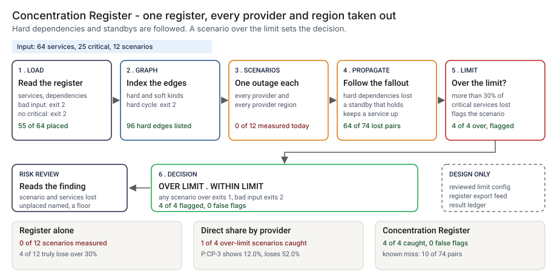

# Architecture: Concentration Register

> **Status.** This is the design for a production shape. The repo implements the product mechanic as a prototype: a command, `src/concentration_register.py`, that reads a services file and an optional dependencies file, runs one outage scenario per provider and per provider-region, follows hard dependencies and second placements, and prints the critical services lost next to a direct count, run here over a 64-service synthetic register. Nothing below is claimed as deployed or load-tested. Where a figure is a design target, it says so.

GCP is primary; AWS and Azure sit beside it.



---

## 1. Logical architecture

Concentration Register is a function between a register of services and a reviewer: two files and a limit in, a table and an exit code out. It does not discover placements, call a cloud account or call a model.

Six components decide the outcome (one as config), two report or record it.

| Component | Responsibility | Language or framework | Decides the outcome? | Stateful? |
| --- | --- | --- | --- | --- |
| `cr-ingest` | Loads both files. Rejects bad input with a one-line message. | Python 3.9+, standard library. Prototype: `load_services`, `load_deps` | Yes, by refusing: exit 2 | No |
| `cr-graph` | Indexes hard and soft edges and rejects a cycle among hard dependencies. | Python. Prototype: `make_register` | Yes, by refusing: exit 2 | No |
| `cr-scenarios` | One scenario per provider and per provider-region seen as a primary or a standby. | Python. Prototype: `scenarios_for`, `hit` | Yes | No |
| `cr-propagate` | Placement hit and no second placement survives, then every hard dependent. | Python. Prototype: `lost_set` | Yes | No |
| `cr-verdict` | Counts critical services lost, compares with the limit, sets the exit code. | Python. Prototype: `analyze`, `over_limit`, `run_check` | Yes | No |
| `cr-report` | Prints the table or JSON. Escapes control characters in names. | Python. Prototype: `render`, `clean`, `--format json` | No | No |
| `cr-limits` | The limit and scenario scope, changed by review (design). Prototype: `--limit-pct` | Reviewed config in git | Yes, config | Stateful, in git |
| `cr-ledger` | One record per run (design). Prototype analog: `src/out/step_04_scenarios.csv` | PostgreSQL and object storage (design) | No | Stateful |

**What decides the outcome.** The input and cycle checks, the scenarios, the propagation rule and the limit. The report and the ledger carry or record it. The tool reads the register as given: a placement is true, a listed standby takes over, a missing dependency is absent.

**Repo structure** (production shape):

```
concentration-register/
├── register/   # ingest, graph, scenarios, propagate, verdict, report
├── limits/     # limit and scope config, by pull request
├── sync/       # export adapters (design)
├── ledger/     # result record writer
├── infra/      # terraform
├── docs/runbooks/
└── tests/      # unit, golden (planted-register numbers), hostile (injection strings)
```

---

## 2. Physical and deployment architecture

One short-lived process, run after a register export lands or on a weekly schedule. There is no server to keep warm.

| Component | GCP (primary) | AWS | Azure | Why |
| --- | --- | --- | --- | --- |
| Run process | Cloud Run job | ECS Fargate task | Container Apps job | Stateless, one pass |
| Register export store | Cloud Storage, versioned | S3, versioned | Blob Storage, versioned | Keeps the bytes a result used |
| `cr-limits` | A file in the risk repo | Same | Same | Limit changes share history with results |
| `cr-ledger` | Cloud SQL for PostgreSQL | RDS for PostgreSQL | Azure Database for PostgreSQL | Already run by the platform team |

**Failure behavior (the decision that matters most).** The tool must never silently pass. A file it cannot read does not become WITHIN LIMIT: it exits 2 with a one-line reason, and a register with gaps prints its gaps.

| Failure | Behavior | Alert |
| --- | --- | --- |
| Services file missing, empty, truncated or malformed | Exit 2, one line naming the file and line | P2 if repeated, else P3 |
| Unknown service, self-dependency or hard cycle in the dependencies | Exit 2 with the reason | P3 |
| No critical service in the file | Exit 2: nothing to measure | P3 |
| No dependencies file, or no rows | The run goes on and the output says no dependency was followed. In the design a scheduled run fails instead | P3 |
| A critical service has no provider or region | Named under `unplaced`; the figures are a lower bound | P3 when the count rises |
| A standby shares the primary's provider and region | Listed in the output | P4 |
| Ledger or telemetry unavailable (design) | The result stands; the record queues locally and the gap is listed | P3 |

**Latency.** The prototype is untimed. 🔴 Design target: a result within 10 minutes of a register export landing.

Recovery is a re-run from the same versioned export and limit.

---

## 3. Data architecture

| Entity | Key | What it holds | Real columns in the prototype |
| --- | --- | --- | --- |
| Service | `service_id` | Criticality, primary placement, resilience, standby placement | `data/services.csv`: `service_id`, `name`, `owner_type`, `criticality`, `provider`, `region`, `resilience`, `standby_provider`, `standby_region` |
| Dependency | `service_id`, `depends_on` | Whether the target is hard or soft | `data/dependencies.csv`: `service_id`, `depends_on`, `kind` |
| Scenario | `P:<provider>` or `R:<provider>/<region>` | Derived by `scenarios_for`, never supplied | None |
| Scenario result | `scenario`, run | Direct and effective counts, critical total, over-limit flag, services lost | `analyze` fields such as `effective_critical`, `over_limit`, `effective_ids`. Prototype: `src/out/step_04_scenarios.csv` |
| Planted truth | `scenario_id`, `service_id` | True placements, unlisted dependencies | `data/truth_*.csv`. Exist only because the data is synthetic |

**Retention** is a design choice, not a measurement; confirm each value against the bank's own record-retention schedule. 🔴 Design default: result records and the limit used for 7 years, in PostgreSQL archived to object storage with a retention lock; the register exports a result used for as long as the result, in versioned storage, so it can be reproduced.

**Lineage.** A flagged scenario traces back in three hops: the record names the limit and the hash of both files; the versioned store returns those bytes; and the propagation is deterministic (no clock, locale or random draw), so re-running `lost_set` reproduces the lost services. The prototype lists which services are lost, not the path that took each one down.

**Deliberately not stored.** Cloud account identifiers, credentials, network addresses, contract terms and service data.

---

## 4. Security architecture

**Identity and roles.** The tool runs under the platform's workload identity and has no user account of its own.

Four roles: `cr:runner` reads the export and `cr-limits` and writes a result record (the scheduler's identity); `cr:approver` approves a limit or scope change, never for their own flagged scenario (third-party risk reviewer); `cr:auditor` reads results, exports and config history (internal audit); `cr:admin` manages roles, buckets and the ledger (platform engineering lead).

**Secrets.** The tool holds none and calls no cloud account or model. Store and ledger access is by workload identity, with no static keys.

**Data classification and what leaves the boundary.** A list of which critical services share a provider is a map of where the estate is weakest, so treat the register and results as confidential. In the prototype nothing leaves the machine. In the design three things leave the job: the exit code, the result table and the ledger write.

| Threat | Example | Mitigation in the design |
| --- | --- | --- |
| Hostile string in a service id or name echoed into output | A `name` holding a newline and text that looks like a command | `clean` escapes control characters and truncates long values. `tests/test_cli.py` covers a hostile name, criticality and dependency id |
| The register is edited to hide a concentration | A `provider` changed, a `hard` edge deleted, a criticality lowered | Versioned exports; the ledger stores both hashes; a diff of two exports lists changes for the owner to confirm |
| The limit is raised to make a flag go away | `--limit-pct` moved from 30 to 50 | The limit lives in `cr-limits`, changes by pull request with a different approver, and each result stores it |
| A standby is claimed and never works | `resilience` set to `warm_standby` with no drill | The tool cannot see this. The design adds a tested-failover field |

---

## 5. Operational architecture

**SLIs.** Scenarios over the limit per register per run (prototype baseline: 🟢 4 of 12 scenarios truly over 30%, `step_01_status_quo.py`); critical services with no placement (prototype: 🟢 3 of 25, `step_01_status_quo.py`); input rejections; export age; time to result.

**SLOs (all 🔴 design targets, none measured).**
- A result within 10 minutes of an export landing.
- Every flagged scenario read by a named person within one business day (planning estimate).
- 99.9 percent of results written to the ledger.

**Alerts.** P2: repeated input rejections on one register, or the ledger down over a day. P3: a scenario newly over the limit, more unplaced critical services, or a changed hash for a finished run. P4: a weekly digest of shared-placement standbys.

**Runbooks** (one page each, in `docs/runbooks/`):
- `over-limit-scenario.md`: read the services lost, then move a service, add a standby or accept the risk in writing.
- `unplaced-critical.md`: find each owner and get the placement into the register.
- `register-rejected.md`: read the reason, fix the export, re-run.
- `changing-the-limit.md`: propose, re-run the planted register, compare, approve.

**On-call and ownership.** The register owner owns the runner, export and runbooks. The platform owner owns the dependency list and standby claims. The third-party risk reviewer approves limit changes. Nobody is paged for a flag.

**Change control for rules and thresholds.** Rules and the limit are versioned in the repo. A change needs a proposer and a different approver. Before merge, the planted register is re-run and compared with the numbers pinned in `tests/test_golden.py`, so a change that moves the flagged count shows in the diff.

---

## 6. Alignment and posture

Alignment, not certification. The README's "Aligned to" section cites one source, restated with the same wording about what was read: the interagency [Guidance on Third-Party Relationships: Risk Management](https://www.federalreserve.gov/supervisionreg/srletters/SR2304.htm) (SR 23-4, issued 7 June 2023). I read the text as published in the Federal Register on 9 June 2023 ([govinfo copy](https://www.govinfo.gov/content/pkg/FR-2023-06-09/html/2023-12340.htm)) on 24 October 2026, through a fetch tool that answers questions about the page, so I checked only the passages this project leans on, not the whole document. Among the factors a bank weighs, the guidance lists dependence on a single provider for several activities and the geographic location of subcontractors. It names no numeric concentration limit.

- **What the design does.** It turns a register into a per-scenario count of critical services lost, so dependence on one provider or region becomes a figure a reviewer can read, with the limit stated as an assumption.
- **What it does not claim.** It makes no claim of conformity to the guidance and assesses no real subcontractor. I have not read or mapped any other source.

---

## 7. What is deliberately not here

- **Capacity and recovery time.** The model is binary and static: a service is up or lost. There is no capacity check on a standby, no recovery time, no availability zone and no shared control plane.
- **Anything outside the register.** A shared DNS or payment network is invisible unless it is a row. 🟢 The register here omits 6 hard dependencies the generator plants, and 10 of the 74 lost pairs are missed (`step_04_with_register_model.py`).
- **A way to know a standby works.** The generator plants a non-working standby that the tool counts as working. The tested-failover field is not built.
- **A way to fill a blank placement.** Three critical services have no placement and sit outside every scenario.
- **A limit from the guidance.** The 30% limit is mine. The guidance I read names no number.
- **Hosting, a model call, or a rate on a real bank.** The author wrote both the world and the rules, so the numbers are a ceiling for these rules.

---

## Appendix: sample contract

```bash
python3 concentration_register.py check services.csv --deps dependencies.csv --limit-pct 30 --format json
```

The JSON carries `limit_pct`, `over`, `unplaced_critical`, `standby_same_placement` and a `scenarios` list; each scenario holds `scenario`, `direct_critical`, `effective_critical`, `critical_total`, `over_limit` and `effective_ids`. Exit status: 0 when no scenario is over the limit, 1 when one is, 2 for bad input.
